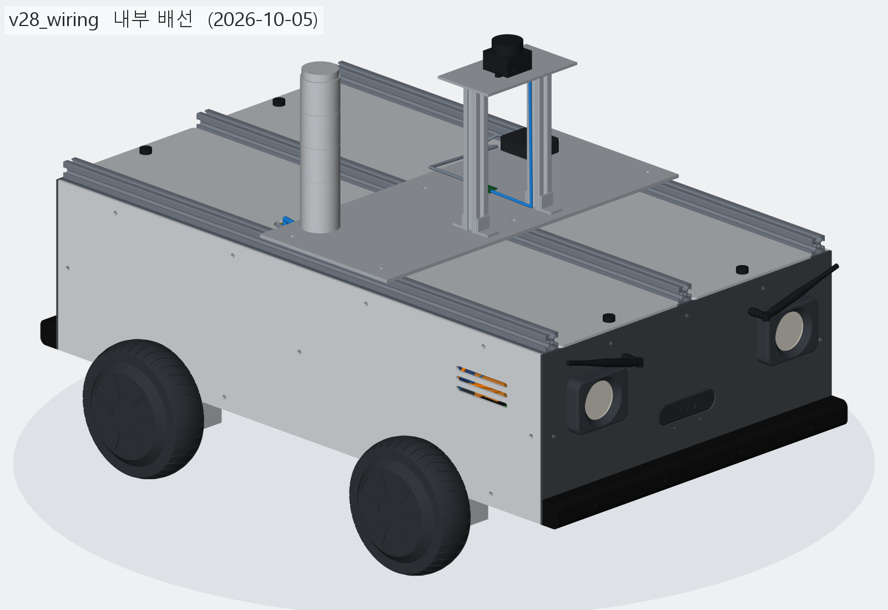

# 누비 (NUBI)

**Modular Autonomous Rover** — 주변을 인식하고 스스로 길을 찾아가는, 모듈형 자율주행 로봇 누비.



누비는 호버보드 허브모터 4개로 움직이는 스키드 스티어 로봇입니다. 알루미늄 프로파일 차체 위에 모듈
레일을 두고 센서 모듈, 적재함, 로봇팔 같은 것을 바꿔 다는 것을 목표로 합니다. 차체는 Python 코드
(build123d)로 설계하고, 바퀴는 ESP32가 호버보드 원래 보드를 통해 굴리며, 인식과 경로 계획은 Jetson Orin
Nano가 맡습니다.

> *NUBI is a modular four-wheel skid-steer rover built from hoverboard hub motors. The chassis is designed in
> code with build123d, an ESP32 drives the stock hoverboard motor boards, and a Jetson Orin Nano handles
> perception and planning. Documentation is written in Korean.*

## 특징

- **코드로 설계한 차체** — 버전 v00 ~ v29를 폴더 하나씩 남겼습니다. 버전마다 이미지 · BOM · 간섭 검사 결과가
  기록되고, 이전 버전과 바뀐 곳을 그림으로 비교합니다. STEP은 명령 한 번으로 다시 만듭니다.
- **호버보드 부품을 그대로 쓰는 구동계** — 호버보드 원래 모터 보드에 오픈소스 펌웨어(RoboDurden
  Gen2.x)를 올리고, ESP32가 클램프 · 램프 · 데드맨 · 워치독 같은 안전장치와 좌우 믹싱을 맡습니다.
- **실제 형상으로 도는 웹 시뮬레이터** — 차체 버전의 메시를 그대로 불러와 주행, 센서 사각지대, 전복각,
  비상정지 방식, 자율주행(점유 격자 + A*)을 브라우저에서 확인합니다.
- **구조해석** — 휠 클램프를 Gmsh + CalculiX로 해석해 형상을 골랐습니다.
- **처음부터 남긴 기록** — 2026-07-27 첫 설계부터 작업 일지 36편, 설계 결정 D-01 ~ D-21, 실패 기록까지
  같은 양식의 Markdown으로 남겼습니다.

## 현재 상태 (2026-10)

| 영역 | 상태 |
| --- | --- |
| 차체 설계 | v28(내부 배선 90가닥)까지 검증 · 기록 완료. 전체 830 × 590 × 534 mm, 약 34 kg(시뮬레이터 추정). v29(배선을 바닥판 위 직각 경로로) 진행 중 |
| 부품 | 국내 구매처 기준 BOM, 단가 확인된 합 약 264만 원 |
| 시제품 | 호버보드 허브모터 4륜 프레임 조립. 바퀴를 띄운 상태로 4륜 회전 확인 |
| 바퀴 제어 | ESP32 펌웨어 동작 (USB 시리얼 명령, Wi-Fi 조종 페이지, 안전장치). 탱크 모드는 지상 주행 전 |
| 시뮬레이터 | 사각지대 · 전복 · 비상정지 방식 비교 · 복도 27 m 자율주행까지 추정 |
| 상위 제어 | 깊이 카메라 장애물 가드(RDK), 초파리 전뇌 시뮬레이션 폐루프 주행(Jetson) 실험 |
| 자율주행 (실기) | ROS 2 · SLAM · 내비게이션은 다음 단계 |

## 시스템 구성

```
상위 컴퓨터   Jetson Orin Nano — 인식 · 판단 · 경로 계획
   │  USB 시리얼 115200, 텍스트 명령 (s / t / x / m / w / h …)
   ▼
바퀴 제어기   LOLIN D32 (ESP32) — 안전장치 · 좌우 믹싱 · Wi-Fi 조종 페이지
   │  UART 19200 8N1 ×2 (앞축 · 뒤축), 명령 9 B / 텔레메트리 22 B, CRC16-XMODEM
   ▼
모터 보드     호버보드 2세대 분리형 보드 ×4 (RoboDurden Hoverboard-Firmware-Hack-Gen2.x)
   │  3상 + 홀센서
   ▼
구동         6.5" BLDC 허브모터 ×4, 스키드 스티어
```

| 항목 | 부품 (차체 설계 기준) |
| --- | --- |
| 컴퓨터 | NVIDIA Jetson Orin Nano |
| 센서 | 뎁스 카메라 Orbbec Gemini 336 ×2 (앞 · 뒤), 2D 라이다 LDROBOT STL-19P, IMU iAHRS, GNSS GPS630 |
| 전원 | 36 V 10S 20 Ah 배터리, 12 V · 5 V 변환기 |
| 안전 | 비상정지 버튼 → DC 컨택터로 바퀴 쪽 전원만 차단, ESP32 데드맨 · 워치독 |
| 차체 | 3030 알루미늄 프로파일, 상부 2020 모듈 레일 ×3 |

계층별 책임, 인터페이스, 각 부품을 고른 이유는
[docs/architecture/system-overview.md](docs/architecture/system-overview.md)에 있습니다.

## 저장소 구조

```
NUBI/
├── docs/
│   ├── worklog/           작업 일지(월별)와 주제별 기록 — 2026-07-27부터
│   ├── architecture/      시스템 구성, 계층 간 인터페이스
│   ├── decisions/         여러 계층에 걸친 설계 결정
│   ├── guides/            셋업 · 운용 방법
│   ├── references/        데이터시트, 외부 자료
│   └── assets/            문서용 이미지
├── hardware/
│   ├── vehicle/           차체 설계 — build123d 모델 v00 ~ v29, 결정 기록 D-NN,
│   │                      부품 조사, 웹 시뮬레이터, 구조해석
│   └── electrical/        차체 모델 밖의 전장 문서 (핀맵, 회로도)
├── firmware/
│   ├── wheel-controller/      LOLIN D32 (ESP32) 바퀴 제어기
│   └── hoverboard-mainboard/  호버보드 메인보드 빌드 설정
├── software/ros2_ws/      ROS 2 Humble 워크스페이스 (예정)
├── sim/                   ROS 2용 시뮬레이션 (예정)
├── tools/                 PC 쪽 개발 · 분석 도구
├── data/                  데이터 — 원본은 git에 올리지 않음
└── experiments/           날짜별 실험과 프로토타입
```

폴더마다 무엇을 어떻게 두는지 적은 README가 있습니다.

## 시작하기

아래 명령은 Windows(PowerShell)와 Python 3.12 기준입니다. 가상환경(`.venv`)은 git에 없으므로 폴더마다
한 번 만듭니다.

### 차체 설계 보기

```powershell
cd hardware\vehicle
py -3.12 -m venv .venv
.venv\Scripts\python.exe -m pip install -r requirements.txt

# 뷰어를 띄워 두고 (http://127.0.0.1:3939)
.venv\Scripts\python.exe -m ocp_vscode
# 다른 터미널에서 버전 하나를 다시 짓기 (형상 · 검증 · STEP · 이미지)
# 휠 모터 STEP이 필요합니다 — hardwareehicle
efmodel\README.md 참고
.venv\Scripts\python.exe models\vehicle\record.py v28_wiring --rebuild
```

자세한 내용은 [hardware/vehicle/SETUP.md](hardware/vehicle/SETUP.md)와
[버전 규칙](hardware/vehicle/models/vehicle/README.md)에 있습니다.

### 웹 시뮬레이터

차체 버전을 한 번 지은 뒤(위의 `record.py`) 실행합니다.

```powershell
cd hardware\vehicle
.venv\Scripts\python.exe models\vehicle\sim\web_export.py v28_wiring
.venv\Scripts\python.exe models\vehicle\sim\web\serve.py 8748
```

브라우저에서 http://localhost:8748 을 엽니다. 조작과 화면 설명은
[시뮬레이터 README](hardware/vehicle/models/vehicle/sim/README.md)에 있습니다.

### 바퀴 제어기 펌웨어

```powershell
cd firmware\wheel-controller
py -3.12 -m venv .venv
.venv\Scripts\python.exe -m pip install -r requirements.txt

# Wi-Fi 조종 페이지 비밀번호는 저장소에 없습니다. 예시를 복사해 직접 정합니다 (8자 이상)
copy include\wifi_config.example.h include\wifi_config.h

.\pio.cmd run                   # 빌드
.\pio.cmd run -t upload         # 빌드 + 플래시
.\hoverctl.cmd                  # 마우스 조종 패널
```

배선, 명령 목록, 안전장치는 [wheel-controller README](firmware/wheel-controller/README.md)에 있습니다.
실제 바퀴를 돌리기 전에 바퀴를 바닥에서 띄우고, 클램프(`m`) 값을 낮게 둔 상태에서 시험하세요.

## 문서

| 문서 | 내용 |
| --- | --- |
| [작업 일지](docs/worklog/README.md) | 2026-07-27부터의 모든 작업 일지와 연표, 주제별 기록(설계 이야기, 교훈, 디버깅 기록) |
| [시스템 개요](docs/architecture/system-overview.md) | 계층 구성, 인터페이스, 부품 구성, 정해야 할 것 |
| [차체 설계 결정 D-01 ~](hardware/vehicle/models/vehicle/DECISIONS.md) | 센서 · 모터 드라이버 · 배터리 · 비상정지 · 배선을 고른 이유와 버린 대안 |
| [차체 버전 표](hardware/vehicle/models/vehicle/README.md) | v00 ~ v29 버전마다 바뀐 곳과 이미지 |
| [바퀴 제어기 이슈](firmware/wheel-controller/ISSUES.md) | 열린 문제와 우선순위 |
| [구조해석](hardware/vehicle/models/hoverboard_mount/FEA.md) | 휠 클램프 FEA 파이프라인과 결과 |

## 지금까지의 흐름

| 날짜 | 무엇 | 기록 |
| --- | --- | --- |
| 2026-07-27 ~ 28 | 첫 설계. 알루미늄 프로파일 프레임, 구동계 검토 끝에 호버보드 6.5" 허브모터로 정함 | [7월 일지](docs/worklog/2026-07.md) |
| 07-28 ~ 08-05 | 스워브(조향 바퀴) 구동을 검토하다 접고, 고정 브라켓 + 3030 프로파일로 | [7월](docs/worklog/2026-07.md) · [8월](docs/worklog/2026-08.md) 일지 |
| 08-07 ~ 08-27 | 휠 마운트 제작. 실물 PETG 브라켓 파손 분석(08-12) → 하부 클램프 Design D, FEA 파이프라인 | [8월 일지](docs/worklog/2026-08.md) |
| 08-09 | 바퀴 제어기(ESP32) 첫 커밋. 호버보드 메인보드 UART 링크 | [8월 일지](docs/worklog/2026-08.md) |
| 09-10 ~ 09-15 | 전체 차량 뷰어, 형상 기반 BOM | [9월 일지](docs/worklog/2026-09.md) |
| 09-17 ~ 09-22 | 탱크 모드 · 데드밴드, RDK 장애물 가드, Jetson 초파리 뇌 폐루프 주행, 메인보드 커스텀 펌웨어 | [9월 일지](docs/worklog/2026-09.md) |
| 10-04 ~ 10-05 | 차체 재설계 v01 ~ v29: 실외 외관, 실부품 선정(D-01 ~ D-21), 웹 시뮬레이터, 내부 배선 | [10월 일지](docs/worklog/2026-10.md) |
| 10-13 | 누비 통합 저장소 | [10월 일지](docs/worklog/2026-10.md) |

## 작업 규칙

- **이름** — 폴더와 파일은 소문자 kebab-case, ROS 2 패키지는 `nubi_` + snake_case, 날짜가 붙는 것은
  `YYYY-MM-DD_` 접두어.
- **좌표계와 단위** — ROS REP-103(x 전진, y 왼쪽, z 위, 지면 z = 0). 기구는 mm, 소프트웨어는 SI 단위.
- **기록** — 작업한 날은 [docs/worklog/](docs/worklog/README.md)에 정해진 양식으로 남깁니다. 차체 설계
  결정은 `DECISIONS.md`(D-NN), 여러 계층에 걸친 결정은 [docs/decisions/](docs/decisions/README.md).
- **데이터** — rosbag, 이미지, 대용량 로그는 커밋하지 않습니다 ([data/README.md](data/README.md)).
- **커밋** — 메시지 앞에 영역을 붙입니다: `docs:` `hardware:` `firmware:` `software:` `sim:` `tools:`
  `data:` `exp:`.

AI 에이전트(Claude Code, Codex)용 규칙은 [AGENTS.md](AGENTS.md)에 있습니다.

## 출처와 라이선스

이 저장소는 2026-10-13에 개인 저장소 두 곳, 바퀴 제어기(`lolind32-wheel`)와 차체 설계(`HoverboardVehicle`)를
커밋 이력째 합쳐 만들었습니다. 통합 전 이력은 `git log 3cca93e^2`(바퀴 제어기)와 `git log 02f205d^2`(차체
설계)로 볼 수 있습니다.

외부에서 가져온 코드는 아래와 같고, 원래의 라이선스를 따릅니다.

| 대상 | 출처 |
| --- | --- |
| `firmware/wheel-controller/include/hoverserial.h`, `util.h` | [RoboDurden/Hoverboard-Firmware-Hack-Gen2.x-GD32](https://github.com/RoboDurden/Hoverboard-Firmware-Hack-Gen2.x-GD32) (GPL-3.0)에서 그대로 복사 |
| 호버보드 모터 보드 펌웨어 | 같은 프로젝트 (GPL-3.0). 이 저장소에는 바꾼 설정과 패치만 둡니다 |

재배포 조건을 확인하지 못한 외부 자료는 저장소에 넣지 않았습니다. 차체를 다시 지으려면 호버보드 6.5" 휠 모터
STEP을 따로 받아야 합니다([hardware/vehicle/refmodel/](hardware/vehicle/refmodel/README.md)).

이 저장소 자체의 라이선스는 아직 정하지 않았습니다.
