# 작업 일지 — 2026년 7월

양식과 전체 연표는 [README](README.md)에 있습니다.

| 날짜 | 영역 | 제목 |
| --- | --- | --- |
| 2026-07-27 (월) | 차체 | [프로파일 단면에서 측면 커버까지](#2026-07-27-월--차체-프로파일-단면에서-측면-커버까지) |
| 2026-07-27 (월) | 차체 | [커버 기능 요소: 후면 패널·얼굴·환기·배선·배터리 브라켓](#2026-07-27-월--차체-커버-기능-요소-후면-패널얼굴환기배선배터리-브라켓) |
| 2026-07-27 (월) | 차체 | [허브모터 배제와 구동계 재검토](#2026-07-27-월--차체-허브모터-배제와-구동계-재검토) |
| 2026-07-27 (월) | 차체 | [모터 후보 검토와 호버보드 허브모터 전환](#2026-07-27-월--차체-모터-후보-검토와-호버보드-허브모터-전환) |
| 2026-07-28 (화) | 차체 | [스워브 전환: 킹핀·벨트·서스펜션](#2026-07-28-화--차체-스워브-전환-킹핀벨트서스펜션) |
| 2026-07-28 (화) | 차체 | [외장 --\\\_\_/--, 실물 Xtion, 그리고 움직이지 않던 서스펜션](#2026-07-28-화--차체-외장---__---실물-xtion-그리고-움직이지-않던-서스펜션) |
| 2026-07-29 (수) | 차체 | [배선 길을 뚫고, 적재함을 세 번 고치고, 무게를 처음 셌다](#2026-07-29-수--차체-배선-길을-뚫고-적재함을-세-번-고치고-무게를-처음-셌다) |
| 2026-07-30 (목) | 차체 | [모듈 3종을 더 얹고, 검사기를 의심하고, 도면을 다시 뽑다](#2026-07-30-목--차체-모듈-3종을-더-얹고-검사기를-의심하고-도면을-다시-뽑다) |
| 2026-07-31 (금) | 차체 | [아웃리거·확장레일을 얹었다 걷어내고, 실물 6.5인치 바퀴로 다시 앉혔다](#2026-07-31-금--차체-아웃리거확장레일을-얹었다-걷어내고-실물-65인치-바퀴로-다시-앉혔다) |

---

## 2026-07-27 (월) · 차체: 프로파일 단면에서 측면 커버까지

> 시간: 18:11 ~ 19:56 · 장소: PC (`D:\build123d`) · 날짜 근거: 세션 기록 · 원본: 차체 설계 일지 `entry_01a.html`

모빌리티 베이스 작업의 첫날이다. 저장소에는 `example_box.py`, `mic_stand.py`, `corner_shophouse.py`, `coupler_28byj48_hex3.py` 네 모델만 있던 상태에서, T슬롯 알루미늄 프로파일을 코드로 그릴 수 있는지 확인하는 질문으로 시작해 1시간 45분(18:11\~19:56) 사이에 4륜 스키드 스티어 모빌리티 베이스의 하부 프레임, 2층 전장 베이, 라운드 측면 커버까지 갔다. 이날 만든 `models/tslot.py`(프로파일 라이브러리)와 `models/mobility_base.py`(차량 본체), 그리고 부품 간 간섭·맞댐·연결성을 부피로 검사하는 습관이 이후 작업의 기반이 됐다. 뷰어는 19:37에야 띄웠고 그 전까지는 matplotlib 선도 렌더로 형상을 확인했다.

### 한 일

#### 18:11 — T슬롯 단면 라이브러리, 5조각 분리 수정

> tslot 알류미늄 기반으로 프레임 짜는것도 가능하니? 3d로?

`models/tslot_frame.py`를 새로 써서 20/30/40 시리즈 단면 표(PROFILES)와 빔 헬퍼, 400×300×400 직육면체 프레임을 만들었다. 첫 실행은 `CommsWarning: Port could not be cast to integer`로 끝났는데, 뷰어 서버가 없어서 `show()`가 실패한 것이다. 이후 실행에서는 같은 경고가 뜨면서도 내보내기는 정상으로 끝났다.

**막힌 것**: 단면을 검사하니 빔 하나가 솔리드 5개로 나왔다. 20×20 사각형(399.99 mm²)을 필렛하고 T홈 4개를 빼고 중심 구멍을 뚫는 방식(최종 191.85 mm²)이었는데, 면이 33.79 mm² 넷과 56.71 mm²(구멍 포함, 와이어 2개) 하나로 갈라져 있었다. **원인**: 슬롯 4개를 각각 통째로 파내면 코너 기둥 4개가 중심 보스와 끊어져 섬으로 남는다 — 33.79 mm² 넷이 코너 기둥, 56.71 mm² 하나가 중심 보스다. **해결**: 실물 압출재처럼 "바깥벽(튜브) + 코너 기둥 4 + 중심 보스 + 45° 대각 리브 4"를 쌓아 올리고 슬롯 입구만 바깥벽에서 잘라내는 구성으로 `profile_face()`를 다시 짰다. 그 결과 세 시리즈 모두 면 1개·솔리드 1개·valid True 가 됐다.

| 시리즈 | 단면적 (mm²) | faces | solids |
| --- | --- | --- | --- |
| 2020 | 187.59 | 1 | 1 |
| 3030 | 384.10 | 1 | 1 |
| 4040 | 821.34 | 1 | 1 |

내부 리브를 단순화한 탓에 2020 단면적은 실물(약 163 mm²)보다 15%쯤 크다. 슬롯 입구·방 치수는 실물과 맞춰 T너트는 그대로 들어가게 했고, 이 한계는 파일 머리말에 적어 두었다. matplotlib(3.11.1)로 단면과 프레임 선도를 구워 확인했다. (현재 `models/tslot.py`의 `section()`으로 다시 계산해도 187.59 / 384.10 / 821.34 mm² 그대로다.)

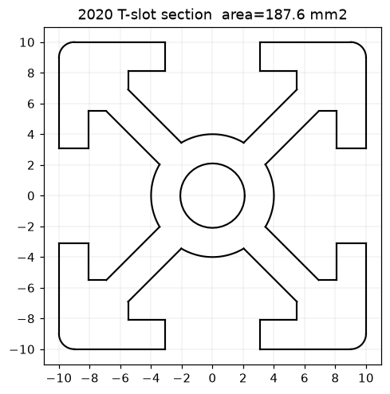

400×300×400 프레임(2020, 빔 12본)의 절단 목록은 기둥 400×4 / X가로대 360×4 / Y가로대 260×4, 합계 4.08 m, 알루미늄 약 2.07 kg. 맞댐 조인트 검사는 개별 부피 합 765,385.9 = 합집합 765,385.9 mm³로 겹침 0.000000%였다. `exports/tslot_frame.step`(2.35 MB) / `.stl`(0.92 MB)이 생성됐다. (이 두 파일은 지금도 7-27 18:36 판이 그대로 있다.)

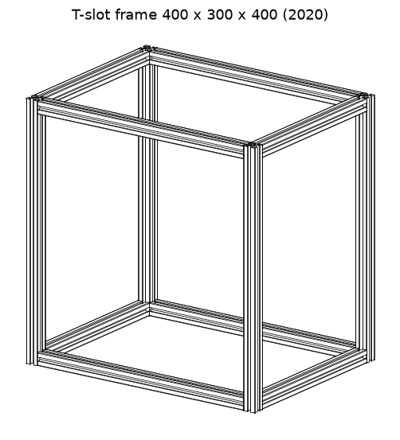

#### 18:27 — 모빌리티 베이스 하부 프레임 v1

> 실외 실내 테스트용 모빌리티 베이스를 만들어보려 하거든? 적당히 커야하는데 그 바퀴를 달 하부 프레임을 짜려고 해

구동 방식·크기·바퀴를 물었고 "4륜 스키드 스티어 / 중형 700×500 / 8인치(200 mm) 고무"로 답을 받았다. 단면 코드를 `models/tslot.py`로 분리해 두 모델이 공유하게 하고(`bar`, `cut_list`), `models/mobility_base.py`를 새로 썼다. 구성은 3030 사다리형 프레임 7본(사이드 2 + 앞뒤 크로스 2 + 축 위치 크로스 2 + 중앙 세로 1), 8 mm 모터 마운트 판 4장, 허브모터 4개(대표 형상 Ø150×55), 100 mm 격자 데크 판.

**막힌 것 1**: 첫 실행에서 전장 760 × 전폭 710이 나왔다. 마운트 판(260 mm)과 축이 프레임 밖으로 삐져나온 탓이다. 판을 프레임 끝에 맞춰 200 mm로 줄이고 볼트 X를 (30,70,110)→(25,55,85)로, 축 길이를 판 관통 지점까지로 고쳐 700 × 670 × 200으로 맞췄다. **막힌 것 2**: 간섭은 전부 OK였지만 축이 마운트 판을 딱 스치며 끝나 너트를 물릴 자리가 없었다. `AXLE_NUT = 10`(판 안쪽으로 더 나오는 길이), `AXLE_FIT = 0.3`(D컷 구멍 여유)을 추가했고 판–축 간섭은 0 mm³로 확인했다.

| 항목 | 값 |
| --- | --- |
| 전장 × 전폭 × 전고 | 700 × 670 × 200 mm |
| 축간거리 / 윤거 | 500 / 605 (비율 0.83) |
| 바퀴 / 지상고 / 데크 높이 | Ø200 / 125 / 155 mm |
| 축 | Ø14, 양면 D컷 12 mm |
| 절단 목록 (3030) | 700×2, 440×5 — 3.60 m, 약 3.73 kg |

축간거리/윤거 0.83은 스키드 스티어에서 제자리 회전 때 타이어가 덜 끌리도록 1 미만으로 잡은 값이다. 이 시점에 Claude 가 스스로 두 가지 문제를 적어 두었다: 리지드 4륜이라 실외 요철에서 대각 2륜만 닿는 순간이 생긴다는 것, 그리고 바퀴 꼭대기(200)가 데크(155\~160)보다 45 mm 높다는 것.

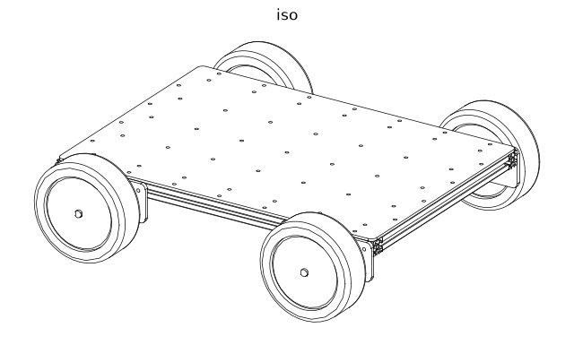

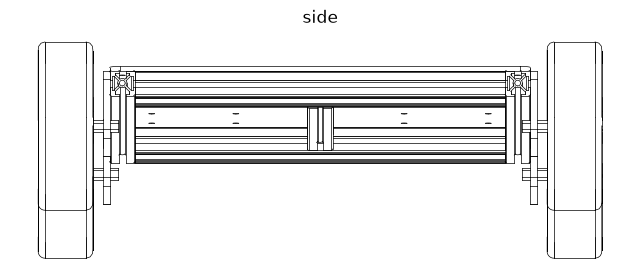

#### 19:03 — 2층 구조 (v2), 중앙 세로 빔 길이 수정

> 바퀴 꼭대기보다 데크를 높이고 내부에 배터리나 마운트, 라즈베리파이, 센서 등 적재 가능한 공간을 만들어야 할거 같아

`mobility_base.py`를 2층 구조로 다시 썼다. 1층(z 125\~155)은 기존 사다리 프레임, 그 위에 3 mm 베이 바닥판(50 mm 격자 M5), 기둥 4본(143 mm), 2층 상부 프레임, 3 mm 데크(100 mm 격자 M6). 전장 베이에는 배터리 24V 20Ah(260×170×90), 모터 드라이버 2개(100×80×35), 라즈베리파이(95×65×30), DC-DC(110×60×40), 데크 위 2D 라이다(Ø100×70) 목업을 넣어 들어가는지 봤다. 목업은 뷰어 전용이고 STEP/STL에는 들어가지 않는다.

**막힌 것**: 새로 넣은 연결성 검사(전부 fuse 한 뒤 솔리드 개수)가 "프레임 15본 → 솔리드 2개"를 뱉었다. 간섭 검사는 전부 OK였는데도. **원인**: 중앙 세로 빔 길이를 `WHEELBASE - 2*S`(440)로 잡아 축 크로스멤버 안쪽면에 양끝 15 mm씩 못 미쳐 공중에 떠 있었다. v1부터 있던 계산 실수다. **해결**: `WHEELBASE - S`(470)로 고치니 2,620,348 = 2,620,348 mm³, 솔리드 1개.

| 항목 | v2 |
| --- | --- |
| 전장 × 전폭 × 전고 | 700 × 670 × 331 mm |
| 전장 베이 | 640 × 440 × 140 (바닥 z=158, 사방 트임) |
| 데크 | 700 × 670 @ z=328, 바퀴 꼭대기보다 128 위, 0.47 m² |
| 절단 목록 | 700×4, 610×2, 470×1, 440×4, 143×4 — 6.82 m, 약 7.07 kg |
| 판재 3t / 모터마운트 | 6.56 kg / 1.34 kg |

판재가 프레임과 맞먹는 무게라는 점을 짚었다. 총 27 kg(배터리 제외)이라는 수치는 Claude 의 답변에 나오는데, 실행 출력이 잘려 있어 원문 합계 줄은 확인하지 못했다.

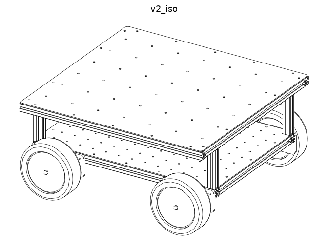

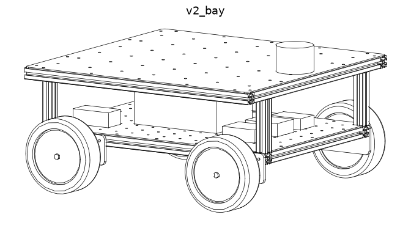

#### 19:19 — 측면 커버와 라운드 외형 (v3)

> 이번에는 측면커버등 해서 너무 각지지는 않게칼끔하게 해봐

2 mm 절곡판 측면 커버(좌/우 두 짝, 수직 밴드 + 상하 안쪽 플랜지)를 넣고 데크 R60 / 커버 R50 / 바닥판 R48로 코너 라운드를 맞췄다. 커버가 지나갈 8 mm를 확보하려고 `AXLE_GAP`을 12→25로 벌려 윤거가 605→631(비율 0.79)이 됐고, 커버 중간을 물릴 자리로 기둥 4→6본, 상부 크로스 2→3본이 됐다. 베이 바닥판을 커버 안쪽선까지 넓혀 베이가 640×440→736×546으로 커졌다.

**막힌 것**: 간섭 검사에서 "측면커버 × 프레임 5,120.3 mm³". **원인**: 커버 플랜지가 기둥 6본을 그대로 뚫고 지나갔다. **해결**: 기둥 중심 `POST_PTS`에 `POST_CUT = S + 3` 크기 구멍을 플랜지에도 파서 (바닥판과 공용) 전 조합 간섭 0으로 만들었다. 검사 스크립트 쪽에서 `'ShapeList' object has no attribute 'volume'`가 한 번 났지만 스크립트를 고쳐 넘어갔다.

결과: 전장 750 × 전폭 710 × 전고 331, 커버 740×550 높이 140(바퀴까지 8 mm 여유), 데크 750×710. 절단 목록 700×2, 690×2, 580×3, 470×1, 440×4, 143×6 — 7.61 m, 약 7.89 kg. 총 31.28 kg(배터리 제외, 19:39 실행 출력의 합계 줄로 확인). 커버 윗단과 데크 사이 30 mm 띠는 상부 프레임이 드러나는 리빌 겸 환기구로 일부러 비웠다. 렌더는 은선 제거 투영(가시 685 / 은선 5,373 에지)으로 아이소·저각·커버 분리 상태 세 장을 구웠다.

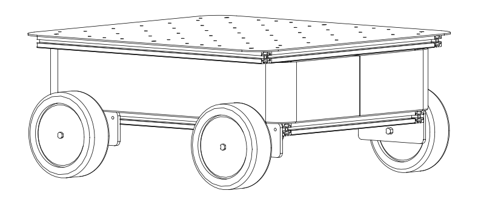

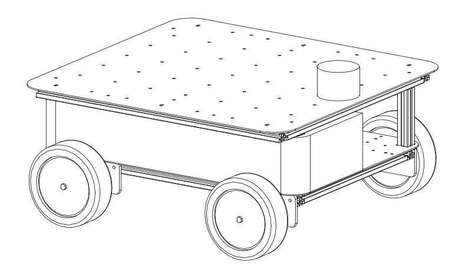

#### 19:37 — 뷰어 서버

> 뷰어 서버 켜주고 전송해주라

`.venv\Scripts\python.exe -m ocp_vscode`를 백그라운드로 띄웠고(PID 21100) 3939 포트가 열린 것을 확인했다. 브라우저 패널을 열어도 스크린샷은 "패널이 표시되지 않아 프레임을 합성하지 않는다"며 실패했고, DOM 을 뒤져 봐도 부품 라벨이 잡히지 않았다. 뷰어는 접속 중인 클라이언트에 push 하는 구조라, 브라우저 패널이 붙은 상태에서 모델을 다시 실행하니 `Using port 3939`와 전송 진행 표시가 떴고 `CommsWarning`이 사라졌다. 패널을 새로 고친 뒤 한 번 더 보내자 `CameraKeepWarning`(reset_camera=KEEP)만 남았다. DOM 에서 부품 라벨은 끝까지 잡히지 않았고 패널이 화면에 안 떠 있어 렌더 확인은 못 했다. 시스템 파이썬 쪽에도 `ocp_vscode`가 하나 더 떠 있었다(PID 15760) — 포트 충돌 후보로 적어 두었다.

#### 19:45 — 상부 프레임 축소 (v4)

> 상부 프레임이 저렇게 클 필요가 있나? 그냥 하부 프레임과 동일하게 해도 되지 않나? 상부 프로파일이 저렇게 크니까 외부에서도 잘 보이고 해서 조금 거슬려

상부 프레임을 하부와 같은 700×500으로 줄였다. 그러자 커버가 더 이상 프레임을 가로지르지 않아 커버를 데크 아랫면까지 올릴 수 있었고(높이 140→170), v3에서 남겨 둔 "윗단 30 mm 개방" 문제가 통째로 사라졌다. 플랜지 폭은 30→16으로 줄였고, 데크 치수를 커버에서 유도하도록(`DECK_L = 2*SKIRT_X + 2*DECK_LIP`, `DECK_R = SKIRT_R + DECK_LIP`) 바꿔 그림자 틈이 직선부·코너 모두 5 mm로 일정해졌다.

**막힌 것**: 간섭 검사에서 "측면커버 × 프레임 835.4 mm³". **원인**: 직선부에서는 플랜지가 프레임에 닿지 않지만 코너 라운드 구간에서 프레임 모서리가 플랜지 안으로 들어온다. (이날 대화에는 없고, 나중에 쓴 build-log 3막에 R로 둥글린 사각형이 원래 모서리를 품으려면 0.293×R 만큼 커야 한다고 정리돼 있다.) **해결**: `FRAME_CLR = 1.5`를 두고 프레임 외곽선(+여유) 크기 상자를 플랜지에서 빼는 컷을 넣어 코너에서만 잘리게 했다. 전 조합 간섭 0. 치수를 바꿔도 바로 걸리도록 assert 두 줄을 넣었다.

| 항목 | v3 | v4 |
| --- | --- | --- |
| 전폭 | 710 | 696 mm |
| 데크 | 750×710 R60 | 750×560 R55, 0.42 m² |
| 커버 높이 | 140 | 170 mm (데크까지 닫힘) |
| 상부 프레임 | 사이드 690 / 크로스 580 (레일 중심 ±305) | 700×500, 커버 안쪽 23 mm |
| 절단 목록 | 6종, 7.61 m | 700×4, 470×1, 440×7, 143×6 — 4종, 7.21 m |
| 프레임 / 판재 | 7.89 / 7.43 kg | 7.48 / 6.52 kg |
| 합계 (배터리 제외) | 31.28 kg | 30.03 kg |

표의 프레임 중량(7.89 / 7.48)과 v3 합계 31.28은 실행 출력에서 확인했다. 판재 7.43 / 6.52 와 v4 합계 30.03은 Claude 답변에만 있고 실행 출력이 "중량" 줄에서 잘려 있어 원문은 확인하지 못했다.

대신 데크가 바퀴를 덮지 않게 됐다. 적재면 0.53→0.42 m²(0.53은 750×710 계산값), 펜더가 없어 실외에서 흙탕물이 옆으로 오른다. 넓은 데크로 되돌리려면 `DECK_W = 710`으로 고정하되 105 mm 캔틸레버가 생기니 데크를 4\~5 mm로 올리거나 2020 아웃리거를 대야 한다고 정리했다.

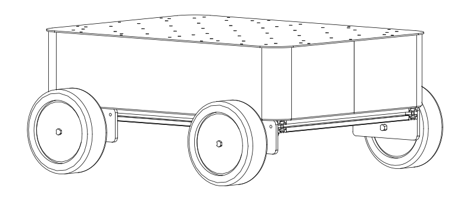

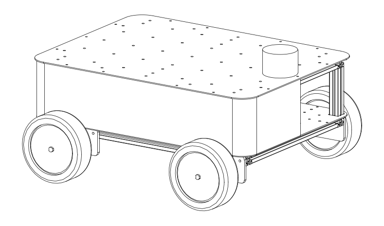

### 결정

- 구동은 4륜 스키드 스티어, 베이스 700×500, 8인치 허브모터. 선택지로 낸 차동 2륜+캐스터(실외 문턱·자갈에 캐스터가 걸림), 메카넘(실외 비포장 불가), 로커 서스펜션(프레임 복잡·중량)은 접었다.
- 프로파일은 3030(연습 프레임은 2020). 단면은 "빼기"가 아니라 "쌓기"로 그린다.
- 축간거리/윤거 비율은 1 미만(0.83→0.79)으로 유지한다.
- 상부 프레임은 하부와 같은 700×500. 커버는 데크 아랫면까지 닫고 그림자 틈 5 mm는 수식으로 고정한다.
- 허브모터·전장은 대표 형상 목업으로 두고 실물이 정해지면 `WHEEL_*`/`AXLE_*`/`MOCKUPS`만 고친다.

### 남은 일

- 밀폐된 베이의 모터 드라이버 발열 — 커버 앞뒤 면 슬롯 벤트.
- 펜더 없음(흙탕물), 배터리 고정 브라켓, 라이다/카메라 폴 마운트, 로커 서스펜션 버전.
- 허브모터 실물 치수 확정, 판재 재질·두께(`PANEL_T`) 재검토로 2\~3 kg 감량.
- 시스템 파이썬의 `ocp_vscode`(PID 15760) 정리.

### 교훈

- "안 부딪힌다"와 "붙어 있다"는 다른 검사다. 간섭 0이어도 연결성(합집합 솔리드 수)을 따로 봐야 15 mm 떠 있는 빔이 잡힌다.
- 구조를 줄이면 다른 문제가 같이 풀리기도 한다. 상부 프레임을 줄이자 커버 개방부 문제가 사라졌다.
- 라운드 커버는 사각 프레임 코너를 반드시 파고든다. 코너에서만 잘라내고 assert 로 조건을 박아 둔다.
- 뷰어는 접속 중인 클라이언트에만 push 한다. 브라우저를 먼저 열고 모델을 다시 실행해야 보인다. 뷰어 없이도 matplotlib 선도로 충분히 검사할 수 있다.

### 이후 달라진 것 (2026-09-15 기준)

이 일지는 당시 기록이다. 그 뒤 `models/mobility_base.py`는 여러 번 바뀌어 지금(2026-09-15 기준) 파라미터는 아래와 같다. `models/tslot.py`(단면적 187.59 / 384.10 / 821.34)와 `models/tslot_frame.py`(2020, 400×300×400)는 이날 값 그대로다. `exports/mobility_base.step` / `.stl`은 7-28 17:48 판(7.45 MB / 14.4 MB)으로 덮여 있어 이날 내보낸 파일은 남아 있지 않다.

| 항목 | 당시 (07-27 v4) | 현재 |
| --- | --- | --- |
| 하부 프레임 외곽 | 700 × 500 | 630 × 450 (0.90 축소) |
| 축간거리 / AXLE_GAP | 500 / 25 | 400 / 20 |
| 바퀴 | Ø200 허브모터 목업(Ø150×55) | Ø210×58 PVC 통바퀴, 구동계 미정 |
| 축 | Ø14 양면 D컷 12, AXLE_FIT 0.3, AXLE_NUT 10 | Ø20 데드 액슬(휠 내경), AXLE_FIT 0.2, AXLE_NUT 12 |
| 측면 커버 | 740 × 550 R50, 좌/우 분할 | 670 × 490 R50, 앞/뒤 분할(후면 통판에 비상정지·커넥터) |
| 데크 | 750 × 560 R55 | 680 × 500 R55 (같은 유도식) |
| DECK_LIP / SKIRT_FLANGE / FRAME_CLR / POST_CUT | 5 / 16 / 1.5 / S+3 | 같음 |
| 중앙 세로 빔 | `WHEELBASE - S` = 470 | 같은 식, 370 |

---

## 2026-07-27 (월) · 차체: 커버 기능 요소: 후면 패널·얼굴·환기·배선·배터리 브라켓

> 시간: 20:04 ~ 21:24 · 장소: PC (`D:\build123d`) · 날짜 근거: 세션 기록 · 원본: 차체 설계 일지 `entry_01b.html`

첫날 저녁 20:04\~21:24 KST 구간이다. 프레임·데크·라운드 커버까지는 앞 구간에서 서 있었고, 이 구간에서는 커버 표면에 실제 기능 요소를 올렸다 — 후면에 비상정지와 커넥터 도어, 전면에 카메라와 LED 바, 그 다음 환기·배선 관통부·배터리 고정. 중간에 ocp_vscode 뷰어 UI가 깨져 보이는 문제를 한 번 조사했고, 마지막에 도면식 렌더를 어떻게 만드는지 설명하는 것으로 끝났다. 파일은 전부 `models/mobility_base.py` 하나다.

### 한 일

#### 20:04 후면 패널 — 비상정지 + 포트 도어

> 커버 뒤쪽에 E-Stop 버튼이 들어갈 구멍과 버튼을 만들어주고 그 하단부에는 연결포트등을 꽂을 수 있는 공간과 커버를 같이 만들어주라

**막힌 것:** 기존 커버는 좌/우 두 짝으로 나뉘어 있어 분할선(y=0)이 후면 한가운데를 지났다. 비상정지와 포트를 세로 중앙에 놓을 수 없었다.

**해결:** 분할을 앞/뒤로 바꿨다. 후면이 통판이 되어 배치가 대칭으로 떨어진다. 대신 후면 커버를 떼면 배선이 딸려 나오므로 여유 루프를 두거나 중간 커넥터를 물려야 한다는 조건이 새로 생겼다.

- 비상정지: 22mm 표준 취부공 Ø22.3 + 회전방지 홈, 중심 z=272. 머리 Ø40이 커버 면에서 24mm(칼라 4 + 머리 20) 돌출. z=272는 임의값이 아니라 **몸체 뒤끝(z=289)이 상부 크로스멤버 아랫면(z=298)에 닿지 않는 최대치**다.
- 포트 도어 170×80 @ z=200, M4 4개, 커버 바깥면에서 2mm 돌출. 비상정지는 항상 눌러야 하므로 **도어 밖**에 뒀다.
- 커넥터 구멍은 별도 판 없이 2mm 커버 판에 직접 뚫었다 — 패널마운트 커넥터가 그대로 물리는 두께다.

| 포트 | 치수 | (y, z) |
| --- | --- | --- |
| 충전 커넥터 | Ø16 | (-45, 218) |
| 메인 전원 스위치 | Ø19 | (0, 218) |
| 상태 표시등 | Ø8 | (+45, 218) |
| 이더넷 RJ45 | 19×15 | (-40, 182) |
| USB-A | 14×12 | (+5, 182) |
| 예비 그로밋 | Ø12 | (+48, 182) |

검증: 커버 2조각 valid, 중심 x=-258 / +259. 후면 커버 면 수 73개(구멍이 다 뚫렸다는 뜻). 전 조합 간섭 0. 전장은 비상정지 머리 때문에 750 → **769mm**가 됐고, 머리가 데크 모서리보다 19mm 밖으로 나온다 — 벽에 긁힐 수 있으니 Ø30 머리나 가드 브라켓을 대안으로 적어 뒀다. 이 시점 내보내기 파일은 `exports/mobility_base.step` 5,735,083 B / `.stl` 11,986,984 B (20:12 KST). 현재 디스크에 있는 것은 07-28 17:48 판으로 7,450,506 / 14,376,184 B이며, `exports/`는 .gitignore 대상이라 당시 파일은 남아 있지 않다.

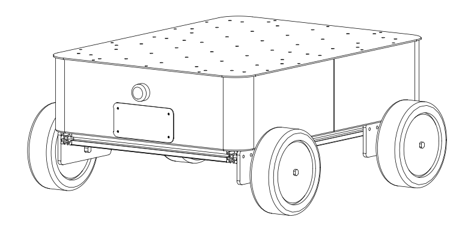

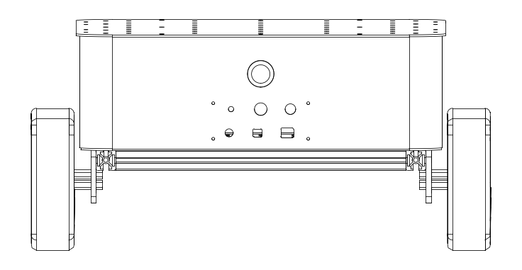

#### 20:20 앞면 얼굴 — 카메라 하나, LED 바 하나

> 차량 앞 커버에는 카메라와 led 바가 들어갈건데 말이야 귀엽게 배치해줘야해 led 가 그냥 하단에 쭉 1자로 되어있어도 되고

가운데 원형 카메라를 눈, 그 아래 양 끝이 반원인 LED 바를 입으로 읽히게 잡았다. 1차는 베젤 Ø56 / LED 400mm / 눈·입 세로 간격 31mm였고 간섭·솔리드 검사는 전부 통과했다(커버·카메라·LED 솔리드 valid, 전면 커버 면 58개, 전 부품 조합 간섭 없음). 그런데 선도 렌더를 보니 **눈이 너무 작고 입이 얼굴 전체를 가로질러** 표정이 안 나왔다. 세 값을 고쳤다.

|  | 1차 | 수정 |
| --- | --- | --- |
| 카메라 베젤 | Ø56 | **Ø76** |
| LED 바 길이 | 400 | **320** |
| 눈·입 간격 | 31 | **20** |

- 카메라: 베젤 링 Ø76(6mm 돌출) + 렌즈 배럴 Ø30 + 커버 안쪽 몸체 26×40×40. 커버에 렌즈공 Ø32와 M3 4개(PCD 60). 카메라 중심 z=262, 몸체 z 242\~282라 상부 크로스멤버(298) 아래로 들어간다.
- LED 바: 중심 z=196, 320×16 슬롯에 T 단면 디퓨저. 안쪽 플랜지 344×34가 걸려 빠지지 않는다. 틈 0.6mm.
- 카메라·LED 솔리드 valid. 부품군 12개 **66쌍 간섭 0**. 전면 커버 면 58개는 1차 검사에서 확인한 값이고, 수정 뒤에는 간섭 검사만 다시 돌렸다(면 수는 구멍 개수가 같으니 변하지 않는다). 전장 769 → 770mm(베젤 6mm 돌출, 기준은 여전히 뒤 비상정지 24mm) — 이 770은 1차 실행 때 이미 나온 값이다.

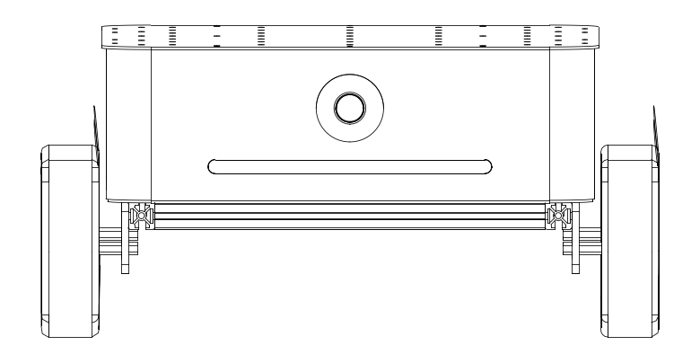

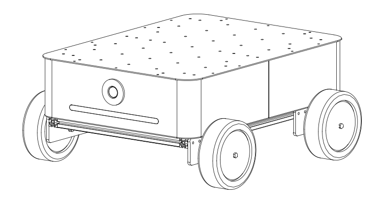

#### 20:32 뷰어 UI 깨짐 조사 — 서버가 아니라 브라우저 캐시

> 뷰어가 이렇게 왼쪽 위에 버튼이나 아래 트리에서 버튼등이나 제대로 로딩이 안된거마냥 안보이거든? 뷰어를 다시 시작해야하나?

재시작 전에 뭐가 안 불러와졌는지부터 봤다. 포트를 보니 3939를 잡은 것은 시스템 파이썬 프로세스(PID 15760, `Python312\python.exe -m ocp_vscode`)였고 venv에서 띄운 21100은 포트 없이 따로 떠 있었다. Claude 쪽 브라우저 패널의 콘솔에는 에러가 없었고 `Small view, collapsing tree`가 6번 찍혀 있어 패널을 1600×950으로 키워 봤다(사용자 브라우저와는 별개 창이라 결론은 못 냈다). venv에는 `ocp_vscode 4.0.0`이 있었고, 시스템 파이썬에서 `import ocp_vscode`는 ModuleNotFoundError였다. 여기까지 조사했을 때 사용자가 끼어들었다.

> 시크릿창에서 접속해서 보면 제대로 Ui 가 보이네

이 한 줄이 결정적이었다. 시크릿창 = 캐시 없음 = 정상, 일반창 = 캐시 있음 = 깨짐. localStorage·sessionStorage도 비어 있었고, Claude가 확인한 바로는 콘솔 에러 0건에 JS·CSS·아이콘 SVG가 전부 200 OK였다. Claude는 원인을 **브라우저 HTTP 캐시**로 잡고 해결로 Ctrl+Shift+R을 제시했다. 그러면서 "근본 원인은 따로 있다"며 앞서 본 포트·import 결과를 근거로 **"존재하지 않는 설치본으로 예전에 뜬 유령 프로세스(15760)가 시기별로 다른 버전 파일을 같은 URL로 서빙해 캐시가 꼬였다**"는 진단을 덧붙였다. 사용자가 "다 죽이고 새로 띄우자"고 해서 두 프로세스를 죽이고 venv로 다시 띄웠는데, 20초 대기 후 3939를 잡은 것은 또 시스템 파이썬(PID 9696)이었고 그 부모가 venv 프로세스(9992)였다.

**정정:** 원래 있던 15760도 venv 프로세스의 정상적인 자식이었고 "유령 프로세스·버전 불일치" 진단은 근거가 없었다. 서버 재기동은 해서 나쁠 게 없었을 뿐 필요한 조치가 아니었다. 당시에는 이것을 "ocp_vscode가 venv에서 띄워도 실제 서버를 시스템 파이썬 자식으로 띄우는 구조"라고 적었는데, 청크 안에서 그 이유까지 밝히지는 않았다. 검수 시 보태는 설명: 현재 저장소의 `.venv/pyvenv.cfg`는 `home = ...\Python312`를 가리키고 `.venv/Scripts/python.exe`는 274 KB짜리 런처다. Windows venv의 python.exe는 기본 인터프리터를 자식으로 띄우는 리디렉터라 부모(venv 경로)/자식(Python312 경로) 쌍이 나오고, 그 자식은 venv의 site-packages를 본다. 직접 실행한 `Python312\python.exe`는 venv 밖이라 import가 실패했을 뿐이다 — ocp_vscode 고유 구조가 아니라 venv 일반 동작으로 보이지만, 당시 프로세스로 직접 확인한 것은 아니다. 재기동 직후 콘솔에 WebSocket error가 반복해서 찍혔지만 모델 전송 자체는 `Using port 3939`로 정상 진행됐다.

#### 20:43 다음 단계 — 허브모터 STEP이 최우선

뷰어 정리 뒤 무엇이 필요한지 정리했다. 모터 배치는 이미 끝나 있으나 대표 형상이지 실물 치수가 아니다. 허브모터 하나가 나머지를 끌고 간다:

| 지금 가정 | 다르면 바뀌는 것 |
| --- | --- |
| 축 Ø14, 양면컷 12mm | 마운트 판 구멍 형상 전체 |
| 모터 폭 55 / 타이어 폭 65 | 윤거 631 → 커버-바퀴 여유 8mm가 사라질 수 있다 |
| 축 길이(판 관통 + 너트 10mm) | 판 두께·간격 |
| 케이블 출구 미반영 | 판에 그로밋 구멍 추가 |
| 1조 3.0kg 추정 | 총중량 30kg |

치수만 있으면 되는 것으로 배터리(가정 260×170×90, 이것이 베이 높이 140을 정한다), 모터 드라이버, 온보드 컴퓨터(RPi 가정 95×65×30, Jetson이면 부족), 라이다, 전면 카메라(바 타입이면 얼굴이 달라진다)를 들었고, STEP 없이 바로 할 수 있는 것 6가지(배터리 브라켓, 벤트, 배선, 센서 폴, 로커 서스펜션, 하중 검증)를 제안했다. 사용자는 이 중 셋을 골랐다.

> 그래 일단 벤트하고 배선 경로, 배터리 브라켓부터 해보자

#### 20:58 환기·배선·배터리 브라켓 — 간섭 두 번, 선제 수정 한 번, 자리 이동 한 번

셋을 한 번에 넣었다. 흡기는 앞쪽 커버 옆면 슬롯 70×6 ×3 (양측 6개, x=80/170/260, z=176), 배기는 후면 80mm 팬 2개(Ø76 컷, PCD 71.5 M4 4개, z=200, 도어 양옆 대칭 — 현재 파일 기준 y=±150). 배선은 바닥판 Ø20 그로밋 4개(±200, ±150 — 사이드 레일 y 220\~250, 축 크로스멤버 x 235\~265를 피한 자리)와 데크 Ø25 2개. 배터리는 앵글 4개(L25×25×3, 배터리 옆면과 1mm 틈) + ㄷ자 스트랩 2개(25×3t), 볼트 12개가 전부 바닥판 50mm 격자(±150,±50 / ±100,±100 / ±50,±150) 위라 판에 구멍을 새로 뚫지 않는다. 배터리는 x=-40에서 축간 정중앙 (0,0)으로 옮겼다.

1. **그로밋 링이 판재를 파고들 것 같았다.** 처음 만든 형태가 판 두께 + 3mm 짜리 단순 링이라 판 안에 겹친다. 검사에서 잡힌 것이 아니라 첫 실행 뒤 스스로 알아채고, 목이 구멍에 끼고 위아래 플랜지가 판을 무는 실제 그로밋 형태로 고쳤다.
2. **전장목업 × 그로밋 3621.1 mm³ 간섭.** 그로밋 3개가 드라이버·파이·컨버터 목업과 겹쳤다. 데크 그로밋을 (±250, 0)에서 (±250, 150)으로 옮겨 라이다 자리(x=300)를 비켰고 목업 배치를 다시 잡았다.
3. **라즈베리파이 × 커버 715.0 mm³.** 겹친 영역이 x 352\~357.5, z 158\~160 — 파이가 커버 아래 플랜지(16mm) 위에 걸터앉아 있었다. 파이를 x 310 → 295로 당기고, 제원에 **"바닥 유효 704×514**"를 추가했다. 바닥판은 736×546이지만 가장자리 16mm는 커버 플랜지 자리라 장비를 놓으면 안 된다.
4. **렌더를 보니 흡기 슬롯이 앞바퀴 바로 옆이었다.** 숫자로는 105쌍 간섭 0, 개구 약 25 cm²로 문제없었지만 바퀴가 튀기는 물·흙을 정통으로 맞는 자리였다. 앞면 LED 바 아래로 옮겼다 — 60×6 ×5개 (y=-160/-80/0/80/160, z=172), 개구 18 cm². 스플래시를 덜 받고 입 아래 그릴처럼 보여 얼굴도 안 깨진다.

최종 검증: 부품군 15개(프레임 18, 커버 2, 판재 2, 마운트판 4, 타이어 4, 허브+축 4, 목업 6, E스톱 머리 1, E스톱 몸체 1, 도어 1, 카메라 1, LED 1, 팬 2, 브라켓 6, 그로밋 6) **105쌍 전 조합 간섭 0**, 브라켓·그로밋·커버 전부 valid. 전고가 331 → 335mm로 바뀌었는데 이 구간에서 이유를 따로 밝히지 않았다. 데크 윗면이 z=331이고 현재 파일의 `grommets()`는 플랜지 돌출 4mm라 데크 그로밋 위 플랜지가 335까지 솟는 것으로 맞아떨어진다(당시 코드는 청크에서 잘려 직접 확인은 못 했다).

| 항목 | 값 (구간 끝, 21:16 실행) |
| --- | --- |
| 전장 × 전폭 × 전고 | 770 × 696 × 335 mm (바퀴 Ø200, 지상고 125) |
| 축간거리 / 윤거 | 500 / 631 (비율 0.79) |
| 전장 베이 | 736 × 546 × 140, 바닥 유효 704 × 514 |
| 절단 목록 (3030) | 700×4, 470×1, 440×7, 143×6 — 합계 7.21 m, 약 7.48 kg |
| 중량 (배터리 제외) | 프레임 7.48 / 판재 3t 6.50 / 커버 2t 2.59 / 마운트 1.34 / 바퀴+모터(추정) 12.00. 합계 줄 30.03 kg은 20:13 실행(후면 패널 단계)에서 나온 값이고, 구간 끝 실행의 합계 줄은 청크에서 잘려 있다. 위 다섯 항목을 더하면 29.91 kg이라 구멍이 늘면서 판재·커버가 약간 가벼워진 것으로 보이나 확실하지 않다. |

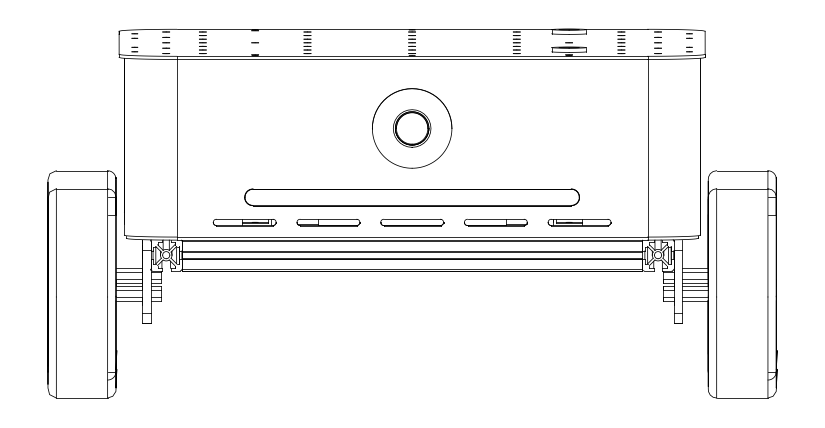

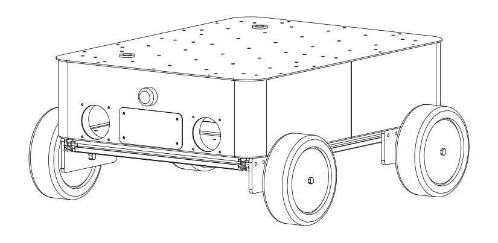

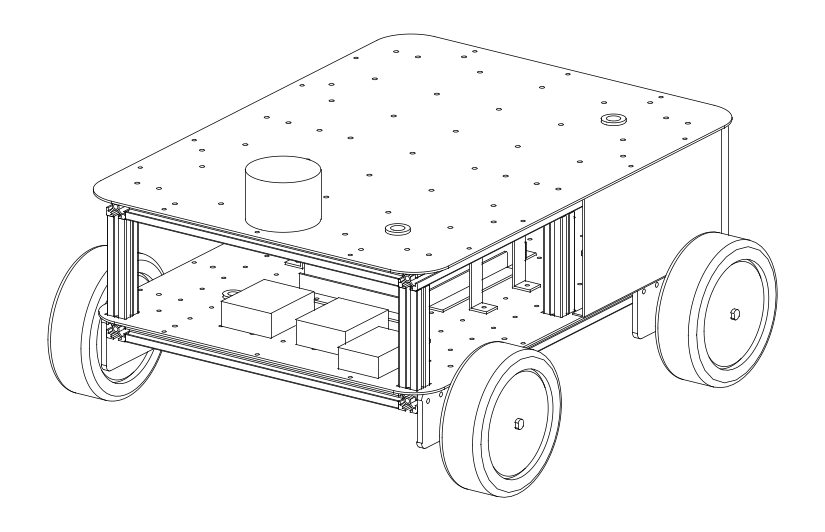

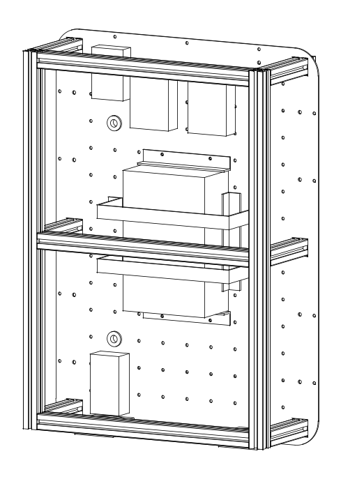

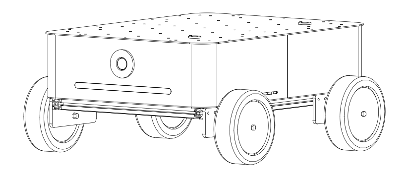

#### 21:20 도면식 렌더 방식 설명

사용자가 렌더 방식을 물었다. OCC의 은선 제거(HLR)로 2D 엣지를 뽑아 matplotlib으로 선만 그린 것이다. 핵심은 `shape.project_to_viewport((2600, 0, 250), viewport_up=(0, 0, 1))`이 visible/hidden 엣지를 갈라 주고, 각 엣지를 `e @ t`로 29점 샘플링해 폴리라인으로 그리는 것 — 직선·원호·스플라인을 가리지 않는다. 아이소는 (1200, -1600, 850) 시점. 원근 투영이라 앞바퀴가 뒷바퀴보다 크게 나온다.

이걸 쓰는 이유는 Claude가 ocp_vscode 화면을 볼 수 없어서다. 실제로 이 렌더로 잡은 것이 T슬롯 단면 5조각 분열(앞 구간), 눈이 작아 얼굴로 안 읽힌 것, 흡기 슬롯이 앞바퀴 옆이던 것 — 셋 다 숫자 검사로는 안 잡히는 종류였다. 한계도 적었다: 치수선·단면·표제란이 없어 도면처럼 보일 뿐 도면은 아니고, 시점이 너무 가파르면 엣지가 일부 빠진 적이 있다. 진짜 도면은 `ExportSVG` / `ExportDXF`로, 판금 5종(커버 2, 데크, 바닥판, 마운트 판, 포트 도어)은 DXF로 뽑아 레이저 업체에 넘길 수 있다고 제안했다.

#### 21:23 IPT 파일

> 혹시 ipt 파일도 가져올수 있니?

못 읽는다 — Autodesk Inventor 독점 포맷이라 OCCT에 리더가 없다. 대신 무엇을 읽을 수 있는지 확인하려던 명령은 사용자가 중단시켰고 구간이 여기서 끝난다.

### 결정

- 커버 분할을 좌/우 → **앞/뒤**로. 후면·전면이 통판이어야 중앙 배치가 된다.
- 비상정지는 포트 도어 **밖**. 커넥터 구멍은 별도 판 없이 2mm 커버 판에 직접.
- 얼굴 세 값: 베젤 Ø76 / LED 320 / 간격 20 — 렌더를 보고 정했다.
- 흡기는 측면이 아니라 **앞면 LED 아래**, 배기는 후면 80mm 팬 2개.
- 배터리 고정은 바닥판 50mm 격자에만 볼트 — 배터리가 바뀌어도 앵글만 옮긴다. 배터리 위치는 축간 정중앙.
- 뷰어는 venv 하나만 띄운다. 프로세스가 venv/시스템 파이썬 둘로 보이는 것은 정상이다. UI가 깨져 보이면 먼저 시크릿창으로 확인하고 Ctrl+Shift+R.

### 남은 일

- 허브모터 STEP 또는 축·폭 도면 — 마운트 판·윤거·커버 여유 8mm를 실물 기준으로 다시 잡아야 한다.
- 배터리·드라이버·온보드 컴퓨터·라이다·카메라 실물 치수.
- 앞면 흡기 슬롯은 완전 방수가 아니다 — 스펀지 필터 또는 물끊기 립.
- 팬은 80×80×25 대표 몸체와 Ø76 구멍만 넣었다. 실제 팬 모델(두께·커넥터) 미정.
- 후면 커버 탈거 시 배선 여유 루프 또는 중간 커넥터.
- 비상정지 머리가 데크보다 19mm 밖 — 가드 여부.
- 하중 검증(적재 40kg 기준 볼트 전단, 데크 처짐, 무게중심)은 아직 안 했다.
- 판금 5종 DXF 내보내기 스크립트(제안만).

### 교훈

- 간섭 0·솔리드 valid는 형상이 *맞다*는 뜻이 아니다. 얼굴 비례, 흡기 위치, 플랜지 위에 걸터앉은 부품은 전부 그림을 봐야 잡혔다.
- 뷰어 문제에서 "시크릿창에서는 되는가"가 서버/클라이언트를 가르는 가장 빠른 실험이었다. 포트·프로세스를 뒤진 조사는 틀린 "근본 원인"으로 이어졌고, 사용자의 한 줄이 맞았다. 확신 없는 진단은 그렇게 표시하고, 틀리면 정정을 남긴다.
- 판을 관통하는 부품(그로밋)은 부피가 겹치는 게 당연하므로 처음부터 판을 무는 형태로 모델링해야 간섭 검사가 의미를 가진다. 그 대신 플랜지가 판 위로 솟아 전고 같은 외형 치수를 바꾼다.
- "바닥판 736×546"과 "장비를 놓을 수 있는 704×514"는 다르다. 제원에 유효 범위를 따로 적어야 다음 배치에서 같은 실수를 안 한다.

### 이후 달라진 것 (2026-09-15 기준)

현재 저장소(2026-09-15 검수 시점)의 `mobility_base.py`는 07-28에 0.90 축소된 판이라 이 구간 값과 다르다: 하부 프레임 700×500 → 630×450, 축간 500 → 400, 커버 바깥 740×550 → 670×490, 바퀴 Ø200 허브모터 → Ø210 PVC 통바퀴 + 데드 액슬(구동계 미정), LED 슬롯 320×16 → 290×16(안쪽 플랜지 314×34), 흡기 슬롯 y ±160/±80/0 → ±145/±72/0, 바닥판 그로밋 (±200, ±150) → (±150, ±150), 중량 집계 항목명 "모터마운트/바퀴+허브모터" → "액슬마운트/바퀴 4개(모터 별도)". build-log 31절의 최종 사양은 전장 700 × 전폭 632 × 전고 335, 축간 400 / 윤거 564다. 비상정지(z=272, Ø22.3, 머리 Ø40), 포트 도어(170×80 @ z=200)와 포트 6종, 카메라(Ø76 베젤, z=262, PCD 60), LED 중심 z=196, 흡기 슬롯 60×6 @ z=172, 팬(80mm, Ø76, PCD 71.5, z=200), 배터리 260×170×90과 브라켓 볼트 자리는 지금도 같다. venv의 ocp_vscode는 지금도 4.0.0이다.

---

## 2026-07-27 (월) · 차체: 허브모터 배제와 구동계 재검토

> 시간: 21:25 ~ 23:43 · 장소: PC (`D:\build123d`) · 날짜 근거: 세션 기록 · 원본: 차체 설계 일지 `entry_02a.html`

사용자가 허브모터를 비용 문제로 배제하고 PVC 통바퀴(Ø210 × 58, 보어 Ø20, 허용중량 70 kg, 개당 12,000원)를 쓰겠다고 했다. 라즈베리파이 실물 STEP도 `refmodel/`에 넣어 줬다. 이 구간에서 한 일은 바퀴·파이 반영 → 구동 방식 결정 → 모터 사양 계산(두 번 정정) → 실제 제품 탐색 → 총액 비교 → 무게 재점검 → 축간거리 400 및 0.90 축소 적용이다. 구간이 끝날 때까지 모터는 확정되지 않았다.

이 일지의 치수는 당시 `models/mobility_base.py` 기준이다. 이 파일은 지금도 저장소에 그대로 있고(프레임 630 × 450, 축간 400, `AXLE_GAP` 20, PVC Ø210), 그 뒤 차량은 `models/swerve_base.py`(스키드 기본값) + 호버보드 6.5인치 허브모터로 갈아탔다. 현재 차량은 전장 873 × 전폭 712 × 전고 518, 축간 420 / 윤거 520이다(`docs/build-log.md` 31절). 즉 이 밤에 내린 "허브모터 배제"는 뒤에 뒤집혔다.

### 한 일

#### 21:25 PVC 바퀴와 파이 실물 STEP 반영

STEP(`RPI5+Pimoroni-NVME+Waveshare-POE v1.step`, 25.2 MB — 지금도 `refmodel/`에 있다)은 로드 19초, 솔리드 516개, **58.1 × 90.0 × 36.5 mm**였다. 목업(95×65×30)보다 6.5 mm 높다. 베이 높이 140이라 여유는 있었다. `REAL_PARTS` 플래그를 두어 (285, 150)에 앉혔고, 켜면 전체 실행이 약 2분이라 축간거리 작업 직전에 껐다(현재 파일도 `REAL_PARTS = False`).

바퀴는 Ø210 × 58, 보어 Ø20에 6204 베어링(20×47×14) 2개가 양쪽에 든 데드 액슬 형태로 다시 모델링했다. 윤거 631 → 624, 커버까지 8 mm 여유는 유지. 허브모터가 빠져 집계 중량이 30.0 → **24.30 kg**(배터리·모터 제외). 15개 부품군 105쌍 간섭 없음, 파이 바운딩박스(x 256\~314, y 105\~195, z 158\~194) 기준 간섭 없음.

막힌 것: 구동 방식을 묻는 AskUserQuestion 호출이 JSON 파싱 오류를 냈다. 오류 메시지에 찍힌 입력은 한글이 전부 `\uXXXX` 이스케이프로 직렬화된 형태였는데, 그것이 원인인지는 확실하지 않다 → 같은 내용을 다시 호출해 통과. 사용자 선택은 **데드 액슬 + 체인/벨트**, 모터는 "아직 미정 — 추천해달라".

이 구간의 렌더는 docs/images 에 없다.

#### 21:41 첫 모터 계산과 두 군데 정정

설계 질량 50 kg(차체 30 + 적재 20), 목표 1.2 m/s = 바퀴 109 rpm으로 계산했다.

| 조건 | 바퀴당 토크 |
| --- | --- |
| 포장면 구름 | 0.39 N·m |
| 잔디·자갈 | 1.55 |
| 15% 등판 | 2.32 |
| 제자리회전 μ=0.8 | **4.13** (지배 조건) |

4륜 합 기계출력 189 W, 전기 약 270 W. 체인 3:1 기준 "24V 320\~350 rpm, 3 N·m, 60\~100 W × 4"를 내놓았다. 패키징 제약도 같이 뽑았다: 사이드 레일 아랫면 z=125, 액슬 z=105, 판 안쪽면 y=250, 스프로킷 틈(판 바깥면\~바퀴 안쪽면) 25 mm. 모터 몸체 Ø40이면 지상고 85, Ø50 75, Ø55 70, Ø70 55 mm → **Ø55 이하** 권고.

> 해당 모터가 실제 제품이 있어? 실제 제품있는 것을 찾아놓은 뒤에 진행하는 걸로 하자

IG-52 계열(SHA YANG YE 설계, 국산 D&J WITH IG-52GM)을 찾았다. WebFetch가 SuperDroid·shayangye 등에서 403/500을 여러 번 냈고, 결국 shayangye 영문 페이지와 Tenet Tech(Rhino IG52 100W)에서 사양을 얻었다: 기어박스 Ø52, 감속비 23종(1/3\~1/936), 2단 정격 2.94 / 최대 8.82 N·m, 베이스 2800 rpm, 축 Ø12 × 28. 1/9.28이면 출력축 302 rpm / 2.69 N·m → 체인 3:1 → 바퀴 101 rpm(1.11 m/s), 7.67 N·m로 요구 4.13의 1.9배. 국산 48.6 W 버전은 1/9.28에서 0.6배로 부족, 1/19(3단)에서도 1.3배로 빠듯. 단 IG-52GM은 \$192(약 26만원)였다.

> 모터 하나당 5만원 이하로 찾아야해 진짜 저정도 사양이 필요 한거야? 다시 확인좀 해볼래?

다시 계산하니 두 곳이 틀렸다. (1) **μ=0.8은 고무 타이어 값**이다. PVC 대 콘크리트는 0.3\~0.5라 0.5로 잡으면 제자리회전이 **4.13 → 2.58 N·m**. (2) 제자리회전 토크를 최고속도 1.2 m/s와 곱해 출력을 부풀렸다. 동작점별로 보면 잔디 1.0 m/s 15 W/바퀴, 제자리회전 45°/s 8 W, 등판 22 W — **모터 30 W면 충분, 100 W는 3배 과함**. 체인비별 모터 요구: 3:1 0.9 N·m@300 rpm / 4:1 0.65@400 / 5:1 0.52@500.

이 조건으로 5만원 이하를 찾아본 결과: JGB37-3530(15,000\~25,000원)은 15 W, 0.45 N·m@319 rpm → 3:1 해도 바퀴 1.35 N·m로 탈락. MY1016Z 24V 250W(3\~5만원)는 110×110×128 mm, 2.5 kg으로 공간에 안 들어가 탈락. 국내 정품 라인에 "40\~50 W + Ø50 + 5만원 이하"는 없고 알리의 Ø45\~52 유성감속 775급이 현실적이라고 정리했다.

#### 22:39 2륜·4륜 구동과 캐스터 검토

> 우리는 제자리 회전을 할 일이 없어 모터도 2개만 달 생각이고 말이야

2륜 구동이면 견인력을 둘이 다 내야 해서 바퀴당 토크는 오히려 오른다(포장면 0.77, 잔디 3.09, 5% 등판 2.06, 10% 3.35, 15% 4.64 N·m). 그리고 4륜 전부 고정에 구동만 2개면 곡선 주행마다 네 바퀴가 옆으로 문질러진다 — 비구동 2륜을 캐스터로 하거나(A) 4륜 고정 유지(B)의 두 갈래를 제시했다.

사용자가 "실내 위주, 완경사"라 답하고 기어 감속 사진을 보이며 캐스터가 뭔지 물었다. 기어는 대기어 지름이 센터거리에 묶인다: 센터거리 100에서 스퍼 3:1이면 대기어 Ø150, 지상고 30 mm. 체인/벨트 3:1은 Ø96(지상고 57), 1:1은 Ø35(지상고 87). 그래서 "감속은 모터 안에서 끝내고 바깥은 HTD-5M 벨트 1:1로 축만 100 mm 옮기자"고 제안했다. 캐스터는 프레임 밑면 z=125에 붙이려면 전고 125 = Ø100짜리여야 하고 Ø200 스위블(전고 235)은 안 들어간다.

> 잠깐만 그러면 모터 4개로 하면?

| 구성 (m=50 kg, 5% 등판, μ=0.5) | 모터 | 바퀴당 토크 | 출력 |
| --- | --- | --- | --- |
| A) 2륜구동 + 캐스터 2 | 2개 | 2.06 N·m | 20 W |
| B) 4륜구동 전부 고정 | 4개 | 직진 1.03 / 회전 **3.61** | 34 W |
| C) 2륜구동 + 고정 2 | 2개 | 회전 7.22 | 69 W |

4륜구동인데 바퀴당 토크가 더 필요하다. 회전 시 요 저항 모멘트 30.7 N·m를 좌우 속도차로 이겨야 해서 바깥 바퀴는 1.03 + 2.58 = 3.61, 안쪽 바퀴는 1.03 − 2.58 = −1.55(제동)가 걸린다. 마른마찰이라 회전 반경과 무관하게 걸린다.

> 제자리회전이 가능하되 4축 고정으로 가고 싶은데 음, 위에 올라가는 무게도 20키로를 넘지 않을 수도 있어

공차를 37 kg(모델 24.3 + 모터 4.8 + 배터리 5 + 전장 3)으로 놓고 제자리회전 토크(축간 500, μ=0.5, 안전율 2배)를 적재별로 냈다: 0 kg 3.83, 10 kg 4.86, 20 kg 5.89 N·m. 적재를 20 → 10으로 줄이면 17%인데, **축간거리는 정비례**라 500 → 400이면 −20%다. 계산식 μWL/4는 궤도차량 근사이고 점접촉으로 엄밀히 풀면 3\~4배 커져 "이론상 불가"가 나오므로 안전율 2배는 경험적 마진이라고 명시했다.

#### 22:57 축간거리 400 적용

> 축간거리 줄여도 상관없어 바닥 긁힘도 상관없어

`WHEELBASE` 500 → 400, 바닥판 그로밋을 x ±200 → ±150으로 옮겼다(액슬 크로스멤버 위로 올라타서). 결과 축간 400 / 윤거 624(비율 0.64), 프레임 솔리드 1개, 105쌍 간섭 0. 적재 10 kg이면 3.88 N·m(벨트 2:1 → 모터 2.04@182 rpm), 20 kg이면 4.70(2.48@182). 현재 `mobility_base.py`도 `WHEELBASE = 400`, 그로밋 ±150 그대로다. 현재 차량(`swerve_base.py`)의 축간은 420이다.

PG45-775(Ø45 유성 + 775 모터) 계열을 찾았다. Doncen 사양표(12\~24 V 라인업)는 5\~800 rpm, 1.77\~38.98 N·m, 11\~89 W. 몸체 Ø45라 축을 z=102.5로 2.5 mm만 내리면 되고 모터 최하단 z=80, 풀리 Ø35 최하단 z=88. 추천을 "24V, 90\~110 rpm, 5 N·m 이상, 벨트 1:1"로 바꿨다.

#### 23:05 엘레파츠 탐색과 PG45-775 출력 한계

> 너가 직접 링크 찾아볼래? 가능하면 엘레파츠 안되면 다른 곳에서 해서 말이야

엘레파츠 유성기어모터 126개는 전부 17만\~23만원(모터뱅크·디엔지위드·SHAYANG-YE 정품). DC기어모터 GM35C-2847은 6 kg·cm(0.59 N·m), 7 W. WebSearch가 "unavailable"을 냈고(이 구간 1회, 다음 허브모터 검색에서 1회), roboticsdna는 403이었다. Ningbo Leison 사양표에서 24V 베이스 모터 3종(9.87 / 18.5 / 30.8 W), 감속비 3.7 / 10.2 / 13.7 / 19.2 / 32.5 / 50.9 / 71.2 / 99.5, 축 Ø10, 기어박스 길이 33.6\~78.8 mm를 확보했다.

문제는 P = T·ω다. 30.8 W × 효율 75% = 축출력 23.1 W면 1.1 m/s에서 2.20 N·m, 0.7 m/s 3.47, 0.6 m/s 4.04, 0.5 m/s 4.85. 요구 4.70(적재 20 kg)이면 **최고 0.52 m/s**, 적재 10 kg이면 0.63. 1.0 m/s를 원하면 60 W 이상이 필요하고 그건 7\~10만원대다. 가격은 AliExpress \$36.99, 인도 판매 페이지(IndiaMart 게재, 당시 기록은 RoboticsDNA로 적었다) ₹2,749(약 4.5만원)였다. 셀러마다 베이스 모터 출력 표기가 없는 경우가 많다고 적어 두었다.

#### 23:11 허브모터 총액 비교

> 흠 허브모터휠도 가격좀 찾아볼까? 4개 할거면 가격 비교도 좀 해봐야할 것 같은데

모터뱅크 8인치 BL70200A 225,700원(24/36V 250/320 W, 22 N·m, 4.5 kg), BL70200P 248,100원, 6인치 BL55160 212,700원, BL200D-5060 405,300원(60 N·m, 6.1 kg).

| 4륜 총액 | 금액 | 비고 |
| --- | --- | --- |
| A) PVC 바퀴 + PG45-775 + 벨트 | 488,000원 | 바퀴 48,000 + 모터 180,000 + 드라이버 60,000 + 풀리 80,000 + 벨트 20,000 + 액슬 20,000 + 판 가공 80,000 |
| B) 허브모터 국내 정품 | 1,122,800원 | 모터뱅크 |
| C) 허브모터 해외 직구 | 500,000원 | 개당 85,000원 **가정**, 알리 페이지 차단으로 미확인 |

모터값만 보면 A가 압도적인데 풀리·벨트·액슬·판 가공이 붙어 A와 C가 같아진다. 당시 설명은 이 부가 비용을 "12만원"이라 했지만 표의 항목 합(80,000 + 20,000 + 20,000 + 80,000)은 20만원이다 — 계산 착오로 보인다. 허브모터는 바퀴 4개가 18 kg(PVC 6.4)이라 공차 43.9 kg, 요구 5.27 N·m로 오르지만 22 N·m라 4배 여유. 판단은 "해외 직구 가능하면 C, 국내 정품만이면 A". 현재 BOM(`docs/bom.md`)의 구동부는 호버보드 6.5인치 인휠 허브모터 4개, 개당 55,000원(추정, 보유)이다 — 당시의 "해외 85,000원 가정"보다 싸게 끝났다.

#### 23:19 DDSM 세 종 검토와 중량 재점검

사용자가 엘레파츠 링크 두 개(no=17191896, 14114276)를 보냈다. Waveshare DDSM315(121,000원 VAT 포함, 정격 0.55 N·m, 스톨 1.10, 200 rpm, 349 g)와 DDSM210(58,047원, 0.25 N·m, 스톨 0.85, 98 rpm, 216 g). 요구는 52.3 kg 기준 평지 0.40, 5% 등판 1.08, 제자리회전 2.16(안전율 없음) / 4.32(2배). DDSM315로 제자리회전이 되는 차체는 Ø210 바퀴 기준 13 kg. 감속기 없는 다이렉트 드라이브라 모터 토크가 곧 바퀴 토크이고, Ø210 바퀴가 견인력을 더 깎는다.

> 우리거 무게는 어떻게 측정한거야? 정확한거야?

정확하지 않다고 답하고 네 등급으로 갈랐다. [1] 부피 × 밀도로 계산한 것 20.72 kg(프레임 3030 18본 7.37, 바닥판 3t 3.15, 데크 3t 3.36, 측면커버 2.59, 액슬마운트 1.33, 배터리 브라켓 0.48, 액슬 Ø20 1.07, 베어링 6204 × 8 1.25, 기타 0.12) — 단 단면적 384 mm²는 실물보다 10\~15% 크다. [2] 모델에 있는데 집계에 빠진 것 약 1.0 kg(배기팬 0.24 등). [3] 추정치: PVC 바퀴 1.6 kg/개는 근거 없음 — 통원판 부피 1,941 cm³를 PVC 밀도로 하면 2.72 kg, 4개면 6.4 대 10.9 kg; 배터리 5, 전장 3. [4] 아예 안 센 것: 코너 브라켓(30여 조인트 × 2 × 40\~60 g ≈ 3 kg), T너트·볼트, 하네스. 결론 **공차 38\~43 kg**. 써오던 32.3은 과소평가였고 60 kg 기준 요구는 4.95 N·m, PG45-775 속도는 0.52 → 0.45 m/s로 더 빠듯해진다.

세 번째 링크(no=16544094) DDSM400은 62,040원, 정격 0.15 N·m, 스톨 0.3, 100 rpm, 236 g으로 셋 중 제일 약했다. 이 모터 4개로 굴릴 수 있는 최대 차체 무게(Ø100 바퀴): DDSM400 평지 41 / 5% 등판 15 / 제자리회전 8 / 안전 2배 4 kg, DDSM210 68/25/13/6, DDSM315 150/56/28/14. 3030 프레임만 7.4 kg이라 "차체를 줄이는" 수준이 아니라 다른 기계가 된다고 답했다. 이때 차체 크기는 전장 770 × 전폭 692 × 전고 335, 프레임 700 × 500, 지상고 125였다.

#### 23:33 전폭·전장 0.90 축소

> 전폭은 조금 줄일수 있을까?

전폭 사슬은 프레임 반폭 → 커버(라운드 코너라 +14) → 바퀴(커버와 8 mm 틈)다. 공짜 10 mm가 하나 있었다: `AXLE_GAP` 25 → 20(벨트 풀리를 안 넣으면 가능), 692 → 682, 회전 토크 +2%. 프레임 폭을 줄이면 윤거가 줄어 회전 토크가 오른다(460 → +9%, 420 → +17%, 400 → +21%). 축간거리를 줄인 것과 정확히 반대 방향이다. 전장은 축간 400이 고정이라 오버행만 줄어 **공짜**다.

> 전장과 전폭 둘다 지금 비율 그대로 하되 조금 줄이는 건 어때?

| 배율 | 프레임 | 전장 × 전폭 | 윤거 | 적재면 | 회전 토크 |
| --- | --- | --- | --- | --- | --- |
| 1.00 | 700×500 | 770 × 682 | 614 | 0.41 m² | 5.03 N·m |
| 0.95 | 660×480 | 730 × 662 | 594 | 0.38 | 5.20 (+3%) |
| **0.90** | 630×450 | 700 × 632 | 564 | 0.34 | 5.48 (+9%) |
| 0.85 | 600×420 | 670 × 602 | 534 | 0.31 | 5.79 (+15%) |
| 0.80 | 560×400 | 630 × 582 | 514 | 0.27 | 6.01 (+19%) |

0.90을 추천했고 사용자가 "0.90으로 적용해줘"라 했다. 막힌 것: 일괄 치환 스크립트가 `AssertionError`로 죽었다. 오류에 찍힌 문자열은 전장 목업 목록이었고, 곧이어 grep한 파일에는 "라즈베리파이는 REF_PARTS 의 실물 STEP 으로 대체했다"는 주석과 함께 라즈베리파이 목업 줄이 이미 없었다 — 앞서 파이 목업을 실물 STEP으로 바꾸면서 치환 대상 문자열이 달라진 것으로 보인다. 치환 문자열을 고쳐 재실행했다. 결과: **전장 700 × 전폭 632 × 전고 335**, 축간 400 / 윤거 564(비율 0.71), 베이 666 × 486 × 140(바닥 유효 634 × 454), 데크 680 × 500(0.34 m²), 커버 670 × 490, 프레임 6.72 kg(7.37에서), 판재 5.22 kg(6.50에서), 절단 630 × 4 / 390 × 7 / 370 × 1 / 143 × 6 = 6.48 m. LED 바 320 → 290. 검증: 프레임 18본 솔리드 1개, 커버 valid, 105쌍 간섭 0. 전고 335는 바퀴 Ø210이 정하는 값이라 안 줄어든다.

현재 `mobility_base.py`는 이 상태(`BASE_L, BASE_W = 630, 450`, `AXLE_GAP = 20`)로 남아 있다. 현재 차량 BOM의 프로파일 절단은 760 × 4 / 390 × 8 / 143 × 6 (`docs/bom.md`)이다.

#### 23:43 독립 조향 검토

사용자가 독립 조향과 서스펜션을 물었다(질문 원문은 청크 기록에 남아 있지 않다. 23:38 "0.90으로 적용해줘" 다음 Claude 답변이 "조향 얘기 답하겠다"로 시작한다). 스키드 제자리회전 5.48 N·m 대 독립조향 시 최대(5% 등판) 1.24 N·m로 구동 토크가 4.4배 준다. 1.0 m/s 필요 출력 52 W 대 12 W — PG45-775 30 W로도 1.0 m/s가 난다. 조향 토크는 킹핀 오프셋 0 / 10 / 20 mm에서 0.25 / 0.98 / 1.72 N·m. 대가는 제어축 4 → 8, 조향 액추에이터·킹핀 베어링·절대각도 센서 각 4, 배선 꼬임(±180° 제한 또는 슬립링), +25\~40만원, 공수 2\~3배. 판단은 "4축 고정으로 먼저 굴리고 코너 모듈만 나중에 교체 — 액슬 마운트 판이 볼트 6개라 판만 바꾸면 된다". 서스펜션은 실내 평탄면에서 이득이 없고 댐퍼 없는 스프링은 출렁이니 빼고, 실외 확장 시 앞축 로커로 가자고 했다. 처음부터 스워브가 목표라면 지금 정해야 한다는 질문으로 구간이 끝난다.

현재 저장소에는 `swerve_base.py`가 `DRIVE=swerve` 옵션으로 조향 4축을 남겨 두었고 기본값은 스키드다. 이날 권고한 "인터페이스만 남기고 4축 고정 먼저"가 그대로 유지됐다.

### 결정

- 허브모터 배제(비용), PVC 통바퀴 Ø210 + Ø20 데드 액슬 + 6204 베어링 — 사용자 지정. 현재는 호버보드 6.5인치 허브모터(Ø158.7 실측) 4개로 되돌아갔다.
- 구동 방식: 데드 액슬 + 체인/벨트 — 사용자 선택. 이후 "감속은 모터 안, 바깥은 벨트 1:1"로 제안이 바뀜(미확정).
- 4축 고정 스키드, 제자리회전 가능, 바닥 긁힘 감수 — 사용자 결정. 현재 차량도 스키드 4륜이다.
- 마찰계수 μ=0.5(PVC) — 사용자 지적으로 정정. 안전율 2배는 Claude가 관례로 얹은 마진.
- 축간거리 500 → 400(회전 토크 −20%), 그로밋 ±150 — 적용. 현재 차량은 축간 420 / 윤거 520.
- 0.90 축소(프레임 630 × 450), `AXLE_GAP` 25 → 20 — 적용. 현재 `mobility_base.py` 값 그대로.
- 독립 조향·서스펜션은 보류 권고(답 대기).

### 남은 일

- 모터 확정: PG45-775(0.45\~0.5 m/s 제한) 대 해외 허브모터(85,000원 가정 미확인) 대 국내 정품(112만).
- 해외 직구 가능 여부와 속도 0.5\~0.6 m/s 허용 여부 확인.
- PVC 바퀴 실측 무게, 배터리 모델 확정, 코너 브라켓 수량 — 중량 집계 코드에 누락 항목 추가(약속만 하고 아직 안 함). 현재 `mobility_base.py`도 `WHEEL_SET_KG = 1.6`에 집계 항목 5개 그대로라 끝내 반영되지 않았다.
- 독립 조향/서스펜션 방향 답변 대기.
- 모터 정해진 뒤 마운트 판 재설계(취부공, 벨트 텐셔너 슬롯, 풀리, 가드).

### 교훈

- 마찰계수는 재료를 보고 넣는다. 고무 값(0.8)을 PVC에 쓰면 요구 토크가 1.6배 부풀고, 사용자의 "진짜 필요한 거냐"는 한마디가 100 W → 30 W를 잡았다.
- 최대 토크와 최대 속도는 동시에 안 쓴다. 곱하면 출력이 3배 과대평가된다.
- 스키드 스티어는 제자리회전이 사양을 지배하고, 4륜구동이 2륜+캐스터보다 바퀴당 토크가 더 필요하다(바깥 바퀴 = 추진 + 차동).
- 축간거리는 회전 토크의 공짜 레버(정비례), 윤거는 반대(반비례). 전장은 공짜로 줄고 전폭은 대가가 있다.
- 모터값만 비교하면 틀린다. 풀리·벨트·액슬·판 가공을 더하면 48.8만 대 50만으로 같아졌다. 다만 그 자리에서 부가 비용을 12만원이라 말한 것은 항목 합(20만원)과 안 맞았다 — 총액표의 숫자를 믿고 말로 요약한 숫자는 다시 더해 본다.
- 다이렉트 드라이브는 감속기가 없어 같은 출력급에서 토크가 1/8\~1/33이다. 후보를 볼 때 "정격 토크 4 N·m 이상"부터 확인한다.
- P = T·ω. 예산이 출력을 정하고 출력이 속도를 정한다 — 30 W면 0.5 m/s가 상한이다.
- 중량은 등급을 나눠 말한다(형상 계산 / 집계 누락 / 추정 / 미집계). 32.3 kg이라던 공차가 38\~43이었다.
- 일괄 치환 스크립트는 앞선 편집으로 어긋난다. assert가 걸려 준 덕에 부분 적용을 막았다.
- 판매 페이지 WebFetch는 403이 잦다. 제조사 사양표를 잡되 셀러별 표기와 다를 수 있음을 적어 둔다.

---

## 2026-07-27 (월) · 차체: 모터 후보 검토와 호버보드 허브모터 전환

> 시간: 23:46 ~ 07-28 (화) 02:03 · 장소: PC (`D:\build123d`) · 날짜 근거: 세션 기록 · 원본: 차체 설계 일지 `entry_02b.html`

앞 구간에서 구동계 요구가 **바퀴 5.48 N·m @ 91 rpm × 4개**로 정리된 상태였다. 이 구간에서는 "설계는 안 건드리고 실구매 가능한 모터"를 찾는 것으로 시작해, 가격·구성(아커만)·용도·참고 모델·총 제작비를 차례로 따졌고, 사용자의 호버보드 아이디어로 구동계 문제가 끝났다. 마지막에는 설계 기록 문서(build-log.md)를 처음 쓰고 렌더 21장을 저장한 뒤, 탈착식 사이드 스커트·펜더·데크 레일을 모델에 넣었다. (시각은 청크의 UTC 타임스탬프를 KST로 바꾼 것이다.)

### 한 일

#### 23:46 SPG 카탈로그 PDF 렌더링

> 그럼 아무것도 안 건드리고 지금 상태에서 모터부터 일단 찾아보자 가격은 일단 생각하지 말고

웹검색으로 SPG S9D90(90W) 계열이 걸렸고 카탈로그 PDF(48페이지, 약 10 MB)를 받았다. 막힌 것이 세 겹이었다.

- pypdf 텍스트 추출 → "90W" 검색 결과 0건. p1\~p3는 아예 텍스트 없음.
- 원인: 폰트 인코딩이 **+31 시프트**돼 있었다 (`(&"3&%.0503` → `GEAREDMOTOR`). 디코더를 짜서 목차·섹션 제목은 읽었으나 숫자 자리는 `¤` 같은 기호로 깨져 나와 토크 표를 못 읽었다.
- Read 도구로 페이지를 보려 하니 pdftoppm 미설치. → **PyMuPDF를 설치해 p26·p27(S9D 사양표)과 p23(S8D 사양표)을 170 dpi PNG로 렌더링**하고 눈으로 읽었다.

| 모델 | 감속비 | 출력 rpm | 토크 | 벨트 후 바퀴(η 0.95) | 판정 |
| --- | --- | --- | --- | --- | --- |
| S9D90-90CH (90W) | 1/30 | 103 | 6.17 N·m | 5.86 / 1.13 m/s | OK |
| S9D90-90CH (90W) | 1/36 | 86 | 7.41 | 7.04 / 0.95 m/s | OK (여유 1.3배) |
| S9D60-90CH (60W) | 1/40 | 78 | 5.14 | 4.88 / 0.86 m/s | 부족 |
| S8D40-90A (40W) | 1/60 | 53 | 5.02 | 4.77 / 0.58 m/s | 부족 |

90W가 최소선이었다. 그런데 치수가 문제였다. S9D90 + S9KC30B는 모터 Ø80×142.5, 기어헤드 □90×65.5, **전장 246 mm, 무게 3.4 kg**(모터 2.2 + 기어헤드 1.21), 출력축 Ø15 h7. 지금 패키징에 넣으려면 축 높이 105→85로 내려야 하고(지상고 125→45 mm), 안쪽으로 y=225에서 −21까지 뻗어 반대편 모터와 충돌하며, 4개에 14 kg이 늘어 공차 40→54 kg, 요구 토크가 5.48→6.5 N·m로 올라 1/30이 다시 부족해진다. 들어가려면 Ø55×180 이내여야 하는데 브러시 DC 90W는 전부 Ø80 프레임이다.

정리한 실구매 리스트: A) SPG S9D90-90CH + S9KC36B ×4 (엘레파츠·모터뱅크, 패키징 불가), B) 모터뱅크 **BL70200A** 8인치 허브모터 ×4 (24V 250W, 22 N·m, 4.5 kg, 225,700원 — 벨트·풀리·액슬 전부 불필요), C) PG45-775 89W판 (셀러 확인 필요). Waveshare DDSM 계열(0.15\~0.55 N·m)과 S8D40/S9D60은 토크 부족으로 탈락.

#### 23:54 SPG 가격 조사

모터뱅크에서 S9D90-24CH 55,910원, S9KC 감속기 1/25\~1/60 구간 **+104,210원**(1/3\~1/10 85,860 / 1/12.5\~1/20 98,100 / 1/75\~ 107,550). 감속기가 모터보다 두 배 비싸다. 모터만 보고 "5만원대"로 생각하면 틀린다.

| 안 | 구동계 총액 | 비고 |
| --- | --- | --- |
| A) SPG S9D90 + 감속기 1/36 + 벨트 | 1,018,480원 | 감속기 4개 416,840원이 최대 항목 |
| B) 허브모터 국내정품 | 1,122,800원 |  |
| C) 허브모터 해외직구 | 500,000원 | 개당 85,000원은 **가정값**. 알리 페이지 차단으로 미확인 |

A와 B가 거의 같은 돈인데 A에는 지상고 45 mm·좌우 엇갈림·+14 kg이 붙는다. 같은 돈이면 A를 고를 이유가 없다고 판단했다.

#### 00:00 아커만(앞 조향 + 뒤 2륜 구동) 검토

> 제자리 회전 없애고 앞 두바퀴는 조향이 가능하고 뒤 두바퀴는 모터2개 연결하는 그런 방식은 어때? 현실성이 있나?

현실성은 있다. 스키드 저항이 사라지고 구동륜이 절반이라 요구가 **2.47 N·m × 2개**(5% 등판)로 4.4배 내려간다. 1.0 m/s에서 24 W/개 → 35W급 2개. SPG S9D60(50,820원)+감속기 1/30 = 155,030원 × 2 = 310,060원으로 4륜 안(730,480원)의 43%다. 대가는 회전 반경이다.

| 조향각 | 선회반경 | U턴 필요폭 |
| --- | --- | --- |
| 30° | 693 mm | 2,298 mm |
| 40° | 477 mm | 1,930 mm |
| 45° | 400 mm | 1,806 mm |

복도 1.2\~1.5 m에서는 못 돈다. 조향 공간도 문제다. Ø210 바퀴가 30° 꺾이면 킹핀 기준 반폭 29→78 mm인데 킹핀 y=282, 커버 바깥면 y=245라 여유가 37 mm뿐 — 49 mm 부족. 전폭 632→730으로 늘리거나, 앞바퀴만 Ø150으로 줄이거나(전폭 700), 휠 아치를 뚫어야 한다.

#### 00:11 용도 확인과 적재 시나리오별 토크

> 배달로봇 같은 느낌도 만들어보고 실내에서 돌아다니는 것도 테스트해보고 실외에서 돌아다니는 것도 해보고 위에다가는 적재함을 달거나 로봇팔을 달거나 … 기반이 되는 베이스 모빌리티 시스템이 필요해서 하는거야

용도가 정해지자 판단 기준이 바뀌었다. 다목적 테스트 베드면 아커만은 뺀다(배달로봇은 엘리베이터·복도를 다닌다). 진짜 변수는 무게가 자란다는 것이었다.

| 구성 | 총중량 | 요구 토크(안전 2배) |
| --- | --- | --- |
| 지금 (빈 데크) | 40 kg | 3.65 N·m |
| 적재함 + 화물 20 kg | 65 kg | 5.94 |
| 소형 로봇팔 10 kg | 60 kg | 5.48 |
| 로봇팔 + 적재함 + 화물 | 75 kg | 6.85 |
| 협동로봇팔 20 kg급 + 화물 | 85 kg | 7.76 |

모터별 커버 범위: SPG 1/36은 77 kg, 1/40은 86 kg, 허브모터 BL70200A(22 N·m)는 241 kg. SPG는 로봇팔+적재함에서 이미 한계다. 전복은 윤거 564에서 옆으로 400 mm 뻗을 때 한계 유효질량 143 kg(600 mm 53 kg, 800 mm 33 kg)이라 정적으로는 안전. 제안: **4륜 스키드 확정, 허브모터, 코너를 교체 가능한 모듈(M6 6개 볼트열)로 표준화**, 데크 100 mm 격자는 그대로.

#### 00:15 f3d 질문과 NXP 참고 모델 분석

f3d는 못 읽는다(build123d import는 step/brep/stl/dxf/svg뿐). 사용자가 STEP으로 준 "NXP Robot Platform V2"(33.8 MB, 저장소 밖 Downloads 경로)를 15초에 로드했다: 전체 바운딩 368×383×254 mm(로봇팔 포함; 외장 패널 기준으로는 366×254×246), 솔리드 126개, 면 12,654개. 바퀴 Ø110×43, 축 Ø8, 축간 236 / 윤거 206, 뒤 2륜 구동, 스퍼기어 40T 감속, L298N ×2(채널 2A), Parkside 12V 팩 2개, 추정 6 kg. 요구 토크는 구동륜당 0.93 N·m로 이 프로젝트(5.48)와 **6배** 차이인데 분해하면 질량 10배 × 축간 1.7 × 바퀴반경 1.9 ÷ 윤거 2.7 ÷ 구동륜 2.0 — 질량이 지배적이다. 크기를 0.55배로 줄이면 토크가 1/4로 떨어지지만 Ø110은 실외를 못 가고 적재 20 kg·로봇팔이 불가하다. 배울 점으로 전동공구 배터리 팩 사용을 적어뒀다.

#### 00:28 총 제작비 산출

모델에서 수량을 직접 뽑았다: 프로파일 6.48 m(630×4, 390×7, 370×1, 143×6), 판재 9.41 kg(바닥판 2.52, 데크 2.71, 커버 2.31, 액슬마운트 1.33, 배터리브라켓 0.48, 포트도어 0.07), 데드액슬 1.02 kg, 베어링 6204 ×8 1.25 kg. 공통(센서 제외) 107만원에 구동계를 더하면 A 허브 국내 213.3만 / B 해외 151.0만 / C SPG 196.4만 (이 표에서만 A/B/C 순서가 앞 표와 다르다). 구동계가 아닌 데서 107만원이 나갔다 — 판재 가공 38만 + 체결류 24만 + 배터리 22만이 컸다. 수치는 바퀴·모터·감속기 외에 전부 [추정]이라고 명시했다.

00:42 배터리 제외·판재 3D 출력으로 바꾸니 공통 716,000원, 총액 A 177.9 / B 115.6 / C 161.0만. 다만 3 mm 판을 그대로 뽑으면 3,486 cm³ / 174시간(0.6 mm 노즐 20 cm³/h 기준)인데, PETG는 크리프가 심해 5\~6 mm+리브로 가야 하고, 그러면 5,926 cm³ / 필라멘트 6.2 kg / **출력 296시간**. 데크 680×500은 베드를 넘어 분할 접합이 필요하고, **액슬마운트는 절대 3D 출력 불가**(차량 하중과 구동 반력을 받는 유일한 부품, 8t 알루미늄 60,000원 유지).

#### 01:03 호버보드 허브모터 검토

> 전동휠 제품에 들어가는 것도 이런 인휠모터 아닌가? 내 생각 뭔지 알것 같지?

사용자의 이 질문으로 구동계 문제가 정리됐다. e-pm.kr 국내 판매가: 6.5인치 55,000 / **8인치 65,000** / 10인치 75,000원. 36V 250\~350W, 3상 BLDC, 15극쌍, 홀센서 120°. 모터뱅크 BL70200A의 29%다. 토크 추정은 250W @ 1.0 m/s 21.0 N·m, 350W 29.4 N·m(η 0.8) — 요구 5.48의 4\~5배. 제어는 EFeru/hoverboard-firmware-hack-FOC로 순정 보드를 그대로 쓴다(보드 1장에 모터 2개, UART/PWM). 총액은 D') 완제품 2대 분해 908,000 / D) 모터 4+보드 2 988,000 / B) 해외직구 1,108,000 / A) 국내정품 1,730,800원.

주의 사항: 전압 36V(24V로 돌리면 최고속 2/3, 목표 1 m/s엔 충분), 축이 양면 D컷이라 마운트 판 구멍만 바꾸면 됨, "8인치"가 실제 215 mm(8.5인치)인 경우가 흔함 — 주문 전 외경·축 지름·평면 폭·축 길이·모터 폭 실측 필요.

*현재와 대조:* 실제로 확보한 모터는 8인치가 아니라 **6.5인치**다. `models/hoverboard_mount/parameters.py`에 타이어 외경 158.7·폭 55 [실측], 축 Ø16·D컷 1면·한쪽 축만 [실측]으로 잡혀 있고, `docs/bom.md`는 "6.5" Ø159 ×4 보유, 55,000원 [추정]"이다. 당시 예상(Ø12 양면 D컷, 215 mm)은 전부 빗나갔다.

01:10 "완제품 2대 분해가 왜 90만원이나 해?" → 호버보드는 24만원이고 나머지 66.8만원이 차체(PETG 18.6만, T너트·볼트 16만, 브라켓 8.4만, 프로파일 7.8만, 액슬마운트 6만, 배선 6만, 스위치류 4만). 범위로 다시 잡으면 33\~85만원.

01:21 "필라멘트는 학교거라 무료, 프로파일 6.5 m 맞나, 볼트 320세트 진짜야?" → 빔 18본을 전수해 6,478 mm는 맞다고 확인(2층 구조). 축크로스 2본을 빼면 5.70 m. **볼트 320은 근거 없이 크게 잡은 값**이었다 — 조인트 28곳 × 브라켓 1\~2개 = 56\~112 + 부품 고정 106(바닥판 14, 데크 16, 커버 플랜지 28, 액슬마운트 24, 배터리 브라켓 12, 포트도어 4, 배기팬 8) = 162\~218세트로 정정. 재계산 총액 31.7\~66만원, 현실적으로 40만원 안팎.

*현재와 대조:* 볼트는 현재 차량 견적(build-log.md 32절 A)에서 M6×15 84개 + 스프링너트 84개, `docs/bom.md` 프레임 항목은 68+68이다. 총 제작비는 차량이 커지고(873×712, 카메라 6·범퍼·핸들 포함) 프로파일·철물이 실단가로 바뀌어 "베이스만 482,000\~992,000원", 적재함까지 붙인 전체 버전은 bom.md 기준 신품 합계 1,976,478원이다. 당시 31.7\~66만원과는 범위·구성이 다르니 그대로 비교하지 않는다.

#### 01:25 설계 기록 문서와 이미지 저장

> 자꾸 이런저런 시도해보고 고민하고 막혔던 것들 그리고 방법을 찾은 것들 정리해서 문서로 작성해둘래? 나중에 이걸로 유튜브 영상이나 만들어봐야곘다

`docs/build-log.md`를 처음 썼다. 당시 368줄, 15,134바이트, 헤딩 30개(섹션 0\~9 + 영상 챕터 제안). Claude가 틀렸던 것들을 모은 표(μ=0.8→0.5, 공차 32.3→40 kg, 볼트 320→162\~218, 스키드 공식은 궤도차량 근사)를 따로 뺐다. 이어 스크래치패드의 렌더가 세션 뒤 사라진다는 점을 지적하자 01:37에 "렌더 이미지들은 다 저장해둬야해"라는 답이 왔고, `docs/images/`에 **21장**(01_tslot_section_2020 \~ 21_ref_spg_s8d_torque_table)을 번호순으로 복사했다.

*현재와 대조:* build-log.md는 2026-09-15 기준 1,630줄 / 80,084바이트 / 헤딩 98개(28막 + 29\~32절 + 영상 챕터 + 도면 색인)로 자랐고, docs/images는 112장이다. 이 구간의 25장(01\~25)은 전부 그대로 있다.

#### 01:37 인휠 전환 영향과 사이드 스커트 판단

"설계 수정은 따로 필요없겠지?"에 대한 답은 **바퀴 주변만**이다. WHEEL_D 210→215(실측 필요), WHEEL_W 58→65\~70, AXLE_D Ø20→Ø12+양면 D컷, tire/bearings/axle 3함수 → 허브모터 1개, motor_plate 관통공 → D컷 슬롯+케이블 노치. 프레임 18본·커버·데크·바닥판·브라켓·마운트 판 외형과 볼트열 6개는 그대로. 전폭은 바퀴 폭 58→622 / 65→636 / 70→646 mm로 AXLE_GAP이 흡수한다. 호버보드도 캔틸레버 단측 지지라 마운트 판 방식과 구조적으로 맞는다.

*현재와 대조:* 이 변경은 `models/mobility_base.py`에는 끝내 적용되지 않았다 — 지금도 WHEEL_D 210 / WHEEL_W 58 / AXLE_D 20(데드 액슬)이다. 인휠 전환은 나중에 새 파일(`models/swerve_base.py`, `models/hoverboard_mount/`)에서 6.5인치 실측 기준으로 다시 그렸다.

사이드 스커트는 축간 400에 Ø210 바퀴라 바퀴 사이 빈 구간이 190 mm뿐(앞 x 95\~305, 뒤 −305\~−95)이어서 참고 이미지만큼 면적이 안 나온다(하단 z=80이면 148 cm², z=40이면 224 cm²). 그래도 발이 바퀴에 말려드는 사고를 막고 하부 노출을 가리며 3D 출력이면 비용이 거의 0이라 **커버 하단 플랜지 볼트를 공유하는 탈착식**(실내 하단 z=50, 실외엔 떼서 지상고 125 회복)을 제안했다.

#### 01:45 스커트·펜더·데크 레일 구현

> 그래 탈착식으로 해서 어떤 느낌인지 살짝 보자 그리고 상단 데크 부분은 모듈식으로 … 레일식으로 … 상단 2d 라이다는 일단 빼두자

`mobility_base.py`에 `SKIRT2`(하단 50, 두께 3, 탭 15, 아치 여유 10), `DECK_RAIL`(2020 프로파일 3본, 길이 660, y=−200/0/+200, 엔드 스톱 3개)을 추가하고 2D 라이다 목업을 지웠다. 실행하면서 세 가지가 걸렸다.

- **스커트가 6조각으로 갈라졌다** — 휠 아치가 옆구리를 끊어서다. 문제는 탭이 앞뒤 면에만 있어 바퀴 사이 조각에 고정점이 없던 것. 바퀴 사이 구간(SKIRT_BOLTS)에 볼트를 추가해 6조각 각각이 탭을 갖게 했다.
- **데크레일이 프레임·커버·판재와 29,955 / 1,675 / 30,774 mm³ 겹쳤다** — 레일 z 기준을 단면 중심이 아니라 밑면으로 잡은 탓. 기준을 `size/2` 올려 z 331\~366으로 고쳤고, 이어 같은 그룹이라 검사에서 빠졌던 레일과 엔드 스톱의 겹침을 발견해 스톱을 레일 위로 올렸다(스톱 포함 전고 376).
- **펜더가 측면커버 75,663 / LED바 19,435 / 판재 2,418 / 배기팬 2,170 mm³ 겹쳤다** — 펜더는 "커버 바깥에 덧붙는 껍데기"여야 해서 프레임 윗면 위 커버 영역을 빼는 컷을 넣었다(PETG 1.97 → 1.77 kg).

| LOWER_COVER | 조각 | PETG | 전폭 | 바퀴 노출 | 간섭 |
| --- | --- | --- | --- | --- | --- |
| "skirt" | 6 | 0.54 kg | 632 mm | 그대로 노출 (z 50\~155) | 136쌍 + 그룹 내부 0 |
| "fender" | 2 | 1.77 kg | 644 mm | 지면\~50 mm만 (24%) | 136쌍 + 그룹 내부 0 |

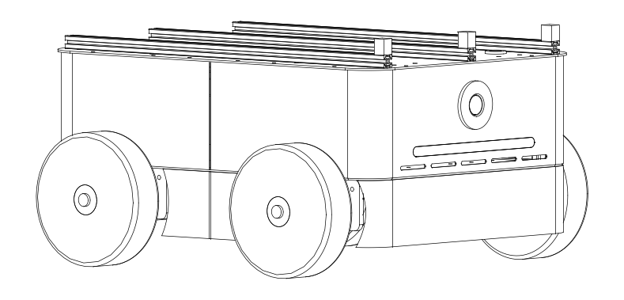

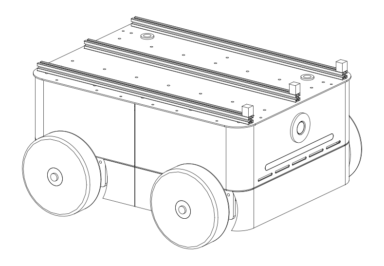

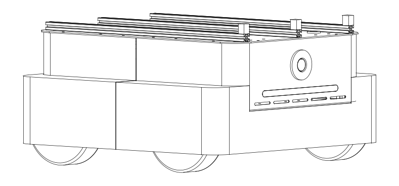

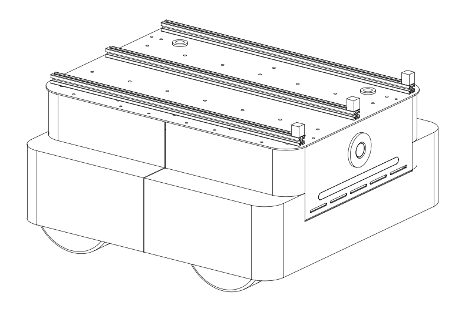

*현재와 대조:* `mobility_base.py`는 지금도 `LOWER_COVER = "fender"`, `DECK_RAIL = True`, 레일 660 / y=(−200, 0, 200)이며, 2026-09-15에 실행하면 전장 700 × 전폭 644 × 전고 376, 프로파일 실길이 6.48 m(과금 7.20 m) / 6.72 kg으로 당시 값과 같다.

렌더 4장을 22\~25번으로 `docs/images/`에 추가했다. 이어서 "200 kg 단순계산이 맞나"도 따졌다 — 이 질문이 어디서 나왔는지는 청크 텍스트에 없어(첨부 이미지였는지) 확실하지 않다. 답은 모터만 보면 맞다(총 200 kg → 제자리회전 바퀴당 9.13 N·m, 안전 2배 18.26, 허브 21\~29 N·m 대비 여유 1.1\~1.6배). 그러나 병목은 모터가 아니다: 축 Ø12 굽힘 153 MPa(안전율 2.3\~3.3; 현재 실물 축은 Ø16), **PETG 데크는 불가**, 250W 연속 등판 시 과열. 호버보드의 100 kg은 사람이 바퀴 바로 위에 서는 조건이고 이 차량은 하중이 z=331 데크 위에 있다. 지금 구조로는 **적재 40\~60 kg이 상한**이라고 정리했다. 목표 적재 20 kg(총 60 kg)에서는 모터 여유가 3.8\~5.3배다.

02:25 백그라운드로 띄운 뷰어("Start viewer from venv")가 exit code 4로 실패했다는 알림이 왔다. 원인은 이 구간에서 확인하지 않았고, 07-28 17:19에 "응답 없음"으로 닫혔다.

### 결정

- 구성은 **4륜 고정 스키드**로 확정. 아커만은 U턴 폭 1.8\~2.3 m와 조향 공간 49 mm 부족(전폭 700\~730 필요)으로 제외. *(이후 build-log 9막에서 독립 조향(스워브)으로 틀었다가 21막에서 다시 4륜 스키드로 돌아왔다. 현재 `swerve_base.py` 기본값은 `DRIVE=skid`.)*
- 구동계는 **호버보드 8인치 허브모터 + 순정 보드(EFeru FOC 펌웨어)**. 벨트·풀리·데드액슬·감속기·별도 컨트롤러 전부 삭제. *(현재 실물은 6.5인치 Ø158.7.)*
- 액슬마운트 판은 8t 알루미늄 유지, 구멍만 D컷으로 변경 예정. 나머지 판재는 학교 대형 3D 프린터로 출력(필라멘트 0원). *(현재 휠 마운트는 별도 설계(Design D 클램프)로 바뀌었다 — 이 일지 범위 밖.)*
- 하부 커버는 `LOWER_COVER = "skirt" | "fender"` 한 줄로 택일하는 탈착식. 효용이 없다고 판명나도 손해가 볼트 값뿐이고, 실내는 펜더·실외 험지는 스커트로 교체 가능. 데크에 2020 레일 3본 + 엔드 스톱으로 모듈 인터페이스(데크 100 mm 격자 직결 대신). 2D 라이다 목업은 레일에 뭘 얹을지 정해지면 넣기로 하고 제거.
- 설계 기록은 `docs/build-log.md`, 렌더는 `docs/images/NN_설명.png`로 남긴다. 스크래치패드 렌더는 세션이 끝나면 사라지기 때문이다.

### 남은 일

- 호버보드 8인치 실측: 외경(210 vs 215), 축 지름·평면 폭·전체 길이, 모터 폭 → 액슬 마운트 판 재설계. *(결과적으로 6.5인치를 실측해 별도 마운트를 설계했다.)*
- 스커트 vs 펜더 선택(또는 둘 다 만들어 교체). 프로파일 5.70 m(축크로스 제외) 축소 여부.
- 데크·바닥판을 베드 크기에 맞춰 분할하고 5\~6 mm+리브로 두께 보정한 STL.
- 해외 허브모터 실가격(85,000원 가정)은 끝내 미확인 — 호버보드로 방향이 바뀌어 우선순위가 내려갔다.
- 뷰어 백그라운드 실패(exit code 4) 원인 확인.

### 교훈

- PDF 텍스트 추출이 깨지면 디코딩에 매달리지 말고 **페이지를 이미지로 렌더링해 읽는 게 빠르다**. 폰트 시프트를 풀어도 숫자는 안 나왔다.
- 감속기·체결류·판재 가공처럼 **모터 밖의 비용**이 총액을 정한다. 모터 가격만 붙들고 있던 시간이 길었다.
- 스키드 요구 토크는 질량에 정비례한다. 크기 축소보다 **무게와 적재 목표**가 모터를 결정한다.
- 추정치를 크게 잡은 항목(볼트 320세트)은 사용자의 "진짜야?" 한마디에 정정됐다. 수량은 모델에서 세어야 한다.
- 같은 그룹 안의 부품끼리는 쌍 검사에서 빠진다. 레일과 엔드 스톱 겹침이 그렇게 숨어 있었다 — 그룹 내부 검사를 추가해야 잡힌다.
- 기존 부품(커버) 바깥에 덧붙는 셸은 먼저 그 부품이 차지한 영역을 빼고 그려야 간섭이 안 난다.
- "주문 전 실측"이라고 써 놓은 항목(외경·축 지름·D컷)은 실제로 전부 예상과 달랐다(215→158.7, Ø12 양면→Ø16 단면). 실측 전 수치로 판을 그리지 않은 것이 맞았다.

### 이후 달라진 것 (2026-09-15 기준)

당시 값과 2026-09-15 기준 저장소를 대조한 표.

| 항목 | 당시(이 일지) | 현재 | 근거 |
| --- | --- | --- | --- |
| 허브모터 | 8인치 65,000원 계획, Ø215 예상 | 6.5인치 Ø158.7×55 실측, 4개 보유, 55,000원 [추정] | hoverboard_mount/parameters.py, docs/bom.md |
| 축 | Ø12 + 양면 D컷 예상 | Ø16, D컷 1면, 한쪽 축만 [실측] | parameters.py |
| mobility_base.py 바퀴/축 | 210 / 58 / Ø20 (인휠 전환 예정) | 210 / 58 / Ø20 그대로 — 전환은 다른 파일에서 | models/mobility_base.py |
| 프로파일 | 18본 6,478 mm, 6.72 kg | mobility_base.py 동일(과금 7.20 m); 현재 차량 swerve_base.py는 18본 7.35 m(과금 7.90 m), 7.62 kg | 실행 결과, build-log.md 31절 |
| 볼트·너트 | 162\~218 세트 | M6×15 84 + 스프링너트 84 (bom.md 프레임 항목 68+68) | build-log.md 32절 A, docs/bom.md |
| 총 제작비 | 317,000\~660,000원 | 베이스만 482,000\~992,000원; 적재함 포함 신품 1,976,478원 | build-log.md 32절 A, docs/bom.md |
| build-log.md | 368줄 / 15,134 B / 헤딩 30 | 1,630줄 / 80,084 B / 헤딩 98 | wc, grep |
| docs/images | 25장 | 112장 (01\~25 전부 존재) | ls |
| 구성 | 4륜 스키드 확정 | 9막 스워브 → 21막 스키드 복귀, DRIVE=skid 기본 | build-log.md, swerve_base.py |

---

## 2026-07-28 (화) · 차체: 스워브 전환: 킹핀·벨트·서스펜션

> 시간: 17:25 ~ 23:37 · 장소: PC (`D:\build123d`) · 날짜 근거: 세션 기록 · 원본: 차체 설계 일지 `entry_03.html`

07-28 저녁. 스키드 4륜 베이스(`mobility_base.py`)는 그대로 두고, 바퀴 하나하나가 독립 조향되는 스워브 변형을 Claude가 `models/swerve_base.py`로 새로 팠다. 프레임 층 분리 → 외장셸과 스커트 → 앞면 얼굴 → 킹핀 브라켓·베어링·벨트 → 조향모터 마운트 → 트레일링 암 서스펜션 순으로 한 파일에 쌓아 갔다. 사용자가 던진 "공중에 떠 있는 거 아니야?" 류의 질문이 세 번 연달아 설계 결함을 잡아냈다. 이 구간 동안 렌더 8장(26\~33번)이 `docs/images/`에 추가됐다(당시 27 → 33장, 현재 112장).

### 한 일

#### 17:25 스윕 원 계산 — 차체를 바퀴 위로 올리는 층 분리

> 일단 지금 버전들 다 냅두고 … 바퀴가 독립적으로 조향이 되는 구조로 말이야 바퀴위쪽에서 서보모터 등으로 돌려줘야하나?

모델을 만들기 전에 Claude는 공간부터 계산했다(17:27). Ø210×58 바퀴를 킹핀 둘레로 돌리면 스윕 반경은 √(105²+29²) = **109 mm**. 조향각별 반폭은 0° 29.0 / 20° 63.2 / 45° 94.8 / 90° 105.0 mm. 스키드 차체는 커버 바깥면 y=245, 킹핀 자리 y=282라 사이가 37 mm뿐이어서 20° 조향에는 차체가 y≤211, 45° 에는 y≤179 이어야 했다(현재 245). 결론은 FRC 스워브와 같은 층 분리 — 모듈이 아래(z 0\~230), 차체가 위(z 230\~). (당시 바퀴는 Ø210×58 가정값이다. 현재 `swerve_base.py`는 6.5인치 실측 Ø158.7×55 를 쓰고 스윕 반경은 84 mm 다.)

첫 실행은 전장 640 × 전폭 556 × 전고 426, 윤거 480 이었고, 간섭 검사에서 요크 팔이 바퀴를 관통(요크×바퀴 137,900 mm³)하고 킹핀 하우징이 사이드 레일을 파고들었다(프레임×킹핀 30,251 mm³). `KINGPIN_Y` 240→260, `MODULE_TOP`을 바퀴 지름+10→+20으로 올려서 0°\~180° 전 구간 간섭 0을 확인했다.

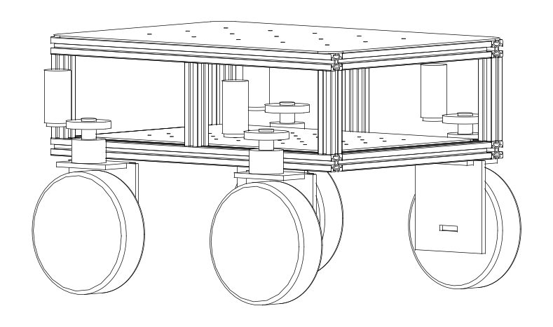

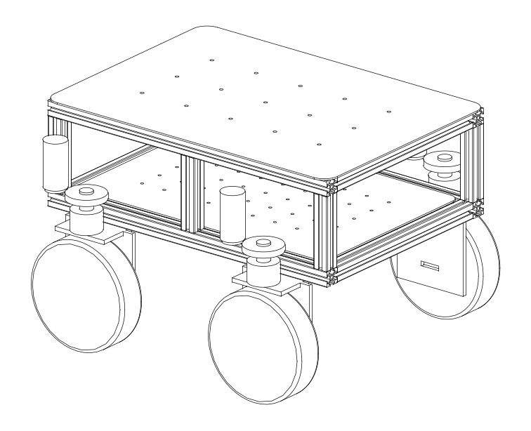

|  | 스키드 (기존) | 스워브 (신규, 17:37 출력) |
| --- | --- | --- |
| 전장×전폭×전고 | 700×632×331 (레일 376) | 640×596×436 (90° 조향 시 전폭 738) |
| 축간/윤거 | 400 / 564 (바퀴 중심 y=±282) | 400/520 |
| 구동 토크/바퀴 | 5.48 N·m | 1.24 N·m (4.4배 감소) |
| 제어축 | 4 | 8 (구동 4 + 조향 4) |
| 프레임 3030 | 6.48 m | 5.72 m / 약 5.93 kg |

조향 모터는 킹핀 위 직결이 아니라 옆에 세우고 벨트 24T→48T(2:1)로 감속하는 배치로 잡았다. 직결하면 모터 길이 90 mm가 전고에 얹히기 때문이다. 스크럽 반경을 0으로 잡아 조향 토크는 계산상 1 N·m 이하라고 봤다. 배선(중공 킹핀 또는 슬립링), 앱솔루트 엔코더, 모터 실치수(Ø45×90 가정), 커버는 미결로 남겼다.

#### 17:38 뷰어 재전송 — 카메라 위치 문제

> 안보여 재전송해줘

포트 3939가 비어 있어 뷰어를 새로 띄우고(PID 21864) 17:39에 보냈다. 17:43에 안 보인다고 해서 브라우저 탭을 열고 두 번 더 보냈는데, 두 번째 재전송에 `CameraKeepWarning`이 떴다. 원인은 이 경고가 가리키는 대로 판단했다 — `reset_camera=KEEP`이라 카메라가 스키드 모델 위치에 남아 있었고, 스워브는 전고가 105 mm 높아 화면 밖이었다는 것이다. `show(..., reset_camera=Camera.RESET)`으로 고쳐 두 파일에 적용했고(`mobility_base.py`의 마지막 수정 시각이 07-28 17:45로 이 시점과 맞는다), 브라우저 JS로 트리에 6개 그룹(프레임/모듈요크/바퀴/킹핀/조향모터/판재)이 들어온 것을 확인했다. 사용자가 "보인다"고 직접 확인한 발언은 없다.

#### 18:06 킹핀 하우징 부유 — 킹핀 브라켓 추가와 애니메이션

> 지금 스웨이브 구조에서 바퀴축이 프레임과 고정되는 부분이 있나? 안보이는것 같아서 말이야 그리고 바퀴 회전을 애니메이션화해서 적용할수 있나 이 뷰어에서

모델에서 확인하니(18:08) 킹핀 베어링 하우징(Ø59, 중심 y=260) 안쪽면이 하부 사이드 레일 바깥면(y=225)에서 **5.5 mm 떠 있었다**. 진단 스크립트 자체는 bbox(킹핀 y −298\~−222, 레일 y −225\~−195)로 "−103.2 mm"라는 엉뚱한 값을 찍었고, 5.5 mm는 하우징 반경 29.5로 다시 계산한 값이다. 하중 경로가 아예 끊긴 상태였다. ㄷ자 킹핀 브라켓(레일 바깥면에 M6 ×2, 상·하 판 32 mm 간격)을 만들어 붙였고 브라켓(y −296\~−225)–레일 간격 0.0 mm를 확인했다. 다만 fuse 하면 솔리드가 2개로 나뉘는 것은 그대로 남았다.

애니메이션은 `ocp_vscode.Animation`으로 됐다. 두 번 걸렸다: `Animation()`은 `show()` 다음에 만들어야 경로를 알고, 경로 루트는 `/swerve_base`가 아니라 `show(*GROUPS)`가 만든 `/Group`이다. 0\~4초 조향 0→90→0°, 4\~8초 바퀴 2회전. 조향(rz)과 구름(ry)을 시간대로 나눈 것은 three.js 오일러 순서 때문에 동시에 걸면 90° 상태에서 엉뚱한 축으로 구르기 때문이다.

#### 18:40 현황 정리 — 실물 치수가 병목

> 뭐 해야하지

exports 13개 / models 8개 / 이미지 27장 상태. 막고 있는 것은 호버보드 실측 4개(바퀴 외경, 축 지름·평면 폭, 축 길이, 모터 폭)이고, 스키드 먼저(총액 33\~66만 원) vs 스워브(+40\~60만 원) 중 Claude는 스키드 먼저를 권했다. 대기 중 할 일로 프린팅 분할(베드 크기 필요), 액슬 마운트 DXF, 발주 리스트, build-log 보강(스커트·펜더·데크레일·스워브·호버보드 5건 미기재)을 꼽았다.

#### 18:52 외장셸 + 축간 연장 — 0.293R 문제 세 번째 재발

> 바퀴 위쪽을 가리면서 바퀴 사이는 스커트 구조로 … 차량 길이도 다시 좀 늘리고

스워브는 문지름이 없어 축간을 늘려도 토크 손해가 없다. 스윕 원(109+여유 10 = 119)이 옆면을 |x−킹핀x|\<112 구간에서 잘라먹기 때문에 축간이 짧으면 스커트 자리가 없다(18:54 계산).

| 축간 | 차체 길이 | 바퀴 사이 스커트 | 앞뒤 여유 |
| --- | --- | --- | --- |
| 400 | 630 | 162 mm | 1 mm — 앞뒤 패널 못 세움 |
| 520 | 800 | 282 mm | 26 mm |
| 600 | 880 | 362 mm | 26 mm |

축간 520(`KINGPIN_X` 200→260)으로 갔다. 셸은 z=50부터 데크 밑까지 통으로 두른 뒤 z\<230 구간에서 스윕 원을 파내는 방식이라, 바퀴 위는 덮이고 바퀴 사이·앞뒤는 스커트가 내려오며 휠 아치가 조향 궤적 그대로 생긴다.

막힌 것: R60 라운드 셸이 사각 프레임 코너를 파고들었다(8,677 mm³). 처음엔 프레임 자리를 파내는 컷으로 때웠는데 검증 스크립트가 10분 타임아웃(exit 143)됐고, 다시 돌리니 **셸이 6조각으로 갈라져** 있었다. 측면 커버·펜더 때 겪은 것과 같은 문제라, 프레임을 800→760으로 줄이고 셸을 `BASE_L/2+25`로 키우고 상부 레일을 y=265로 넣은 뒤 `assert SHELL_X - SHELL_T >= BASE_L/2 + 0.293*(SHELL_R - SHELL_T)` 두 줄(SHELL_Y 쪽 동일)로 못 박았다. 결과(19:22) 전장 820 × 620 × 436, 베이 700×390×140, 데크 820×620, 셸 810×610 하단 z=50(2조각 valid, PETG 3.28 kg), 프레임 6.57 m / 6.81 kg, 8개 부품군 간섭 0. 이 assert 두 줄은 현재 파일에도 `_need = 0.293*(SHELL_R - SHELL_T)` 형태로 그대로 남아 있고(485\~487행), `BASE_L` 760 / `SHELL_X = BASE_L/2+25` / `TOP_RAIL_Y` 265 도 그대로다.

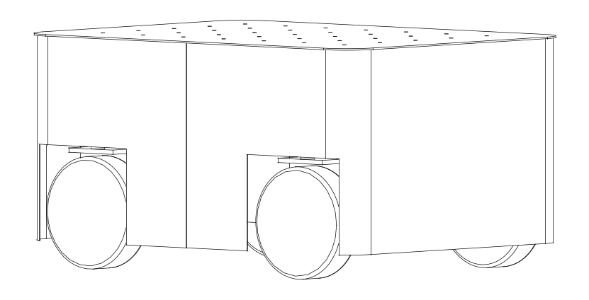

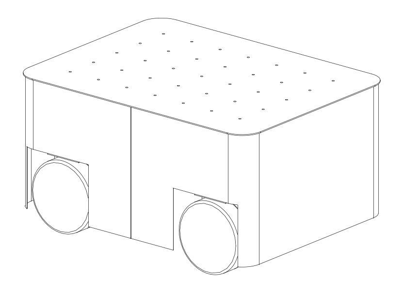

#### 19:24 앞면 얼굴 이식 — 회전 누락과 비율

스키드의 카메라·LED·흡기를 옮기자 외장셸×카메라 1,037 mm³가 잡혔다. 베젤에 `rotation=(0,90,0)`을 빼먹어 원통 축이 Z로 서서 셸 벽을 옆으로 뚫은 것이다. 고친 뒤 렌더를 보니 셸이 383 mm로 커진 탓에 얼굴이 위쪽에 몰려 있어 베젤 Ø90→110, LED 380→430, 눈 z 320→305, 입 z 252→215, 흡기 z 218→155로 키우고 내렸다(19:30). 10개 부품군 간섭 0, 전장 821. 이 시점 이미지 31장. (이 가짜 베젤 얼굴은 후일 build-log 12막에서 ASUS Xtion 실물 STEP 으로 바뀌었다.)

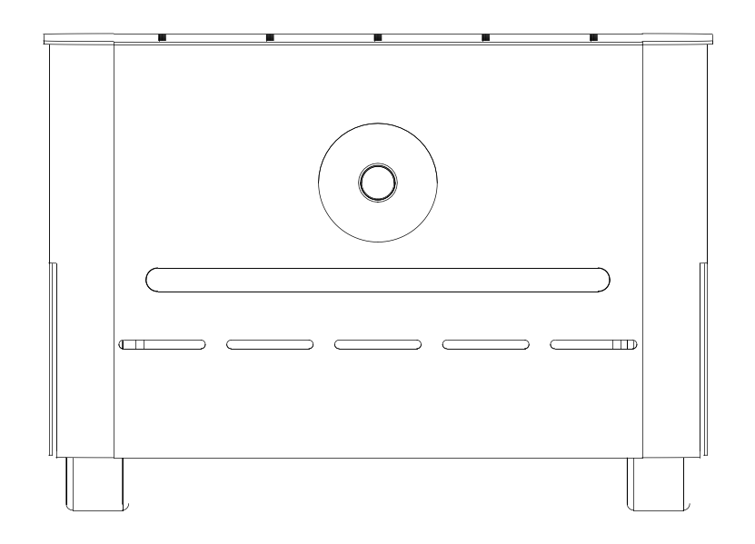

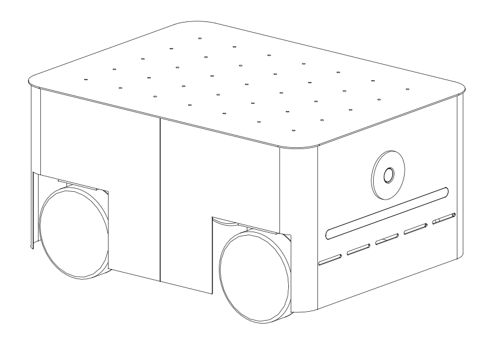

#### 21:01 네 가지 지적 — 베어링·벨트 누락

> 킹핀 브라켓 구멍이 더 크다보니까 바퀴가 앞뒤 좌우로 흔들릴수 있는거 아니야? … 조향모터랑은 축이랑 어떻게 연결되는거지? … 애니메이션에서 바퀴와 요크가 도는 속도가 서로 다른지 돌다가 서로 겹치거든?

모델에서 확인한 사실(21:04) 네 가지가 전부 맞았다.

1. 축 Ø25, 브라켓 보어 Ø47 → 반경 틈 11 mm. 베어링이 모델에 없었다 → 6005(25×47×12) 2개를 상·하 판에 넣었다.
2. 칼라·스냅링·어깨 없음 → 축이 빠질 수 있었다 → Ø40×10 칼라 2개를 베어링 바깥쪽에 붙였다.
3. 풀리 24T(Ø38.2)/48T(Ø76.4), 센터거리 70(최소 57.3)은 성립하지만 벨트가 없었다 → 타이밍벨트(두께 3, 폭 15)를 `make_hull`로 두 풀리를 감아 넣었다. 청크에서는 HTD-5M 이라고 했고 풀리 지름 Ø38.2/24T 는 5 mm 피치에 맞는다. build-log 10막에는 HTD-3M 으로 적혀 있어 서로 다르다.
4. 애니메이션은 부품 종류별로 rz 트랙을 따로 걸어 어긋났다 → 요크·바퀴·킹핀축을 킹핀 원점 Compound 하나로 묶고 `/Group/모듈/모듈N`에 rz, 그 아래 바퀴에만 ry를 걸었다. 좌우 대칭도 mirror 대신 `Rot(0,0,180)`으로 바꿨다.

고치면서 또 걸린 것: 칼라가 베어링과 겹쳤고(모듈×베어링 12,252 mm³), 모터 몸체 Ø45가 풀리 Ø38보다 굵어 벨트를 쳤다(12,572 mm³) → 모터를 벨트 위로 올렸다. 부품군 10개(프레임 16 / 모듈 12 / 베어링 8 / 킹핀브라켓 8 / 조향모터 4 / 조향벨트 4 / 판재 2 / 외장셸 2 / 카메라 2 / LED바 1, 21:11) 간섭 0. 킹핀 축 Ø25 / 베어링 6005 / 칼라 Ø40×10 / 벨트 3×15 / 풀리 24T→48T / 센터거리 70 은 현재 파일에도 같은 값이다.

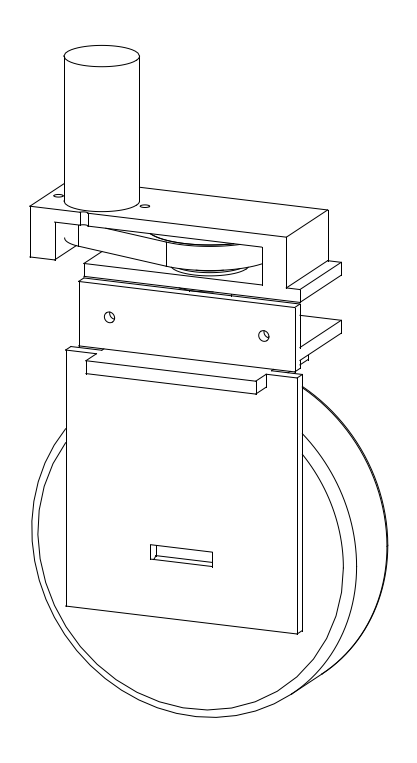

#### 21:28 조향모터 마운트 — 킹핀 브라켓 위 라이저

> 근데 지금 구조로는 모터도 공중에 떠 있는 구조 아닌가? 상부 프레임에 브라켓 달고 고정할 수 있게 해야할거 같은데

상부 프레임이 아니라 킹핀 브라켓에서 라이저로 올려 세웠다. 다른 부재에 달면 조립 오차·열변형으로 벨트 센터거리 70 mm가 흔들리기 때문이다. 여기서 다섯 개가 연달아 걸렸다.

- 문자열 슬라이스를 잘못 잡아 `kingpin_bearings / steer_belt / kingpin_mount`가 중복 정의됐고, 옛 `kingpin_mount`가 새 것을 덮어써 고쳐도 반영이 안 됐다.
- 라이저가 종동 풀리를 침(모듈×브라켓 10,821 mm³) → 풀리 반경 기준으로 위치 계산.
- 킹핀축이 모터판을 2 mm 뚫음 → 축 상단을 `FRAME_TOP + 30 + BELT_W/2`로.
- 모터판 끝이 셸 라운드 코너를 파고듦(1,241 mm³ ×2, 또 0.293R) → 판을 −55→−35로 짧게.
- 라이저가 벨트를 침(2,759 mm³) → 16→10 mm로 좁혀 벨트 바깥에.

진단 코드도 한 번 틀렸다. 조향모터 그룹의 첫 솔리드(풀리, z 282\~298)만 읽고 "모터가 떠 있다"고 잘못 보고했고, 실제 몸체는 z 306\~396에 제대로 얹혀 있었다. 최종 적층(21:52): 모터 306\~396 / 모터판 298\~306 / 라이저 274\~298 / 베어링판 상 266\~274 / 베어링판 하 230\~238, 벨트 z 282\~298. 모터 상단 396과 상부 레일 403 사이 7 mm에 보강 타이를 걸 수 있다는 것과 벨트 텐셔너(장공)는 남겼다.

#### 22:34 충격 흡수 검토 — 서스펜션 방식 선정

> 지금 이 상태로는 충격 흡수가 되나?

하중 경로에서 유연한 곳은 통고무 바퀴 1\~2 mm뿐이었다. 20 mm 턱을 1.0 m/s로 넘을 때(바퀴당 정하중 147 N, 60 kg 기준, 22:36 계산):

|  | 접촉 시간 | 충격력 | 정하중 대비 |
| --- | --- | --- | --- |
| 통고무 직결 (지금) | 5 ms | 1,879 N | 12.8배 |
| 공압 타이어 | 20 ms | 470 N | 3.2배 |
| 스프링 서스펜션 | 60 ms | 157 N | 1.1배 |

금속 부품은 버틴다(6005 정정격 5,850 N 대비 32 %, 킹핀축 Ø25 응력 129 MPa vs 항복 350). 약점은 PETG 출력물 층간 균열, 볼트 200여 개 풀림, 적재 센서, 베어링 수명이라고 봤다. Claude는 1순위로 10인치 공압 휠 교체를 권했으나 사용자는 공압을 배제했다(23:05).

> 공압은 안 쓸거야 그러면 실외에서도 쓰는 것을 감안한다면 어떻게 충격흡수하게 만들어야할까?

네 가지(A 킹핀 축방향 스프링 / B 모듈 안 트레일링 암 / C 모듈 전체 스윙 / D 고무 부시) 중 B를 골랐다(23:07). A는 풀리가 축에 붙어 있어 벨트 평면이 같이 움직이고, C는 벨트는 무사하지만 비스프렁 질량이 모듈 전체 6 kg+가 되며, D는 2\~3 mm뿐이다. B는 조향계를 전혀 안 건드리고, 피벗을 킹핀에서 97 mm 안(스윕 109 이내)에 두면 셸·휠 아치·프레임이 그대로다. 제안 단계 수치는 스프링 약 9.4 N/mm(정하중 147 N에서 16 mm 처짐), 암 105 mm로 트래블 25 mm = 13.8°, 그때 축 전후 이동 3.0 mm, 3G 441 N에서 47 mm 처짐이었다.

#### 23:21 트레일링 암 서스펜션 — 모듈 단위 탈착

> 그렇게 해보자 여전히 모듈구조를 유지해서 바퀴하나마다 제작과 유지보수 그리고 부착도 용이하도록 말이야

요크를 요크상부(고정, 피벗 보스·쇼크 상단·범프스톱 자리) / 스윙암(`make_hull`로 세 보스를 감싼 8 mm 판) / 코일오버로 나눴다. 피벗 (−95, 165), 트래블 25, 쇼크 마운트 (−25,215)/(−15,112), 쇼크 Ø22. 첫 실행(23:24)에서 요크 수직판이 레일을 뚫어(프레임×모듈 38,169 mm³) 높이를 `MODULE_TOP` 안으로 넣었다. 결과(23:26) 10개 부품군 간섭 0, 스트로크 검사 정위치/25 mm 압축/12 mm 신장 OK. 암 길이 112 mm, 쇼크 마운트까지 96 mm → 모션비 0.85, 바퀴 25 mm에 쇼크 21 mm, 필요 스프링 13 N/mm(쇼크를 피벗 쪽에 붙였으면 48 N/mm). 모듈 = [요크상부, 스윙암, 쇼크, 바퀴, 킹핀축] 5개이고 차체와 접점은 킹핀축–베어링 하나뿐이라 칼라 하나 풀면 아래로 빠진다. (build-log 11막에는 암 길이가 109 mm 로 적혀 있다 — 당시 출력은 112 mm. 현재 파일은 피벗을 절대 좌표가 아니라 차축 기준 `SUS_PIVOT_X −95 / 차축 +60` 으로 역산한다.)

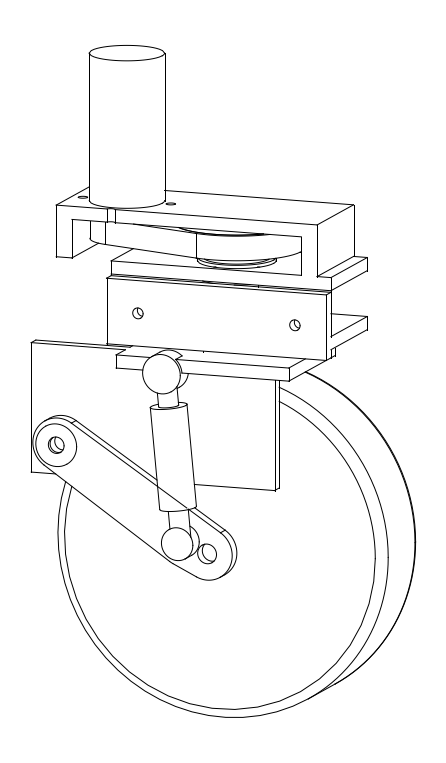

#### 23:35 다음 요구 — 바운스 애니메이션과 --\\\_\_/-- 스커트

> 앞뒤는 길게 스커트가 내려오게 하지 않아도 되고(제거하라는소리야) 바퀴와 바퀴 사이는 --\\\_\_/-- 이런구조로 해서 깔끔하게

`SKIRT_LOW_X 70 / SKIRT_TOP_X 138 / SKIRT_LOW_Z 60` 파라미터로 패치를 시작했으나, 치환 스크립트가 `\_` 이스케이프 경고와 f-string 안 따옴표 중첩으로 `SyntaxError: unterminated string literal`이 나면서 이 구간은 여기서 끝났다(23:37). 셸은 아직 옛 상태(스커트 282 mm 구간)다. 현재 파일에는 `SKIRT_LOW_X, SKIRT_TOP_X = 70, 138`(스워브) 이 들어가 있고 `DRIVE=swerve` 로 돌리면 "옆면 스커트 저부 140 mm → 경사 끝 276 mm, 앞뒤는 스커트 없음"으로 나온다 — 이 요구는 다음 구간에서 구현됐다.

### 결정

- 스워브는 차체를 바퀴 위(z≥230)로 올리는 층 분리로 간다 — 스윕 반경 109 mm 때문에 선택이 아니라 강제였다. 대안이었던 "스키드 프레임 유지 + 커버만 잘라내기"는 20° 조향에 차체 y≤211 이 필요해 불가였다.
- 조향 모터는 킹핀 옆 벨트 2:1, 마운트는 상부 프레임이 아니라 킹핀 브라켓 위 — 센터거리 70 mm 고정이 우선이다.
- 축간 400→520, 프레임 760, 셸 810×610 — 축간 400에서는 스커트 162 mm·앞뒤 여유 1 mm로 앞뒤 패널을 못 세웠고, 520에서 282 mm를 확보했다(560/600은 322/362 mm, 전장 840/880).
- 서스펜션은 공압 대신 모듈 안 트레일링 암 + 코일오버(B안). 조향계를 안 건드리면서 비스프렁 질량도 안 늘리는 안이었다. 쇼크는 바퀴축 가까이(모션비 0.85) 두어 13 N/mm 쇼크가 맞게 했다.
- 라운드 셸은 사각 프레임보다 0.293R 크게 — assert로 고정.
- 애니메이션은 트랙 값을 맞추는 대신 회전부를 킹핀 원점 Compound 로 묶어 구조로 고정.

### 남은 일

- `--\__/--` 스커트와 앞뒤 스커트 제거, 서스펜션 바운스 애니메이션(패치 스크립트 SyntaxError로 중단).
- 쇼크 실물 선정(13 N/mm, 스트로크 21 mm 이상, 아이-투-아이 약 104 mm — 전동킥보드 리어쇼크 후보), 범프스톱(3G 441 N에서 47 mm 처짐), 하중에 따른 지상고 변동 16 mm의 라이다 캘리브레이션 반영.
- 브라켓–레일이 맞닿는데 fuse 시 솔리드 2개로 나뉘는 것, 벨트 텐셔너(장공), 상부 레일 보강 타이.
- 인휠모터 배선(중공 킹핀/슬립링), 앱솔루트 엔코더, 조향모터 실치수, 호버보드 실측 4개, 프린팅 분할(베드 크기), build-log 미기재 5건.
- 참고: 이 구간의 스트로크 검사 "OK"는 후일 build-log 13막에서 잘못된 것으로 드러났다 — 요크 수평팔이 바퀴 위 6 mm 를 지나가 실제 트래블은 3\~6 mm 였고, 원인은 `MODULE_TOP = WHEEL_D + 20` 눈대중이었다. 당시 검사가 왜 OK 로 나왔는지는 청크와 build-log 만으로는 확실하지 않다. 이 청크 안에서는 알 수 없었던 사실이다.

### 교훈

- "공중에 떠 있는 거 아니야?"라는 사용자 질문이 세 번(킹핀 → 베어링/벨트 → 모터) 연속 결함을 잡았다. 간섭 검사는 겹침만 보지 부재(不在)는 못 본다 — 하중 경로를 부품 단위로 짚어 봐야 한다.
- 같은 문제(라운드 vs 사각 코너)가 세 번째 재발했다. 파내서 때우면 셸이 6조각이 되고, 답은 치수 규칙 + assert다.
- 뷰어에 안 보이는 것을 전송 실패가 아니라 카메라 문제로 봤다. 경고 메시지(`CameraKeepWarning`)가 이미 답을 말하고 있었다.
- 애니메이션이 어긋나면 트랙을 맞추지 말고 구조(Compound)로 못 박아야 한다.
- 문자열 슬라이스로 파일을 고치면 함수가 중복 정의돼 "고쳐도 안 바뀌는" 상태가 된다. 진단 코드도 첫 솔리드만 읽고 틀린 보고를 했고, 킹핀 부유 진단도 −103.2 mm 라는 엉뚱한 값을 찍었다 — 검사 도구 자체를 의심할 것.

### 이후 달라진 것 (2026-09-15 기준)

2026-09-15 저장소 기준.

| 항목 | 당시 (07-28) | 현재 |
| --- | --- | --- |
| 바퀴 / 스윕 반경 | Ø210×58 가정 / 109 mm | Ø158.7×55 (6.5인치 STEP 실측) / 84 mm |
| 모듈 층 / 차체 층 | z 0\~230 / 230\~436 | `DRIVE=swerve` 실행 시 z 0\~196.7 / 196.7\~409 (build-log 9막에는 중간 시점 값 248 / 전고 460) |
| 전장×전폭×전고 | 821×620×436 | `DRIVE=swerve` 873×712×544 (범퍼·핸들·포트베이 추가 후) |
| 프레임 / 셸 / 베이 | 6.57 m · 6.81 kg / 810×610 / 700×390×140 | 동일 (데크만 820×620 → 810×610) |
| 킹핀·베어링·벨트·풀리 | Ø25 / 6005 / 3×15 / 24T→48T, 센터 70 | 동일 |
| 스커트 | 282 mm 구간, 앞뒤 스커트 있음 | 옆면만 --\\\_\_/-- (저부 140, 경사 끝 276), 앞뒤 없음 |
| 파일 | swerve_base.py 는 스워브 전용 | 같은 파일이 `DRIVE=skid` 기본(고정 4륜)이고 스워브는 옵션. build-log 21막에서 스워브 자체를 접었다. `models/mobility_base.py`, `exports/swerve_base.step`, 이미지 26\~33 은 모두 남아 있다 |

---

## 2026-07-28 (화) · 차체: 외장 --\\\_\_/--, 실물 Xtion, 그리고 움직이지 않던 서스펜션

> 시간: 23:41 ~ 07-29 (수) 12:02 · 장소: PC (`D:\build123d`) · 날짜 근거: 세션 기록 · 원본: 차체 설계 일지 `entry_04.html`

KST 07-28 23:41 \~ 07-29 02:11, 그리고 07-29 09:47 \~ 12:02 의 두 구간이다 (원본 타임스탬프 UTC 14:41 \~ 17:11, 00:47 \~ 03:02). 대상은 스워브 버전 `models/swerve_base.py`. 앞뒤 스커트를 걷어낸 `--\__/--` 외장, 목업 카메라를 실물 STEP 으로 교체, 애니메이션 서스펜션 바운스가 이월된 과제였다. 바운스 각도를 재다가 설계값 25mm 트래블이 실제로는 안 나온다는 것을 찾았고, 이어서 후면 비상정지·포트 베이·소형 카메라 6개, 문서 갱신(7막\~13막), 베이 내부 부품·냉각·안테나, 삼면도 시트까지 갔다. 이 일지의 숫자는 당시 값이며, 당시와 지금이 다른 값은 본문에 "당시 X, 현재 Y" 로 병기했다(정리는 끝의 "현재 저장소와의 차이").

### 한 일

#### 23:41 — 서스암 서브 Compound 와 스커트 사다리꼴

이전 세션에서 heredoc 이스케이프가 깨진 채 끊겨 파일을 직접 편집하는 것으로 시작했다. 스윙암·쇼크·바퀴를 **피벗이 원점인 서브 Compound `서스암N`** 으로 묶었다. 모듈 원점은 킹핀이라 그냥 `ry` 를 주면 엉뚱한 축으로 돌기 때문이다. `ARM_L = math.dist(SUS_PIVOT, (0, AXLE_Z))` 를 추가하고, 애니메이션은 0\~4초 조향 0→90→0°, 4\~8초 구름 + 5초 턱 바운스(앞바퀴 먼저, 뒷바퀴 1.2초 뒤)로 짰다. 실행 출력은 "암 10° = 바퀴 20mm, 한계 13°" 인데, 아래 스트로크 스윕에서는 −10° 가 바퀴 상승 17.4mm 로 나온다. 두 수치가 왜 다른지는 청크에서 다루지 않았다 — 확실하지 않다.

스커트는 `_low_cut()` 하나로 z\<MODULE_TOP 을 통째로 지우되 옆면 가운데 사다리꼴만 남기는 방식이다. `SKIRT_TOP_X <= KINGPIN_X - SWEEP_R - SWEEP_CLR`, `SKIRT_LOW_X < SKIRT_TOP_X` 두 assert 를 넣었다. 첫 실행(23:44): 전장 821 × 전폭 620 × 전고 436, 축간 520 / 윤거 520, 외장셸 810×610 본체 z=230\~433, 저부 140mm @ z=62 → 경사 끝 276mm @ z=230, 프로파일 6.57m / 6.81kg.

#### 23:47 — 간섭 2건과 검증 코드의 조상 Location 누락

재구성 직후 간섭 검사에 새 항목 2건이 떴다(어느 쌍인지는 청크 출력이 잘려 있다). 모듈1 부품의 world bbox 를 찍어 보니 스윙암 위치는 기대치와 일치했다. 리프 단위 스캔이 문제였다 — 트리를 내려가며 **조상 Location 을 곱하지 않고** 원점 기준 좌표로 비교하고 있었다. build-log 29절 「틀렸던 것들」 표에는 이 증상이 "킹핀축 4개가 전부 같은 부재와 같은 부피로 겹친다고 나옴" 으로 남아 있다. 조상 location 을 누적하는 `walk()` 로 다시 쓰자(`verify2.py`) 킹핀축 4개는 (±260, ±260, 258)에 제대로 있었다. 리프 단위에서는 요크상부N×킹핀축N 7,540 mm³ 같은 결합부 겹침(그리고 뒤에 피벗 보스 문제로 밝혀지는 요크상부N×바퀴N 265 mm³)이 남았고, 같은 부품군 안의 쌍을 빼자 부품군 간섭 0건, 월드 솔리드 75개, 외장뒤 829 / 외장앞 789 cm³ 였다.

#### 00:03 — 스커트 누락과 Plane.XZ 법선 방향

실루엣 렌더(`shell_side.png`)를 보니 스커트가 없었다. `Plane.XZ` 의 법선이 **−Y** 라 `offset(SHELL_Y+20)` 한 사다리꼴 프리즘이 모델 밖으로 밀려 나간 것이다. 스케치 평면을 `Plane.XZ` 로 두고 양쪽으로 밀어 해결했다. 숫자 검사는 다 통과한 상태였고 그림으로만 보였다.

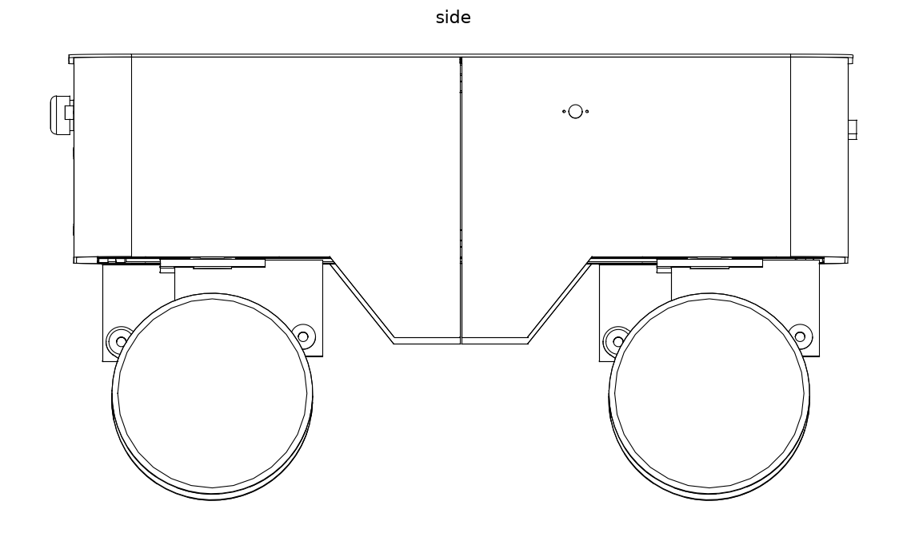

#### 00:03\~00:26 — 목업 카메라를 ASUS Xtion STEP 으로 교체

`refmodel/ASUS Xtion Pro Live.step` 을 재니 bbox 180.0 × 46.9 × 40.0, 솔리드 2개(150 + 16 cm³). 렌즈가 +Z, 스탠드가 −Y 라 `Plane(x_dir=(0,1,0), z_dir=(1,0,0))` 으로 눕혔다. 베젤·렌즈 목업을 지우고 베이스는 떼는 전제(`XT_KEEP_BASE=False`)로 센서 바만 남겼다. 바를 잡는 **크래들 브라켓**(바닥판+뒤판+옆 치크+상단 스트랩)과 그것을 얹을 **카메라크로스 3030 × 390mm** 를 기둥 사이에 새로 넣었다. 창은 바 실루엣 + 1mm. 카메라크로스가 붙어 프로파일은 6.57 → 6.96m 가 됐다.

이 구간에서 스커트 깊이를 절반으로(저부 z=62 → 146, 깊이 168 → 84mm), 스커트 벽만 10mm(본체 3mm)로 바꿨다. 이 요구의 사용자 발언은 청크에 없다. Claude 의 "스커트 깊이 절반에 두께 10mm 로 같이 반영하겠다" 와 build-log 12막의 인용("너무 아래까지 내려왔다, 절반이면 되고 좀 두껍게")으로 확인된다. 스커트 벽 10mm / 본체 3mm 는 현재도 같다(`SKIRT_T = 10`). 저부 폭은 당시 140mm(반길이 70/138), 현재 스키드 기본값은 120mm(60/118) @ z=125.7 이고 스워브 모드에서만 70/138 이 남아 있다.

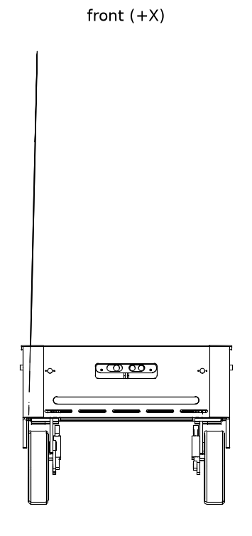

#### 00:16 — 셸 아래 잔류 띠 제거

간섭 0건인데 셸 목록이 네 줄로 늘었다 — 외장뒤 1002 + 310 cm³, 외장앞 936 + 310 cm³, 즉 **짝마다 솔리드 2개**(월드 솔리드 79개). 셸 스케치가 `SHELL_BOT=50` 에서 시작하는데 컷 박스는 `SKIRT_LOW_Z−20` 부터라 z 50\~126 띠가 안 잘리고 남은 것이다. `SHELL_BOT` 을 없애고 스케치를 `SKIRT_LOW_Z` 에서 시작하게 했다. 77 솔리드, 외장뒤 1002 / 외장앞 936 cm³. 연결성(솔리드 수 == 1) 검사가 또 잡았다.

#### 00:22 — 셸 고정 플랜지와 M6 12개

고정 구조가 없다는 지적(사용자 발언은 청크에 없고 build-log 12막에 "고정 파츠가 안 보여서" 로 인용됨)에 셸 상단을 안쪽으로 접은 **플랜지 폭 45 × 두께 6** 을 만들고 **M6 12개**(옆면 x = ±100, ±300 × 2, 앞뒤 y = ±150 × 2)로 상부 레일·크로스 슬롯에 물렸다. 데크판을 6mm 올려 볼트를 덮는다. `CAM_X` NameError 한 번을 고친 뒤 전고 442, 데크 z=439, 센서바 @ z=355 / 창 182×43 / 카메라크로스 z=312, 76 솔리드, 외장뒤 1372 / 외장앞 1312 cm³, 간섭 0. 플랜지 45×6 / M6 12개 / 볼트 위치는 현재 파라미터(`FLANGE_T, FLANGE_W = 6, 45`, `FLANGE_BOLT_X`, `FLANGE_BOLT_Y`)와 같다.

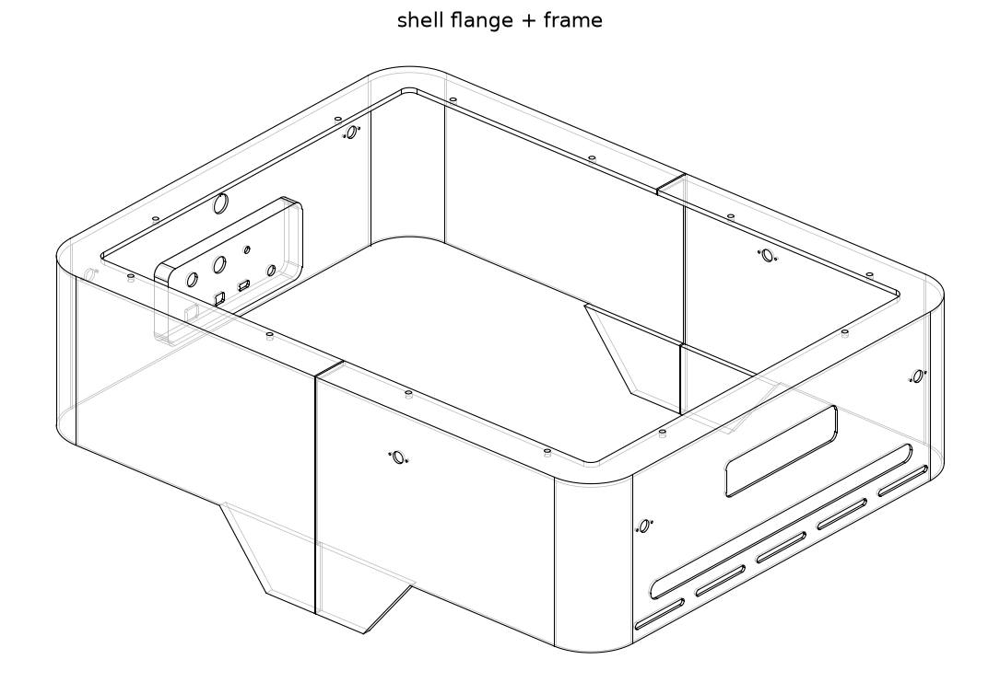

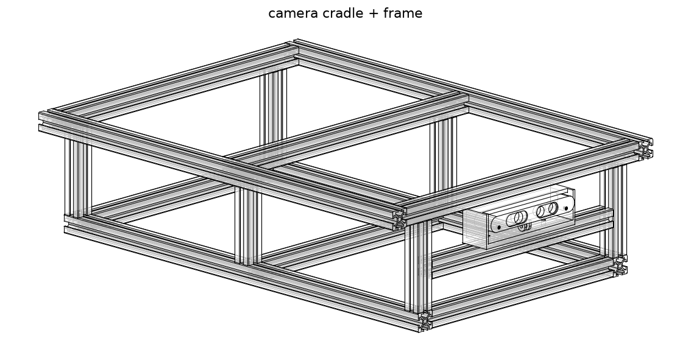

#### 00:36 — 서스펜션 트래블 실측과 MODULE_TOP 역산

바운스 각도를 검증하려고 암 각도를 스윕하며 요크×바퀴 교집합 부피를 쟀다(`stroke.py`). 바퀴 정위치 top = 210, 요크 수평팔 z 216\~224, MODULE_TOP 230.

| 암 각 | 바퀴 상승 | 요크×바퀴 (수정 전) | 수정 후 |
| --- | --- | --- | --- |
| 0° | 0 mm | 265 mm³ | 0 |
| −2° | +3.4 | 265 | 0 |
| −4° | +6.8 | 852 | 0 |
| −6° | +10.3 | 8,165 (build-log 13막) | 0 |
| −10° | +17.4 | 29,784 (build-log 13막) | 0 (청크 출력이 잘려 있고 Claude 의 "Full travel is clear" 로 확인) |

설계값 25mm 트래블이 실제로는 3\~6mm 였다. 원인은 `MODULE_TOP = WHEEL_D + 20` 이라는 눈대중 값을 서스펜션을 넣은 뒤 다시 안 본 것. 값을 키우는 대신 **트래블에서 역산**하도록 바꿨다: `YOKE_ARM_Z = WHEEL_D + SUS_TRAVEL + YOKE_CLR(3) + YOKE_T/2`, MODULE_TOP 230 → 248, 전고 442 → **460**, 요크 수평팔 z 234\~242. 딸려 나온 결함 둘: 피벗 보스가 바퀴 폭 안으로 5mm(265mm³, x[−94,−82] y[−29,−24] z[152,169])라 보스 길이를 바퀴 폭 기준으로 계산했고, 모듈을 올리자 요크 팔이 킹핀 브라켓 수직판을 물어(2,640mm³) 판 밑단을 MODULE_TOP 에 맞췄다. 수정 후 −10° 까지 요크×바퀴 0. 이 역산식(`YOKE_ARM_Z`, `SUS_TRAVEL = 25`, `YOKE_CLR = 3`)은 현재 파일에도 그대로 있고, 스워브 모드에서만 MODULE_TOP 에 쓰인다. 스키드 모드는 바퀴 꼭대기 + 여유 12 가 곧 차체 바닥이다.

#### 01:16 — Xtion 치수 반올림 간섭과 STEP bbox 런타임 읽기

남은 간섭을 쌍 유형별로 묶으니 Xtion×카메라브라켓 406mm³(3 + 399 + 3)이 하나 있었다. 실측을 `(180, 41, 36)` 으로 반올림해 상수로 박은 탓이었다(실제 180.0 × 41.64 × 36.19). STEP bbox 를 런타임에 읽어 창과 크래들 높이를 뽑도록 바꿨다. 이후 남은 겹침은 요크상부×킹핀축 10,053 / 요크상부×스윙암 3,619·951 / 요크상부×쇼크 1,313 / 스윙암×쇼크 1,513 mm³ × 4모듈 = **20건, 전부 의도된 결합부**. 이 시점 제원: 전장 820 × 620 × 460, 스커트 저부 140mm @ z=164 → 경사 끝 276mm @ z=248, 센서바 180×42 @ z=385, 창 182×44 (여유 1.0), 카메라크로스 z=341, 프로파일 6.96m / 7.22kg. 렌더 34\~38 저장(01:27), STEP 5.7MB(01:26). Xtion 창 182×44 는 현재 최종 사양(build-log 31절)에도 같은 값이다.

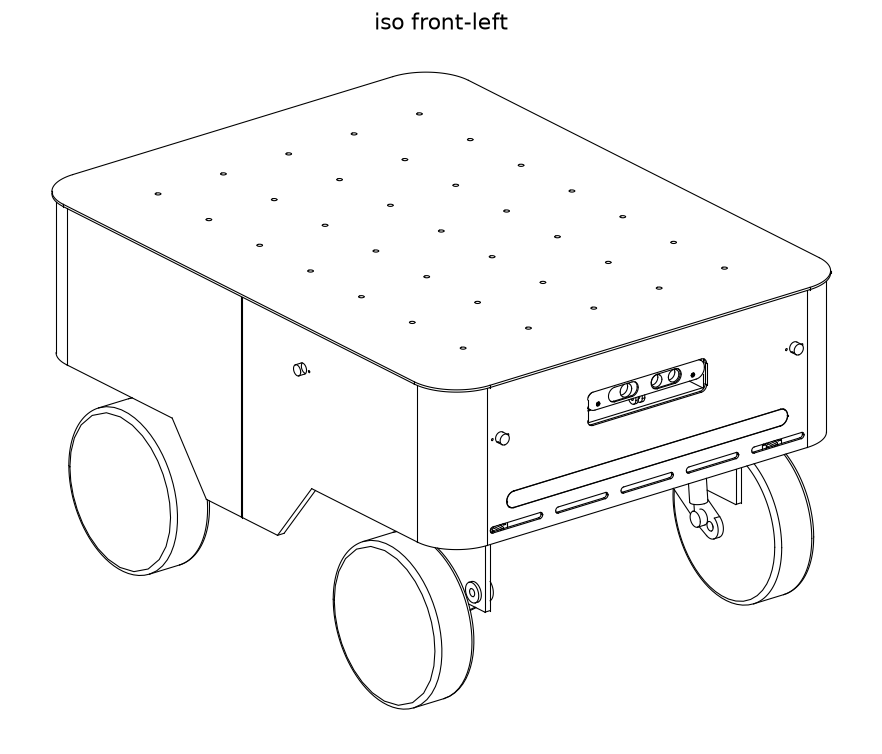

#### 01:35 — 후면·소형 카메라·문서

> 전고는 그대로 가자, 이제 문서 업데이트 해줘 … 차량 뒤쪽 외장쉘에는 비상정지버튼과 여러 포트(내부로 조금 들어가있느 형태) 공간이 있어야해 작은 카메라 공간도 후방 2개 전방2개 좌우 1개씩 있으면 괜찮을 거 같기도한데

`_face()` 로 면 이름 → (법선, 좌표 함수)를 한 번만 갈라 두고 소형 카메라 6개(렌즈 Ø14, M2.5 2점)를 같은 코드로 뚫었다. 비상정지 Ø22 는 상부크로스 밑을 지나도록 역산해 z=400, 포트 베이 220×95 @ z=320, 깊이 20, 커넥터 7종(충전/전원스위치/표시등/RJ45/USB-A/HDMI/예비 그로밋)이 뒷벽(x=−385, 프레임보다 2mm 앞)에 물린다. 막힌 것 둘: 포트 베이 스케치에 z 를 안 줘 셸이 z=−47 까지 늘어나 전고 508 이 됐고, `MINI_BODY[2]`(높이)를 깊이 자리에 써서 몸체가 3mm 더 들어가 앞뒤 기둥을 물었다(271/373 mm³ — 이 두 부피는 Claude 요약에만 있고 검사 출력은 잘려 있다). 둘 다 고쳐 84 솔리드, 외장뒤 1402 / 외장앞 1309 cm³, 전장 843 × 628 × 460, 데크 z=457, 베이 700×390×140 바닥 z=281. 비상정지 Ø22 / 포트 베이 220×95 깊이 20 / 커넥터 7종 / 소형 카메라 6 은 현재 파라미터와 최종 사양에도 그대로다.

`docs/build-log.md` 를 368 → 676줄로 늘려 7막\~13막을 추가했고 「틀렸던 것들」 표(현재 29절)에 6줄(검증 코드 자체의 오류 포함)을 더했다 — 368 과 "6줄" 은 Claude 요약값이고 청크의 wc 출력은 잘려 있다. 676줄은 조립 스크립트 출력으로 확인된다. 현재는 1,630줄, 28막 + 29\~32절이다. 모델에서 뽑은 수량(프로파일 6.96m, 셸 2,712 cm³ PLA 3.36kg, 판재 2,324 cm³ 2.88kg, 카메라브라켓 172 cm³)으로 제작비를 냈다: 스키드 317,000\~660,000, 스워브 692,000\~1,974,000원. 폭이 3배 가까이 벌어지는 이유는 조향 모터(NEMA17+감속+엔코더 2.5만 vs 브러시리스 서보 15만/개)다. 국내 시세 추정이지 견적이 아니다. 현재 build-log 32절은 구 스키드 317,000\~660,000(그대로) / 현행 스키드 482,000\~992,000 / 스워브 887,000\~2,483,000 이고, `docs/bom.md` 의 적재함 포함 전체 신품 합계는 1,976,478원이다.

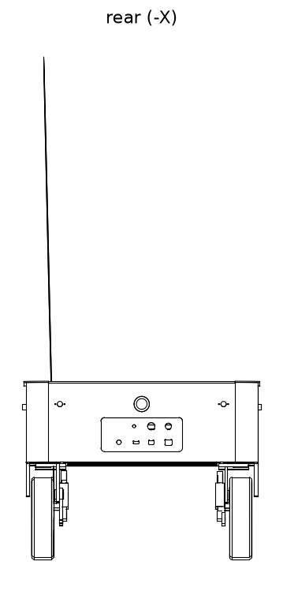

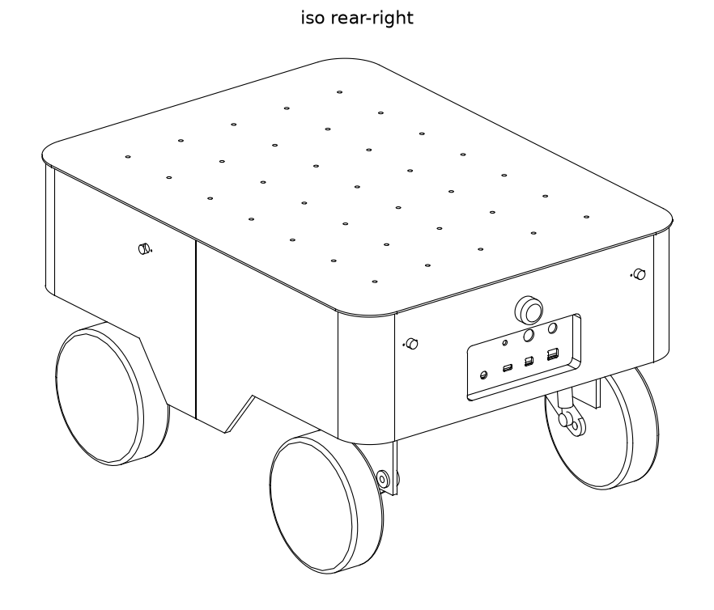

#### 09:47 — 남은 작업 정리와 MG996R 조향 토크

> 이제 남은 작업이 있나? 부품을 넣어야한다던지등 실제 step 파일이 필요한다던지 등

`refmodel/` 에 새로 들어온 `Servo MG996R.STEP`(파일 시각 07-29 01:19, bbox 53.6 × 47.6 × 20.0, 솔리드 1)을 재고 조향 토크를 계산했다(μ=0.5, 제자리 조향).

| 차량 | 바퀴당 | 제자리 조향 토크 | 모터측 1:1 | 2:1 |
| --- | --- | --- | --- | --- |
| 45 kg | 110 N | 0.80 N·m | 8.2 kgf·cm | 4.1 |
| 50 kg | 123 N | 0.89 N·m | 9.1 | 4.5 |
| 55 kg | 135 N | 0.98 N·m | 10.0 | 5.0 |

MG996R 은 11 kgf·cm@6V = 1.08 N·m, 회전 약 180° — Claude 가 인용한 스펙이고 데이터시트와 대조하지는 않았다. 토크는 되지만 **벨트 2:1 에서 킹핀 ±90° 를 만들려면 서보가 360° 돌아야 해서 각도가 안 된다.** 1:1 벨트(여유 1.2배), ±45° 제한, 연속회전 개조 세 가지 중 1:1 을 추천했다. 남은 것으로 허브모터 실측(스윙암 축 구멍이 아직 Ø12 원형 — 허브모터는 축이 고정자라 D컷 없이는 구동토크 21\~29 N·m 에 미끄러진다), 배터리 실측, 배터리·파이·그로밋·데크 레일·드라이버·배기팬 미이식, 공차 중량·무게중심 미산출을 정리했다. 현재 파일의 `STEER_PULLEY = (24, 48)` 은 여전히 2:1 이다 — 1:1 결정은 반영되지 않았고, 스워브 자체가 21막에서 보류됐다. 축 구멍은 이후 22\~23막에서 실물 축(Ø16, D컷 평면 −46.5\~−3.7)을 실측해 다시 잡았다.

#### 11:03 — 베이 내부 부품·냉각·안테나

> 안테나도 달아야겠네 , 학교 프린터는 1000\*1000\*1000 도 가능한 대형 프린터야 / 라즈베리파이와 데크모듈 레일, 드라이버 배치 배기팬 등 다 넣어보자 배터리 등도

셸 한 짝이 810×610×293 이라 분할은 불필요, 앞뒤 2분할은 조립(닫힌 고리를 프레임에 못 씌움) 때문이라고 문서를 고쳤다. 넣은 것: 배터리 200×150×90 **[추정]** + 브라켓(M5 4점), 라즈베리파이5+NVMe+PoE 58×90×37(STEP 실측 58.1 × 90.0 × 36.5), 인휠 드라이버 2 + 조향 드라이버 1, 2020 레일 3본 × 760, 안테나 2본(뒤쪽 모서리, 25° 후경, 레일 바깥 y=±265), 바닥 Ø25 그로밋 4 + 데크 2. 여기서 앞면 흡기 그릴이 z=266 인데 바닥판이 z=281 이라 **지금까지 그릴은 모듈실만 식히고 있었다**는 것을 알았다. 측면 흡기 루버 6×양면과 후면 배기팬 60mm × 2(y=±160)를 넣어 옆→뒤 흐름으로 바꿨다. 전고는 안테나 포함 612(차체 460). 현재 값: 배터리 (200,150,90) [추정] 그대로, 배기팬 y=±160 · 루버 (60×8) 2열×3단 = 6/면 그대로, 안테나는 `ANT_TILT = 10`°, `ANT_Y = 230`(컴팩트 셸 170)으로 바뀌었다. 공차 중량은 당시 "50kg대 추정" 이었고 18막에서 89 kg 로 처음 제대로 셌다.

막힌 것: 파이 실물 STEP 이 **솔리드 516개**라 간섭 검사가 10분을 넘겨 백그라운드로 밀렸다. 외형 박스로 대체하고 `PI_DETAIL` 플래그로 실물을 켤 수 있게 남겼다(현재도 `PI_DETAIL = False`). 검사 대상 99 솔리드, 간섭 20건(전부 의도된 결합부), 신규 부품 0건.

#### 11:50 — 삼면도와 뷰어

`sheet.py` 로 정면/우측/배면/좌측/평면/등각(선 1,476 / 1,079 / 1,165 / 1,080 / 489 / 980개)을 뽑아 `41_swerve_drawing_sheet.png` 와 42\~47 개별 뷰로 저장했다. 네 입면은 동일 축척(span 927)이다. 막힌 것 둘: 곡선 샘플링이 실패하면 정점 두 개를 직선으로 잇는 폴백이 화면을 가로지르는 가짜 선을 만들어 300mm 넘는 선은 버리게 했다. 시트에서 안테나가 잘려 보였는데 투영 범위(우측 843×617 \< 축척 927)를 찍어 보니 잘린 게 아니라 실제로 거기까지 가는 것이었다. 뷰어 전송은 `show()` 의 포트 자동탐색이 "No Windows console found" 로 죽어 `set_port(3939)` 와 `progress=None` 으로 고정했다. 그때까지 애니메이션도 "Path '/Group/모듈/모듈1' does not exist" 로 실패하고 있었다. 제작비는 레일·팬·안테나·그로밋 반영으로 732,000\~2,068,000원, STEP 7.7MB(12:01). 현재 STEP 은 26MB(08-01)다.

`sheet.py` 를 비롯한 이날의 scratchpad 스크립트(verify2/verify3/stroke/clash/camclash/xtion/pi/servo/bom/views/shell_only)는 지금 남아 있지 않다. build-log 28막 "도면 스크립트가 사라져 있었다" 가 이 일이고, 뒤에 `models/drawings.py` 로 다시 짰다. 현재 `docs/images` 의 41\~47_swerve\_\* 는 07-31 09:38 에 다시 뽑은 파일이라 이날 11:52 결과물 그대로는 아니다(34\~40 은 이날 02:01 파일이 그대로 있다).

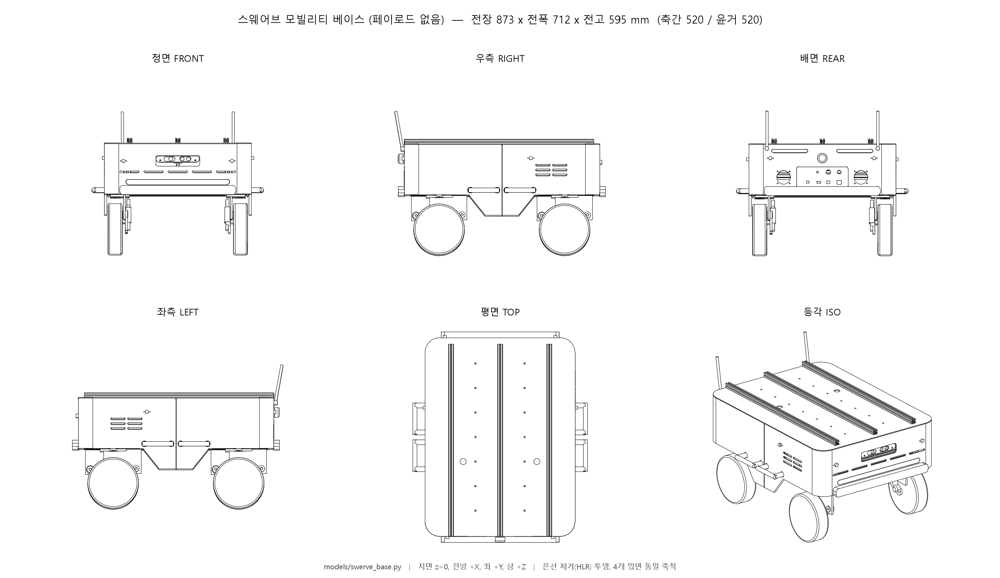

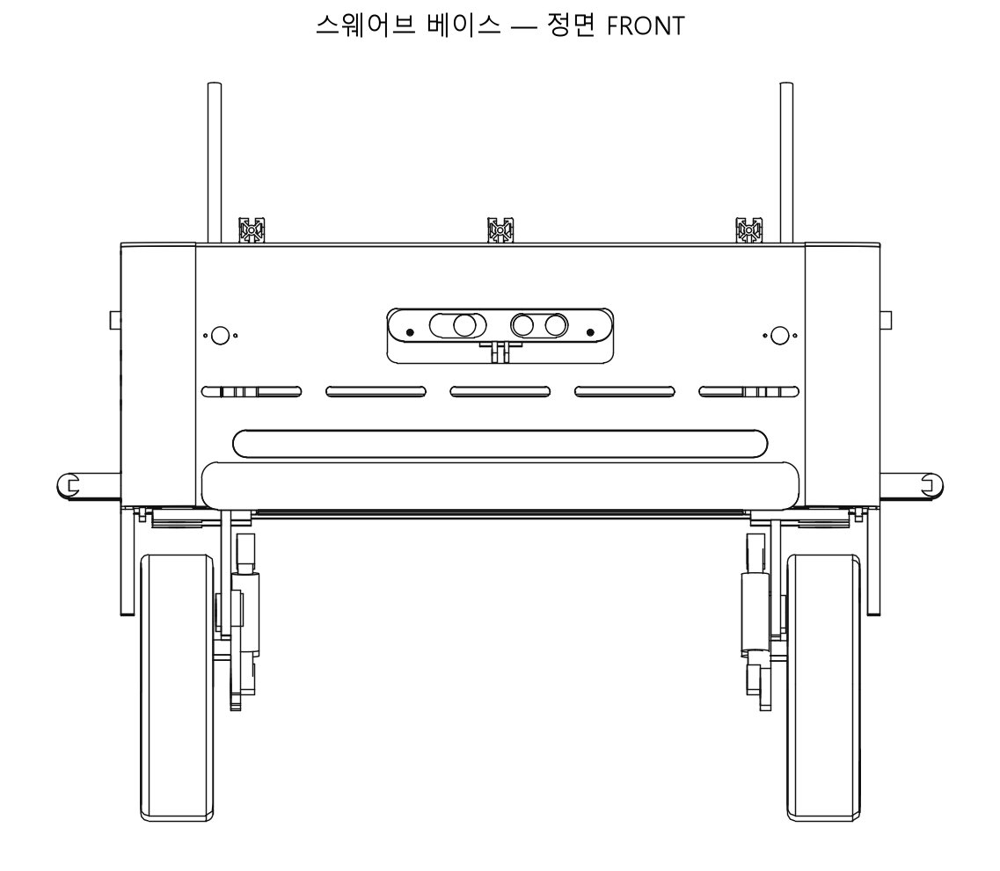

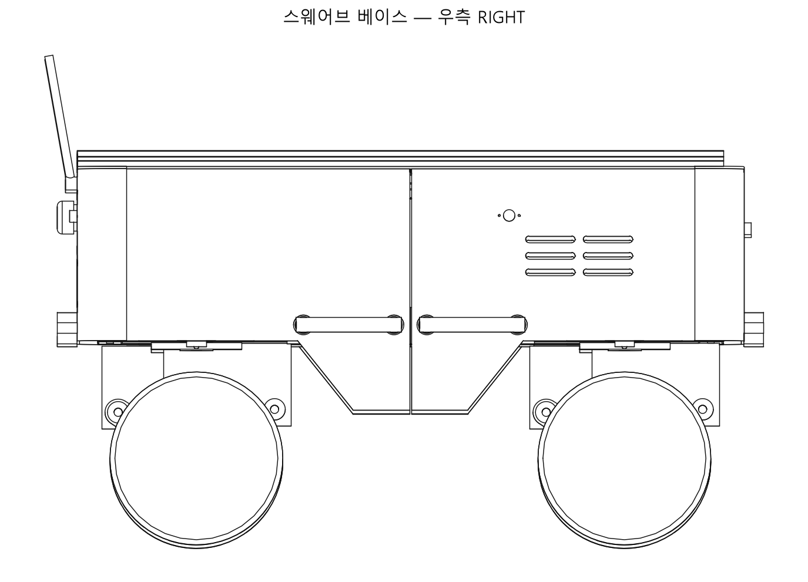

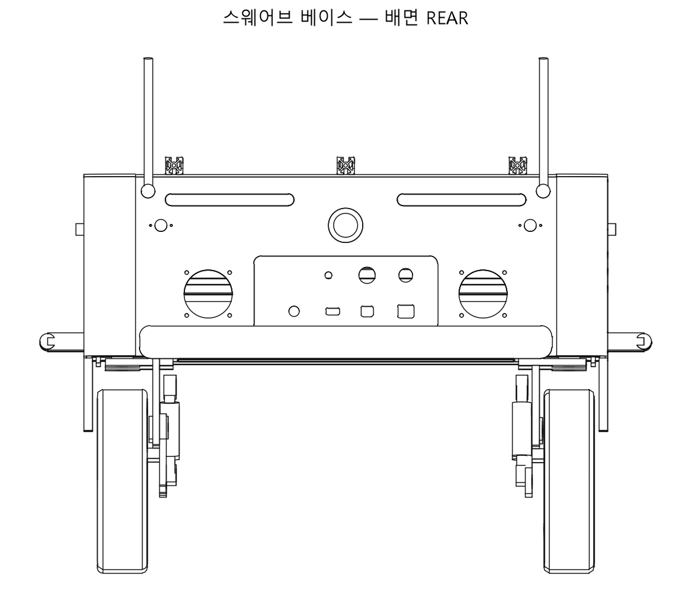

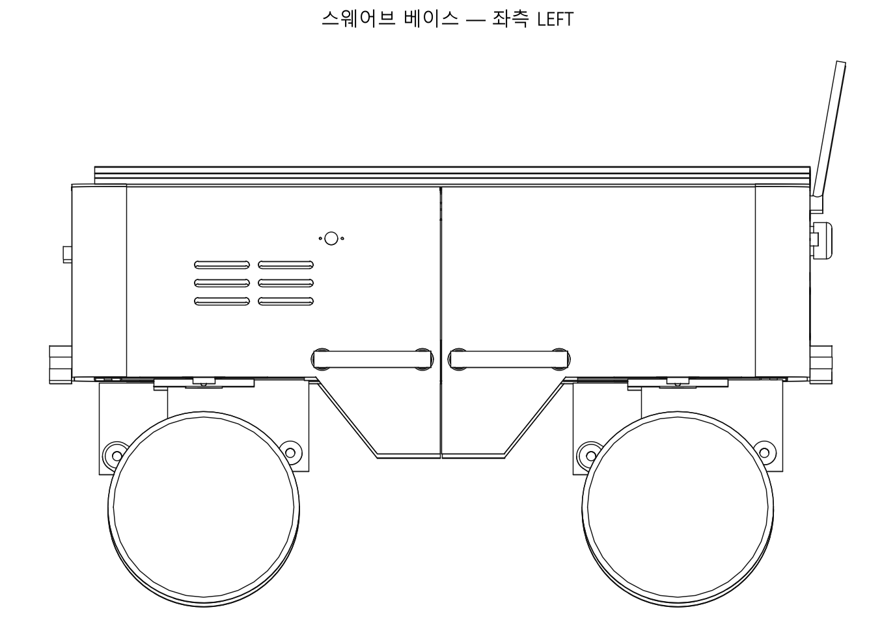

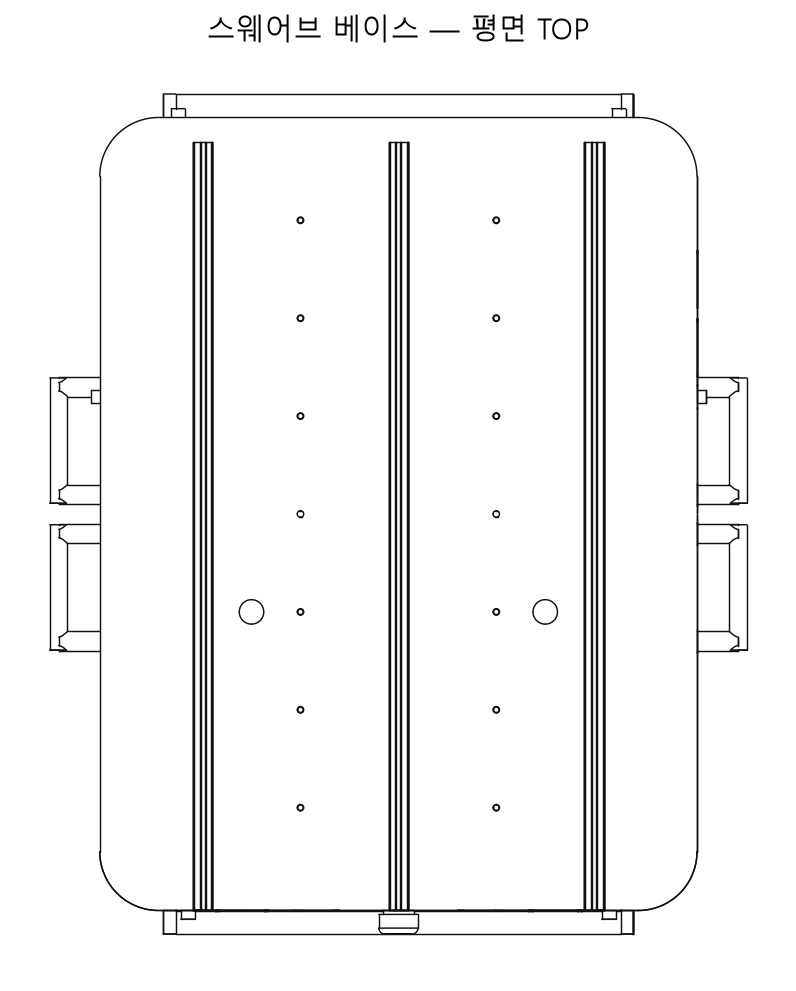

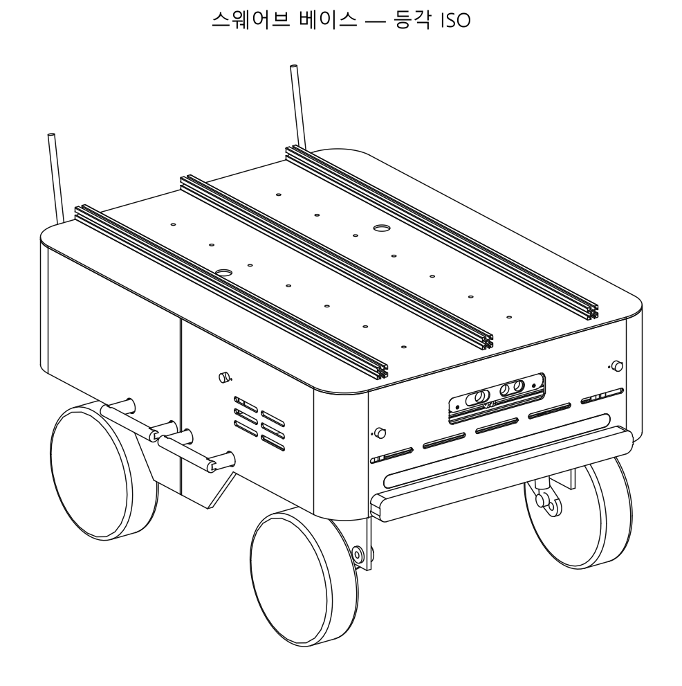

### 결정

- 25mm 트래블을 지키고 전고 460 을 받아들였다. 사용자도 "전고는 그대로 가자". 모듈 높이는 상수가 아니라 트래블 역산식이다. (대안: 트래블을 줄여 442 로 되돌리기)
- Xtion 치수는 상수로 옮겨 적지 않고 STEP bbox 를 런타임에 읽는다. 파일이 바뀌면 assert 가 먼저 걸린다.
- 셸 앞뒤 2분할은 출력 크기가 아니라 조립 때문에 유지한다.
- 냉각은 앞→뒤가 아니라 옆→뒤. 앞면 그릴은 모듈실용으로 남기고 용도를 주석에 명시했다. (대안: 앞면 그릴을 베이 높이로 올리기)
- 라즈베리파이는 외형 박스로 두고 실물 STEP 은 `PI_DETAIL` 뒤에 둔다.
- 포트 커넥터는 안으로 20mm 들어간 베이의 뒷벽에 문다. 사용자 요구("내부로 조금 들어가있느 형태"). (대안: 스키드 버전처럼 도어 덮개)
- MG996R 을 조향에 쓴다면 벨트 1:1 을 추천했다 — 결정은 보류. 현재 파일은 여전히 2:1 이다.

### 남은 일

당시 기준이다. 괄호 안은 이후 경과.

- 호버보드 허브모터 실측 — 축 지름·D컷 폭·축 길이. 스윙암 축 구멍은 아직 Ø12 원형이다. (이후 22\~24막에서 실물 STEP 실측으로 해결)
- 배터리 실측 — 200×150×90 은 추정값. 무게중심이 여기 걸려 있다. (현재도 [추정] 그대로)
- MG996R 조향 결정(벨트비 1:1 여부). 조향 각도 범위 vs 벨트비 assert 가 아직 없다. (스워브 보류로 미결)
- 공차 중량·무게중심·전복각 미산출. "50kg대" 도 추정이다. (18막에서 89 kg)
- 셸 출력량 2.71 L(짝당 60\~80시간) — 플랜지 링 767 cm³(28%)를 탭으로 줄이는 안.

### 교훈

- 정지 상태 간섭 검사만으로는 부족하다. 움직이는 설계는 각도를 스윕하며 재야 한다. 25mm 라고 적힌 트래블이 실제 3\~6mm 였다.
- 검증 코드 자체가 틀릴 수 있다. 4개가 전부 같은 부재와 같은 부피로 겹친다는 결과처럼 "너무 규칙적"이면 그게 신호다.
- 사람이 옮겨 적는 순간 정밀도가 죽는다. 0.3mm 반올림이 0.4 cm³ 간섭이 됐다.
- 연결성 검사(솔리드 수 == 1)와 실루엣 렌더는 간섭 0건이 못 보는 것을 본다 — 떠 있는 띠, 사라진 스커트.
- `Plane.XZ` 의 법선은 −Y 다. offset 방향을 확인하지 않으면 컷이 모델 밖으로 나간다.
- 실물 STEP 은 외형만 필요할 때 통째로 넣지 않는다. 516 솔리드 하나가 검증·렌더를 마비시켰다.
- 산출물이 아니라 산출하는 코드를 남겨라. 이날 scratchpad 에서 돌린 도면 스크립트는 저장되지 않았고, 28막에서 다시 짜야 했다.

### 이후 달라진 것 (2026-09-15 기준)

이 일지의 숫자는 당시 값이다. 현재 `swerve_base.py` 는 기본값이 `DRIVE=skid` 인 4륜 스키드(21막 "스워브를 버렸다")이고 바퀴가 PVC 목업 Ø210×58 에서 호버보드 6.5" 실물 Ø158.7×55 로 바뀌어 전장 873 × 전폭 712 × 전고 518, 축간 420 / 윤거 520 이다 (build-log 31절). 스워브는 `DRIVE=swerve` 로 남아 있고 그때는 전고 595 / 축간 520 이다. 본문에 병기한 차이를 모으면 다음과 같다.

- 스커트 저부 폭: 당시 140mm(반길이 70/138) → 현재 스키드 기본 120mm(60/118) @ z=125.7, 스워브 모드에서만 70/138. 스커트 벽 10 / 본체 3mm 는 같다.
- 플랜지 45×6 / M6 12개 / 볼트 위치, Xtion 창 182×44, 비상정지 Ø22 / 포트 베이 220×95 깊이 20 / 커넥터 7종 / 소형 카메라 6, 배기팬 y=±160 / 루버 6면, 배터리 [추정] 200×150×90, `PI_DETAIL = False`: 현재도 같다.
- 트래블 역산식(`YOKE_ARM_Z`, `SUS_TRAVEL = 25`, `YOKE_CLR = 3`)은 남아 있으나 스워브 모드에서만 MODULE_TOP 에 쓰인다. 스키드 모드는 바퀴 꼭대기 + 12 가 차체 바닥이다.
- `STEER_PULLEY = (24, 48)` 은 여전히 2:1 — 1:1 추천은 반영되지 않았고 스워브 자체가 21막에서 보류됐다. 스윙암 축 구멍 Ø12 원형은 22\~23막에서 실물 축(Ø16, D컷)으로 바뀌었다.
- 안테나: 당시 25° 후경 / y=±265 → 현재 `ANT_TILT = 10`°, `ANT_Y = 230`(컴팩트 셸 170). 공차 중량 "50kg대 추정" → 18막에서 89 kg.
- build-log: 당시 676줄(7막\~13막까지) → 현재 1,630줄, 28막 + 29\~32절. 제작비는 32절에서 구 스키드 317,000\~660,000 / 현행 스키드 482,000\~992,000 / 스워브 887,000\~2,483,000 으로 갱신됐고, `docs/bom.md` 전체 신품 합계는 1,976,478원.
- 이날 scratchpad 스크립트(sheet/verify2/verify3/stroke 등)는 남아 있지 않고 `models/drawings.py` 로 다시 짰다. `docs/images` 41\~47 은 07-31 09:38 재생성본, 34\~40 은 이날 02:01 파일 그대로. STEP 은 7.7MB → 26MB(08-01).

---

## 2026-07-29 (수) · 차체: 배선 길을 뚫고, 적재함을 세 번 고치고, 무게를 처음 셌다

> 시간: 16:26 ~ 07-30 (목) 02:44 · 장소: PC (`D:\build123d`) · 날짜 근거: 세션 기록 · 원본: 차체 설계 일지 `entry_05.html`

2026-07-29 16:26 \~ 07-30 02:44 KST. 스워브 베이스(`models/swerve_base.py`)에 "더 들어갈 부품"을 훑는 데서 시작해, 안전·제어 부품(A급) 일괄 적용 → 삼면도 갱신 → 적재함 설계 → 손잡이 재설계 → 중량 계산 → 표준 페이로드 인터페이스 문서와 평판 모듈까지 갔다. 약 10시간 18분, 모델 스크립트를 수십 번 고쳐 돌렸고 간섭 검사(`verify3.py`)는 한 번에 4\~10분씩 걸려 뒤로 갈수록 백그라운드로 돌렸다(600초 타임아웃으로 백그라운드로 넘어간 것이 대기 루프 포함 네 번, 처음부터 백그라운드로 돌린 것이 두 번).

이 날 쓴 검사·렌더 스크립트(`verify3.py`, `steerlimit.py`, `slide.py`, `slide2.py`, `slidepics.py`, `sheet.py`, `hlr.py`, `hlr2.py`, `inside.py`, `cw.py`, `cargo_bom.py`, `lidopen.py`, `hd.py`, `mass.py`, `flat.py`)는 전부 세션 스크래치패드의 임시 파일이라 **지금은 남아 있지 않다**. 아래 수치는 당시 실행 출력을 그대로 옮긴 것이다. 저장소에 남은 것은 `models/swerve_base.py`, `exports/swerve_base.step`, `docs/payload-interface.md`, `docs/images/41~54` 다. 이 모델은 이후(21막) 스워브를 버리고 스키드 구동이 기본(`DRIVE=skid`)이 되었으므로, 아래 조향·킹핀 관련 값은 `DRIVE=swerve` 일 때만 살아난다.

### 한 일

#### 16:26 — 추가 부품 검토와 A·B·C 등급 분류

킹핀축 코드를 열어보니 **Ø25 통짜**였다. 인휠모터 한 개당 3상(14AWG×3)+홀센서(26AWG×5)=8선이 나가는데, 조향 ±90°면 선다발이 180° 비틀리고 지나갈 구멍조차 없었다. 슬립링(3상 20\~30A라 크고 비쌈)·무한회전을 버리고 **중공축+조향각 제한+서비스 루프**로 가기로 했다. Ø25를 Ø13으로 뚫으면 벽 6mm, 배선 단면 약 30mm² \< 통로 133mm² (Claude 계산, 비틀림 관성은 84% 유지라고 적었다).

이걸 A급(중공 킹핀·기계식 하드스톱·원점 센서·주회로 차단기), B급(방수·범퍼·낙하감지·후방등화), C급(손잡이·서비스 해치·IMU·모듈 탈착+방수 커넥터)으로 정리해 제시했다.

> "그래 A급은 다 적용하고, 범퍼+접속스위치 + 후방등화 + 부저 + 손잡이/리프팅포인트 적용해보자 서비스 해치는 구조를 나중에 좀 더 생각해봐야할것 같아"

#### 16:55\~17:26 — A급 4개 + 범퍼·후미등·부저·핸들

막힌 것 → 원인 → 해결 순서로 세 번 걸렸다.

- **assert 가 정의 전에 실행됐다** — `ESTOP_Z`, `CAM_WIN` NameError 두 번. 후미등·흡기 그릴 겹침 검사문을 상수 정의 뒤로 옮겨 해결.
- **스톱 핀이 요크 수평팔을 때렸다**(요크상부×킹핀브라켓 804mm³×4) — 하부 칼라 높이로 팔이 지나간다. 걸림턱을 상부 칼라로 옮겼는데 거긴 벨트(z=300.5\~)가 있어 걸림턱 높이를 6mm 로 제한하고 핀 길이 `STOP_H`를 10→7mm 로 줄였다.
- **스톱이 정확히 ±90°에서 닿았다** — 핀 각도 (7.5°,172.5°) 기준 설계 한계 ±91.5°, 스윕하니 +90°에서 80mm³ 걸림. 작동 범위 끝에서 닿으면 스톱이 아니라 방해물이다. 핀을 (15°,165°)로 벌려 ±99°로 만들고 `assert STEER_LIMIT >= 95`를 심었다.
- 범퍼(520→480×38)를 밑단에 넣자 흡기 그릴 자리를 먹었다 → 그릴을 LED(입)와 카메라(눈) 사이로 올렸다. 얼굴 배치 3차.
- 범퍼 스위치 플런저가 범퍼와 608mm³×4 겹침 → 평시 2mm 비접촉으로 수정.

| 조향각 (+방향 스윕) | 핀 (7.5,172.5) | 핀 (15,165) |
| --- | --- | --- |
| +85° | 0 mm³ | 0 mm³ |
| +90° | 80 mm³ (걸림) | 0 mm³ |
| +91° | 110 mm³ | 0 mm³ |
| +92° | 141 mm³ | 0 mm³ |
| +95° | 226 mm³ | 15 mm³ (여기서 막힘) |

음의 방향은 −90/−91/−92° 만 스윕했고 값은 대칭이었다(첫 스윕 −90° 80·−91° 110, 두 번째 스윕 0). −95°는 스윕하지 않았다.

결과: 킹핀 중공 Ø13, 하드스톱 ±99°, 원점 홀센서 4(하부 칼라 외주 Ø6 자석 — 축 중앙은 배선이 쓰므로 온축 엔코더 불가), 차단기+퓨즈·프리차지, 범퍼 앞뒤 2+리미트 스위치 4, 후미등 150×14×2 @z=430, 부저 Ø30, 핸들 4(데크→상부 사이드 레일 직결). 전장 858×전폭 628×전고 612, 간섭 20건(전부 모듈 결합부), 비용 812,000\~2,308,000원. `docs/build-log.md`에 14막 추가(762줄). 현재 `swerve_base.py`에도 `KP_BORE=13`, `STOP_A=(15,165)`, `STOP_H=7`, `STEER_LIMIT>=95` assert 가 그대로 있다(단 assert 는 `SKID or ...` 로 스키드 모드에서는 건너뛴다). 비용은 당시 스워브 구성의 추정치이고, 현재 `docs/bom.md`(스키드+적재함 전체 버전)의 신품 합계는 1,976,478원이라 구성이 달라 직접 비교는 안 된다.

#### 18:20\~19:00 — 도면 7장 확인, 적재함 1차(2020 프레임)

> "우선 설계도 같은 사면도, iso 이미지부터 뽑아두자 그리고 적재함 설계를 들어가볼까?"

도면 41\~47은 이미 최신이었다. 적재함은 질문 3개로 정했다 — 후면 도어, 820×620×450, 화물칸+상단 센서 마운트. 820×620이면 데크의 핸들 4개와 안테나 2개가 깔리므로 핸들은 셸 옆면(x=±250, 전폭 628→680), 안테나는 뒷면 상부 코너(y=±230)로 옮겼다. 안테나 회전각을 잘못 줘 전장이 991로 튀었다가 879로 잡았다.

2020 프레임 12본 7.24m(알루미늄 3.67kg) + 3mm 판재 1.77m²로 짜니 내부 179L, 전고 930. 판재 5장이 모서리마다 겹쳤고(22cm³, 전부 같은 크기로 만든 탓) 바닥·천장 → 옆판 → 앞판 순으로 끼워 맞춰 해결. 가스 스트럿 220→160. 판재 재질별 무게(3mm 1.77m², Claude 계산): 알루미늄 14.3kg / 폴리카보네이트 6.35kg / PLA 6.6kg(출력 5.3L≈200h) / 복합패널 7.9kg — PC 추천. 무게중심 추정 405mm면 전복각 33°, 화물 40kg 높이 실으면 500mm·27°(윤거 520 기준, 추정치).

#### 20:23\~22:06 — 적재함 2차: 라운드 셸 + 슬라이드, 삽입 방향 수정

> "아래 디자인과 일치하게 올라가도록 둥근 모서리 모양이어야해 … 슬라이드 구멍은 앞에서 안보이고 뒤에서만 보이도록 … 도어도 위쪽에서 여는 것으로"

프레임 방식을 버리고 본체 셸과 같은 단면 **810×610 R60**을 위로 이어 올린 프린트 셸로 다시 짰다(`DECK_LIP2` 5→0으로 데크도 같은 크기). 내부 216L, 전고 941→933. 여기서 세 번 막혔다.

1. **라운드 스커트를 데크까지 내리면 못 끼운다.** 코너가 둥글어 앞으로 갈수록 스커트 안폭이 좁아진다. 계산상 데크(602폭)는 45mm밖에 못 들어간다 → 스커트를 레일 구간(z=461\~480, 20mm)만 덮게 했다. 데크 밑단은 1mm 그림자선.
2. **앞쪽 스커트 벽이 레일을 가로지른다.** 슬라이드 스윕(0\~600mm)에서 20mm 3207mm³, 60\~600mm 전 구간 3615mm³ 걸림. d=200 에서 분해하니 함셸×데크레일 523mm³×3 + 슬라이드채널×데크레일 523mm³×3 + 함바닥판×안테나 239mm³×2. 안테나는 SMA 휩을 빼고 끼우는 것으로 검사에서 제외하고, 레일을 셸 면까지 빼고 벽에 노치 3개를 내 노치가 레일을 타게 했다. 스토퍼 위치 보정(0mm 에서 1568mm³) 한 번 더 거쳐 전 구간 0.
3. **뚜껑 걸침턱을 3mm 벽에 10mm 파려 했다.** 자리가 없다. 뚜껑을 위에 얹고 안쪽 립 10mm로 위치를 잡는 방식으로 바꿨다. 리브가 바닥판·뚜껑 립과 물림, 채널 윗면 웨브가 레일 꼭대기와 충돌(데크레일×채널 27616mm³×3), 잠금 몸체가 스트라이커 안 — 셋 다 고쳐 간섭 20건 복귀.

도면 평면도에 화면을 가로지르는 가짜 선이 나왔다. 안테나가 시선과 거의 나란해 투영이 깨진 것. 샘플링 실패 엣지는 버리고, 1000mm 넘는 선도 버리고, 평면도에서 안테나를 제외했다.

> "반대로 끼운 것 같으네 슬라이드 식으로 앞에서 뒤로 끼우는 거고 구멍이 뒤에서 보여야하잖아"

확인하니 개구 중심 좌표를 잘못 계산해 **뒤끝이 아니라 옆면 한가운데**(중심 −212.5, 구간 x −252\~−172)가 뚫려 있었다. 맞는 값은 중심 −385, 구간 x −425\~−345. 고치고 나서도 "뒤에서 앞으로 밀어 넣는다"는 Claude 가 짠 구조를 유지한 채 방향을 되물었다.

> "뒤에서 앞으로 밀어넣는게 아니라 앞에서 뒤로 밀어넣는거라니까? 그리고 방금 수정한 적재함쉘 구멍낸거는 다시 되돌리고 말이야 그냥 방향만 앞뒤로 바꾸면 되는거였는데 왜이렇게 돌아가"

앞에서 뒤로 밀면 레일이 함의 뒷면으로 들어온다. 노치는 뒷면에만, 앞면은 통으로 막힌다 — 요구가 그냥 맞아떨어지는 구조였다. 레일을 x=−405\~+380(`RAIL_X1=380`, 현재도 같은 값)으로 바꾸고 뒷면 큰 개구는 삭제. 앞으로 0\~600mm 간섭 0, 정적 20건.

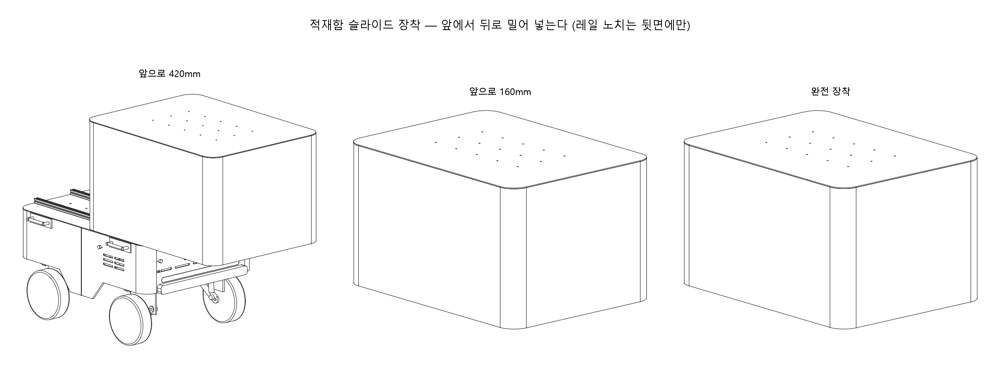

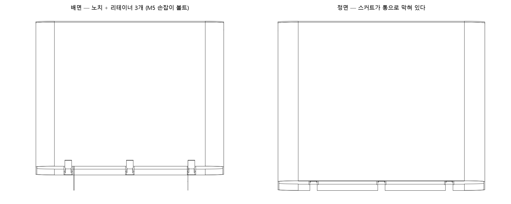

#### 23:27 — 타이다운 질문, 앞방향 리테이너 추가

타이다운 4개는 화물↔함 바닥, 슬라이드 채널+턱은 함↔로봇 — 다른 일이다. 그런데 이 질문 덕에 **채널 스토퍼가 뒤로 밀 때만 멈추고 앞으로는 무방비**라는 걸 찾았다. 제동하면 216L 짜리가 관성으로 미끄러져 나온다. 레일 끝 중앙 보어(2020 Ø4.2 → M5 탭, `tslot.py` PROFILES[20].bore=4.2)에 물리는 **노치 리테이너 3개**(`CARGO_RET=(44,30,4)`, 현재도 같음)를 넣었다. 볼트 3개만 풀면 다시 빠진다. 채널 턱과 레일 슬롯 사이 0.6mm 유격은 남아 있다.

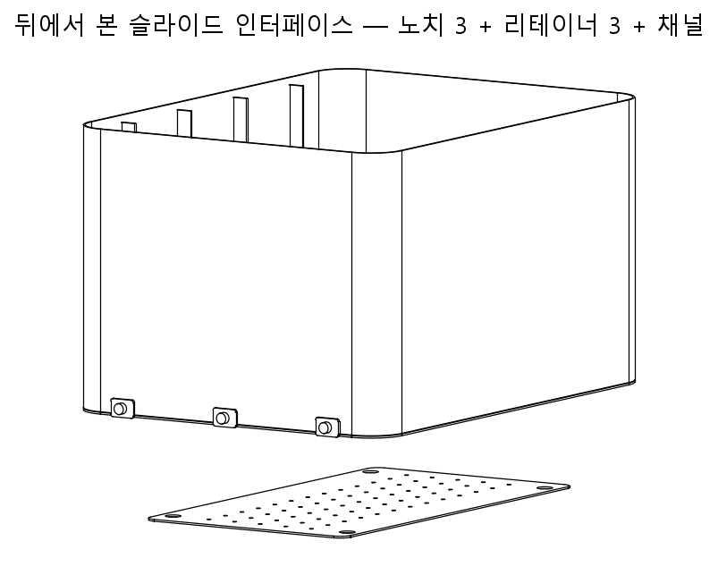

#### 23:41\~00:38 — 벽 5mm·격벽·라이너, 도면 스크립트 오류

> "적재함을 조금 더 두껍게 … 내부는 배달음식 담을 수 있는 용기처럼 깔끔하게 … 앞부분은 따로 빈공간으로"

벽 3→5mm, 세로 리브 8개 제거(닦이지 않는다), 격벽 x=230으로 화물칸 628 + 장비베이 168(≈44L), 내부 213L. 라이너 트레이(R25 코너, 탈착 세척), 장비 마운트 M4 50격자, 타이다운은 라이너 위 벽면으로. 라이너·장비바닥이 사각이라 R55 라운드 셸과 20,908mm³ 겹침 → 셸 프로파일을 따라가게 고침(fillet 한 번 실패, 제거). 뚜껑은 화물칸만 덮고(x −405\~228) 장비베이 위는 고정 지붕, 뒷면 손잡이 홈 240×55×28(`CARGO_GRIP`, 현재도 같음), 잠금은 홈 앞으로. 립 스케치에서 사각형을 y로 안 잘라 전폭이 1600으로 튄 적이 있다.

**도면 스크립트가 죽었다.** 평면도 선 0개, 정면 22개 — 이전엔 1500선대였다. 그룹별로는 전부 정상(프레임 667선, 셸 348선…). 처음엔 안테나 휩이 베이스와 한 점에서만 만나 솔리드가 갈라진 탓으로 보고 겹쳐 넣었으나 바뀌지 않았다. 진짜 원인은 `Compound(children=...)`가 자식을 **재부모화**해서, 두 번째 Compound를 만들 때 첫 번째가 비워진 것. 뷰마다 새로 묶게 고치자 정면 978→(바퀴 되살린 뒤) 1357선, 평면 537선.

무게가 문제로 떠올랐다. 적재함 프린트 총량 13.9L, PLA 17.2kg(셸 9.53 + 뚜껑 2.01 + 라이너 2.39 + 장비마운트 1.26 + 판재 1.77 + 채널 0.24), PETG 17.6kg. 810×610×450은 표면적 2.2m²라 두께로는 답이 안 나온다. 대안: 평면부 3mm PC 판재(→8\~9kg) / 벽 4mm(→14kg) / 높이 350(→13.5kg, 165L).

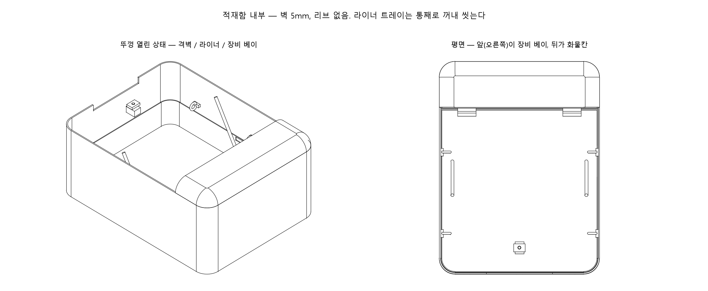

#### 00:39\~01:25 — 높이 360 + 어깨 R55

> "흠 적재함이 조금 높아 낮춰도 돼. 그리고 디자인적으로 적재함을 어떻게 좀더 귀엽고 친근하게 만들수 있을까?"

`CARGO_H` 450→360(전고 933→840, 내부 170L), 어깨 라운드 R55를 1/4원 6단면 loft로 넣었다. 어깨를 뚜껑에 포함시켜 열면 800×600 전면이 열린다(셸에 두면 690×490). 뚜껑 여닫힘 애니메이션 8.5\~13.5초·72°. 뚜껑 열림 렌더에서 40°/72° 장면의 나머지 부품이 사라졌다 — 같은 Compound 재부모화 함정에 두 번째로 걸렸고, 참조를 먼저 스냅샷해 해결. 검증 144솔리드·간섭 20건. 더 귀엽게 만드는 안 5개(테이퍼 3\~4°, 얼굴 위치, 크라운 8\~10mm, 전경사 2\~3°, 미소 손잡이)를 제안했으나 채택은 미정.

현재 값은 다르다: `CARGO_H=280`, `CARGO_SHOULDER=30` (유로 컨테이너 400×300×220 한 개 기준으로 역산), 라이너 트레이 대신 기성 바구니를 꽂는 구조로 바뀌었고 격벽 x 도 바구니에서 유도한다.

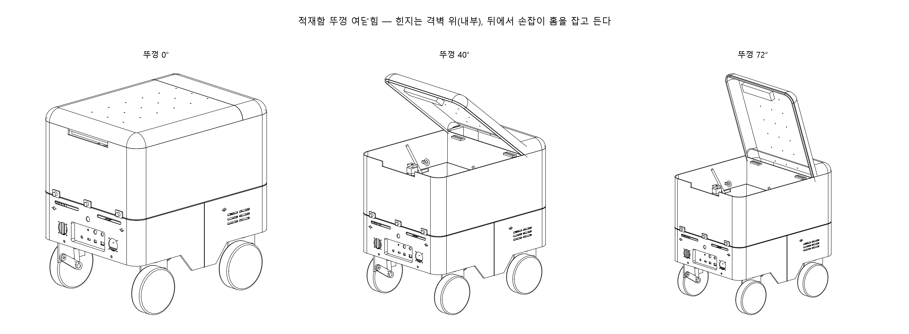

#### 01:44\~02:15 — 손잡이 재설계: 하부 레일 직결 관통형

> "핸들 자체가 … 프레임이 아니라 쉘에 붙어있는거 같은데 이러면 약해서 부서지지 않을까 싶네. 차라리 하부사이드바 1,2 에 고정되고 손잡이 구멍이 바퀴 사이 쉘 스커트 구조 있는 쪽에"

지적이 맞았다. 상부 사이드 레일까지 22mm가 비어 있는데 잇는 부재를 안 넣어 사실상 3mm 프린트 셸에 50kg을 매다는 구조였다. 하부사이드 레일 직결·바퀴 사이 매립형(x=±70, 개구 130×40 R12)으로 바꿨다. 처음 잡은 x=±110·개구 150은 "손잡이 개구가 바퀴 스윕 구간까지 나갔다" assert 에 걸렸다(스커트 구간 ±138 안으로 들여야 했다). 전폭 680→628.

> "아니 구멍을 저렇게 뚤으란것이 아니라 작은 구멍을 통해 핸들 봉이 튀어나와서 잡을 수 있게 하라는 거였어"

이날 두 번째 오해. 관통형으로 다시 — 그립 봉 Ø18(셸 밖 42mm) → 팔 Ø20×2(셸 Ø24 구멍 관통) → 베이스판 → 3030 하부사이드 레일(M6×2). x=±75, 팔 간격 110, 봉-셸 33mm. 셸에 뚫리는 건 Ø24 구멍 8개뿐. 전폭 628→712. 사용자는 "폭 문제는 괜찮아"라 했다. 관통형 이후 간섭 검증은 사용자 지시로 생략했다. 현재는 `HANDLE_XS=(0,)`·`HANDLE_SPAN=170` 으로 양쪽 1개씩 2개(구멍 4개)이고 봉 Ø18·스탠드오프 42는 그대로다.

#### 02:29\~02:44 — 중량 계산 89kg, 표준 인터페이스와 평판 모듈

> "이제 적재함 말고 다른 위에 올릴 것은 뭐가 될수 있을까?"

답하려고 미뤄둔 중량 계산(`mass.py`, 그룹별 부피×밀도, 실물 부품은 카탈로그 값)을 했다. "50kg대"라던 것이 실제로는 89kg이었다.

| 항목 | 무게 | 무게중심 z |
| --- | --- | --- |
| 모듈 4세트(허브모터 포함) | 20.0 kg | 158 |
| 적재함 일체(PLA 5mm 벽) | 17.4 kg | ≈620 |
| 배터리(추정) | 12.0 kg | 326 |
| 프레임 3030 (6.96m) | 7.2 kg | 350 |
| 판재(Al 3mm) | 6.1 kg | 369 |
| 외장셸 | 3.3 kg | 310 |
| **구조 합계** | **77.2 kg** | **357** |
| 체결·배선 +15% | 약 89 kg | 전복각 33\~36° |

적재 한계(Claude 계산): 모터 100kg 이상, **서스펜션 약 60kg(병목)** — 쇼크 13N/mm×25mm×4=132kg에서 스프렁 70kg을 뺀 값, 전복 25° 유지면 CG 700mm에서 50kg / 1200mm에서 25kg. 로봇 팔·센서 타워·평판·배터리 확장·살수·키오스크·리프트 7종을 표로 비교했고, 로봇 팔은 5kg 페이로드 0.8m 도달 시 모멘트 39 N·m vs 저항 227 N·m로 5.8배 여유라고 봤다. 그보다 먼저 **표준 페이로드 인터페이스**를 문서로 고정하자고 제안했다.

> "간섭검증 필요없어 표준인터페이스 와 평판모듈 가보자"

`PAYLOAD = "cargo" | "flat" | None` 플래그를 넣고 슬라이드 부분을 `payload_skirt()`로 뽑아 공유했다. 평판 모듈: 810×610 R60, 상판 4mm, 립 20, M6 100격자 35점, 타이다운 D링 6, 상판 z=461\~504(출력된 전고는 595 — 안테나 꼭대기로 보이나 확실하지 않다). 함수 붙여넣기에서 `def cargo_channels():def cargo_channels():`가 중복돼 SyntaxError 한 번. `docs/payload-interface.md` 159줄 작성 — 레일 3본(y=−200/0/+200, x=−405\~+380, 윗면 z=480, 슬롯 중심 z=470), 채널 안폭 22·턱 2.5×4, 그로밋 Ø25×2 @(−100,±150), 36V+보조전원, 한계 60kg/CG 700mm 이하, 그리고 막혔던 제약 4개. 현재 이 문서는 307줄로 늘었고(sensor·arm·inst 모듈과 아웃리거 절 추가) `PAYLOAD`는 환경변수(`cargo|flat|sensor|arm|inst|none`, 기본 none)로 바뀌었다.

### 결정

- 킹핀 중공 Ø13 + 하드스톱 ±99° + 원점 홀센서 — 세 개는 한 묶음. 슬립링은 쓰지 않는다. (이후 스키드 전환으로 스워브 모드에서만 쓰인다.)
- 적재함은 프레임+판재가 아니라 본체 셸과 같은 810×610 R60 단면의 프린트 셸. 앞에서 뒤로 밀어 끼우고 노치는 뒷면에만.
- 스커트는 레일 구간 20mm만 덮는다. 뒤로는 채널 스토퍼, 앞으로는 노치 리테이너 3(M5).
- 벽 5mm·리브 없음·격벽 x=230·라이너 트레이. 높이 360, 어깨 R55, 어깨는 뚜껑에 포함. (현재 높이 280·어깨 R30·유로 컨테이너 방식.)
- 손잡이는 하부사이드 레일 직결 관통형(Ø24 구멍 8개). 전폭 712는 수용. (현재 2개·구멍 4개.)
- 페이로드는 `PAYLOAD` 플래그로 교체하고 규격은 `docs/payload-interface.md`에 고정.
- 서비스 해치·배터리 슬라이드 모듈은 보류(배터리 실측 후 무게중심부터).

### 남은 일

- 적재함 무게 17kg대 — 평면부를 3mm PC 판재로 빼는 안 미결. (이후 높이 280·유로 컨테이너로 바뀌어 이 안은 그대로 쓰이지 않았다.)
- 귀여운 형상 5안(테이퍼·얼굴 위치·크라운 뚜껑·전경사·미소 손잡이) 채택 여부.
- 관통형 손잡이 이후 간섭 검증 미실행. 그립 Ø18·길이 110은 Claude 가 제안한 값을 그대로 쓴 것으로 실물 확인은 없다.
- 채널 턱-슬롯 0.6mm 유격(달그락) — 리테이너 웨지화 검토.
- 안테나가 슬라이드 경로에 있어 SMA 휩을 빼고 끼워야 한다. 접이식 베이스 검토.
- `docs/build-log.md`가 14막(762줄)에서 멈춰 있다 — 적재함·손잡이·중량·인터페이스 기록 필요. (이후 15\~20막으로 채워졌고 현재 28막 + 29\~32절, 1630줄.)
- 다음 모듈 후보: 로봇 팔(팔 기종 미정) 또는 센서 타워. 서스펜션 60kg 한계를 넘기려면 스프링 20N/mm대로.

### 교훈

- 사용자 요구를 반대로 구현해 놓고 그 위에서 맞추려 들면 돌아간다. "방향만 바꾸면 되는" 문제였다 — 좌표 계산 오류(옆면 개구)와 방향 오해가 겹쳐 두 번 되짚었다.
- 손잡이 요구도 한 번 오해했다(매립 개구 → 작은 관통공). 형상 요구는 렌더 한 장 먼저 보이고 확인받는 편이 빠르다.
- `Compound(children=...)`는 자식을 재부모화한다. 도면 HLR(1500→22선)과 뚜껑 렌더에서 같은 증상("부품이 사라진다")으로 걸렸다. Claude 는 "세 번"이라 적었으나 이 기록에서 확인되는 것은 두 번이다. 결과가 이상하면 모델보다 검사기·렌더 코드를 먼저 의심한다.
- 스톱은 작동 범위 끝에 닿으면 안 된다. 각도 스윕으로 확인하고 assert로 묶는다.
- "왜 필요하냐"는 질문이 빠진 부품(앞방향 리테이너)을 찾아냈다. 하중 경로(손잡이)와 방향(슬라이드) 둘 다 사용자가 잡았다.
- 큰 프린트 셸은 두께가 아니라 표면적이 무게를 정한다(2.2m²×5mm=11L). 중량은 미루지 말고 처음부터 센다 — 50kg이라 믿던 것이 89kg이었다.

---

## 2026-07-30 (목) · 차체: 모듈 3종을 더 얹고, 검사기를 의심하고, 도면을 다시 뽑다

> 시간: 07:42 ~ 07-31 (금) 11:07 · 장소: PC (`D:\build123d`) · 날짜 근거: 세션 기록 · 원본: 차체 설계 일지 `entry_06.html`

전날 적재함·평판 모듈로 페이로드 인터페이스를 규격화한 뒤, 이 구간에서는 나머지 모듈(센서 타워·로봇 팔 마운트·계측)을 같은 슬라이드 인터페이스에 얹고, 5종 전부 간섭 검증을 돌린 다음, 낡아 있던 도면과 문서를 실제 모델 값으로 되돌리는 데 썼다. 07-30 07:42 KST 에 시작해 07-31 11:07 KST 에 끝났다. 뷰어 포트는 3939, 모델 파일은 `models/swerve_base.py` 하나다. 도면·검증 스크립트(`sheet.py`, `modsheet.py`, `vmod.py`, `dims.py`, `cur.py`, `flat.py`)는 전부 세션 스크래치패드에 두고 돌렸다 — 저장소에 넣지 않았고, 지금은 남아 있지 않다 (이 대가는 build-log 28막 "도면 스크립트가 사라져 있었다"에 기록됐고, 도면은 이후 `models/drawings.py` 로 다시 짰다).

### 한 일

#### 07-30 07:42 — 센서 타워 모듈 추가와 브레이스 방향 오류

> 센서 타워 모듈 만들어보자

`PAYLOAD = "sensor"` 분기를 추가했다. 2020 기둥 2본(y=±100, 간격 200) + 가로타이 2(z=640/810) + 대각 브레이스 4, 헤드판 240×240×6 @ z=940, 라이다 Ø65 를 라이저 30 으로 띄워 스캔면 z=1008, 팬틸트 70×90×62, GNSS Ø60, IMU 36×26×12 는 진동이 적은 베이스판 위. 전고 1041, 추정 무게 약 5 kg 으로 CG 357→372, 전복각 36°→35° (무게·CG·전복각은 Claude 의 계산값이다). 이 치수들은 현재 `swerve_base.py` 의 `TOWER_*`, `LIDAR`, `PANTILT`, `GNSS`, `IMU` 상수와 그대로 일치한다.

막힌 것 두 가지. 첫째, 함수 삽입 치환이 겹쳐 `def cargo_channels():def cargo_channels():` 가 생겨 1339행 SyntaxError 가 났다. 중복을 지워 복구했는데, 이후 팔·계측 모듈을 추가할 때도 같은 치환문을 예방적으로 매번 넣어야 했다. 둘째, 렌더 `55_sensor_tower.png` 를 보니 브레이스가 마스트 밑에서 바깥으로 뻗어 올라가는 V자였다. 회전 부호가 반대였다. 베이스판(낮고 바깥) → 마스트(높고 안쪽) 방향으로 뒤집었다. 출력에서만 보면 잡히지 않는 결함이다.

#### 07-30 12:09 — 로봇 팔 마운트 추가와 서스펜션 처짐 검토

> 로봇 팔 마운트도 가보자

팔 기종이 미정이라 xArm6 급(도달 700, 자중 12 kg, 가반 3 kg)으로 파라미터화하고 마운트만 설계했다. 베이스판 10 mm(3 mm 로는 팔 모멘트에 휜다), 취부 보스 Ø150×14 M6×4 PCD100 [가정], 레일 y=−200/0/+200 선상에 분산 리브 3본, 보스 중앙 Ø44 케이블 관통, 컨트롤러 200×160×90 은 베이가 꽉 차서 데크 앞쪽 x=+250. 전고 938. (현재 코드의 `ARM_*` 상수도 같은 값이다.)

| 검토 | 값 | 판정 |
| --- | --- | --- |
| 전복 여유 | 복원 258 N·m vs 최대도달 전도 13 N·m → 19.9배 | 문제 없음 (앞서 5.8배로 봤던 것은 중량 89 kg 반영 전) |
| 서스펜션 처짐 | 코너당 4.9 mm → 기울기 1.07° → 툴 이동 약 19 mm | 반복정밀도 ±0.1 mm 의 200배. 정밀 작업엔 락아웃 필요 |

11막에서 "실외 주행 때문에 서스펜션이 필요하다"고 넣은 것이 여기서 정면으로 부딪혔다. 대책으로 스크류 잭 아웃리거 4개 / 서스펜션 락아웃 / IMU 역보상을 표로 비교하고, 구현은 미뤘다.

#### 07-30 13:50 — 모듈 아이디어와 build-log 15\~20막

> 마운트 뭐가 더 들어갈수 있을까? 아이디어 좀 주고 문서 정리하자

A급(계측 모듈, 조절식 밸러스트), B급(온도제어 배달함, 픽업 락커, 살포, 스테레오 카메라 리그), C급(키오스크, 쓰레기 수거, UV-C, 툴 체인저)으로 나눴다. 근거는 하나였다 — 이 세션의 89 kg, CG 357, 전복각 36°, 툴 처짐 19 mm 가 전부 계산값이고 플랫폼 자체를 시험하는 모듈이 없다는 것. 제설 브러시(앞면 별도 인터페이스)·자동 충전 수신부(셸에 고정)·배터리 스왑(베이스 구조 변경)은 데크 모듈이 아니라고 따로 선을 그었다. 추천 순서는 계측 → 밸러스트 → 온도제어 배달함.

이어 `docs/build-log.md` 를 762 → 1034줄로 늘렸다. 15\~20막(적재함 세 번 막힌 이야기, 어깨 라운드, 손잡이 세 번 이동, 89 kg, 모듈 규격화, 검사기 함정) 추가, 「틀렸던 것들」 표에 7줄 추가, 방법론에 "검사기를 먼저 의심하라" 절 추가, 영상 챕터 12 → 18개. 정리하다 11막과 19막이 같은 부품(서스펜션)을 두고 반대 결론을 내고 있다는 걸 발견했는데, 설계 실수가 아니라 다목적 플랫폼의 본질적 상충이라 판단해 그대로 남겼다.

#### 07-30 14:13 — 계측 모듈 추가와 로드셀 측정 범위 전제

> 계측 모듈 만들어보자

설계 전에 전제를 하나 박았다. 모듈과 데크 사이의 로드셀은 그 위의 페이로드만 본다. 바퀴별 하중은 외부 저울 패드 4개나 서스펜션 계장(베이스 개조)이 있어야 하고, 현실적 타협은 스트로크 센서로 역산하는 것이다. 그 전제로 베이스판 6 mm, 버튼형 로드셀 Ø40 × 4 @ (x=50±210, y=±190), 시험 플랫폼 600×500×8 M6 격자, DAQ 박스 150×200×80, IMU, 후단 견인 훅(인라인 로드셀 + 아이볼트). 전고 605(간섭 수정 뒤 628). 시험 플랫폼은 로드셀 4개에만 닿아야 하므로 DAQ 는 플랫폼 밖 뒤쪽 베이스판에 앉혔다. 실험 순서 5단계(영점 → 밸러스트 단계별 스프링 상수 → CG 이동 → 경사로 전복각 33\~36° 검증 → 견인 훅으로 구동토크 1.24 N·m 검증)를 문서에 적었다.

#### 07-30 14:42 \~ 16:03 — 5종 간섭 검증: 모듈-베이스 0건, 내부 결함 5개

> 간섭검증 돌려줘

5종을 파일 수정 없이 돌리려고 `PAYLOAD = os.environ.get("PAYLOAD", "cargo")` 로 바꿨다 (당시 기본값 cargo, 현재 코드는 기본값 `none` 이고 `MODULE_ONLY` 모드에서는 강제로 none 이다). 첫 실행은 10분 타임아웃(exit 143)으로 죽었다. 백그라운드로 옮기고 검사 범위를 모듈 내부 쌍 + 모듈×베이스 쌍으로 좁혔다(베이스 내부 20건은 전부 의도된 결합부라 제외). 14:53 에 시작해 15:45 에 끝났으니 약 52분. grep 파이프 버퍼링 때문에 중간 진행은 전혀 보이지 않았다.

| 모듈 | 솔리드 (모듈/베이스) | 내부 1차 | 내부 재검 | 베이스와 |
| --- | --- | --- | --- | --- |
| cargo | 26 / 118 | 0 | — | 0 |
| flat | 13 / 118 | 0 | — | 0 |
| sensor | 20 / 118 | 12 | 8 (전부 결합부) | 0 |
| arm | 10 / 118 (재검 출력 기준) | 1 | 0 | 0 |
| inst | — (출력이 잘려 확인 못 함) | 11 | 0 | 0 |

진짜 결함은 5가지였다. 팬틸트 브라켓이 기둥 2본을 관통(3752 mm³ × 2, 브라켓 폭을 기둥 바깥까지 잡음 → 기둥 사이 폭 180 으로), 전후 브레이스끼리 파고듦(571 × 2, 윗단을 기둥 중심까지 보냄 → 기둥 바깥면 x=±10 에 붙임), 팔 가운데 리브가 팔 베이스를 14 mm 파고듦(14103 mm³, 리브 높이 28 > 보스 14 → 14 로), 로드셀 버튼이 판을 뚫음(1140 × 8, 위아래 대칭 → 위로만 4 mm), DAQ 박스가 견인 훅과 84 cm³ 겹침 + 시험 플랫폼과 5 mm 겹침(DAQ 폭 120 으로 줄여 x=−315, 훅은 −415). 남은 sensor 8건은 브레이스 끝이 베이스판(191 mm³)·기둥(129 mm³)에 박히는 볼트 결합부라 결함으로 보지 않았다. 수정 후 값(DAQ 120×200×80 @ x=−315, 버튼 Ø22×4)은 현재 코드의 `INST_DAQ`, `INST_DAQ_X`, `INST_BTN` 과 일치한다.

계측 모듈의 5 mm 겹침은 숫자로는 사소하지만 성격이 다르다. 플랫폼이 DAQ 에 닿으면 하중이 그리로 새서 계측값 자체가 틀린다. 로드셀 버튼 관통도 로드셀을 우회하는 직접 경로다. 간섭 검사가 "부딪히나"만이 아니라 "하중이 의도한 길로만 가나"를 보는 도구가 된다는 걸 확인했다.

#### 07-30 16:11 · 20:23 — 뷰어 재전송과 전체 치수 정리

> 일단 전체적인 차량이나 베이스 등 크기 자세히 알려주고 정리해줘

적재함 버전을 뷰어에 다시 보내면서 제원 출력에 "핸들 4 (데크→상부사이드 레일 직결)" 이라는 옛 문구가 남아 있는 걸 발견했다. 실제는 봉 Ø18 셸 관통 → 하부사이드 레일 직결, x=±75 다 (당시 핸들 4개. 현재 코드는 `HANDLE_XS = (0,)` 로 양쪽 1개씩 2개다). 문구를 고친 뒤 `assembly.bounding_box()` 로 치수를 직접 뽑았다. 아래 표는 당시(스워브 구동, 바퀴 Ø210) 값이다.

| 항목 | 값 |
| --- | --- |
| 전체 외곽 (적재함 포함) | 전장 873 (안테나 −444 \~ 범퍼 +429) / 전폭 712 (핸들 봉 ±356) / 전고 840 (뚜껑) |
| 차체만 | 810 × 610 × 840 R60 한 단면. 돌출: 범퍼 앞뒤 +24, 안테나 뒤 +39, 핸들 좌우 +51 |
| 주행부 | 축간 520 = 윤거 520, 바퀴 Ø210 × 58 축높이 105, 조향 스윕 반경 109 (90° 시 전폭 738), 킹핀 (±260, ±260) 중공 Ø13, 하드스톱 ±99°, 트레일링 암 112 / 트래블 25 |
| 지상고 | 164 (스커트 저부) / 248 (셸 밑단 = 하부 레일 밑면 = 모듈 상한) |
| 프레임 3030 | 760 × 450, 하부 레일 z=263 / 상부 z=436 / 기둥 143, 베이 700×390×140 (바닥 z=281), 절단 6.96 m / 7.22 kg |
| 외장셸 | 810×610 R60 벽 3 mm, 본체 z 248\~451, 플랜지 45×6t M6 12개, 스커트 폭 140 @ z=164 → 276 @ z=248 벽 10 mm |
| 데크·인터페이스 | 데크판 810×610 @ z 457\~460, 레일 2020 ×3 @ y=−200/0/+200, x −405\~380, 윗면 z=480, 모듈 스커트 z 461\~480 |
| 적재함 | 810×610×360 어깨 R55, z 461\~840, 벽 5 mm, 내부 800×600×354 ≈ 170 L, 격벽 x=230 → 화물칸 630 / 장비베이 170 |

비율에서 눈에 띈 것: 전폭 610 안에 윤거 520 이 들어와 있어 조향 90° 면 738 로 차체 밖으로 벌어진다. 전고 840 : 윤거 520 = 1.6:1 이라 페이로드를 높이 실으면 전복각이 빠르게 나빠진다.

#### 07-30 23:09 \~ 23:53 — 기본 베이스 뷰어 전송과 도면 41\~47 재생성

> 적재함 뺀 기본 모델로 뷰어에 띄어줄래? … 문서에 이 기본 베이스 도면도 다시 뽑아서 넣어줘

`PAYLOAD=none` 으로 보냈다. 전고 840 → 595 (안테나 꼭대기), 차체는 460. 뚜껑 애니메이션 트랙은 자동으로 빠졌다. 이어 도면 시트 제목을 손으로 고치던 방식을 버리고 `bounding_box()` + `PAYLOAD` 에서 자동 생성하도록 바꿨는데, 여기서 세 번 헛돌았다. 삽입 앵커를 `D = 20000` 으로 잡았는데 실제 파일은 `D = 30000` 이라 치환이 조용히 실패했고, `_TITLE` NameError 만 반복됐다. 중간에 `python3` 을 불러 "Python was not found"(MS Store alias)도 한 번. 파일을 직접 읽고 나서야 붙었다. 41\~47 갱신 후 build-log 23절과 payload-interface 앞머리에 삽입, 도면 색인 표(41\~57) 추가. build-log 1034 → 1068줄, payload-interface 210 → 258줄.

#### 07-31 09:35 — 도면 판재 숨김으로 인한 데크판 누락

> 베이스도면에 상단 커버? 가 안 나와있는데 의도한거야?

사용자 지적으로 잡혔다. 도면 스크립트의 `HIDDEN` 집합에 `"판재"` 가 들어 있었다. HLR 이 1500선 → 22선으로 죽었을 때 내부 부품을 빼면서 넣은 것인데, 이 그룹에는 베이 바닥판(내부)과 데크판(외부 상면)이 같이 들어 있다. 적재함이 덮고 있을 땐 티가 안 났고 페이로드를 빼니 상면이 뚫려 보였다. HLR 진짜 원인은 Compound 재부모화였으니 뺄 이유가 없었다. 숨김에서 걷어내자 평면도 선 수가 1160 → 705, 등각 1567 → 1075 로 오히려 줄었다 — 없던 상판이 아래를 가려서다. 숨김 목록이 모듈 구성에 따라 달라진다는 뜻이라, 구성별 목록을 두는 대신 아예 안 빼는 쪽으로 갔다.

이때 뽑은 `41_swerve_drawing_sheet.png`(파일 시각 07-31 09:38 KST)는 지금도 그대로 남아 있다. 다만 현재 기본 베이스 도면은 스키드 구동 기준의 `41_skid_*`(08-12, `models/drawings.py` 생성)이고, 아래 그림은 당시 스워브 구성이다.

#### 07-31 09:53 — 모듈 도면 4장 새 제목 형식으로

> 모듈 도면들도 새 제목으로 다시 뽑아줘

`modsheet.py` 를 새로 써서 54\~57 을 다시 뽑았다. 판재 숨김도 여기서 걷어내 평판 모듈이 공중에 뜬 것처럼 보이던 문제가 사라졌다. 이 네 파일은 이후 갱신되지 않았다 (파일 시각 07-31 09:55\~10:02 KST).

| 도면 | 모듈 | 전장 × 전폭 × 전고 |
| --- | --- | --- |
| 54 | 평판 | 873 × 712 × 595 (모듈 504, 안테나 595 가 더 높다) |
| 55 | 센서 타워 | 873 × 712 × 1041 |
| 56 | 로봇 팔 마운트 | 873 × 712 × 938 |
| 57 | 계측 | 874 × 712 × 628 (견인 훅이 안테나보다 1 mm 뒤) |

#### 07-31 10:10 — 뷰어 서버 비정상 종료와 재기동

백그라운드 뷰어 태스크가 exit 1 로 끝났다. `ocp_vscode/standalone.py:402 javascript_client.send` 에서 `ConnectionResetError [WinError 10054]`. 브라우저 탭이 닫히며 웹소켓이 끊겼는데 라이브러리가 예외를 안 잡고 프로세스째 종료됐다 (원인은 Claude 의 추정이다). 재기동 후 8초 뒤 확인에서 "기동 실패"가 나왔지만 6초 더 기다리니 3939 리스닝. 기동에 8\~15초 걸린다. 세션 초반의 "화면만 안 보임"(브라우저 캐시)과는 다른 증상으로 구분해 두었다.

#### 07-31 11:04 — 문서 최종 정리: 낡은 값 9개

> 문서 정리해서 마무리하자

build-log 23절 B 와 payload-interface 를 모델 값과 대조했다.

| 항목 | 문서 | 실제 |
| --- | --- | --- |
| 기본 베이스 외곽 | 843 × 628 × 460 | 873 × 712 × 595 |
| 데크 | 820 × 620 | 810 × 610 |
| 외장셸 부피 | 2,712 cm³ | 2,656 cm³ |
| 리프팅 핸들 | 데크 → 상부 사이드 레일 | 셸 관통 → 하부 사이드 레일 |
| 데크 레일 길이 | 760 | 785 (x −405\~380) |
| 안테나 | 데크 뒤 모서리, 25° | 뒷면 상부 코너 y=±230, 10° |
| 모듈 수 | 4종 | 5종 |
| 적재함 격벽 | 화물칸 628 / 장비베이 168 | 630 / 170 |
| 계측 모듈 전고 | 605 | 628 |

24절 프린트 물량도 다시 썼다. 셸 2.7 L 가 아니라 적재함 14 L 가 진짜 문제다. 최종 build-log 1077줄, payload-interface 279줄(7절 구성).

### 결정

- 팔 기종은 미정 그대로 두고 xArm6 급으로 파라미터화, PCD·볼트·자중에 [가정] 딱지를 남겼다.
- 서스펜션 vs 정밀 매니퓰레이션 상충은 문서에 그대로 남기고, 해결은 모듈/베이스 쪽(아웃리거)에서 한다.
- 계측 모듈은 페이로드 하중만 잰다는 전제로 설계. 바퀴별 하중은 스트로크 역산.
- `PAYLOAD` 는 환경변수로 덮어쓴다(당시 기본 cargo, 현재 none). 간섭 검증은 모듈 관련 쌍만 본다.
- sensor 의 결합부 8건(191/129 mm³)은 결함이 아니므로 남긴다.
- 도면 제목은 모델에서 자동 생성. `판재` 는 숨기지 않는다. 적재함 상세도 48\~53 은 성격이 달라 옛 제목 형식 유지.

### 남은 일

- 아웃리거 — 팔 모듈 툴 처짐 19 mm 대책 (스크류 잭 4개 유력). 이후 베이스 옵션으로 구현됐다.
- 적재함 하이브리드화 — 프린트 14 L 를 평면부 판재화로 절반으로
- 팔 기종 확정 — 보스 PCD100·M6×4·자중 12 kg 이 전부 가정 (현재 코드에도 [가정] 표기 그대로)
- 계측 모듈로 실측 — 89 kg / CG 357 / 13 N/mm 가 나머지 셋의 전제
- 센서 타워 진동 실측 후 방진 마운트 여부, 라이다 기종(Mid-360 vs 16채널 퍽 Ø100×75) 확정

### 교훈

- "안 보이니 빼도 된다"는 판단은 구성에 따라 뒤집힌다. 사용자가 묻지 않았으면 데크판 누락을 계속 몰랐을 것이다.
- 간섭 검사는 하중 경로 검사이기도 하다. 계측 모듈의 5 mm 겹침은 만들고 나서 "왜 무게가 안 맞지" 로 한참 헤맬 종류였다.
- 문서에 손으로 적은 숫자는 반드시 낡는다. 하루 만에 9개가 어긋났다. 제목·치수는 모델에서 읽어야 한다.
- 문자열 치환으로 코드를 삽입하면 앵커가 틀려도 조용히 지나간다. 결과를 grep 으로 확인하기 전에는 붙었다고 믿지 말 것.
- 뷰어 장애는 두 종류다. 화면만 이상 → 브라우저 캐시, 연결 자체가 안 됨 → 서버 죽음(재기동 8\~15초).
- 렌더는 굽고 끝이 아니라 봐야 한다. 브레이스 V자는 이미지에서만 보였다.
- 산출물만 남기고 산출하는 코드를 스크래치패드에 두면 잃는다. 이 구간의 도면·검증 스크립트가 그렇게 사라졌고, 도면은 나중에 다시 짜야 했다 (build-log 28막).

### 이후 달라진 것 (2026-09-15 기준)

이 일지는 당시 기록이다 (2026-09-15 대조). 그 뒤 모델이 스키드 구동·6.5인치 허브모터로 바뀌어 아래 값들이 달라졌다. 모듈 3종(센서 타워·팔 마운트·계측)의 치수 상수는 바뀌지 않았다.

| 항목 | 당시 (07-30\~31) | 현재 |
| --- | --- | --- |
| `PAYLOAD` 기본값 | cargo | none (`MODULE_ONLY` 면 강제 none) |
| 구동 / 바퀴 | 스워브, 바퀴 Ø210, 축간 520 | 기본 스키드(`DRIVE=skid`), 6.5인치 허브모터 Ø158.7, 축간 420. 스워브는 `DRIVE=swerve` 로 남아 있다 |
| 기본 베이스 외곽 | 873 × 712 × 595 (차체 460) | 873 × 712 × 518 (차체 383), build-log 최종 사양 기준 |
| 프레임 절단 | 6.96 m / 7.22 kg | 실 7.35 m / 7.62 kg |
| 리프팅 핸들 | 4개, x=±75 | 2개, `HANDLE_XS = (0,)` |
| 적재함 높이 | 360 (전고 840) | 코드 `CARGO_H = 280` (유로 컨테이너 400×300×220 기준). payload-interface 와 build-log C절은 아직 360 / 전고 840 으로 남아 있다 |
| 문서 줄 수 | build-log 1077 / payload-interface 279 | 1630 / 307 |
| 도면 41\~47 | `41_swerve_*` (스크래치 `sheet.py`) | `41_skid_*` 를 `models/drawings.py` 가 만든다. `41_swerve_*` 파일은 07-31 것이 그대로 남아 있다 |
| 아웃리거 | 미구현 (대책 표만) | 베이스 옵션 `OUTRIGGER` 로 구현, 도면 58, payload-interface 3.1절 |

---

## 2026-07-31 (금) · 차체: 아웃리거·확장레일을 얹었다 걷어내고, 실물 6.5인치 바퀴로 다시 앉혔다

> 시간: 11:20 ~ 08-01 (토) 01:11 · 장소: PC (`D:\build123d`) · 날짜 근거: 세션 기록 · 원본: 차체 설계 일지 `entry_07.html`

이날은 낮에 계측 모듈용 아웃리거와 측면 확장 레일을 붙여 봤고, 저녁에 사용자가 "바퀴가 6.5인치 같다"고 하면서 방향이 바뀌었다. 바퀴 치수 가정을 뒤졌더니 PVC 바퀴 스펙이 그대로 남아 있었고, 사용자가 넣어 준 실물 STEP(`refmodel/Motor, BLDC, Hoverboard Wheel, 6.5in.stp`)을 실측해 Ø158.7 × 55, 축 Ø16 D컷 13 으로 모델을 다시 세웠다. 이어서 손잡이 4→2개, 스커트 지상고 112.7→151.7, 제작 순서·조향 모터·모듈 가공 방법을 정리했고, 자정 넘어 레퍼런스(AGRO 논문)를 찾은 뒤 사용자의 반박으로 하루가 끝났다. (시각은 KST, 원본 UTC+9)

*현재 상태(2026-09-15 대조):* `models/swerve_base.py` 는 이후 `DRIVE=skid` 가 기본값이 되어 조향·서스펜션 없는 스키드 4륜이 본 모델이다(build-log 21막). 이날의 스워브 구성은 `DRIVE=swerve` 로 남아 있고, 그 모드에서 다시 계산한 값(바퀴 Ø158.7×55, 스윕 84.0, 모듈 상한 196.7, 쇼크 78.0/21.4/0.854, 스커트 저부 151.7, 핸들 2개 봉 170 z=216, 전장 873 × 전폭 712 × 전고 544)은 이날 기록과 같다. 아래에서 값이 달라진 곳만 "당시/현재"로 병기했다.

### 한 일

#### 11:20 아웃리거 — 베이스 상부 레일 피벗, 접이식

> "계측 모듈 아웃리거도 만들어보자"

두 가지를 먼저 정했다. 첫째, 아웃리거는 모듈이 아니라 베이스에 붙인다. 모듈에 달면 로봇 전체 무게가 슬라이드 인터페이스(레일 슬롯에 2.5mm 물린 턱)를 통과한다. 둘째, `z<248` 에서는 90° 조향 스윕(반경 109)이 x 151\~369 를 통째로 쓰므로 바퀴 옆에는 자리가 없다(남는 건 |x|\<151 과 11mm 틈뿐). 그래서 상부 사이드 레일(z=436)에서 피벗해 셸 밖으로 내려오는 접이식으로 갔다.

**막힌 것 → 원인 → 해결.** 첫 렌더에서 발판이 지면에 닿지 않고 옆으로만 벌어졌다(전폭 1432, 발이 z=64 에서 멈춤). 잭을 암과 같이 45° 로 기울인 탓이었다. 실제 아웃리거처럼 암만 45° 벌리고 잭은 수직 스크류로 내려가게 고쳤다 → 전개 전폭 1059.

> "x=±360으로 벌리고 문서에도 정리해줘"

|  | x=±300 | x=±360 |
| --- | --- | --- |
| 지지 베이스 | 600 × 979 | 720 × 979 |
| 전복각 앞뒤 / 좌우 | 40° / 54° | 45° / 54° |
| 전폭 접힘 / 전개 | 720 / 1059 | 720 / 1059 |

암 240 × 26×22, 잭 Ø34 튜브 + M18 스크류 + 발판 Ø80. 바퀴 접지 520 × 520 대비 앞뒤 1.38배 / 좌우 1.88배다. 상부 레일이 ±380 까지라 ±360 이 거의 한계다. `docs/payload-interface.md` 에 3.1 아웃리거 절을, `docs/build-log.md` 19막 뒤에 "아웃리거로 서스펜션을 우회한다" 절을 넣었고(당시 기록 "307줄 / 1103줄"은 편집 후 파일 총 줄수로 보인다 — payload-interface.md 는 지금도 307줄, build-log.md 는 1630줄로 늘었다. 현재 두 절은 각각 89줄·732줄에 있다), 비용은 +6\~14만원(스워브 베이스 합계 887,000\~2,483,000원)으로 갱신했다. 이 비용 수치는 현재 build-log.md 32절 표에도 그대로 남아 있다. 사용자가 "아웃리거가 뭐야"라고 물어 크레인·고소작업차의 지지 다리라고 설명했다.

#### 11:42 측면 확장 레일 — z 290\~325 대역

> "아웃리거 빼보고 … 사이드에 프로파일이나 레일을 확장한 구조를 넣어서 라이다 부품을 달거나 여러 센서모듈을 달기 좋은 … 구조"

셸 옆면 점유를 z 대역별로 뽑았다: 스커트 164\~248 / 핸들 개구 247\~287 / **290\~325 빈 곳** / 흡기 루버 327\~375 / 소형카메라 387\~413 / 상단 플랜지 451\~457. 여기에 2020 프로파일 2본 × 760 을 y=±330, z=310 에 깔고 브라켓 8개(x=±180, ±340 — 핸들 개구 |x| 10\~140 회피)로 하부사이드 레일에 직결했다. 전폭 720→750. 예시로 2D 라이다 Ø70 2대를 전방좌(+340, +330)/후방우 대각으로 앉혀 각 270° 로 360° 를 덮게 했다. 레일이 셸 밖 25mm 에 떠서 그 틈으로 배선이 지난다.

렌더 스크립트를 `sed` 로 고쳐 쓰다 SyntaxError 가 나서 새 스크립트로 다시 썼다. 상충도 하나 나왔다: 아웃리거가 접힌 상태로 y=320 을 지나므로 확장 레일(y=330, z=310)과 부딪힌다. `OUTRIGGER = False` 로 끄고 `SIDE_RAIL` 만 켰다. 15:27 에 이 구성을 뷰어로 보냈다(전장 873 × 전폭 750 × 전고 595). 이때 저장한 59번 렌더는 뒤에 61번으로 덮어써서 지금은 남아 있지 않다.

#### 19:46 바퀴 치수 가정 점검

> "지금 바퀴 사이즈가 몇으로 가정하고 만들어졌지?"

`WHEEL_D, WHEEL_W = 210, 58` 은 원래 PVC 통바퀴 실물 스펙(Ø210 × 58, 휠내경 20, 70kg, 12,000원)이었다. 호버보드 허브모터로 바꿀 때 주석만 바꾸고 치수는 그대로 뒀다. 호버보드 규격은 6.5"≈165 / 8.5"≈215\~220 / 10"≈250 이라 어디에도 정확히 맞지 않는다. 이 값에 AXLE_Z 105, SWEEP_R 109, YOKE_ARM_Z 242, MODULE_TOP 248 → RAIL_Z 263 → DECK_Z 451 이 줄줄이 매달려 있고, 스윙암 축 구멍은 Ø12 원형이라 D컷이 없었다.

#### 19:54 Ø165×70 으로 변경 — 서스펜션 좌표 상대값화

> "바퀴가 6.5인치 같거든? 그리고 폭은 한 7cm 정도 … 적재함도 일단 떼놓고 아까 추가한 좌우 확장레일도 제거한 기본 베이스 모델로"

Ø165 × 70 으로 바꾸자 `SUS_PIVOT=(-95,165)`, `SHOCK_TOP=(-25,215)` 가 절대 z 라 쇼크 상단(215)이 모듈 상한(203) 밖으로 튀어나갔다. `SUS_PIVOT=(-95, AXLE_Z+60)`, `SHOCK_TOP=(-25, MODULE_TOP-33)`, `SHOCK_BOT=(-15, AXLE_Z+7)` 로 상대값화해 모션비 0.854 를 유지했다. 백그라운드 검증은 간섭 20건(전부 결합부), 스트로크 −10°(바퀴 +17.4mm)까지 요크×바퀴 0 으로 통과했다.

#### 19:59 실물 STEP 실측 — Ø158.7×55, 축 Ø16 D컷 13

> "Motor, BLDC, Hoverboard Wheel, 6.5in.stp 라는 파일을 refmodel 폴더에 넣어두어거든? 실제 바퀴모델을 적용해볼래?"

STEP 을 x 단면으로 잘라 반경을 재는 스크립트를 hw2\~hw7 여섯 번 고쳐 썼다. hw2·hw5 는 결과가 비었고, hw3·hw6 은 `AttributeError: 'ShapeList' object has no attribute 'bounding_box'` 로 죽었다(hw4 는 반경대별 X 폭까지는 나왔다). `intersect` 결과가 Shape 일 때와 ShapeList 일 때가 섞여서였고, hw7 에서 `hasattr` 분기 + `Compound` 로 묶어 축 단면까지 얻었다.

| 부위 | 치수 | STEP X 구간 |
| --- | --- | --- |
| 타이어 | Ø158.74 (트레드 폭 38.8) | 9.2\~48 |
| 모터 몸통 | Ø150 | 48\~60 |
| 전체 폭 | 55 | 5\~60 |
| 축 | Ø16, D컷 13 (한쪽 3mm 평면), 노출 56 | −51\~5 |

6.5인치 공칭인데 실측은 Ø158.7 이다(165 아님). `HUB_REAL=True` 로 STEP 을 그대로 배치하되, 몸통 중심(X=32.5)이 아니라 타이어 중심면(X=28.6)을 y=0 에 맞춰 킹핀 스크럽을 0 으로 뒀다(3.9mm 차이). 축 56mm 가 요크판(−37.5)과 스윙암(−60..−18)을 관통해 20mm 튀어나와 너트 자리가 된다고 봤다. 스윙암 구멍을 Ø12 원형 → Ø16 D컷 13 으로 바꿨다 — 허브모터는 축이 고정자라 원형 구멍이면 구동토크 21\~29 N·m 에 미끄러진다. 처음 넣은 D컷 박스는 위치 계산이 틀려 구멍 밖에 놓였고, 축 중심 기준 오프셋(`HUB_FLAT − HUB_SHAFT_D/2`)으로 다시 잡았다.

*당시/현재:* "축 노출 56 (X −51\~5), 끝이 너트 자리"는 이날의 판독이다. 뒤에 STEP 을 0.1mm 간격으로 다시 스캔해(build-log 22막) X=−51\~−50 은 1mm 모따기고 나사부가 없으며, STEP 자체가 축을 −51 에서 잘라 놓은 것임을 확인했다. D컷 평면 구간도 −46.5\~−3.7 로 좁혀졌고(현재 `HUB_UNDERCUT_X=(-50,-46.5)`, `HUB_SHAFT_X=(-46.5,-3.7)`), 너트는 지웠다. Ø16 / D컷 13 / 타이어 Ø158.7×55 는 지금 파일 값과 같다.

|  | Ø210×58 | Ø165×70 (추정) | Ø158.7×55 (실측) |
| --- | --- | --- | --- |
| 축 높이 | 105 | 82.5 | 79.4 |
| 스윕 반경 | 108.9 | 89.6 | 84.0 |
| 모듈 상한 | 248 | 203 | 196.7 |
| 데크 | 451 | 406 | 409 |
| 전고 | 595 | 550 | 544 |
| 90° 조향 시 전폭 | 738 | 699 | 688 |

#### 20:25 6.5인치 영향 정리 — 지상고

> "바퀴 사이즈가 변경된걸로 영향이 끼쳐지는게 있나? … 6.5인치여도 괜찮을까?"

백그라운드 검증 결과 파일이 0바이트였다(중간에 끊김). 다시 돌리면서 영향을 정리했다. 좋아진 것: 무게중심 45mm 하강, 스윕 109→84, 트래블/반경 비 0.24→0.31. 나빠진 것: 스커트 지상고 164→112.7, 등판 턱 35\~52→26\~40mm, 쇼크 아이투아이 103.5→78(구하기 어렵다), Xtion 높이 385→334, 핸들 267→216. 토크는 문제없다 — 15% 등판에 바퀴당 2.6 N·m, 모터는 20 N·m 급, 200 rpm 에서 6 km/h. 결론은 "실내와 평탄한 실외는 되고 연석 100\~150 은 안 된다". 선택지 ①스커트 올리기(`SKIRT_DROP` 84→40, 지상고 152) ②8.5인치 교체(전고 +56, STEP 없음) ③스커트 제거(196.7) 중 ①을 권했다.

#### 20:39 스윕반경·전고 설명, 손잡이 2개, 스커트 45

> "스윕반경은 뭐야? 전고가 낮아지면 좋은건가? 전고가 어디지, 그리고 손잡이도 … 총2개로 만들고 스커트 높이도 조금 올려보자"

SWEEP_R = √(D²+W²)/2 = √(158.7²+55²)/2 = 84.0 — 킹핀축에서 바퀴의 가장 먼 모서리까지의 거리로, 조향하면 이 원 안에는 아무것도 둘 수 없다. 전고 544 는 안테나 끝이고 데크레일 429 / 판재 409 / 셸 406 / 모듈 264 다. 전고는 결과값이라 최적화 대상이 아니고, 봐야 할 건 지상고와 센서 높이라고 답했다.

손잡이를 `HANDLE_XS=(0,)` 로 양옆 1개씩 2개로 줄이면서 봉을 110→220 으로 늘렸다. 개수를 절반으로 하면 1인당 22→44.5kg 이 되어 못 드니, 한 손잡이에 두 손이 들어가 4인 인양이 유지되어야 한다. `SKIRT_DROP` 84→45 로 스커트 저부 112.7→151.7(경사각 51°→33°). 제원 출력문이 `HANDLE_XS[1]` 을 참조해 Traceback 이 났고 개수 기반으로 고쳤다.

**막힌 것.** 검증 26건 중 새 간섭 2종: 스윙암×바퀴 4건 713 mm³(실물 축이 D컷 구멍에 물린 것, 의도), 요크상부×핸들 2건 **7 mm³ — 실제 접촉**. 봉이 220 이 되며 팔이 x=±110 에 가서 요크 수평팔 회전 반경과 겹쳤다. 조향하면 더 파고든다.

> "1번으로 해줘"

22:01 봉 220→170(팔 x=±85)으로 줄여 핸들 간섭 0건을 확인하고(검사 9분) 뷰어에 보냈다. 제약을 주석에 남겼다.

|  | 전 | 후 |
| --- | --- | --- |
| 손잡이 | 4개, 봉 Ø18 × 110, x=±75 | 2개, 봉 Ø18 × 170, x=0, z=216 |
| 스커트 깊이 / 지상고 | 84 / 112.7 | 45 / 151.7 |
| 전체 | 전장 873 × 전폭 712 × 전고 544 | 변화 없음 (축간·윤거 520, 모듈 z 0\~196.7 / 차체 196.7\~409) |

#### 22:51 제작 순서 — 모듈 1개 시제 먼저

> "제작순서를 어떻게 하는게 좋을까? 어떤 부품부터 시켜서"

절단 목록은 3030 760×4 / 500×3 / 390×4 / 143×6 = 6.96 m, 약 7.22 kg (당시 값. 현재 `DRIVE=swerve` 로 돌리면 카메라크로스 390 한 본이 `CAM_RAIL=1` 옵션으로 빠져 390×3, 6.57 m / 6.81 kg 이 나온다). 순서는 0단계 호버보드 2대 확보·분해 후 실측(축 Ø/D컷, 노출 56, 배선 8선이 킹핀 중공 Ø13 을 지나는지, 인출 위치) → 1단계 모듈 1개 시제(조향 ±90°, 트래블 25, D컷이 토크에 버티는지, 벨트 센터 70) → 2단계 프레임+굴러가는 섀시(코너 브라켓 약 52, T너트 약 300세트) → 3단계 전장 → 4단계 외장(프린트 2.5 L, 짝당 60\~80시간, 판재 Al 3mm 6.1 kg — 단 `MODULE_TOP` 확정 뒤 출력) → 5단계 페이로드(계측 모듈 먼저). 결정이 먼저인 것은 조향 모터, 쇼크(아이투아이 78 / 스트로크 21 / 13 N/mm 가 실재하는지), 판재 재질.

#### 22:56 조향 모터 후보 비교

> "바퀴를 회전시키는 모터를 어떤 것을 사용할거야? … 서보모터인가?"

구동은 허브모터로 확정이고, 조향 모터 `STEER_D, STEER_L = 45, 90` 은 특정 제품이 아닌 자리 표시다. 필요 사양은 바퀴당 218 N, 제자리 조향 토크 1.67 N·m → 안전율 2 로 킹핀 3.33 N·m, 벨트 2:1 이면 모터 1.67 N·m(17 kgf·cm), 30 rpm, 절대 위치 필수.

| 후보 | 토크 | 회전각 | 개당 | 판정 |
| --- | --- | --- | --- | --- |
| MG996R | 1.08 N·m | 180° | 1만 | 부족 (2:1 이면 360° 필요) |
| DS3218 | 1.96 | 270° | 3만 | 피드백 없음 |
| NEMA17 + 유성 5:1 | 1.6 | 무한 | 3\~4만 | 추천 (AS5600 절대각) |
| 37GB DC 기어드+엔코더 | 2\~5 | 무한 | 3\~5만 | 대안 |
| Dynamixel XM430-W350 | 4.1 | 무한 | 30만 | 4개 120만 |

NEMA17 0.4 × 5 × 효율 0.8 = 1.6, 벨트 2:1 로 킹핀 3.2 N·m, 90° 를 0.5초, 4개 12\~16만원. 킹핀 칼라의 원점 홀 IC 자리를 AS5600 으로 바꾸면 전원 투입 즉시 절대각을 읽는다.

#### 23:18 모듈 가공 방법 — 8mm 알루미늄 2D 절단

> "스웨어브 모듈은 어떻게 만들어야 할까? 3d 프린터로 구현해야 하나? … 딱 저모양으로 파는 부품을 사기도 힘들지 않나"

코너 하중 240 N(89kg/4 × 충격 1.1), 스윙암 8mm × 32mm, 암 112mm → 피벗 굽힘모멘트 27.0 N·m, 응력 19.8 MPa. PETG 허용 15\~20 MPa 면 여유 1.0배(못 쓴다), Al6061 150 MPa 면 7.6배. D컷 전단면은 24 mm² 인데 구동토크 20 N·m 이 그대로 들어온다. 다행히 모듈은 거의 평판이다: 스윙암(순수 2D 1장), 요크상부(판 2장), 킹핀브라켓(판 약 6장)은 8mm 알루미늄 레이저/워터젯 절단(개당 몇천\~2만원, 3\~5일), 킹핀축 Ø25 중공 Ø13 만 선반, 나머지는 구매품, 하중 없는 브라켓만 프린트. 요크상부는 L자 일체라 판 2장 + 볼트로 나눠야 한다(8mm 절곡은 R8\~10).

> "실제 살수 있는 부품 기반으로 하는게 좋을까 그렇게 업체에다가 맞기는게 좋을까"

둘 다다. 기성품으로 될 건 이미 기성품이고, 고유 형상은 모듈당 판 9장 + 축 1개뿐이다. 기성 스워브 모듈(SDS MK4, REV MAXSwerve)은 30\~60만원 × 4 = 120\~240만원(Claude 가 제시한 가격, 출처 확인 안 됨)에 인휠 구조와 맞지 않는다. 프린트 시제(조립성·간섭 확인) → Al 1세트 → 실하중 검증 후 3세트 순으로 가고, 쇼크는 살 수 있는 것을 먼저 정한 뒤 좌표를 맞추자고 했다.

#### 23:51 모듈 작업대 모드 MODULE_ONLY=1

> "프레임 하나하고 바퀴만 로드해서 모듈을 제대로 설계해볼까?"

처음엔 `SWERVE_LIB` 환경변수로 조립 직전에 멈추는 가드를 넣었다가 지저분해서 되돌리고, 기존 플래그 방식으로 `MODULE_ONLY` 를 넣었다. 그런데 정의가 130줄, 사용(`SHELL = not MODULE_ONLY`)이 59줄이라 NameError 가 났고 파라미터 블록 앞으로 옮겼다. 결과: 프레임 + 바퀴 + 모듈만 남아 전장 760 × 전폭 602 × 전고 400, 프로파일 6.57 m / 6.81 kg, `exports/swerve_module.step` 별도 저장. 렌더에서 모듈 1개 코너 부품이 11개였다. 손봐야 할 우선순위로 요크상부 판 2장 분해, 볼트 전무, 킹핀축 클램프(분할 클램프 또는 키홈, 조향 토크 3.3 N·m), 조향 모터 확정, 쇼크 선정을 꼽았다.

#### 08-01 00:29 레퍼런스 — AGRO

> "우선 레퍼런스부터 찾아볼까? 6.5인치 호버보드 바퀴를 이용해서 스워브 드라이브 만든 사례등이 있는지"

Chief Delphi 스레드는 403 으로 못 읽었고, arXiv 2007.02417 은 abstract 페이지에 사양이 없고 PDF 는 WebFetch 가 바이너리로 받아 실패했다. 로컬에 저장된 PDF 를 `fitz` 로 직접 풀어(8페이지, 31,858자) 읽었다. AGRO 는 호버보드 인휠 허브모터 4 + Hitec HS-1000SGT 서보 조향, 80/20 T슬롯 + 워터젯 알루미늄 브라켓, ODrive 2채널 × 2, 6S ×2 = 44.4V, 23.59 kg, 11.4 m/s, 서스펜션 없음이다(허브모터·서보·서스펜션 없음은 청크에 논문 원문 인용이 남아 있고, 전압·질량·속도는 Claude 요약에만 있어 독립 확인은 못 했다). HS-1000SGT 가 약 11 N·m 급이라 킹핀 직결로도 3배 여유라고 봤는데, 이 토크값은 Claude 의 추정이라 확실하지 않다. 배선이 킹핀을 어떻게 지나는지는 논문에 없다. 00:44 에 AGRO·ODrive 호버보드 가이드·HoverBot·Printables 슬립링 마운트·StreetSaw 결선표 등 링크 9개를 정리해 줬다.

> "보긴 했는데 저 구조는 나중에 스프링을 달거나 하기 어려운 구조같은데 저 모터를 국내에서 당장 구하기도 힘들고"

01:11 의 이 한 줄로 구간이 끝난다. 답은 다음 구간이다.

### 결정

- 아웃리거는 베이스(상부 사이드 레일 z=436) 피벗, 잭 수직, x=±360. 확장 레일과 자리가 겹쳐 지금은 `OUTRIGGER=False`, `SIDE_RAIL=False`.
- 바퀴는 실물 STEP 기준 Ø158.7 × 55, 축 Ø16 D컷 13. 스윙암 구멍도 실측대로.
- 서스펜션 좌표는 `AXLE_Z`·`MODULE_TOP` 상대값으로. 모션비 0.854 유지.
- 손잡이 2개, 봉 170 (220 은 요크와 7 mm³ 간섭). 스커트 깊이 45, 지상고 151.7.
- 모듈 구조부는 8mm 알루미늄 2D 절단 + 볼트, 프린트 시제 → 1세트 → 4세트.
- 조향 모터는 NEMA17 + 유성 5:1 + AS5600 을 권했으나 미확정. AGRO 를 보고 대형 서보 직결도 재검토 제안. (현재도 `STEER_D, STEER_L = 45, 90` 자리 표시 그대로다.)
- *현재:* 스워브 모듈 가공·조향 모터 결정은 다음 구간(build-log 21막)에서 스워브 자체를 접으면서 실행되지 않았다. 기본값이 `DRIVE=skid`(축간 420)로 바뀌었고, 위 구성은 `DRIVE=swerve` 로만 남아 있다.

### 남은 일

- 문서·도면이 아직 Ø210 기준이다 (도면 41\~47 재생성, 사양·비용 갱신).
- 조향 모터 기종 확정 — 1단계 모듈 시제를 막는 유일한 항목.
- 요크상부 판 2장 분해, 볼트·킹핀 클램프 추가 후 DXF 추출.
- 쇼크 실물 선정 후 `SHOCK_TOP/BOT` 맞추기.
- 호버보드 실물 분해 후 축·배선 인출 위치 대조.
- 사용자의 반박("스프링 달기 어려운 구조", "국내 조달 어려움")에 대한 답 — 다음 구간.

### 교훈

- 치수의 출처를 주석에 남겨야 한다. PVC 바퀴 치수(Ø210×58)가 6막에서 8인치 호버보드(≈215)로 바꿀 때 "거의 같다"며 넘어간 뒤 "호버보드"라는 주석 아래 그대로 살아남아 파생값 전부를 끌고 갔다. 정확히 며칠이었는지는 청크만으로는 확실하지 않다.
- 다른 부품에 매달린 좌표는 절대값으로 박지 않는다. 바퀴를 줄이자 쇼크가 모듈 밖으로 나갔다.
- 실물 STEP 하나가 세션 내내 "실측 필요"로 미뤄둔 항목(축 D컷)을 한 번에 풀었다. 남의 STEP 은 측정 대상이다.
- 개수를 줄이면 길이가 늘고, 길이가 늘면 다른 부품과 만난다. 7 mm³ 라도 회전체와 겹치면 접촉이다.
- 전고는 결과다. 최적화할 숫자는 지상고와 센서 높이다.
- 프린트 가능 여부는 감이 아니라 굽힘응력으로 판단한다(19.8 MPa vs PETG 15\~20).
- 백그라운드 검증은 조용히 죽는다. 결과 파일 크기부터 본다.
