# 작업 일지 — 2026년 8월

양식과 전체 연표는 [README](README.md)에 있습니다.

| 날짜 | 영역 | 제목 |
| --- | --- | --- |
| 2026-08-01 (토) | 차체 | [스워브를 접고 고정 브라켓·단륜 지그로](#2026-08-01-토--차체-스워브를-접고-고정-브라켓단륜-지그로) |
| 2026-08-01 (토) | 차체 | [시험 지그 축소와 허브모터 축 언더컷](#2026-08-01-토--차체-시험-지그-축소와-허브모터-축-언더컷) |
| 2026-08-01 (토) | 차체 | [축 나사부 부재 확인과 휠브라켓의 3030 프로파일 전환](#2026-08-01-토--차체-축-나사부-부재-확인과-휠브라켓의-3030-프로파일-전환) |
| 2026-08-07 (금) | 차체 | [ㄷ자 휠마운트를 세우고 제작법을 고르다](#2026-08-07-금--차체-ㄷ자-휠마운트를-세우고-제작법을-고르다) |
| 2026-08-07 (금) | 차체 | [프린트판 분리, 프레임 이식, 도면 스크립트 복원](#2026-08-07-금--차체-프린트판-분리-프레임-이식-도면-스크립트-복원) |
| 2026-08-08 이전 (날짜 미상) | 바퀴 제어 | [호버보드 링크 디버깅](#2026-08-08-이전-날짜-미상--바퀴-제어-호버보드-링크-디버깅) |
| 2026-08-09 (일) | 바퀴 제어 | [첫 커밋과 디버깅 기록](#2026-08-09-일--바퀴-제어-첫-커밋과-디버깅-기록) |
| 2026-08-10 (월) | 차체 | [기록 공백을 채우고, 적재함을 기성 바구니 기준으로 다시 짰다](#2026-08-10-월--차체-기록-공백을-채우고-적재함을-기성-바구니-기준으로-다시-짰다) |
| 2026-08-12 (수) | 차체 | [휠 브라켓 파손 원인 분석과 하단 클램프 대안](#2026-08-12-수--차체-휠-브라켓-파손-원인-분석과-하단-클램프-대안) |
| 2026-08-12 (수) | 바퀴 제어 | [조향 부호 실측](#2026-08-12-수--바퀴-제어-조향-부호-실측) |
| 2026-08-14 (금) | 차체 | [브라켓을 네 번 다시 그렸다: A/B → C → D → 통짜 D](#2026-08-14-금--차체-브라켓을-네-번-다시-그렸다-ab--c--d--통짜-d) |
| 2026-08-15 (토) | 차체 | [세션 밖(GPT/Codex): 프레임 폭 450 통일·FEA 파이프라인·구형 브라켓 파손 재현](#2026-08-15-토--차체-세션-밖gptcodex-프레임-폭-450-통일fea-파이프라인구형-브라켓-파손-재현) |
| 2026-08-21 (금) | 차체 | [인수인계 검증, 실물 파손 반영, 플랜지 없는 FEA, 젖힘 모멘트 시각화](#2026-08-21-금--차체-인수인계-검증-실물-파손-반영-플랜지-없는-fea-젖힘-모멘트-시각화) |
| 2026-08-21 (금) | 차체 | [액슬 타이 보강과 휘어짐 기준 순위 정정](#2026-08-21-금--차체-액슬-타이-보강과-휘어짐-기준-순위-정정) |
| 2026-08-21 (금) | 차체 | [봉 길이 400 고정, git 초기 커밋, 재료 검토, T텅, 여분 3030 을 타이로](#2026-08-21-금--차체-봉-길이-400-고정-git-초기-커밋-재료-검토-t텅-여분-3030-을-타이로) |

---

## 2026-08-01 (토) · 차체: 스워브를 접고 고정 브라켓·단륜 지그로

> 시간: 01:15 ~ 13:27 · 장소: PC (`D:\build123d`) · 날짜 근거: 세션 기록 · 원본: 차체 설계 일지 `entry_08a.html`

새벽 01:15 부터 13:27 까지 (03:20\~11:05 는 공백). 이전 구간 끝에 사용자가 6.5인치 호버보드 휠 스워브 레퍼런스(AGRO)에 의문을 냈고, 이 구간은 그 답으로 시작한다. 결국 스워브·서스펜션을 둘 다 내려놓고 **4륜 고정 스키드**로 다시 잡았다. 허브모터 축을 STEP 에서 실측해 클램프 브라켓을 새로 만들고, 사용자 지적으로 브라켓 형상·축 스택을 두 번 고쳤고, 마지막에 바퀴 한 개를 시험할 **단륜 지그**(`models/wheel_jig.py`)를 새로 만들었다.

*검수 주석: 이 구간의 판재 브라켓(클램프 판 2장 + 슬리브)은 그 뒤 ㄷ자 휠마운트(`models/wheel_mount.py`) + 실물 클램프 STEP 으로 대체됐다. 지금 `swerve_base.py` 의 `fixed_wheels()` 는 휠마운트·휠클램프를 쓰고, `wheel_bracket()`/`axle_cap()` 은 CNC 견적 비교용으로만 남아 있다. 아래 브라켓 수치는 당시 값이다.*

### 한 일

#### 01:17 — AGRO 레퍼런스 판정과 국내 조향 모터

논문을 인용해 AGRO 는 서스펜션이 아예 없고 폼 매트 위에서 실험한 로봇이라고 정리했다. 즉 그 조향부 배치는 서스펜션이 없다는 전제로만 성립한다. 서보를 킹핀축 위에 직결하면 이 모듈의 중공 배선(`KP_BORE = 13`, 8선)이 나올 구멍을 서보가 막고, 쇼크 상단(x = −25)과도 붙는다. HS-1000SGT 는 180° 서보인데 하드스톱은 ±99° = 198° 라 범위도 모자란다 (`STEER_LIMIT = (360 − 150 − 12) / 2 = 99`, 지금 코드도 같다). 결론은 오프셋 70 + 벨트 2:1 유지.

조향 모터 필요 토크는 킹핀 3.33 N·m(SF 2 포함) → 벨트 2:1 → 모터측 1.67 N·m. 국내 구매 가능한 안으로 NEMA17 + 유성감속 5:1(1.6\~2.0 N·m, 42 mm 각), NEMA23 + 5:1(4\~5 N·m), 다이나믹셀 XM430-W350(4.1 N·m), 대형 디지털 서보(3.4\~4.4 N·m, 270° 제한)를 비교하고 NEMA17 + 5:1 + AS5600 을 권했다. 이 비교는 곧바로 무의미해졌다 — 약 30분 뒤(01:44) 스워브 자체를 접었기 때문이다.

#### 01:35 — 기존 스워브 구조의 안정성 검토

> 흠 원래 우리가 설계한 구조는 어때? 안정적인가? 스워브 드라이브를 설계할 때 중요한게 있나?

파라미터를 임시 스크립트(`an.py`)로 뽑아 계산했다. 기하학은 잘 잡혀 있었고(스크럽 0, 조향축 수직, 중공 배선, 홀 IC 원점), 문제는 스프링이었다. 아래는 전부 그 자리에서 Claude 가 계산한 값이다.

| 항목 | 값 |
| --- | --- |
| 모듈 상한 / 베어링 z / 스팬 | 196.7 / 200.7·236.7 / 36.0 mm |
| 암 길이 / 모션비 / 쇼크 길이 | 112.4 mm / 0.854 / 78.0 mm |
| 트레일 (−12.5 / 0 / +12.5 스트로크) | −9.2 / 0 / +6.8 mm |
| 코너 하중 / 모터 최대 구동력 / 마찰 한계 | 218 N / 365 N / 175 N (타이어가 먼저 미끄러진다) |
| 제동 시 킹핀 모멘트 → 베어링 반력 | 35.0 N·m → 973 N/개 (6005 정정격을 7.35 kN 으로 놓고 13%) |
| 킹핀 Ø25(중공 13) 굽힘응력 | 단면계수 1422 mm³ → 24.6 MPa |
| 정지 처짐 / 총 트래블 | **23 / 25 mm (92%)** — 범프 여유 2 mm |
| 필요 쇼크 레이트 (새그 30%) | 13 → 34 N/mm, 고유진동수 3.6 → 5.8 Hz |
| 쇼크 하중 정지 / 최대가속 / 최대제동 | 216 / 470 (2.17배) / 37 N — 후진 가속 시 바퀴가 뜬다 |
| 90° 조향 시 전폭 | 610 → 688 mm (스윕 반경 84.0, 바퀴 바깥 y = 344, 39 mm 씩 튀어나온다) |
| 전복각 | 36° (0.73 g) |

13 N/mm 은 Claude 가 근거 없이 넣어 둔 자리표시자였다는 걸 스스로 인정했다. 트래블 25 유지·34 N/mm 로 갈지, 트래블 60 으로 키워 부드럽게(2.5 Hz) 갈지 물었다.

#### 01:44 — 고정식 4륜 스키드로 전환

> 일단 스프링없고 스워브 드라이브도 아닌 버전부터 재설계 들어가볼까? 프레임에다가 해서 그냥 고정식으로 하는 걸로 말이야

조향 방식을 물었고(4륜 스키드 / 2륜+캐스터 등) 사용자는 **4륜 스키드 스티어**를 골랐다. 고정식이면 코너당 킹핀·6005 베어링·하드스톱·원점센서·조향모터·풀리·벨트·스윙암·쇼크가 통째로 사라지고 브라켓 하나만 남는다. 차체 바닥은 처음에 "196.7 → 약 175" 라고 했다가, 치수를 확정할 때 170.7(바퀴 158.7 + 여유 12)로 잡았다.

스키드 제자리 회전 조건을 처음엔 "T > L" 로 단정했다가(현재 520×520 정사각은 경계선), 마찰원으로 다시 풀어 `M = 2μN[T·cosθ − L·sinθ]` — T = L 에서도 돌지만 여유가 없다고 정정했다. 실차 스키드로더 T/L ≈ 1.2\~1.5. 처음 제안한 340 은 피치 전복각이 27° 로 떨어져 너무 짧고, **휠베이스 420**(T/L 1.24, 피치 전복 32°)으로 잡았다. 지금도 `SKID_WHEELBASE = 420` 이다.

#### 01:49 — 허브모터 축 실측

refmodel STEP(`Motor, BLDC, Hoverboard Wheel, 6.5in.stp`)을 bbox 와 3 mm 간격 단면으로 쟀다. 전체 111 × 158.74 × 158.74, 솔리드 1개, 958 cm³.

```
X −51 ~ −48   Ø14 나사부 (로 추정)
X −48 ~  −3   Ø16 D컷 (평면 13)   ← 여기만 물릴 수 있다
X  −3 ~  +3   Ø28→Ø39 숄더
X   6 ~  51   바퀴 Ø158.7
X  54 ~  60   Ø101 커버 (축 없음)
```

축은 한쪽으로만 나오므로 양쪽 지지(더블 시어)가 불가능하다. **외팔보**이므로 45 mm 안에서 판 두 장을 벌려 세워 모멘트를 couple 로 받기로 했다. (첫 줄의 "Ø14 나사부" 는 3 mm 단면의 지름 14 를 나사로 읽은 것이다 — 뒤에 틀린 것으로 밝혀진다. 아래 12:42 절 끝 참조.)

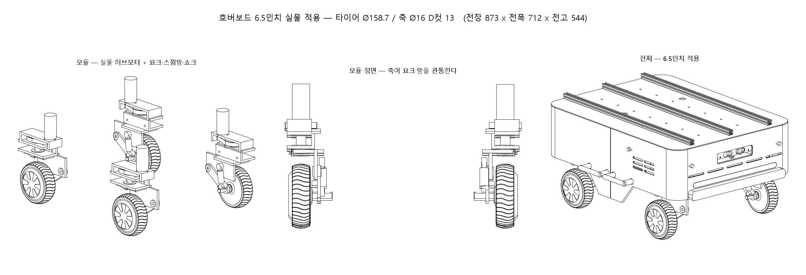

#### 01:56\~03:20 — DRIVE=skid 구현과 간섭 4건 → 0건

예전 `models/mobility_base.py`(4륜 스키드)가 있었지만 8인치 PVC 통바퀴 + 구동계 미정 상태라 적재함·페이로드·내부·검증 1400줄이 없다. 그래서 `swerve_base.py` 에 `DRIVE` 플래그를 넣어 스키드를 기본으로 돌리고 스워브 코드는 남겼다. 바꾼 것: `AXLE_X = 210`, `WHEEL_CLR = 12`(차체 바닥 158.7 + 12 = 170.7), 스커트 반길이 (70, 138) → (60, 118), 축크로스 2본을 x = ±210 에 추가(바퀴 하중이 사이드 레일 단일 스팬을 굽히지 않게), 조향드라이버 보드 제거, 애니메이션을 0\~4초 직진 / 4\~8초 제자리 회전으로 교체. (축크로스는 지금 x = ±265 다 — 축 바로 위에 두니 휠브라켓과 코너 브라켓 자리를 다퉈 55 mm 비켰다.)

```
전장 873 x 전폭 712 x 전고 518 mm
구동 skid / 축간 420 / 윤거 520 / 바퀴 Ø158.7
스키드 T/L 1.24 / 클램프 판 간격 30.0 mm
구동부 z 0~170.7 / 차체 z 170.7~383 / 스커트 지상고 126
제어축 4개 = 구동 4(인휠)
```

**막힌 것 1** — 간섭 검사(임시 `verify.py`, 솔리드 69개)에서 축 × 브라켓 구멍 4건, 각 37 mm³. 원인은 구멍을 Ø16 정확히 파서 끼움 틈이 0 이었던 것. `BR_FIT = 0.3` 을 넣었다. D컷 방향도 단면으로 확인했다(Z −8 \~ +5, 평면은 +Z 쪽, 모델과 일치).

**막힌 것 2** — 다시 돌리니 34 mm³ 가 남았다. 0.1 mm 간격으로 스캔하자 D컷 **평면**은 −48\~−3 이 아니라 **−46.5 \~ −3.7 (42.8 mm)** 였다. 양 끝 1.5 mm 와 0.7 mm 는 평면이 없는 완전 원형이고, 안쪽 판이 거기를 밟고 있었다. `HUB_SHAFT_X = (-46.5, -3.7)`, `BR_CLR` 7 → 5 로 고쳐 간섭 0건. (42.8 은 지금 `hoverboard_mount/parameters.py` 의 `AXLE_FLAT_LENGTH = 42.8` 로 살아 있다. `BR_CLR` 은 지금 없고 `BR_OUT_SLEEVE = 5` 가 같은 자리를 맡는다.)

브라켓 하중 계산: 바깥 판 218 + 273 = 491 N(구멍 지압 4.2 MPa), 안쪽 판 273 N, 축 굽힘 27 MPa, 판 횡방향 처짐 0.15 mm. 프레임에는 레일 밑면 슬롯 M6 2개 + 바깥면 슬롯 M6 2개, 두 면에서 문다. 레일을 타므로 실물에서 휠베이스를 420\~630 사이로 바꿔 시험할 수 있다.

이 구간의 렌더는 docs/images 에 없다.

#### 렌더 — 재부모화 함정과 뷰당 10분

확인용 PNG 를 굽다가 `Compound(children=[...])` 가 자식을 재부모화하는 함정에 또 걸렸다(`assert self._wrapped` → `AssertionError`). 뷰마다 새 사본을 만들어 넣도록 고쳤다. 다음 문제는 속도 — 실물 허브모터 STEP 의 테셀레이션이 뷰당 10분이었다. `HUB_MOCK=1` 로 원기둥 목업을 쓰게 했는데, 그러자 **목업 바퀴에 축이 없어서** 브라켓이 허공에 뜬 그림이 나올 뻔했다. 목업에도 D컷 축을 넣고, 스윙암의 D컷 코드를 브라켓과 같은 `_shaft_cut()` 으로 합쳤다. 래스터가 순수 파이썬 루프라 해상도도 낮췄다. 03:20 에 정리 보고를 하고 "문서·도면 정리와 브라켓 판재 분해 중 어느 쪽부터?" 를 물었다.

|  | 스워브 (전) | 스키드 (지금) |
| --- | --- | --- |
| 축간 | 520 | 420 (T/L 1.24) |
| 차체 바닥 | 196.7 | 170.7 (−26) |
| 전고 | 544 | 518 |
| 제어축 | 8 | 4 |
| 코너당 부품 | 12종 | 브라켓 1 |

(전고 544 는 이 구간 청크와 이미지 60 표제의 값이다. `docs/build-log.md` 21막과 도면 41_swerve 표제에는 595 로 적혀 있다. 두 값의 차 51 mm 가 8인치 바퀴 Ø210 과 6.5인치 Ø158.7 의 차 51.3 과 맞으므로, 595 는 6.5인치 적용 전의 값으로 보인다 — 추정이며 확실하지 않다.)

#### 11:05 — 브라켓 다리 단차 제거와 축 스페이서 슬리브

> 근데 브라켓 이부분 보면 말이야 굳이 이렇게 ㄴ 자 형태로 깍일 필요가 없지 않아? 오히려 저렇게 파이면 약한거 아니야?

브라켓만 떼어 렌더했다(임시 `br.py`). bbox x ±30, y −75.1\~−27.0, z 49.3\~200.7, 부피 134.2 cm³ / 알루미늄 0.36 kg. 클램프 판 y = −71.1, −41.3 (두께 8), 레일 바깥면 y = −35.0. 답은 둘로 갈랐다. (1) 레일을 감싸는 ㄱ자는 필요하다 — 그 안쪽이 빈 건 깎은 게 아니라 레일이 거기 있어서다. (2) **다리 위쪽 단차는 Claude 의 실수**다. 다리를 `top − BR_T` 에서 끊고 타이판을 얹었는데, 레일 밑면까지 그대로 올려 한 몸으로 합치면 단차가 없다. 강도는 좌굴 여유 266배(520 N vs 138,500 N), 안쪽 다리 인장 0.6 MPa, 횡력 109 N 에 19 MPa / 처짐 0.15 mm 라 문제는 아니지만 이유 없는 형상이니 없앴다. (지금 `wheel_bracket()` 도 다리를 축 중심에서 레일 밑면까지 한 박스로 올린다.)

그림을 보다가 더 중요한 걸 찾았다 — 두 판 사이가 비어 있어서 **축 너트를 조이면 바깥 판이 안쪽으로 휜다**. 실물 호버보드 마운트가 다 쓰는 축 스페이서 슬리브(Ø26 / 내경 16.3 / 길이 21.8, `BR_SLEEVE = 26`)를 추가했다. 부피 136.1 cm³ / 0.37 kg, 솔리드 73개, 간섭 0건. 프로파일은 3030(슬롯 8.2 / 방 16.5 → M6 T너트, `tslot.py PROFILES[30]` 과 같다). 절단 목록 합계 7.74 m / 8.02 kg — 목록에 찍힌 건 760×4, 500×3, 390×6, 143×6 의 19본이고 길이 합도 7,738 mm 로 19본과 맞는다. Claude 가 답에 적은 "총 20본" 은 오기로 보인다.

다리가 91 mm 나 긴 이유도 짚었다: 축 z = 79.35, 하부 사이드 레일 z = 170.7. 레일(y 195\~225)은 바퀴(y 237\~291)와 y 로 안 겹치므로 레일을 z = 125 로 내리면 다리 31 mm, 무게중심 46 mm 하강이 가능하지만 셸에 휠아치를 파야 한다. 급하지 않아 보류.

#### 12:42 — 뷰어 덮어쓰기 원인과 축 스택 재정리

> 근데 왜 바퀴는 원래대로 돌아온거지? 내가 넣어준 step 파일 써야지 그렇게 해서 저거 브라켓이랑 연결해둬야지

**원인**: `HUB_MOCK=1` 로 돌린 브라켓 렌더 스크립트가 `swerve_base` 를 import 하면서 `show()` 까지 실행해 목업이 뷰어의 실물 모델을 덮어썼다. **해결**: `NOSHOW=1` 플래그를 만들고, 목업이면 자동으로 뷰어 전송을 막게 했다(`os.environ.setdefault("NOSHOW", "1")`). `ANIMATE` 도 NOSHOW 에 묶었다. 이 세 줄은 지금 코드에 그대로 있다.

"간섭 0건은 안 겹친다는 뜻일 뿐 물려 있다는 증명이 아니다" 라며 임시 `engage.py` 로 판 두께 구간의 축 부피를 쟀다. D컷 단면 175.0 mm²(Ø16 원 201.1 − 활꼴 26.1), 판 8 mm 구간 기대값 1400 mm³ — 바깥 판(y −41.3) 1400 (100%), 안쪽 판(y −71.1) 1400 (100%). 물려 있었다. 그런데 이 계산이 다른 문제를 드러냈다: 축 끝(나사) y = −79.6 \~ 안쪽 판 바깥면 −75.1 = 너트 자리 4.5 mm 인데, **M14 너트는 Ø16 단차에서 멈춰 판에 닿지 않고**, 반대쪽 바깥 판과 숄더 사이도 5.7 mm 떠 있다. 스택이 양쪽 합쳐 7.2 mm 헐거워 너트를 조여도 축이 축방향으로 고정되지 않는다.

숄더\~나사 45.0 mm 를 정확히 채우도록 다시 짰다: **슬리브 5 + 판 8 + 슬리브 24 + 판 8 = 45 mm**. 안쪽 판은 너트 면에 붙느라 평면 없는 원형 구간을 밟으므로 원형 구멍(`flat=False`)으로 팠다. 재검: 바깥 판(y −40.6) 100%, 안쪽 판(y −72.6) 102.7%, 너트+와셔 자리 3.0 mm. 판 간격 29.8 → 32.0 mm. 솔리드 77개, 간섭 0건. (사용자가 12:46 에 지그를 요청해 작업이 한 번 끊겼고, 스택 마무리를 먼저 끝낸 뒤 지그로 넘어갔다.)

*주의: 이 스택은 축 끝 −51\~−48 이 Ø14 나사부라는 가정 위에 있다. build-log 22막에 따르면 이후 스캔에서 나사부가 없고 1 mm 모따기로 끝나는 것이 밝혀져 너트 자체가 존재할 수 없는 부품으로 판명됐다. 이 구간에서는 아직 그 사실을 몰랐다. 지금 코드는 `HUB_THREAD_MEASURED = False`, `parameters.AXLE_HAS_THREAD = False`, 축 끝 `AXLE_END_Y = −78.6`(당시 −79.6) 이고, 판 사이 24 mm 슬리브는 없어지고 숄더 쪽 5 mm 위치 스페이서만 남았다. 판 간격은 당시 32.0, 지금 계산값 30.5 (바깥 판 −40.6 / 안쪽 판 −71.1) 다.*

#### 12:46\~13:27 — 단륜 시험 지그 models/wheel_jig.py

> 바퀴만 테스트해볼 용도로 해서 프로파일 3d만 별개로 추가로 설계해볼수 있을까? 박스구조나 지그 구조나 어떻게 해서 지금의 바퀴 브라켓과 그 나중에 적용할 스워브 드라이브 바퀴도 테스트해볼 수 있을정도로 말이야

원칙은 **로봇의 장착 인터페이스를 그대로 복제**하는 것 — 장착 레일을 로봇 하부사이드 레일과 같은 3030, y = ±210, 같은 높이에 둔다. 지그 전용 어댑터를 만들면 "지그에서는 됐는데 로봇에서는 안 되는" 차이의 출처를 알 수 없기 때문이다. `JIG=skid|swerve` 로 얹는 대상만 바뀌고 프레임은 같다(레일 높이 185.7 ↔ 211.7, T슬롯이라 볼트만 풀면 된다).

**막힌 것** — 첫 정적 간섭 검사(임시 `jigcheck.py`)에서 지그 프레임 자체가 12건: 발 × 베이스세로 6,635 mm³ ×4, 발 × 베이스가로 936 ×4, 기둥 × 장착레일 2,885 ×4. 수직 스택(BASE_TOP, 기둥 시작점)을 다시 잡아 2건(전장선반 × 휠브라켓 1,748 / × 가운데슬리브 102)으로, 선반을 바퀴 쪽으로 덜 뻗게 해서 0건. 스워브 모드는 7건이 나왔는데 전부 모듈 내부(요크상부 × 킹핀축 8,993 mm³ 등 조인트 표현)였고 모듈 × 지그는 0. 스윕 검사는 `NoneType.volume` 으로 죽어 try/except 를 씌웠다.

이 과정에서 로봇 쪽 버그도 잡혔다: 스윙암이 `_shaft_cut(yp, 40)` 으로 두께 40 을 넘겨 평면 복원 박스가 판 밖 32 mm 까지 뻗어 바퀴를 물고 있었다(86 / 298 mm³). `_shaft_cut(yp − YOKE_T, YOKE_T)` 로 고쳐 6건으로 줄었고(지금 코드도 이 줄이다), **조향 스윕 ±99° 충돌 없음**. 스워브 90° 에서 바퀴가 y 176\~344 를 쓸기 때문에 베이스 가로대를 y = ±380 까지 밀어내야 했다(여유 21 mm) — 정적 간섭만 봤으면 못 잡는다.

| 지그 제원 (당시) | 값 |
| --- | --- |
| 외형 | 400 × 800 × 514 mm (처음 529 에서 스택 정리 후) |
| 프로파일 | 3030 6.00 m, 약 6.2 kg (스크립트 출력은 6.1 kg) — 베이스세로 760×2 / 기둥 415×4 / 상단세로 390×2 / 상단가로 360×2 / 베이스가로·장착레일 330×4 |
| 장착 레일 | y = ±210, z = 185.7 (skid) / 211.7 (swerve) |
| 조절 발 | M10 × 4, 스트로크 35 — 20 mm 내리면 바퀴가 뜬다 (무부하 시험) |
| 하중 시험 | 앞 발 2개 올림 → 바퀴 + 뒤 발 2개 3점 지지, 바퀴가 59% 부담 |
| 코너하중 재현 | 22.2 kg 재현에 상단 데크 추 약 28 kg (5 kg 판 6장) |

*검수 주석: 지금 `wheel_jig.py` 는 이 구간 뒤에 통째로 다시 설계됐다. 절단 길이를 본체 재단표의 390 하나(`REUSE_LEN`)로 통일해 7본(2.73 m), ㄴ자 2장 + 가로 3본, 장착 레일은 y = +210 한 본을 기둥 꼭대기(z = 405)에 고정하고, 바퀴를 공중에 띄운 채 시험하며 네 귀를 M8 앵커로 바닥에 잡는다. 반대쪽 레일·상단 프레임·조절 발·추 데크·3점 지지는 없어졌다. 위 표는 당시 값이다.*

최종 로봇 검증 솔리드 77개 간섭 0건, `exports/skid_base.step` 과 `exports/wheel_jig_skid.step` 내보냈다(둘 다 지금 있다. skid_base.step 은 08-13 에 다시 써졌고 wheel_jig_skid.step 은 08-01 날짜 그대로다). 실물 STEP 바퀴로 뷰어에 다시 보냈다. 이 구간에서 쓴 임시 스크립트 `an.py` / `verify.py` / `shot.py` / `br.py` / `engage.py` / `jigcheck.py` 는 스크래치패드에 있었고 지금은 남아 있지 않다.

### 결정

- **서스펜션도 스워브도 없는 4륜 고정 스키드부터 만든다.** 스워브 코드는 `DRIVE=swerve` 로 남긴다(지금도 `DRIVE` 기본값은 skid). 조향 방식은 사용자가 4륜 스키드를 택했다.
- 휠베이스 520 → **420** (T/L 1.24). 340 은 피치 전복각 27° 로 기각.
- 차체 바닥 196.7 → **170.7** (바퀴 158.7 + 여유 12). 전고 518.
- 휠 브라켓은 8t 클램프 판 2장 + 레일 밑면·바깥면 두 평면 M6 4개. 다리 단차 제거, 축 스페이서 슬리브 추가, 축 스택 5+8+24+8 = 45. (뒤에 ㄷ자 휠마운트로 대체됨.)
- 렌더는 `HUB_MOCK=1`, 검증·내보내기는 실물 STEP. 목업이면 뷰어 전송 자동 차단(`NOSHOW`).
- 지그는 로봇 인터페이스를 복제한다 — 전용 어댑터 없음. 베이스 가로대는 ±99° 스윕 결과로 y = ±380.

### 남은 일

- `docs/build-log.md` 23장 A절(당시 번호)이 아직 8인치 PVC 통바퀴 기준 옛 스키드다. 도면 41\~47 재출력 필요 (치수가 전부 바뀌었다). — 지금 build-log 는 28막 + 29\~32절 체제로 재편됐고 도면은 `drawings.py` 로 다시 뽑혔다.
- 스워브 모듈 내부 간섭 6건 (요크 × 킹핀축 등 조인트 표현, 기존 문제).
- 무게·무게중심 재계산 — 모듈 4세트가 빠져 89 kg 에서 꽤 줄었을 것.
- 브라켓 두 다리 사이 거싯 (여유 27배라 필수는 아님), 레이저 절단용 판재 분해.
- 레일을 z = 125 로 내려 다리 31 mm·무게중심 46 mm 낮추는 안 — 셸 휠아치가 필요해 보류.
- 지그에 계측(로드셀 마운트 등) 추가는 무엇부터 시험할지 정한 뒤.
- 축 끝 나사부 존재 여부 — 이 구간의 스택은 Ø14 나사부를 전제한다 (이후 22막에서 뒤집힌다).

### 교훈

- **실물 STEP 이 있으면 가정하지 말고 스캔해라.** 3 mm 간격 스캔은 "−48\~−3 D컷" 이라고 답했고, 0.1 mm 스캔이 "평면은 −46.5\~−3.7" 이라고 답했다. 그 1.5 mm 가 34 mm³ 간섭이었다. (같은 3 mm 스캔이 모따기를 "Ø14 나사" 로 읽은 것도 뒤에 0.1 mm 스캔이 잡는다.)
- **간섭 0건 ≠ 물려 있음.** 판 구간의 축 부피를 재는 별도 검사가 100% 물림을 증명했고, 같은 검사가 너트가 판에 안 닿는 7.2 mm 유격을 드러냈다.
- **그림을 봐야 잡히는 결함이 있다.** 브라켓 단차와 스페이서 부재는 숫자 검사로는 안 나왔고, 사용자가 그림을 보고 물었기 때문에 잡혔다.
- **보조 스크립트가 모델을 import 하면 부작용도 같이 온다.** 렌더용 목업이 뷰어를 덮어써 "바퀴가 원래대로 돌아온" 것처럼 보였다.
- **움직임 검사는 정적 검사와 별개다.** 지그 베이스 가로대 위치는 ±99° 스윕이 정했다.
- `Compound(children=)` 재부모화 함정 — 이전 요약에 "세 번" 이라 적혀 있었으니 이번이 네 번째다. 뷰마다 사본.
- 스프링 레이트 13 N/mm 처럼 근거 없는 자리표시자는 계산해 보기 전까지 설계를 조용히 망친다 (정지 처짐 92%).

---

## 2026-08-01 (토) · 차체: 시험 지그 축소와 허브모터 축 언더컷

> 시간: 13:29 ~ 18:13 · 장소: PC (`D:\build123d`) · 날짜 근거: 세션 기록 · 원본: 차체 설계 일지 `entry_08b.html`

그 전에 만들어 둔 단륜 시험 지그(`models/wheel_jig.py`)를 사용자가 실제로 주문·조립할 수 있는 물건으로 다듬는 날이었다. 13:29\~18:13 KST 사이에 지그는 로봇 하부 프레임 복제본(400×800×514)에서 3030 프로파일 390 mm 7본짜리 ㄴ자 프레임으로 줄었고, 그 과정에서 3030 의 100 mm 단위 과금 규칙, 철물 선정, 프린트 스탠드(`models/motor_stand.py`), 그리고 허브모터 축 끝의 원형 구간 때문에 클램프가 아예 안 끼워진다는 사실이 드러났다.


### 한 일

#### 13:29 — 지그 크기 축소, 시험 대상 bbox 에서 역산

> 지그가 왜이렇게 크지? 그리고 바퀴 하나만 가지고 모듈 테스트하는건데 반대쪽까지 있을 필요가 있나?

원인은 로봇 하부 프레임을 통째로 베낀 것이었다. 시험 대상을 실측하니 스키드 휠브라켓은 y 183\~233 / z \~201, 스워브 킹핀브라켓도 y 225\~296 으로 **둘 다 +Y 레일 한 본에만 물린다**. 반대쪽 레일(y=−210)과 스워브 기준 높이 480 은 낭비였다. 프레임 치수를 상수로 박지 않고 시험 대상 bbox + 여유로 계산하도록 고쳤고, 반대쪽 레일은 y=+60 으로 당겼다.

|  | 이전 | 스키드 | 스워브 |
| --- | --- | --- | --- |
| 크기 | 400×800×514 | 279×501×285 | 350×554×446 |
| 부피 | 164 L | 40 L (−76%) | 87 L |
| 프로파일 | 6.00 m | 3.22 m | 4.40 m |

#### 13:45 — 공중 시험 전제로 발·추 데크 제거

> 바퀴는 땅에 닿지않고 공중에 띄운채로 테스트할건데

3점 지지, 조절 발 4개, 상단 추 데크, 그걸 받치려던 긴 베이스가 모두 사라졌다. 조향 스윕(y=344 까지)이 z=50 위라서 베이스(z 0\~30)가 바퀴 밑으로 지나가도 된다. 269×286×331, 26 L (처음 대비 −84%), 3.21 m.

대신 새 문제가 생겼다. 바퀴가 떠 있으면 구동 토크 반력 29 N·m 이 지면으로 안 빠지고 지그를 축 둘레로 뒤집는다. 자중 6.7 kg × 반폭 134 mm = 8.8 N·m 로 3.3배 부족하다. 추 약 15 kg 을 바닥에 얹거나 네 귀 M8 로 벤치에 고정해야 한다.

#### 14:12 — 상단 프로파일 길이 수정, 바닥판 제거, 지면 접촉 하중 시험 여부

사용자가 상단 가로대가 짧아 보인다고 짚었다. 확인하니 맞았다. 기둥은 ±119 중심이라 실제로 104\~134 를 차지하는데 상단가로는 2·RAIL_X = 238 로 기둥 중심선에서 끊겨 윗면 절반이 비어 있었다. 기둥 *사이*에 끼우는 베이스가로(208)와 기둥 *위*에 얹히는 상단가로는 규칙이 반대인데 같은 식을 썼다. 268 로 고쳤다.

바닥판은 빼고 M8 앵커 4개로 바꿨다. 처음엔 뒤 기둥과 같은 자리(y=60)에 놓아 2,854 mm³ 씩 2건 물렸고, 기둥·가로대를 피한 곳으로 옮겨 0건이 됐다.

"땅에 닿으면 하중 시험이 되나"에는 **안 된다**고 답했다. 지그를 바닥에 고정하면 바퀴와 바닥 사이 틈이 고정이라 심 0.5 mm 차이로 하중이 0 이거나 프레임이 휜다. 대안으로 바퀴 밑에서 M12 전산볼트 나사잭 + 로드셀로 밀어 올리는 방식(218 N)을 제안했다.

#### 14:38 — 스워브까지 한 프레임으로 (UNIV=1)

> 그게 다 필요하나 어차피 잘 굴러가는지 테스트용인데 말이야

잭·로드셀은 넣지 않았다. 당시 지상고 50 mm 는 그대로라 나중에 M12 압반은 들어간다고 적어 두었다. 스워브 모듈은 `JIG=swerve` 로 붙게 돼 있었지만 프레임이 시험 대상에 맞춰 자동으로 커져서, 스키드용으로 잘라두면 나중에 다시 잘라야 했다. `UNIV=1` 을 넣어 스워브 포락선으로 한 번만 짓게 했다. 354×296×492, 4.36 m — 스키드 전용(3.27 m)보다 1.09 m 더 들지만 재제작이 없다. 두 모드 차이는 장착 레일 높이 235.7 ↔ 261.7 뿐이었다. 검증은 스키드 간섭 0건, 스워브 모듈×지그 0건 + 조향 스윕 ±99° 충돌 없음. (jigcheck 원출력은 스워브에서 매번 정적 간섭 6건을 찍었지만 지그·앵커가 낀 쌍은 없었고, 스워브 모듈 내부의 기존 건으로 보고 제외했다.)

#### 14:58 — 3030 의 100 mm 단위 올림 과금 반영

> 음 3030 재단 규격 다시 생각해야할거 같은데 … 100mm 단위인건가

사용자가 판매 페이지 캡처를 보여줬다. 770 mm 주문 = 800 mm 값(100 mm 당 900원)이었다. 지금 재단표로 계산하니 50단위 45,000원에 버림 640 mm(13%). 순서를 뒤집어 **절단 길이를 먼저 100 배수로 잡고 프레임 치수를 역산**하도록 바꿨다. 기둥이 조향모터 꼭대기를 쫓아 432 였는데 조향모터는 레일 바깥에 매달려 있어 기둥이 거기까지 갈 이유가 없었다. 장착 레일 위 40 mm 에서 끊으니 300 이 됐고, 상단 가로·세로를 맞바꿔 가로 3종이 전부 같은 길이가 됐다.

|  | 이전 | 100 단위 정렬 |
| --- | --- | --- |
| 재단 종류 | 5가지 | 2가지 (300×12, 180×2) |
| 과금 | 50단위 45,000원 | 40단위 36,000원 |
| 버림 | 640 mm (13%) | 40 mm (1%) |
| 크기 | 354×296×492 | 374×300×412 |

`tslot.cut_list` 에 과금 단위·주문수량·버림·금액 계산을 넣었다. 15:47 주문 옵션을 묻는 질문에서 수량 칸이 개수가 아니라 **100 mm 단위 개수**(770 mm 1개 → 수량 8)임을 정리했고, 주문서는 수량 36 + 4 두 줄이다. 가공(홀·탭)은 넣지 말라고 했다 — 장착 레일을 26 mm 옮겨야 하고, 브라켓 + T너트로 가면 재단만 시키면 된다. 이때 철물은 브라켓 약 30개·T너트 60·볼트 60 으로 약 55,000원(합 9만원대)이라고 어림했는데, 이 수치는 16:42 에 조인트를 세면서 10,500원으로 내려간다.

당시 단가 900원/100 mm 는 판매 페이지 판독값이다. 현재 `tslot.py` 는 `UNIT_PRICE = 950` (2026-08 실주문 확인)으로 바뀌어 있어, 이 날의 36,000 / 25,200 / 74,700원은 지금 단가로는 38,000 / 26,600 / 78,850원이 된다.

#### 15:58 — 본체 가격

본체(스키드) 프로파일은 760×4 / 500×3 / 390×6 / 143×6 = 83단위 74,700원(실 7.74 m, 과금 8.30 m, 버림 562 mm). 기둥 143 이 6본에서 342 mm 를 버리는 최악이다. 전체 추정은 약 599,000\~1,404,000원이고 스워브(887,000\~2,483,000) 대비 최대 기준 절반 이하다 — 시세 기준 추정이지 견적이 아니다. 휠브라켓 8t 알루미늄은 프린트로 못 바꾼다 — D컷 평면 지압 44.6 MPa 가 PETG 항복 45 MPa 와 같다. 사용자는 호버보드 2대를 6.5인치로 이미 10만원에 샀다고 확정했다.

당시 본체 프로파일 83단위 74,700원. 현재 `docs/build-log.md` 32절은 휠브라켓이 프로파일 휠마운트로 바뀐 뒤 값이라 79단위(7.90 m 과금) 75,050원(950원/100 mm)이다.

#### 16:03 — ㄴ자 7본, 전부 390 으로 본체에 재활용

> 직각삼각형 모양으로 하면 어떨까? 8개로 끝나지 않을까? 아니면 그냥 ㄴ자로 … 나중에 본체에 재활용 할 수 있으면 더 좋고

지그는 앵커로 바닥에 잡고 쓰므로 전복 반력을 프레임이 아니라 앵커가 받는다. 그러면 박스 상단 4본 + 뒤 기둥 2본은 하는 일이 없다. ㄴ자 2장 + 가로 3본 = **7본, 전부 390 mm** 로 통일했다(2.73 m, 28단위 25,200원, 버림 70 mm = 2%). 본체 재단표의 390×6(축크로스·하부크로스·카메라크로스)과 같은 길이라 시험이 끝나면 6본이 그대로 본체로 간다. 대각재를 프로파일로 쓰지 않은 이유도 같다 — 45° 절단이 들어가면 본체로 못 옮긴다. 코너는 거싯판 200×200×6t 로 잡았다. 크기는 스키드 464×456×420, 스워브 얹으면 464×466×556.

막힌 것: 절대 z 로 저장해 둔 스워브 포락선 어서트가 LIFT 변경으로 걸렸다 → 레일 기준 상대값으로 바꿨다. 거싯이 앵커와 2,112 mm³ 겹쳤다 → 앵커를 거싯·가로대를 피한 구간으로 옮겼다. 부수효과로 레일을 기둥 꼭대기(z=405)에 고정하니 스키드·스워브 사이에 레일을 옮길 필요조차 없어졌고 바퀴만 219 / 193 mm 높이에 뜬다.

|  | 프로파일 비용 |
| --- | --- |
| 지그(박스) + 본체 | 36,000 + 74,700 = 110,700 |
| 지그(ㄴ자) + 본체 | 25,200 + 74,700 = 99,900 |
| 재활용 반영 | 25,200 + (74,700 − 21,600) = 78,300 |

#### 16:29 — 본체 프로파일 치수 재검토

Claude가 앞서 던진 "760 → 800" 은 틀렸다. 800 도 8단위라 돈이 안 준다. 돈이 주는 건 단위 경계를 아래로 넘을 때뿐이다. 실제로 `BAY_H` 140 → 197 로 돌려보니 기둥 143 → 200 이 되어도 83단위 74,700원으로 동일하고 베이 부피만 +41%, 전고 518 → 575 였다. 그러나 전고 +57 mm 는 휠베이스 420 에서 피치 전복각을 32° → 29° 로 떨어뜨린다. 줄이는 쪽(기둥 100, 사이드 700)은 9,000원 절감에 베이 −43 mm + 전장 −60 mm 이고, 하부크로스 390 → 300 은 RAIL_Y 가 210 → 165 로 바뀌어 휠브라켓을 다시 설계해야 해서 불가. **본체는 그대로 둔다.**

#### 16:32 — 지그 3D 프린트 가능성 검토

일부만 가능하다고 답했다. 장착 레일에 반력 29 N·m 이 통째로 비틀림으로 들어가는데, 3030 알루미늄이 1.3° 비틀리는 구간에서 PLA/PETG 는 전단탄성계수가 1/25 이라 30° 넘게 감긴다(근사 계산). 지그가 먼저 감기면 브라켓 미끄러짐과 구분이 안 된다. 프로파일 7본은 알루미늄(25,200원), 거싯·앵커판만 프린트 가능(약 1만원 절감). 통짜 각봉으로 강성을 맞추려면 한 변 70 mm 급, 필라멘트 6\~8 kg 이라 할 일이 아니다.

#### 16:42 — 거싯 제거, 철물 목록, 다이캐스팅 브라켓 선정

> 그냥 지금 프로파일 7본으로 해결하자, 근데 저 판이 굳이 있어야 되나 싶네

ㄴ자 코너 모멘트를 재보니 구동 반력은 기둥 2본에 ±69 N 축력으로 갈리고, 바퀴 자중 33 N 이 50 mm 앞에 있어 코너 2곳이 0.8 N·m 씩 나눈다. 30 시리즈 브라켓 2개면 20배 여유라 거싯을 뺐다. 조인트별 브라켓 수(`JOINTS`)에서 철물을 뽑도록 넣었다: 브라켓 12, M6×12 볼트 28, 사각너트 24, 스프링너트 4, 앤드캡 8.

처음엔 "아연은 조이다 깨진다"며 스틸(450원)을 권했는데 사용자가 되물어 계산하니 근거가 없었다. 조인트 하중은 장착레일 끝 86 N, ㄴ자 코너 98 N 으로 브라켓 1개당 43\~49 N 이고 다이캐스팅 정격 약 490 N 이라 여유 10배다(490 N 은 "보통 50 kgf" 라는 통상값을 든 것으로 출처는 확인하지 않았다). 다이캐스팅 12개(4,320원)로 바꿨다. 합계 **34,600원** + M8 앵커 4개(철물점).

다만 `wheel_jig.py` 코드의 철물 합계식은 지금도 스틸 450원 기준(약 10,500원)으로 남아 있다 — 다이캐스팅 4,320원 / 34,600원은 대화 정리에만 있다. 이후 본체 BOM(`docs/bom.md`)은 다이캐스팅 3025 를 360원 실단가로 확인해 쓰고 있고, 너트는 사각너트 없이 스프링너트(180원)만 쓴다.

"브라켓과 볼트만 있으면 되지 않나"에는 프로파일에 나사산이 없어 볼트 1 = 너트 1 이 항상 짝이라고 설명했다. 사각너트(50원)는 끝에서 밀어 넣고 스프링너트(180원)는 옆에서 끼운다 — 강도는 같고 넣는 방법만 다르다. 장착 레일은 양 끝이 기둥에 막혀 조립 후 사각너트를 추가할 수 없어, 시험 대상을 바꾸는 자리만 스프링너트다. 스키드 휠브라켓은 밑면 ±20 / 바깥면 ±20, 스워브 킹핀브라켓은 바깥면 ±50 이라 위치가 겹치지 않으므로 **스프링너트를 6개로 올리라**고 했다(+360원).

#### 17:10 — motorHolder.step 을 참고한 프린트 스탠드

사용자가 `refmodel/motorHolder.step`(97×86×30, 솔리드 1개)을 넣어 "아래 홀더 같은 느낌으로 공중에 띄우는 것"을 요청했다. 참고 홀더는 축이 세로라 원뿔 + 방사 리브 + 쪼개진 클램프 보스였고, 허브모터는 축이 가로라 형상은 못 쓰고 방식만 가져왔다. `models/motor_stand.py` 를 새로 썼다.

- 통짜 파일런 첫 판: 1,350 cm³ (프린트 12시간+), 지압 계산도 틀렸다 → 핀 2장 + 웹으로 바꿔 비틀림을 핀 상하 커플 ±725 N 으로 받게 했다. 634 cm³.
- 핀을 앞(+y)으로 벌렸더니 바퀴와 6,483 mm³ 간섭 → 뒤로만 퍼지게 고쳐 0. 571 cm³ / PETG 40% 약 363 g.
- 클램프를 판 2장(16 mm 물림, 22 MPa) 대신 보스 하나로 평면 구간 42.8 mm 전체를 물어 지압 8.5 MPa, 여유 5.3배.
- 자중 3.8 kg × 85 mm = 3.1 N·m 뿐이라 여기서도 M8 앵커 4개 필수(개당 230 N).

위 수치는 실행 출력값이다. 현재 `motor_stand.py` 머리 주석에는 지압식 수정 전 값(8.3 MPa / 5.4배 / 앵커 145 N)이 그대로 남아 있어 실행 출력(8.5 / 5.3 / 230)과 다르다.

스탠드로 먼저 모터·드라이버·홀센서를 돌려보고, 휠브라켓 검증과 스워브는 프로파일 지그로 가자고 정리했다.

#### 17:39 — 축 끝 원형 구간 확인, 클램프 조립 불가

> 근데 바퀴 축이 d 컷이 지만 맨 끝에쪽에는 둥그레 원으로 되어있잖아 그러면 제대로 끼울 수 있나?

확인하니 지금 설계로는 못 끼운다. 당시 모델 기준으로 축은 y −76.6\~−75.1 이 Ø16 완전 원형(나사 언더컷으로 읽었다), −75.1\~−32.3 이 D컷, 반대쪽은 숄더 Ø28→39. D컷 보어 높이 13.3 으로는 원형 구간 1.5 mm 를 못 지나고 반대쪽은 숄더가 막는다. 스탠드는 **축 중심(z=120)에서 갈라 위에서 떨구는 2조각 클램프**로 바꿨다. 가르는 면이 중심보다 위면 입구가 16 보다 좁고, 아래면 D컷 평면이 본체로 넘어가므로 중심이어야 한다. 본체 555 + 캡 58 = 613 cm³(약 389 g), 캡 볼트 M6×2(x=±23). assembly 에 넣은 조각은 재부모화돼 export 가 죽어서 새로 만들어 내보냈다. 사용자가 보낸 실물 클램프 사진도 같은 2조각 방식이었다(사진 자체는 청크에 첨부 표시가 없고 Claude 답변이 두 번 참조한다).

사진에서 배선도 잡았다. STEP 은 축을 통짜로 그렸지만 실물은 8선이 축 끝(y=−79.6)으로 나온다. 클램프는 −75.1 에서 끝나 출구는 안 막지만 늘어진 다발이 바퀴에 감기니 웹에 케이블타이 슬롯 5×3 을 2곳 뚫었다.

로봇 휠브라켓도 같은 문제였다. 알루미늄이라 판을 위아래로 가르거나(4장) 축의 언더컷 1.5 mm 를 평줄로 밀어내는 두 선택지를 냈고, 사용자가 후자를 골랐다. `HUB_FILE_UNDERCUT = True` 로 `wheel()` 이 줄 작업 끝난 축을 그리게 했다(불리언 4초). 이러면 안쪽 판도 D컷이 되어 토크를 두 판이 나눈다: 바깥 판 혼자 44.6 MPa → 22.3 MPa (6061-T6 항복 276 대비 12배). 검증 스크립트가 600초를 넘겨 백그라운드로 돌렸고(모델 로드 110초), 결과는 솔리드 77개 간섭 0건, 바깥 판(y=−40.6)·안쪽 판(y=−72.6) 축 부피 1,400 mm³ 100%, 너트 자리 3.0 mm. 스탠드도 `BR_FLAT` 을 참조하므로 물림이 42.8 → 44.3 mm 로 늘었다.

### 결정

- 지그는 공중 시험 전용. 하중 시험(잭·로드셀)은 넣지 않는다.
- 프레임은 3030 390 mm × 7본 ㄴ자, 거싯 없음, M8 앵커 4개로 바닥 고정. 가공(홀·탭·각도)은 시키지 않는다 — 6본을 본체 390 크로스로 재활용하기 위해서다.
- 철물은 다이캐스팅 브라켓 12 + M6×12 볼트 28 + 사각너트 24 + 스프링너트 4(→6 권고) + 앤드캡 8, 약 34,600원.
- 본체 프로파일 치수는 그대로(83단위 74,700원). BAY_H 를 키우면 공짜지만 전복각이 30° 아래로 내려간다.
- 프린트 스탠드는 2조각 클램프(위에서 떨굼)로 먼저 모터를 돌려보고, 로봇 휠브라켓은 축 언더컷을 줄로 밀어 두 판 모두 D컷으로 문다. (줄 작업 결정은 이후 폐기됐다 — 남긴 일 참조.)

### 남은 일

- 스워브 킹핀브라켓 볼트 위치가 미확정이라 스프링너트 수는 여유를 둬야 한다.
- 휠브라켓 8t 알루미늄 가공(3만\~20만원)이 견적에서 남은 가장 큰 불확실성. 클램프 판 2장만 알루미늄, 타이판·플랜지는 프린트로 쪼개는 안은 제안만 하고 반영하지 않았다.
- 당시 `docs/build-log.md` 24막 제작비가 아직 스워브 기준이었다. 현재는 32절로 번호가 밀렸고 스키드 기준(실단가 950원/100 mm)으로 갱신돼 있다.
- 이 구간 밖의 일이지만 기록해 둔다: 현재 `swerve_base.py` 는 `HUB_FILE_UNDERCUT = False` 이고, 주석에 따르면 "Ø14 나사 3 mm" 는 1 mm 모따기를 잘못 읽은 것이며 원형 구간은 −50\~−46.5 의 3.5 mm 다(build-log 22막). 브라켓이 아래로 열린 U + 캡 클램프로 바뀌면서 줄 작업 자체가 필요 없어졌다. 이날의 1.5 mm / Ø14 나사 수치는 그 이후 정정됐고, 스탠드 물림도 다시 42.8 mm(−75.1\~−32.3)다.
- 390 재활용 구상은 형태를 바꿔 살아남았다. 현재 `docs/bom.md` 는 남는 390 mm 3030 2본을 액슬 타이(360 으로 절단)로 쓴다고 적고 있다.
- 내보낸 파일: `exports/wheel_jig_skid.step`(08-01 16:45 KST)·`wheel_jig_swerve.step`(16:49)은 이날 판이 그대로 남아 있다. `motor_stand.step`(17:23)은 2조각으로 가르기 전 1조각 판이고, `motor_stand_body.step`·`_cap.step` 은 08-10 에 다시 내보낸 것이다.

### 교훈

- 지그는 로봇을 베끼는 게 아니라 **시험 대상의 bbox 에서 역산**한다. 반대쪽 절반은 통째로 낭비였다.
- 재료 과금 단위를 먼저 알고 나서 치수를 정한다. 100 mm 올림이면 "절단 길이를 먼저 100 배수로 잡고 프레임을 역산"하는 게 맞고, 버림을 줄여도 단위 경계를 안 넘으면 돈은 안 준다.
- "기둥 사이에 끼우는 부재"와 "기둥 위에 얹는 부재"는 길이 규칙이 반대다. 같은 식을 쓰면 눈에 띄게 짧아진다.
- 근거 없이 튼튼한 쪽을 고르는 버릇 — 거싯판, 스틸 브라켓 — 은 사용자가 되물을 때마다 계산하면 무너졌다. 하중을 먼저 세어라.
- D컷 축은 평면 구간만 보면 안 되고 **그 구간에 도달할 수 있는 경로**를 봐야 한다. 양쪽이 원형·숄더로 막혀 있으면 닫힌 보어는 조립 자체가 불가능하다. 호버보드 프레임이 전부 열린 슬롯인 이유였다.
- 어서트는 절대 좌표가 아니라 기준 부재 상대값으로 둔다. 절대 z 어서트는 LIFT 하나 바꾸자 바로 걸렸다.

---

## 2026-08-01 (토) · 차체: 축 나사부 부재 확인과 휠브라켓의 3030 프로파일 전환

> 시간: 20:41 ~ 08-05 (수) 16:44 · 장소: PC (`D:\build123d`) · 날짜 근거: 세션 기록 · 원본: 차체 설계 일지 `entry_09.html`

스키드 전환이 끝난 차량(873 × 712 × 518 mm, 축간 420 / 윤거 520 / 바퀴 Ø158.7, T/L 1.24)을 뷰어로 다시 보내는 데서 시작했다. 이 구간의 주제는 하나다 — **휠브라켓이 실물 축을 정말 잡을 수 있는가.** 너트 예압 → 아래로 열린 U + 하부 캡 → 브리지 블록 → 핀치 갭 → 조인트 철물 30개 자동 배치 → 그리고 마지막에 판재 브라켓 전체를 3030 프로파일 69.3 mm 한 토막으로 갈아엎었다. 방향을 바꾼 지적은 거의 전부 사용자에게서 나왔다(핀치 갭 하나만 사용자의 두께 질문에 답하려고 재다가 Claude 가 찾았다). 날짜는 KST 기준이며 08-01 밤 작업은 자정을 넘겨 08-02 03:26 까지 이어졌다. 차량 크기 873 × 712 × 518 / 축간 420 / 윤거 520 은 2026-09 현재도 같다(`docs/build-log.md` 31절).

이 구간의 렌더는 docs/images 에 없다(당시 렌더는 전부 스크래치 폴더의 br2\_\*.png 였다).

### 한 일

#### 08-01 20:41 — 바퀴 축소 후 윤거·축간 재검토

차량을 뷰어에 보낸 뒤 사용자가 물었다.

> 근데 바퀴 크기가 줄어들었잖아 그러면 바퀴 간 거리를 다시 조정해야되나? 다시 늘려야 하나? 이건 뭐 어떻게 결정해야하지?

스크래치 스크립트(geom.py)로 실제 형상에서 상·하한을 뽑았다. 결론은 **바퀴 지름은 윤거·축간을 정하는 변수가 아니다**였다.

| 항목 | 하한 | 상한 | 현재 | 무엇이 정하나 |
| --- | --- | --- | --- | --- |
| 윤거 | 515 (바퀴 안쪽면이 레일 바깥면 225 에서 10 여유) | 541 (바퀴 바깥면이 셸 안쪽면 302 안) | 520 | 프레임 폭 BASE_W=450. 창이 26 mm |
| 축간 | 346 / 381 / 416 (CG z=300 / 330 / 360, 피치 전복 30°) | 433 (스키드 T/L ≥ 1.2), 셸 625 | 420 | 무게중심 높이 — 아직 안 쟀다 |

바퀴가 Ø210 → Ø158.7 로 줄어 실제로 움직인 건 차체 바닥 196.7 → 170.7, 스커트 지상고 151.7 → 125.7, 전고 544 → 518, 그리고 등판 턱 높이 약 47 → 36 mm(11 mm 손실, "강성 바퀴는 반경의 0.45배" 가정)뿐이다. 바퀴 폭은 58 → 55 로 3 mm 차이다. 다음 결정은 **무게중심 실측**인데 이 구간에서는 하지 못했다. (`BASE_W = 450`, `SKID_WHEELBASE = 420` 은 현재 `swerve_base.py` 에도 그대로다.)

#### 08-02 02:27 — 축 너트 예압 검토, 나사부 부재 확인, 하부 축캡 클램프로 전환

> 바퀴 끼울때 구멍이 클램프 구조가 아니라서 저렇게 하면 고정이 안되거나 끼우지 못하지 않을까

처음 답은 "슬립핏(Ø16.3 vs 축 Ø16.0, 0.3 mm 여유) + 축 너트 예압"이었다. M12 너트 40 N·m → 축력 약 16.7 kN, 마찰(μ 0.15) 2.5 kN 대 실하중 218 N 으로 11배 여유, 스택 [슬리브 5 + 판 8 + 슬리브 24 + 판 8] = 45 mm 가 숄더\~나사 간격과 일치한다고 설명했다. 그러자 "지금 그림에서 너트가 없지 않나"가 왔고, `axle_nut()` 을 넣었다 (M14 나일론 록너트, 대변 21, 높이 15).

**막힌 것:** 너트를 넣자마자 너트 × 바퀴 간섭 117 mm³ → 보어에 여유를 주니 98 → 축 끝 위치를 고치니 17 → 너트에 모따기를 주니 0 mm³. 이 과정에서 축 끝을 0.1 mm 간격으로 스캔했다.

```
X −51.0  Ø14.0   ← 축 끝
X −50.5  Ø15.0   ← 지름이 연속으로 는다 = 1 mm 모따기
X −50.0  Ø16.0
X −46.5 ~ −3.7   D컷 평면
```

**원인:** "Ø14 나사 3 mm"로 읽었던 것은 모따기였다. STEP 에는 나사부가 없다. 줄로 밀 구간은 1.5 가 아니라 3.5 mm(X −50 \~ −46.5), 판 간격 32 → 34, 스택 45 → 47 mm 로 고치고 "실물 축 길이·나사 규격을 재라"는 경고를 찍게 했다. 그때 사용자가 결정적인 말을 했다.

> 애초에 보드 축은 너트를 끼울수 있게 되어있는 형태는 아닌데 말이야

**해결:** 나사가 없는 건 오류가 아니라 사실이었다. 너트 예압 전제를 통째로 버리고 **아래로 열린 U 판 + 하부 축캡(이때는 M6 ×4)** 클램프로 바꿨다. 바퀴 하중 218 N 은 위쪽 판이 직접 받는다. 안쪽 판을 원래 D컷 평면 안쪽 끝(−75.1)에 맞추니 판 간격 34 → 30.5 mm 가 됐고, 캡이 판 두 장에 걸쳐 하나로 가서 무는 길이는 판 두께 합 16 이 아니라 38 mm 다(간격 34 일 때는 42). 축방향으로 밀어 끼우지 않으니 `HUB_FILE_UNDERCUT=False` — 줄 작업 자체가 없어졌다(현재 코드에도 False, `HUB_UNDERCUT_X=(-50.0, -46.5)`). 부품은 [판 2 + 슬리브 2 + 너트] → [판 2 + 캡 1 + 위치스페이서 1]. 간섭 0건(솔리드 77개). 실물 확인 항목이 넷에서 둘로 줄었다: D컷 평면 길이(모델 42.8) 와 숄더\~축 끝(모델 47). `wheel_jig.py` 도 같이 고쳤다(파일 시각 08-02 03:16).

#### 08-02 19:52 — 캡 볼트 탭 자리 검토: 8t 판 대신 브리지 블록

> 나사산과 구멍을 휠 브라켓 쪽에 넣어둔다고 했을때 적절한 크기로 설정되어있나?

M6 자체는 맞는데 **탭이 앉는 자리가 틀렸다.** 판 8 mm 에 M6 하공 Ø5.0 이면 구멍 옆 살이 (8−5)/2 = 1.5 mm 뿐이다. 알루미늄 M6 는 둘레 Ø12(2×D) 이상이 필요하다. 볼트를 판이 아니라 **판 사이 브리지 블록(22.5 w × 20 t)** 에 물리게 했다. 캡 Ø6.6 관통 → 브리지 Ø5.0 탭, 깊이 20 = 3.3×D. 브리지는 D컷 평면을 위에서 직접 눌러 회전 방지도 겸한다. 캡 볼트는 M6 ×4 → **M6 ×2 (x=±22)**: 필요 체결력 = 횡력 175 N ÷ μ 0.2 ÷ 2 = 438 N/볼트, M6 10 N·m 체결 시 약 8,000 N → 18배. M8 로 올릴 이유는 없다고 봤다. 간섭 0건(솔리드 77개). (`BRIDGE_Z = 20`, `CAP_BOLT = (6.6, 5.0)` 은 현재 코드에 그대로 남아 있다.)

#### 08-02 20:18 — 축캡 두께 축소와 핀치 갭 추가

> 하단 축캡 클램프는 너무 두꺼운거 아닌가? 두께가 얼마나 되는거지? 높이 말이야

캡은 60 × 38.5 × 30, 63 cm³(알루미늄 0.17 kg), 축 밑 살 21.8 mm, 지상고 49.3 이었다. 두께를 정하는 건 실하중이 아니라 **과체결**(M6 규정 체결 8 kN)이다.

| 축 밑 살 | M6 ×2 풀체결 응력 | 6061 항복 276 대비 |
| --- | --- | --- |
| 21.8 (전, 캡 30t) | 57 MPa | 4.8배 — 과했다 |
| 18.0 | 85 MPa | 3.3배 |
| 16.0 | 107 MPa | 2.6배 |
| **15.0 (채택, 캡 24t)** | **122 MPa** | **2.3배** |
| 14.0 | 140 MPa | 2.0배 |
| 12.0 | 190 MPa | 1.4배 — 위험 |

(cap.py 계산 출력은 12.0 행에서 잘려 있어 12.0 → 190 MPa 는 Claude 의 답변에만 나온다. 15.0 → 122 MPa 는 모델 실행 출력에 찍힌 값이다.)

**막힌 것:** 캡 치수를 재다 보니 캡 윗면 z=79.3, 판 밑면 z=79.35 로 딱 맞닿아 있고, 캡 시트 R8.15 대 축 R8.0 으로 0.15 mm 틈이 있었다. 볼트를 조이면 캡이 축을 물기 전에 판에 먼저 닿는다 — **클램프인데 클램프가 안 됐다.** **해결:** 핀치 갭 1.0 mm(캡 윗면을 판 밑면보다 낮춤), 캡 시트 R8.05(`CAP_GAP, CAP_FIT = 1.0, 0.1`, 현재 코드에도 그대로). 캡 밑 지상고 49.3 → 54.3. 간섭 0건(솔리드 77개). 코너당 부품은 클램프판 2(8t 레이저) + 브리지 1(20t) + 축캡 1(24t) + 위치스페이서 1(선반 Ø26/Ø16.3 × 5) + M6 볼트 2(캡) + 4(레일).

#### 08-04 22:54 — 뷰어 재기동과 ONLY 필터 추가

> 뷰어 서버 켜져있나? 우리 프로파일하고 바퀴하고 브라켓만 보여줘볼래?

"켜져 있다"고 답했는데 틀렸다. 전송 출력에 `WinError 10061` 연결 거부가 있었는데, 결과를 `grep` 으로 거르면서 `CommsWarning` 줄까지 잘라내고 있었다. `python -m ocp_vscode` 를 백그라운드로 띄워 3939 LISTENING 을 확인하고 다시 보냈다. 이어서 "외부케이스까지만 더" 요청에 `ONLY=프레임,바퀴,휠브라켓,외장셸` 환경변수를 추가했다 — `MODULE_ONLY` 와 달리 다 짓고 표시만 거르므로 셸의 창·홈 상호작용이 검증된 채로 나온다. 없는 그룹 이름은 목록을 띄우고 멈춘다.

| 구성 | 크기 (mm) |
| --- | --- |
| 프레임만 | 760 × 560 × 203 (z 170.7\~373.7) |
| + 바퀴·휠브라켓 | 760 × 583 × 374 |
| + 외장셸 | 810 × 610 × 380 |
| 완성 (핸들·안테나·범퍼) | 873 × 712 × 518 |

프레임 재단은 760 × 4 / 500 × 3 / 390 × 6 / 143 × 6 = 19본, 83단위, 당시 단가 900원으로 74,700원, 실길이 7.74 m / 과금 8.30 m, 알루미늄 약 8.0 kg. 지그 390 × 6본을 옮겨 오면 21,600원이 빠진다.

#### 08-04 23:10 — 조인트 브라켓 30개 자동 배치와 간섭 21건 해소

> 우리 저 3d 설계에 연결부품(볼트,너트,브라켓등) 도 들어가야하는거 안니야? 각 모서리마다 해서 말이야

모델엔 구멍만 있고 브라켓 실물이 없었다. `BEAMS` 에서 빔 끝면이 다른 축 빔에 맞대지는 곳을 자동으로 찾아 3025 코너 브라켓을 놓게 했다 — 30개(빔마다 끝 2개씩 정확). 검증이 도는 사이에 `models/export_cnc.py` 를 새로 써서(파일 시각 08-04 23:27) 융합돼 있던 휠브라켓을 두께 방향으로 갈라 `exports/cnc/` 에 7종 STEP 으로 내보냈다(DXF 는 평판 6종만). 분해 검증은 원본 141.0 cm³ = 조각 합 141.0 cm³(차이 0). 8t 4종(클램프판 2·타이판·플랜지)은 레이저 한 판(49+49+28+17 = 143 cm² × 4), 브리지 20t·축캡 24t 는 워터젯 또는 톱+밀링, 위치스페이서는 선반이라 DXF 를 안 만들게 고쳤다. 이 파일들은 2026-09 현재도 `exports/cnc/` 에 남아 있다(그 뒤 추가된 휠마운트_cnc_M6 파일들과 함께).

**막힌 것:** 브라켓을 넣자 검증(솔리드 107개)에서 간섭 21건. 당시 Claude 가 분류한 내역은 브라켓끼리 3(5,326 mm³), 베이 바닥판 4(2,147), 데크 6(300), 외장셸 6(2,498), 핸들·전방카메라 3 인데 합이 22 라 분류는 정확하지 않다(원본 목록은 출력이 잘려 전부 보이지 않는다). 전장도 760 → 790, 전고 374 → 404 로 튀어나왔다. 사용자는 이너 브라켓(306, 770원)을 물었다: 30개면 23,100원 대 3025 10,800원, +12,300원이고 프로파일 밖으로 안 나와 21건이 원리상 사라진다고 답했다 — 다만 실제로 `BRK=inner` 로 돌린 검사는 브라켓이 레일 솔리드와 1,057 mm³ 씩 겹치는 결과가 나왔고(슬롯 안에 들어가는 형상이 프로파일 모델과 겹친 것으로 보이나 확실하지 않다) 더 파지 않았다. 강도가 낮고 슬롯 끝에서만 넣을 수 있다는 단점도 적었다. 그러다 지적이 왔다.

> 상부 브라켓이나 하부도 보면 그 굳이 필요 없는 곳에 되어있거나 되야할곳에 안된곳이 있고 그러는데? 이상한데

**원인:** 조인트 위치는 맞는데 **면 선택이 틀렸다.** 제3축의 + 방향을 무조건 골라 하부크로스는 베이 바닥판 자리(+Z), 상부크로스는 데크 자리(+Z), 기둥은 셸 자리(+X/+Y)로 절반이 나갔다. 이너 브라켓 12,300원은 Claude 의 면 선택 실수를 돈으로 덮는 것이었다. **해결(세 번):**

1. 제3축 + 고정 → 21건
2. 제3축 중 안쪽 → 12건. 상부크로스는 위가 데크, 아래가 기둥이라 둘 다 막힘(250 mm³ ×6), 축크로스는 휠브라켓과 같은 x 자리라 네 면이 다 막힘(2,390 mm³ ×4)
3. 빔 A 의 옆면 네 방향을 다 놓아보고 장애물(빔·판재·휠브라켓 bbox) 겹침이 가장 작은 면 + 동점이면 아래·안쪽. 축크로스는 55 mm 비켰다(하중은 레일이 받아 처짐 차이 없음). 동점을 "무조건 −"로 뒀더니 뒤쪽 기둥(x=−365)이 차 바깥을 향해 후방 셸·범퍼·후방카메라·후미등과 12건 → "안쪽 우선"으로 고쳐 **0건**

셸·범퍼·카메라는 속 빈 상자라 bbox 로 못 거른다 — 그래서 방향 규칙과 최종 간섭검사로 잡는다. 검증 한 번이 10분(600 s 타임아웃)을 넘겨 백그라운드로 여러 번 넘어갔다. 축크로스 +55 mm 는 현재 `swerve_base.py` 의 `BEAMS` 에 그대로 있다. 철물은 한 종류씩만 쓰기로 확정했다.

| 품목 | 수량 | 단가 | 금액 |
| --- | --- | --- | --- |
| 다이캐스팅 브라켓 3025 | 30 | 360 | 10,800 |
| 둥근머리 렌지볼트 M6×12 | 96 (브라켓 60 + 휠 16 + 셸 12 + 축캡 8) | 70 | 6,720 |
| 스프링너트 306 | 88 (축캡 8은 브리지 탭이라 제외) | 180 | 15,840 |
| 합계 |  |  | **33,360** |

프로파일 74,700 + 철물 33,360 = 108,060원, 지그 이관 시 86,460원. 사각너트(50원)는 8,000원쯤 싸지만 슬롯 끝에서만 들어가 조립 순서에 묶이므로 스프링너트로 통일했다. 브라켓 30개를 넣어도 크기는 873 × 712 × 518 그대로다.

#### 08-05 10:26 — 장바구니 사진 대조: 단가 950원, 카메라크로스 제외

사용자가 실제 장바구니 사진을 붙였다. 100 mm 단위가 **950원**이었다 — 900으로 잡고 있었다. `tslot.py` 의 `UNIT_PRICE` 를 950 으로 고쳤다(파일 시각 08-05 10:27, 현재도 950). 390 을 5본으로 줄인 건 카메라크로스(Xtion 크래들 받침뿐)를 뺀 것이라 첫 제작에서는 빼고 나중에 390 한 본 + 브라켓 2개로 추가하게 했다(`CAM_RAIL` 환경변수, 현재도 기본 꺼짐). 프로파일은 760×4 → 32, 500×3 → 15, 390×5 → 20, 143×6 → 12 = 79단위 = 75,050원으로 장바구니와 정확히 일치했다. 조인트는 30 → 28, 볼트 규격은 장바구니에 맞춰 M6×12 → M6×15.

> 다이캐스팅 브라켓 하나당 렌지볼트랑 스프링너트 2개씩 아니야? 프로파일 사이즈랑 수량은 다 맞는건가?

맞다(도면 2-Ø7). 그래서 장바구니 80/80 은 브라켓 40개분이고, 휠브라켓→레일 16, 셸 플랜지 12, 축캡→브리지 8(너트 없음)이 빠져 있었다. A안 브라켓 28 / 볼트 92 / 너트 84 = 철물 31,640, 총 106,690원. B안 브라켓 40(기둥 12곳 2개씩 + 여유) / 볼트 116 / 너트 108 = 41,960, 총 117,010원. B 를 권했다. 사용자는 다음 메시지에서 "일다 해결했고" 라고만 했고 어느 안으로 갔는지는 기록에 없다.

#### 08-05 15:46 — 휠브라켓 기성품 검토와 3030 휠포스트 전환

> 이걸 3D 프린팅으로 하기에는 너무 약할것 같고 금속으로 하기에는 CNC 나 금속3D 프린팅등을 맡겨야 할텐데 흠..

먼저 SHF16/SK16 샤프트 서포트(분할 클램프 블록)를 답으로 내놓고, 판재를 톱+드릴로 자작하면 4\~6만원, 외주 레이저+워터젯이면 8\~20만원이라는 표도 같이 냈다. "실제 제품 링크를 찾아달라"는 말에 WebFetch 로 SHF16(베어링스토어 3,900원, 품절, 내경 16 / W 50 / H 31 / B 40 / S 5.5 → M5 볼트로 읽음) 과 SK16(베어링웍스 1,760원, 삼익THK 4,200원)을 찾았다. 분할 클램프 1개 ≈ 8 N·m, 2개 16 N·m 인데 타이어 마찰 한계 13.9 N·m, 스톨 토크 29 N·m 라 스톨에서 미끄러진다고 덧붙였다. 사용자가 되물었다.

> 샤프트 서포트 가 왜 나와? 내가 지금 너랑 같은 휠 브라켓을 보고 있는 거 맞나?

**원인:** 렌더를 다시 뽑아 보니 브라켓은 z 79.3\~200.7, 즉 **레일 밑면(170.7)에서 축(79.35)까지 91.3 mm 를 내려주는 구조물**이고 축을 무는 건 부차적이다(현재 문서는 91.35 mm 로 적는다). 축 높이 31 mm 짜리 서포트를 사도 60 mm 내려주는 구조물은 그대로 남는다. 잘못 짚은 걸 인정했다. 그리고 사용자가 답을 냈다.

> 굳이 가공이 힘든 저런 형태 말고 휠 브라켓을 그냥 프로파일로 대체할까? 프로파일 하단 구멍에 탭 가공만해서 지금 기존에 호버보드에 남아있던 클램프랑 해서 같이 끼우면 들어가겠는데

| 하중 | 값 | 여유 |
| --- | --- | --- |
| 바퀴 하중 218 N | 프로파일 축방향 압축 | 무시 가능 |
| 선회 횡력 109 N → 굽힘 | 18.5 N·m / 단면계수 3000 mm³ = 6.2 MPa | 45배 |
| 구동 반력 29 N·m (M8 끝단 탭 둘레) | 예압 15 kN × 7.5 mm ≈ 112 N·m | 3.9배 |
| 제동 Z축 회전 8.75 N·m | 면 마찰 ≈ 25 N·m | 2.9배 |

판재 6종 가공 40,000\~200,000원 대신 3030 휠포스트 69.3 mm × 4본 = 4단위 = 3,800원 + M8 탭 4곳(중심 보어 Ø6.8), 클램프는 재사용. 레일 밑면 z=170.7 에서 클램프 윗면 z=101.3 을 프로파일이 잇는다. 클램프 50 × 40 × 44 는 **가정값**(`CLAMP_MEASURED=False`)이며 축\~윗면 높이, 윗면 평면 면적, 재질을 재야 한다 — 플라스틱이면 D컷 지압 44.6 MPa 가 PETG 항복 45 와 같아 못 쓰고 `wheel_bracket()` 에 남겨둔 판재 설계로 돌아간다. **막힌 것:** 큰 치환 스크립트 한 번이 적용되지 않았다(도구 분류기 일시 불가) — `fixed_wheels()` 를 Edit 로 다시 갈았다. 포스트를 `BEAMS` 에 넣으니 절단표(69.3 × 4)와 조인트 탐색이 자동으로 따라와 "빈 면을 못 찾은 브라켓 4개" 경고도 사라졌다. 간섭 0건(솔리드 104개).

| 최종 주문 | 수량 | 금액 |
| --- | --- | --- |
| 프로파일 760×4 / 500×3 / 390×5 / 143×6 / 69.3×4 = 22본 | 83단위 | 78,850 |
| 다이캐스팅 브라켓 3025 (조인트 32곳) | 32 | 11,520 |
| 렌지볼트 M6×15 (브라켓 64 + 휠 4 + 셸 12) | 80 | 5,600 |
| 스프링너트 306 | 80 | 14,400 |
| 합계 (철물 31,520, 판재 가공 0원) |  | **110,370** |

볼트·너트가 장바구니 80/80 과 정확히 맞아떨어졌다. 브라켓만 40 → 32 로 줄이면 된다. 조인트가 28 → 32 로 는 것은 휠포스트 4본이 `BEAMS` 에 들어가 모델이 스스로 센 것이다.

### 결정

- 윤거 520 / 축간 420 은 바퀴 지름과 무관하게 유지. 축간 확정은 무게중심 실측 뒤로 미룸.
- 축 너트 폐기. 호버보드 축은 나사부 없이 1 mm 모따기로 끝난다(0.1 mm 스캔). 축 줄 작업도 폐기.
- 판재 클램프의 캡 볼트는 8t 판이 아니라 브리지 블록(20t, 3.3×D 탭)에, 캡 24t, 핀치 갭 1.0 mm — 이 설계는 `wheel_bracket()` 에 보존.
- 조인트 브라켓은 손 목록이 아니라 `BEAMS` 에서 자동 탐색, 면은 네 방향 탐색 + 아래·안쪽 우선. 축크로스 55 mm 이동.
- 철물은 3025 다이캐스팅 / 둥근머리 렌지볼트 M6 / 스프링너트 306 한 종류씩. 단가 950원/100 mm.
- 카메라크로스는 첫 제작에서 제외.
- **휠브라켓을 3030 휠포스트 69.3 mm × 4 + 기존 클램프 재사용으로 교체** (사용자 제안). 클램프 치수는 가정값. — 이 결정은 곧 ㄷ자 휠마운트로 다시 바뀌었다(아래 "현재 저장소와의 차이").

### 남은 일

- 호버보드 기존 클램프 실측 3가지 — 축 중심\~윗면 높이, 윗면 평면 면적, 재질(알루미늄이어야 한다). `CLAMP=(50,40,44)` 는 가정값. (현재: 실물 STEP 으로 대체됨.)
- 무게중심 실측 → 축간 420 확정(380 까지 줄일 수 있는지). (현재도 축간 420.)
- 기둥 12곳 브라켓 2개씩(B안, 브라켓 40 / 볼트 116 / 너트 108) 여부. (현재 문서는 조인트당 1개, 28개.)
- 휠포스트 ↔ 레일 조인트는 횡력 모멘트 18.5 N·m 를 받으므로 브라켓 2개씩 또는 밑면+바깥면 두 평면 체결 검토. (이 문제가 ㄷ자 마운트로 가는 계기가 됐다 — 23막 "프로파일은 레일 밑면에만 물린다".)
- `docs/build-log.md` 23장(최종 사양)·24장(제작비)과 도면 41\~47 이 아직 스워브·Ø210 기준. (현재는 31·32절로 번호가 바뀌었고 스키드 기준으로 갱신돼 있다.)
- 재료 두께 8 / 20 / 24 → 8 / 25 통일 제안은 판재 브라켓 자체가 물러나며 보류.

### 교훈

- 남의 STEP 에 나사가 있다고 가정하지 말고 0.1 mm 로 스캔해라. 열 줄짜리 스캔이 존재하지 않는 부품(너트)을 지웠다.
- 클램프는 갈라진 면 사이에 의도적인 틈이 있어야 한다. 두께를 물어본 덕에 "딱 맞닿아 조여지지 않는" 캡을 찾았다 — 계산으로는 안 나오는 결함이다.
- 얇은 판 모서리에 세로 탭은 살이 남지 않는다(8t 에 M6 → 1.5 mm). 탭은 살이 있는 블록에.
- 연결 철물을 모델에 넣어야 판재·셸과의 충돌과 수량이 보인다. 넣자마자 21건이 나왔고, 그 원인은 배치 규칙이었지 브라켓 종류가 아니었다 — 더 비싼 부품으로 규칙 실수를 덮지 마라.
- 부품이 하는 일을 먼저 물어라. 휠브라켓의 본질은 "축을 무는 것"이 아니라 "91.3 mm 를 내려주는 것"이었고, 그 답은 판재 6종이 아니라 프로파일 한 토막이었다.
- 뷰어 연결 여부를 "오류 메시지가 안 보였다"로 판단하지 마라. grep 이 경고를 같이 잘라내고 있었다.

### 이후 달라진 것 (2026-09-15 기준)

이 3030 휠포스트 설계는 그 뒤 곧 **ㄷ자 휠마운트**(`models/wheel_mount.py`, 70 × 40 × 151.4, 레일을 위아래로 감싸 M6 4개)로 다시 바뀌었다(`docs/build-log.md` 23막 3차). 현재 `swerve_base.py` 에는 "휠포스트(3030 x4)는 없앴다 … 끝단 M8 탭도 없어졌다"는 주석만 남았고, 클램프 가정값 (50, 40, 44) 는 실물 STEP 42.72 × 39.22 × 12.57(채널 깊이 5.07 = D컷 평면 높이)로 대체됐다. 클램프 볼트도 M8 이 아니라 M6 다(장공 8.128 이 실측인지 불확실해서, 24막). 그래서 현재 기본 베이스 주문은 프로파일 18본 79단위 75,050 / 브라켓 28 10,080 / 볼트 M6×15 84 5,880 / 너트 84 15,120 (32절)이고, 위 표의 22본 83단위 · 브라켓 32 는 08-05 당시 값이다. 판재 브라켓 설계(`wheel_bracket()` / `axle_cap()` / `axle_spacer()`)는 현재 코드에도 남아 있다.

---

## 2026-08-07 (금) · 차체: ㄷ자 휠마운트를 세우고 제작법을 고르다

> 시간: 01:07 ~ 03:44 · 장소: PC (`D:\build123d`) · 날짜 근거: 세션 기록 · 원본: 차체 설계 일지 `entry_10a.html`

새벽 01:07 부터 03:44 까지(원본 UTC 08-06 16:07\~18:44). 앞 구간에서 판재 브라켓을 버리고 "3030 휠포스트 + 기존 클램프"로 바꿔 놓은 상태였다. 이 구간에서는 로봇 전체 모델을 내려놓고 **레일 한 토막 + 실물 허브모터 + 실물 클램프 STEP**만 올린 작업대(`models/wheel_mount.py`)를 새로 만들어, 레일 밑면에서 축까지 91.35 mm 를 잇는 마운트를 곧은 기둥 → 두 팔 → ㄷ자 → 치수 통일 → 볼트 이동 → 슬롯 여유 순으로 여러 번 고쳐 ㄷ자 형태로 확정했다. 그 뒤 STEP/STL/DXF 를 내보내고, 진공주형·CNC·프린트·JLC 견적·학교 장비·기성품·프린트 강도까지 제작법을 놓고 판단을 여러 번 뒤집었다. 형상 확인은 뷰어와 `models/iso_render.py` 로 scratchpad 에 구운 PNG 로 했고, 이 구간의 렌더는 `docs/images` 에 없다. `docs/images` 의 `41~47_wheelmount_*` 는 08-12 에 만든 Design-D 하단클램프 도면이라 이 ㄷ자와 다른 부품이다.

### 한 일

#### 01:07 — 뷰어 재시작

포트 3939 가 내려가 있어 `python -m ocp_vscode` 를 백그라운드로 띄웠다. 포트 대기 루프가 120 초를 넘겨 백그라운드로 밀렸고, 그 사이 `--port 3939` 를 붙여 한 번 더 띄운 인스턴스는 "이미 사용 중"으로 죽었다. 원인은 처음 띄운 인스턴스(PID 18468)가 이미 LISTENING 이었기 때문이다. `swerve_base.py` 전송은 연결 오류 없이 들어갔다: 전장 873 × 전폭 712 × 전고 518 mm, 프로파일 83 단위 78,850원, 철물 31,520원. 인자 없이 띄우고 `netstat -ano | findstr 3939` 로 확인하라고 정리했다.

#### 01:14 — 작업대 스크립트 분리

> 바퀴와 클램프, 브라켓 구조만 다시 해보자 3030프로파일 하나와 바퀴모델(실제모델) 만 일단 띄어볼래?

swerve_base 를 통째로 부르면 2 분이 걸려서, 허브모터 STEP 을 직접 읽는 `wheel_mount.py` 를 만들었다. 좌표는 로봇의 상대 위치 그대로다(지면 z=0, 타이어 중심면 y=0, 축 z=79.35, 레일 중심 y=−50 z=185.7). 축 실측: Ø16.0, D컷 13.0, 평면 구간 y −75.1\~−32.3 (42.8 mm), 축 끝 y=−78.6, **나사부 없음**. 레일 밑면 z=170.7 에서 축까지 **91.35 mm** 를 무엇으로 채울지가 과제로 남았다. (이 값들은 현재 `wheel_mount.py` 를 실행해도 그대로 나온다.)

#### 01:24 — 기존 클램프 STEP 실측

> 클램프 레일에 꽂아서 이동가능하면서도 아래로 연장되어서 기존 클램프를 활용해서 고정할 수 있는 그런 구조로 만들고 싶거든?

사용자가 준 Downloads 폴더의 `Hub Motor Shaft Bracket.STEP` 을 bbox·원통면·단면 격자로 뜯었다. 처음엔 Ø16 축을 받는 반원 홈이 안 보였는데, y=12 단면을 x 1 mm·z 2 mm 격자로 찍어 보니 가운데 x −9\~+9 에 채널이 있었다.

| 항목 | 값 |
| --- | --- |
| 외형 | 42.72 × 39.22 × 12.57 mm, 코너 R2.54, 부피 15.1 cm³ |
| 채널 깊이 | **5.07** = 축 D컷 평면 높이(축중심 +5) |
| 볼트 구멍 | Ø8.13 장공 16.25 L × 4, 중심 (±15.1, ±11.87) |

채널 5.07 이 평면 높이와 같다는 건 우연이 아니다. 맞대는 면이 축 중심에 오고 채널이 D컷을 물어 회전을 막으니, 새로 만들 마운트는 **축 아래 반원만** 받치면 된다. 첫 마운트는 66 × 45.3 × 113.3 / 138 cm³ 였는데, 기둥을 가운데로 곧게 올려 클램프 자리를 **7,220 mm³** 먹었다. 클램프 폭(±21.36) 바깥 x=±28 두 팔로 갈라 타고 넘게 하니 2 mm³(코너 R 슬라이버)로 떨어졌다(65 × 45.3 × 113.3 / 130 cm³). 빈 교집합이 None 으로 와서 `.volume` 이 죽는 것도 `_ivol()` 로 감쌌다. (Ø8.13 장공은 이 시점엔 실측으로 믿었다. 나중에 0.3200" 라운드 인치값이라 실측이 아님이 드러나 클램프 볼트를 M8 → M6 으로 바꿨다 — build-log 24막, 현재 `CLAMP_BOLT` 기본 6.)

#### 01:38 — ㄷ자 형태로 변경

> 프레임과 아래쪽에서만 고정하는게 아니라 ㄷ 자 형태로 해서 말이야 프레임을 안쪽에서 감싸는 형태로 해서 위에서도 고정하고 아래서도 고정하는 방식으로

레일 밑면만 물면 횡력 모멘트 18.6 N·m 를 볼트가 프라잉으로 받는다. 레일을 안쪽에서 감싸 밑면 M6 × 2 + 윗면 M6 × 2 로 물면 레일 높이 30 mm 를 팔로 쓰는 순수 커플이 되어 볼트당 310 N 이고, 볼트가 풀려도 마운트가 레일에서 벗겨지지 않는다. 결과 65 × 39.9 × 152.3 / 163 cm³. 로봇에 넣으면 윗팔(z 200.7\~209.7)이 베이 바닥판(z 200.7\~203.7)과 겹치니 판 네 귀에 66 × 9 노치가 필요하다고 적어 두었다.

#### 01:43 — 치수 상수 세 개로 통일

> 애매하게 너비나 폭 등이 통일되지 않고 턱이 조금 있거나 하는 곳이 있어서 애매하거든 깔끔하게 만들어보자

블록 깊이는 클램프 STEP 값 39.22, ㄷ자 팔은 34, 전폭 65, 벽 9, 블록 22 로 제각각이라 양 끝에 턱이 남아 있었다. `MNT_W, MNT_D, WALL = 70, 40, 10` 셋만 두고 나머지를 유도하도록 바꿨다(웹 안쪽면 y=−75, 팔 끝 y=−35 = 레일 바깥면과 flush, 기둥 x=±30). 결과 **70 × 40 × 151.3 / 190 cm³**. 이 세 상수는 현재 코드에도 그대로 있다.

막힌 것: 실행하자 `assert MNT_Y0 > RAIL_Y + S/2` 가 "ㄷ자 팔이 레일 바깥면을 못 덮는다"로 죽었다. 원인은 팔 끝이 레일 바깥면과 정확히 같은 면(−35)인데 조건을 부등호로 과하게 건 것이다. 같이 고치며 어서트 대상이 틀린 것도 잡았다 — "블록이 D컷 평면 구간 안에 있어야 한다"고 걸어 놨는데, 반원 시트는 둥근 면을 받으니 평면과 무관하고 평면 안에 있어야 하는 건 **클램프**다. 검사식을 웹 ≤ 레일 안쪽면 / 팔 ≥ 슬롯 중심 / 기둥 > 클램프 반폭+2 / 클램프 ⊂ 평면 구간 네 개로 다시 걸었다(현재 코드 148\~157행에 그대로 있다).

#### 01:50 — 아래팔 볼트 구멍 이동

> 아랫부분에서 프로파일이랑 고정하는 구멍은 막히네 좀더 내부쪽으로 구멍을 이동해서 여유를 주어야할것 같은데

볼트 x=±25 면 구멍(21.7\~28.3)이 기둥(25\~35)을 3.3 mm 파고들고, 아래팔 볼트는 렌치가 기둥에 막힌다. ±15 로 옮기고 `HEX_R = 6`(육각렌지 머리 + 공구 반경)을 두어 `assert BOLT_X + HEX_R < ARM_X − WALL/2`(15+6 \< 25, 여유 4 mm)로 걸었다. 간섭이 아니라 **공구 여유**로 조건을 건 것이 요점이다. 조립 순서도 정했다: 마운트를 레일에 먼저 물리고 → 휠베이스 맞춰 조이고 → 바퀴를 아래서 올려 시트에 앉히고 → 클램프를 M8 × 4 로 조인다(당시 M8, 현재 M6). 클램프가 붙어 있으면 아래팔 볼트 위로 렌치가 안 들어간다. 02:35 에 x=±15 렌치 통로 형상을 따로 넣어 간섭 0 을 확인했다.

#### 02:27 — STEP·STL·DXF 내보내기와 되읽기

> 이걸 3d 프린터로 뽑거나 알루미늄으로 뽑을 수 있게 하기 위해서 step 파일이나 dxf 파일도 만들어볼래?

이 사이에 컨텍스트가 넘쳐 세션 요약이 한 번 끼어들었다. `exports/cnc/` 에 휠마운트.step(80 KB), .stl(213 KB), 정면 XZ·측면 YZ·평면 XY DXF 를 냈다. 당시 파일명이고, 지금은 `휠마운트_cnc_M6.step` / `_cnc_M6.stl` / `휠마운트_정면_XZ_cnc_M6.dxf` 식으로 접미가 붙어 있으며 `휠마운트_끼움쿠폰_cnc_M6.stl` 과 `exports/print/` 의 `_print_M6` 판이 더 생겼다(cnc 판은 08-12 22:39 재생성, print 판은 08-07 04:03 — 이 구간 직후). DXF 는 이 부품이 평판이 아니라 도면·검토용일 뿐이라고 못박았다. 되읽기 검증: STEP 솔리드 1 개, 70.0 × 40.0 × 151.3 / 189.6 cm³로 모델과 일치, STL 4,368 facet, DXF 단면적 43 / 16 / 27 cm². 원통면을 세어 Ø6.6 레일볼트 4(z 165.7·205.7), Ø6.8 M8 탭 4, R8.15 시트 1 임을 확인했다. 막힌 것: `Mesher.mesh_shapes()` 가 없어 STL 되읽기가 한 번 죽었다 — `Mesher.read()` 반환값을 직접 쓰는 것으로 고쳤다. 첫 판단은 PETG 40 % 인필 약 120 g / 알루미늄 0.51 kg, 최대 응력 횡력 굽힘 3.5 MPa(세워 뽑는 층간 인장 25\~30 MPa 대비 8 배), "PETG 로 먼저 4 개 뽑아 굴린다"였다.

#### 02:40 — 진공주형·CNC·프린트 비교와 프린트 자세 정정

> 우리거는 3d프린팅, 진공주형, cnc 가공 중에 뭘 선택해야하지?

진공주형은 탈락 — 4 개에 몰드값을 나누는 구조이고(이기는 구간은 20\~200 개), PU 레진은 상시하중 크리프에 옥외 표면 60 °C 가 HDT 60\~80 °C 구간에 걸린다. CNC 는 77 배 여유가 지금은 필요 없고 4 개에 1.6 kg 더 무거우며 설계가 아직 안 굳었으니 나중. 그리고 **앞서 "블록을 바닥에 놓고 세우라"고 한 프린트 자세가 반대였다.**

| 자세 | 바닥 접촉 | 높이 | 서포트 | 응력 방향 |
| --- | --- | --- | --- | --- |
| 웹면(y=−75) 눕히기 | 64.2 cm² | 40 mm | 0 | 층과 나란함 |
| 세우기 | 26.5 cm² | 151 mm | 39.6 cm² | 층간 인장 |

눕히면 굽힘 σ\_zz 가 층 안쪽 방향이 되어 층간 25 MPa 가 아니라 소재 45\~50 MPa 를 쓰고, 여유가 8 배에서 13 배가 되며 파괴 모드가 층 분리가 아니게 된다. 코드의 프린트 안내를 고쳤고(현재 코드 659행 "웹면을 바닥에 눕힌다"), 옥외라면 ASA 를 언급했다.

#### 03:05 — JLC 서비스와 견적

> jlc 에서는 어떤 서비스로 시킬 수 있을까?

Sheet metal ✗(판금 형상이 아님), SLA ✗(취성·자외선·크리프), SLM ✗(오버킬), FDM △, MJF 나일론 ○, CNC 알루미늄 ○. MJF PA12 는 등방성이라 자세 걱정이 없지만 190 cm³ 를 통짜로 채워 192 g/개, 흡습 \~0.5 %. CNC 는 레일 볼트 4 개가 위아래 팔에 동축(x=±15, y=−50)이라 셋업 2\~3 회이고, Ø6.8 = M8 탭 하공, Ø6.6 = M6 관통이라 STEP 에 "Ø6.8 × 4 M8 탭"만 지정하면 된다. 판단 기준을 "CNC 가 나일론의 2 배 이내면 CNC"로 세웠다.

> cnc 로 하면 4개 했을 때 228달러 3dp 는 nylon 으로 했을 때 285 달러 흠

견적이 뒤집혔다 — CNC 개당 \$57, MJF \$71. MJF 는 부피 과금인데 이 부품은 인필 없이 190 cm³ 를 채우고, CNC 는 가공시간 과금인데 전부 각진 형상이라 형상이 우연히 CNC 에 유리했다. 무게는 나일론이 4 개 합쳐 1.28 kg 가볍지만 30\~40 kg 로봇에서 3\~4 % 라 값을 더 낼 차이는 아니라고 봤다.

#### 03:23 — 슬롯 끼워맞춤 여유 추가

발주 전에 잡은 것: 아래팔 윗면 = 레일 밑면, 위팔 밑면 = 레일 윗면이라 ㄷ자 슬롯 높이가 정확히 30.000 mm 였다. 압출 공차 ±0.2\~0.3 이면 30.2 짜리 레일이 안 들어가고, 알루미늄 4 개를 받아 놓고 안 들어가면 답이 없다. `RAIL_FIT = 0.4` 를 **아래팔 쪽에만** 주었다 — 위팔 밑면은 볼트가 미끄러졌을 때 수직 하중을 걸려 받는 자리라 레일 윗면에 딱 맞춰야 하고, 조이면 스프링너트가 팔을 당겨 틈이 닫힌다. 검증에서 두 번 헛짚었다: 1차는 레일 상자를 중심 기준으로 키워 위팔에 닿았고(30.2 에서 414.6 mm³ 간섭), 2차는 높이와 폭을 같이 키워 웹 쪽에서 가짜 간섭이 났다(30.2 에서 211.4 mm³). ㄷ자는 Z 로만 감싸고 +Y 가 열려 있어 폭 공차는 애초에 못 물린다. 높이만 흔드니 30.4 까지 간섭 0, 30.5 에서 200.4 mm³ 였다. 다시 낸 STEP 은 70 × 40 × 151.4, 190 cm³ 그대로. 발주 설정(6061, As machined, ±0.1, Ø6.8 4 곳 M8 탭)과 "5 개 견적을 물어보라"까지 적고, 레일 높이 `RAIL_Z = 185.7` 확정 여부를 묻던 중에 사용자가 끊었다. (당시 0.4 하나였고, 현재는 `RAIL_FIT = 0.8 if PRINT else 0.4` — FDM 내부 치수 수축을 얹은 값이 나중에 추가됐다.)

#### 03:28 — 학교 장비 검토 — 2.5D 확인

> 그냥 너무 비싸니까 학교에서 프린트 해서 잘 맞는지 확인해보고 학교 cnc 기계로 해야하나?

웹면 실루엣을 Y 로 40 밀어낸 것과 부품을 비교했다. 처음 `outer_wire()` 로 실루엣을 잡아 기둥 사이 구멍이 메워져 234.2 cm³ 덩어리 하나가 나왔고, 내부 구멍을 포함한 면으로 다시 하니 257.7 − 189.6 = **68.1 cm³**, 즉 ㄷ자 포켓 70 × 30 × 30.4(65.2 cm³) 하나 + Ø6.8 × 20 탭 하공 4 개(2.9 cm³)가 옆에서 팔 전부였다. 바깥 윤곽은 정확히 70 × 151.35 직사각형이라 70 × 40 각봉을 152 로 톱질하면 외곽 가공이 0 이다. 셋업은 웹면 위에서 밀링 1 회(관통 슬롯 50 × 81, 축 시트 Ø16.3, 포켓) + 위아래 드릴 2 회. 소재 427 cm³ 중 제거 237 cm³(56 %), 그중 162 cm³(68 %)가 기둥 사이 관통 슬롯이라 약한 기계면 체인드릴로 속을 먼저 떨어뜨리라고 했다. 순서는 "프린트를 확인용이 아니라 그냥 쓰는 것"으로 바꾸고, 프린트 전에 캘리퍼로 레일 실제 높이와 축 지름 둘만 재라고 했다.

#### 03:34 — 기성품 탐색

Parallax Hub Motor Mounting Block(\$9.75, 6061 아노다이징, 0.2822 lb ≈ 128 g, 1/4-20 탭)이 하단 블록과 하는 일이 같지만 91 mm 를 못 건너고 탭이 인치라 못 쓴다. SK16 샤프트 서포트는 M4 핀치 클램프 마찰 토크가 약 6 N·m(M4 체결력 2.5 kN × 2, μ 0.15, 반지름 8 mm 가정)로 필요한 구동 반력 29 N·m 의 1/5 이고 보어가 완전한 원이라 D컷을 못 문다. 다만 SK16 치수(축중심 27, 폭 48, 두께 16, M4)는 MISUMI 가 403 이고 다른 페이지에도 표가 없어 Claude 가 일반값으로 넣은 것이라 확실하지 않다. SHF16 은 bearingsdirect 에서 M5×16·40 mm 피치·\$22.26 이 확인됐다. 결론은 아래 절반은 기성품이 있고 위 절반은 없다 — 기성품은 장착면이 축 가까이 있다는 전제인데 이 로봇은 레일이 바퀴 위를 지나는 레이아웃이라 91.35 mm 가 빈다. 부품 선택 문제가 아니라 레이아웃 결정의 결과다.

#### 03:39 — 프린트 강도 계산

> 3d 프린팅으로 그냥 때워도 버티려나?

z 높이별 단면을 실제로 잘라 면적·단면계수를 뽑았다. 1차 계산은 Iyy 에 평행축 정리가 빠져 면마다 자기 도심 기준으로 나왔고, 고쳐서 다시 냈다.

| z | 단면적 mm² | Zx(횡) mm³ | 횡력 파단 | 부위 |
| --- | --- | --- | --- | --- |
| 65 | 2655 | 17622 | 12200 N | 블록 |
| 120 | 800 | 5333 | 2000 N | 기둥 |
| 158 | 800 | 5333 | **1519 N** | 기둥 위끝 (최약) |
| 165 | 2732 | 18454 | 5033 N | ㄷ 아래팔 |
| 205 | 2732 | 18454 | 4051 N | ㄷ 위팔 |

마찰이 낼 수 있는 최대 횡력은 218 N(μ=1.0, 바퀴 하중 218 N)이라 주행 응력은 횡 6.5 / 전후 1.7 MPa, PETG 45 MPa 대비 7.0 배 / 27 배다. 주행으로는 안 깨지고, 깨지려면 마찰 한계의 7 배가 필요하니 옆에서 부딪힐 때뿐이라고 봤다. 표의 "z=185 웹만 284 N"은 웹을 자유롭게 휘는 판으로 놓은 잘못된 모델이다 — 실제로는 레일 옆면에 70 × 30 으로 밀착돼 면압 0.6 MPa 로 받는다. 진짜 위험은 열이다: PETG Tg 80 °C / HDT 약 70 °C 인데 검은 부품 한여름 직사광이 60\~70 °C 라, 강도가 반으로 떨어지면 7 배가 3 배, 층 접착이 정격의 절반이면 1.7 배가 된다(일반 물성값 기준). 실내 시험은 PETG, 옥외 여름은 ASA(Tg 105 °C, 눕혀 뽑아 워핑 여지가 적다). M8 은 직접 탭 내지 말고 황동 인서트, 토크 3\~4 N·m. 확인은 하나 뽑아 레일에 물리고 바퀴를 옆으로 400 N 까지 밀어 영구 변형이 남는지 보는 것이다.

**뒤에 일어난 일:** 이 계산은 횡력만 봤다. 실물 PETG 출력품은 한쪽 코너 탑승(수직 800 N, 접지점이 그립에서 55 mm 바깥)에서 ㄷ자 팔 뿌리가 부러졌다 — 현재 `wheel_mount.py` 90\~94행 주석(53.5 MPa = PETG 의 119 %)과 `FEA.md` 의 `legacy_u_nogusset` 재현(3 mm 메쉬 44.373 MPa / 2.979 mm). 그 뒤 거싯 8 × 25 × 25 를 팔마다 3 장 세웠고, 차량은 91 mm 캔틸레버가 없는 Design-D 하단 클램프로 넘어갔다. 이 구간의 "주행 여유 7 배"는 그 하중 경로를 안 본 값이다.

### 결정

- 휠마운트는 **ㄷ자로 레일을 감싸는** 형태. 치수는 전폭 70 / 깊이 40 / 벽 10 셋에서 전부 유도, 70 × 40 × 151.4 / 190 cm³ (현재 실행값: 거싯 포함 70 × 40 × 176.3 / 203 cm³, `NO_GUSSET=1` 이면 151.4 / 191 cm³).
- 레일 볼트는 기둥 안쪽 x=±15, 공구 여유 `HEX_R = 6` 을 어서트로. 클램프는 기존 실물 그대로, M8 탭 4 곳 (당시 M8·하공 Ø6.8, 현재 기본 M6·하공 Ø5.0).
- ㄷ자 슬롯 여유 0.4 mm 는 아래팔 쪽에만. 위팔은 레일 윗면에 딱 (현재 CNC 0.4 / PRINT 0.8).
- 진공주형·SLA·SLM 은 탈락. JLC 는 CNC(\$228/4개)가 MJF(\$285)보다 싸다. 그러나 사용자는 학교 프린트 → 필요하면 학교 CNC 로 방향을 잡았고, 계산상 프린트가 주행 하중은 버틴다고 봤다.
- 프린트 자세는 웹면을 바닥에 눕힌다. 옥외 여름이면 ASA.

### 남은 일

- `swerve_base.py` 이식 — 로봇 모델은 아직 옛 휠포스트 + 목업 클램프이고, 베이 바닥판 네 귀에 66 × 9 노치가 필요하다.
- 캘리퍼 실측 2 개(레일 실제 높이, 축 실제 지름) → `RAIL_FIT`·시트 반경 갱신.
- 프린트 1 개로 400 N 횡력 시험, 하루 두고 축 높이(크리프) 확인 후 4 개.
- 레일 높이 `RAIL_Z = 185.7` 를 바꾸면 마운트 4 개를 다시 만들어야 한다는 점 — 발주 전 확정 여부를 묻다가 끊겼다.
- PLA 비교(build-log 25막 (4))와 프린트판 `bed()` 눕혀 내보내기·`_cnc/_print` 파일명 분리(26막 뒷부분)는 이 구간에 없다 — 다음 구간.

### 교훈

- 남의 STEP 은 격자 단면까지 찍어야 숨은 채널이 보인다. 채널 5.07 = 평면 높이라는 사실 하나가 회전 방지 설계를 통째로 없앴다.
- 어서트는 대상과 부등호를 의심해야 한다. "블록이 평면 안에"는 대상이 틀렸고, "팔 > 바깥면"은 flush 인 정답을 오류로 잡았다.
- 구멍 간섭이 없다는 것과 렌치가 들어간다는 것은 다르다. 조건은 공구 여유로 건다.
- "공칭이 같다"는 맞는 게 아니다. 끼워맞춤 검증은 물릴 수 있는 축을 먼저 정하고 그 축만 흔든다 — 다 같이 키우면 가짜 간섭이 나온다.
- 프린트 자세 조언을 반대로 했다. 바닥 접촉 면적·서포트·응력 방향을 숫자로 뽑기 전에는 단정하지 말아야 했다.
- 강도 계산은 하중 경로를 하나 빠뜨리면 그 배수가 통째로 의미가 없다. 횡력 7 배 여유를 말하는 동안 수직 편심 하중은 안 봤고, 실물은 거기서 부러졌다.
- 견적이 뒤집힌 것도, 학교 장비로 선회한 것도 결국 "모르는 것(충격하중·열)을 가장 싸게 알아내는 순서"의 문제였다.

### 이후 달라진 것 (2026-09-15 기준)

| 항목 | 당시(08-07 새벽) | 현재(저장소, 2026-09-15) |
| --- | --- | --- |
| 마운트 bbox / 부피 | 70 × 40 × 151.4 / 190 cm³ | 70 × 40 × 176.3 / 203 cm³ (거싯 포함; `NO_GUSSET=1` 151.4 / 191) |
| 클램프 볼트 | M8 탭, 하공 Ø6.8 | M6 탭, 하공 Ø5.0 (PRINT 5.3); `CLAMP_BOLT=8` 로 되돌릴 수 있다 |
| 슬롯 여유 | 0.4 (아래팔) | CNC 0.4 / PRINT 0.8 |
| 내보내기 파일명 | 휠마운트.step/.stl/\_정면_XZ.dxf … | 휠마운트_cnc_M6.\* (exports/cnc), 휠마운트_print_M6.\* (exports/print), 끼움쿠폰 STL 추가 |
| 차량에서의 역할 | 스키드 4륜의 휠 마운트 후보 | FEA 의 `legacy_u`(구형 긴 ㄷ자)로만 남고, BOM 은 Design-D 하부 클램프(PLA 116 cm³ × 4) |
| 레일·축 좌표 | RAIL_Z 185.7, AXLE_Z 79.35, 91.35 mm | 동일 (`MOUNT=low` 옵션이면 레일이 축 바로 위로 내려온다) |

---

## 2026-08-07 (금) · 차체: 프린트판 분리, 프레임 이식, 도면 스크립트 복원

> 시간: 03:45 ~ 14:34 · 장소: PC (`D:\build123d`) · 날짜 근거: 세션 기록 · 원본: 차체 설계 일지 `entry_10b.html`

새벽 03:45부터 14:34까지(KST) 한 구간이다. 직전 구간(같은 날 01:07\~03:44 KST)에서 마운트를 ㄷ자로 바꾸고 PETG 정적 강도까지 본 뒤, 이날은 "실제로 뽑아서 3030 레일에 끼울 수 있나"를 따졌다. CNC 치수를 FDM 치수와 갈라내고, 클램프 볼트 규격을 STEP 을 재서 정하고, 마운트를 `swerve_base.py` 전체 프레임에 이식했다. 낮에는 사라진 도면 스크립트를 `models/drawings.py` 로 다시 짰고, 오후에는 PLA 강도를 계산하고 그 계산의 근거를 하나씩 해부했다.

### 한 일

#### 03:45 — 3030 맞물림 점검과 CNC/FDM 치수 분리

> 3030 프로필 사이즈는 딱 맞게 되어있나? 그리고 3d 프린터로 출력했을 때도 고려해서 마운트 설계가 잘 되어있나?

맞물림 자체는 맞았다. 슬롯 30.4 는 레일 30.0±0.3 이 30.4 까지 들어가고 30.5 부터 물리며, 볼트 y=−50 이 레일 슬롯 중심에 놓이고, 웹 70×30 면이 레일 옆면에 밀착해 Y 위치를 잡는다. 레일 모서리가 R1.5 라 모델의 직각 ㄷ자와는 대각으로 0.62mm(=1.5×(√2−1)) 떠서, FDM 내부 모서리에 생기는 0.2\~0.4mm 자연 필렛이 그 안에 들어간다.

그러나 모델은 CNC 치수였다. FDM 은 내부 치수가 0.1\~0.3 작게 나오고, 눕혀 뽑으면 볼트 구멍이 수평이라 작게·처져서 나오며, Ø6.8 은 금속용 탭 하공이다. `PRINT=1` 환경변수로 세 값을 한꺼번에 바꾸게 했다.

| 항목 | CNC | PRINT | 이유 |
| --- | --- | --- | --- |
| 슬롯 높이 | 30.4 | 30.8 | FDM 내부치수 축소 |
| 레일 볼트공 | Ø6.6 | Ø7.2 | 수평 구멍 수축·처짐 |
| 클램프 탭 하공 (M6) | Ø5.0 | Ø5.3 | 플라스틱은 하공을 키운다 |

탭 하공 줄은 이 시점엔 M8 기준(Ø6.8 → Ø7.0)이었고, 아래 03:52 의 볼트 결정 뒤 M6(Ø5.0 / 5.3)으로 바뀌었다. 현재 `wheel_mount.py` 도 같은 값이다 — `RAIL_FIT = 0.8 if PRINT else 0.4`, `RAIL_BOLT` 6.6 / 7.2, `_TAP = {6: 5.0, 8: 6.8}`, `_TAP_PLASTIC = {6: 5.3, 8: 7.0}`.

PRINT 판을 레일 높이 30.0/30.3/30.6/30.8/31.0 상자와 교차시켜 검증했다 — 30.8 까지 간섭 0, 31.0 에서 398.1 mm³. 공차 ±0.3 을 다 덮는다. 같이 "끼움 시험용 쿠폰"을 만들었다. ㄷ자 부분만 40mm 폭으로 잘라낸 40×40×51, 43 cm³ 토막으로, 본품(189\~191 cm³ — 실행마다 반올림이 달랐다)과 같은 자세·같은 슬라이서 설정으로 뽑아 레일에 끼워보는 용도다.

#### 03:52 — 클램프 볼트 규격 결정 (장공, 8.128 의 출처)

> 저 아래 클램프?의 경우는 저 구멍 직경에 맞는 볼트를 써야할텐데 말이야 저거 원본도 m6 나사를 썻으려나?

클램프 STEP 을 다시 쟀다. 외형 42.72×12.57×39.22, 원통면 16개(R4.064 ×8, R2.54 ×4, R0.254 ×4). R4.064 면의 중심이 x=±11.04 와 ±19.16 두 쌍으로 나뉘어 있어 구멍은 원이 아니라 **폭 8.128 × 길이 16.25 장공**(조정 여유 8.12mm, 중심 ±15.1/±11.87 4곳)이었다.

막힌 것: 인치 환산 판정식(`abs(v/25.4*1000 - round(...)) < 0.5`)은 어떤 수든 참이 되는 식이라 7개 치수 전부에 "인치로 딱 떨어진다"가 붙었다. 1.6819" 에도 붙었으니 판정식이 틀린 것이었다. 고치고 나서야 패턴이 보였다 — 코너 R 0.1000", 필렛 R 0.0100", 구멍 Ø 0.3200" 셋만 정확히 떨어지고 외폭 1.6819" · 두께 0.4949" · 높이 1.5441" 는 안 떨어진다. 즉 외형은 실측, 반지름과 구멍은 모델러가 친 라운드 인치값이다. GrabCAD 원본 페이지는 403 이라 확인하지 못했다. 실물 구멍은 8.0 일 수도 8.3 일 수도 있다.

|  | M8 | M6 |
| --- | --- | --- |
| 장공 8.128 통과 여유 | 0.13mm | 2.13mm (와셔 OD 12 가 덮는다) |
| 볼트당 하중 (구동반력 29 N·m / x=±15.1 커플 ×4) | 480 N | 480 N |
| 볼트 능력 (Claude 인용값, 근거 미제시) | 16 kN | 11 kN → 23배 |
| 마운트 블록 y쪽 살두께 (블록 y −75\~−35, 하공 반지름 뺀 값) | 4.73mm | 5.63mm |

M6 로 정하고 `CLAMP_BOLT` 환경변수(6 또는 8)와 `_TAP_PLASTIC = {6: 5.3, 8: 7.0}` 를 넣었다. `CLAMP_BOLT=8` 은 어서트(여유 0.5 미만)에서 죽는데, 처음 메시지는 "못 지난다"뿐이라 무엇을 해야 하는지 안 알려줬다. "실물을 캘리퍼로 재서 `CL_SLOT_W` 를 고치면 M8 도 통과한다"로 바꿨다. 이 어서트와 `CL_SLOT_W, CL_SLOT_L = 8.128, 16.25` 는 현재 파일에도 그대로 있다.

#### 04:00 — 프린트 파일 점검 (파일명·자세·DXF)

프린트 파일 위치를 답하려고 점검하니 세 가지가 걸려 있었다. (청크에는 이 사이의 사용자 질문이 빠져 있고, Claude 답변의 "물어봐줘서 다행이다"로 미루어 파일 위치를 물은 것으로 보인다 — 확실하지 않다.) (1) CNC 판·프린트판이 둘 다 `휠마운트.step` 으로 나가 `PRINT=1` 실행이 CNC 파일을 조용히 덮어썼다 → 파일명에 `_cnc_M6` / `_print_M6` 을 박고 출력 폴더를 `exports/print` 로 갈랐다. (2) 모델이 로봇 좌표라 Z 가 151mm 세로여서 슬라이서에 서서 놓였다(서포트 40 cm², 응력이 층간 인장) → `bed()` 로 웹면을 눕혀 바닥 z=0 에 앉혀 내보낸다(접촉 64 cm², 높이 40mm, 서포트 0). (3) 프린트판 DXF 가 눕힌 부품을 로봇 좌표 평면으로 잘라 정면 단면이 43→7 cm² 로 깨지고 평면은 아예 없었다 → DXF 는 가공용이라 프린트판에서 뺐다.

결과: `휠마운트_print_M6.stl` 70.0×151.4×40.0, `휠마운트_끼움쿠폰_print_M6.stl` 40.0×50.8×40.0, 둘 다 바닥 z=0. CNC 쪽은 `휠마운트_cnc_M6.step/.stl` + DXF 3장(정면 XZ 43 cm² / 측면 YZ 16 / 평면 XY 27). 본품 191 cm³ 는 PETG 40% 인필로 약 121 g, 알루미늄이면 0.52 kg. 슬라이서 설정은 PETG/ASA, 벽 4겹 이상, 인필 40% 이상, 서포트·Brim 없음. M6 탭은 뽑은 뒤 직접, 토크 3\~4 N·m. (`exports/print/` 의 세 파일은 지금도 08-07 04:03 KST 판 그대로 남아 있고, `exports/cnc/` 의 휠마운트 6종은 08-12 에 다시 나갔다.)

#### 04:04 — swerve_base.py 이식과 바닥판 간섭

`wheel_mount.py` 를 import 부작용 없이 쓸 수 있게 재구성하고(상수·`wheel/clamp/mount` 를 위, 데모 실행은 `__main__` 아래), `swerve_base.py` 가 `import wheel_mount as WM` 으로 가져다 쓰게 했다. 두 벌로 그리면 반드시 어긋난다. 접합면에 어서트 셋을 걸었다 — 레일 y, 레일 z·축 z, 프로파일 시리즈. (현재는 축 z 가 따로 떨어져 4줄이고, 레일 z 에는 `MOUNT=low` 예외가 붙어 있다.) 3030 휠포스트 ×4(69.35mm = 170.7 − (79.35 + 22))와 끝단 M8 탭, 가정값 `CLAMP=(50,40,44)` 를 없애고 실물 STEP 42.72×39.22×12.57 로 바꿨다.

막힌 것: 전체 간섭 검사 루틴이 따로 없어 직접 짜서 돌렸다(휠마운트 4개 vs 나머지 93개). ㄷ자 위팔이 레일 윗면 위로 10mm 올라오는데(z 200.7\~210.7) 베이 바닥판이 정확히 z=200.7 에 깔려 코너마다 2100 mm³, 합 8400 mm³ 관통하고 있었다. 마운트 bbox 에서 자동으로 따내는 노치(`_NOTCH_FIT = 2.0`)를 판에 파서 0 으로 만들었다. 남은 4건 합 8 mm³ 는 이미 알던 클램프 코너 R2.54 슬라이버다. 바닥판 부피 2263 cm³.

| 항목 | 전 (휠포스트) | 후 (ㄷ자 마운트) |
| --- | --- | --- |
| 프로파일 | 83단위 78,850원 | 79단위 75,050원 (실길이 7.35 m / 과금 7.90 m, 버림 552 mm 7%, 950원/100mm) |
| 철물 | — | 31,080원 (브라켓 28 / 볼트 84 / 너트 84) |
| 볼트 내역 | — | 브라켓 56 + 휠마운트 16 + 셸 12 (클램프 탭 16 은 별도) |
| 알루미늄 | — | 약 7.62 kg |

프로파일 79단위·75,050원·7.62 kg 과 철물 31,080원은 현재 `docs/build-log.md` 32절 예상 제작비 표와 같은 값이다.

전체 어셈블리 렌더는 600초를 넘겨 백그라운드로 넘어갔고, 코너 확대 렌더는 반경 필터가 사이드레일(중심 x=0)을 놓쳐 레일을 잘라 넣어 다시 구웠다. 뷰어(3939)에도 올렸다. 이 시점에 바퀴·클램프는 실물 STEP 이고 직접 만들 부품은 마운트 하나다.

#### 12:09 — 도면 스크립트 재작성 (drawings.py)

> 그래 도면도 다시 뽑아봐 그리고 쿠폰은 무슨 소리야?

"쿠폰"은 재료시험 용어였다. "본품 뽑기 전에 30분짜리로 치수만 확인하는 조각"이라고 풀어 말했다.

도면 41\~47 을 찾으니 이미지만 있고 만든 코드가 없었다. 예전 세션에서 즉석으로 돌리고 저장을 안 한 것이고, 그래서 모델이 스키드로 바뀐 뒤에도 도면만 스워브 시절(전고 595 / 축간 520)로 굳어 있었다. 기존 시트 이미지를 보고 HLR 은선제거 6면 투영(`project_to_viewport`)으로 `models/drawings.py` 를 새로 썼다.

막힌 것: 첫 시험 출력(우측 1면)이 좌우로 잘렸다. 4개 입면 공통 축척의 중심을 투영선 점 평균으로 잡았는데, 곡선은 48분할·직선은 2점이라 선이 촘촘한 쪽으로 중심이 끌려갔다. bbox 중심으로 바꿔 해결했다. 여백은 `HALF = (w×0.54, h×0.60)`. 문서 치환 스크립트를 `D:/build123d` 에서 `../.venv` 로 부르는 경로 실수도 한 번 있었다.

| 바퀴 | 1면 | 6면 | 선 수(우측) |
| --- | --- | --- | --- |
| 목업 | 4.1\~5.0 s | 27 s | 1,108 |
| 실물 STEP | 9.5\~23.1 s | 111 s | 3,278 |

프로젝트 관례는 "렌더는 목업"이지만 도면만 예외로 실물을 기본으로 뒤집었다(트레드·허브 스포크가 살아난다). 1면 23 s 를 보고 "6면 140초"로 예상했으나 실제 6면은 111 s 였다(`drawings.py` 주석에는 140초가 남아 있다). 빠른 확인은 `HUB_MOCK=1`, 한 면은 `ONE=정면`. 시트 표기: 전장 873 × 전폭 712 × 전고 518 mm, 축간 420 / 윤거 520.

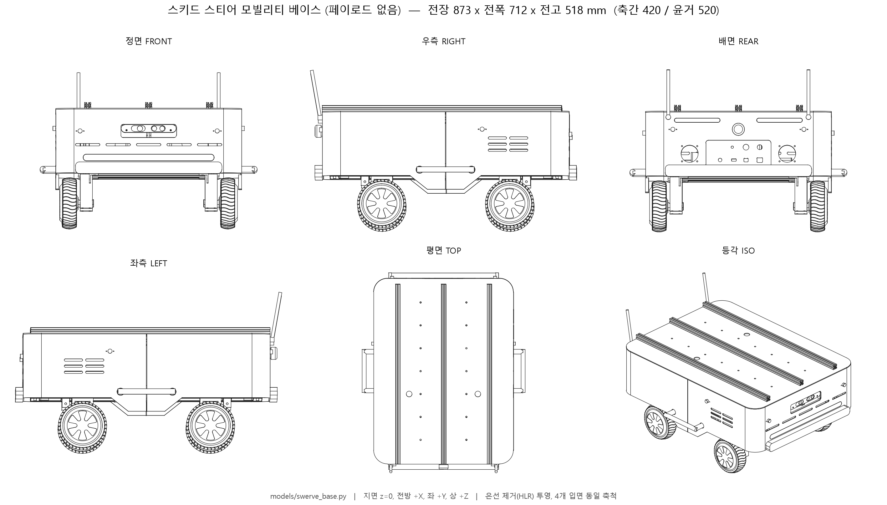

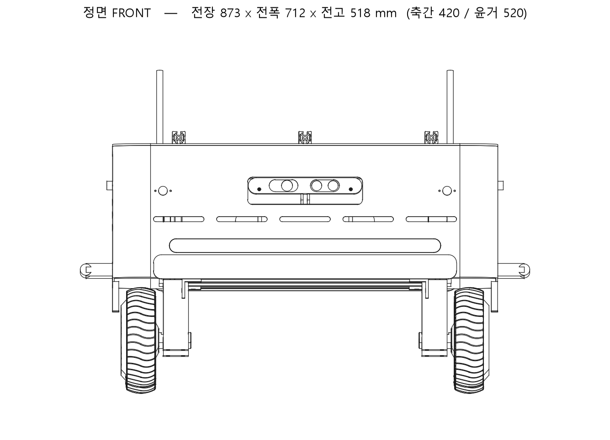

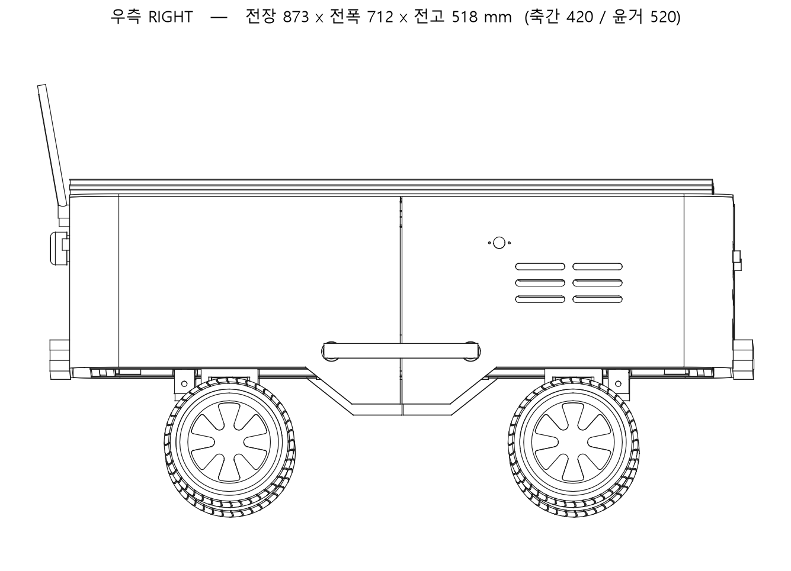

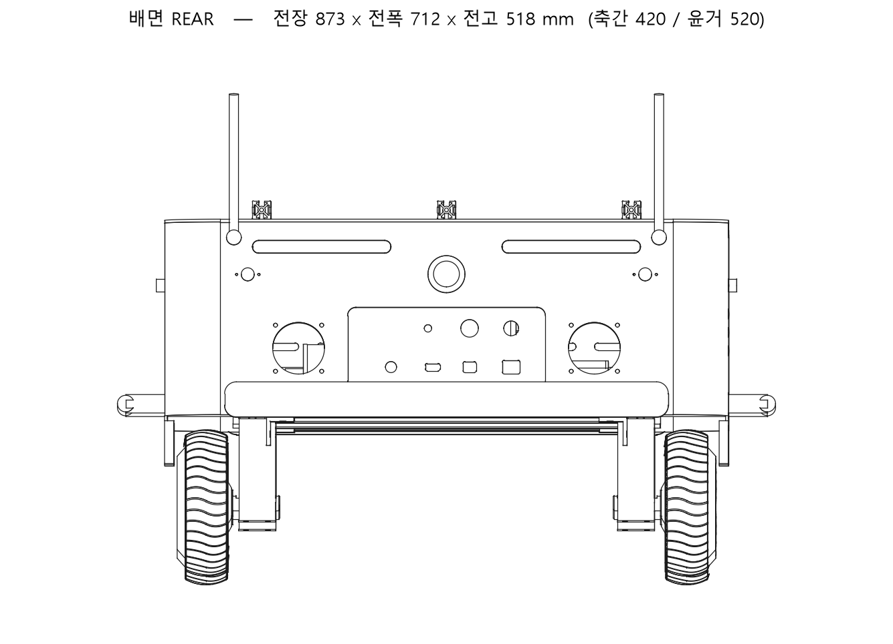

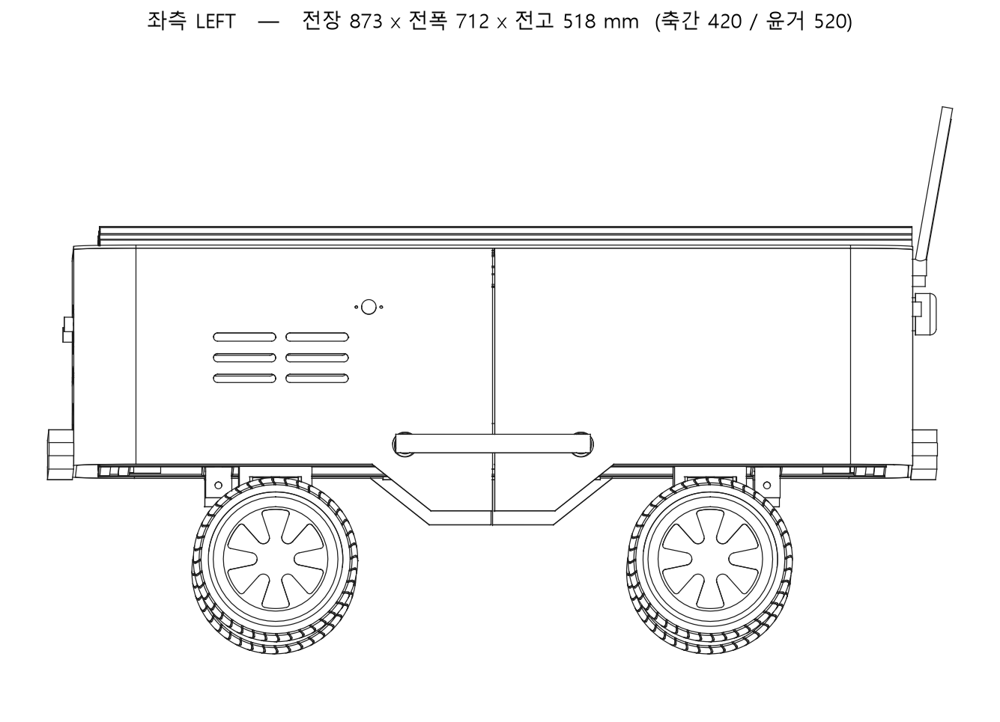

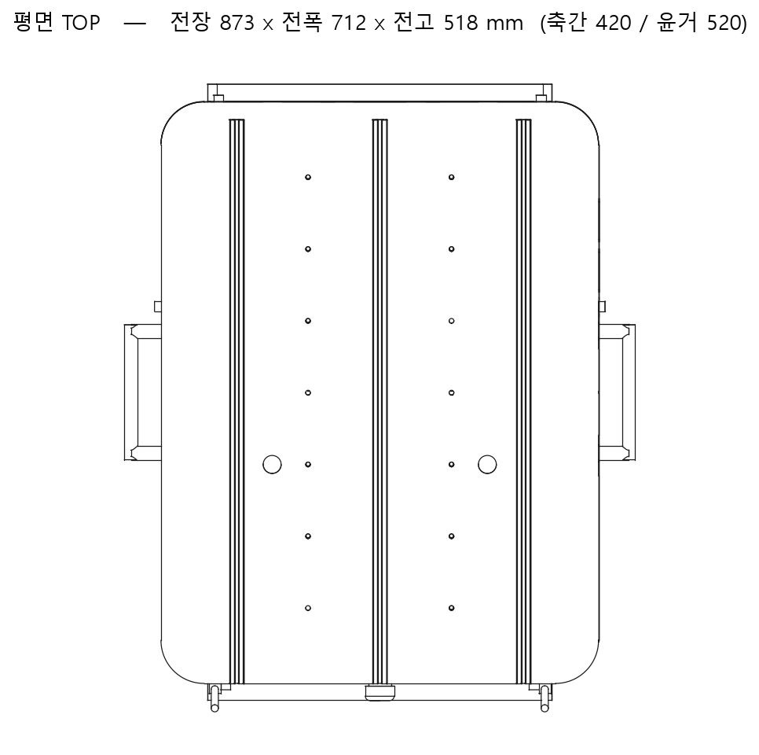

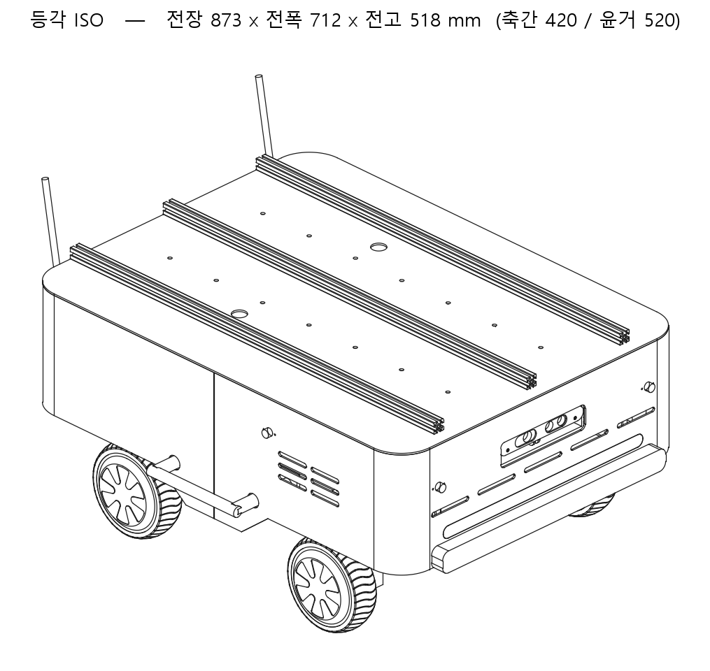

위 일곱 장은 이날 12:26 KST 에 처음 나온 `41~47_skid_*.png` 와 같은 `drawings.py` 산출물로, 지금 `docs/images` 에 있는 파일은 08-12 23:27 KST 에 다시 구운 판이다(이날 판은 덮어써졌다). 시트 표기(873 × 712 × 518, 축간 420 / 윤거 520)는 이날과 같다. `drawings.py` 에는 이후 `SUBJECT=wheelmount` 가 추가됐다.

문서는 `payload-interface.md` 2건, `build-log.md` 4건을 치환했다(스워브→스키드, 도면 파일명, 도면 색인, 꼬리말). 23절 B 표 본문과 24절 제작비는 일부러 안 고치고 "스워브 시절 숫자 — 갱신 대기" 인용구만 박았다. (현재 build-log 는 28막 + 29\~32절로 늘어 이 부분이 31절 B·32절 A 이고, 본문이 스키드 숫자 873×712×518 / 축간 420 / 79단위로 갱신되어 있다.)

#### 12:43 — 쿠폰 없이 뽑을 파일과 3030 규격

> 쿠폰 안 쓸건데 그냥 뽑으려면 어떤 파일을 뽑으면될까?

`exports/print/휠마운트_print_M6.stl` 하나다(STEP 도 같은 형상). 대신 4개를 한 번에 걸지 말고 본품 1개를 먼저 뽑아 끼워보라고 했다 — 스르륵 들어가고 조이면 안 움직이면 통과, 뻑뻑하면 `RAIL_FIT` 1.0, 덜그럭이면 0.6.

> 실제 3030 프로파일 사이즈는 어느정도이고 지금 저 마운트 걸치는 곳은 크기가 어느정도로 되어있어?

(12:55) `tslot.py` 규격: 한 변 30, 벽 2.4, 슬롯 입구 8.2, 슬롯 방 16.5, 보스 11.0, 중심 보어 6.8, 리브 2.4, 모서리 R1.5 — 현재 `PROFILES[30]` 과 같다. 마운트 ㄷ자: 슬롯 높이 30.4(CNC)/30.8(PRINT), 포켓 깊이 30.0(+Y 열림), 팔 70×40×10t 두 장, 웹 70×10t×50.4, 레일 볼트 M6 ×4 x=±15 y=−50, 접촉 면적 아래팔 21 + 위팔 21 + 웹 21 cm². 여유는 아래팔 쪽에만 몰려 있다(아래팔 윗면 170.3 / 레일 밑면 170.7) — 위팔 밑면을 레일 윗면 z=200.7 에 딱 맞춰 볼트가 미끄러져도 바퀴 무게를 거기서 받게 했다. 정작 모르는 것은 사용자 레일의 실제 높이이며, 실측 30.0\~30.1 이면 `RAIL_FIT` 0.6, 30.4 이상이면 1.0 이 맞다고 적었다.

#### 14:25 — PLA 강도 계산과 근거 검토

> pla 로 출력하는 것도 강도 등 계산해볼래? 버틸지

|  | 인장 / 탄성률 (인용) | 파단횡력 | 여유 | 축 처짐 / 접지 처짐 | 인성지표 σ×ε | Tg | 노치 아이조드 |
| --- | --- | --- | --- | --- | --- | --- | --- |
| PLA | 55 MPa / 3.5 GPa | 1856 N | 8.5배 | 0.15 / 0.34mm | 2.5 | 60°C | 2.5 |
| PETG | 45 MPa / 2.0 GPa | 1519 N | 7.0배 | 0.26 / 0.60mm | 7.2 | 80°C | 8.0 |
| ASA | 44 MPa / 2.1 GPa | 1485 N | 6.8배 | 0.25 / 0.57mm | 5.3 | 105°C | 7.0 |

주행 응력 6.5 MPa, 기둥 압축 0.27 MPa(218/800), 축 시트 면압 0.34 MPa(218/(16×40)). 마찰이 낼 수 있는 최대 횡력이 218 N 이라 주행으로는 어느 재료도 파단에 못 간다. 유일한 위험은 측면 충격이고 거기서는 에너지 흡수가 답인데 PLA 가 약 3배 진다. 결정타는 열이다 — 허브모터는 축이 곧 고정자라 코일 열이 강철 축을 타고 마운트 블록(축을 반원으로 40mm 감쌈)으로 직접 들어온다. PLA Tg 60°C 는 여유가 없다. 실내 전용이면 PLA 도 되지만 옥외·여름은 안 된다. 다만 확인용 1개는 치수 정확도가 좋은 PLA 가 오히려 낫다.

> 그 계산을 어떻게 해낸거야? 자세히 좀 알려줄래?

계산 사슬을 열어 보였다. ① 89 kg 가정 → 바퀴당 89×9.81/4 = 218 N, 횡력 상한 μN(μ=1.0) = 218 N. ② 모델을 실제로 잘라(OCC `BRepGProp`) 단면 성질을 뽑았다 — z=120/158: 면적 800, Ixx 106,667, Zx 5,333(기둥 10×40 두 개, 손계산 2×10×40³/12 와 일치); z=165: 면적 2732, Ixx 371,394, Zx 18,454. ③ 모멘트 M=F×z 는 올라갈수록 커지는데 기둥 단면은 79\~160 구간 내내 같으므로 기둥 위끝 z=158 이 최약이다. σ = 218×158/5333 = 6.5 MPa, 파단 F = 45×5333/158 = 1519 N. ④ 캔틸레버 δ=FL³/3EI, θ=FL²/2EI, L=91.35(레일 밑면 170.7 → 축 79.35), 접지점 처짐 = δ + θ×79.35(바퀴 반지름) — PETG 에서 축이 0.26mm 밀릴 때 접지점은 0.60mm 간다.

막힌 것: 처음 단면 계산에서 평행축 정리를 빼먹어 Iyy 가 726,667 대신 6,667 로 나왔다. 각 면을 자기 도심 기준으로만 더해 x=±30 떨어진 거리를 안 넣은 것이었다(2×(3,333 + 400×30²) = 726,667).

믿을 수 있는 정도도 갈라 적었다. 단면 성질은 확실(형상에서 나왔고 손계산과 일치), 굽힘·처짐 공식은 표준이나 가는 보가 아니라 10\~20% 오차, 89 kg/μ=1.0 은 가정, 재료값 PLA 55 / PETG 45 / ASA 44 MPa 는 데이터시트 통상값을 적어넣은 것이라 ±30% 흔들린다(여유 7배가 5\~9배일 수 있다). 인성지표는 응력-변형 곡선을 직사각형 근사한 것이라 절대값은 안 믿고 비율만 봤고, 독립 측정값인 노치 아이조드(3.2배)와 방향이 같아 "약 3배"만 믿는다. 충격력 자체는 계산하지 않았다 — 충돌 속도·타이어 변형·유효 질량이 다 추정이라 10배씩 흔들려서, "충격이 유일한 위험"이라는 정성 결론까지만 갔다.

### 결정

- CNC 와 프린트를 `PRINT=1` 로 갈라 다른 파일(`_cnc_M6` / `_print_M6`), 다른 폴더(`exports/cnc` / `exports/print`)로 낸다. 프린트판은 `bed()` 로 눕혀 바닥 z=0 에 앉히고 DXF 는 내지 않는다. (대안이던 출력 후 드릴 후가공은 32구멍이라 모델에서 맞추는 쪽을 택했다.)
- 클램프 고정 볼트는 M6 + 와셔. `CLAMP_BOLT=8` 은 실물 장공 폭을 재서 `CL_SLOT_W` 를 고친 뒤에만 통과한다.
- 휠마운트 원본은 `wheel_mount.py` 한 곳. `swerve_base.py` 는 import 하고 접합면 어서트 3개로 좌표 어긋남을 잡는다. 3030 휠포스트와 가정값 클램프는 폐기.
- 베이 바닥판 노치는 마운트 bbox 에서 자동으로 딴다 — 마운트 치수를 바꿔도 따라오고, 레일 쪽으로 열려 있어 마운트를 끼운 뒤 판을 위에서 내려놓을 수 있다.
- 도면은 `models/drawings.py` 가 만들고, 도면만은 실물 바퀴가 기본(111초).
- build-log 23절 B 표 본문·24절 제작비는 고치지 않고 "갱신 대기" 인용구만 박는다 — 도면 작업과 별건이라 몰래 고치는 것보다 눈에 띄게 표시하는 쪽이 맞다.
- 본품 소재는 PETG(실내)/ASA(옥외). PLA 는 실내 전용이거나 치수 확인용 1개.
- 쿠폰을 건너뛰더라도 본품 4개를 한 번에 걸지 않고 1개 먼저 끼워본다 — 슬롯 30.8 의 실제 축소량은 프린터마다 달라 계산으로 못 맞히고, 어차피 4개 필요하니 버리는 것도 없다.

### 남은 일

- `docs/build-log.md` 23·24절 본문의 스워브 숫자(전고 595, 축간 520, 제작비)를 스키드로 갱신 — 이날은 인용구 표시만. (현재는 31·32절로 번호가 밀린 채 갱신되어 있다.)
- 무게중심 실측 — 축간 420 이 맞는지는 이게 나와야 안다.
- 사용자 레일 실제 높이와 클램프 장공 실제 폭을 캘리퍼로 재서 `RAIL_FIT`·`CL_SLOT_W` 확정.
- 본품 1개(PETG 또는 PLA) 선출력 후 끼움 확인, 그 다음 3개.
- 허브모터 축 온도 실측 — PETG 여유 20°C 가 실제로 충분한지는 재봐야 안다.
- 측면 충격력은 계산하지 않았다. 굴려봐야 안다.

### 교훈

- 판정 결과가 전부 참이면 판정식을 의심한다. "인치로 떨어진다"가 7줄 모두에 붙은 게 신호였다.
- 남의 STEP 은 어디까지 실측인지 물어야 한다. 인치 환산 한 번으로 구멍 Ø8.128 이 타이핑값임을 알았고 볼트 크기가 바뀌었다.
- 자세·조건은 파일에 박아 내보낸다. 파일명에 판을 안 박으면 조용히 덮어쓰고, 좌표를 사람이 돌리게 두면 언젠가 틀린 자세로 뽑는다.
- 산출물이 아니라 산출하는 코드를 남긴다. 도면 이미지만 남으니 모델이 바뀐 뒤에도 아무도 못 고쳤다.
- 어서트 메시지에는 "무엇을 하면 되는지"를 넣는다.
- 강도 계산은 어디까지가 모델값이고 어디부터가 가정·인용인지 갈라서 말한다. 단면은 확실했고, 재료값과 충격력은 아니었다.

### 이후 달라진 것 (2026-09-15 기준)

- 이날의 ㄷ자 마운트는 실제로 출력·장착됐고, 08-12 20:32 KST 사용자 보고로 "올라타는 하중은 버텼지만 바퀴가 점점 바깥으로 밀리고 브라켓 상단 고정부에 금이 갔다"가 나왔다. 현재 `wheel_mount.py` 주석: 한쪽 코너 탑승 800 N 에서 ㄷ자 팔(판 외팔보) 53.5 MPa = PETG 의 119%, 팔이 무보강 외팔보 판이었던 것이 원인 — 이날 계산은 89 kg 로봇만 보고 사람 탑승을 안 넣었고(바퀴당 218 N 횡력), 하중 크기·방향이 달랐다. 그 뒤 삼각 거싯(8×25×25, 팔당 3장)이 들어갔고, FEA 에서는 이 형상이 `legacy_u` / `legacy_u_nogusset` 으로 남아 있다(CLAUDE.md: PETG 800 N 상향·편심 55 mm·3 mm 메쉬에서 44.373 MPa / 2.979 mm, 아래 볼트열부터 바깥으로 휨).
- 현재 채택 설계는 `models/hoverboard_mount/` 의 Design-D 하부 클램프(3030 바닥 볼트 2개, AL6061-T6 예정)이며, 이 일지의 ㄷ자는 채택 형상이 아니다.
- 레일 M6 볼트는 이날 길이를 정하지 않았다. 현재 파일에는 브라켓용 M6x15 를 쓰면 물림 0.6mm 라 안 되고 머리 밑 25mm 가 필요하다는 어서트(`RAIL_BOLT_L = 25.0`)가 있다.
- `docs/images` 의 `41~47_skid_*.png` 는 이날 판이 아니라 08-12 23:27 KST 재생성 판이다. `exports/print/` 의 세 파일은 이날 04:03 KST 판 그대로다.

---

## 2026-08-08 이전 (날짜 미상) · 바퀴 제어: 호버보드 링크 디버깅

> 장소: PC · 날짜 근거: [링크 디버깅 기록](topics/wheel-link-debugging.md), 첫 커밋 내용(세션 기록 없음) · 커밋: 2026-08-09의 두 커밋에 담김 · 원본: 바퀴 제어기 작업 일지 `firmware/wheel-controller/WORKLOG.md`

[링크 디버깅 기록](topics/wheel-link-debugging.md)에 자세히 있고, 여기에는 포트폴리오 관점의 골자만 적는다.

### 한 일

- **결론**: 하드웨어 고장은 없었다. `DRIVING_MODE 0`(pwm)에서는 명령값이 곧 듀티라서 첫 테스트
  `s 30`(3 %)은 안 도는 게 정상이었다. 그 뒤 조사는 대부분 "측정 도구가 엉뚱한 장치를 보고
  있던" 문제였다.
- **프로토콜 식별**: 처음엔 EFeru FOC(115200, 0xABCD, XOR)로 가정했지만 캡처와 맞지 않았다. RoboDurden
  Gen2.x(19200, 22바이트 피드백, `'/'`로 시작하는 9바이트 명령, CRC16-XMODEM)로 정정했다. 다항식
  65536개를 브루트포스로 돌려 CRC를 확정했고, 나중에 업스트림 `CalcCRC()`와 같음을 확인했다.
- **핵심 교훈**: 펌웨어가 200 ms마다 찍는 리포트 줄은 보드가 꺼져 있어도 나온다. 그래서 "살아 있다"는
  근거는 실제로 디코딩된 프레임만 세는 `rx N` 카운터뿐이다. 잘못된 도구로 낸 결론 두 개가 유효한
  측정을 뒤집은 기록이 남아 있다.
- **진단 도구**: `d`(핀별 프레임 수, 패드 루프백 + 미연결 대조핀 GPIO25, 송신 프레임 hex, 풀업
  프로브), `y`(프레임 레이아웃 프로브), `r`(RC 시정수로 직렬 저항 추정), `k`(ShutOff로 명령 도달
  확인). 도구마다 "무엇을 증명하고 무엇을 못 보는지"를 표로 정리했다.
- **안전장치**: 클램프(부팅 시 400/1000), 램프(20/100 ms), 데드맨(텔레메트리 500 ms), 호스트
  워치독(opt-in `w 1`, GUI가 250 ms마다 `h`). 모든 타임아웃은 `loop()`의 단일 `iNow`와 비교해서
  unsigned 랩을 피한다.
- **STOP 부활 버그**: GUI 레이트리미터가 삼킨 값을 하트비트가 STOP 뒤에 흘려보내서 바퀴가 다시
  돌았다. `drop_pending` + `stopped` 래치 + 하트비트 억제로 고쳤다. 회귀 테스트 `test_stop.py`는
  양방향(고친 코드는 통과, 옛 코드는 실패)으로 단언하고, 벽시계 대신 시계를 주입한다.
- **도구**: `hoverctl.py`(tkinter 패널, 링크 품질 미터), `speedsweep.py`(듀티 스윕 → Kv),
  `speedcalc.py`(Kv → 속도/전류, 경사·다륜. 기본 Kv 14 rpm/V, 36.8 V), `ledtest.py`
- **4륜 계획 계산**: 20 % 경사에서 모터당 전류가 2륜 ~21 A → 4륜 ~8 A. 발열은 전류의 제곱으로 준다.

---

## 2026-08-09 (일) · 바퀴 제어: 첫 커밋과 디버깅 기록

> 장소: PC · 날짜 근거: 커밋 `6e0a3a6` 00:49, `0e8cd2b` 01:32. 자정 직후라 실제로는 08-08 밤 작업의 마무리다. · 원본: 바퀴 제어기 작업 일지 `firmware/wheel-controller/WORKLOG.md`

### 한 일

- `6e0a3a6 first commit`: 펌웨어 `main.cpp` 535줄, `hoverserial.h`, 도구 5종, README 228줄
- `0e8cd2b feat:문서기록 및 도구추가`: [링크 디버깅 기록](topics/wheel-link-debugging.md) 227줄, `test_stop.py`를 시계 주입 방식으로 재작성

---

## 2026-08-10 (월) · 차체: 기록 공백을 채우고, 적재함을 기성 바구니 기준으로 다시 짰다

> 시간: 00:00 ~ 08-11 (화) 16:46 · 장소: PC (`D:\build123d`) · 날짜 근거: 세션 기록 · 원본: 차체 설계 일지 `entry_11.html`

이 구간은 두 가지였다. 하나는 설계기록(`docs/build-log.md`)에 스키드 전환 이후가 통째로 빠져 있다는 걸 알고 21\~28막을 써 넣은 일. 다른 하나는 사용자 요구로 적재함을 처음부터 다시 잡은 일이다. "높이를 낮추고 안에 바구니를 끼우는 구조"에서 출발해 리서치 → 유로 컨테이너 규격 채택 → 세 번의 재설계(v2 → v3 → v4)를 거쳤다. 사이사이 뷰어 전송 요청이 다섯 번 있었고, 그 과정에서 ocp_vscode 뷰어의 동작 방식을 하나 배웠다. (시각은 KST. 원본 로그는 UTC 08-09 15:00Z \~ 08-11 07:46Z.)

### 한 일

#### 08-10 00:00 — 설계기록 공백 확인과 21\~28막 추가

> "내가 이 작업 처음부터 시작하면서 너랑 대화하면서 경험했던것들, 삽질했던것들, 결정했던것들, 다 정리한 문서가 있나?"

있긴 했다. `docs/build-log.md` 1116줄. 그런데 키워드를 세어 보니 **클램프 0회, D컷 0회, CNC 0회, JLC 0회, 휠마운트 0회, 지그 0회**였다(스키드 22, 브라켓 13). 기록이 20막(검증코드 함정)에서 끊겨 있었고, 스워브를 버리고 고정 4륜으로 튼 것부터 도면 스크립트가 사라진 것까지 전부 없었다. 아이러니하게도 판단 밀도가 제일 높은 구간이 빠져 있었고, 도면 스크립트 분실이 바로 그 손해였다.

21\~28막을 새로 써서 20막 뒤에 끼웠다 — 기존 20막까지는 한 글자도 손대지 않았다(로그는 과거를 고치면 안 된다). 결과 1116 → 1630줄, 42k자, 28막 + 29\~32절. 뒤의 29\~32절도 갱신했다. (현재 저장소의 build-log.md 도 1630줄 / 42,140자 / 28막 + 29\~32절 그대로다. 같은 키워드를 지금 세면 클램프 15, D컷 9, CNC 18, JLC 3, 휠마운트 3, 지그 0.)

- 29절(틀렸던 것들 정리) — 10행 추가. 이번 구간의 패턴은 **"가정을 실측으로 착각하는 것"**(D컷 평면, 클램프 구멍, 프로파일 공차)이었다.
- 30절 「방법론」 — 실물 측정(0.1mm 스캔·인치 환산), 모델값 교차검증, 판정식이 전부 참이면 판정식을 의심, 산출물이 아니라 코드를 남긴다. `← 이번에 추가` 표시가 두 곳에 붙어 애매해져서 전부 막 번호로 바꿨다.
- 31절 사양 B 를 스키드 실제 숫자(전장 873 × 전폭 712 × 전고 518, 축간 420 / 윤거 520, T/L 1.24)로 교체.
- 32절 제작비를 A(현행 스키드)/B(스워브)로 갈랐다. 프로파일·철물은 실주문 단가라고 명시 — 3030 79단위(7.90 m 과금) 75,050원(950원/100mm), 브라켓 3025 28개 10,080원, M6x15 84개 5,880원, 스프링너트 306 84개 15,120원, 철물 합계 31,080원. (현재 `docs/bom.md` 는 프로파일 76단위 72,200원 / M6x15·스프링너트 각 68개(프레임)+8개(하부 클램프)다. 휠마운트 체결이 Design-D 하부 클램프로 바뀌면서 수량이 달라졌고, 브라켓 28개 10,080원은 같다.)

| 버전 | 제작비 범위(원) |
| --- | --- |
| 구 스키드 | 317,000 \~ 660,000 |
| 현행 스키드 | 482,000 \~ 992,000 |
| 스워브 | 887,000 \~ 2,483,000 |

30절에 넣은 5행짜리 신뢰도 구분(확실 / 표준 / 가정 / 인용 / 안 함 — 본문에 "신뢰도 5단계"라는 이름은 안 붙였다)의 마지막 줄 — 충격력은 계산하지 않았는데 PLA 탈락 판단이 그 위에 서 있다 — 를 남겨 둔 것이 제일 값어치 있는 줄이라고 봤다. 영상 챕터는 18 → 25개.

#### 01:04 — 코드베이스 집계와 "설계 파이프라인" 명칭 검토

> "근데 내가 여기서 작업하면서 구축해둔 거 있잖아, 너랑 하면서 만들어둔 도면도 만드는 그런 작업도 있고 build123d 랑 적절하게 claude code 랑 연결해서 흐름 만든것도 있고 지금 여러번 작업하면서 노하우 쌓으면서 구축한 3D 설계 파이프라인이 있다고 말할 수 있을까?"

인상으로 답하지 않고 세어 봤다. 모델 스크립트 29개 / 12,236줄, 문서 3개 / 2,086줄, exports 102개, docs/images 101장. `tslot.py`(125줄)를 4개 파일이 쓰고, `wheel_mount.py → swerve_base.py → drawings.py / export_cnc.py / motor_stand.py / wheel_jig.py`로 물려 있다. `swerve_base.py`(당시 2,799줄)에 assert 47개, `wheel_mount.py`에 8개, `mobility_base.py` 4개. 환경변수 스위치는 NOSHOW 7곳, DRIVE 4곳 등 20종(상위 20개만 출력했으니 그 이상일 수 있다). 결론은 "범용 파이프라인"은 과장이고 — 프로젝트 간 공유되는 건 `tslot.py` 125줄과 `iso_render.py` 243줄뿐이라 — **「알루미늄 프로파일 기반 기구 설계용 코드 파이프라인」**이 정확하다는 것. 제일 약한 고리는 `git rev-parse`가 `fatal: not a git repository`를 뱉었다는 점 — 12k줄과 42k자 기록이 버전관리 밖에 있었다.

(현재: models 최상위 스크립트 30개 / 13,436줄, docs 4개 / 2,249줄, docs/images 112장, exports 최상위 109개, assert swerve_base 51 / wheel_mount 15 / mobility_base 4, swerve_base.py 2,961줄. git 은 08-21 에 초기 커밋 `14fb653` 으로 시작했다.)

#### 01:08 — 채팅 내 브라우저로 뷰어 전송

뷰어는 **ocp_vscode 4.0.0**(build123d 0.11.1), 포트 3939. `set_port(3939)`를 명시한 이유는 자동 탐색이 콘솔을 찾다가 파이프 환경에서 죽기 때문이다. 적재함을 얹은 전체를 보내달라는 요청에 `PAYLOAD=cargo`로 쐈는데 세 가지에 걸렸다.

- Claude 가 띄운 두 번째 서버 인스턴스가 "Port 3939 is already in use"로 죽었다. 기존 서버가 살아 있어서(302) 전송은 정상이었다.
- 브라우저 첫 화면이 OCP 로고였다. 뷰어는 **접속한 클라이언트에 밀어주는 방식**이라 브라우저를 먼저 열고 스크립트를 다시 돌려야 했다. 이 순서 문제는 이후 전송 때마다 반복됐다(탭이 닫히면 또 쏴야 한다).
- 드래그로 회전하려다 면이 선택됐다(`bspline: area ≈ 9881`). 툴바 뷰 프리셋을 쓰는 게 확실하다.

올라간 상태: 전장 873 × 전폭 712 × 전고 763(적재함 얹어 518 → 763), 적재함 810×610 R60, z=384\~763, 내부 약 170 L.

#### 01:39 — 적재함 리서치와 유로 컨테이너 규격 채택

> "지금 적재함을 아예 다시 설계할거야 높이를 낮출거고 내부에는 바구니같이 함을 끼울 수 있는 구조를 만들건데 그전에 … 리서치부터 해보는게 좋을 것 가타"

| 제품 | 적재함 |
| --- | --- |
| Starship | 400×320×340 = 43.5 L / 10 kg |
| Cartken Model C | 보온 27 L |
| Kiwibot | 10 kg |
| Pudu BellaBot(실내) | 4단 트레이 230/200/200/180, 단당 10 kg |
| 한국 라이더 탑박스 | 45\~58 L(실측 규격 3종), 판매 표기 30\~120 L |
| 이 차량(v1) | 810×610×360, 내부 800×600, 약 170 L |

(웹 검색 결과를 Claude 가 정리한 값이라 제품 수치는 원 출처를 다시 확인하지 않았다.) 음식 배달용은 27\~50 L 로 수렴한다. 바구니는 직접 설계하지 않고 **유로 컨테이너(VDA 4500 / KLT) 600×400 / 400×300**을 쓰기로 했고, 높이는 147.5 또는 280(적층 겹침 15 포함)이 표준 계열이다. 같은 발자국으로 EPP 서모박스(−40\~+110°C)가 나오므로 범용은 KLT, 배달은 서모박스를 꽂으면 된다 — 단열·씰이 소모품 쪽으로 넘어간다. 내부 800×600 은 유로팔레트 분할 치수와 일치했는데, 코너 R55(호 중심 345/245) 때문에 800×600 풀사이즈는 걸리고 685×485(여유 2.5/2.5)는 프린트 공차에 안 들어가며 600×400(여유 45/45)만 안전했다. 높이는 147.5(35 L, 컵이 안 선다) / 220(47 L) / 280(59 L, 360에서 40 밖에 안 준다) 중 220 을 권했다. 사용자는 용도 "범용 시험 화물 + 음식 배달", 바구니 "600×400 한 개"를 골랐다. 끼우는 방식은 드롭인(위치 리브) — 측면 레일(BellaBot식)은 옥외 밀폐가 어렵다.

이 구간의 v2\~v4 렌더(cargo2\~4, cradle, cradle2, cargo_full, handle.png)는 임시 폴더에만 구웠고 지금은 남아 있지 않다. 이 구간의 렌더는 docs/images 에 없다.

#### 01:52 \~ 02:27 — v2: 격벽 제거, 통짜 뚜껑, 크래들 재설계

높이를 계산하니 "\~260"은 어깨 라운드와 뚜껑 립 40mm 를 빼먹은 값이었다. 바구니 220 + 바닥판 3 + 띄움 8 + 여유 8 + 어깨/립 40 = 279 → `CARGO_H = 280`(360 에서 −80), 어깨는 55 → 30. 상수는 `CARGO_BIN=(600,400,220)`, `CARGO_BIN_CLR=6`, `CARGO_FOOT=8`, `CARGO_RIB=(10,70)`. 분기점은 **격벽 제거**였다 — 600 을 x 로 놓을 수밖에 없고(y 는 내부폭과 같아 안 들어간다) KLT 손잡이 구멍이 있는 짧은 변이 ±x 를 향하는데, 격벽(x=230)이 딱 그 자리였다. 라이너 트레이·장비 베이를 지우고 `cargo_cradle()`·`cargo_bin()`을 넣었다. 실행하자 `NameError: g` — 지붕 분할을 통합하며 `g = CARGO_LID_GAP`까지 지웠던 것.

간섭 6건: 함잠금 × 유로컨테이너 2039 mm³, 함뚜껑 × 타이다운 1837 mm³ × 4, 그리고 함스트라이커 × 유로컨테이너(출력이 잘려 부피는 확인 못 함). 잠금은 뒤 중앙 1개를 좌우 2개로(손잡이 홈과 바구니 사이 창이 22mm 뿐이라 46mm 솔레노이드가 못 들어갔다), 타이다운은 `바구니 윗단 + 15` 절대값을 `CARGO_LID_Z − 35` 역산으로 바꿨다. 간섭 0건 / 부품 23개. 그런데 렌더를 보니 **크래들이 두 조각으로 떨어져 있었다** — 간섭 0, 어서트 통과였는데 그림에만 보였다. 부피도 1461 cm³(PETG 약 0.9 kg)로 과했다. 닫힌 링 하나에 리브 8개로 다시 짜고(필렛 R3 가 링 안쪽 R6 에서 `ValueError`를 내 try 로 감쌌다) 리브를 70 → 40 으로 낮췄다 — 상자 벽이 바구니보다 9mm 높을 뿐이라 넘어질 수 없고, 미끄러짐만 막으면 된다.

| 크래들 | 치수 | 부피 | 솔리드 |
| --- | --- | --- | --- |
| v1 | 640×432×78 | 1461 cm³ | 2조각 |
| v2 | 632×432×48 | 847 cm³ (PETG 40% 약 538 g) | 1개 |

검증 치수: 바닥판 윗면 +3, 바구니 밑 +11, 바구니 윗단 +231 / 뚜껑 립 밑면 +240 → 머리 위 9mm, 리브 안쪽 612×412 는 코너 호 중심(345,245) 안쪽, 손 넣는 자리 짧은변 84 / 긴변 84, 바구니 목업 616×416×220(위가 넓은 테이퍼 +16)은 x·y 6mm 움직이면 리브에 닿는다. 적재 170 L → 53 L.

#### 08-10 20:38 \~ 22:52 — v3: 바구니 축소·후방 배치, 앞은 닫힌 장비 베이

> "뚜겅은 더 작게 해도 되는데 실제 범위만큼에 맞게 말이야 그리고 적재함도 지금보다 조금 더 작고 뒤쪽에 있어도 되겠다 앞쪽은 다른 전자부품등이 들어가야할수도 있으니까"

600×400 을 유지하면 크래들 632×432 → 적재함 외형 732×492 가 되어 데크 810 에서 앞에 78mm 밖에 안 남는다(짧은 변 손자리 45mm 는 뺄 수 없다). 400×300 이면 크래들 432×332, 적재함 532×392, 앞 278mm. 사용자는 **400×300, 닫힌 장비 베이**를 골랐다(적재 53 → 26 L, Cartken 급). 격벽이 돌아왔지만 이번엔 상수가 아니라 유도값이다: `CARGO_BAY_X = 바구니 + 2×(여유+리브) + 2×손자리 = 522`, `CARGO_BULK_X = −400 + 522 + 2.5 = 124.5`(출력은 124, 설명에는 125 로 적었다), `assert CARGO_EQ_X > 150`. 뒤 바구니칸 522, 앞 장비베이 272\~273(고정 지붕), 뚜껑 810×610 → 522×610, 손 넣는 자리 짧은 변 45×2 / 긴 변 134×2. 간섭 1건 — 뚜껑 손잡이 홈(깊이 28)이 바구니를 1352 mm³ 물었다. 바구니 윗단이 립보다 9mm 아래라 그보다 깊은 돌기는 무조건 닿는다. 깊이를 줄이지 않고 홈을 뒤쪽 손자리 안으로 옮기되 바구니 뒷면에서 역산하게 했다. 최종 간섭 0건 / 부품 26개, 뚜껑 529×610 / 1959 cm³.

#### 22:52 — 경쟁 제품과 전폭 비교

|  | 전장 | 전폭 | 전고 |
| --- | --- | --- | --- |
| Kiwibot | 559 | 432 | 559 |
| Starship | 678 | 569 | 554 |
| Cartken Model C V2 | 710 | 455 | 602 |
| Cartken Model C V3 | 831 | 529 | 646 |
| Serve | 790 | 640 | 1050 |
| 이 차량 | 873 | **712** | 518 (적재함 683) |

(경쟁 제품 치수는 dimensions.com·robotatta 검색 결과이고 원 출처를 재확인하진 않았다.) 한국 실외이동로봇 운행안전인증은 폭 800 이하(보도 2500 이상이면 1200). 712 는 통과하지만 여유 88mm. 폭이 쌓이는 순서를 뜯어보니 하부 프레임 450 → 윤거 520 → 바퀴 바깥 575(타이어 55) → 상부 레일 530 → 셸 610 → **핸들 712(+102)**. 하한은 바퀴 575 이고, 윤거를 줄이면 T/L 520/420 = 1.24 → 470 이면 1.12 로 제자리회전 여유가 사라진다. 다목적 테스트베드라 Starship 잣대가 맞지 않다고 봤지만 핸들 102mm 는 값에 비해 비싸다고 판단했다. 감축 순서는 핸들(−102) → 셸 610→590(−20) → 윤거(−50).

#### 08-11 00:33 — 핸들 폭 102mm 분석

> "핸들 102mm 는 뭐야 어떤 부분인데 그래"

리프팅 핸들이다. 봉 Ø18 → 팔 Ø20 두 개가 셸을 관통 → 베이스판 → 3030 하부사이드 레일. 셸은 구멍만 내고 하중을 받지 않는다(17막에서 셸에 매달았다가 고친 것). 레일 바깥 y=225, 셸 305, 봉 중심 347(standoff 42), 봉 바깥 356 → 전폭 712. 손가락 틈 33mm 에 어서트 하한 30 이라 고정식으로는 standoff 39 까지, 전폭 706 이 한계다. 탈착식(회수 102 → 610) / 접이식(646, 회수 66, 힌지·잠금 추가) / 셸 오목홈(실루엣 깨짐) 중 **탈착식**을 권했다 — 드는 건 시험장 옮길 때뿐이고 하중 경로는 그대로다. 아직 반영하지 않았다. (현재도 `HANDLE_STANDOFF = 42` 고정식 그대로다. 다만 이후 작업에서 `SHELL_Y=255 / TOP_RAIL_Y=210 / MOUNT=low` 구성이 생겨 `docs/bom.md` 의 차량은 전장 873 × 전폭 612 × 전고 606 — 셸을 510 으로 좁힌 것이고 핸들 102 는 그대로다.)

#### 08-11 01:30 \~ 02:05 — v4: 뚜껑 개구를 바구니칸으로 축소

> "야 근데 적재함 뚜겅보니가 보이는건데 뚜겅이 열리면 적재함 바구니만 보여야지 그 주변까지 보이면 안될것 같은데"

맞는 지적이었다. 열리는 면적 522×600 = 3132 cm² 중 바구니 416×316 = 1315 cm² — **58% 가 빈 바닥**이었다. 바구니를 줄일 때 x 는 격벽으로 막았는데 y 는 안 막은 것이다. 적재함 자체를 좁히면 셸 실루엣이 끊기므로(16막) 바구니칸 옆벽을 안쪽으로 세우는 A 안으로 갔다: 바구니칸 522×600 → 522×350, 좌우 120×522 는 닫힌 수납, 고정 지붕이 ㄷ자로 개구를 두른다. 여기서 네 건이 나왔다.

1. `from build123d import *` 가 모듈 별칭 `M`(미터 상수)을 덮어 `AttributeError`. 별칭을 `SB` 로.
2. 뚜껑·지붕이 각각 **솔리드 2개**(1130.4+163.2, 1947.6+140.7 cm³). 씰링 립을 `CARGO_T + g/2` 들여놨는데 캡 안쪽면은 `CARGO_T` 라 0.5mm 링 틈이 있었다. **원래부터 있던 버그**다 — 적재함 부품에는 연결성 검사를 안 돌리고 있었다. 립을 4mm 올려 융합.
3. 간섭 5건: 뚜껑 × 지붕 22,454 mm³(개구 절단에 어깨 곡률 `ins`를 먹여 위에서 닫혔다 → 곧은 수직면), 힌지 × 셸 1241×2(`y=±200` 고정값이 새 옆벽 ±175 를 뚫음 → ±130 유도), 잠금 × 셸 600×2.
4. 잠금을 옆 수납(y=±210)에 넣고 래치만 벽 너머(±161)로 보냈더니 **한 부품이 2조각**이 되고 바구니를 55 mm³ 스쳤다. 바구니 뒤쪽 x=−372(뒷면 −347 에서 2mm), y=±147(손잡이 홈 ±125 와 옆벽 ±175 사이)로 옮겼다 — 잠금은 이 구간에서 자리를 네 곳 거쳤다(세 번 옮겼다).

최종: 간섭 0건 / 갈라진 부품 0 / 부품 26개. 뚜껑 529×349×58 / 1594 cm³(v3 529×610 시절 1959; 810×610 통짜 뚜껑의 부피는 재지 않았다), 지붕 810×610 / 2840 cm³. 옆벽 하나 세웠더니 절대값으로 박힌 부품 다섯 개(힌지·잠금·스트라이커·절단면·손잡이 홈)가 연쇄로 틀어졌고, 전부 `CARGO_BAY_Y` / `CARGO_BIN` 유도값으로 바꿨다. (현재 `swerve_base.py` 도 이 v4 값 그대로다 — `CARGO_BIN=(400,300,220)`, `CARGO_RIB=(10,40)`, BAY_X 522 / BAY_Y 350 / SIDE_Y 120, 힌지 ±130, 잠금 x=−372 y=±147.)

|  | v1 | v2 | v3 | v4 |
| --- | --- | --- | --- | --- |
| 높이 | 360 | 280 | 280 | 280 |
| 바구니 | 라이너 | 600×400 | 400×300 | 400×300 |
| 적재 | 170 L | 53 L | 26 L | 26 L |
| 격벽 | x=230 고정 | 없음 | x=124.5 역산 | x=124.5 역산 |
| 뚜껑 | 뒤 절반 | 810×610 | 529×610 | 529×349 |

#### 08-11 10:25 / 16:44 — 뷰어 전송 두 번

프레임·바퀴·휠마운트·휠클램프만 `ONLY=` 로 걸러 보냈다(전장 760 × 583 × 374). ㄷ자 마운트 70×40×151.4, 191 cm³, 레일 z=185.7 에서 축 z=79.35 까지 91.35mm, 클램프 실물 STEP 42.72×39.22×12.57, 채널 5.07 = D컷 평면 높이, 고정 코너당 8 / 전체 32, 횡력 파단 1519 N vs 마찰 218 N(7.0배), 전후 27배. 조인트브라켓 28개는 "바퀴 브라켓"만 말해서 뺐다. 오후에 적재함 v4 로 재전송. 브라우저 패널이 화면에 안 떠 있어 스크린샷은 못 찍었고, 페이지 JS 로 트리 그룹 16개를 읽어 전송을 확인했다.

### 결정

- 바구니는 설계하지 않고 유로 컨테이너 규격을 쓴다. 최종 400×300×220, KLT / EPP 서모박스 공용 발자국.
- 적재함 높이 360 → 280. 바구니를 뒤로, 앞 272mm 는 닫힌 장비 베이. 뚜껑은 바구니칸(522×350)만 덮는다.
- 격벽·힌지·잠금·손잡이 홈·타이다운 위치를 전부 바구니 규격에서 역산한다. 눈대중 상수 금지.
- 핸들은 탈착식이 맞다고 봤으나 보류. 적재함 폭(B안)으로 전폭 문제를 풀지 않는다.
- build-log 는 과거를 고치지 않고 뒤에 붙인다.

### 남은 일

- 핸들 탈착식(712 → 610, 법규 여유 88 → 190mm). 셸 610 → 590 은 그 뒤. (09-15 현재 탈착식은 미반영.)
- 가스 스트럿 위치·용량 재검토(뚜껑 1959 → 1594 cm³).
- 타이다운 주석 정리 — 배치는 바구니를 누르는 스트랩용인데 주석은 "긴 물건".
- 옆 수납 120×522×2 용도(배선·배터리?).
- build-log 에 적재함 재설계 건 기록, 그리고 `git init`. (git 은 08-21 초기 커밋으로 해결됐다. 적재함 재설계 막은 build-log 에 아직 없다 — 28막이 마지막이다.)

### 교훈

- 간섭 0 은 정상이 아니다. 크래들 두 조각과 뚜껑·지붕의 0.5mm 틈은 연결성 검사(솔리드 개수)와 렌더로만 보였다. 30절에 써 놓고 적재함엔 안 쓰고 있었다.
- 벽을 하나 세우면 절대값으로 박힌 부품이 전부 틀어진다. 13막 `MODULE_TOP`과 같은 실수를 v4 한 라운드에서 부품 다섯 개로 겪었다(v2 타이다운, v3 손잡이 홈까지 치면 더 된다).
- ocp_vscode 는 접속한 클라이언트에 밀어주는 방식이라 브라우저 먼저, 스크립트 나중이다. `python -m ocp_vscode` 는 이미 떠 있으면 죽는 게 정상이다.
- `from build123d import *` 뒤에 `M` 을 모듈 별칭으로 쓰면 덮인다.
- 기록이 없으면 실제로 손해가 난다 — 도면 스크립트 분실이 그 증거였다.

---

## 2026-08-12 (수) · 차체: 휠 브라켓 파손 원인 분석과 하단 클램프 대안

> 시간: 20:32 ~ 08-13 (목) 01:09 · 장소: PC (`D:\build123d`) · 날짜 근거: 세션 기록 · 원본: 차체 설계 일지 `entry_12.html`

조립해서 타보던 차량에서 휠 브라켓이 하나 박살났다는 보고로 시작한 구간이다. 이날의 일은 순서대로 네 가지였다 — 손계산이 어디서 틀렸는지 규명, ㄷ자 마운트에 거싯을 넣어 보강, 사용자가 제안한 **하단 클램프**(프레임을 축 바로 위로 내리는 구조)를 그려 비교, 그리고 볼트 물림 길이·볼트 방향까지 체결 문제를 다시 훑는 것. 시각은 KST 기준이며(원본 청크는 UTC), 작업은 자정을 넘겨 08-13 새벽까지 이어졌다. FEA 는 이 구간에서 "오픈소스로 가능하다"까지만 정리했고 실제로 돌리지는 않았다.

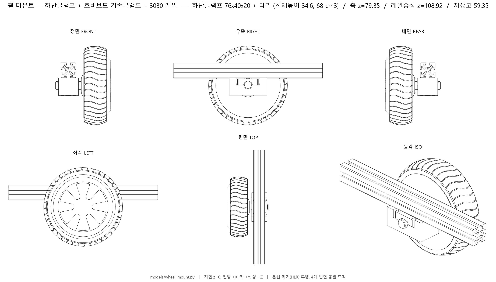

### 한 일

#### 20:32 — 휠 브라켓 파손 보고와 이전 계산 재검토

> 내가 올라타는 등 하중은 버티긴 했는데 하중구조가 분산이 잘 안된건지 바퀴가 점점 바깥쪽으로 밀리드라 브라켓 상단 고정부분도 금이 가기도 했고 … 옆에 살짝 부딛혔는데 그게 트리거가 되서 브라켓 하나가 박살이 나버렸어

먼저 이전 계산을 되짚었다. 그 계산은 **접지점 횡력 한 케이스**뿐이었다 (파단 1519 N vs 마찰 최대 218 N, "여유 7배"). 파괴 위치는 ㄷ자 **팔**인데, 그 자리를 보 단면(Zx 18454 mm³)으로 재고 넘겼다. 실제로는 웹에서 뻗은 **외팔보 판**이라 Zx 는 볼트공 2개를 뺀 순단면으로 947 mm³ — 19배 차이다 (구멍을 안 뺀 총단면은 70×10²/6 = 1167 mm³, 16배). 더 큰 누락은 수직하중이 접지점(y=0)에 걸리는데 그립 중심은 y=−55 라는 것, 즉 **55 mm 오프셋 모멘트**(800 N 에서 44 N·m)를 넣지 않았다는 점이었다. 하중 케이스도 89 kg 로봇 자중만 봤고 사람이 올라타는 경우가 없었다.

| W (N) | 상황 | 기둥 | 팔(판 외팔보) | PETG 45 MPa 대비 |
| --- | --- | --- | --- | --- |
| 218 | 로봇만 (89 kg 4륜 균등) | 2.2 MPa | 14.6 MPa | 32 % |
| 414 | +80 kg 탑승 균등 | 4.3 | 27.7 | 61 % |
| 600 | 탑승자가 한쪽으로 | 6.2 | 40.1 | 89 % |
| 800 | 한 바퀴에 몰림 | 8.3 | 53.5 | 119 % |

"자중으로는 멀쩡 → 탑승하면 점점 밀림(60\~90 %, 크리프) → 상단에 금(89 %) → 살짝 부딪히자 박살"이 이 표의 순서와 맞았다. 사용자의 진단 "내부에서 한번 잡아주는 구조가 없어서"는 팔이 무보강 판이었다는 뜻으로 맞았다.

#### 20:40 — 하중 경로 검사기 report_loads() 추가

한 군데만 보다 놓쳤으니 경로의 모든 단면을 자동으로 훑는 함수를 `wheel_mount.py` 에 넣었다. **막힌 것:** 히어독으로 넣은 코드의 `\n` 이 실제 줄바꿈으로 들어가 f-string 이 247행에서 끊겼다(SyntaxError). Edit 로 줄을 나눠 고쳤다. 결과 800 N·PETG·안전율 2 기준: 팔 53.5 MPa (119 %, 지배), 볼트 지압 33.3 (74 %), 웹 18.9 (42 %), 기둥 굽힘 8.3 (18 %), 축 시트 1.2, 기둥 압축 1.0, 레일 볼트 인장 1467 N. 이 시점의 대안은 ① 알루미늄 CNC (같은 형상 20 %, JLC 견적 \$228/4개) ② 웹-팔 거싯 (Zx 947→약 3900) ③ 팔 두께 10→16 이었다.

#### 21:09 — 구간별 사용률 색칠 stress_view()

> 하중 걸리는 걸 시각적으로 볼수는 없어?

`stress_view()` 를 넣어 마운트를 하중 경로 구간으로 쪼개 계산된 사용률로 색칠했다. FEA 가 아니라는 점을 분명히 했다 — 구간 안의 분포·응력집중은 안 나오고 값은 ±2배 오차다. 세 장을 만들었다: PETG 800 N 팔 119 % 빨강, PETG 218 N 32 % 노랑, AL6061 800 N 20 % 초록. "하중은 버티긴 했는데"가 그림에 그대로 있었다.

#### 21:19 — FEA 환경 조사

> fea 까지 하려면 어떻게 해야하지? 그것도 오픈소스 기반 있나?

가상환경에 gmsh·sfepy·meshio·pyvista·ccx 없음, numpy·scipy·matplotlib 있음, gmsh 는 pip 로 4.15.2 설치 가능했다. 두 갈래를 정리했다 — A. PrePoMax(윈도우 GUI, 코딩 0) / B. STEP → gmsh → .inp → CalculiX → 후처리 파이프라인(셋업 하루). 프린트품은 등방·균질 가정이 안 맞아 FEA 값어치가 절반이라는 점도 적었다. 추천 순서는 거싯 → PrePoMax → 알루미늄 발주 → 여유되면 B. 사용자는 "그래 바로 계속 진행해"로 거싯부터 택했다.

#### 22:30 — 거싯 6장 보강과 볼트 모델 오류 두 건 수정

팔 뿌리에 삼각 거싯을 세워 T 단면으로 바꿨다 (아래팔 밑 3, 위팔 위 3). 팔 Zx 1167 → 6205 mm³ (5.3배 — 이 비교는 구멍 미고려 총단면 기준이다), 부피 191 → 203 cm³ (+6 %), 높이 151.4 → 176.3 (위팔 위 거싯 25 mm). 지배 모드가 옮겨가서 "볼트 지압 74 %"가 1위로 올라왔는데, 그 모델이 틀렸다는 걸 여기서 알았다.

- 커플 힘(약 2200 N)을 볼트 전단 지압으로 놨으나 실제로는 팔이 레일 면을 누르는 접촉압이다. 볼트는 인장을 받고, 위험은 볼트 머리가 플라스틱을 파고드는 것 → 와셔 OD18 아래 면압 6.7 MPa (15 %).
- 팔당 볼트가 2개인데 커플 힘을 1개에 다 걸고 있었다 → 3.3 MPa (7 %), 레일 볼트 인장 1467 → 733 N (스프링너트 인발 하한 1500 N 의 49 %). 그대로 뒀으면 "인발의 98 %"라고 잘못 경고할 뻔했다.

| 항목 | 거싯 전 | 거싯 후 |
| --- | --- | --- |
| ㄷ자 팔 | 119 % | 18 % |
| ㄷ자 웹 굽힘 | 42 % | 42 % ← 이제 지배 |
| 레일 볼트 인장 | 1467 N | 733 N (49 %) |
| 부피 / 높이 | 191 cm³ / 151.4 | 203 cm³ / 176.3 |

파일에 남아 있던 옛 문구 "최대 응력 3.5 MPa vs 45 → 13배"는 틀린 값이라 지우고 `report_loads()` 호출로 바꿨다. 뷰어에 보낸 뒤 간섭은 마운트×기존클램프 2 mm³(원래 있던 코너 R 슬라이버), 나머지 0. 거싯 형상은 `exports/cnc/휠마운트_cnc_M6.step` 으로 다시 내보내졌다(파일 시각 08-12 22:39 KST). 배경에서 돌린 로봇 전체 검사도 간섭 0건이었으나, 거싯 윗단이 **베이 바닥판 위로 32 mm** 올라온다는 게 새로 나왔다.

#### 22:40 — 사용자 제안: 기존 클램프의 짝을 프레임에 바로 고정하는 하단 클램프 안

> 기존 클램프 정도의 크기와 높이를 가진 부품을 하나 더 만들고 짝을 맞춘다음에 프레임에 고정하는 거지 … cnc 비용도 더 줄어들거고 바퀴도 프레임에 제대로 고정될것 같은데 지상고는 많이 낮아져도 말이야

숫자로 확인했다. 축 중심 z=79.35, 기존 클램프 윗면 91.92(두께 12.57), 레일 밑면 93.92 → 레일 중심 108.92, 새 부품 밑면 59.35. 프레임이 185.7 → 108.9 로 **77 mm 하강**, 지상고 170.7 → 59.3, 바퀴 윗면 158.7 이 레일 윗면 123.9 보다 **35 mm 솟는다**(셸 휠아치 4곳 필요). 팔·기둥·웹 굽힘은 형상이 없어져 전부 사라지지만 55 mm 오프셋 모멘트(800 N 에서 44 N·m)는 허브모터 지오메트리라 그대로다. 밑면 볼트 2개로 받으면 인장 2200 N — 스프링너트 인발 하한 1500 N 의 147 % 로 ㄷ자(733 N, 49 %)보다 3배 불리했다. 이 시점에 Claude 가 "레일을 관통해 볼트를 박으면 M6 8.8 약 11 kN 기준 20 %"라는 전제를 **스스로 끼워 넣었다**. 이게 뒤에 문제가 된다.

"그래 그렇게 해보자"로 `mount_low()` 를 그렸다: 76 × 40 × 34.57, **68 cm³**(ㄷ자 203 의 34 %), 간섭 기존클램프 2 mm³ / 레일·바퀴 0. 관통볼트 전제로 800 N 에서 볼트 2148 N (20 %), 블록 굽힘 8.5 MPa, 시트 면압 1.2 MPa.

#### 22:51 — 뷰어 전송 실패와 다리 위치 1 mm 턱

**막힌 것:** `show(a, b, c, d, names=[...])` 나열형으로 보내면 트리에 아무것도 안 붙었다. **원인(당시 추정):** 이 세션 브라우저에서 나열형 전송이 불안정했고, `swerve_base` 는 항상 Compound 로 보내서 잘 됐던 것이라고 봤다. 청크에는 이 추정을 따로 검증한 기록은 없다. **해결:** 라벨을 붙인 뒤 Compound 하나로 묶어 보내니 "하단클램프안" 그룹이 바로 올라왔다.

22:56 사용자가 "양쪽 외곽을 굳이 1 mm 깎은 이유가 있나?"라고 물었다. 이유 없는 실수였다 — 블록 ±38 에 다리를 x=±30·폭 14 로 눈대중으로 박아 23\~37 이 되면서 1 mm 턱이 남았다. `LOW_POST_X = LOW_W/2 − LOW_POST_W/2` 유도값으로 바꿔 턱 0, 클램프 반폭 21.36 과의 여유 2.64 mm. ㄷ자 때 블록 깊이 39.22 / 팔 34 / 전폭 65 / 벽 9 가 제각각이라 턱이 생겼던 것과 같은 실수를 두 번째로 한 것이다.

#### 23:20 — 휠 마운트 도면과 drawings.py 대상별 일반화

`SUBJECT=vehicle | wheelmount` 스위치를 넣었다. **막힌 것:** 치환 스크립트의 앵커 문자열이 두 번 틀렸다(주석의 "바구니"→ 실제는 "바퀴", 모듈 레벨 print 줄의 들여쓰기). 어서트가 실패했는데도 차량 도면 생성이 그대로 돌아 두 번(각 90초 안팎) 헛돌았다 — 왜 이어서 돌았는지는 청크에 남아 있지 않아 확실하지 않다. `cat -A` 로 실제 문구를 확인해 9건 치환을 한 번에 적용하고 구문 검사 후 실행했다. 휠 마운트 도면은 필요한 모듈만 import 해서 **21초**(차량 90초)에 나왔다. 산출: `41_wheelmount_drawing_sheet.png` + 42\~47 낱장. 시트 표기: 하단클램프 76×40×20 + 다리 (전체높이 34.6, 68 cm³) / 축 z=79.35 / 레일중심 108.92 / 지상고 59.35. docs/images 의 이 7장은 파일 시각이 08-12 23:29\~23:30 KST 로 이 실행의 산출물 그대로이며, 따라서 뒤에 바뀐 84×40×24 블록이 아니라 76×40×20 시점 형상이다.

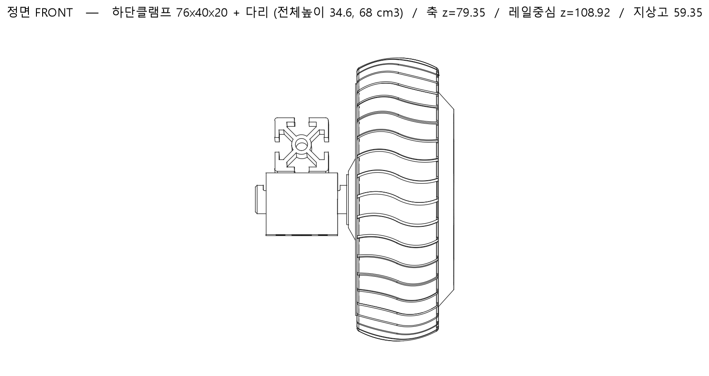

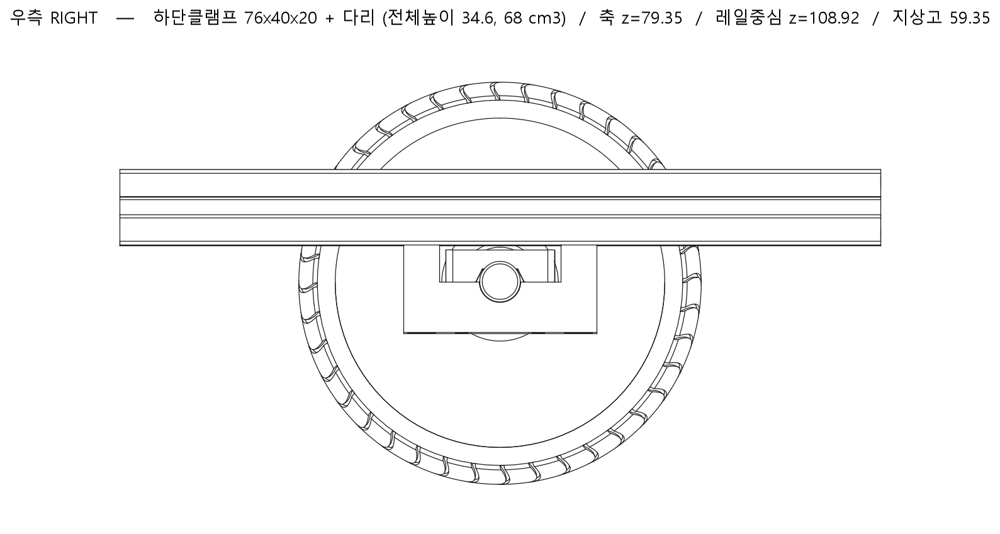

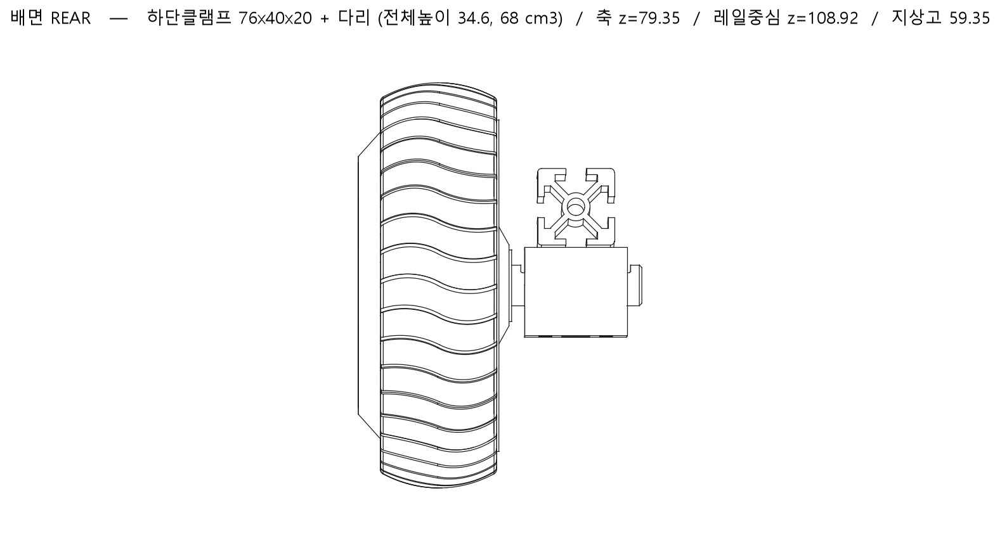

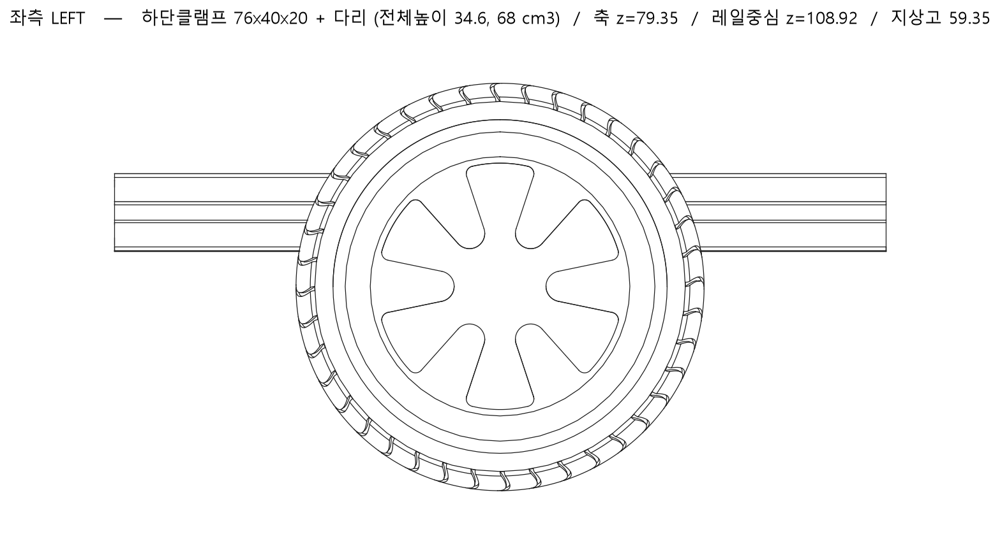

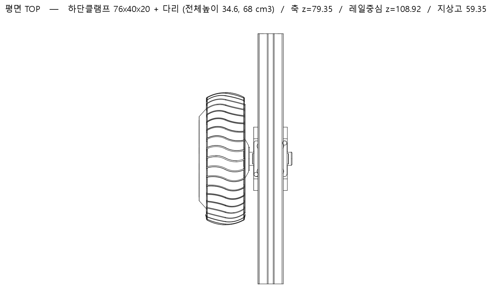

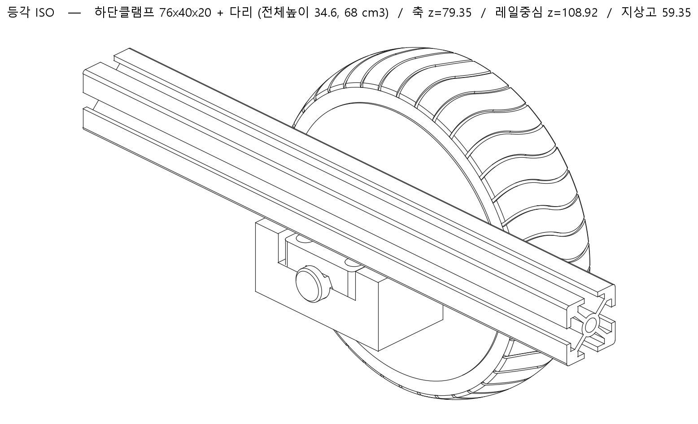

#### 23:34 — MOUNT=low 스위치로 차량 전체 높이 비교

`swerve_base.py` 에 기존 설계를 지우지 않고 `MOUNT=low` 모드를 나란히 넣었다 (`MODULE_TOP` 이 `WM.LOW_RAIL_BOT` 에서 나오고 `fixed_wheels()` 가 `mount_low()` 를 쓴다). 아래는 당시 `swerve_base.py` 출력값이다.

|  | ㄷ자 (지금) | 하단클램프 | 차이 |
| --- | --- | --- | --- |
| 전고 (적재함 포함) | 683 | 606 | −77 |
| 차체 바닥 | 170.7 | 93.9 | −77 |
| 적재함 | 384\~683 | 307\~606 | −77 |
| 스커트 지상고 | 126 | 49 | −77 |

전고 606 은 Kiwibot 559 / Starship 554 / Cartken V3 646 사이다. 바퀴가 레일 윗면보다 34.8 mm 솟아 셸이 바퀴를 물고 있는 상태로 보냈고, 스커트 지상고 49 mm 는 실외에서 턱·자갈에 긁힐 높이라 휠아치와 함께 올려야 한다고 적었다. 사용자는 "괜찮은데?"였다.

#### 00:01 — 하단 클램프 강도 비교 정정

> 괜찮은데? 지금 이 클램프가 훨씬 더 하중을 잘 버티고 튼튼하다고 했나?

3개 항목만 손으로 집어 "모두 20 % 밑"이라 했던 게 틀렸다. `load_paths_low()` 로 경로 전체를 같은 기준으로 훑으니 **카운터보어 바닥 면압 39 %**, 블록 Y 굽힘 23 % 가 있었다. ㄷ자 42 % vs 하단 39 % — 거의 같았고 "훨씬 튼튼"은 과장이었다. 전폭 76→84, 다리 14→18, 카운터보어 Ø11→Ø16 으로 바꿔 78 cm³, 지배가 블록 Y 굽힘 23 % (다리 사이 순스팬 48, 시트 아래 살 11.8, Zx 936)로 내려왔다. 사용자 지시로 블록 높이 20→24: 91 cm³, 지상고 55.35, 살 15.85, Zx 1675.

| 하단 클램프 (블록 24), 800 N | PETG | AL6061 |
| --- | --- | --- |
| 볼트머리 지압 (Ø16 카운터보어) | 6.4 MPa · 14 % (지배) | 2 % |
| 블록 굽힘 Y (다리 스팬) | 5.7 · 13 % | 2 % |
| 블록 굽힘 X (오프셋) | 5.3 · 12 % | 2 % |
| 다리 굽힘 | 4.5 · 10 % | 2 % |

같은 실수가 세 번째였다 — 1회 ㄷ자 팔(횡력만), 2회 볼트 모델, 3회 하단 클램프(3개만 집음). Claude 스스로 "검사기를 만드는 것과 쓰는 건 다른 일이다"라고 적었다.

#### 00:18 — 레일 볼트 물림 길이 검토

> 근데 둥근머리; 렌지볼트 6mm 볼트가 들어가서 스프링너트에 충분히 닿을 수 있을만큼 휠마운트에 있는 볼트 구멍 깊이가 적절해야해 … 지금 내가 쓰는 볼트 높이가 머리까지 포함해서 한 20mm 정도 될까말까 하거든

계산: 팔 10 + 와셔 1.6 + 레일 여유 0.4 + 슬롯 립 2.4 = **14.4 mm** 까지는 나사산에 닿지도 않고, M6 최소 물림 6 을 더하면 머리 밑 20.4 mm 가 필요하다. M6×15 → 물림 0.6 mm ✗, M6×20 → 5.6 ✗, M6×25 → 10.6 ✓. 프레임 코너 브라켓은 4t 다이캐스팅이라 M6×15 로 물림 8.6 이 나오는데 휠 마운트는 같은 볼트를 쓸 수 없었다. `rail_bolt_len()` 어서트를 넣었다 (PRINT 판은 레일 여유 0.8 로 20.8 → 역시 M6×25). 사야 할 볼트: 코너 브라켓 M6×15 56개(그대로), 휠 마운트 M6×25 16개(신규), 셸 플랜지 M6×15 12개. 하단 클램프를 관통볼트로 간다면 32.6 + 30 + 1.6 + 5 = 69 → M6×70 8개. "점점 밀림"의 후보가 ① 팔 크리프 ② 볼트머리 파고듦 ③ **볼트가 애초에 안 물림** 셋이 됐고, ③이 제일 그럴듯하다고 봤다.

#### 00:25 — 관통볼트 전제 철회와 스프링너트 기준 재계산

> 아니야 우리 관통볼트 아니야

관통볼트는 Claude 가 임의로 넣은 전제였다. 스프링너트 기준으로 다시 계산하니 800 N 에서 ㄷ자 733 N (49 %) vs 하단 클램프 **1074 N (72 %)** — ㄷ자는 레일 높이 30 을 지레로 볼트 4개, 하단은 블록 반깊이 20 을 지레로 볼트 2개라 체결에서는 하단이 불리하다. 하단 볼트 길이도 스프링너트라면 머리 밑 41.0 → M6×45. 개선안은 ① 블록 깊이 60(D컷 평면 42.8 을 넘어 ✗) ② 볼트 4개(537 N, 36 %) ③ 관통. 1500 N 은 보수 하한이라 실측이 2.5\~3 kN 이면 두 설계 다 25\~40 % 로 논쟁이 사라진다는 점도 적었다.

00:28 "관통볼트면 탭 구멍?"에는 아니라고 답했다. 3030 슬롯 중심선을 0.2 mm 간격으로 훑으니 재료는 2.2 + 2.2 = **4.4 mm** 뿐이고 벽 2.4 에 탭을 내면 물림 2.4 로 M6 최소 6 미달 — Ø6.6 관통 후 레일 윗면에 너트·와셔가 답이다 (tslot.py 의 3030 단면: 벽 2.4 / 슬롯 입구 8.2 / 중심보스 Ø11 / 보어 Ø6.8). 웹 검색으로 남들의 방식도 모았다: 호버보드 원본 프레임의 축 포켓을 잘라 재사용(가장 흔함), 프로파일용 프린트 클램프는 대부분 40 mm 계열, 강철 용접. 검색 결과에서 Claude 는 현장 고장의 주류가 파손이 아니라 **볼트 풀림**이라고 정리했다 (몇 건의 포럼·모델 페이지 인용이며 통계는 아니다).

#### 00:45 — 볼트 6개 제안과 3면 마운트 mount_wrap()

> 아니면 우리도 이렇게 만드는 건 어떨까? 대신 이제 양옆에 기둥이 있어서 프로파일 양 옆과 하단에 이제 렌지볼트를 박을수 있는거지 프레임에 총 6개가 박히도록 말이야 그러면 튼튼하려나?

사용자가 Thingiverse 2991697 링크와 함께 프로파일 양옆·하단에 볼트 6개를 제안했다. 바퀴 몸통을 y 로 스캔하니 축(R8)은 y −75\~−27, 몸통(R75\~79)은 −25 부터 시작하고 레일은 y −68.7\~−38.7 이라 **레일 바깥면→모터 몸통이 12 mm** 뿐이었다. 바깥 옆면엔 볼트를 못 박는다. 대신 핵심은 개수가 아니라 **하중 모드**였다 — 옆면 볼트는 기울임을 전단으로 받고, 스프링너트는 인발 1.5 kN 이지만 전단은 M6 8 kN 이라 5배 세다. 그래서 밑 2 + 안쪽 옆 2 + 윗면 2 의 3면으로 잡았다.

"일단해봐"로 `mount_wrap()` 을 그렸다: 84 × 45 × 78.57, **165 cm³**. **막힌 것:** 바퀴 간섭 50 mm³. **원인:** 블록을 깊게 하면서 축 시트 절단 길이가 따라오지 않아 안쪽으로 0.4 mm 짧았다. **해결:** 시트 기준을 블록 깊이에서 유도 → 간섭 0. 800 N·43 N·m 에서 옆면 전단 716 N (9 %), 위·아래 인장 716 N (48 %, 최악값이며 전단이 뻣뻣해 대부분을 가져간다). 뷰어에 "3면마운트안"으로 올렸다 (볼트 하단 x=±33, 안쪽 옆 x=±15, 윗면 x=±15).

|  | ㄷ자 + 거싯 | 하단 클램프 | 3면 마운트 |
| --- | --- | --- | --- |
| 부피 | 203 cm³ | 91 cm³ | 165 cm³ |
| 프레임 볼트 | 4 | 2 | 6 |
| 볼트 최악 (스프링너트) | 49 % 인장 | 72 % 인발 | 9 % 전단 |
| 구조 응력 (PETG) | 42 % | 14 % | 14 % 대 |
| 관통볼트 | 불필요 | 사실상 필요 | 불필요 |
| 프레임/셸 변경 | 없음 | −77 mm + 휠아치 | −77 mm + 휠아치 |

CNC 절감은 ㄷ자 대비 19 % 로 줄었다 (하단 클램프였다면 55 %). "하단은 싸지만 볼트가 약하고, 3면은 볼트가 강하지만 별로 안 싸다."

#### 01:06 — ㄷ자 웹 방향(바깥/안쪽)의 영향 검토

> 근데 내가 이전에 다른 거는 이미지처럼 정반대로 햇거든? ㄷ 자가 외부에서 끼워지는 형태로 말이야 이것도 영향이 있었지 않을까?

사용자가 사진과 함께, 실물은 지금 모델과 반대로 웹이 바깥쪽에 있었다며 그게 바깥으로 밀린 원인이 아니냐고 물었다. 배치를 재보니 레일 y −65\~−35, 지금 웹 −75\~−65, 모터 몸통 −25 라 웹을 바깥으로 뒤집으면 여유가 **0.0 mm** 다. 메커니즘(웹은 레일 옆면 지압을 한 방향으로만 전달)은 실재하지만 가설과는 반대다 — 실물은 웹이 바깥에 있어 바깥 방향 지압이 있었는데도 밀렸다. 옆방향 힘의 주경로는 어차피 수직 볼트 4개의 전단(각 8 kN)이고, 기울임에 대해서는 웹이 어느 쪽에 있든 위팔·아래팔 중 하나는 강하고 하나는 약해 대칭이다. 답은 "있지만 작다" — 물림 0.6 mm 와 팔 119 % 가 10배 규모의 문제라 방향은 세 번째다. 강성(캠버가 얼마나 생기는지)은 변형 문제라 FEA 가 필요하다고 덧붙이고, 금이 간 위치를 볼 사진을 요청하며 구간이 끝났다.

### 결정

- ㄷ자 마운트에 거싯 6장을 넣어 팔 Zx 1167 → 6205 (119 % → 18 %). 옛 "13배 여유" 문구는 삭제.
- `report_loads()` / `report_loads_low()` / `stress_view()` 를 모델에 내장 — 앞으로 응력은 손으로 집지 않고 여기서 본다. (즉시 FEA 파이프라인 구축은 셋업 하루 + 경계조건 오류 시 ±10배라 뒤로 미뤘다.)
- 하단 클램프(`mount_low`, 84×40×24 블록, 91 cm³)와 3면 마운트(`mount_wrap`, 165 cm³)를 대안으로 모델에 두고, `MOUNT=low` 로 차량 전체를 오갈 수 있게 했다. 셋 중 최종 선택은 하지 않았다 — 부품값·무게중심은 하단, 볼트는 3면, 프레임·셸 무변경은 ㄷ자뿐이라 셸 휠아치를 봐야 끝난다.
- 관통볼트 전제는 철회 — 사용자 요구는 M6 나사 2개로 프레임에 고정하는 것이었다.
- 휠 마운트 레일 볼트는 M6×15 가 아니라 **M6×25**(16개). 어서트로 박았다.
- 하단 클램프 블록 높이 20 → 24, 카운터보어 Ø11 → Ø16, 전폭 76 → 84 — 지배 모드를 내려 전 항목 14 % 이하로. 대가는 지상고 4 mm.
- 3면 마운트는 바깥 옆면 대신 밑·안쪽 옆·윗면을 쓴다 — 레일 바깥면→모터 몸통 12 mm 뿐이라 사용자 원안(양옆+하단)은 물리적으로 안 들어간다.
- 하단 클램프 다리 위치는 숫자가 아니라 `LOW_W/2 − LOW_POST_W/2` 로 유도.

### 남은 일

- 셸 휠아치 4곳(바퀴가 레일 윗면보다 34.8 mm 솟음) + 스커트 밑단 49 → 100 mm 대로 올리기. 이것이 하단/3면 안 채택의 마지막 미지수다.
- ㄷ자+거싯 / 하단 클램프 / 3면 마운트 중 결정. 하단 클램프를 살리려면 볼트 4개 안(다리 폭 18 은 M6 두 개가 안 들어감) 검토.
- 스프링너트 M6 인발 실측 — 1500 N 은 보수 하한이며, 두 설계의 지배 항목이 여기 달려 있다. (2026-09-15 현재도 실측되지 않았다.)
- 부러진 브라켓의 금 간 위치와 스프링너트 나사산 상태 확인 (사진 요청 중).
- PrePoMax 또는 gmsh+CalculiX 로 웹 42 % 와 팔 강성 확인. 이 구간에서는 환경 조사만 했다. (이후 08-21 기준 CLAUDE.md/FEA.md: B안 gmsh+CalculiX 파이프라인이 실제로 구축됐고, 실물 파손 재현 케이스 legacy_u_nogusset · PETG · 800 N 상향 · 편심 55 mm · 3 mm 메쉬는 44.373 MPa / 2.979 mm 로 나왔다.)
- build-log 에 이 파손·재설계 건 기록. (2026-09-15 현재 docs/build-log.md(28막 + 29\~32절)에는 이 건이 없다 — 기록은 08-09 분까지다.)
- 참고: 이 하단 클램프 발상은 뒤에 `models/hoverboard_mount` 의 Design-D(하부 클램프 + 기존 상부 클램프, 바닥 볼트 2개)로 이어진다. 3면 발상에 해당하는 레일 옆면 플랜지(옆면 전단 716 N, 9 %)는 Design-D 에 들어갔다가 08-21 실물(PETG)에서 툭 치니 부러져 `LOW_SIDE = False` 로 제거됐다 — CLAUDE_HANDOFF.md 기준이며 이 구간의 사건은 아니다.

### 교훈

- 부러진 원인은 형상이 아니라 **하중 경로 가정**이었다. 사람이 올라타는 케이스를 빼놓았고, 판 외팔보를 보 단면으로 쟀고(19배), 커플 힘을 볼트 전단으로 놓고 개수도 안 나눴다. "간섭 0 + 어서트 통과"는 안전을 뜻하지 않는다.
- 검사기를 만든 뒤에도 새 설계엔 또 손으로 3개만 집었다. 도구는 만드는 것과 쓰는 것이 다른 일이다.
- 사용자 제안에 Claude 의 전제(관통볼트)를 끼워 넣으면 비교표 전체가 틀린다. 전제가 바뀌자 72 % 와 20 % 가 뒤집혔다.
- 볼트 길이는 부품 두께에서 역산해야 한다. 브라켓용 M6×15 를 10 mm 팔에 쓰면 물림 0.6 mm 로, 조여지는 느낌만 있고 걸치지 않는다. 웹에서 모은 사례에서도 자주 보고되는 고장은 파손보다 체결 풀림이었다.
- 새 부품의 위치를 "30이면 되겠지"로 찍으면 턱이 생긴다. 두 번째다 — 관계식으로 적는다.
- 뷰어 전송이 트리에 안 붙으면 나열형 `show(a, b, …)` 대신 Compound 로 묶는다 (이 구간에서는 그렇게 해서 됐다; 원인은 추정이다).
- 구간별 색칠은 FEA 가 아니다. 지배 단면은 보여주지만 분포·응력집중·강성은 못 보여준다.

### 이후 달라진 것 (2026-09-15 기준)

2026-09-15 기준 대조.

- **하단 클램프 치수:** `models/wheel_mount.py` 의 `mount_low()` 는 지금도 84×40×24 · 다리 18 · 카운터보어 Ø16 그대로다. 채택된 설계는 별도 패키지 `models/hoverboard_mount/parameters.py` 의 Design-D 로, 전폭 92.7 × 깊이 46.6 × 블록 높이 24, 다리 폭 24(18 은 가늘어 보여 키움), 카운터보어 Ø16 × 깊이 32.3(볼트 길이에서 역산), 부품 밑면\~레일 밑면 38.9 mm 다.
- **볼트 길이:** `wheel_mount.py` 에는 `RAIL_BOLT_L = 25.0` 과 어서트가 그대로 있다. 그러나 채택된 Design-D 는 하부 클램프 밑면 볼트를 **M6×15 8개** + 스프링너트 8개로 쓰고(docs/bom.md), 카운터보어 깊이를 볼트 길이 15 에서 역산해 물림 6 을 맞춘다(`LOW_BOLT_LEN = 15`, `LOW_MIN_ENGAGE = 6`). ㄷ자용 M6×25 16개는 BOM 에 없다 — ㄷ자 안이 채택되지 않았기 때문이다. 코너 브라켓 56 + 셸 플랜지 12 = M6×15 68개는 BOM 과 일치한다.
- **스프링너트 인발:** 1500 N 은 2026-09-15 현재도 CLAUDE_HANDOFF.md 가 쓰는 보수 하한이고 실측은 안 됐다("유일하게 안 잰 설계 변수"). 08-21 플랜지 제거 형상은 밑면 볼트 인발 1432 N (96 %) 로 기록돼 있다. docs/bom.md 에는 "스프링너트 933 N [추정]" 이라는 다른 수치도 있어 문서 간에 일관되지 않다.

---

## 2026-08-12 (수) · 바퀴 제어: 조향 부호 실측

> 장소: 조립된 프레임 · 날짜 근거: `src/main.cpp` 주석("Measured on the assembled frame 2026-08-12") · 커밋: `cd922a5`에 포함 · 원본: 바퀴 제어기 작업 일지 `firmware/wheel-controller/WORKLOG.md`

### 한 일

- 양의 `iSteer`를 주면 프레임이 **왼쪽**으로 돌았다. 그래서 `STEER_SIGN = -1`로 뒤집어, 웹, 시리얼 `t`,
  GUI 모두에서 양수 = 우회전이 되게 맞췄다.

---

## 2026-08-14 (금) · 차체: 브라켓을 네 번 다시 그렸다: A/B → C → D → 통짜 D

> 시간: 11:18 ~ 08-15 (토) 13:42 · 장소: PC (`D:\build123d`) · 날짜 근거: 세션 기록 · 원본: 차체 설계 일지 `entry_13.html`

실물 브라켓이 부러진 뒤의 재설계 구간이다. 사용자가 정리해 온 장문 프롬프트(2피스 스플릿 클램프 + 어댑터 판 + 4080 프로파일; 청크에는 11절까지 보이고 Claude 는 "§13 원칙"을 인용하므로 절 수는 확실하지 않다)로 `models/hoverboard_mount/` 패키지를 새로 짜는 데서 출발해, "프레임은 3030 이다", "탭이 너무 많다", "CNC 통짜로" 라는 지적을 거치며 설계안이 A/B → C(새들) → D(하부 클램프) → D 통짜로 바뀌었다. 끝에 3030 참조 단면이 틀려 있던 것을 잡았고, 도면·DXF 스크립트를 쓴 직후 인증 오류로 세션이 끊겼다. 하중 기준은 전 구간 같다: 800 N/바퀴, 편심 53.7 mm, 기울임 모멘트 43.0 N·m. (현재 `parameters.py` 도 DESIGN_W 800 / 편심 53.7 그대로이고, 08-21 이후 FEA 는 편심 55 mm 로 돌린다.)

이 구간의 렌더는 docs/images 에 없다.

### 한 일

#### 11:18 — 프롬프트로 패키지 신규 작성 (Design A/B, 4080 전제)

> 프롬프트 만들어왔어

프롬프트 전제 가운데 셋이 22막 실측(0.1 mm 스캔)과 충돌해 실측값을 기본으로 넣고 `[실측]/[TODO]` 태그로 구분했다.

| 프롬프트 전제 | 실측 |
| --- | --- |
| AXLE_THREAD_DIAMETER 12 | 나사부 없음 — Ø16 D컷이 1 mm 모따기로 끝난다 |
| AXLE_FLAT_TO_FLAT 12 (양면) | 단면 D컷, 평면\~반대편 원호 13.0 |
| WHEEL_DIAMETER 165 | 158.7 |
| 4080 프로파일 | 현재 로봇은 3030 (이 시점엔 "4080 이 맞는 방향"으로 봤다) |

parameters / axle / motor_reference / split_clamp / torque_plate / adapter_plate / extrusion_reference / assembly / export / prototype / README 를 11:20\~11:45, 25분 안에 만들었다. 설계 중에 잡은 것은 여섯이다.

- **`Plane.XZ` 법선이 −Y 라는 함정에 세 번** 걸림(축이 두 조각 / 모터가 엉뚱한 자리 / 포켓이 클램프 밖) → `plane_at_y(y) = Plane.XZ.offset(-y)` 헬퍼로 봉인
- 축이 어댑터 판을 5.9 mm 파고듦 → 카운터보어(축은 막고 케이블만 통과)
- T너트 볼트가 클램프 밑에 깔려 조일 수 없음 → 볼트 간격 70→100, 판 폭을 간격에서 유도(120→130)
- Design B 토크판이 어댑터에서 32 mm 떠 있음 → 바깥면에 맞댐
- 리테이너가 프로파일과 4430 mm³ 간섭 → 평판은 축방향을 못 막는다, 분할 칼라로 교체
- 볼트 머리끼리 겹침(z 간격 12 \< 머리 Ø13.6) → 16

그 밖에 파라미터 정의 순서 `NameError`(BOLT_X_PITCH) 가 한 번 났다 — 같은 종류의 오류가 17:27 프리셋 작업에서 한 번 더 난다.

결과: A = upper 47.6 + lower 62.0 cm³, B = torque_plate 50.2 + 칼라 13.9 cm³, 공통 adapter 108.4 cm³ (4080 기준; 3060 프리셋에서는 토크판 52.5, 어댑터 105.7). 두 안 다 간섭 0·솔리드 1, STEP 9 / STL 7. 프로토타입 프린트판은 포켓 여유 0.05→0.35. (2026-09-15 에 다시 돌려도 같은 부피가 나온다.)

#### 12:20 — 데이텀을 하우징 폭에서 타이어 중심면으로

> 케입르 구멍지름위치 등은 축에서 그대로 나오는거라 신경안써도 돼

케이블 항목은 뺐는데, 확인하다 더 큰 것이 나왔다. 클램프 위치가 `[TODO]` 인 하우징 폭 45 에서 유도되어 평면 구간이 −27.8\~−70.6 로, 실측 −32.3\~−75.1 대비 **4.5 mm 어긋나** 있었다. 바퀴 좌우 대칭인 타이어 중심면을 데이텀으로 바꾸고 어서트 2줄을 걸었다. 클램프 중심 −53.7, 어댑터 바깥면 −72.7. 마운트 치수를 실제로 바꾸는 `[TODO]` 는 T너트 인발 하나만 남았다.

#### 16:51 — 뷰어 전송과 서버 생사 확인

`curl` 이 000 을 돌려줘 서버를 재시작했는데 실제로는 포트 3939 가 살아 있었다(PID 29084). **`show()` 가 성공하는지가 생사의 진짜 판정**이고, 브라우저는 접속 후에 쏴야 트리에 붙는다. A/B 를 x = ∓150 에 나란히 올렸다(전체 500×148×159).

#### 17:27 — 프로파일이 3030 이라는 지적, 프리셋 분리

> 근데 우리 프로파일은 4040사이즈가 아니라 3030인데

`EXTRUSION` 환경변수 프리셋(3030/3060/4040/4080)으로 뺐다. 4080 을 고른 이유가 슬롯 2줄의 지레였으니 30 계열 2줄짜리 **3060 을 기본**으로 두고, 3030 은 어서트가 이유를 설명하며 막게 했다. (프리셋 블록이 어댑터 절보다 뒤에 있어 `NameError` 가 한 번 더 났다.)

| 프로파일 | 슬롯 피치 | T너트 | 800 N 기울임 → 볼트당 | 어댑터 판 |
| --- | --- | --- | --- | --- |
| 3060 | 30 | M6 | 716 N | 126×110 |
| 4080 | 40 | M8 | 537 N | 130×110 |
| 3030 | 1줄 | — | 어서트로 차단 | — |

볼트 하중이 537→716 N 으로 33 % 늘었지만 ㄷ자 마운트를 3030 단일 슬롯에 물렸을 때(1074 N, 인발의 72 %)보다는 낫다. 17:45 에 3060 판을 뷰어에 다시 올렸다(480×138×159). 남은 미지수는 M6 스프링너트 실제 인발 — 1500 N 이면 48 %, 3000 N 이면 24 %.

#### 21:23 — 탭 8곳 문제, 레일 위치와 제작법 질문

> 이렇게 하면 구멍내고 탭 내고 해야할것 같은데 방법이 없나 음

세어 보니 탭이 8곳(클램프 핀치 M8×4, 클램프→어댑터 M8×4)이고, 어댑터 뒷면은 프로파일이 z 49\~109 를 덮어 너트를 못 쓴다. 이번 세션에서 확정된 사실(D컷 형상 물림, 편심 54 mm, 800 N 이 예외가 아님, 무보강 10 mm 판 외팔보는 부러짐, 볼트 물림 0.6 mm)을 들고 요구조건 다섯을 세웠다: ① D컷을 형상으로 ② 기울임을 인발 아닌 경로로 ③ 얇은 판 외팔보 금지 ④ 볼트 길이 역산 ⑤ 탭 최소화. 레일 위치와 제작법을 물었고 23:29 에 **"축 옆으로 내린다" / "CNC 알루미늄 통짜**"로 답이 왔다.

#### 23:31 — Design C, 통짜 새들 브라켓 (3060 세로)

3060 의 60 면을 세워 슬롯 2줄이 30 mm 높이차를 만들고, 상부 절반은 **기존 호버보드 클램프**(채널 깊이 5.07 = D컷 평면 높이 5.0)를 그대로 쓴다. 23:31\~00:08, 약 37분 동안 잡은 것:

- 레일 볼트 소켓이 기존 클램프(±21.4)를 스침 → SADDLE_BOLT_X 26→30 (어서트가 잡음)
- 백플레이트가 클램프를 6 mm 파고듦(2585 mm³) → 레일 위치를 클램프 안쪽면에서 역산
- 필렛 비드가 클램프를 9 mm³ 밈 → 간극 = 필렛 반경 + 2
- 레일 밑을 받치는 선반이 +Y 로 뻗어 살 속에 묻힘 → −Y 로
- 축 시트 절삭이 백플레이트 한복판에 D자 구멍 → 축 실제 구간까지만
- **아래 슬롯줄(z 74.3)이 블록 살(51.3\~79.35) 속에 묻혀 볼트를 넣으려면 알루미늄 47 mm 를 뚫어야 했다** → 레일 높이를 "아래 줄이 블록 윗면 위로"에서 역산, CLR 6→10
- 새들만 지면 기준 z 로 지어 축이 79 mm 아래 따로 뜸 → 패키지 관례(축 중심 z=0)
- 핀치갭 어서트 부등호 반대. 채널 5.07 > 평면 5.0 이므로 핀치갭 > 0.07 이어야 클램프가 축에 앉는다. 0.4 → 클램프 착좌 −0.07, 맞댐면 틈 0.33

최종 76×85×80, 217 cm³, 6061 586 g, 지상고 51.3, 탭 4곳(기존 클램프 M6). 하중: 레일볼트 윗줄 인장 430 N(M6 너트 1500 N 의 29 %), 아랫줄 143 N(10 %), 새들 뿌리 굽힘 2.1 MPa(1 %), 백플레이트 8.6 MPa(4 %), 구동토크 29 N·m → 전단 242 N(3 %). 뷰어 재시작 때 `--no-browser` 옵션이 없어 한 번 실패했다. README 를 "세 설계안"으로 고쳤다. (`saddle_bracket.py` 는 지금도 있고 2026-09-15 에 돌리면 같은 76×85×80 / 217 cm³ / 586 g 이 나온다.)

#### 08-15 02:05 — 3030 기준 하단 결합안으로 복귀, Design D

> 아니야 우리 3030프로파일 기준으로 해야하고 기존브라켓과 새로만든 브라켓을 결합해서 하단부에 부착하던 것이 더 나은 것 같은데 그걸로 다시 해볼래

C 는 3060 전용이라 접고, 기본을 3030 으로 돌려 `low_clamp.py` 를 짰다. 기존 클램프(상부) + 새 하부 클램프를 M6×4 로 물리고, 다리 2개가 클램프를 타고 넘어 3030 레일 밑면에 매달린다. 80.7×46.6×63.9, 102 cm³, 275 g, 지상고 54.9, 레일 밑면 지상 93.8.

막힌 것: `TNUT_PULLOUT` 이 M8 값 4000 으로 고정돼 밑면 볼트 인발을 35.8 % 로 잘못 보고했다. 볼트 굵기에서 유도하게 고치니 **1432 N / 1500 = 95.5 %** — 실물이 부러진 것과 같은 경로다. 그래서 다리 위쪽이 레일 양 옆면까지 감싸 옆 슬롯에 볼트 4개를 더 박고(총 6개), 같은 모멘트를 플랜지 2장의 전단 커플(지레 30)로 보내 716 N / 8000 = 8.9 %. 다리 굽힘 4.5 MPa, 블록 굽힘 5.6 MPa, 시트 면압 1.2 MPa. 볼트는 밑면 M6×45 ×2, 옆면 M6×20 ×4. 플랜지가 레일을 감싸므로 **레일 끝에서 밀어 끼우는 조립 순서가 강제**된다. A/B 는 3030 에서 볼트 두 줄이 겹쳐(1175 mm³, `export.py` 주석) 성립하지 않으므로 `export.py` 가 건너뛴다. 렌더가 두 조각으로 보여 단면 프로브 9곳으로 살을 확인했다 — 원인은 다음 절에서 드러난다.

당시 값이다. 현재(08-21 실물 시험 이후)는 옆 플랜지가 PETG 출력품에서 툭 쳐서 부러져 `LOW_SIDE` 기본이 False 이고, 레일 체결은 밑면 M6×15 ×2 뿐이다(`CLAUDE_HANDOFF.md`, `docs/bom.md`). 밑면 인발은 액슬 타이 로드가 모멘트의 73 % 를 가져가 `low_clamp.report()` 기준 384.5 N / 1500 = 25.6 % 로 찍힌다.

#### 08:56 — 통짜 각기둥으로 재설계

> cnc 로 깍을때 움직임 덜 할 수 있게 … 그냥 이어진 하나의 큰 통짜 부품으로 만들자는 거지

사용자가 찍은 모서리 (−40.36, −77, 14.5)→(−22.36, …) 가 플랜지 밑변이었다. 다리가 z 14.5 에서 18×40 기둥에서 18×8 지느러미로 줄고 몸체보다 3.3 mm 튀어나와 있었다. **92.7×46.6×63.9 각기둥 하나에서 셋만 파내는** 형상으로 다시 짰다: 통로 44.7(클램프 42.72+2), 레일 홈 30.6, 축 시트 Ø16.2. 다리 폭 18→24. 143 cm³, 387 g. 다리 굽힘 4.5→2.5, 블록 굽힘 5.6→4.8 MPa. 낙하 경로 간섭 0.

부수적으로: 하부 블록에 잘못 걸린 "D컷 평면 구간" 어서트(평면이 필요한 건 기존 클램프) 수정, 필렛이 레일을 124 mm³ 물어 필렛을 홈 파기 전으로, `TNUT_BOLT` 가 하드코딩 "3060" 을 읽던 것 수정. 그리고 **렌더가 몸체를 빼먹던 진짜 원인** — `iso_render` 가 접지면 원판을 z=0 에 고정하는데 이 패키지는 z=0 이 축 중심이라, 몸체(z −24.4\~−0.4)가 원판에 가려졌다. 접지면을 min(0, 모델 밑면)으로 고쳤다.

현재 `low_clamp()` 는 플랜지를 뺀 92.7×46.6×38.9, 116 cm³, 314 g 이다(2026-09-15 실행; 다리 폭 24, 통로 44.72, 깊이 46.6 은 그대로). 다리 굽힘 2.5 / 블록 굽힘 4.8 MPa 도 그대로 찍힌다.

#### 12:51 — 3030 참조 단면 오류 확인

> 3030프로파일이 아닌느낌인데 생김새가 조금 다르잖아 크기는 맞나?

외형은 30.00×30.00 으로 맞았다. 그러나 ±Y 면에만 슬롯이 있고 ±Z 면은 막혀 있었으며 중심 보어도 T 언더컷도 없었다(단면 286 mm²). **Design D 의 밑면 볼트 2개가 슬롯 없는 면으로 들어가는데도 검증이 통과**하고 있었다. 4면 T슬롯(입구 8.2, 홈 16.4) + 45° 대각 웹 + 보어 Ø6.8 로 다시 만들었다(단면 406 mm²). 웹이 모서리 밖으로 삐져 31.40 이 되어 외곽으로 트림, 3060 은 두 셀 경계가 통살로 남아 2.81 kg/m 이 나와 면 처리를 일반화했다.

| 프리셋 | 외형 | 모델 kg/m | 실물 약 |
| --- | --- | --- | --- |
| 3030 | 30×30 | 1.10 | 1.0 |
| 3060 | 30×60 | 2.30 | 2.1 |
| 4040 | 40×40 | 1.98 | 1.6 |
| 4080 | 40×80 | 4.09 | 3.2 |

T홈을 직사각으로 단순화해 중량이 +10 %/+24 % 나오는 한계를 파일에 적었다. 밑면 볼트 x ±34.4, 옆면 볼트 z 29.5 가 살과 간섭 없이 슬롯으로 들어간다. (2026-09-15 에 네 프리셋을 다시 돌려도 표와 같은 값이다.)

#### 13:10 — 도면·DXF 스크립트 작성, 세션 끊김

"치수적힌 도면도도 만들고 dxf파일도 만들어줘" 에 `ExportDXF` API 를 확인하고 `hoverboard_mount/drawing.py`(3면도 PNG/PDF, 낱장 DXF, 프로파일 단면 DXF, 치수는 parameters.py 에서)를 썼다. 직후 "조직에서 구독 접근을 비활성화" 메시지가 뜨고 13:42 "ㄱㄱ" 에 403 으로 실패했다. **이 세션 안에서는 스크립트가 실행되지 않았다.** (이후 실행됐다 — `output/drawing/low_clamp_drawing.png·pdf` 와 `output/dxf/` 5개가 있고 폴더 시각이 08-15 15:59, 파일 시각이 08-21 07:59 다. 그 경위는 이 청크 밖이다.)

### 결정

- 프레임은 3030 유지. Design D(기존 클램프 + 새 하부 클램프, 레일 밑면 + 양 옆면 6볼트)가 기본. A/B 는 2줄 프로파일 전용, C 는 3060 전용으로 남긴다. — 현재는 08-21 실물 시험으로 옆 플랜지를 빼 밑면 2볼트 + 액슬 타이 구성이다.
- 하부 클램프는 CNC 통짜 각기둥에서 파낸다 — 단차·지느러미 없음.
- 데이텀은 타이어 중심면, 패키지 z=0 은 축 중심.
- T너트 인발 한계는 볼트 굵기에서 유도(M6 1500 / M8 4000 보수 하한). 현재 `parameters.py` 도 같다.

### 남은 일

- `drawing.py` 실행·검증 (도면 PNG/PDF, DXF) — 이후 실행돼 `output/drawing`, `output/dxf` 가 있다 (최종 갱신 08-21).
- M6 스프링너트 인발 실측 — 설계 전체에서 유일하게 안 잰 변수. 현재도 `parameters.py` 는 1500 N 보수 하한을 쓰고, `docs/bom.md` 에 스프링너트 933 N / 드롭인 T너트 2271 N 이 [추정] 으로 적혀 있다. 실측했는지는 확실하지 않다.
- 프린트 fitment 판으로 축 끼움 확인 — 08-21 출력·조립 시험에서 치수는 맞았다 (`CLAUDE_HANDOFF.md`).
- 하중 경로 검사기(응력)를 패키지 공통 검증에 편입 — 현재 `low_clamp.report()` 가 매번 찍고, 국부 응력은 별도 FEA 파이프라인(`run_clamp_fea.py`)으로 본다.

### 교훈

- **참조가 틀리면 검증이 틀린 걸 통과시킨다.** 슬롯 없는 면으로 볼트가 들어가도 간섭 0 이었다.
- 같은 부호 함정에 세 번 걸리면 헬퍼로 봉인한다 (`plane_at_y`).
- "조립 가능한가"는 간섭과 다른 검사다 — 볼트 접근(47 mm 살), 공구 접근, 낙하 경로를 따로 본다.
- 렌더 도구도 의심한다. 두 번 조각난 듯 보인 것은 접지면 원판이었다.
- 상수가 아닌 것을 상수로 두면(4000 N) 사용률이 36 % 와 96 % 만큼 달라진다.

---

## 2026-08-15 (토) · 차체: 세션 밖(GPT/Codex): 프레임 폭 450 통일·FEA 파이프라인·구형 브라켓 파손 재현

> 시간: 15:59 ~ 08-19 (수) 23:31 · 장소: PC (`D:\build123d`) · 날짜 근거: 파일 시각 (세션 밖, GPT/Codex 작업) · 원본: 차체 설계 일지 `entry_13b.html`

이 구간은 Claude 대화 기록에 없다. 08-15 13:42 에 구독 접근 비활성화(403)로 세션이 끊긴 뒤 사용자가 GPT/Codex 로 작업을 이어갔고, 08-21 00:17 에 Claude 가 다시 시작하면서 "gpt 랑 좀 작업을 했었는데 … 인수인계 내용 확인을 좀 해볼래?" 로 넘겨받았다. 그 사이 대화는 어디에도 없고 남은 것은 파일뿐이다 — 인수인계 문서 3개(`CLAUDE_HANDOFF.md`·`FEA.md`·`CLAUDE.md`), 새 스크립트 십여 개, `tools/fea/` 툴체인, `output/fea/` 결과 폴더 11개(Design-D 편심 55 폴더 3개는 08-21 재실행으로 덮였고, 그중 PETG 폴더는 08-27 에 한 번 더 덮였다)와 보고서 2개. 아래 시각은 전부 파일 mtime 이고, 인수인계 두 문서는 08-21 에 Claude 가 고쳐 써서 GPT 시점 원문은 없다. 이 구간의 렌더는 docs/images 에 없다 (조립 GIF 는 `output/animation/hoverboard_clamp_assembly.gif` 에만 있다).

### 한 일

#### 08-15 15:59 \~ 08-16 00:31 — 도면 실행, 조립 애니메이션

세션이 끊기며 못 돌린 `drawing.py` 가 실행돼 `output/drawing/`·`output/dxf/` 폴더가 생겼다(폴더 15:59/16:00, 파일은 08-21 07:59 에 재생성). 이어 `extrusion_reference.py`(18:09), `README.md`(20:28), `motor_reference.py`(22:08) 가 바뀌었다. README 는 이 시점 형상 — 플랜지 있는 92.7×46.6×63.9, 143 cm³, 밑면 M6×20 ×2 + 옆면 ×4 — 기준이고 "`LOW_SIDE = False` 로 플랜지를 끄면 인발 96% 만 남는다. 끄지 마라" 가 들어 있다.

`load_visualization.py`(23:10) 는 800 N 화살표와 두 경로 — 바닥 인발 1432 N/개(95%), 옆면 전단 716 N/개(9%) — 를 뷰어 토글 객체로 만든다. `assembly_animation.py`(23:48) 와 오프라인판 `render_assembly_gif.py`(08-16 00:31, 4 fps · 720×540 · 12 s) 는 조립 6단계를 움직인다.

1. 하부 클램프 배치
2. 휠모터 축을 하부 시트에 수직 하강으로 안착 (옆에서 관통시키지 않는다)
3. 상부 클램프 장착 (휠 상단보다 위에서 대기)
4. 3030 프로파일을 끝에서 X 방향으로 밀어 넣기
5. 측면 M6×20 4개
6. 바닥 M6×20 2개 (카운터보어 아래에서 위로)

플랜지가 있던 형상의 순서다. 인수인계 §5 의 현재 6단계는 08-21 에 고쳐진 판으로, 상·하부 클램프를 먼저 체결한 뒤 프로파일을 **위에서 얹고** 바닥 볼트 2개(M6×15)만 조인다. "상부 클램프를 먼저 닫아 놓은 뒤 축을 통과시키거나, 프로파일을 먼저 장착한 상태에서 위쪽 클램프 볼트에 접근하는 순서는 쓰지 않는다"는 원칙은 두 판이 같다.

#### 08-16 17:03 — 절곡 강판 대안 bent_lower_clamp.py

CNC 통짜 대신 레이저 절단 + 프레스 절곡 3부품 안이다: 6 mm SS400 U 브래킷(축 지지, 외폭 76 · 깊이 38), 6 mm SS400 햇 브래킷(3030 밑면·양 옆면 감싸기, 폭 92 · 플랜지 높이 24), 2.5 mm 교체형 V 축받침. 축·상부 클램프·레일·M6 좌표는 Design-D 와 같다. 인수인계 "중요 파일" 목록에 없어 검토 결과는 모른다.

#### 08-16 21:31 \~ 08-17 03:00 — 프레임 폭 450 통일과 차량 장면

`export_low_clamp_step.py` 는 STEP 을 내보낸 뒤 다시 읽어 부피 오차 1e-3, 외형 1e-6 안인지 검사한다. `swerve_base.py`(08-17 02:16 이 마지막 수정) 에는 `SHELL_Y`·`TOP_RAIL_Y`·`SHELL_WHEEL_Y`·`WHEEL_ARCH_CLR`·`HUB_MOCK` 환경변수 덮어쓰기와 `COMPACT_SHELL = SHELL_Y < 280` 분기가 있고, 같은 시각의 `vehicle_cargo_integration.py`(11줄, `VEHICLE_PAYLOAD=cargo`) 와 그것이 import 하는 `vehicle_shell_integration.py`(현재 파일 mtime 은 09-10 이지만 초기 커밋 판에 같은 값이 있다) 가 이를 쓴다 — `TOP_RAIL_Y=210`, `SHELL_Y=255`(셸 폭 510), `SHELL_WHEEL_Y=263.7`. `vehicle_flat_abs_integration.py`(03:00) 는 라운드 셸을 3 mm ABS 평판(각진 하부 외장, 사각 데크, 4면 적재함 + 평판 덮개)으로 바꾼 비교 장면이다.

프레임 변경의 골자는 인수인계 §3 이다. 3030 프레임 760×450 에서 상부 폭을 하부와 같은 450 으로 맞췄고 높이는 그대로다. swerve_base 기본값 `TOP_RAIL_Y=265` 면 상부 크로스가 2×265−30 = 500 이었는데, 210 이면 450−30−30 = 390 이다. 휠 축 X=±210, 휠 중심 Y≈±263.7 (레일 중심 210 + 클램프 오프셋 53.7).

| 390 mm 프로파일 | 수량 |
| --- | --- |
| 하부 크로스 | 3 |
| 상부 크로스 | 3 |
| 축 하중 보강 크로스 (x=±265) | 2 |
| 합계 | 8 |

기존 상부 500 ×3 은 390 으로 잘라 재사용할 수 있다. 새로 산다면 상부 변경분 3개, 실차에 축 보강 크로스 2개가 없으면 총 5개, 카메라 받침 크로스까지 달면 390 한 개 추가. `vehicle_integration.py` 가 발주 확인용 기준 장면이고 그룹은 다섯 — 변경차량_3030프레임_상하폭450 / DesignD_하부클램프_4개 / 기존_상부클램프_4개 / 실제_휠모터_STEP_4개 / 프로파일체결볼트(이 구간에서는 M6×20 24개, 08-21 이후 M6×15 8개).

#### 08-18 00:29 \~ 00:48 — FEA 파이프라인 구축, 편심 0·하향 첫 결과

`load_analysis_viewer.py`(00:29) 는 800/1600/2400 N 케이스, 위험부 A(축 시트)·B(플랜지 뿌리)·C(카운터보어 잔여두께), 구동토크 29 N·m 를 그룹으로 나눈 뷰어 장면인데 이름에 "색상은 FEA 응력값 아님" 을 박았다. 실제 해석은 00:35\~00:40 에 `tools/fea/` 로 들어온 툴체인이 한다: Gmsh 4.15.2(`gmsh_pyenv`), CalculiX 2.23 Windows(`calculix_2.23_4win.zip` 61.7 MB), meshio·ccx2paraview 3.2.0·numpy(`python/`).

```
STEP → Gmsh C3D10 2차 사면체 → CalculiX 선형 정적 → ccx2paraview VTU → VTK 응력/변형 PNG
```

```
powershell -ExecutionPolicy Bypass -File tools\fea\run_clamp_fea.ps1 `
  -Model design_d -Material al6061 -Load 800 -MeshSize 3 `
  -Eccentricity 55 -LoadDirection upward
```

`run_clamp_fea.ps1` 은 `.venv` 파이썬을 먼저 시험하고 안 되면 Codex 번들 파이썬으로 떨어진다 — 이 구간에 `.venv` 가 깨졌다고 믿고 있었다는 흔적이다. 기본값이 `Eccentricity 0`·`downward` 라서 옵션을 빼면 편심 0 케이스가 돈다. 재료 카드는 AL6061-T6(E 68,900 MPa, ν 0.33, 항복 276)과 PETG 등방 근사(E 2,100, ν 0.38, 항복 45) 둘뿐이다. 고정은 레일 체결 구멍 벽 노드 XYZ 강체 고정, 하중은 축 시트 표면 노드 균등 분배.

첫 결과(00:46/00:48, 플랜지 있는 63.9 mm 형상, 구멍 6개 고정, 편심 0 하향):

| 메쉬 | C3D10 요소 | 최대 von Mises | 최대변위 |
| --- | --- | --- | --- |
| 4 mm | 24,128 | 3.613 MPa | 0.001390 mm |
| 3 mm | 46,928 | 4.036 MPa | 0.001400 mm |

변위 차 0.7%, 응력 차 11.7%, 반력 합 Fz = +800 N. 이 4.036 MPa 가 GPT 시점 FEA.md 의 "기준 결과" 였다.

#### 08-18 01:46 \~ 02:03 — 구형 긴 ㄷ자와 동일조건 비교

`exports/cnc/휠마운트_cnc_M6.step`(70×40×176.35, 202.8 cm³, 거싯 있음)을 같은 조건으로 돌려 `comparison_800N.md` 를 썼다.

| 형상 | 3 mm 요소 | 최대응력 | 최대변위 | 구형/현재형 |
| --- | --- | --- | --- | --- |
| Design-D (137.0 cm³) | 46,928 | 4.036 MPa | 0.001400 mm | 1.00× |
| 구형 긴 ㄷ자 | 58,158 | 15.816 MPa | 0.009374 mm | 응력 3.92×, 변위 6.70× |

등가 수직강성 571.6 vs 85.3 kN/mm. 반력 분배는 Design-D 가 바닥 2개 53.4% / 측면 4개 46.6%, 구형이 아래팔 볼트 81.7% / 위팔 18.3%. 보고서 스스로 범위 경고를 달았다 — 축중심 하중이라 접지점 편심 55 mm 의 44 N·m 가 빠졌고, STEP 은 파손 뒤 거싯이 붙은 AL6061 형상이라 PETG 출력품 파손 검증이 아니다.

#### 08-18 02:13 \~ 02:27 — 구형 브라켓 파손 재현 legacy_u_nogusset

그래서 실물 조건을 따로 만들었다. `wheel_mount.py` 에 `NO_GUSSET`·`U_OPEN_INBOARD` 환경변수를 넣고 `export_legacy_ungusseted.py` 로 거싯 없는, ㄷ자 열린 면이 차량 내부를 향하는 STEP 을 뽑았다. 조건: PETG, 800 N, 편심 55 mm(44 N·m), 위·아래 볼트 4개 고정. 02:16/02:18 에 하향으로 먼저 돌렸고(02:13 자 `legacy_u_bracket_no_gussets.step`, 열린 면 방향 미반영; 3 mm 62.329 MPa / 2.955 mm — 폴더 summary.txt 값, 문서에는 없다), 02:19 에 ps1 이 바뀐 뒤(`-LoadDirection` 이 이때 들어간 것으로 보인다) 02:24/02:26 에 상향으로 다시 돌렸다. 상향이 프레임을 고정했을 때 노면이 바퀴를 미는 방향이고, 하향은 응력 크기는 비슷해도 휘는 방향이 사진과 반대다.

| 메쉬 | 요소 | 최대응력 | 최대 전체변위 | 최대 바깥방향 변위 |
| --- | --- | --- | --- | --- |
| 4 mm | 27,903 | 45.917 MPa | 2.967 mm | 약 2.81 mm |
| 3 mm | 55,892 | 44.373 MPa | 2.979 mm | 2.819 mm |

최대응력은 아래 볼트열 부근 [15.4, −53.3, 170.3] mm. 긴 다리의 바깥방향 변위 중앙값은 z 180\~212 에서 약 0.005 mm, 140\~160 에서 0.241, 100\~120 에서 1.123, 60\~80 에서 2.389 mm 로 내려갈수록 커진다 — 사용자가 본 "아래 볼트 부근부터 바퀴 쪽으로 갈수록 바깥으로 휘어짐" 과 맞는다. PETG 항복 45 대비 사용률 약 99%. 같은 편심 55·상향을 Design-D AL6061(구멍 6개 고정)에 주면 17.677 MPa / 0.007293 mm, 구형 대비 응력 2.51 배 낮다(`legacy_failure_reproduction.md`). 이 17.677 이 GPT 시점 인수인계의 "기준" 이었다.

#### 08-19 23:31 — STL 내보내기

`export_clamp_stl.py` 가 하부 클램프와 OEM 상부 참조를 최저면 z=0 으로 옮겨 바이너리 STL 로 저장하고 헤더(84 + 50×삼각형 수 바이트)를 검사한다. 08-20 자 파일은 없다. 이 STL 로 출력한 것을 사용자가 08-21 낮에 달아 봤고 그 결과가 다음 편이다.

#### 인수인계 문서에 적힌 규칙

§8 결과 이미지: 흰 와이어프레임이 원형, 색칠 메쉬가 변형 형상, `Deformation display: Nx` 는 확대율이고 숫자로 적힌 최대변위만 실제 값. 파랑→빨강은 von Mises 증가 순서라 따뜻한 색은 변위가 아니라 응력이 큰 곳. `S_Mises` 가 응력, `U` 가 변위, `E_Mises` 는 변형률이라 응력으로 읽지 않는다. §9 검증: 형상 변경 → STEP 재생성 → 4 mm 로 노드 분류·솔버 오류 확인 → 3 mm 수렴 비교 → 반력 합 = 입력 하중 → PNG 에서 고정면·하중면·휘는 방향 확인 → 비교 모델은 같은 방향·편심·재료·메쉬 규칙 → 최대점 하나가 아니라 분포와 전체 변형을 본다. §11 안전 판단: 800 N 은 시험으로 확정한 허용하중이 아니라 비교용 코너 하중, 정적 선형해석만으로 탑승 허용중량이나 인증을 선언하지 않는다, 출력품은 무부하 조립 → 지그 정적시험 → 무인 저속시험 순, 최종 클램프는 AL6061-T6, 실제 허용하중은 휠/축/베어링/프로파일/T너트/볼트/프레임/제동 중 가장 낮은 한계가 정한다. 600 N = 약 61.2 kgf 는 한 바퀴 힘이지 차량 총질량이 아니다 — 차량 40 kg + 사람 70 kg 이면 정적 총중량 약 1,079 N 이고 편중·비틀림·탑승 충격으로 한쪽에 400\~650 N, 순간 800 N 이상이 걸릴 수 있다.

FEA.md §8 은 코너 하중을 총중량으로 바꾸는 식이다.

```
gross_mass_kg = 4 × F_corner /
                (9.81 × K_dynamic × K_imbalance)
```

800 N 에 `K_dynamic=2.0`, `K_imbalance=1.3` 이면 약 125 kg — 잠정 설계 목표이지 허용중량이 아니며, 여기서 차량 자중을 빼고 가장 낮은 부품 한계를 적용한다.

### 결정

- 상·하부 프레임 폭 450 통일, 크로스 390 ×8. 길이 760 과 높이는 유지.
- 구조해석은 뷰어 화살표(설명용)와 CalculiX 파이프라인(실제 계산)을 분리한다. 비교는 같은 하중·편심·재료·메쉬 규칙으로만 한다.
- 구형 파손 재현 조건은 `legacy_u_nogusset` · PETG · 800 N · 편심 55 · 상향.
- 사람 탑승 최종품은 AL6061-T6. 출력품은 치수·조립·저속 무부하용.

### 남은 일

- 인수인계 3문서를 저장소 실제 상태와 대조 — 08-21 00:17 에 Claude 가 시작한 일이다.
- FEA.md §7 확장 순서: 하부+축+상부 접촉 모델 → M6 프리로드 → 3030/T너트 접촉 → 수직·제동토크·횡하중 load step → 편중 30\~50%·충격 1.5\~2.5배 → 실물 proof test 상관검증. PLA 재료 카드 없음.
- M6 스프링너트 인발 실측.
- 절곡 강판안과 ABS 평판 셸의 채택 여부.

### 교훈

- 대화 없이 결과물만 남으면 "기준" 이 두 개가 된다. 조건(편심·방향·고정 구멍 수)을 숫자 옆에 같이 적지 않은 값은 다음 사람이 섞어 쓴다.
- 기본값이 위험하다 — `Eccentricity 0 · downward` 가 기본이라 옵션을 빼면 실물과 다른 케이스가 조용히 돈다.
- 같은 800 N 이라도 편심 55 mm 를 넣느냐가 4.036 과 17.677 MPa 를 가른다. 축중심 하중 비교는 형상 순위에는 쓰여도 파손 재현에는 못 쓴다.
- 실물 관찰(아래 볼트열부터 바깥으로 휨)을 재현하는 조건을 찾는 것이 해석의 첫 검증이다. 방향이 반대면 응력 크기가 맞아도 틀린 모델이다.
- 타임스탬프는 순서만 믿는다.

### 이후 달라진 것 (2026-09-15 기준)

- `README.md` 는 08-15 20:28 그대로다 — 63.9 mm · 143 cm³ · M6×20 6볼트 · "플랜지를 끄지 마라". 현재 코드는 `LOW_SIDE` 가 환경변수(기본 꺼짐)이고 부품은 38.9 mm · 116 cm³ · M6×15 2볼트다.
- `LOW_SIDE` 가 꺼지면 `side_button_head_bolts_reference()` 가 빈 목록을 돌려준다. 이 구간 스크립트 중 `assembly_animation.py`(이름 10개 고정)·`render_assembly_gif.py`·`load_analysis_viewer.py`·`bent_lower_clamp.py`·`vehicle_flat_abs_integration.py`("M6x20_프로파일체결볼트_24개")는 옆 볼트 4개를 전제한다. 실행해 보지는 않았다.
- `run_clamp_fea.py`·`vehicle_integration.py`·`parameters.py` 는 08-21 과 08-27 에 다시 바뀌었다(측면 노드 선택 `P.LOW_SIDE` 조건화, 볼트 길이·개수 파라미터 유도, 액슬 타이).
- `output/fea/` 의 편심 0·하향 폴더(`clamp_800N_h3mm`·`h4mm`, `legacy_u_*`, `legacy_u_nogusset_*`)와 보고서 2개는 08-18 자 그대로 남아 있다.

### 참고

#### 확실하지 않은 것

- 시각은 전부 mtime 이다. 08-21 세션에서 Claude 가 "이 머신의 시계가 왔다갔다 한다" 고 적었으니 순서는 믿되 절대 시각은 참고만 한다.
- GPT 가 무엇을 시도하고 버렸는지 모른다. `bent_lower_clamp.py`, `vehicle_flat_abs_integration.py` 가 검토안인지 채택안인지 문서에 없다.
- GPT 시점 `CLAUDE_HANDOFF.md`·`FEA.md` 원문은 없다. 08-21 00:17 에 280 / 226 줄이었고, FEA.md 는 4.036 MPa(편심 0 하향), 인수인계는 17.677 MPa(편심 55 상향)를 각각 "기준" 이라 불렀으며 `.venv` 가 깨졌다는 경고가 있었다는 것만 다음 편에서 확인된다.
- README 의 143 cm³ 와 08-18 비교표의 137.0 cm³ 가 왜 다른지 — 그 사이 형상 수정이 있었는지 — 근거가 없다.

---

## 2026-08-21 (금) · 차체: 인수인계 검증, 실물 파손 반영, 플랜지 없는 FEA, 젖힘 모멘트 시각화

> 시간: 00:17 ~ 01:41 · 장소: PC (`D:\build123d`) · 날짜 근거: 세션 기록 · 원본: 차체 설계 일지 `entry_14a.html`

GPT 와 작업해 둔 인수인계 문서 3개(`CLAUDE_HANDOFF.md` 280줄, `FEA.md` 226줄, `CLAUDE.md` 63줄 — 당시 `wc -l`. 현재는 363 / 281 / 70줄)를 저장소 실제 상태와 대조하는 것으로 시작했다. 그러다 사용자가 낮에 실제로 출력해 달아 본 결과를 가져왔고, 하부 클램프의 옆 플랜지 제거·볼트 15 mm 반영·FEA 재실행·"왜 바깥으로 휘나" 설명 자료 제작까지 한 번에 이어졌다.

### 한 일

#### 00:17 — 인수인계 문서 대조

> gpt 랑 좀 작업을 했었는데 … 이 인수인계 내용 확인을 좀 해볼래?

파일 10개 존재, STEP/STL 이 현재 코드와 같은지(체적차 0.000%, STL 6,396 삼각형, z +0.00\~+63.90), FEA 수치 3개(17.677/0.007293, 17.527/0.2426, 44.373/2.979 mm), 반력 합 `[0.000014, −0.000036, −800.000116]`(오차 1.2e-4 N), 프레임 760×450·크로스 390·휠 Y=±263.7, 390 mm 프로파일 8개, 뷰어 그룹명 5개, 볼트 24개, 인수인계의 산술(60.5%, 12.3배, 안전율 15.6, 44 N·m 등)을 Claude 가 전부 직접 재계산했다. 대부분 맞았다. 파일 타임스탬프는 이 머신의 시계가 왔다갔다 해서 믿지 않고 STEP·STL 을 직접 파싱해 비교했다.

문제 3건을 찾았다.

1. `.venv` 가 깨졌다는 경고가 지금은 거짓 — Python 3.12.10 / build123d 0.11.1 정상. Codex 우회 안내 문구가 남아 있으면 다음 작업자가 멀쩡한 환경을 두고 우회부터 탄다.
2. 문서 3개가 서로 다른 조건을 "기준 결과"로 부른다 — FEA.md 는 4.036 MPa(하향·편심 0), 인수인계는 17.677 MPa(상향·편심 55). 4.4배 차이인데 둘 다 기준이라 적혀 있었다.
3. M6×20 이 성립하는 이유가 문서에 없다. 카운터보어 Ø16×27.3 은 오로지 20 mm 볼트를 쓰려고 판 것인데(그립 11.60 + 립 2.4 + 물림 6 = 정확히 20.00, 여유 0), 어서트 7개 중 볼트 길이를 지키는 것이 없었다.

#### 00:30 — 실물 시험 결과: 옆 플랜지 파손, 볼트 15 mm 실측

> 양 옆 기둥같은 것은 툭하니까 부러지더라고 … 해놓고 보니까 솔직히 불필요하겠더라고 … 우리가 가진 m6 나사가 20mm 가 아니라 15mm 이더라고

사용자의 하중 경로 관찰이 맞았다. 누르는 힘은 다리 윗면과 레일 밑면의 지압이 받고 볼트를 거치지 않는다. 코드에 반영했다.

- `LOW_SIDE = False` — 옆 플랜지 제거. 볼트 6개 → 2개. (현재는 상수가 아니라 환경변수 `LOW_SIDE=1` 로 켜는 스위치이고 기본은 꺼짐. 플랜지용 볼트 길이는 `LOW_SIDE_BOLT_LEN = 20.0` 으로 따로 분리됐다.)
- `LOW_BOLT_LEN = 15.0` [실측], `LOW_MIN_ENGAGE = 6.0`. 카운터보어 깊이를 손으로 박아 두던 27.3 대신 **볼트 길이에서 역산**하도록 바꿨다 → Ø16 × 32.3 mm, 머리 위 살 6.6 mm. (현재 `parameters.LOW_CBORE` = (16.0, 32.3), `rail_bolt_len()` = 15.00 으로 그대로다.)
- `assert rail_bolt_len() <= LOW_BOLT_LEN` 추가. 이제 `LOW_H` 를 건드려 볼트가 안 닿으면 조용히 넘어가지 않는다.
- `load_paths()` 에 "다리↔레일 지압(누름) 0.8 MPa / 60 = 1.3% (랜드 1046 mm²)" 와 "들어올릴 때 볼트 인장 15 N / 1500 = 1.0%" (`WHEEL_MASS_N = 30`) 항목을 넣었다. 사용자가 걱정한 "프레임을 들어올리면 볼트 2개가 바퀴 무게를 다 받는다"는 1% 라 문제가 아니다. 남는 것은 레일 밑면 볼트 인발 1432 N / 1500 = 95.5% 하나다. (현재 `report()` 에는 이후 세션이 넣은 "타이 M8 인장 483.5 N" 항목이 있어 볼트 인발이 384.5 N / 25.6% 로 찍힌다.)
- `vehicle_integration.py` 의 볼트 길이·개수 하드코딩(20, 24개)을 파라미터 유도로 바꿨다. 뷰어 그룹명이 `M6x15_프로파일체결볼트_8개` 로 바뀌었다.

STEP/STL 재생성: 부품이 92.72 × 46.60 × **38.90** mm (63.9 에서 25 mm 낮아짐), 117,203.8 mm³ = 117.2 cm³(137.0 에서), 약 316 g(알루미늄 2.7 g/cm³ 환산), STL 4,332 삼각형. 레일을 끝에서 밀어 끼울 필요 없이 위에서 얹으면 된다. (현재 코드 체적은 116,261.3 mm³ = 116.3 cm³ 로 이후 형상 변경이 조금 있었고, STEP 은 그 값과 0.000% 로 일치하게 다시 내보내져 있다. STL 은 bbox·삼각형 수 4,332 가 그대로다.) 뷰어 3939 를 띄우고 차량 전체(프레임 760×450, 바퀴 4, 하부·상부 클램프 4씩)를 전송해 확인했다. 문서 ①②③도 고쳤다 — CLAUDE.md 환경 절을 "정상, 깨졌을 때만 우회"로, FEA.md §4 앞에 편심 0 / 편심 55 조건 대조표를 넣었다.

#### 00:38 — FEA 결과가 옛 형상 기준임을 확인

인수인계를 갱신하다 보니 `output/fea/` 결과가 전부 플랜지 있던 63.9 mm 형상, 구멍 6개 강체 고정으로 돌린 것이었다. 지금은 구멍 2개뿐이다. `run_clamp_fea.py` 를 열어 보니 측면 구멍 노드 선택이 무조건이라, 그대로 두면 바닥 구멍만 잡히면서 예전과 같은 경계조건인 척 돌 뻔했다. 측면 노드 선택을 `P.LOW_SIDE` 로 감싸고 최소 고정노드 수를 18 → 6 으로, support 문구를 조건부로 바꿨다. (모델 사전 이름이 `MODELS` 가 아니라 `MODEL_INFO` 라 첫 확인이 한 번 헛돌았다.) 현재 코드도 `min_fixed = 18 if (model != "design_d" or P.LOW_SIDE) else 6` 으로 그대로다.

#### 00:42 — FEA 재실행 (800 N · 편심 55 · 상향)

> 그래 돌려줘

| 재료 · 메쉬 | 요소 | 고정노드 | 최대 von Mises | 구조응력(구멍 3 mm 밖) | 최대변위 |
| --- | --- | --- | --- | --- | --- |
| AL6061-T6 · 4 mm | 18,581 | 368 | 132.2 MPa | 45.1 MPa | 0.0577 mm |
| AL6061-T6 · 3 mm | 35,739 | 596 | 150.1 MPa | 45.3 MPa | 0.0582 mm |
| PETG 근사 (E=2100 MPa) · 3 mm | 35,739 | 596 | 144.4 MPa | 45.6 MPa | 1.9067 mm |

반력 합은 셋 다 입력 800 N 과 0.0012 N 이내로 맞았다(3 mm AL −800.001151, PETG −800.000449 N). 그런데 최대응력이 4 → 3 mm 에서 **13.5% 올랐다**. VTU 를 meshio 로 읽어 최대점 좌표를 찍으니 세 케이스 모두 z=+14.50, 볼트 구멍 축에서 정확히 반경 3.30 mm — 강체 고정한 구멍 벽 위쪽 모서리다. 탄성해의 특이점이라 메쉬를 조일수록 계속 오른다. 구멍에서 3 mm 만 벗어나면 45.1 → 45.3 MPa(+0.4%)로 수렴하고 변위도 +0.9% 로 수렴한다. 이 값을 재현 가능하게 뽑는 `tools/fea/structural_stress.py` 를 만들고, "최대 150 MPa 는 인용하지 않는다"를 CLAUDE.md·FEA.md·인수인계 §7 에 박았다.

- 안전율: AL6061-T6 276 / 45.3 = **6.1**. PETG 50 / 45.6 = **1.1** — 출력품은 800 N 에서 재료 한계다. (`run_clamp_fea.py` 의 PETG 참고 항복은 45 MPa 로 들어 있고, 안전율 계산에는 50 을 썼다. 아래 한계 하중표의 795 N 은 45 기준이다.)
- 플랜지 뺀 대가: 같은 조건에서 17.677 MPa / 0.007293 mm 였으니 **변위가 8.0배** 커졌다. 되살리려면 `LOW_SIDE = True`.
- `report()` 의 손계산(다리 굽힘 2.5, 블록 굽힘 4.8 MPa)은 FEA 45 MPa 와 10배 차이다. 통짜 보로 봐서 하중이 Ø6.6 구멍 두 개로 빨려 들어가는 것을 못 본다. report 는 경로별 사용률 확인용이고 국부 응력은 FEA 라고 출력에 명시했다.
- 옛 폴더 `clamp_800N_h3mm_e55mm_up` 은 이번 실행으로 덮어써졌다. 그리고 이 세 폴더는 초기 커밋(08-21 08:12) 전에 다른 하중 케이스로 다시 덮였다 — 현재 `summary.txt` 는 4 mm AL 90.3 MPa / 0.0372 mm(반력 Y 553 N 이 따로 있음), 3 mm AL 48,391 요소·구멍 6개 고정 1,996 노드·18.0 MPa / 0.0076 mm(플랜지 켠 재실행), PETG 3 mm 40,536 요소·26.5 MPa / 0.263 mm 다. 위 표의 132.2 / 150.1 / 144.4 와 45.1 / 45.3 / 45.6 은 지금 어느 폴더에도 없고 CLAUDE.md·FEA.md §4·인수인계 §7 에만 남아 있다.

#### 00:53 — 바깥 방향 휨의 정리

> 음 쉽게 정리해줄래? 이것도 결국 무게 많이 실리면 바깥쪽으로 휜다는거야?

VTU 에서 축 시트 노드의 +Y 변위를 직접 뽑았다.

| 형상 · 재료 | 축 시트 바깥(+Y) 평균 | 전체 최대 변위 |
| --- | --- | --- |
| 부러진 구형 PETG | +2.16 mm | 2.979 mm |
| 현재형 PETG | +0.67 mm (3.2배 적음) | 1.907 mm |
| 현재형 AL6061 | +0.02 mm (103배 적음) | 0.058 mm |

방향은 같다. 타이어 접지점이 클램프 중심보다 약 54 mm 바깥이라 43 N·m 의 젖힘 모멘트는 어떤 브라켓이든 생긴다. 구형이 부러진 것은 응력이 한계(44 MPa)였던 것과 2.2 mm 씩 휘며 조립부가 계속 벌어진 것이 겹쳐서다. 현재형 PETG 는 두 번째만 3배 개선했고 첫 번째(45.6 MPa)는 그대로다. 결론은 전과 같다 — 출력품은 조립·치수 확인용, 탑승은 알루미늄 이후.

#### 00:58 — 알루미늄이면 얼마나 더 버티나: 경로별 한계 하중

> 알루미늄으로 하면 얼마나 하중을 더 버티는데?

각 경로가 몇 N 에서 한계에 닿는지 계산했다.

| 경로 | 한계 하중 | 근거 |
| --- | --- | --- |
| PETG 클램프 본체 | 795 N (81 kgf) | FEA 45.3 MPa @800 N → 항복 45 |
| 레일 볼트 인발 · 스프링너트 보수 하한 1500 N | 838 N | 볼트당 1432 N @800 N |
| · 일반품 3000 N | 1,676 N |  |
| · 양품 4000 N | 2,235 N |  |
| AL6061 클램프 본체 | 4,874 N (497 kgf) | 항복 276 |
| 상부 클램프 볼트 전단 / 블록 굽힘 / 지압 | 16,949 / 40,056 / 62,784 N | 손계산 |

클램프만 보면 6.1배 강해지지만 그 순간 병목이 스프링너트 인발로 옮겨간다. 너트 품질에 따라 1.05배 \~ 2.8배다. 이 프로젝트에서 유일하게 안 잰 값이 하필 병목이라, 스프링너트 인발 실측을 먼저 권했다. 더 올리는 방법은 좋은 너트 / 옆 플랜지 복원(알루미늄일 때) / 휠 구간만 3060.

위 표의 한계 하중은 인수인계 §7 의 정적 환산과 같이 읽는다. 600 N = 약 61.2 kgf 는 **한 바퀴에 걸리는 힘**이지 차량 총질량이 아니다. 차량 약 40 kg + 사람 70 kg 이면 총 정적 중량은 약 1,079 N 이고, 사람이 한 축 가까이 앉고 좌우 편중·프레임 비틀림·탑승 충격이 겹치면 한쪽 클램프에 400\~650 N, 순간적으로 800 N 이상이 걸릴 수 있다. 표의 795 / 838 N 은 이 한쪽 클램프 하중과 비교하는 값이다.

#### 01:04 — 긴 볼트와 스프링으로 서스펜션 안: 슬라이딩 필러 검토

> 규격만 같은 훨씬 긴 볼트를 꽂아봤었는데 … 위 아래로 움직여지더라고 그래서 그 볼트에 스프링을 끼워두면 서스펜션 역할도 할 수 있는 구조가 되지 않을까

관찰은 정확하다 — 조인트가 "조여서 고정"에서 "미끄러지는 안내"로 바뀐 것이고, 실제로 있는 방식(sliding pillar)이다. 문제는 스프링이 아니라 안내다. 틈이 생기면 43 N·m 가 전부 볼트로 간다.

- M6 볼트를 안내로 쓰면: 안내 길이 6.6 mm(L/D 1.0), 굽힘응력 1,013 MPa(8.8 급 640 초과), 구멍 여유 0.6 mm 에서 5.2° 기울어 접지점 7 mm 흔들림. 사용자가 본 헐렁함이 이것이다.
- Ø10 / 12 / 16 안내면 핀 굽힘 219 / 127 / 53 MPa. Ø16 부시 + 숄더핀이면 된다. 지금 카운터보어 Ø16×32.3 이 우연히 가이드 보어 치수다.
- 행정은 32.3 − 20 = 12.3 mm 뿐. 한쪽 바퀴 정하중 270 N 기준 스프링 22.5 N/mm × 2, 고유진동수 6.4 Hz — 쿠션이지 서스펜션이 아니다. 25 mm 행정이면 부품 전고 52 mm.

권고는 미루기 — 잔진동만 잡으려면 클램프와 레일 사이 우레탄 패드 3\~5 mm 가 싸고 안전하다. 진짜 서스펜션은 이 조인트가 아니라 트레일링 암 자리다.

#### 01:19 — 젖힘 모멘트 시각화: 도면·GIF·인터랙티브 페이지

> 바깥에 있어서 항상 젖히는 힘이 생긴다는게 좀 잘 안들어와서 시각적으로 어떻게 좀 표현좀 해볼래?

matplotlib 로 실제 좌표(parameters.py / low_clamp.py)의 1:1 Y-Z 단면을 그렸다. 세 번 고쳤다: 첫 판은 `gridspec_kw` 오타로 SyntaxError, 둘째 판은 라벨이 겹쳐 안 읽힘, 셋째 판은 **회전 방향이 반대**였다 — FEA 와 구형 파손 관찰은 레일이 고정되고 아래(바퀴)가 바깥으로 나가는데 축 중심으로 돌려 놓았었다. 고쳐서 3단 그림과 48프레임(14 fps) GIF 를 만들었다.

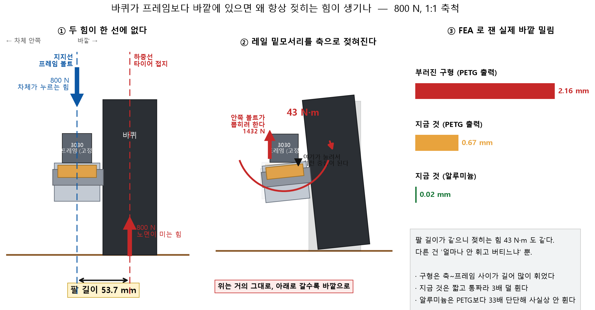

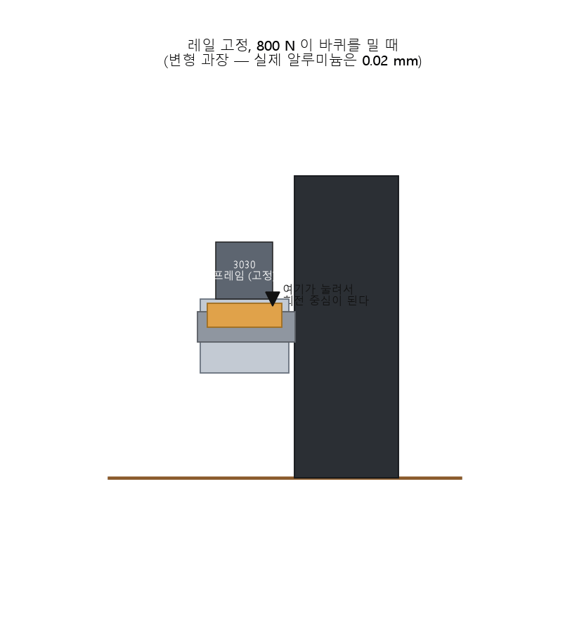

이어서 슬라이더로 팔 길이를 바꾸면 모멘트·볼트 인발·기울기가 따라오는 인터랙티브 페이지 `lever.html` 을 아티팩트로 발행했다. 제도지 바탕·잉크 선·하중 적색/반력 청색·등폭 숫자로 설계했다.

같은 시간에 사용자가 앞서 낸 "두 바퀴를 축으로 잇자"는 안을 계산했다. 좌우 클램프가 서로 반대로 젖히므로 잇으면 빔 안에서 상쇄된다. 3030 단면은 참조모델 실측 406 mm², I ≈ 3.10e4 mm⁴ 로 잡았다.

| 안 | 볼트 인발 | 평가 |
| --- | --- | --- |
| 지금 | 1,432 N | — |
| 액슬 타이 빔 3030 (길이 373 mm, 굽힘 20.8 MPa, SF 13.3) | 299\~1,039 N | 가장 추천. 빔 부담 27%(FEA 강체 조인트 3.02e7 N·mm/rad 상한)\~79%(조인트 강성 1/10) |
| 액슬 타이 빔 3060 (굽힘 6.3 MPa, SF 43.9) | 55\~409 N | 더 좋지만 무겁다 |
| 삼각 브레이스 (지레 190 mm) | 226 N | 바퀴 옆 공간을 먹는다 |
| 레일 옆면 물기 | 716 N | 알루미늄이면 OK |
| 3060 구간 교체 | 477 N | 프레임 변경 필요 |
| 바퀴 안쪽 이동 | 1,355 N | 의미 없음 — 하한 50.8 mm(타이어 반폭 27.5 + 클램프 반두께 23.3), 지금 53.7 이라 2.9 mm(5%) 감소 |

주의 하나: 빔 끝단이 회전 구속이어야 한다. 중심 보어 볼트 하나면 힌지라 효과가 없다. 클램프 안쪽면에 M6 탭 4개가 필요하다. 기존 축 크로스는 레일끼리 잇는 것이라 이 문제에는 안 통한다.

#### 01:37 — 인터랙티브 페이지 로컬 저장

> 인터랙티브 페이지 만든거 로컬 폴더에도 저장해둘래?

`docs/interactive/lever.html`(15,795 bytes) 로 복사하고 `<!doctype html>` 껍데기를 씌웠다 — 아티팩트는 발행 시 자동으로 붙지만 로컬 파일은 쿼크스 모드로 열려 깨진다. 생성 스크립트를 `tools/figures/tipping_moment.py` 로, 출처 표를 `docs/interactive/README.md` 로 넣고 인수인계 §5.1 에 위치를 기록했다.

막힌 것 두 개, 원인은 하나였다. 윈도식 백슬래시 경로가 파이썬 문자열 이스케이프로 먹혔다.

```
"\50_why..."     → \50 은 8진 이스케이프 = "("  → docs/images(_why_tipping_moment.png 생성
"tools\figures"  → \f 는 폼피드 → 주석 줄이 쪼개져 SyntaxError (line 4)
```

잔여 파일을 지우고 `pathlib` 연산으로 바꿨다. 이미지 번호도 기존 `50_cargo_slide_detail` / `51_cargo_interior` 와 겹쳐 **63/64** 로 옮겼다(63_why_tipping_moment.png 170,757 bytes / 64_tipping_animation.gif 586,632 bytes — 현재도 같은 크기). 브라우저에서 파일을 열어 슬라이더 0 / 30 / 53.7 / 90 mm → 모멘트 0 / 24 / 43 / 72 N·m, 볼트 0 / 800 / 1,432 / 2,400 N, 50.8 mm 아래에서 "만들 수 없다" 경고를 확인했다. 테마는 다크(배경 rgb(16,21,25))로 렌더된 것만 실제로 읽었고, 라이트 테마는 CSS 에 정의돼 있으나 그 자리에서 전환해 본 기록은 없다.

### 결정

- 옆 플랜지 제거(`LOW_SIDE=False`), 볼트 M6×15 실측 반영, 카운터보어 깊이는 볼트 길이에서 역산. 부품 38.9 mm.
- FEA 기준값을 "800 N · 편심 55 · 상향 · 3 mm 에서 구조응력 45.3 MPa / 변위 0.0582 mm" 로 통일. 최대 von Mises 는 인용 금지. (현재 CLAUDE.md·FEA.md·인수인계 §7 에 그대로 남아 있다.)
- 서스펜션은 미룬다. 필요하면 우레탄 패드, 제대로 하려면 트레일링 암.
- 보강은 액슬 타이 빔이 1순위. 바퀴 안쪽 이동은 접는다. (현재 코드는 3030 빔이 아니라 M8 전산볼트 2개 — `parameters.TIE_ROD = 8`, `TIE_ROD_LEN = 400`, 인수인계 §5.0 은 Ø8×397.4 mm — 로 바뀌어 있고, `docs/bom.md` 는 "3030 L360 2본 + PLA 코너 브래킷 8개" 를 적고 있다. 둘 중 어느 쪽이 최종인지는 저장소만으론 확실하지 않다.)

### 남은 일

- M6 스프링너트 인발력 실측 — 차량 허용하중을 2배 넘게 좌우하는 유일한 미측정값. (현재도 `parameters.TNUT_PULLOUT = 1500` 보수 하한 그대로이고, `docs/bom.md` 는 스프링너트 933 N / 드롭인 T너트 2271 N 이라는 별도 추정치를 적고 있다. 실측 기록은 저장소에 없다.)
- 액슬 타이 모델링(클램프 안쪽면 탭 + 373 mm 부재)과 좌우 연결 FEA.
- `lever.html` 의 수치는 손으로 박은 값이라 형상·하중이 바뀌면 README 의 출처 표를 보고 직접 고쳐야 한다. 너트 한계 1500 N 이 실측으로 바뀌면 "95% / 한계 초과" 판정도 바뀐다.
- 프로파일 구매 수량(390 mm 5개 여부)은 실물 차량 상태에 달려 저장소만으론 확인 불가.

### 교훈

- **실물 시험 한 번이 문서 검증보다 값어치가 크다.** 20 mm 볼트 전제 위에 쌓은 27.3 mm 카운터보어는 문서상 완벽했고, 가진 볼트가 15 mm 인 순간 무너졌다. 손으로 박은 치수는 반드시 유도값으로 바꾸고 어서트를 둔다.
- 강체 고정한 구멍 벽의 최대응력은 메쉬를 조일수록 오른다. 수렴하는 값(구조응력·변위)만 설계에 쓴다.
- 형상을 바꾸면 해석기의 경계조건 코드도 같이 봐야 한다. 조건 없는 노드 선택은 옛 형상인 척 조용히 돈다.
- 재료를 바꾸면 병목이 옮겨간다. 클램프 6배는 너트 2\~3배로 깎인다.
- 파이썬 문자열에 백슬래시 경로를 넣지 않는다. `\50` 과 `\f` 는 문법 경고도 없이 파일명과 주석을 바꾼다.
- FEA 결과 폴더는 조건이 바뀌면 같은 이름으로 덮인다. 인용할 값은 폴더가 아니라 문서에 조건과 함께 적어 둬야 한다 — 이 밤의 45.3 / 0.0582 도 지금은 문서에만 남았다.

---

## 2026-08-21 (금) · 차체: 액슬 타이 보강과 휘어짐 기준 순위 정정

> 시간: 01:43 ~ 03:31 · 장소: PC (`D:\build123d`) · 날짜 근거: 세션 기록 · 원본: 차체 설계 일지 `entry_14b.html`

앞 구간에서 바퀴가 축 그립보다 53.7mm 바깥이라 800 N 에서 43 N·m 의 젖힘 모멘트가 생기고, 그것이 3030 레일 밑면 볼트 인발 1,432 N(보수 한계 1,500 N 의 95.5%)으로 몰린다는 것까지 나와 있었다. 이 구간은 그 위험 항목을 없애는 보강 구조를 실제로 넣고, FEA 로 확인하고, 사용자가 "강도가 아니라 휘어짐이 문제"라고 목적함수를 바꾼 뒤 방법 순위를 다시 세우는 과정이다. 같은 밤에 결론이 세 번 정정됐다.

이 구간의 클램프·타이 렌더는 docs/images 에 없다 (차량 프레임 해석 그림은 아래 03:14 절에 있다).

### 한 일

#### 01:43 — 평철 타이 바 20×6, 리세스 6mm

> 보강 구조를 시도해볼까?

좌우 클램프는 젖힘 모멘트로 **아랫부분이 서로 반대 방향으로 벌어진다.** 둘을 이으면 그 부재는 순수 인장만 받으니 굽힘 접합이 필요 없고 평철 하나면 된다는 것이 출발점이었다. 계산 스크립트 결과: 피벗(레일 밑면) z=+14.5, 클램프 밑면 z=−24.4 로 지레 38.9mm, 클램프 안쪽면 사이 373mm. 20×6 평철(L=433, A=120mm²)이면 타이 분담 66%, 바 인장 725 N(6.0 MPa), 레일볼트 인발 492 N(33%)이었다. 클램프 밑면에 6mm 리세스를 파면 지상고 54.9mm 가 유지되고 상부 클램프 탭(x=±15.1)과도 2.6mm 남는다.

**막힌 것:** parameters.py / low_clamp.py 에 파라미터와 어서트를 넣는 데 SyntaxError 가 세 번 났다. 원인은 두 가지 — ① 히어독으로 넘긴 소스에서 `\`+개행이 리터럴로 박혔다, ② CRLF 파일을 `\n` 으로 다시 써서 `\r\r\n` 이 됐다(빈 줄에서 invalid syntax). 해결은 어서트를 괄호 형태로 바꾸고, 파일 전체에서 `\r` 을 걷어낸 뒤 `ast.parse` 로 확인하고 바이너리로 쓰는 것이었다.

결과: 레일 볼트 인발 **1,432 N (95.5%) → 492 N (32.8%)**. 클램프 92.72×46.60×38.90mm, 111.3 cm³, 301 g, 솔리드 1개, 지상고 54.9mm 그대로. 타이바 20×433×6 = 139 g, 간섭 0.

렌더를 열어 보니 **타이 체결볼트(y=±224)가 바 끝(±216.7) 밖에 있었다.** TIE_LAP=30 이 원인. 겹침을 클램프 깊이 전체(LOW_D)로 바꾸고 어서트를 걸었다 → 바 466.6mm, 149 g, 끝여유 9.3mm, 분담 64% / 인장 706 N / 레일볼트 516 N(34%).

#### 01:55 — 여분 3030 프로파일 390 검토, M8 전산볼트로 전환

사용자가 가진 390mm 프로파일을 타이로 쓸 수 있는지부터 실측값으로 대봤다. (390 을 제안한 사용자 발언과 "평철은 구하기 어렵다"는 발언은 청크에 남아 있지 않고, Claude 응답과 parameters.py 주석에서만 확인된다.)

- 클램프 안쪽면 사이 373.4mm — 390 은 16.6mm 길다
- 축 끝이 클램프 안쪽면보다 1.6mm 튀어나와 x=±8 을 피해야 한다
- 클램프 안쪽면에 30×30 끝면이 얹힐 자리가 없다 (블록 높이 24 \< 30). 쓰려면 블록을 30 으로 키워야 하고 지상고가 54.9 → 48.9 로 깎인다
- 기존 축 크로스(x=±265)는 좌우 *레일*을 잇는 부재라 클램프–레일 조인트의 43 N·m 는 그대로다

부재가 받는 힘은 순수 인장 706 N 이라 3030 은 100배 과잉이고, 평철은 구하기 어렵다고 하니 **전산볼트(나사봉)** 로 갔다. 클램프 안쪽면에 탭만 내면 되어 리세스도 브래킷도 없어진다. M6 35.1 MPa(안전율 18) / M8 19.3 MPa(33) / M10 12.2 MPa(53).

| 부재 | z | 지레 | 보수 분담 | 레일볼트 | 현실(1/5) 분담 | 레일볼트 |
| --- | --- | --- | --- | --- | --- | --- |
| M8 ×1 (x=0) | −15.4 | 29.9 | 27% | 1,041 N | 65% | 498 N |
| **M8 ×2 (x=±25)** | −18.0 | 32.5 | 47% | 759 N | 82% | 264 N |
| M10 ×2 (x=±25) | −18.0 | 32.5 | 58% | 595 N | 88% | 178 N |
| M12 ×1 (x=0) | −15.4 | 29.9 | 46% | 768 N | 81% | 269 N |
| 평철 20×6 (참고) | −21.4 | 35.9 | 64% | 516 N | 90% | 145 N |

이 표는 전산볼트 E 를 68,900(알루미늄)으로 두고 계산한 것이다 — 03:00 에 강철(206,000)로 고쳐야 한다는 것이 드러난다(아래 정정 3). 현재 저장소의 `low_clamp.tie_force()` 로 다시 계산하면 M8 ×2 는 분담 73% / 봉당 483 N / 레일볼트 385 N 이 나온다(당시 47% / 311 N / 759 N).

**M8 ×2, x=±24.3, z=−18.0, 탭 깊이 12** 로 정했다. x=24.3 은 상부클램프 탭(±15.1)과 레일볼트공(±34.4) 사이 창의 한가운데로 양쪽 벽이 3.3mm 남는다(M10 은 2.5mm 라 접었다). 클램프 116.3 cm³ / 314 g, 봉 Ø8×397.4mm(간격 373.4 + 물림 12×2), 봉당 인장 311 N, 레일볼트 759 N(51%). 어서트 3개 추가 — 탭이 블록 밑면·축 시트를 뚫는지, 상부탭/레일볼트공과 벽 2mm 이상. (클램프 bbox·부피·질량·지상고는 현재 저장소에서 다시 계산해도 92.72×46.60×38.90 / 116.3 cm³ / 314 g / 54.9mm 로 같다.)

렌더에서 봉 끝이 클램프 바깥면을 19.1mm 넘는 것처럼 나왔는데, 클램프의 로컬 중심이 y=−53.7 이라 렌더 스크립트가 `Pos(0,±210,0)` 대신 ±263.7 을 써야 했다. **모델은 맞고 그림만 틀린 경우.** 한 축 전체 폭 473.4mm. 인수인계 §5.0 에 접은 안까지 적었다. 이때 "1m 봉 1개면 4개 다 나온다"고 적었는데, 02:30 에 정정했다 — 397.4×4 = 1,589.6mm 라 1m 봉 2개가 필요하다("형이 맞다"고 답했으나 이를 지적한 사용자 발언은 청크에 남아 있지 않다).

#### 02:28 — 타이를 접지 스프링으로 FEA 에 반영

> 타이 적용한 상태로 FEA 다시 돌려줘 … 이게 가장 저렴하면서 휘어짐 문제도 해결하면서 무게도 더 버티는 구조가 되는건가?

`run_clamp_fea.py` 에 타이 탭 벽 노드 분류와 CalculiX `SPRING1` 접지 스프링을 넣고 반력 출력을 추가했다. 강체로 묶으면 실제보다 좋게 나오므로 스프링으로 했고, 이때 말한 축강성 "12,690 N/mm" 는 E=68,900 기준 값이다(강철 E 로는 약 37,900 N/mm). 당시 FEA 코드 자체가 어느 E 를 썼는지는 청크에서 확인되지 않는다 — 현재 코드는 206,000 을 쓰고 주석에 12,690 이 남아 있다. 여기서도 히어독 치환이 세 번 막혔다(치환 불일치 AssertionError, 백슬래시가 개행으로 먹힌 SyntaxError, 앵커 미발견 ValueError) → `chr(92)` 플레이스홀더로 우회했다. ast 검사가 쓰기 전에 멈춰 파일은 안 깨졌다.

| 조건 | 최대(특이점) | 구조응력 | 변위 | 타이 반력 Fy |
| --- | --- | --- | --- | --- |
| 타이 없음 4mm | 132.2 | 45.1 MPa | 0.0577 mm | — |
| 타이 없음 3mm | 150.1 | 45.3 MPa | 0.0582 mm | — |
| M8×2 타이 4mm | 90.3 | 30.1 MPa | 0.0372 mm | 553 N |
| M8×2 타이 3mm | 100.0 | 30.3 MPa | 0.0371 mm | 557 N |

구조응력 −33%, 변위 −36%, 메쉬 두 단계 사이 0.7% 이내 수렴. 타이 반력 557 N 은 손계산 622 N(분담 47%)과 근접(FEA 분담 42%). 안전율 AL6061 6.1 → 9.1, PETG 0.99 → 1.49. (현재 `clamp_800N_h4mm_e55mm_up/summary.txt` 는 이 타이 4mm 실행 그대로다 — 90.3 MPa / 0.0372 mm / Fy 553 N. 3mm 폴더는 아래 "남긴 일" 참조.)

이어서 강도 기준으로 방법 6가지를 비교했다 — ① 보강 없음 한계 838 N, ② M8×2 1,446 N, ③ 평철 2,326 N, ④ T너트 교체만 2,235 N(T너트 인발 4,000 N 을 가정한 미실측값), ⑤ 옆 플랜지 복원(AL) 4,874 N, ⑥ 플랜지+타이 7,287 N. 이때 첫 결론은 "T너트 교체(4천원)가 제일 싸고 효과 크다"였다. 같이 나온 숫자 하나가 중요했다: **옆 플랜지 24×8, 캔틸레버 15mm 의 굽힘 42 MPa 는 PETG 한계(45)의 93%, AL6061(276)의 15%**. 실물이 툭 쳐서 부러진 것은 우연이 아니었고, 재료가 바뀌면 판단이 뒤집히는 항목이었다.

#### 02:40 — T너트 인발 용량은 너트가 아니라 슬롯 립이 정한다

> t 너트가 지금 스프링 너트보다 훨씬 좋나?

3030 슬롯 립은 두께 2.4mm, 내밀림 4.1mm, 6063-T5 항복 170 MPa. 인발 파괴는 립이 휘어 벌어지는 것이라 너트 강도가 아니라 **립을 얼마나 넓게, 얼마나 뿌리 쪽에서 누르느냐**가 용량을 정한다. 립 굽힘 모델 추정: 경제형 스프링너트(물림 10) 933 N / 표준(14) 1,632 N / 드롭인 T너트(16) 2,271 N / 슬라이드 T너트(20) 3,264 N. 실물 공표범위보다 조금 보수적이지만 순서는 확실하다. 슬라이드 T너트는 프로파일 끝에서만 들어가므로 조립된 차량에는 드롭인이 맞다. 너트 두께가 2mm 안팎이면 박판 경제형, 5\~6mm 면 제대로 된 T너트다.

#### 02:42 — 조인트 무름을 더한 축 밀림 비교 (정정 1)

> t 너트로 하면 휘어짐도 덜한가? 지금 쓰는 T 너트는 없어 구매해야해

FEA 는 볼트 구멍을 강체로 고정해 너트+립의 무름을 아예 안 세고 있었다. 립 강성과 너트 굽힘 강성을 직렬로 합성하면 조인트 축강성은 경제형 23,430 / 표준 61,363 / 드롭인 98,415 / 슬라이드 129,061 N/mm — 박판 스프링너트는 자기가 먼저 휘어 립 강성의 1/3 밖에 못 쓴다.

| 너트 | 타이 없음 축 밀림 | 한계 | M8 타이 적용 축 밀림 | 한계 |
| --- | --- | --- | --- | --- |
| 경제형 스프링 2t×10 | 0.0206+0.0591 = 0.0797 mm (사용률 154%) | 53 kgf | 0.0180 mm | 236 kgf |
| 표준 스프링 3t×14 | 0.0432 mm | 93 kgf | 0.0151 mm | 266 kgf |
| 드롭인 T너트 5t×16 | 0.0347 mm | 129 kgf | 0.0139 mm | 323 kgf |
| 슬라이드 T너트 6t×20 | 0.0313 mm | 186 kgf | 0.0133 mm | 437 kgf |

타이가 없으면 너트 차이가 2.5배, 타이가 있으면 1.35배로 준다. 무른 너트일수록 조인트가 더 휘어 타이가 더 가져가기 때문(경제형 77% vs 슬라이드 57%). 그래서 앞 메시지를 정정했다 — **타이만 236 kgf > T너트만 129 kgf**, 둘 다 323 kgf. T너트를 새로 사야 하는 상황이니 전산볼트부터. (이 표의 "타이 적용 0.0180" 은 클램프 몫을 0.0046 으로 둔 손계산이고, 아래 02:47 표의 "타이만 0.0264" 는 클램프 몫을 FEA 값 0.0131 로 바꾼 것이다 — 같은 밤 안에서 두 값이 공존한다.)

#### 02:47 — 목적함수를 휘어짐으로, 플랜지 복원 FEA

> 이전 클램프도 차체무게 + 70KG 사람무게까지 잘 버티고 다녔단 말이야 휘어짐이 문제였지 … 휘어짐을 최우선으로 해결해야한단말이야

옆 플랜지를 `LOW_SIDE=1` 환경변수로 켤 수 있게 했더니 어서트가 **"옆면 볼트가 16.40mm 필요하다"**(플랜지 8 + 립 2.4 + 물림 6)고 막았다. 가진 M6×15 로는 안 닿아 `LOW_SIDE_BOLT_LEN = 20` 을 밑면과 분리했다(현재 parameters.py 에 그대로 있다). 플랜지 복원 3mm FEA: 최대 18.2 MPa / 변위 0.0077 mm, 축 시트 바깥 밀림 +0.0007 mm (타이 없음 0.0206 의 29배 개선). 플랜지+타이는 타이 반력이 61 N 밖에 안 잡혀 타이가 놀고 있었다. 조인트 무름까지 더한 합계는 ① 0.0797 / ② T너트 0.0347 / ③ 타이 0.0264 / ④ 타이+T너트 0.0187 / ⑤⑥ 플랜지 0.0022 mm — 이 시점의 답은 "플랜지 복원이 36배로 압도적"이었다. 단, ⑤⑥의 조인트 변형 0.0015 는 추정이고 타이 노드가 1,080개로 잡히는 선택 버그가 있었다(정상 10개, 총강성은 같아 결과는 유효).

#### 02:55 — 플랜지 전단 접합의 볼트 유격 (정정 2)

> 플랜지를 다시 복원하는게 제일 효과가 크다는 거야?

플랜지는 전단 접합이다. 볼트 1개 전단 716 N 에 대해 마찰로 물리려면 예압이 필요한데, T슬롯 너트의 예압은 인발 용량에 묶여 경제형 560 N(마찰 112) / 드롭인 1,363 N(273) / 슬라이드 1,958 N(392) — **어느 너트로도 미끄러진다.** 미끄러지면 구멍 유격이 그대로 휨이 된다.

| 플랜지 구멍 | 유격 | 합계 축 밀림 | 지금 대비 |
| --- | --- | --- | --- |
| 일반 통과공 Ø6.6 | 0.60 mm | 0.5974 mm | 0.13배 (7배 악화) |
| H7 끼워맞춤 Ø6.0 | 0.04 mm | 0.0467 mm | 1.7배 |
| 다월핀 (유격 0) | 0 | 0.0074 mm | 10.8배 |
| ④ 타이 + 드롭인 T너트 | — (인장 경로, 유격 없음) | 0.0187 mm | 4.3배 (확정값) |

인장 경로는 예압으로 항상 접촉 상태라 유격이 없고, 전단 경로는 유격이 성능을 좌우한다. 사용자가 겪은 "점점 헐거워지며 바퀴가 밀린다"가 유격 있는 전단 접합의 반복하중 거동과 맞는다. 결론: 휘어짐 기준 ④가 제일 안전, 플랜지는 다월핀까지 갈 때만 의미 있고 **중간은 없다.**

#### 03:00 — PLA 전제와 전산볼트 E 정정 (정정 3)

> MM 값이 클수록 개선효과가 큰거야? 아니면 배율이 클수록? … CNC 는 당분간 작업 못할거고 계속 PLA 출력으로 대체할건데 … 일단 뭐부터하라고? … 쉽게좀

mm 는 실제로 휘는 양이라 작을수록, 배율은 지금보다 몇 배 덜 휘느냐라 클수록 좋다고 정리했다. 그리고 앞 표는 전부 알루미늄 기준이었다. 이 과정에서 버그가 하나 더 나왔다 — `low_clamp.tie_force()` 가 전산볼트를 알루미늄(E=68,900)으로 계산하고 있었다. 강철(206,000)로 고치니 3배 차이(현재 low_clamp.py 는 206,000 이다). PLA 손계산은 "타이 하나로 113배"가 나왔는데 FEA(PETG E=2,100 을 낮은 인필 PLA 근사로)로 확인하니 **7.2배** 였다. 손계산이 모멘트 분담만 선형으로 나눈 근사였고, 실제로는 클램프가 축에서 타이까지 힘을 전달하느라 여전히 변형한다. FEA 값을 채택했다.

| PETG 800 N | 축 시트 바깥 밀림 | 전체 변위 | 응력 |
| --- | --- | --- | --- |
| 타이 없음 | +0.672 mm | 1.907 mm | 45.6 MPa (한계 101%) |
| M8×2 타이 | −0.024 mm | 0.266 mm | 27.3 MPa (61%) |

(당시 값이다. 현재 `clamp_800N_h3mm_petg_e55mm_up/summary.txt` 는 이후 3030 프로파일 타이(`TIE_KIND="profile"`) 실행으로 덮여 있어 26.5 MPa / 0.263 mm / 타이 반력 1,268 N 이 적혀 있다.) E 비례 보정: PLA 낮은 인필 2.29 → 0.32 mm, PLA 꽉 채움 1.14 → 0.16 mm. 권장 순서 — 1순위 M8 전산볼트 타이(7.2배, 약 1만원), 2순위 인필 꽉 채워 재출력(2배 더, 합 14배). T너트는 PLA 에서 병목이 아니니 지금 사지 말고, 옆 플랜지는 PLA 굽힘 90% 이상이라 금지. PLA 크리프로 탭 주변이 느슨해질 수 있어 주기적 조임 확인.

#### 03:14 — 다월핀, 그리고 차량 전체 보요소 해석

다월핀은 정확한 지름으로 갈아낸 강철 핀(Ø6 h6 + 리머공 H7 → 유격 0.01mm, 일반 볼트 Ø5.9+통과공 Ø6.6 은 0.7mm — 02:55 표에서는 같은 통과공 유격을 0.60 으로 잡았다, 두 값이 청크에 공존한다)이며 PLA 에는 못 쓴다. 차량 전체는 3030 프레임을 3mm 솔리드로 메싱하면 수백만 요소가 되므로 `tools/frame/frame_fea.py` 에 12자유도 3차원 보요소 솔버를 새로 짰다 — 3030 은 E=69,000 참조단면, 클램프는 강체 링크, 타이는 강철 트러스, 지지는 바퀴 접지점 4곳. 시각화 `frame_view.py` 는 첫 실행에서 smax UnboundLocalError 가 났고, 이를 고치는 히어독 패치가 세 번 연속 어긋나(치환 불일치, f-string 안 개행 2회) 결국 Write 로 통째 다시 썼다.

| 하중 케이스 (70kg) | 최대 처짐 | 바퀴 하중 | 프레임 응력 | 안전율(6063 170) |
| --- | --- | --- | --- | --- |
| 중앙 | 0.078 mm | 267\~275 N | 11.8 MPa | 14.4 |
| 한쪽 구석 | 0.379 mm | 22\~865 N | 37.0 MPa | 4.6 |
| 뒤축 위 | 0.161 mm | 1\~534 N | 26.6 MPa | 6.4 |

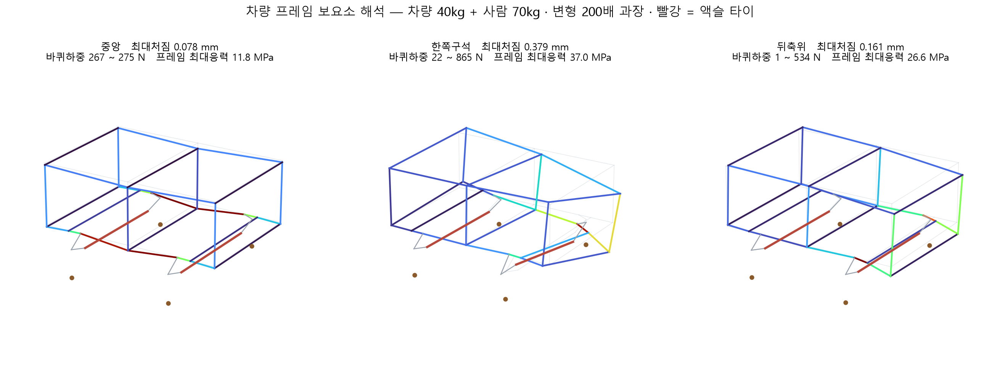

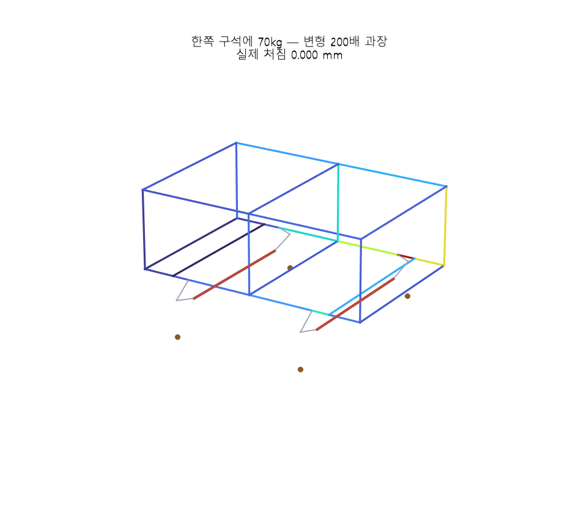

여기서 나온 것: ① 가정으로 써온 설계하중 800 N 이 검증됐다 — 구석에 올라서면 그 바퀴에 865 N. ② 대각선 바퀴가 22 N 으로 거의 뜬다. ③ 프레임 자체는 항복의 22% 로 문제가 아니다. 타이 유무는 프레임 처짐에 거의 영향이 없다(0.081 vs 0.078). 클램프 솔리드 FEA(PETG)를 865 N 으로 환산해 합치면 타이 없음 0.379+2.06 = 2.44 mm(바깥 밀림 +0.727), 타이 적용 0.379+0.29 = 0.67 mm(−0.025). **타이 없으면 클램프가 전체 변형의 84**%다. 없는 것: T슬롯 코너 조인트 강성(강체로 봄), 비틀림 J 추정값, 충격계수. (현재 저장소의 `frame_fea.py` 를 다시 돌려도 처짐 0.078 / 0.379 / 0.161 (타이 없음 0.081 / 0.380 / 0.162) 이 그대로 나온다.)

#### 03:26 — 미실행 도면·DXF 스크립트 정리

> 이제 뭐 해야 할까

확인해보니 이전 구간에서 도면·DXF 스크립트를 쓰고 **실행을 안 했었다.** DXF 는 아예 없었고 도면은 플랜지 있던 옛 형상(63.9mm) 기준. `drawing.py` 에서 전고를 `FLANGE_TOP − LOW_BOT` 파생값 대신 bbox 로 재게 하고, 우측면도의 플랜지 치수를 지우고 타이 탭을 넣고, 겹치던 표제란을 두 번 재배치했다. 도면 PNG/PDF + DXF 5개(정면 31 / 평면 32 / 우측 43 / 종합 106 / 3030 단면 45선 — 현재 output/dxf 파일들은 08-21 07:59 KST 에 다시 생성된 것인데 LINE+ELLIPSE(+CIRCLE) 엔티티 수가 같은 값이다). git 은 이 시점에 "저장소 아님"이었다.

### 결정

- 액슬 타이는 **M8 전산볼트 ×2**(Ø8×397.4, 클램프 안쪽면 탭 x=±24.3, z=−18.0). 평철 20×6 은 성능(64%)은 낫지만 구매가 어려워 보류, 여분 3030 390 은 치수 제약 3개로 접음.
- FEA 에 타이는 강체가 아니라 **접지 스프링**으로 넣는다.
- 휘어짐 기준·PLA 전제에서의 순서: 타이 → 인필 꽉 채워 재출력 → (알루미늄 갈 때) T너트·플랜지+다월핀. 플랜지는 PLA 금지, 일반 통과공이면 오히려 7배 악화.
- 차량 프레임은 보요소로 푼다(`tools/frame/`). 설계하중 800 N 유지(구석 865 N 으로 검증; parameters.py `DESIGN_W = 800` 그대로).

### 남은 일

- 클램프 4개 재출력(인필 꽉), M8 전산볼트 1m 봉 2개 구매, 다이얼 게이지로 바퀴 바깥 밀림 예측 0.73 → 0.03 mm 실측 검증.
- FEA 타이 노드 선택 버그(1,080개 잡힘) 수정 — 현재 코드에서 고쳐졌는지는 확인하지 못했다. 결과 폴더 이름이 LOW_SIDE/TIE 를 담지 않아 `clamp_800N_h3mm_e55mm_up` 의 summary.txt 가 플랜지 복원+타이 실행(18.0 MPa / 0.0076 mm, 구멍 6개, 타이 노드 1,080, Fy 61 N)으로 덮여 있다 — 지금도 그 상태다. CLAUDE.md 의 기준값 45.3 MPa / 0.0582 mm 는 이 폴더의 현재 summary.txt 와 맞지 않는다.
- git init(당시 12,000줄 무버전) — 같은 날 08:12 KST 에 초기 커밋(14fb653)이 만들어졌다. 스프링너트 두께 실측(2mm대 vs 5mm대).

### 교훈

- **한 밤에 세 번 정정됐다.** 조인트 무름을 안 세서(정정 1), 볼트 유격을 안 세서(정정 2), 재료를 알루미늄으로 두고 계산해서(정정 3). 순위는 목적함수(강도/휘어짐)와 재료(AL/PLA)에 따라 뒤집히니 표에 전제를 반드시 붙여야 한다.
- **손계산 113배는 FEA 7.2배 앞에서 틀렸다.** 모멘트 분담을 선형으로 나누는 근사는 하중 경로가 바뀔 때 무너진다. 한 자릿수 이상 차이가 나면 손계산을 의심한다.
- 렌더로만 잡힌 결함이 두 번 — 타이 볼트가 바 밖에 있던 것, 봉 끝이 클램프를 넘는 것처럼 보였던 것(후자는 그림이 틀림). 검증 통과 ≠ 형상 정상.
- 히어독으로 파이썬 소스를 고치면 `\`+개행과 CRLF 가 반복해서 깨진다. `\r` 제거 → `ast.parse` → 바이너리 쓰기, 그래도 안 되면 Write 로 통째 다시 쓰는 편이 빠르다.
- 스크립트를 쓰고 실행을 안 하면 산출물이 옛 형상으로 박제된다(도면 63.9mm). 파생 상수 대신 bbox 로 재라.
- 재료 상수 하나(E=68,900 vs 206,000)가 이 밤의 타이 분담률 표 전체에 깔려 있었다. 표를 낼 때 어떤 E 를 썼는지 같이 적어야 한다.

### 이후 달라진 것 (2026-09-15 기준)

- M8 전산볼트 타이 결정은 이 구간 이후 뒤집혔다: 현재 parameters.py 기본값은 `TIE_KIND="profile"`(3030 을 360 으로 잘라 코너 브래킷 탭 x=±22, z=−6/−19 로 무는 안)이고 docs/bom.md 도 "액슬 타이 프로파일 3030 L360 ×2 + PLA 코너 브래킷 8 + 드롭인 T너트 8" 로 적혀 있다. CLAUDE_HANDOFF.md §5.0 은 아직 M8×397.4 / 깊이 12 기준이다.
- 현재 parameters.py 에는 `TIE_KIND="profile"`, `TIE_ROD_LEN=400`(397.4 대신 라운드 수), `TIE_TAP_DEPTH=15`(12 대신) 등 이 구간 이후의 변경이 들어 있다. TIE_X=24.3, TIE_Z=−18.0, LOW_SIDE_BOLT_LEN=20 은 이 구간 값 그대로다. 이 구간의 확정값은 위 본문 기준이다.

---

## 2026-08-21 (금) · 차체: 봉 길이 400 고정, git 초기 커밋, 재료 검토, T텅, 여분 3030 을 타이로

> 시간: 07:57 ~ 08-27 (목) 02:45 · 장소: PC (`D:\build123d`) · 날짜 근거: 세션 기록 · 원본: 차체 설계 일지 `entry_15.html`

액슬 타이 봉 길이가 397.4mm 라는 유도값으로 나와 있던 것을 발주 가능한 라운드 수로 고정하고, 저장소에 로컬 git 초기 커밋을 했다(원격은 지금도 없다). 그 뒤로는 실물 제작을 앞두고 재료(PPS-CF10, 알루미늄 프린트)와 구조 대안(일체형 T텅, 충전재, 여분 3030 프로파일 타이)을 하나씩 숫자로 검토했다. 원본 대화록(줄 10045\~10459)의 마지막 구간이며 며칠에 걸쳐 짧게 이어져서 날짜별로 나눈다. 시각은 모두 KST 다.

이 구간의 렌더는 docs/images 에 없다.

### 한 일

#### 08-21 07:57 — 봉 길이 397.4mm 를 400mm 로 고정

> 397.4mm 는 애매한것 같은데? 단위가 말이야 가공 요청하기에 애매한 수치야

원인은 봉 길이를 클램프 사이 간격(373.4 = 2×(210 − 46.6/2))에서 유도했기 때문이다. 간격 자체는 프레임 폭 450 과 클램프 깊이 46.6(`LOW_D`)에서 나오는 고정값이라 손댈 수 없으니, 봉 길이를 라운드 수로 고정하고 **탭을 물림보다 깊게 파서 절단 공차를 흡수**하게 바꿨다.

| 봉 길이 | 한쪽 물림 | 판정 |
| --- | --- | --- |
| 380 | 3.3mm | 물림 부족 |
| 390 | 8.3mm | OK |
| 395 | 10.8mm | OK |
| **400** | **13.3mm** | 채택 (1m 봉에서 2개, 자투리 200×2) |
| 410 | 18.3mm | 탭을 더 깊게 파야 함 |

`parameters.py` 에 `TIE_ROD_LEN = 400.0`, `TIE_TAP_DEPTH = 15.0` 을 두고 `low_clamp.py` 의 어서트로 `8 ≤ 물림 ≤ 탭깊이−1` 을 검사한다. 봉을 ±2mm 틀리게 잘라도 물림이 11\~15mm 안에 든다. (현재 저장소도 400 / 15 / 물림 13.3 그대로다. 다만 `CLAUDE_HANDOFF.md` §5.0 은 지금도 "Ø8 x 397.4mm (간격 373.4 + 물림 12x2)" 로 남아 있다 — 이 구간에서 "문서 갱신"을 했다고 했지만 그 줄은 고쳐지지 않았다.)

부수 효과로 계산 버그 두 개를 잡았다 — 강철 전산볼트를 알루미늄 E 로 계산하고 있었고(강철이 3배 뻣뻣하다), 자유길이를 봉 전체로 잡고 있었다. 고치니 **타이 분담률 47% → 73%**, 레일볼트 인발 830 → **385 N (26%)**, 타이 인장 483 N 이 됐다(현재 `tie_force()` 도 73% / 483 N / 385 N). export/drawing 재실행: 검증 문제 없음, 상부 클램프 볼트 전단 377.6 N / 8000 N = 4.7% (구동 반력 29 N·m / 볼트 4개 반경 19.2 — 현재 값도 같다).

#### 08-21 08:08 — git 초기 커밋: 617 MB 를 28.5 MB 로

`git add -A` 를 그대로 하니 스테이징이 **617.5 MB / 501 파일**이었다. `exports/robot_vacuum.step` 하나가 131 MB, `exports/` 460M, `refmodel/` 130M, `tools/` 459M(그중 CalculiX 172M·Gmsh 143M·Python 87M), `models/hoverboard_mount/output/` 724M(FEA 중간파일), `.venv` 1.8G.

`.gitignore` 방침을 "소스와 문서만 담는다"로 정했다. 예외는 hoverboard_mount 의 발주용 산출물(STEP 2.1M / STL 3.7M / DXF 160K / 도면 376K)과 FEA 의 summary.txt·PNG·비교문서다. `*.inp/*.frd/*.vtu/*.dat` 는 재생성 가능하고 케이스당 수십 MB 라 뺐다. 결과 **28.5 MB / 커밋 `14fb653`(08-21 08:12:56 KST) 추적 256 파일 / 미추적 0**. 현재도 추적 256 파일이고 `output/` 아래 추적분은 58개(STEP 15·STL 11·DXF 5·PNG 12·summary txt 11·md 2·pdf 1·gif 1)다.

`.gitattributes` 로 `* text=auto eol=lf` 를 걸었다. 이번 세션에서 CRLF 가 섞여 `low_clamp.py` 에 `\r\r\n` 이 생기며 두 번 깨진 적이 있어서다. 형상·이미지(`*.step *.stl *.dxf *.png *.gif *.pdf *.zip`)는 `-text`.

커밋 직후 `.git` 은 192M 이었고 지금도 192M(느슨한 객체 515개, 팩 0)이다. 처음 스테이징했다가 reset 한 617 MB 의 객체가 남아 있는 것으로 보이지만 청크에 그 설명은 없다.

#### 08-22 11:55 — PPS-CF10 재료 검토

> 알루미늄 cnc 대신에 3d 프린터로 최대 강도 올릴 수 있을만한 거 찾아볼까? pps-cf10 은 어때?

Polymaker 위키는 출력 조건만 있고 물성표가 없었고 제품 페이지는 403 이었다. 검색 결과에 걸린 TDS(scribd, V1.1) 의 값을 썼는데, 원문을 직접 열어 본 기록은 청크에 없다. 값이 예상과 달랐다: **XY 탄성률 5,447 MPa**(PLA 3,500 의 1.56배), XY 인장 59.4 MPa(PLA 와 비슷), Z 2,790 MPa / 32.0 MPa, **HDT@0.45 252.5°C**. 노즐 310\~350°C, 베드 80\~90°C, 챔버 불필요, 125°C 16시간 어닐링 권장. CF10 이라 섬유가 10% 뿐이다.

PETG FEA 실측(E=2,100, M8 타이 포함: 구조응력 17.8 MPa, 최대 27.3 은 특이점, 전체 변위 0.2659mm, 축시트 바깥 밀림 −0.0235mm)을 탄성률로 스케일해 비교했다. (이 폴더 `clamp_800N_h3mm_petg_e55mm_up` 은 08-27 에 3030 타이 케이스로 덮어써져서, 현재 summary.txt 는 최대 26.5 MPa / 0.2627mm 이고 구조응력은 17.8 MPa 로 같다.)

| 소재 | 탄성률 | 전체 변위 | 바퀴 바깥 밀림 | Tg/HDT | 1kg |
| --- | --- | --- | --- | --- | --- |
| PLA 꽉 채움 | 3.5 GPa | 0.160 mm | −0.0141 mm | 60°C | 3.5만 |
| PLA-CF | 5.0 | 0.112 | −0.0099 | 60°C | 5만 |
| PPS-CF10 | 5.4 | 0.103 | −0.0091 | 252°C | 18만 |
| PET-CF17 | 6.5 | 0.086 | −0.0076 | 80°C | 9만 |
| PA612-CF15 | 7.5 | 0.075 | −0.0066 | 100°C | 11만 |
| PA6-CF20 | 8.6 | 0.065 | −0.0057 | 120°C | 12만 |
| AL6061-T6 CNC | 68.9 | 0.008 | −0.0007 | 200°C | 가공비 |

결론: 타이를 달면 PLA 꽉 채움만으로 바깥 밀림이 −0.014mm 라 강성은 더 살 이유가 없다. 재료를 바꿔야 할 진짜 이유는 **PLA Tg 60°C** — 여름 차 안에서 형상이 변하고 타이 인장 483 N 이 탭 주변을 눌러앉힌다. 여기서는 PPS-CF10 이 HDT 와 무흡습으로 최강이지만, 4개 116 cm³×4 ≈ 630 g(밀도 1.35) → 약 15만원이라 했고(630 g × 18만원/kg 이면 11.3만원이라 15만원의 근거 계산은 청크에 없다), 이전 CNC 알루미늄 견적이 4개 228달러(당시 203 cm³)였다. 즉 2배 값에 13배 성능. 시험 단계는 PLA + 타이, 여름 야외는 PET-CF17(9만원), PPS-CF10 살 돈이면 알루미늄으로 가는 것으로 정리했다. (응력여유 열은 중간 계산과 최종 답의 값이 서로 달라 여기 싣지 않는다 — 확실하지 않다.)

#### 08-22 14:01 — 알루미늄 3D 프린트 비용 검토

> 알루미늄 프린트는 안되나

데스크탑 금속 필라멘트(BASF Ultrafuse 류)는 316L·17-4PH 만 있고 알루미늄은 산화막 때문에 소결이 안 된다. 실제 알루미늄 프린트는 DMLS/SLM 외주 AlSi10Mg (E \~70 GPa, 항복 230\~270 MPa)로 성능은 6061 CNC 와 거의 같다. 문제는 값이다: 4개 약 1.25 kg(116 cm³×4×2.7), 그램당 \$0.5\~2 → **90\~350만원** vs CNC 25\~30만원. 이 클램프는 일부러 "각기둥에서 세 군데만 파내는" CNC 친화 형상이라 DMLS 가 값하는 내부 유로·격자가 하나도 없다. 알루미늄이면 CNC 다.

#### 08-24 01:14 — 일체형 T텅: 스프링너트를 하중 경로에서 빼는 안

> 맞닿는 부분을 t너트처럼 해서 슬라이드처럼 끼워서 넣을 수 있게 하는거야 이미 기존 스프링 너트 공간은 또 따로 확보해둬서

인발 파괴는 너트가 아니라 프로파일 슬롯 립(두께 2.4, 6063-T5 항복 170)이 벌어지는 것이므로, 클램프 몸체가 직접 립을 물면 물림 길이가 너트(10\~16mm)에서 다리 길이로 늘어난다. 텅 단면은 목 7.8×2.7, 머리 16.0×6.0, 높이 8.7 — 레일 밑면 z=14.5 에서 23.2 까지, 캐비티 16.9\~23.7 에 든다.

**막힌 것**: 다리 24mm(x 22.36\~46.36) 안에 카운터보어 Ø16(26.36\~42.36)이 들어 있어 양쪽 벽이 4mm 뿐이다. 텅을 넣으면 벽이 1mm 대로 떨어진다. → 다리를 40mm 로 넓히면 카운터보어 34.36\~50.36 양옆에 12mm 씩 남아 **다리당 10mm 텅 2조각(총 4조각 40mm**)이 들어간다. `TONGUE=1` 환경변수로 켜고 기본은 꺼둔다(현재도 기본 0).

| 방식 | 물림 | 인발용량 | 레일하중 385 N 사용률 |
| --- | --- | --- | --- |
| 경제형 스프링너트 | 10mm | 933 N | 41% |
| 드롭인 T너트 | 16mm | 2,271 N | 17% |
| 일체형 텅 10mm×4 | 40mm | 6,528 N | 5.9% |

대가: 전폭 92.7 → 124.7 (+35%), 체적 116.1 → 178.8 cm³ (+54%), 질량 314 → 483 g. 질량은 청크에 밀도가 적혀 있지 않지만 부피×2.7 과 일치하므로 알루미늄 기준이다. (현재 모델은 브래킷 탭이 더해져 116.3 / 179.0 cm³ 이고 간섭 461.6 mm³ 도 그대로 재현된다.) 레일 끝에서 밀어 끼워야 하므로 프레임 조립 전에 넣어야 한다. 효과는 재료에 따라 갈린다 — PLA 는 클램프 변형 0.160 + 조인트 0.016 에서 조인트만 0.001 로 줄어 **8% 개선**, 알루미늄은 0.008 + 0.016 → 0.009 로 **2.7배**. 텅 머리 밑면 4.1mm 가 90° 오버행이라 FDM 으로는 하중면이 처진다(45° 챔퍼로 자립시키면 쐐기가 되어 립을 벌리니 역효과). 결론: PLA 단계에서는 하지 말고 알루미늄 CNC 로 갈 때 같이 넣는다. 레일 참조모델과 461.6 mm³ 간섭이 잡히는데 대각 웹 단순화로 캐비티 모서리를 0.20mm 파고드는 것이라 실물 간섭은 아닌 것으로 봤다 — 실물 슬롯을 재봐야 확정된다.

#### 08-24 01:38 — 텅 버전 뷰어 전송과 오버행 그림

> 뷰어에 전송해봐

뷰어 서버(127.0.0.1:3939)가 살아 있는지 먼저 확인하고(200), `TONGUE=1` 로 좌우 하부 클램프 + 레일 + 타이봉을 한 장면으로 `show()` 해 전송에 성공했다(01:39, SENT). 이어 오버행이 무엇인지 — FDM 은 아래 층 위에 한 층씩 얹으므로 밑에 아무것도 없는 면은 처진다 — 를 설명하고, 텅 머리 밑면 4.1mm 가 허공에 뜨는 모습을 matplotlib 로 그린 `overhang.png` 를 사용자에게 전달했다(01:41). 스크래치패드 파일이라 지금은 남아 있지 않다.

#### 08-24 01:42 — 충전재로 강성을 올릴 수 있나

마른 모래는 알갱이가 미끄러져 굽힘 강성 \~0(감쇠 목적), 순수 에폭시 3,000 MPa, 에폭시 그래나이트 35,000, 강철 200,000. 다리 24×46.6 (I=202,389 mm⁴, EI=7.08e8) 기준으로 에폭시 그래나이트 코어 18×20 을 중앙에 넣어야 1.5배, 강철 Ø8 봉 2개를 y=±18 에 심으면 **10.3배**, Ø10 이면 15.6배. 중립축에서 먼 재료가 강성을 만든다. 다만 타이를 달면 이미 −0.014mm 라 실물로 재본 뒤 판단하기로 했고, 확실히 도움 되는 건 크리프에 듣는 에폭시 인필 충전(몇천 원)이다. (이 질문의 사용자 발언은 청크에 빠져 있다.)

#### 08-27 01:16 — 뷰어 재전송과 M8x403 레이블 버그

> 클램프 다시 뷰어에 전송해봐

현재 형상과 텅 버전을 Y 로 130mm 떨어뜨려 나란히 보냈다. 두 번 걸렸다 — 뷰어 서버가 죽어 있었고(`WinError 10061`, 재시작), 브라우저가 붙기 전에 보내 화면이 비어 있었다(재전송). 이어 차량 전체(760×450 프레임, 390 크로스 8개, rail_z 108.8, wheel_y ±263.7)를 올리니 그룹명이 **M8x403** 으로 찍혔다. 봉을 400 으로 고정했는데 `vehicle_integration.py` 레이블만 옛 유도식(간격 373.4 + 물림 15×2)을 쓰고 있었다. 발주 때 보는 숫자라 `TIE_ROD_LEN` 에서 직접 가져오게 고쳤다. (현재 코드는 `TIE_KIND` 에 따라 `액슬타이_M8x400봉` / `액슬타이_3030x360` 으로 레이블이 갈린다.)

#### 08-27 01:56 — 봉 대신 여분 3030 프로파일 390 을 타이로

> 저 봉을 사지 말고 남는 390MM 짜리 3030프로파일을 활용하는 방법은 없을까?

이전에 안 된다고 했던 이유는 390 을 그대로 쓰려 해서였다. 관건은 **축이 클램프 안쪽면(y=±186.7)보다 안쪽인 y=±185.1 까지 나와 있다**는 점이다(`AXLE_END_Y = −78.6`, `CLAMP_CY = −53.7`). 타이가 축과 같은 x=0 선상이라 390(끝 ±195)은 축과 부딪히고, 피하려고 z=−23 으로 내리면 지상고 54.9 → 41.3mm 로 깎인다. 370.2 미만으로 자르면 높이가 자유로워진다.

| 부재 | EA | 지레(피벗 z=14.5 기준) | 회전강성 |
| --- | --- | --- | --- |
| M8 전산볼트 ×2 | 15.1e6 | 32.5mm | 7.96e7 |
| 3030 ×1, z=−9.4 (밑면 맞춤) | 28.0e6 | 23.9mm | 8.89e7 (+12%) |

`TIE_KIND=profile` 옵션을 추가했다: 3030 × 360 (y ±180, z −24.4\~5.6), 좌우 클램프·좌우 축 간섭 0, 지상고 54.9 유지, 검증 통과. 클램프 안쪽면에 M6 탭 4개(x=±22, z=−6/−19, 깊이 12)를 냈는데 x=22 인 이유는 상부클램프 탭(17.6)과 카운터보어(26.4) 사이 창이 거기뿐이라서다(벽 1.9mm). 부피 116.1 → 116.3 cm³. 여분 390 이 2개 → 축 2개에 1개씩, 자투리 30×2. 사야 할 것은 코너 브래킷 4개(약 4천원)뿐이라 했다. (현재 `parameters.py` 도 `TIE_KIND` 기본 "profile", `TIE_PROF_LEN 360`, `TIE_PROF_Z −9.4`, `TIE_BRK_X 22`, `TIE_BRK_Z (−6, −19)`, `TIE_BRK_TAP 12` 다. 나중에 만든 `docs/bom.md` 는 브래킷을 구매가 아니라 PLA 출력 8개(축당 4)로 잡았다.)

#### 08-27 02:25 — 타이 브래킷 누락 보완

> 지금 뷰어 상에서는 공중에 떠 있는 것처럼 보이거든? 클램프와 연결없이 말이야

사용자 지적이 맞았다. 프로파일 끝 ±180 과 클램프 면 ±186.7 사이 **6.7mm 씩 실제로 떠 있었다**. 그 자리가 브래킷인데 모델에 안 넣은 누락이다. `tie_brackets()` 를 추가했다 — L 자 판, 두께 6mm, 프로파일 쪽 다리 30mm, 이음부당 2개 총 4개(축 하나 기준). bbox x −35\~−15, y −186.7\~−156.7, z −22.4\~3.6 으로 클램프 면과 프로파일 옆면(x=±15)에 정확히 접하고 간섭 없음(현재 실행도 같은 bbox). 확대 렌더 2장(`tie_joint.png`, `tie_joint_top.png`)으로 확인해 보냈는데, 스크래치패드 파일이라 지금은 남아 있지 않다. 간극을 줄이려면 368mm(축 여유 1.1, 간극 2.7)도 가능하지만 절단 치수가 애매해진다.

#### 08-27 02:30 — FEA: 3030 타이와 M8 봉 비교

> 이렇게 하면 강성이 더 강해지려나? 위에서 눌러줘도 바퀴가 바깥쪽으로 휘거나 하는 것이 훨씬 덜할려나?

`run_clamp_fea.py` 에 프로파일 타이를 접지 스프링(1,656 노드)으로 반영해 PETG · 800 N · 편심 55 · 상향으로 돌렸다.

| 구성 | 바깥 밀림 | 전체 변위 | 타이 반력 |
| --- | --- | --- | --- |
| 보강 없음 | +0.672 mm | 1.9067 mm | — |
| M8 전산볼트 ×2 | −0.0235 mm | 0.2659 mm | 557 N |
| 3030 ×360 타이 | −0.0244 mm | 0.2627 mm | 1,268 N |

3030 케이스의 최대 von Mises 는 26.5 MPa(특이점, 인용 기준 아님)이고 현재 summary.txt 가 이 결과다(반력 합 Fy 1,268.05 N, Fz −800.00 N). 차이 1.2%. 봉을 단 시점에 이미 병목이 클램프 몸체로 넘어가서 타이를 더 뻣뻣하게 해도 티가 안 난다. 반력이 2.3배 늘었는데도 변위가 그대로인 게 그 증거다. "위에서 눌러도 바퀴가 안 휘게"는 어느 쪽이든 달성된다(0.67 → 0.024mm, 28배). 주의 하나: 반력 1,268 N 이 브래킷 볼트 8개(볼트당 158 N)를 슬롯 미끄럼 방향으로 지나가는데, 경제형 스프링너트는 예압 560 N → 마찰 112 N 으로 미끄러지고 드롭인 T너트(예압 1,363 → 마찰 273 N)라야 버틴다고 했다. 다만 "8개"가 무엇을 센 것인지 청크에 없다 — 모델의 브래킷은 축당 4개, 브래킷당 클램프 탭 볼트 2 + 슬롯 볼트 1 이라 슬롯 방향 볼트는 한쪽 접합부에 2개뿐이고, 한쪽이 타이 인장 1,268 N 을 다 받는다면 볼트당 하중은 158 N 보다 크다. 이 계산은 낙관적일 수 있고 확실하지 않다. 브래킷·T너트를 사면 비용이 봉과 비슷해져, 3030 을 고를 이유는 성능이 아니라 슬롯에 전장품을 매달 수 있다는 점이다.

#### 08-27 02:42 — 390 프로파일을 그대로 쓰기 위한 클램프 깊이 30 검토

> 390 사이즈라니까 왜 360사이즈야? 프레임에 이미 같은 사이즈의 3030프로파일이 존재하는데 너무 크기가 다르잖아

부품 표준화 지적이 맞다. 간격 = 420 − 클램프 깊이이므로 **깊이를 30 으로 줄이면 간격이 390 이 되어 390 을 자르지 않고 쓴다**(30 은 3030 폭과 같다).

| 클램프 깊이 | 간격 | 축 돌출 |
| --- | --- | --- |
| 46.6 (현재) | 373.4 | +1.6mm |
| 40.0 | 380.0 | +4.9mm |
| 30.0 | 390.0 | +9.9mm |

깊이 30 검증: 축 끝 여유 9.9 / 모터 하우징 여유 11.7, 기존 상부 클램프(39.22)가 9.2mm 넘치지만 볼트(±11.87)는 받쳐지고, 축 시트 46.6 → 30mm 로 면압 1.07 → 1.67 MPa(한계 120 의 1.4%). 단 축이 타이와 같은 x=0 선상이라 **타이를 X 로 25mm 비껴야** 한다(타이 x +10\~+40, 축 ±8, 여유 2mm). 비대칭 비틀림 32 N·m 는 레일볼트 2개에 462 N 전단, M6 한계의 6%이고 앞뒤 축에서 좌우를 번갈아 두면 상쇄된다. 회전강성은 390 이 8.21e7, 360 이 8.89e7 이다 — 청크에는 "1% 차이"라 적혀 있으나 두 값의 비는 360/390 = 0.923 이라 7.6% 낮은 것이고, 1% 는 잘못 쓴 것으로 보인다(앞 FEA 에서 타이 강성 12% 차이가 변위 1.2% 차이였으니 변위 기준으로는 1% 안쪽일 수 있다 — 확실하지 않다). "깊이 30 + X 오프셋 25 로 바꿀까"를 물은 채 구간이 끝났다(02:45). 09-10 10:43 에 08-27 01:19 에 띄운 뷰어 백그라운드 프로세스(`bdotbkd0j`)가 stopped 로 알림된 것 외에 이후 대화는 없다. 현재 `LOW_D` 는 여전히 46.6 이라 깊이 30 안은 적용되지 않았다.

### 결정

- 전산볼트 타이 길이 400mm 고정, 탭 15mm — 유도값 397.4 폐기. 절단 공차는 탭 깊이가 흡수한다.
- git 은 소스·문서·발주 확정 산출물만. exports/refmodel/외부 바이너리/FEA 중간파일 제외. LF 통일. (git LFS 는 검토하지 않았다.)
- 재료: 시험 단계 PLA 꽉 채움 + 타이. 여름 야외 PET-CF17. PPS-CF10 예산이면 알루미늄 CNC. DMLS 는 안 쓴다.
- T텅은 알루미늄 CNC 로 갈 때 같이 넣는다(`TONGUE=1`). PLA 단계에서는 8% 얻자고 54% 커지므로 보류.
- 타이 부재는 `TIE_KIND=profile`(3030 ×360 + 코너 브래킷 4 + T너트 8 — 축 하나 기준인지 차량 전체인지 청크에 없다)로 두되 `rod` 로 되돌릴 수 있게 남겼다. 390 그대로 쓰려면 클램프 깊이 30 + 타이 X 오프셋 25 — 미결.

### 남은 일

- 클램프 깊이 30 + 타이 X 오프셋 25 (390 그대로 사용) 적용 여부 결정 → 적용 시 FEA 재실행. (2026-09-15 현재 미적용.)
- 실물: STL 4개 재출력(인필 꽉), 타이 장착 후 바퀴 바깥 밀림을 다이얼 게이지로 측정. 청크의 예측은 "0.03mm 근처"(PETG FEA −0.0235\~−0.0244, PLA 스케일 −0.014).
- 실물 3030 슬롯 치수 측정 — 텅 462 mm³ 간섭이 참조모델 단순화인지 확정.
- 브래킷–프로파일 체결에 드롭인 T너트 사용(스프링너트는 158 N 전단에 미끄러진다는 계산 — 볼트 수 근거는 위와 같이 불확실).
- 프린터 노즐 최고 온도 확인 후 PET-CF17 등 실제 쓸 수 있는 후보 좁히기.
- `CLAUDE_HANDOFF.md` §5.0 의 397.4 / 물림 12×2 를 400 / 탭 15 / 물림 13.3 으로 갱신.
- `.git` 의 느슨한 객체 190 MiB 정리 여부.

### 교훈

- 유도값은 발주 숫자가 되면 안 된다. 라운드 수를 고정하고 공차를 흡수할 자리(탭 깊이)를 따로 둔다. 레이블(M8x403)까지 같은 상수를 참조하지 않으면 도면과 화면이 어긋난다. 문서(CLAUDE_HANDOFF.md 의 397.4)도 같은 문제다.
- 재료 이름값으로 판단하지 말고 XY 데이터시트를 본다. PPS-CF10 은 강성 1.56배·열 252°C 로, 이 설계의 병목(강성이 아니라 여름 온도)에 맞춰 평가해야 했다.
- 병목이 옮겨간 뒤에는 그 부재를 더 키워도 소용없다. 타이 강성 12%↑, 반력 2.3배↑ 에도 변위는 1.2% 차이였다.
- 사용자가 "떠 있다"고 하면 모델이 정말 떠 있는 것이다. 접합 부재(브래킷)를 빼고 검증 통과라 한 건 누락이었다.
- "안 된다"는 결론은 조건을 바꿔 다시 본다. 390 은 그대로는 안 됐지만 클램프 깊이를 바꾸면 되는 문제였다.
- 같은 세션 안에서도 응력여유·강성 배수·"1% 차이"처럼 중간 출력과 최종 답이 다르거나 수와 말이 안 맞는 숫자가 있었다. 표에 옮길 때는 출처 줄을 확인한다.
