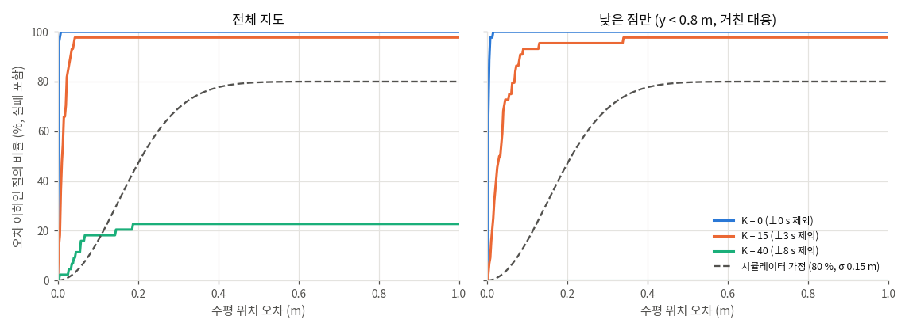

# 결과 — SfM 지도에 카메라 사진 위치 찾기 (leave-out)

> 이 파일은 `relocalize.py`가 만든다 (2026-10-14 12:23). 해석과 주의점은 [README.md](README.md)에 있다.

## 조건

- 지도: 프레임 263장, 3D 점 51,220개, 관측 389,085개. 낮은 점 (지도 높이 y < 0.8 m) 17,181개.
- 질의: 프레임 44장 (매 6번째). 질의 프레임과 앞뒤 ±K 프레임의 관측을 지도에서 뺀다. 빼는 범위: K = 0 → ±0 초 (약 ±0.0 m), K = 15 → ±3 초 (약 ±3.2 m), K = 40 → ±8 초 (약 ±8.4 m) (프레임 사이 이동 중앙 0.21 m).
- 질의 특징점: 프레임 사진에서 OpenCV SIFT로 다시 뽑음 (긴 변 1600 px, 최대 5000개, RootSIFT uint8 — 실제 카메라와 같은 길).
- 매칭: 정확한 최근접 (L2, 지도 전체와 전수 비교), 비율 검사 0.8 (가장 가까운 *다른* 3D 점과 비교), 3D 점 하나에 질의 특징점 하나.
- 3D 점: '전체 지도' · '낮은 점만'은 매칭된 3D 점을 남은 프레임 (질의 ±K 밖)의 관측만으로 다시 삼각측량해서 쓴다 (SfM 카메라 자세는 고정, 2장 이상 · 삼각 각도 ≥ 1.5° · 재투영 ≤ 4 px). 'SfM 점 그대로'는 복원 모델의 점 위치를 그대로 쓴다. 그 점들은 질의 프레임까지 넣어 다듬은 것이라 오차가 거의 0으로 나온다 (비교용).
- 낮은 점만: 지도 높이 y < 0.8 m 인 3D 점의 관측만 지도에 남기고 그것과만 매칭한다 (낮은 카메라의 거친 대용, README 참고).
- 자세: OpenCV `solvePnPRansac` (AP3P) → 인라이어로 `solvePnPRefineLM` 두 번, 재투영 허용 12 px, 카메라는 알려진 값 (SIMPLE_RADIAL 1920x1080 943.7 960 540 -0.003484). 성공 = 자세가 나오고 인라이어 ≥ 30.
- 기준: 같은 프레임의 SfM 복원 자세. 오차는 align.json으로 바꾼 지도 좌표 (m)에서 잰다. 위치 = 카메라 중심 사이 거리, 수평 = x · z만, 회전 = 두 자세 사이 회전 각.
- 계산: CPU numpy (aarch64, 6 cores). 질의당 시간 = 특징점 뽑기 + 매칭 + PnP (지도 불러오기 2 s와 재삼각측량은 이 실험 방식 때문에 생긴 것이라 뺀다).
- 실행: `relocalize.py --features opencv --step 6 --ks 0,15,40 --tag _jetson_cv`, 전체 1439 s.

## 1. 한눈에 (전체 질의)

| 변형 | K | 질의 | 성공률 | 위치 오차 중앙 / 90 % (m) | 수평 오차 중앙 / 90 % (m) | 회전 오차 중앙 / 90 % (°) | 인라이어 중앙 | 매칭 중앙 | 1 m 넘는 오답 | 질의당 시간 중앙 (ms) |
|---|---:|---:|---:|---:|---:|---:|---:|---:|---:|---:|
| 전체 지도 | 0 | 44 | 100.0 % | 0.001 / 0.002 | 0.001 / 0.001 | 0.03 / 0.04 | 784 | 854 | 0 | 9245 |
| 전체 지도 | 15 | 44 | 97.7 % | 0.012 / 0.033 | 0.011 / 0.028 | 0.07 / 0.24 | 138 | 258 | 0 | 8309 |
| 전체 지도 | 40 | 44 | 27.3 % | 0.069 / 1.382 | 0.056 / 1.371 | 0.58 / 2.38 | 26 | 98 | 2 | 6451 |
| 낮은 점만 | 0 | 44 | 100.0 % | 0.002 / 0.006 | 0.002 / 0.005 | 0.03 / 0.07 | 286 | 357 | 0 | 3403 |
| 낮은 점만 | 15 | 44 | 97.7 % | 0.039 / 0.087 | 0.029 / 0.077 | 0.26 / 0.61 | 64 | 142 | 0 | 3064 |
| 낮은 점만 | 40 | 44 | 0.0 % | – / – | – / – | – / – | 8 | 80 | 0 | 2537 |
| 전체 지도 · SfM 점 그대로 | 0 | 44 | 100.0 % | 0.001 / 0.001 | 0.000 / 0.001 | 0.03 / 0.03 | 803 | 854 | 0 | 9244 |
| 전체 지도 · SfM 점 그대로 | 15 | 44 | 97.7 % | 0.004 / 0.013 | 0.003 / 0.010 | 0.05 / 0.07 | 164 | 258 | 0 | 8309 |
| 전체 지도 · SfM 점 그대로 | 40 | 44 | 56.8 % | 0.027 / 1.040 | 0.022 / 1.034 | 0.16 / 1.18 | 32 | 98 | 3 | 6424 |
| *시뮬레이터 가정* | – | – | 80 % | – | 0.177 / 0.322 | 2.0 / 4.9 (yaw만) | – | – | – | – |

오차의 중앙 · 90 %는 성공한 질의만으로 낸다. 시뮬레이터 가정은 `sim/web/agent.js`의 `VIS_P = 0.8`, `VIS_M = 0.15` (x · y 각각 표준편차), `VIS_DEG = 3`에서 계산한 값이다.

## 2. 정해진 오차 안에 든 비율 (모든 질의 기준, 실패는 밖으로 셈)

| 변형 | K | 수평 ≤ 0.15 m | ≤ 0.30 m | ≤ 0.50 m | ≤ 1.0 m | ≤ 0.15 m 이고 회전 ≤ 3° |
|---|---:|---:|---:|---:|---:|---:|
| 전체 지도 | 0 | 100.0 % | 100.0 % | 100.0 % | 100.0 % | 100.0 % |
| 전체 지도 | 15 | 97.7 % | 97.7 % | 97.7 % | 97.7 % | 97.7 % |
| 전체 지도 | 40 | 20.5 % | 22.7 % | 22.7 % | 22.7 % | 20.5 % |
| 낮은 점만 | 0 | 100.0 % | 100.0 % | 100.0 % | 100.0 % | 100.0 % |
| 낮은 점만 | 15 | 95.5 % | 95.5 % | 97.7 % | 97.7 % | 95.5 % |
| 낮은 점만 | 40 | 0.0 % | 0.0 % | 0.0 % | 0.0 % | 0.0 % |
| 전체 지도 · SfM 점 그대로 | 0 | 100.0 % | 100.0 % | 100.0 % | 100.0 % | 100.0 % |
| 전체 지도 · SfM 점 그대로 | 15 | 97.7 % | 97.7 % | 97.7 % | 97.7 % | 97.7 % |
| 전체 지도 · SfM 점 그대로 | 40 | 45.5 % | 50.0 % | 50.0 % | 50.0 % | 45.5 % |
| *시뮬레이터 가정* | – | 31.5 % | 69.2 % | 79.7 % | 80.0 % | 21.5 % |

## 3. 복도와 라운지 따로

| 변형 | K | 구간 | 질의 | 성공률 | 수평 오차 중앙 / 90 % (m) | 회전 오차 중앙 (°) | 인라이어 중앙 | 1 m 넘는 오답 |
|---|---:|---|---:|---:|---:|---:|---:|---:|
| 전체 지도 | 0 | 복도 (0–118) | 20 | 100.0 % | 0.001 / 0.001 | 0.03 | 671 | 0 |
| 전체 지도 | 0 | 라운지 (119–262) | 24 | 100.0 % | 0.001 / 0.002 | 0.03 | 1426 | 0 |
| 전체 지도 | 15 | 복도 (0–118) | 20 | 100.0 % | 0.008 / 0.031 | 0.05 | 127 | 0 |
| 전체 지도 | 15 | 라운지 (119–262) | 24 | 95.8 % | 0.014 / 0.024 | 0.09 | 239 | 0 |
| 전체 지도 | 40 | 복도 (0–118) | 20 | 30.0 % | 0.104 / 1.674 | 0.35 | 28 | 2 |
| 전체 지도 | 40 | 라운지 (119–262) | 24 | 25.0 % | 0.041 / 0.121 | 0.82 | 14 | 0 |
| 낮은 점만 | 0 | 복도 (0–118) | 20 | 100.0 % | 0.002 / 0.005 | 0.04 | 206 | 0 |
| 낮은 점만 | 0 | 라운지 (119–262) | 24 | 100.0 % | 0.002 / 0.005 | 0.03 | 514 | 0 |
| 낮은 점만 | 15 | 복도 (0–118) | 20 | 100.0 % | 0.034 / 0.072 | 0.24 | 60 | 0 |
| 낮은 점만 | 15 | 라운지 (119–262) | 24 | 95.8 % | 0.024 / 0.078 | 0.27 | 68 | 0 |
| 낮은 점만 | 40 | 복도 (0–118) | 20 | 0.0 % | – / – | – | 14 | 0 |
| 낮은 점만 | 40 | 라운지 (119–262) | 24 | 0.0 % | – / – | – | 7 | 0 |
| 전체 지도 · SfM 점 그대로 | 0 | 복도 (0–118) | 20 | 100.0 % | 0.000 / 0.001 | 0.03 | 679 | 0 |
| 전체 지도 · SfM 점 그대로 | 0 | 라운지 (119–262) | 24 | 100.0 % | 0.001 / 0.001 | 0.03 | 1459 | 0 |
| 전체 지도 · SfM 점 그대로 | 15 | 복도 (0–118) | 20 | 100.0 % | 0.004 / 0.013 | 0.04 | 146 | 0 |
| 전체 지도 · SfM 점 그대로 | 15 | 라운지 (119–262) | 24 | 95.8 % | 0.003 / 0.010 | 0.05 | 298 | 0 |
| 전체 지도 · SfM 점 그대로 | 40 | 복도 (0–118) | 20 | 75.0 % | 0.040 / 1.716 | 0.20 | 36 | 3 |
| 전체 지도 · SfM 점 그대로 | 40 | 라운지 (119–262) | 24 | 41.7 % | 0.009 / 0.178 | 0.11 | 23 | 0 |

## 4. 지도와 매칭 규모

| 변형 | K | 가장 가까운 남은 지도 카메라까지 중앙 (최소) (m) | 질의마다 남은 3D 점 (중앙) | 질의 사진의 SfM 대응 중 낮은 점 (중앙) | 매칭 (중앙) | 인라이어 (중앙) | SfM 대응과 같은 매칭 비율 (중앙) | 특징점 / 매칭 / PnP 시간 중앙 (ms) |
|---|---:|---:|---:|---:|---:|---:|---:|---:|
| 전체 지도 | 0 | 0.21 (0.09) | 51,220 | -1 | 854 | 784 | – % | 346 / 8890 / 6 |
| 전체 지도 | 15 | 3.20 (0.86) | 47,666 | -1 | 258 | 138 | – % | 346 / 7856 / 4 |
| 전체 지도 | 40 | 8.15 (0.86) | 39,564 | -1 | 98 | 26 | – % | 346 / 5937 / 46 |
| 낮은 점만 | 0 | 0.21 (0.09) | 17,181 | -1 | 357 | 286 | – % | 346 / 3055 / 3 |
| 낮은 점만 | 15 | 3.20 (0.86) | 16,248 | -1 | 142 | 64 | – % | 346 / 2689 / 8 |
| 낮은 점만 | 40 | 8.15 (0.86) | 13,382 | -1 | 80 | 8 | – % | 346 / 1899 / 295 |
| 전체 지도 · SfM 점 그대로 | 0 | 0.21 (0.09) | 51,220 | -1 | 854 | 803 | – % | 346 / 8890 / 5 |
| 전체 지도 · SfM 점 그대로 | 15 | 3.20 (0.86) | 47,666 | -1 | 258 | 164 | – % | 346 / 7856 / 3 |
| 전체 지도 · SfM 점 그대로 | 40 | 8.15 (0.86) | 39,564 | -1 | 98 | 32 | – % | 346 / 5937 / 24 |

'SfM 대응과 같은 매칭 비율'은 매칭된 3D 점이 복원 모델이 그 특징점에 붙인 3D 점과 같은 비율이다 (복원 모델이 3D 점을 붙이지 않은 특징점의 매칭은 틀린 것으로 센다).

질의마다의 수치는 `per_query_jetson_cv.csv`에 있다.
