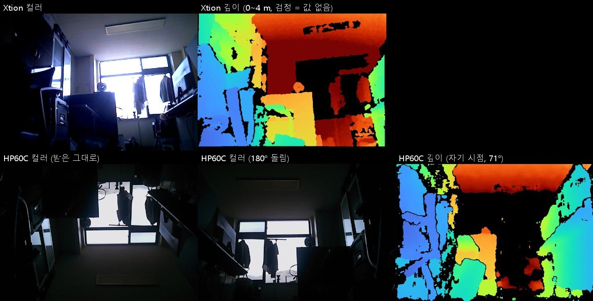

# 2026-10-13 · GPT · Claude 실차 운전 (Jetson + ESP32 + Xtion)

시뮬레이터 ⑤ "GPT · Claude 운전" 과 같은 방식을 실차로 옮긴 것입니다. Xtion 사진에 깊이로 잰 갈 수 있는 방향을 번호
화살표로 그리고, 위에서 본 복도 지도와 오도메트리 추정 위치를 같이 모델에 보내 한 걸음씩 몹니다. 모델 호출 코드와
프롬프트는 시뮬레이터 것([agent.py](../../hardware/vehicle/models/vehicle/sim/agent.py) ·
[agent_claude.py](../../hardware/vehicle/models/vehicle/sim/agent_claude.py))을 그대로 부릅니다.

## 1. 목적

- 시뮬레이터에서 된 "사진 + 깊이 화살표 + 지도 + 추정 위치 → 모델이 한 걸음 결정 → 차가 닫힌 루프로 실행" 이 실차에서도
  되는지 확인한다.
- 그 전에 실차 쪽 기본기 — ESP32 링크 · 오도메트리 · 돌기 / 가기 · Xtion 깊이 · 사각 정지 — 를 하나씩 확인한다.

## 2. 구성

```
Xtion Pro Live ──USB 2.0 (OpenNI2)──►  Jetson Orin Nano "dongki"  ──USB 시리얼 115200 (CH340)──► LOLIN D32 (ESP32) ──UART──► 호버보드 보드 4장
                                       drive.py                                                    w 1 + h 하트비트, s · t · x
                                         └─ HTTPS ─► OpenAI / Anthropic API (agent.py · agent_claude.py)
```

| 파일 | 하는 일 |
| --- | --- |
| `drive.py` | 본체. 걸음마다 사진 · 깊이 → 화살표 → 지도 · 위치 → 모델 → (Enter 확인) → 실행 → 기록 |
| `wheel_link.py` | ESP32 시리얼. 보고 줄 (200 ms) 해석, 명령, **하트비트 임대** — 제어 루프가 멈추면 1 s 뒤 ESP32 가 선다 |
| `xtion.py` | Xtion (OpenNI2 + `openni` 바인딩, 없으면 `primesense`). 깊이를 컬러 시점에 맞춤 (시작 전), 백그라운드로 읽기, 거울상이면 소프트웨어로 뒤집기 |
| `xtion_no_audio.sh` | Xtion 마이크 (USB 오디오) 를 막는 udev 규칙 — **Jetson 에서 Xtion 을 쓰려면 꼭 필요** (아래 '결과') |
| `hp60c.py` | Nuwa-HP60C 깊이 카메라 — 제조사 SDK 없이 UVC 복합 프레임 (640x642 MJPG) 을 풀어 컬러 + 컬러 시점 깊이. `flip180` |
| `to_jetson.sh` | PC → Jetson `~/NUBI` 로 필요한 것만 복사 (`WITH_KEY=1` 이면 API 키도) |
| `bench.py` · `bench_ctl.sh` | **바퀴 점검 웹 패널** — Jetson 에서 띄우고 PC 브라우저로 `http://192.168.127.2:8090` (유선 직결 주소에만 연다). 네 바퀴 속도 (앞으로 = +) · 앞축 스텝 · 전압 · 링크, 짧은 시험 (최대 3 s) · STOP · '바퀴를 띄웠다' 체크 · 페이지 끊김 정지. `bash bench_ctl.sh start / stop / status`, PC 연습은 `--fake` (`.claude/launch.json` 의 `wheel-bench-fake`) |
| `depth_view.py` | 바닥면 맞추기 (카메라 높이 · 숙임 자동), 방향별 빈 거리, **0.5 m 안쪽 사각** 판정, 화살표 그리기 |
| `odometry.py` | 앞축 홀 스텝 → 지도 위 위치 (추측 항법) |
| `motion.py` | 제자리 돌기 · 곧게 가기 (오도메트리 닫힌 루프, 방향 틀어짐 보정, 깊이 · 시간 · 걸림으로 정지) |
| `hallway_map.py` | 복도 `scene.json` → 지도 그림 · 글 (시뮬레이터 `agent.js` 와 같은 내용, 가구 회색은 빠짐) |
| `calibrate.py` | 연결 확인 · 카메라 바닥면 · 직진 / 회전으로 `m_per_step` · `odo_sign` · `track_eff_m` 재기 |
| `robot.json` | 차마다 값 — 명령 크기, 정지 거리, 오도메트리 보정값 ([가정] 값은 실측으로 바꾼다) |
| `fake.py` · `selftest.py` | 가짜 ESP32 (펌웨어 흉내) · 가짜 Xtion (복도 벽에 광선) 과 자체 시험 |
| `images/` | 결과 사진 (`camera_compare.jpg` — Xtion · HP60C 비교) |

### 시뮬레이터와 다른 점 (Xtion)

- 화각 약 58° × 45° (Gemini 336 은 90° × 65°) → 화살표는 ±24°, ±16°, ±8°, 0° 의 7 개.
- 약 0.5 m 안쪽은 깊이가 0 이다 (2026-09-17 RDK 가드에서 확인). 바닥이 0.65 ~ 2 m 에 보여야 할 줄이 비어 있으면
  그 방향을 '사각 → 막힘 0.3 m' 로 친다. 정면이 사각이면 가던 것도 선다.
- 카메라 장착 높이 · 숙임은 시작할 때 바닥면으로 잰다. 바닥이 안 보이면 `robot.json` 의 `camera_height_m` 를 쓴다.

## 3. Jetson 준비 (한 번)

1. PC (Git Bash) 에서 필요한 것만 Jetson `~/NUBI` 아래 같은 자리로 보낸다 — 이 폴더 (`.venv` 빼고), 시뮬레이터
   `agent.py` · `agent_claude.py`, 복도 지도 `scene.json` (git 밖), API 키 `agent.local.json` (있으면, git 밖).
   유선 직결 주소는 [일지 'Jetson 유선 직결'](../../docs/worklog/2026-10.md) (`dongki@192.168.127.2`).
   ```bash
   bash experiments/2026-10-13_vlm-drive/to_jetson.sh
   ```
2. 키를 Jetson 에 파일로 두기 싫으면 `agent.local.json` 을 지우고 환경변수 (`OPENAI_API_KEY` · `ANTHROPIC_API_KEY`) 로.
3. 지도 경로를 바꾸려면 `HALLWAY_SCENE=경로` 또는 `--scene`.
4. 패키지 (2026-10-14 "mokpo": `libopenni2-0` · OpenCV 4.5 · numpy · Pillow 는 이미 있었다. `python3-venv` 가 없어
   가상환경 대신 사용자 영역에 설치했다):
   ```bash
   python3 -m pip install --user pyserial==3.5 openni==2.3.0
   ```
   Claude 를 쓸 때만 `anthropic` 도. OpenNI2 배포본은 `~/Study/flysim/data/openni2` (초파리 주행 때 것) 를 먼저 쓴다.
5. Xtion 마이크 막기 (sudo, 한 번):
   ```bash
   sudo bash /home/dongki/NUBI/experiments/2026-10-13_vlm-drive/xtion_no_audio.sh
   ```
6. 시리얼: CH340 드라이버 (`ch341.ko`) 와 `brltty` 제거는 2026-09-18 에 이미 했다 ([일지](../../docs/worklog/2026-09.md)).
   사용자가 `dialout` 그룹에 있어야 한다.

## 4. 처음 시험 순서

| 단계 | 명령 | 볼 것 |
| --- | --- | --- |
| 0. PC 자체 시험 | `.venv\Scripts\python.exe selftest.py` | 모두 통과 |
| 1. 연결 | `python3 calibrate.py report` | 전압, `rx` · `rx2` 가 늘어남, `odo` |
| 2. 카메라 | `python3 calibrate.py camera` | 바닥면 높이 · 숙임이 실제 장착과 맞나, 화살표 사진 (`data/logs/vlm-drive/calib_camera.jpg`) |
| 3. 방향 (바퀴 띄움) | `python3 calibrate.py straight` · `spin` | 앞으로 / 왼쪽으로 도는지, 홀 스텝 부호 |
| 4. 보정 (바닥, 앞 2 m 비움) | `python3 calibrate.py straight --write` 다음 `spin --write` | 줄자 거리 · 각도를 넣어 `robot.json` 갱신 |
| 5. 걸음마다 확인하며 운전 | `python3 drive.py --goal 310앞 --model gpt-6-luna` | 걸음마다 모델 결정을 보고 Enter (s = 건너뜀, q = 그만) |
| 6. 자동 | `--auto` | 5 단계가 몇 번 성공한 뒤에만 |

출발은 복도 입구 (지도 x = 1.4, y = 0) 에서 안쪽을 보고 선다 (`--start x,y,방향°` 로 바꿀 수 있다).

### 안전

- 사람이 비상정지 버튼을 들고 따라간다. 처음에는 `robot.json` 의 `max_cmd` 300 · `fwd_cmd` 180 그대로 (느림).
- 모델은 장애물 정지에 끼지 않는다. 가는 중 깊이로 범퍼 앞 0.30 m (`stop_gap_m`) 안이 막히거나 정면이 사각이면 선다.
- 하트비트 임대: 모델 응답을 기다리는 동안 (수 초) 에는 하트비트를 보내지 않는다 → ESP32 가 "host watchdog" 으로 멈춘
  상태로 기다린다. 프로그램이 죽어도 1 s 안에 선다. 끝날 때 `w 0` 으로 워치독을 끄고 나간다 (ISSUES N2).
- 실물 사진에는 사람이 찍힌다. 기록 (`data/logs/vlm-drive/`) 은 git 에 올라가지 않고, 사진은 모델 회사로 간다 —
  학교 쪽 확인이 필요할 수 있다.

## 5. 결과

### 2026-10-13 PC 자체 시험 (가짜 장치)

가짜 ESP32 는 홀 스텝 축척을 2 %, 유효 윤거를 4 % 일부러 다르게 했다.

| 시험 | 결과 |
| --- | --- |
| 보고 줄 해석 | 펌웨어 printf 모양 그대로 통과 |
| 바닥면 맞추기 (높이 0.30 m, 3° 숙임) | 0.300 m, +3.02° |
| 복도 입구 화살표 | 정면 4.0 m (깊이 끝), ±24° 는 벽 2.7 ~ 2.9 m |
| 0.35 m 앞 원기둥 (깊이 0) | 정면 사각 → 막힘 0.3 m, 범퍼 앞 0 → 선다 |
| 1.2 m 앞 원기둥 | 정면 1.0 m (원기둥 겉면) |
| 왼쪽 90° 돌기 | 오도메트리 +91.9°, 진짜 +90.9° |
| 1 m 가기 | 오도메트리 1.025 m, 진짜 1.050 m |
| 1.0 m 앞 장애물에 2 m 가라 | 0.44 m 가고 깊이로 정지 |
| 하트비트 임대가 끊김 | 1 s 뒤 "host watchdog" STOP |
| 끝까지 (모의 모델 4 걸음) | 오도메트리 7.56 m / 진짜 7.69 m |

### 2026-10-14 Jetson "mokpo" (움직이지 않는 점검)

| 항목 | 결과 |
| --- | --- |
| 가짜 장치 자체 시험 (Python 3.10, numpy 1.21, OpenCV 4.5) | 13 항목 모두 통과 |
| ESP32 (`/dev/ttyUSB0`) | 바퀴 모드, 마스터 = 오른쪽, 데드밴드 100, 상한 400. 보드 전원을 켜자 앞 · 뒤축 텔레메트리, 40.5 V |
| Xtion 열기 | 처음에는 끝없이 멈췄다 — OpenNI 로그 'Getting hardware versions...' 에서 대답 없음, 커널에 `usb_set_interface failed (-110)` 5 s 마다. 로그인 화면 (gdm) 오디오 서버가 Xtion 마이크를 열다 실패하며 제어 통로를 막았다. `xtion_no_audio.sh` (오디오 인터페이스 authorized=0) + USB 다시 꽂기로 해결 |
| Xtion 영상 | 640×480, 화각 58.6° × 45.6°, 29 fps. 장치가 거울상 (미러링 켜짐) 으로 내보내 코드가 뒤집는다 — 좌우가 맞는 것을 사용자가 실물로 확인 |
| 바닥면 | 이날은 카메라가 차에 달려 있지 않고 방을 가로질러 봐서 바닥이 안 보였다 (찾지 못함이 맞음) |

### 2026-10-14 HP60C 와 비교 (같은 방, 차례로 찍음)

| | Xtion Pro Live | Nuwa-HP60C |
| --- | --- | --- |
| 연결 | USB 2.0, OpenNI2 | USB 2.0 (Type-C), 표준 UVC — `hp60c.py` 로 직접 해독 |
| 컬러 | 640×480, 58.6° | 640×480, 56.8° (fx 591.8) |
| 깊이 화각 | 58.6° × 45.6° | 71.3° (자기 시점, fx 446.0) — 컬러 시점으로 옮기면 컬러 화각만큼 |
| 가까운 사각 | 약 0.5 m | 0.2 m (제품 설명) |
| 프레임 | 29 fps | 22.6 fps (문서: 6 주기에 5 장) |
| 이 장면 깊이 값 있음 | 72 % | 30 % (컬러 시점으로 옮긴 뒤 · 창문 햇빛) |



HP60C 보정 (이 장치): 깊이 → 컬러 R 의 z 회전 0.8°, 기선 12.2 mm. **고정핀대로 바로 세워 둔 채로** 컬러 · 깊이가 함께
위아래가 뒤집혀 나왔다 (장치 고유 방향) → `HP60CCamera` 는 기본으로 180° 돌린다 (`flip180=True`). 아직 `drive.py` 에서
카메라를 고를 수는 없다.

### 2026-10-14 바퀴 방향 (바퀴를 띄우고 점검판으로, 세기 180 · 2 s)

| 시험 | 앞 왼쪽 | 앞 오른쪽 | 뒤 왼쪽 | 뒤 오른쪽 | 앞축 스텝 (오른쪽 마스터 / 왼쪽 슬레이브) |
| --- | --- | --- | --- | --- | --- |
| 앞으로 (두 번) | −1.84 | +1.81 | −1.86 | +1.82 km/h | −257 / +259 |
| 뒤로 | +1.80 | −1.80 | +1.85 | −1.77 | +242 / −243 |
| 왼쪽 제자리 | +2.00 | +1.99 | +1.97 | +1.91 | −276 / −277 |
| 오른쪽 제자리 | −1.92 | −1.90 | −1.93 | −1.77 | +276 / +278 |

(보드 원시 부호.) 네 시험 모두 실제로 맞는 방향으로 돌았다 (사용자가 눈으로 확인). 보드는 **왼쪽 바퀴 속도를 거꾸로**,
**앞축 스텝은 오른쪽 (마스터) 을 거꾸로** 센다 → `robot.json` 의 `odo_sign` 을 처음 넣은 [1, −1] (가정) 에서 **[−1, +1]** 로 고쳤다.
점검판은 속도를 '앞으로 = +' 로 바꿔 보이고 원시 값은 괄호에 둔다. 가짜 ESP32 (`fake.py`) 도 이 부호로 맞췄다.
메인보드는 몇 분 명령이 없으면 스스로 꺼진다 — 시험 직전에 보드 전원을 다시 켠다.

실차 주행 결과는 아직 없다.

## 6. 결론

진행 중. 실차 1 ~ 5 단계를 해 본 뒤 적는다. 자리를 잡으면 ROS 2 패키지 (`software/ros2_ws/src/nubi_base` — cmd_vel ·
오도메트리, `nubi_perception` — 깊이) 로 옮긴다.

### 알려진 한계

- 위치는 오도메트리뿐이다 (스키드 스티어는 돌 때 미끄러져 방향 오차가 쌓인다). IMU (iAHRS) 와 SfM 시각 위치 인식은
  아직 붙이지 않았다 — 위치 인식 정확도는 [2026-10-13_sfm-relocalization](../2026-10-13_sfm-relocalization/) 에서 잰다.
- 지도에 가구 (회색) 가 없다. 지도는 벽 선과 문만.
- 반짝이는 검은 바닥 · 유리는 깊이가 비어 '사각' 으로 보일 수 있다 (보수적으로 선다).
