# 차량 재설계 (models/vehicle)

호버보드 휠 스키드 모빌리티 베이스를 **v01_base 부터 버전별로** 다시 설계한다.
그 전까지의 작업은 `models/hoverboard_mount/`, `models/swerve_base.py` 에 있고,
재설계 직전 상태는 `v00_ref` 로 남겨 비교 기준으로만 쓴다.

## 규칙

1. **버전 = 폴더** `vNN_<영문소문자>` (예: `v02_posts`). 번호는 두 자리, 하나씩 올린다.
2. **폴더 하나에 그 버전의 코드가 전부 있다.** `parameters.py`·`low_clamp.py` 등은 동결
   사본이라 다른 버전이나 `hoverboard_mount` 원본이 바뀌어도 그 버전은 그대로 다시 지어진다.
3. **기록을 마친 버전은 고치지 않는다.** 잘못을 찾으면 다음 버전에서 고치고, 옛 버전
   README 의 "알려진 문제"에 한 줄만 덧붙인다.
4. 버전마다 남기는 것 — `record.py` 가 같은 규칙으로 만든다.
   - `images/overall.png` 전체 모습 (ISO · 위 · 옆 · 아래), `overall_iso.png` 큰 그림, `thumb.png`
   - `images/change_NN_<그룹>.png` 이전 버전 대비 바뀐 곳 — 이전/이번 × ISO/위,
     **빨강 = 이전 자리, 파랑 = 이번 자리**, 안 바뀐 부품은 흐리게
   - `README.md` — 위쪽은 사람이 쓴다 (무엇을 · 왜 · 버린 대안 · 남은 일),
     아래 자동 구역은 record.py 가 쓴다 (변화 표 · 이미지 · 수치 · 검증 · 부품 구성)
   - `output/<버전>.step` (assembly.py 실행 시), `output/scene.npz|json` (메시 캐시)
     — **git 에는 `.step` · `scene.npz` 를 넣지 않는다** (합치면 600 MB). `record.py <버전> --rebuild` 로 다시 만든다.
     조립 STEP 에는 휠 모터 참조 형상이 들어가므로 공유용 STEP 도 담지 않는다. `scene.json` · 이미지 · DXF · BOM 은 담는다.
     차를 지으려면 `refmodel/Motor, BLDC, Hoverboard Wheel, 6.5in.stp` 가 필요하다 — 외부 모델이라 저장소에 없다 ([`refmodel/README.md`](../../refmodel/README.md)).
5. 부품 label 은 버전 사이에 **같은 부품이면 같은 이름**을 쓴다. 변화는 `그룹key/label`
   로 짝지어 자동으로 찾는다 (삭제 · 추가 · 이동 · 형상 변경).

## 작업 순서

```bash
.venv/Scripts/python.exe models/vehicle/record.py new v02_posts "기둥 배치"
```

1. 위 명령으로 마지막 버전 폴더를 복사한다 (VERSION · TITLE · DATE · PREV 가 고쳐진다).
2. 새 폴더의 `assembly.py` 에서 `SUMMARY` 와 설명을 쓰고 형상을 고친다.
3. `record.py <버전>` 한 번 — **한 프로세스에서 한 번 지어** 검증 · STEP · 뷰어 전송 ·
   이미지 · README 자동 구역 · 버전 표까지 끝낸다. 단계별 소요 시간이 README 에 남는다.
   코드가 지난 기록과 같으면 짓지 않고 캐시로 이미지 · 기록만 다시 만든다 (`--rebuild` 로 강제).
4. 새 README 의 사람 구역(무엇을 · 왜)을 쓴다. 이미지를 직접 열어 확인한다.

```bash
.venv/Scripts/python.exe models/vehicle/record.py v03_posts
```

v01 · v02 의 `assembly.py` 는 기록 당시 그대로 둔다 (검증이 3 분 걸리는 옛 방식).
v03 부터는 검증이 빠르고 `assembly.py` 를 실행해도 record.py 로 넘어간다.

## 결정 기록 · 조사

- [`DECISIONS.md`](DECISIONS.md) — 무엇을 **왜** 골랐는지 (근거 · 버린 대안 · 확인할 것). 부품 · 방식을 정할 때마다 한 칸 더한다.
- [`research/`](research/) — 결정의 근거가 된 조사 원자료 (날짜별).
- [`sim/`](sim/README.md) — 웹 시뮬레이터 (운전 · 센서 · 전원 추정). `sim/web_export.py <버전>` 후 http://localhost:8748

## 좌표

지면 z=0, 전방 +x, 좌 +y, 위 +z, 단위 mm. 차량 중심 x=y=0.

## 버전

<!-- record:begin — record.py 가 덮어쓴다. 이 사이는 손으로 고치지 않는다 -->
| 버전 | 날짜 | 제목 | 요약 | 모습 |
|---|---|---|---|---|
| [v00_ref](v00_ref/README.md) | 2026-09-17 | 재설계 직전 참조 | 09-17 마지막 설계 — H 크로스 + 혀 선반 + 상부 프레임 (비교 기준) | 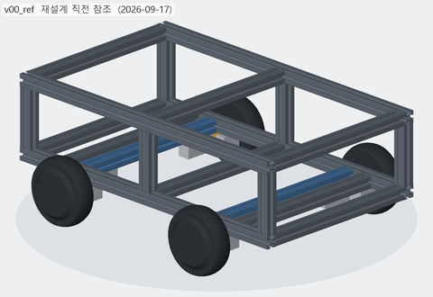 |
| [v01_base](v01_base/README.md) | 2026-10-04 | 기본 베이스 | 하부 프레임 + 바퀴 + T 클램프만 남기고, 축크로스를 ±265 → ±210 (혀 위) 로 옮겼다 | 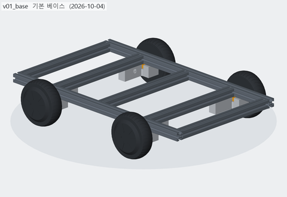 |
| [v02_posts](v02_posts/README.md) | 2026-10-04 | 기둥 배치 | 축크로스 자리(x=±210) 레일 위에 상부 프레임용 기둥 4 본 (3030 x 143) | 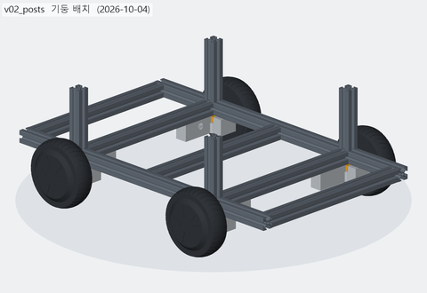 |
| [v03_posts](v03_posts/README.md) | 2026-10-04 | 기둥 10 본 | 옛 기둥 자리 6 본 (x=0 · ±365) 을 더해 크로스 자리마다 기둥 — 좌우 10 본 (상부 프레임은 아직 없음) | 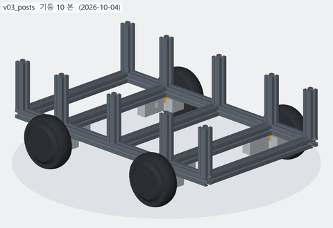 |
| [v04_posts6](v04_posts6/README.md) | 2026-10-04 | 기둥 6 본 (옛 자리) | 기둥을 옛 자리 6 본 (x=0 · ±365) 만 남기고 축크로스 자리 (±210) 4 본은 뺐다 | 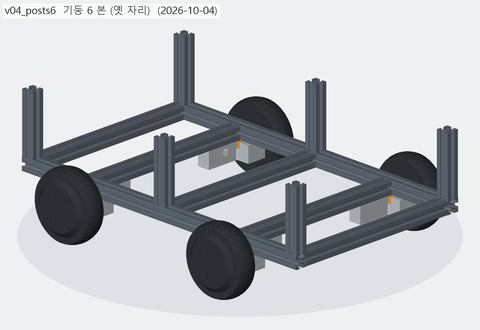 |
| [v05_floor](v05_floor/README.md) | 2026-10-04 | 바닥판 | 하부 프레임 위 바닥판 — 기둥 노치 6 · M6 고정 18 · 케이블 그로밋 4 · M5 격자 (아크릴 5t 기준) | 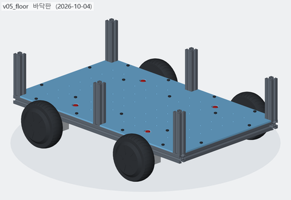 |
| [v06_floor10](v06_floor10/README.md) | 2026-10-04 | 바닥판 기둥 6·10 겸용 | 바닥판 노치를 크로스 5 곳 전부 (10 개) 로 — 기둥 6 본 · 10 본 어느 쪽이든 같은 판 | 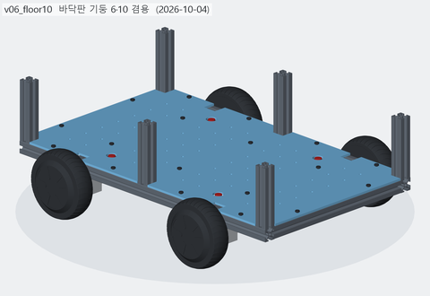 |
| [v07_parts](v07_parts/README.md) | 2026-10-04 | 노치 R3 + 부품 가배치 | 노치 모서리 R3, 판 위에 부품 가형태 9 개 (배터리 · 드라이버 2 · 젯슨 · ESP32 · 전원 3 · IMU) | 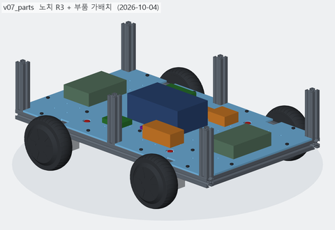 |
| [v08_realparts](v08_realparts/README.md) | 2026-10-04 | 부품 실측 모델 | 부품을 실측 치수 모델로 (볼트온 20Ah · ZLAC8015D · 젯슨 · Victron MIDI · Fotek SSR · DC-DC · BNO085) | 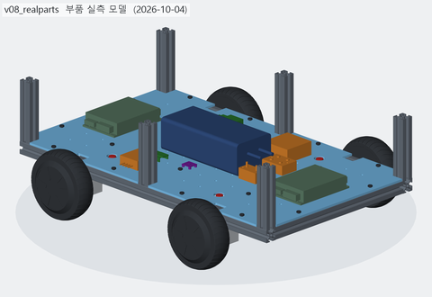 |
| [v09_floor_pc](v09_floor_pc/README.md) | 2026-10-04 | 실외 바닥판 (PC · 부품 고정 구멍) | 실외 바닥판 — PC 5t, 글랜드 M20, 격자 없앰, 부품 고정 구멍 · 배터리 밴드 슬롯 | 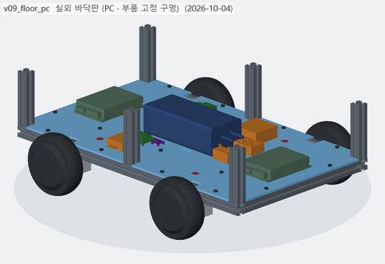 |
| [v10_shell](v10_shell/README.md) | 2026-10-04 | 외관판 (ACM · PC · ASA 펜더) | 실외 외관 — ACM 옆판 · 윗판, UV PC 앞뒤판, ASA 펜더 4 · 범퍼 2 · 루버 덮개 2 | 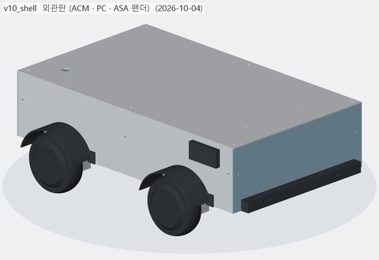 |
| [v11_shell_h](v11_shell_h/README.md) | 2026-10-04 | 외관 벽 상부 프레임 높이까지 (윗판 뺌) | 윗판 뺌, 벽을 상부 프레임 윗면 (z=296.85, 3030 가정) 까지 — 상부 슬롯 M5 미리 | 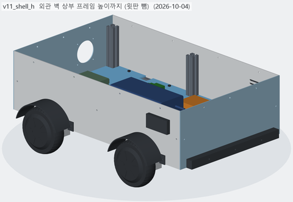 |
| [v12_nofender](v12_nofender/README.md) | 2026-10-04 | 펜더 뺌 | 바퀴 펜더 4 개를 뺐다 (옆판 고정 구멍은 그대로) | 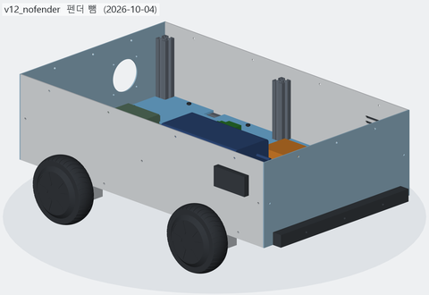 |
| [v13_opaque](v13_opaque/README.md) | 2026-10-04 | 소재 불투명으로 | 투명 · 반투명 없이 불투명으로 — 바닥판 불투명 PC 5t, 앞뒤판 불투명 UV PC 3t | 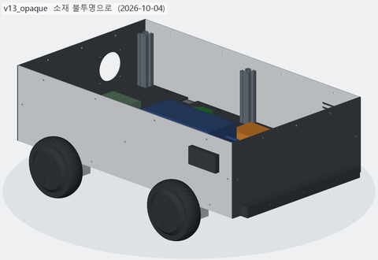 |
| [v14_rear_io](v14_rear_io/README.md) | 2026-10-04 | 뒤판 포트칸 · 카메라 · 고무범퍼 | 뒤판 오목 포트 칸 (덮개) · 비상정지 · 팬, 앞뒤 뎁스 카메라 창 · 차양, ASA 범퍼 → 고무 범퍼 4+4 | 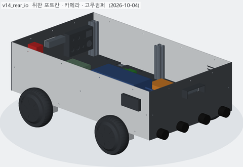 |
| [v15_rear2](v15_rear2/README.md) | 2026-10-04 | 고무 띠 범퍼 · 배기 양쪽 · 포트칸 카메라 아래 | 고무 범퍼 → 이어진 고무 띠, 뒤판 배기 팬 양쪽 · 포트 칸 카메라 아래, 카메라 차양 뺌 | 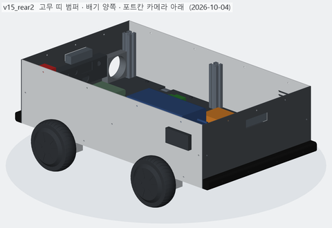 |
| [v16_camera](v16_camera/README.md) | 2026-10-04 | 뎁스 카메라 실물 · BOM | 뎁스 카메라 Orbbec Gemini 336L 실물 모델 (스타디움 창 · 브래킷), 포트 칸 60, BOM 시작 | 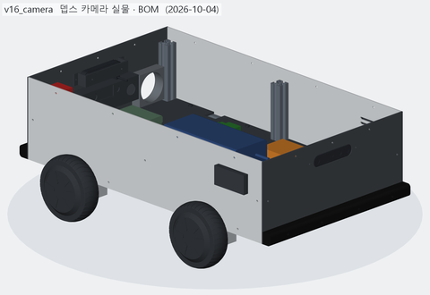 |
| [v17_estop](v17_estop/README.md) | 2026-10-04 | 비상정지 실물 · 카메라 검토 | 비상정지 Schneider XB5AS8442 실물 모델 (+ 노란 Ø60 명판, 회전방지 홈), 팬 · 비상정지 높이 조정 | 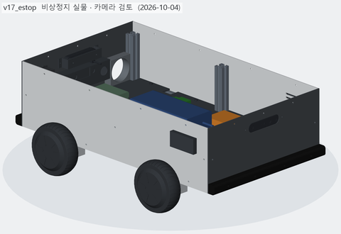 |
| [v18_simplify](v18_simplify/README.md) | 2026-10-04 | IP 기준 뺌 — 비상정지 Autonics · 그로밋 · 덮개 정리 | 방수 기준 뺌 — 비상정지 Autonics SF2ER-E2RB 실물, 그로밋 Ø25, 루버 덮개 뺌, BOM 정리 |  |
| [v19_gemini336](v19_gemini336/README.md) | 2026-10-04 | 뎁스카메라 Gemini 336 (저가 · 햇빛 대응) | 카메라 Gemini 336L → Gemini 336 (308,000 절감), 끝면 USB-C, 선반형 브래킷 | 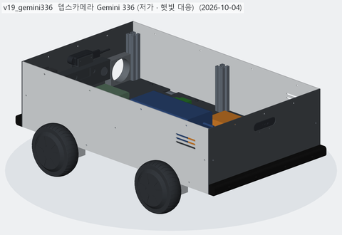 |
| [v20_power](v20_power/README.md) | 2026-10-05 | 전원 · 구동 계통 확정 (호버보드 원래 보드 · 30A 배터리 · 컨택터 · iAHRS) | 호버보드 원래 보드 ×2 · ZENION 20Ah 30 A · DC 차단기 + 컨택터 · 12V/5V 국내품 · iAHRS, BOM 국내 구매처 | 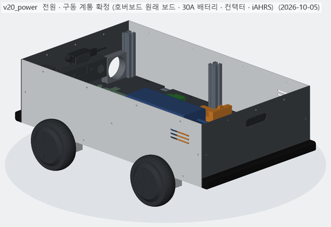 |
| [v21_split_ports](v21_split_ports/README.md) | 2026-10-05 | 분리형 보드 4장 · 포트칸 실물 · 배기팬 실물 | 모터 드라이버 = 2 세대 분리형 보드 4 장, 포트 칸 실물 7 개, 배기 팬 EC8025H05B + 가드 | 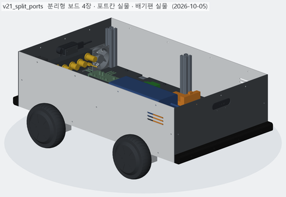 |
| [v22_headlight](v22_headlight/README.md) | 2026-10-05 | 전조등 | 전조등 MR16 12V 5W ×2 + ASA 테두리 · 고정 링, MOSFET 모듈 (ESP32 PWM) | 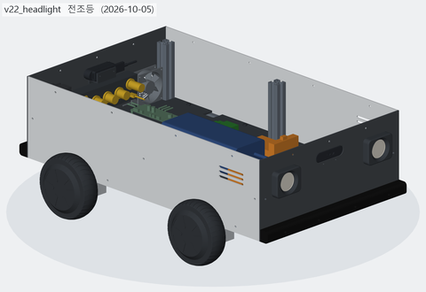 |
| [v23_upper_eyebrow](v23_upper_eyebrow/README.md) | 2026-10-05 | 상부 프레임 + 눈썹 안테나 | 상부 프레임 3030 (레일 2 · 크로스 3, 기둥 볼트 M8) + 전조등 위 눈썹 안테나 2 | 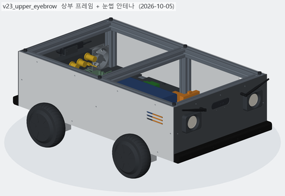 |
| [v24_camera_mouth](v24_camera_mouth/README.md) | 2026-10-05 | 앞 카메라 내림 (입) | 앞 뎁스 카메라 z 250 → 172 (전조등 아래 = 입), 뒤는 그대로 |  |
| [v25_top_cover](v25_top_cover/README.md) | 2026-10-05 | 상부 덮개 | 상부 덮개 ACM 3t 766 × 456 R6, M5 손나사 10, 기둥 볼트 머리 구멍 | 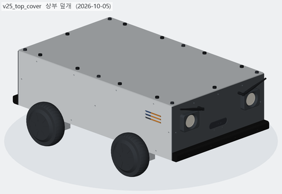 |
| [v26_module_rails](v26_module_rails/README.md) | 2026-10-05 | 모듈 레일 2020 · 덮개 두 장 | 모듈 레일 2020 ×3 (상부 프레임 위), 덮개 레일 사이 두 장 · 그로밋 2, 기둥 이음 -> 코너 브래킷 | 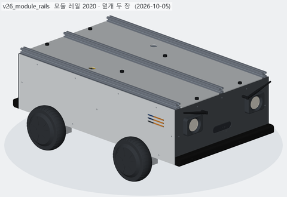 |
| [v27_sensor_module](v27_sensor_module/README.md) | 2026-10-05 | 센서 모듈 (라이다 · GPS · 표시등) | 센서 모듈 — 라이다 STL-19P (스캔 z 526) · GPS630 · 큐라이트 표시등 3 단, AL 밑판이 레일 3 본에 T 너트 | 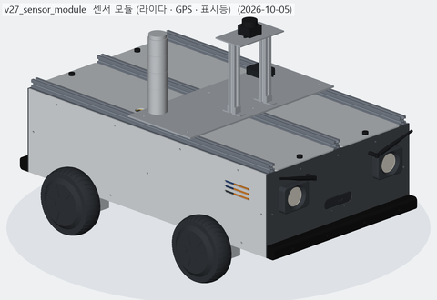 |
| [v28_wiring](v28_wiring/README.md) | 2026-10-05 | 내부 배선 | 내부 배선 — 분기 레일 (차단기 20 A ×4 · 퓨즈 15 A ×3) · 음극 N 바 · WAGO · USB 허브 + 전선 90 가닥 · 간선 2 (겹침 0) | 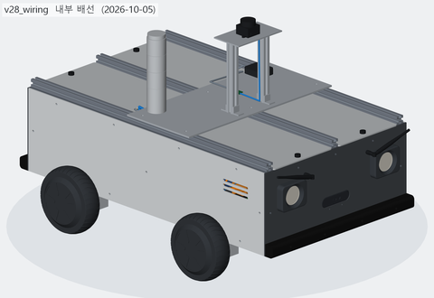 |
| [v29_floor_wiring](v29_floor_wiring/README.md) | 2026-10-05 | 배선 바닥 정리 (진행 중) | 전선을 바닥판 위 직각 경로로 (router A*), XT90 · 분기 레일 · N 바 자리 옮김 — **검증 실패 남음** (판 2 · 선끼리 69) | 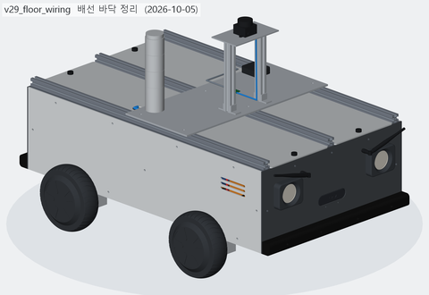 |
<!-- record:end -->
