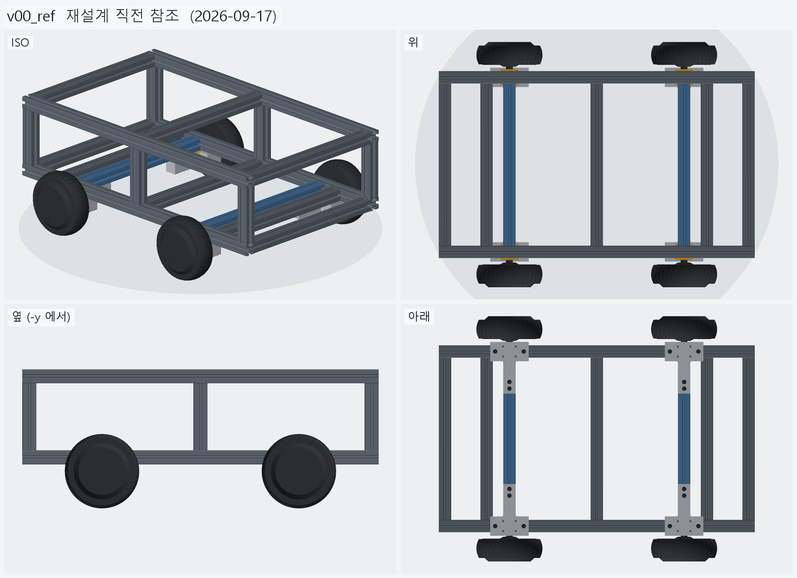

# v00_ref — 재설계 직전 참조

- 날짜: 2026-09-17 (09-17 `floor_plate.py` 장면 기준, 2026-10-04 에 다시 세움)
- **설계 버전이 아니다.** v01_base 의 변화 이미지를 만들기 위한 비교 기준이다.
- 코드: [assembly.py](assembly.py) — 클램프 · 바퀴는 `v01_base` 의 동결 사본을 불러 쓴다
  (09-17 설정이 v01 고정값과 같다: `LOW_SHELF=True`, `SHELF_KIND=tongue`, `TIE=False`)

## 무엇이 들어 있나

- 프레임 3030 760×450 — 하부사이드 2, 하부크로스 3 (x=0, ±365), 축크로스 2 (**±265**),
  기둥 6 (143, x=0·±365), 상부사이드 2, 상부크로스 3
- H 크로스 2 (±210) — 혀 선반이 이 밑면을 물었다
- 바퀴 · T 클램프 · 상부 클램프 · 볼트 — v01 과 같다
- 뺀 것: 바닥판 (아크릴), 케이블 경로, 셸 · 외장

<!-- record:begin — record.py 가 덮어쓴다. 이 사이는 손으로 고치지 않는다 -->
## 기록 (자동 · record.py · 2026-10-04 00:57)

**요약** — 09-17 마지막 설계 — H 크로스 + 혀 선반 + 상부 프레임 (비교 기준)

### 전체 모습

### 수치

| 항목 | 값 |
|---|---|
| 프레임 3030 | 18 본 + H 크로스 2 본 |
| 기둥 높이 | 143 mm |
| 옛 축크로스 x | ±265 mm |
| 전체 크기 (x × y × z) | 760.0 × 590.2 × 296.9 mm |
| 최저 지상고 (바퀴 제외, 지면 z=0) | 54.9 mm |

### 부품 구성

| 그룹 | 개수 |
|---|---|
| 프레임_3030_18본 | 18 |
| H크로스_3030_2본 | 2 |
| T클램프_혀선반_4개 | 4 |
| 기존_상부클램프_4개 | 4 |
| 휠모터_4개 | 4 |
| 체결볼트_M6x15_16개 | 16 |

<!-- record:end -->
