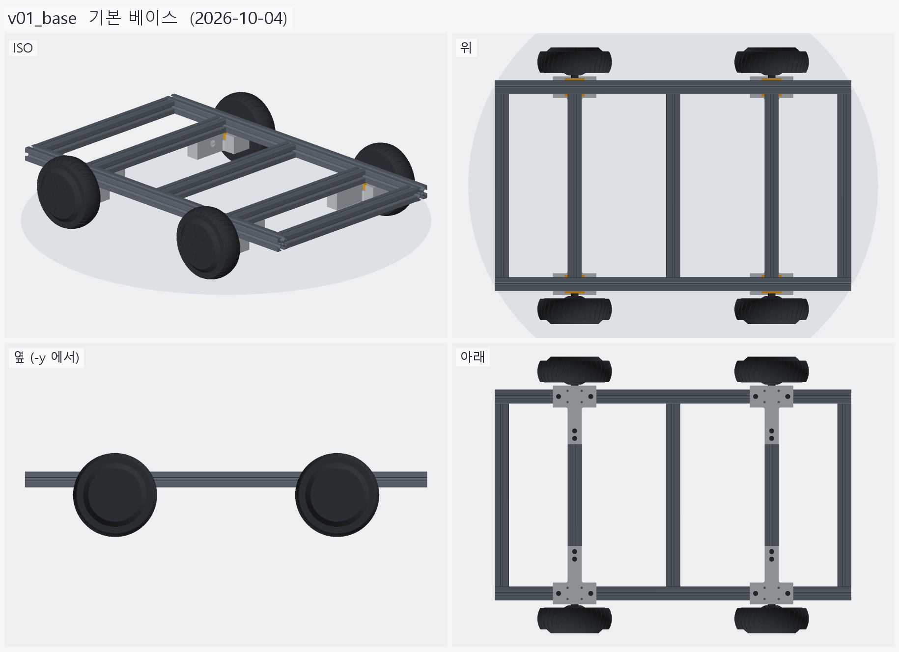
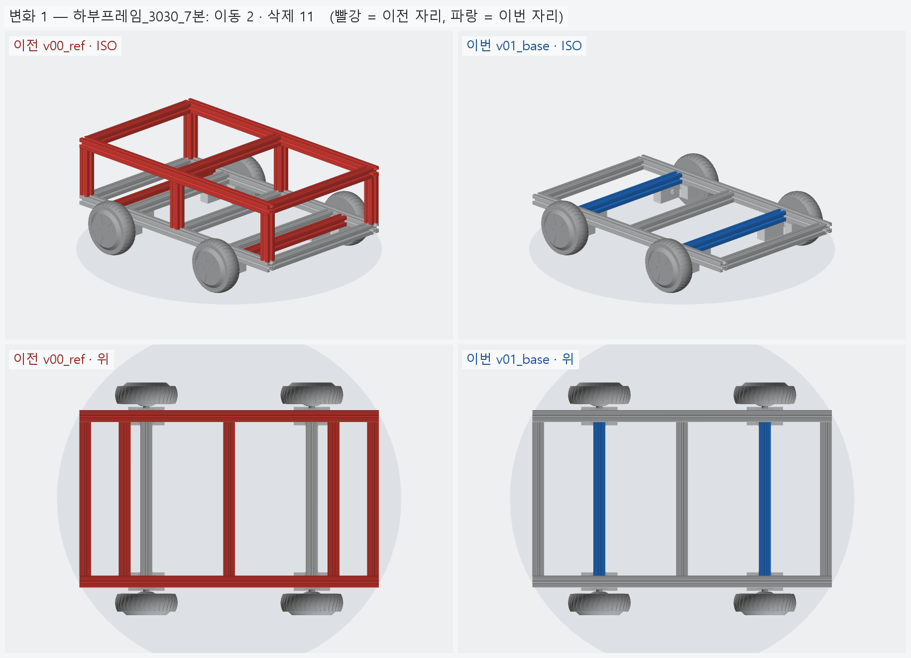
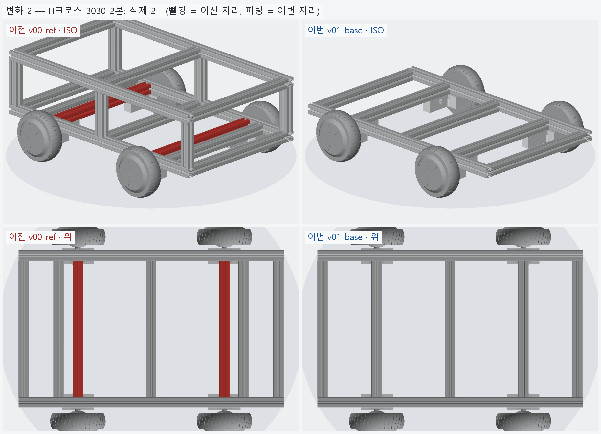

# v01_base — 기본 베이스

- 날짜: 2026-10-04
- 이전 버전: [v00_ref](../v00_ref/README.md) (재설계 직전 09-17 설계, 비교 기준)
- 코드: [assembly.py](assembly.py) + 동결 사본 `parameters.py` `low_clamp.py` `axle.py`
  `extrusion_reference.py` `motor_reference.py` `tslot.py` (2026-10-04 `hoverboard_mount`·`models/` 에서 복사)

## 무엇을 왜 바꿨나

"좀 더 현실적으로 재설계"의 출발점이다. 2026-10-04 세션에서 세 단계로 만들었다.

1. **확인** — 셸까지 들어간 완성 차량 (`vehicle_shell_integration.py`, 기본 설정 = Design-D
   클램프 + 3030 액슬타이 360) 을 뷰어로 봤다.
2. **덜어내기** — 하부 프레임 · 바퀴 · T 자 바퀴 브라켓만 남겼다.
   - 뺀 것: 액슬타이와 코너 브래킷, H 크로스, 상부 프레임 (기둥 6 · 상부 사이드 2 · 상부 크로스 3),
     셸 · 범퍼 · 카메라 등 외장 전부
   - T 자 브라켓 = 09-17 에 출력한 **혀 선반 하부 클램프** (`LOW_SHELF` · `tongue` · 케이블 통로).
     위(아래)에서 보면 클램프 몸체 + 안쪽으로 뻗은 혀가 T 자다.
3. **축크로스 재배치** — 내부 축크로스 2 본을 x=±265 → **±210 (T 클램프 혀 바로 위)**.
   크로스 밑면이 혀 윗면 (= 레일 밑면 높이) 에 얹히고, 혀 볼트 2 개 (바퀴당) 가 크로스 밑면
   슬롯에 물린다. 혀 폭 30 = 크로스 폭이라 크로스가 혀를 그대로 덮는다.
   09-17 설계에서 H 크로스가 하던 일을 하부 프레임 부재가 맡게 되어, 레일 사이 크로스가
   7 본 (크로스 3 + 축크로스 2 + H 크로스 2) → **5 본**이 됐다.

이 버전에서 내린 판단

- 혀 볼트 (혀 → 축크로스) 는 "브라켓끼리 잇는 구조"가 아니라 레일 볼트와 같은
  **브라켓 → 프레임 체결**로 보고 남겼다.
- 축크로스를 ±210 에 두면 옛 자리 (±265) 는 비어 있다. 끝 크로스 (±365) 와 가운데 (0) 는 그대로다.

## 알려진 한계 / 남은 일

- 상부 프레임이 없다 → **v02**: 축크로스 위치에 상부 프레임과 잇는 기둥.
- 젖힘 모멘트 (바퀴가 축 그립보다 53.7 mm 바깥) 를 액슬타이 없이 레일 볼트 + 혀 볼트의
  슬롯 인발로 받는다. 클램프 단품 FEA 는 09-16 `hoverboard_mount/output/fea/clamp_800N_h3mm_petg_e55mm_up_tongue_cable*`
  (구멍 벽 강체 고정 모델) — 크로스와의 접촉 · 프리로드는 모델에 없다.
- M6 스프링너트 인발 하중은 아직 실측 전이다 (보수 하한 1500 N 가정).

<!-- record:begin — record.py 가 덮어쓴다. 이 사이는 손으로 고치지 않는다 -->
## 기록 (자동 · record.py · 2026-10-04 01:11)

**요약** — 하부 프레임 + 바퀴 + T 클램프만 남기고, 축크로스를 ±265 → ±210 (혀 위) 로 옮겼다

### 전체 모습



### 이전 버전(v00_ref) 대비 변화

| # | 그룹 | 변화 | 부품 |
|---|---|---|---|
| 1 | 하부프레임_3030_7본 | 이동 2 · 삭제 11 | 축크로스1 이동 Δ(+55.0, +0.0, +0.0)<br>축크로스2 이동 Δ(-55.0, +0.0, +0.0)<br>기둥 ×6 삭제<br>상부크로스 ×3 삭제<br>상부사이드 ×2 삭제 |
| 2 | H크로스_3030_2본 | 삭제 2 | H크로스 ×2 삭제 |

**변화 1 — 하부프레임_3030_7본**



**변화 2 — H크로스_3030_2본**



### 수치

| 항목 | 값 |
|---|---|
| 프레임 외곽 (x × y) | 760 × 450 mm |
| 휠베이스 (앞뒤 축 간격) | 420 mm |
| 트레드 (좌우 바퀴 중심 간격) | 527.4 mm |
| 레일 윗면 높이 | 123.8 mm |
| 축크로스 x | ±210 mm |
| 3030 절단 | 760 × 2 + 390 × 5 |
| 3030 합계 | 실길이 3.47 m / 과금 3.60 m (34,200원) |
| 체결볼트 M6x15 | 16 개 |
| 전체 크기 (x × y × z) | 760.0 × 590.2 × 158.7 mm |
| 최저 지상고 (바퀴 제외, 지면 z=0) | 54.9 mm |

### 부품 구성

| 그룹 | 개수 |
|---|---|
| 하부프레임_3030_7본 | 7 |
| T클램프_혀선반_4개 | 4 |
| 기존_상부클램프_4개 | 4 |
| 휠모터_4개 | 4 |
| 체결볼트_M6x15_16개 | 16 |

### 검증

```
  간섭 프레임-T클램프: 0.00 mm3
  간섭 프레임-상부클램프: 0.00 mm3
  간섭 프레임-휠모터: 0.00 mm3
  간섭 T클램프-휠모터: 0.00 mm3
  간섭 T클램프-상부클램프: 0.00 mm3
  간섭 볼트-프레임: 0.00 mm3
  간섭 볼트-T클램프: 8.38 mm3 (두께 0.010)
  간섭 볼트-휠모터: 0.00 mm3
  대조군 클램프 +1mm 올림 → 레일 겹침 4006 mm3
  대조군 클램프 +1mm 올림 → 축크로스 겹침 6509 mm3
verify: OK
```

<!-- record:end -->
