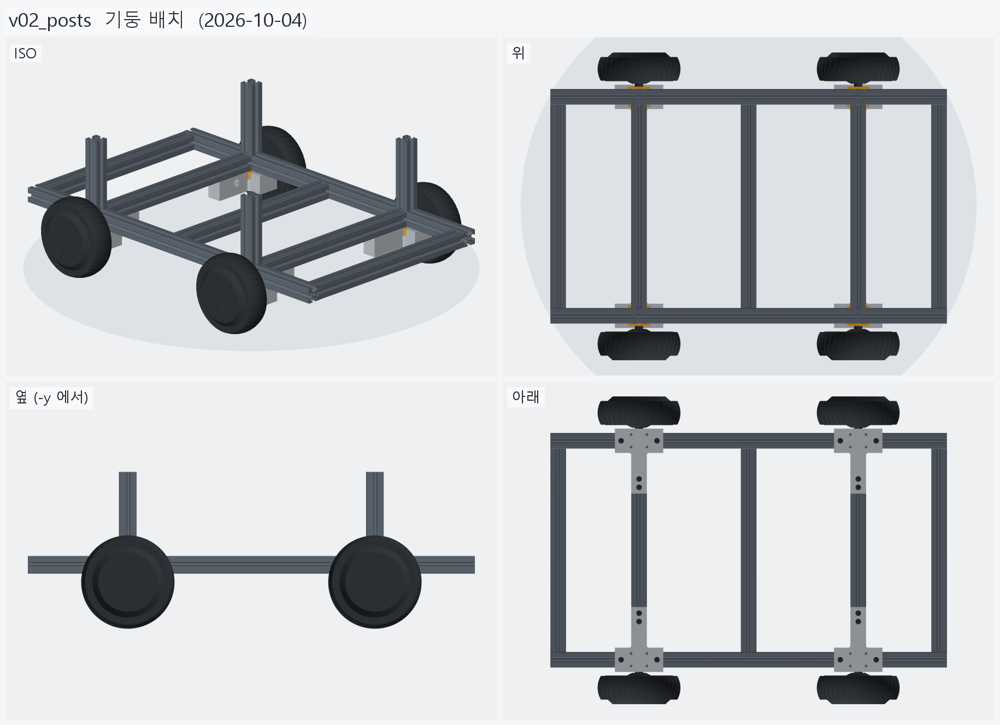
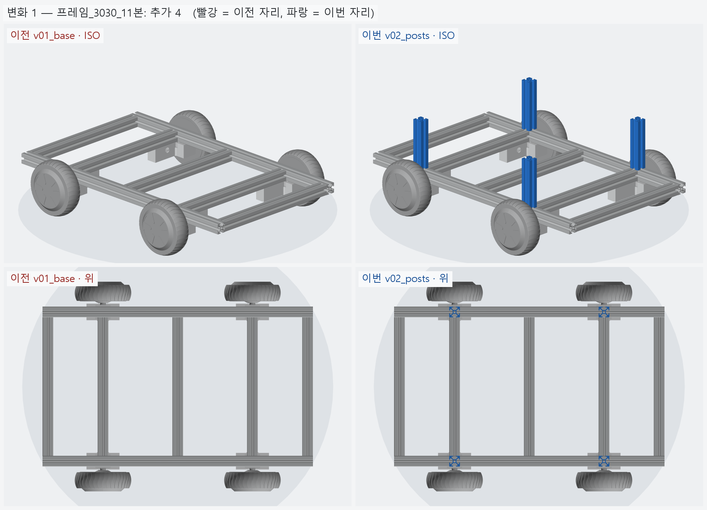

# v02_posts — 기둥 배치

- 날짜: 2026-10-04
- 이전 버전: [v01_base](../v01_base/README.md)
- 코드: [assembly.py](assembly.py) (`posts()` 추가) + v01 동결 사본 그대로

## 무엇을 왜 바꿨나

요청: "하부 프레임 위에 내부 크로스들 위치에 맞게, 기존 상부 프레임과 연결하는 용도의 기둥들을 배치"

- **기둥 4 본** (3030 × 143) 을 축크로스 자리 x=±210 의 사이드 레일 윗면 (y=±210) 에 세웠다.
- 자리를 축크로스에 맞춘 이유 — 그 x 에서 기둥 · 사이드 레일 · 축크로스 끝 · T 클램프 다리가
  **한 단면에 모인다.** 위에서 오는 하중이 레일을 휘게 하지 않고 바로 클램프 → 축으로 내려간다.
- 높이 143 = 옛 상부 프레임 (v00_ref) 과 같다. 상부 레일 밑면이 z=266.8 에 오므로
  옛 상부 프레임 (760 × 450, 상부 사이드 2 + 상부 크로스 3) 을 그대로 얹을 수 있다.
- 옛 기둥 자리 (x=0, ±365) 에는 세우지 않았다 — 요청이 "내부 크로스 위치"였다.

## 열린 질문 / 남은 일

- **기둥 4 본만이면** 상부 프레임 앞뒤 끝 (±365) 이 기둥에서 155 mm 튀어나온 캔틸레버가 된다.
  끝 기둥 (±365) 을 더할지, 상부 프레임을 줄일지 정해야 한다.
- 기둥 접합 철물 (다이캐스팅 3025 브라켓 등) 이 아직 없다 — 상부 프레임과 같이 정한다.
- 상부 프레임 자체 → v03 후보.

<!-- record:begin — record.py 가 덮어쓴다. 이 사이는 손으로 고치지 않는다 -->
## 기록 (자동 · record.py · 2026-10-04 02:00)

**요약** — 축크로스 자리(x=±210) 레일 위에 상부 프레임용 기둥 4 본 (3030 x 143)

### 전체 모습



### 이전 버전(v01_base) 대비 변화

| # | 그룹 | 변화 | 부품 |
|---|---|---|---|
| 1 | 프레임_3030_11본 | 추가 4 | 기둥 ×4 추가 |

**변화 1 — 프레임_3030_11본**



### 수치

| 항목 | 값 |
|---|---|
| 프레임 외곽 (x × y) | 760 × 450 mm |
| 휠베이스 (앞뒤 축 간격) | 420 mm |
| 트레드 (좌우 바퀴 중심 간격) | 527.4 mm |
| 레일 윗면 높이 | 123.8 mm |
| 축크로스 x | ±210 mm |
| 기둥 | 4 본, x=±210 · y=±210, 높이 143 (상부 레일 밑면 z=266.9) |
| 3030 절단 | 760 × 2 + 390 × 5 + 143 × 4 |
| 3030 합계 | 실길이 4.04 m / 과금 4.40 m (41,800원) |
| 체결볼트 M6x15 | 16 개 |
| 전체 크기 (x × y × z) | 760.0 × 590.2 × 266.9 mm |
| 최저 지상고 (바퀴 제외, 지면 z=0) | 54.9 mm |

### 부품 구성

| 그룹 | 개수 |
|---|---|
| 프레임_3030_11본 | 11 |
| T클램프_혀선반_4개 | 4 |
| 기존_상부클램프_4개 | 4 |
| 휠모터_4개 | 4 |
| 체결볼트_M6x15_16개 | 16 |

### 검증

```
  간섭 프레임-T클램프: 0.00 mm3
  간섭 프레임-상부클램프: 0.00 mm3
  간섭 프레임-휠모터: 0.00 mm3
  간섭 T클램프-휠모터: 0.00 mm3
  간섭 T클램프-상부클램프: 0.00 mm3
  간섭 볼트-프레임: 0.00 mm3
  간섭 볼트-T클램프: 8.38 mm3 (두께 0.010)
  간섭 볼트-휠모터: 0.00 mm3
  대조군 클램프 +1mm 올림 → 레일 겹침 4006 mm3
  대조군 클램프 +1mm 올림 → 축크로스 겹침 6509 mm3
  대조군 기둥 -1mm 내림 → 레일 겹침 1262 mm3
  기둥 ~ 휠모터 최소 간격 15.1 mm (메시 점 기준)
verify: OK
```

### 기록 소요

전체 모습 이미지 5 장 7.4s · 변화 이미지 1 장 2.2s

<!-- record:end -->
