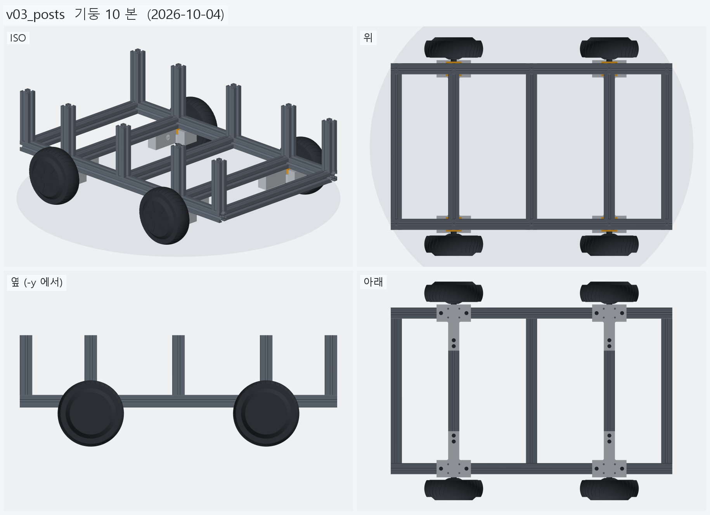
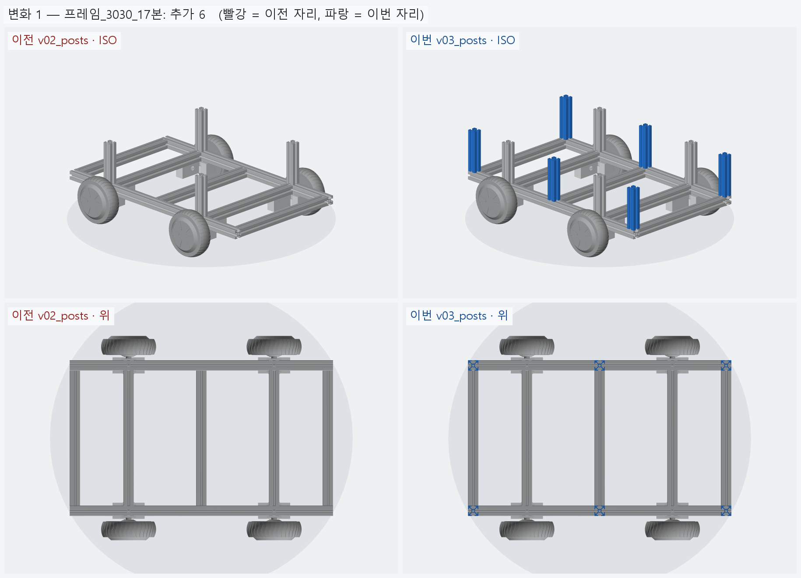

# v03_posts — 기둥 10 본

- 날짜: 2026-10-04
- 이전 버전: [v02_posts](../v02_posts/README.md)
- 코드: [assembly.py](assembly.py) (`posts()` 자리 추가, 빠른 검증) + `tslot.py` (같은 길이 토막 캐시)

## 무엇을 왜 바꿨나

요청: 기둥이 4 본뿐이라 모자라다 — **옛 기둥 자리 6 본 + 축크로스 자리 4 본**.
상부 프레임은 아직 올리지 않는다 (기둥만).

- 좌우 사이드 레일 윗면에 x = -365 · -210 · 0 · +210 · +365 마다 기둥 → **10 본** (3030 × 143).
  하부 크로스 5 본이 레일에 붙는 자리와 같다.
- 기둥1~4 (x=±210) 는 v02 그대로, 기둥5~10 (x=0 · ±365) 이 옛 설계 (v00_ref) 자리다.
- 높이 143 은 옛 상부 프레임에 맞춘 값이다 (기둥 윗면 z=266.8).

경위: 처음 만든 v03 (`v03_upper`) 은 요청과 달리 상부 프레임까지 얹어서 지웠다.

## 열린 질문 / 남은 일

- 기둥 · 레일 접합 철물 (다이캐스팅 3025 브라켓 등) 이 아직 없다.
- 상부 프레임 (언제, 어떤 모양으로 올릴지).

<!-- record:begin — record.py 가 덮어쓴다. 이 사이는 손으로 고치지 않는다 -->
## 기록 (자동 · record.py · 2026-10-04 02:47)

**요약** — 옛 기둥 자리 6 본 (x=0 · ±365) 을 더해 크로스 자리마다 기둥 — 좌우 10 본 (상부 프레임은 아직 없음)

### 전체 모습



### 이전 버전(v02_posts) 대비 변화

| # | 그룹 | 변화 | 부품 |
|---|---|---|---|
| 1 | 프레임_3030_17본 | 추가 6 | 기둥 ×6 추가 |

**변화 1 — 프레임_3030_17본**



### 수치

| 항목 | 값 |
|---|---|
| 프레임 외곽 (x × y) | 760 × 450 mm |
| 휠베이스 (앞뒤 축 간격) | 420 mm |
| 트레드 (좌우 바퀴 중심 간격) | 527.4 mm |
| 레일 윗면 높이 | 123.8 mm |
| 축크로스 x | ±210 mm |
| 기둥 | 10 본, x=0 · ±210 · ±365 × y=±210, 높이 143 (윗면 z=266.9) |
| 3030 절단 | 760 × 2 + 390 × 5 + 143 × 10 |
| 3030 합계 | 실길이 4.90 m / 과금 5.60 m (53,200원) |
| 체결볼트 M6x15 | 16 개 |
| 전체 크기 (x × y × z) | 760.0 × 590.2 × 266.9 mm |
| 최저 지상고 (바퀴 제외, 지면 z=0) | 54.9 mm |

### 부품 구성

| 그룹 | 개수 |
|---|---|
| 프레임_3030_17본 | 17 |
| T클램프_혀선반_4개 | 4 |
| 기존_상부클램프_4개 | 4 |
| 휠모터_4개 | 4 |
| 체결볼트_M6x15_16개 | 16 |

### 검증

```
  간섭 프레임-T클램프: 0.00 mm3
  간섭 프레임-상부클램프: 0.00 mm3
  간섭 프레임-휠모터: 0.00 mm3
  간섭 T클램프-휠모터: 0.00 mm3
  간섭 T클램프-상부클램프: 0.00 mm3
  간섭 볼트-프레임: 0.00 mm3
  간섭 볼트-T클램프: 8.38 mm3 (두께 0.010)
  간섭 볼트-휠모터: 0.00 mm3
  대조군 클램프 +1mm 올림 → 레일 겹침 4006 mm3
  대조군 클램프 +1mm 올림 → 축크로스 겹침 6509 mm3
  대조군 기둥 -1mm 내림 → 레일 겹침 3155 mm3
  기둥 ~ 휠모터 최소 간격 15.1 mm (메시 점 기준)
verify: OK
```

### 기록 소요

불러오기 0.2s · 짓기 5.1s · 검증 8.1s · STEP 0.9s · 뷰어 전송 3.9s · 메시 (11 형상 → 45 부품) 4.2s · 전체 모습 이미지 5 장 2.6s · 변화 이미지 1 장 1.9s

<!-- record:end -->
