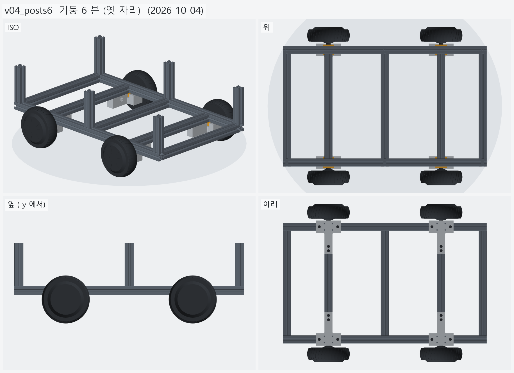
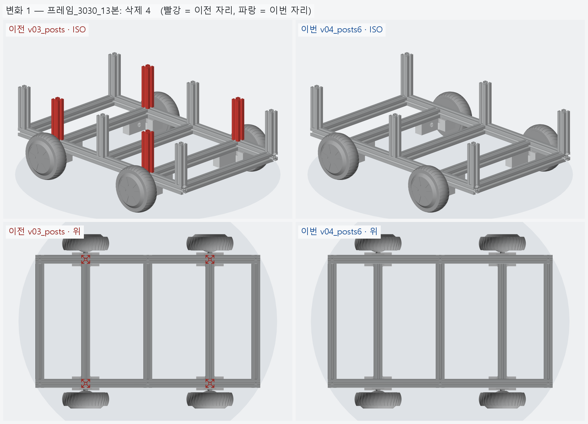

# v04_posts6 — 기둥 6 본 (옛 자리)

- 날짜: 2026-10-04
- 이전 버전: [v03_posts](../v03_posts/README.md)
- 코드: [assembly.py](assembly.py) (`posts()` 자리만 바꿈)

## 무엇을 왜 바꿨나

요청: v03 의 기둥 10 본은 너무 많다 — **예전처럼 6 본만**.

- 옛 설계 (v00_ref) 자리 x = -365 · 0 · +365 × 좌우 레일 → 6 본 (기둥5~10, v03 과 같은 이름).
- 축크로스 자리 (x=±210) 의 기둥1~4 는 뺐다. 그 자리는 기둥 · 레일 · 축크로스 · T 클램프가
  한 단면에 모여 위 하중이 바로 클램프로 내려가던 곳이라, 이제 위 하중은 레일을 타고
  클램프까지 155 mm (x=±365 → ±210) 를 건너간다.
- 상부 프레임은 아직 없다 (기둥만).

## 열린 질문 / 남은 일

- 기둥 · 레일 접합 철물 (다이캐스팅 3025 브라켓 등).
- 상부 프레임.

<!-- record:begin — record.py 가 덮어쓴다. 이 사이는 손으로 고치지 않는다 -->
## 기록 (자동 · record.py · 2026-10-04 02:52)

**요약** — 기둥을 옛 자리 6 본 (x=0 · ±365) 만 남기고 축크로스 자리 (±210) 4 본은 뺐다

### 전체 모습



### 이전 버전(v03_posts) 대비 변화

| # | 그룹 | 변화 | 부품 |
|---|---|---|---|
| 1 | 프레임_3030_13본 | 삭제 4 | 기둥 ×4 삭제 |

**변화 1 — 프레임_3030_13본**



### 수치

| 항목 | 값 |
|---|---|
| 프레임 외곽 (x × y) | 760 × 450 mm |
| 휠베이스 (앞뒤 축 간격) | 420 mm |
| 트레드 (좌우 바퀴 중심 간격) | 527.4 mm |
| 레일 윗면 높이 | 123.8 mm |
| 축크로스 x | ±210 mm |
| 기둥 | 6 본, x=-365 · +0 · +365 × y=±210, 높이 143 (윗면 z=266.9) |
| 3030 절단 | 760 × 2 + 390 × 5 + 143 × 6 |
| 3030 합계 | 실길이 4.33 m / 과금 4.80 m (45,600원) |
| 체결볼트 M6x15 | 16 개 |
| 전체 크기 (x × y × z) | 760.0 × 590.2 × 266.9 mm |
| 최저 지상고 (바퀴 제외, 지면 z=0) | 54.9 mm |

### 부품 구성

| 그룹 | 개수 |
|---|---|
| 프레임_3030_13본 | 13 |
| T클램프_혀선반_4개 | 4 |
| 기존_상부클램프_4개 | 4 |
| 휠모터_4개 | 4 |
| 체결볼트_M6x15_16개 | 16 |

### 검증

```
  간섭 프레임-T클램프: 0.00 mm3
  간섭 프레임-상부클램프: 0.00 mm3
  간섭 프레임-휠모터: 0.00 mm3
  간섭 T클램프-휠모터: 0.00 mm3
  간섭 T클램프-상부클램프: 0.00 mm3
  간섭 볼트-프레임: 0.00 mm3
  간섭 볼트-T클램프: 8.38 mm3 (두께 0.010)
  간섭 볼트-휠모터: 0.00 mm3
  대조군 클램프 +1mm 올림 → 레일 겹침 4006 mm3
  대조군 클램프 +1mm 올림 → 축크로스 겹침 6509 mm3
  대조군 기둥 -1mm 내림 → 레일 겹침 1893 mm3
  기둥 ~ 휠모터 최소 간격 74.0 mm (메시 점 기준)
verify: OK
```

### 기록 소요

불러오기 0.1s · 짓기 7.1s · 검증 13.1s · STEP 1.6s · 뷰어 전송 3.2s · 메시 (11 형상 → 41 부품) 8.5s · 전체 모습 이미지 5 장 4.8s · 변화 이미지 1 장 3.2s

<!-- record:end -->
