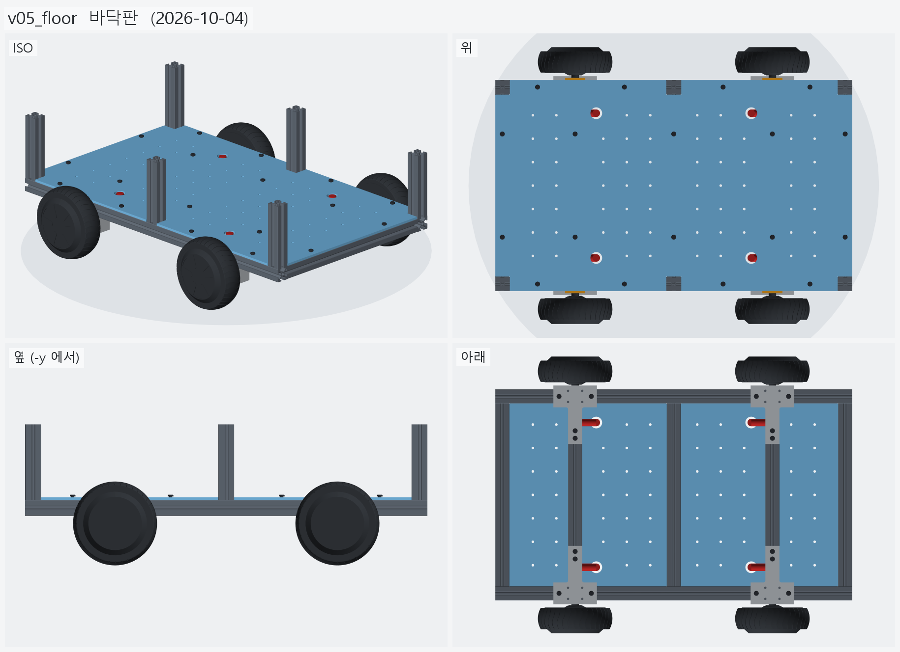
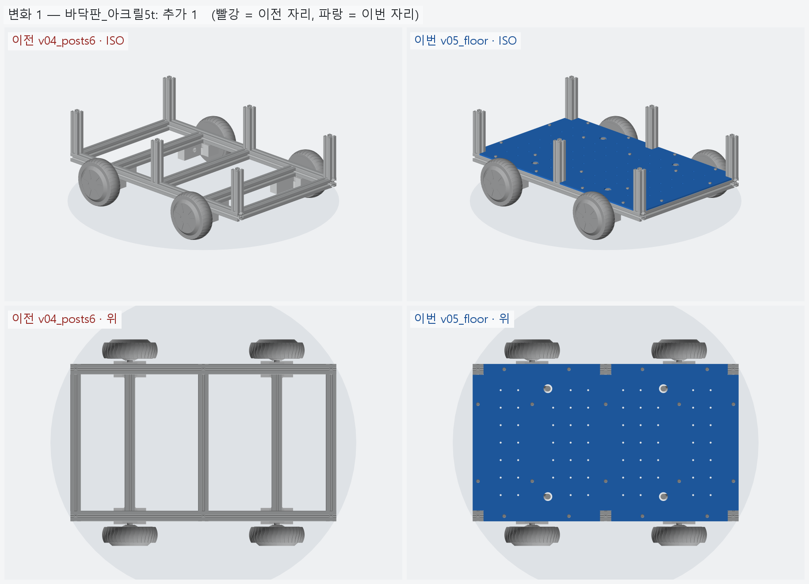
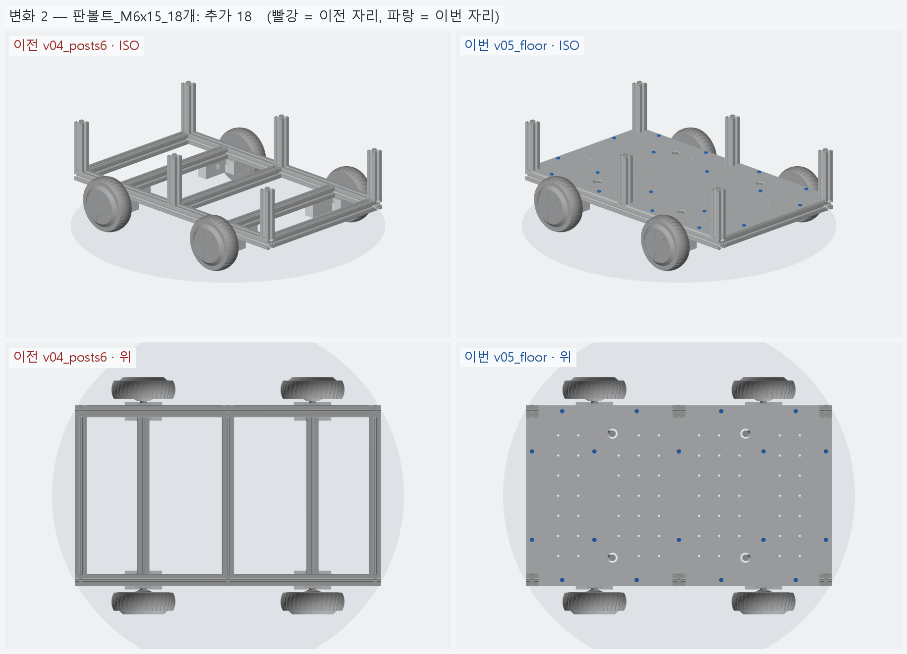
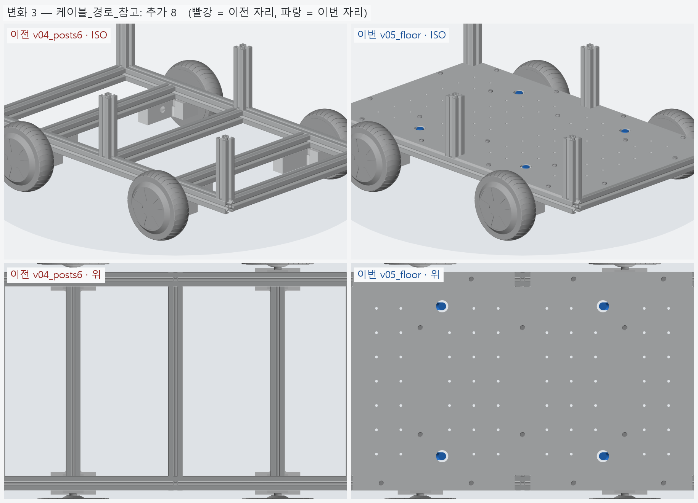

# v05_floor — 바닥판

- 날짜: 2026-10-04
- 이전 버전: [v04_posts6](../v04_posts6/README.md)
- 코드: [assembly.py](assembly.py) + [floor.py](floor.py) (바닥판). 재단: [floor_plate_cut.md](floor_plate_cut.md),
  `output/floor_plate.dxf`, 도면 `output/floor_plate.png`

## 무엇을 왜 바꿨나

요청: 하부 프레임 위 바닥판 — 기둥을 피하고, 프로파일에 고정할 나사 구멍, 바퀴 케이블이 올라올 구멍.

- 760 × 450 (하부 프레임 외곽 그대로), 레일 · 크로스 윗면에 얹힌다 (밑면 z=123.85).
- **기둥 노치 6** — x=0 · ±365, 기둥 30×30 + 한쪽 1 mm 여유, 판 가장자리에서 판다.
- **M6 고정 18** — 크로스 5 본 윗면 슬롯 (y=±110) 10 + 사이드 레일 윗면 슬롯 (x=±105 · ±290) 8.
  스프링너트 + 와셔. 5t 면 M6x15 가 딱 맞는다 (지금 쓰는 볼트와 같다).
- **케이블 그로밋 4 (Ø25)** — T 클램프 혀 옆면 출구 (x=±195, y=±154, 축 높이) 에서 안쪽 30 → 위로.
  케이블 길 (Ø16 튜브) 이 프레임 · 클램프 · 판과 간섭 0 인 것을 검사했다.
- **M5 장비 격자 66** — 50 mm 간격. 볼트 · 그로밋 · 노치 근처와 **프레임 빔 바로 위**는 뺐다
  (처음엔 크로스 위에도 구멍이 있었다 — 볼트가 빔에 막혀 못 쓴다).
- 재료는 `floor.MATERIAL` 하나로 바꾼다 (기본 아크릴 5t, 후보 PC 5t · 알루미늄 5052 3t · 자작합판 9t).

## 남은 일 / 다음 버전 후보

- 재료 확정 (아크릴이면 사이드 레일 볼트 구멍이 가장자리에서 11.8 mm 라 살살 조인다).
- 판 위 부품 배치 — 배터리 · 모터 드라이버 · 젯슨 · 전원 (v06 후보).

<!-- record:begin — record.py 가 덮어쓴다. 이 사이는 손으로 고치지 않는다 -->
## 기록 (자동 · record.py · 2026-10-04 03:03)

**요약** — 하부 프레임 위 바닥판 — 기둥 노치 6 · M6 고정 18 · 케이블 그로밋 4 · M5 격자 (아크릴 5t 기준)

### 전체 모습



### 이전 버전(v04_posts6) 대비 변화

| # | 그룹 | 변화 | 부품 |
|---|---|---|---|
| 1 | 바닥판_아크릴5t | 추가 1 | 바닥판 추가 |
| 2 | 판볼트_M6x15_18개 | 추가 18 | 판볼트 ×18 추가 |
| 3 | 케이블_경로_참고 | 추가 8 | 케이블1_수평 추가<br>케이블1_수직 추가<br>케이블2_수평 추가<br>케이블2_수직 추가<br>케이블3_수평 추가<br>케이블3_수직 추가<br>케이블4_수평 추가<br>케이블4_수직 추가 |

**변화 1 — 바닥판_아크릴5t**



**변화 2 — 판볼트_M6x15_18개**



**변화 3 — 케이블_경로_참고**



### 수치

| 항목 | 값 |
|---|---|
| 프레임 외곽 (x × y) | 760 × 450 mm |
| 휠베이스 (앞뒤 축 간격) | 420 mm |
| 트레드 (좌우 바퀴 중심 간격) | 527.4 mm |
| 레일 윗면 높이 | 123.8 mm |
| 축크로스 x | ±210 mm |
| 기둥 | 6 본, x=-365 · +0 · +365 × y=±210, 높이 143 (윗면 z=266.9) |
| 3030 절단 | 760 × 2 + 390 × 5 + 143 × 6 |
| 3030 합계 | 실길이 4.33 m / 과금 4.80 m (45,600원) |
| 체결볼트 M6x15 | 16 개 |
| 바닥판 재료 | 아크릴 (PMMA) 5t — 레이저 깔끔 · 투명 · 싸다 / 충격 · 볼트 조임에 갈라진다 |
| 바닥판 크기 · 무게 | 760 × 450 × 5, 약 1.98 kg |
| 바닥판 구멍 | M6 고정 18 · 그로밋 Ø25 4 · M5 격자 66 · 기둥 노치 6 |
| 판볼트 | M6x15 + 와셔 (필요 15.0 ~ 최대 15.8) |
| 받침 없는 구간 (크로스 안쪽면 사이) | 125 · 180 · 180 · 125 mm |
| 전체 크기 (x × y × z) | 760.0 × 590.2 × 266.9 mm |
| 최저 지상고 (바퀴 제외, 지면 z=0) | 54.9 mm |

### 부품 구성

| 그룹 | 개수 |
|---|---|
| 프레임_3030_13본 | 13 |
| T클램프_혀선반_4개 | 4 |
| 기존_상부클램프_4개 | 4 |
| 휠모터_4개 | 4 |
| 체결볼트_M6x15_16개 | 16 |
| 바닥판_아크릴5t | 1 |
| 판볼트_M6x15_18개 | 18 |
| 케이블_경로_참고 | 8 |

### 검증

```
  간섭 프레임-T클램프: 0.00 mm3
  간섭 프레임-상부클램프: 0.00 mm3
  간섭 프레임-휠모터: 0.00 mm3
  간섭 T클램프-휠모터: 0.00 mm3
  간섭 T클램프-상부클램프: 0.00 mm3
  간섭 볼트-프레임: 0.00 mm3
  간섭 볼트-T클램프: 8.38 mm3 (두께 0.010)
  간섭 볼트-휠모터: 0.00 mm3
  대조군 클램프 +1mm 올림 → 레일 겹침 4006 mm3
  대조군 클램프 +1mm 올림 → 축크로스 겹침 6509 mm3
  대조군 기둥 -1mm 내림 → 레일 겹침 1893 mm3
  기둥 ~ 휠모터 최소 간격 74.0 mm (메시 점 기준)
  간섭 바닥판-프레임 (기둥 포함): 0.00 mm3
  간섭 바닥판-T클램프: 0.00 mm3
  간섭 바닥판-휠모터: 0.00 mm3
  간섭 판볼트-프레임: 0.00 mm3
  간섭 판볼트-바닥판: 0.00 mm3
  간섭 케이블-프레임: 0.00 mm3
  간섭 케이블-T클램프: 0.00 mm3
  간섭 케이블-상부클램프: 0.00 mm3
  간섭 케이블-휠모터: 0.00 mm3
  간섭 케이블-바닥판: 0.00 mm3
  대조군 바닥판 -0.5mm → 프레임 겹침 33331 mm3
  판볼트 길이: 필요 15.0 ~ 최대 15.8 → M6x15
verify: OK
```

### 기록 소요

불러오기 0.1s · 짓기 8.5s · 검증 23.4s · STEP 5.6s · 내보내기 3.9s · 뷰어 전송 15.9s · 메시 (21 형상 → 68 부품) 16.2s · 전체 모습 이미지 5 장 4.9s · 변화 이미지 3 장 14.1s

<!-- record:end -->
