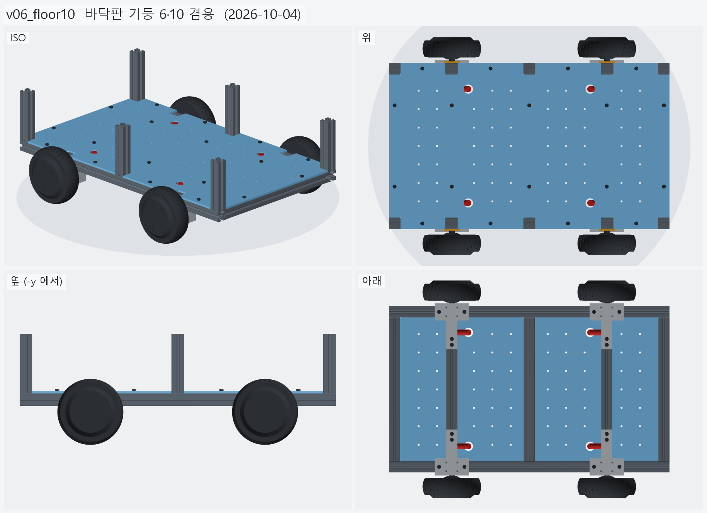
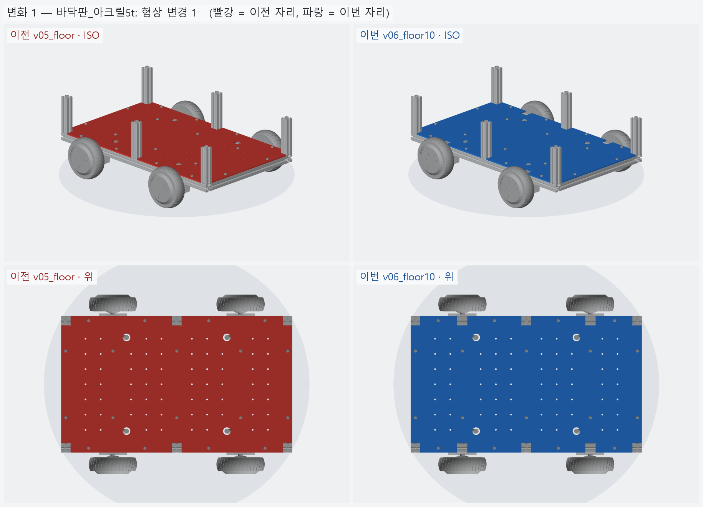

# v06_floor10 — 바닥판 기둥 6·10 겸용

- 날짜: 2026-10-04
- 이전 버전: [v05_floor](../v05_floor/README.md)
- 코드: [floor.py](floor.py) (`notch_xs` = 크로스 자리 전부), [assembly.py](assembly.py) (10 본 겸용 검사).
  재단: [floor_plate_cut.md](floor_plate_cut.md), `output/floor_plate.dxf`, 도면 `output/floor_plate.png`

## 무엇을 왜 바꿨나

요청: 지금은 기둥 6 본이지만 10 본이 될 수도 있으니, 바닥판이 10 본에도 맞는 형태여야 한다.

- 기둥 노치를 기둥이 **서 있는 자리**가 아니라 **설 수 있는 자리** (크로스 5 곳 x=0 · ±210 · ±365) 전부에 판다
  → 노치 6 → **10**. 축 자리 (±210) 노치 4 개는 지금은 비어 있다.
- 나머지 구멍 규칙은 v05 그대로 (M6 18 · 그로밋 4 · M5 격자 — 노치 근처 격자는 자동으로 빠진다).
- 검사: 축 자리에 가상 기둥 4 본을 세워 판과 간섭 0. 대조군으로 노치 없는 통판은 같은 가상 기둥과 겹쳐야 한다.

## 남은 일 / 다음 버전 후보

- 재료 확정 (아크릴이면 노치 안쪽 모서리를 R2~3 으로 둥글리는 걸 권한다).
- 판 위 부품 배치 (배터리 · 드라이버 · 젯슨 · 전원).

<!-- record:begin — record.py 가 덮어쓴다. 이 사이는 손으로 고치지 않는다 -->
## 기록 (자동 · record.py · 2026-10-04 03:06)

**요약** — 바닥판 노치를 크로스 5 곳 전부 (10 개) 로 — 기둥 6 본 · 10 본 어느 쪽이든 같은 판

### 전체 모습



### 이전 버전(v05_floor) 대비 변화

| # | 그룹 | 변화 | 부품 |
|---|---|---|---|
| 1 | 바닥판_아크릴5t | 형상 변경 1 | 바닥판 형상 변경 (부피 1660.2 → 1639.1 cm³) |

**변화 1 — 바닥판_아크릴5t**



### 수치

| 항목 | 값 |
|---|---|
| 프레임 외곽 (x × y) | 760 × 450 mm |
| 휠베이스 (앞뒤 축 간격) | 420 mm |
| 트레드 (좌우 바퀴 중심 간격) | 527.4 mm |
| 레일 윗면 높이 | 123.8 mm |
| 축크로스 x | ±210 mm |
| 기둥 | 6 본, x=-365 · +0 · +365 × y=±210, 높이 143 (윗면 z=266.9) |
| 3030 절단 | 760 × 2 + 390 × 5 + 143 × 6 |
| 3030 합계 | 실길이 4.33 m / 과금 4.80 m (45,600원) |
| 체결볼트 M6x15 | 16 개 |
| 바닥판 재료 | 아크릴 (PMMA) 5t — 레이저 깔끔 · 투명 · 싸다 / 충격 · 볼트 조임에 갈라진다 |
| 바닥판 크기 · 무게 | 760 × 450 × 5, 약 1.95 kg |
| 바닥판 구멍 | M6 고정 18 · 그로밋 Ø25 4 · M5 격자 66 · 기둥 노치 10 (x=-365 · -210 · +0 · +210 · +365, 기둥 6 · 10 본 겸용) |
| 판볼트 | M6x15 + 와셔 (필요 15.0 ~ 최대 15.8) |
| 받침 없는 구간 (크로스 안쪽면 사이) | 125 · 180 · 180 · 125 mm |
| 전체 크기 (x × y × z) | 760.0 × 590.2 × 266.9 mm |
| 최저 지상고 (바퀴 제외, 지면 z=0) | 54.9 mm |

### 부품 구성

| 그룹 | 개수 |
|---|---|
| 프레임_3030_13본 | 13 |
| T클램프_혀선반_4개 | 4 |
| 기존_상부클램프_4개 | 4 |
| 휠모터_4개 | 4 |
| 체결볼트_M6x15_16개 | 16 |
| 바닥판_아크릴5t | 1 |
| 판볼트_M6x15_18개 | 18 |
| 케이블_경로_참고 | 8 |

### 검증

```
  간섭 프레임-T클램프: 0.00 mm3
  간섭 프레임-상부클램프: 0.00 mm3
  간섭 프레임-휠모터: 0.00 mm3
  간섭 T클램프-휠모터: 0.00 mm3
  간섭 T클램프-상부클램프: 0.00 mm3
  간섭 볼트-프레임: 0.00 mm3
  간섭 볼트-T클램프: 8.38 mm3 (두께 0.010)
  간섭 볼트-휠모터: 0.00 mm3
  대조군 클램프 +1mm 올림 → 레일 겹침 4006 mm3
  대조군 클램프 +1mm 올림 → 축크로스 겹침 6509 mm3
  대조군 기둥 -1mm 내림 → 레일 겹침 1893 mm3
  기둥 ~ 휠모터 최소 간격 74.0 mm (메시 점 기준)
  간섭 바닥판-프레임 (기둥 포함): 0.00 mm3
  간섭 바닥판-T클램프: 0.00 mm3
  간섭 바닥판-휠모터: 0.00 mm3
  간섭 판볼트-프레임: 0.00 mm3
  간섭 판볼트-바닥판: 0.00 mm3
  간섭 케이블-프레임: 0.00 mm3
  간섭 케이블-T클램프: 0.00 mm3
  간섭 케이블-상부클램프: 0.00 mm3
  간섭 케이블-휠모터: 0.00 mm3
  간섭 케이블-바닥판: 0.00 mm3
  대조군 바닥판 -0.5mm → 프레임 겹침 31907 mm3
  10 본 겸용: 축 자리 가상 기둥 4 본 ~ 바닥판 간섭 0.00 mm3
  대조군 노치 없는 판 ~ 가상 기둥 겹침 7682 mm3
  판볼트 길이: 필요 15.0 ~ 최대 15.8 → M6x15
verify: OK
```

### 기록 소요

불러오기 0.1s · 짓기 5.0s · 검증 19.2s · STEP 1.8s · 내보내기 1.4s · 뷰어 전송 4.6s · 메시 (21 형상 → 68 부품) 5.7s · 전체 모습 이미지 5 장 4.5s · 변화 이미지 1 장 3.2s

<!-- record:end -->
