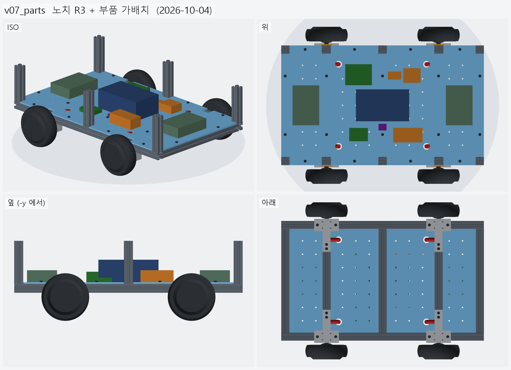
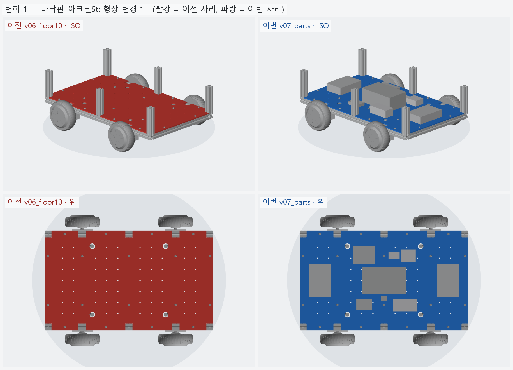
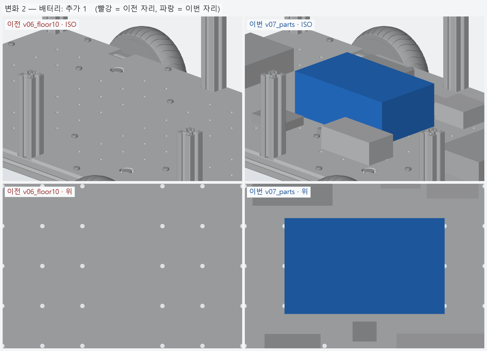
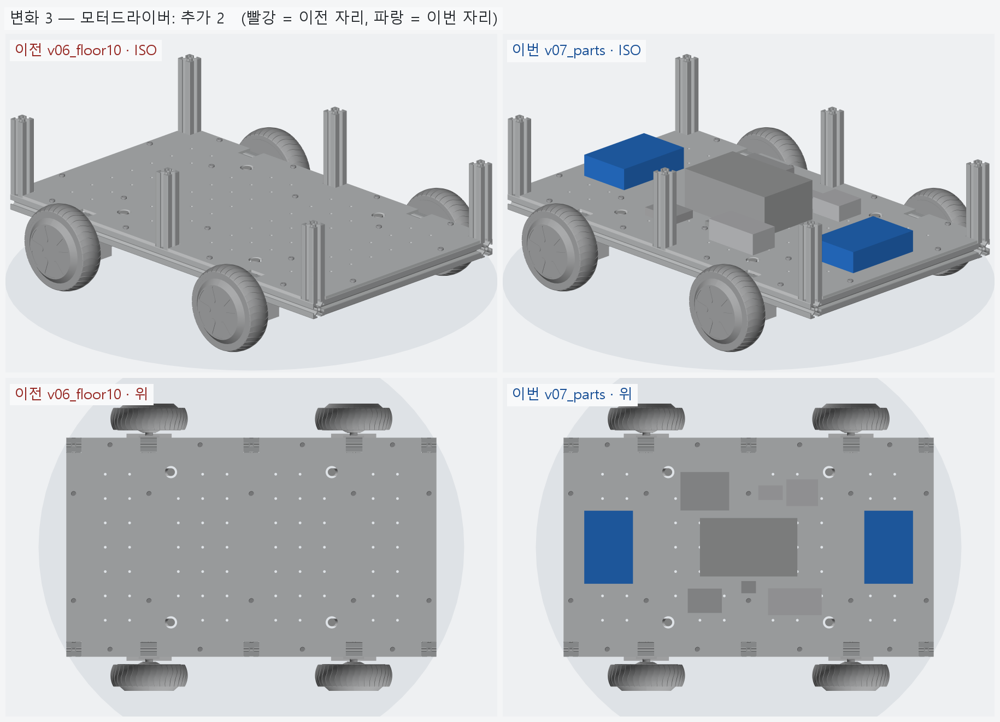
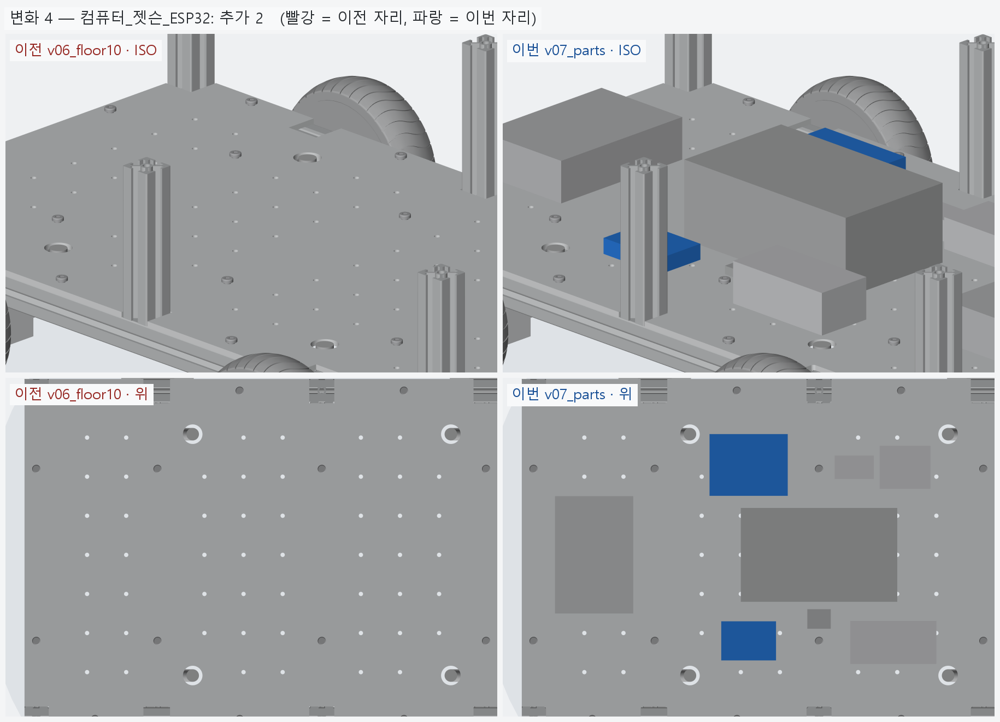
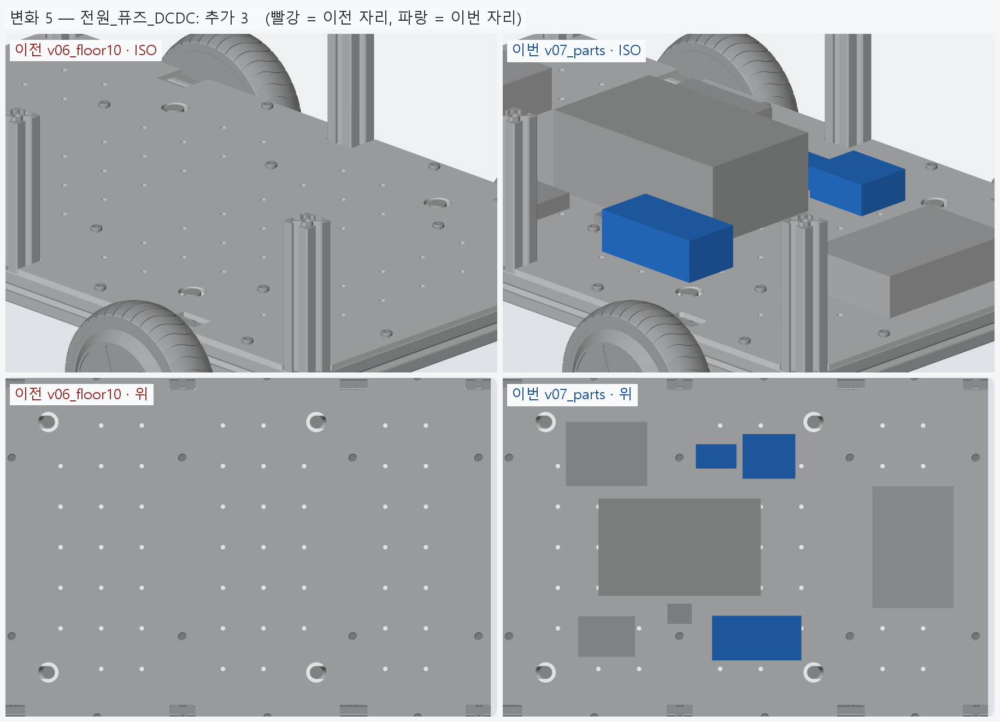
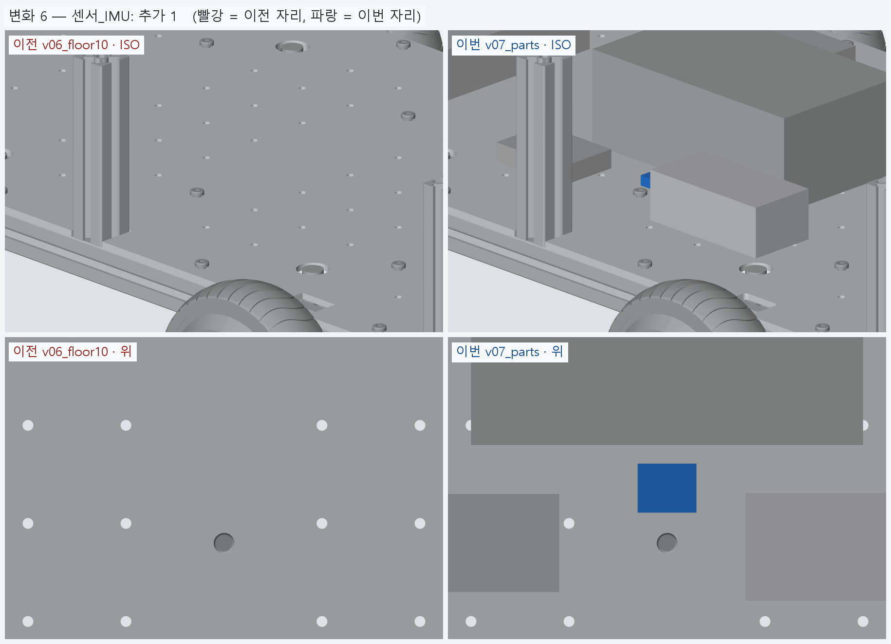

# v07_parts — 노치 R3 + 부품 가배치

- 날짜: 2026-10-04
- 이전 버전: [v06_floor10](../v06_floor10/README.md)
- 코드: [floor.py](floor.py) (`NOTCH_R`), [parts.py](parts.py) (부품 표 — 치수 · 자리 · 무게), [assembly.py](assembly.py)

## 무엇을 왜 바꿨나

요청: 노치 모서리를 R3 로 둥글리고, 필요하다고 정리한 부품을 가형태로 판 위에 올린다.

- **노치 R3** — 노치 10 개 안쪽 모서리. 아크릴은 직각 오목 모서리에서 금이 시작된다.
  노치 여유 (한쪽 1 mm) 안에서 둥글려서 기둥과 안 닿는다 (가상 기둥 10 본 검사 포함).
- **부품 가형태 9 개** (상자, 치수 · 무게는 어림값 — 실물 재면 `parts.py` 의 숫자만 바꾼다)

| 부품 | 크기 (x·y·z) | 자리 | 이유 |
|---|---|---|---|
| 배터리 36V 10S6P | 200·120·75 | 가운데 (x=0 크로스 위) | 제일 무겁다 — 무게중심 가운데, 크로스가 받친다 |
| 모터드라이버 앞 · 뒤 (ZLAC8015D) | 100·150·40 | 앞 · 뒤 끝 칸 (x=±287.5) | 바퀴 케이블 그로밋과 가깝게 — 3 상선 짧게 |
| 전원분배 (퓨즈 · 스위치 · 버스바) | 110·55·40 | 배터리 앞 오른쪽 | 배터리 바로 옆에 모은다 |
| DC-DC 36→19V (젯슨) · 36→5V | 65·55·30 · 50·30·20 | 배터리 앞 왼쪽 | 〃 |
| 젯슨 오린 나노 | 100·79·35 | 뒤 칸 왼쪽 | 드라이버 열 · 노이즈에서 떨어지고 위가 트임 |
| ESP32 | 70·50·15 | 뒤 칸 오른쪽 | 젯슨 옆 |
| IMU | 30·25·8 | 가운데 (배터리 옆) | 차체 중심 가까이 |

- 라이다 · 카메라 · 비상정지 버튼은 상부에 갈 것이라 이번엔 없다.
- 검사: 부품끼리 · 기둥 · 판볼트 머리와 안 겹침, 판 밖으로 안 나감, 케이블 그로밋 위 (반경 15, 높이 40) 를 안 막음.

## 남은 일 / 다음 버전 후보

- 부품 실측 치수 · 고정 방법 (밴드 · 브라켓 · 스탠드오프).
- 배선 (전원 굵은 선 · 3 상선 · 신호선) 경로.
- 상부 프레임 · 상부 센서.

<!-- record:begin — record.py 가 덮어쓴다. 이 사이는 손으로 고치지 않는다 -->
## 기록 (자동 · record.py · 2026-10-04 03:27)

**요약** — 노치 모서리 R3, 판 위에 부품 가형태 9 개 (배터리 · 드라이버 2 · 젯슨 · ESP32 · 전원 3 · IMU)

### 전체 모습



### 이전 버전(v06_floor10) 대비 변화

| # | 그룹 | 변화 | 부품 |
|---|---|---|---|
| 1 | 바닥판_아크릴5t | 형상 변경 1 | 바닥판 형상 변경 (부피 1639.1 → 1639.3 cm³) |
| 2 | 배터리 | 추가 1 | 배터리_36V_10S6P 추가 |
| 3 | 모터드라이버 | 추가 2 | 모터드라이버_앞_ZLAC8015D 추가<br>모터드라이버_뒤_ZLAC8015D 추가 |
| 4 | 컴퓨터_젯슨_ESP32 | 추가 2 | 젯슨_오린나노_개발킷 추가<br>ESP32_보드 추가 |
| 5 | 전원_퓨즈_DCDC | 추가 3 | 전원분배_퓨즈40A_스위치_버스바 추가<br>DCDC_36V-19V_젯슨 추가<br>DCDC_36V-5V 추가 |
| 6 | 센서_IMU | 추가 1 | IMU_BNO085 추가 |

**변화 1 — 바닥판_아크릴5t**



**변화 2 — 배터리**



**변화 3 — 모터드라이버**



**변화 4 — 컴퓨터_젯슨_ESP32**



**변화 5 — 전원_퓨즈_DCDC**



**변화 6 — 센서_IMU**



### 수치

| 항목 | 값 |
|---|---|
| 프레임 외곽 (x × y) | 760 × 450 mm |
| 휠베이스 (앞뒤 축 간격) | 420 mm |
| 트레드 (좌우 바퀴 중심 간격) | 527.4 mm |
| 레일 윗면 높이 | 123.8 mm |
| 축크로스 x | ±210 mm |
| 기둥 | 6 본, x=-365 · +0 · +365 × y=±210, 높이 143 (윗면 z=266.9) |
| 3030 절단 | 760 × 2 + 390 × 5 + 143 × 6 |
| 3030 합계 | 실길이 4.33 m / 과금 4.80 m (45,600원) |
| 체결볼트 M6x15 | 16 개 |
| 바닥판 재료 | 아크릴 (PMMA) 5t — 레이저 깔끔 · 투명 · 싸다 / 충격 · 볼트 조임에 갈라진다 |
| 바닥판 크기 · 무게 | 760 × 450 × 5, 약 1.95 kg |
| 바닥판 구멍 | M6 고정 18 · 그로밋 Ø25 4 · M5 격자 66 · 기둥 노치 10 (x=-365 · -210 · +0 · +210 · +365, 기둥 6 · 10 본 겸용) |
| 판볼트 | M6x15 + 와셔 (필요 15.0 ~ 최대 15.8) |
| 받침 없는 구간 (크로스 안쪽면 사이) | 125 · 180 · 180 · 125 mm |
| 부품 (가형태) | 9 개, 합 5.49 kg (어림값) |
| 부품 무게중심 | x=+4.1 · y=+2.5 · z=158.6 mm (휠베이스 가운데 x=0 기준) |
| 가장 높은 부품 윗면 | z=203.8 — 기둥 윗면 z=266.9 까지 63.0 mm 남음 |
| 전체 크기 (x × y × z) | 760.0 × 590.2 × 266.9 mm |
| 최저 지상고 (바퀴 제외, 지면 z=0) | 54.9 mm |

### 부품 구성

| 그룹 | 개수 |
|---|---|
| 프레임_3030_13본 | 13 |
| T클램프_혀선반_4개 | 4 |
| 기존_상부클램프_4개 | 4 |
| 휠모터_4개 | 4 |
| 체결볼트_M6x15_16개 | 16 |
| 바닥판_아크릴5t | 1 |
| 판볼트_M6x15_18개 | 18 |
| 케이블_경로_참고 | 8 |
| 배터리 | 1 |
| 모터드라이버 | 2 |
| 컴퓨터_젯슨_ESP32 | 2 |
| 전원_퓨즈_DCDC | 3 |
| 센서_IMU | 1 |

### 검증

```
  간섭 프레임-T클램프: 0.00 mm3
  간섭 프레임-상부클램프: 0.00 mm3
  간섭 프레임-휠모터: 0.00 mm3
  간섭 T클램프-휠모터: 0.00 mm3
  간섭 T클램프-상부클램프: 0.00 mm3
  간섭 볼트-프레임: 0.00 mm3
  간섭 볼트-T클램프: 8.38 mm3 (두께 0.010)
  간섭 볼트-휠모터: 0.00 mm3
  대조군 클램프 +1mm 올림 → 레일 겹침 4006 mm3
  대조군 클램프 +1mm 올림 → 축크로스 겹침 6509 mm3
  대조군 기둥 -1mm 내림 → 레일 겹침 1893 mm3
  기둥 ~ 휠모터 최소 간격 74.0 mm (메시 점 기준)
  간섭 바닥판-프레임 (기둥 포함): 0.00 mm3
  간섭 바닥판-T클램프: 0.00 mm3
  간섭 바닥판-휠모터: 0.00 mm3
  간섭 판볼트-프레임: 0.00 mm3
  간섭 판볼트-바닥판: 0.00 mm3
  간섭 케이블-프레임: 0.00 mm3
  간섭 케이블-T클램프: 0.00 mm3
  간섭 케이블-상부클램프: 0.00 mm3
  간섭 케이블-휠모터: 0.00 mm3
  간섭 케이블-바닥판: 0.00 mm3
  대조군 바닥판 -0.5mm → 프레임 겹침 31909 mm3
  10 본 겸용: 축 자리 가상 기둥 4 본 ~ 바닥판 간섭 0.00 mm3
  대조군 노치 없는 판 ~ 가상 기둥 겹침 7682 mm3
  판볼트 길이: 필요 15.0 ~ 최대 15.8 → M6x15
  간섭 부품끼리: 0.00 mm3
  간섭 부품-프레임 (기둥): 0.00 mm3
  간섭 부품-판볼트 머리: 0.00 mm3
  간섭 부품-바닥판: 0.00 mm3
  간섭 부품-케이블 구멍 위 (반경 15): 0.00 mm3
  대조군 부품 -1mm → 바닥판 겹침 76550 mm3
verify: OK
```

### 기록 소요

불러오기 0.1s · 짓기 7.9s · 검증 30.5s · STEP 4.1s · 내보내기 2.9s · 뷰어 전송 6.0s · 메시 (30 형상 → 77 부품) 8.1s · 전체 모습 이미지 5 장 3.8s · 변화 이미지 6 장 16.4s

<!-- record:end -->
