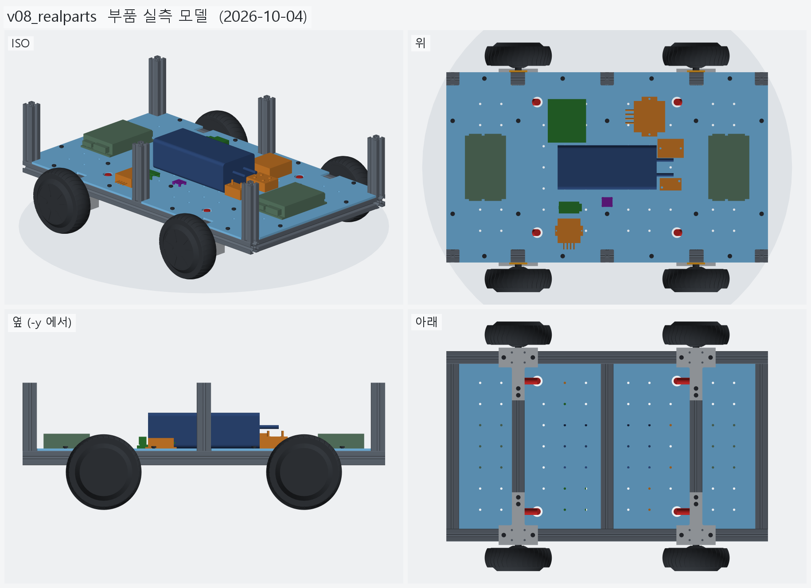
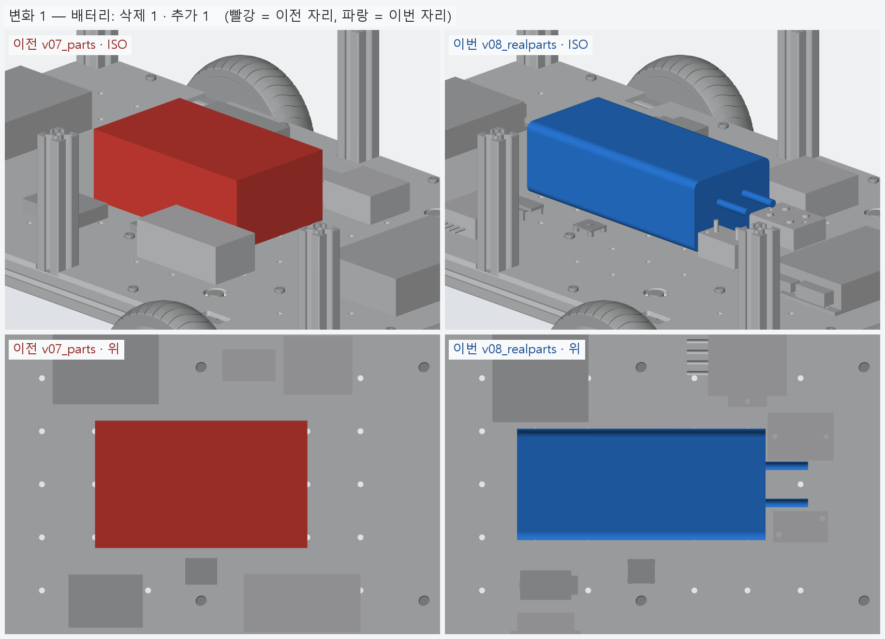
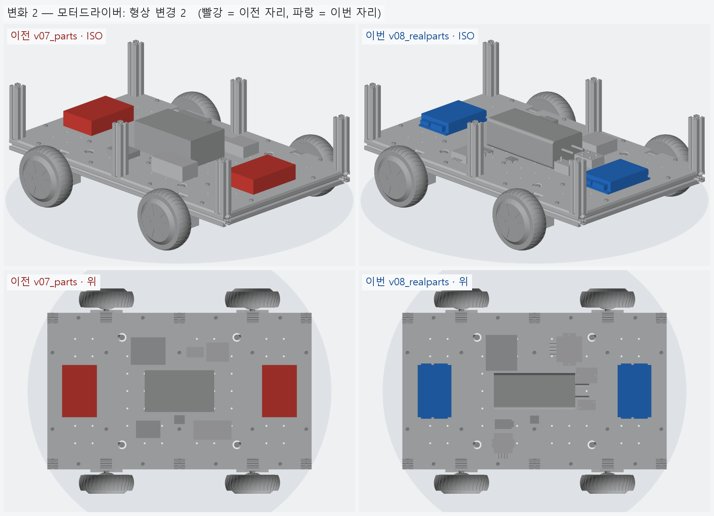
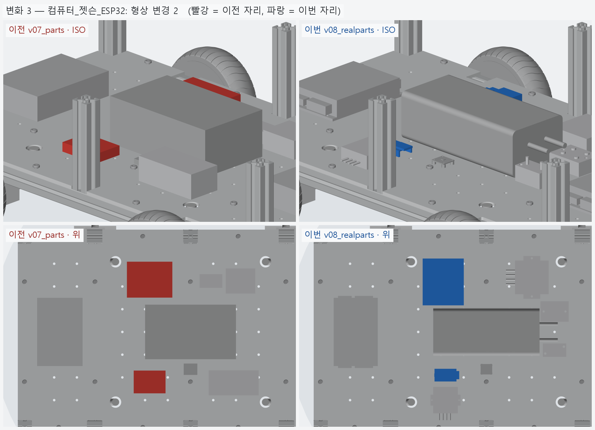
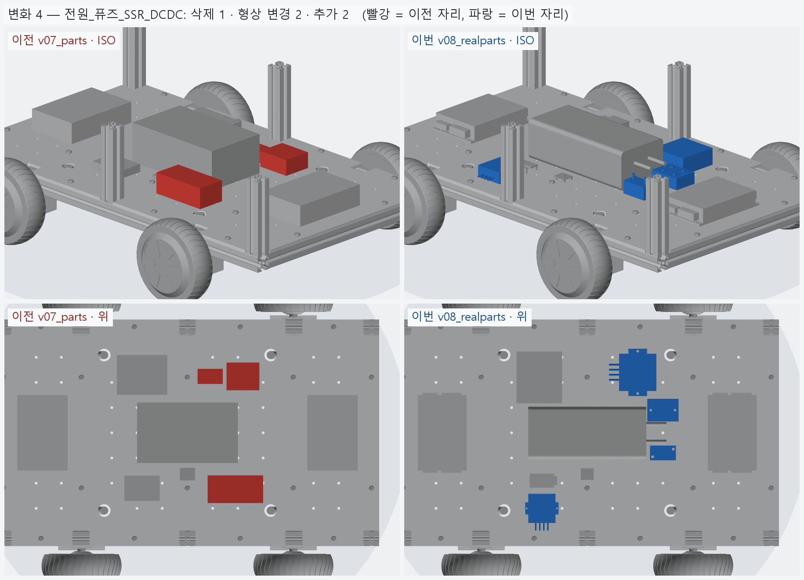
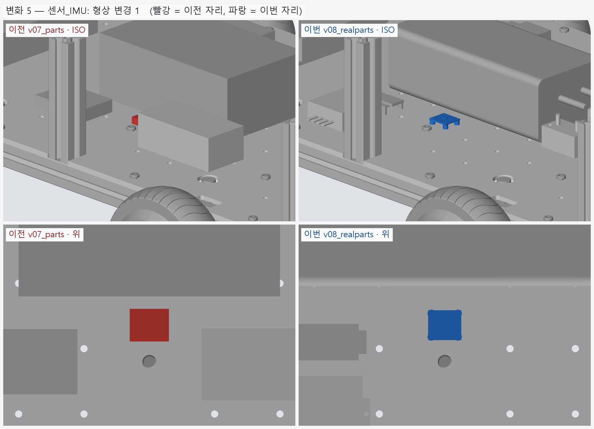

# v08_realparts — 부품 실측 모델

- 날짜: 2026-10-04
- 이전 버전: [v07_parts](../v07_parts/README.md)
- 코드: [components.py](components.py) (부품 형상 빌더), [parts.py](parts.py) (치수 · 출처 · 배치 표), [assembly.py](assembly.py)

## 무엇을 왜 바꿨나

요청: 가형태 상자를 실제 데이터 (치수 · 도면 · 사진) 기반 모델로.

| 부품 | 모델 | 치수 출처 | 형상에 넣은 것 |
|---|---|---|---|
| 배터리 | 볼트온 36V 20Ah | [판매처] 234×105×75, 3.2 kg | 둥근 모서리 팩 + 출력선 2 |
| 모터 드라이버 ×2 | ZLTECH ZLAC8015D | [도면] 150×97×31, 구멍 Ø4.5 · 65.5, [도면 비례] 141.5 | 밑판 귀 구멍 4 · 끝면 착탈 단자 (13.3 돌출) |
| 젯슨 | Orin Nano 개발킷 P3768 | [도면] 103×90.5×34.77, 캐리어 100×79, [도면 비례] 구멍 86×58 · 히트싱크 | 받침 · 캐리어 · 히트싱크 팬 · I/O 커넥터 6 |
| ESP32 | DevKitC V4 | [도면] 48.26×27.94, 헤더 c-c 25.40 | 핀헤더 2 열 · 모듈 (안테나 6.04 돌출) · USB |
| 메인 퓨즈 | Victron MIDI 홀더 CIP000050001 | [도면] 51.36×29.36×25.12, 스터드 c-c 30 | 몸통 · 스터드 M5 · 고정 구멍 대각 2 |
| 모터 전원 차단 | Fotek SSR-40DD | [도면] 62×45×22.5, 고정 c-c 48 Ø4.8 | 몸통 · 고정 구멍 · 나사 단자 4 |
| DC-DC 19V | Fidida 30–60V→19V | [판매처] 74×74×32 | 몸통 · 귀 · 전선 4 (귀 구멍 [가정]) |
| DC-DC 5V | DROK 200656 11–90V→5V | [판매처] 66×58×22 | 몸통 · 귀 · 전선 4 (귀 구멍 [가정]) |
| IMU | Adafruit BNO085 #4754 | [도면] 25.4×22.86, 구멍 20.32×17.78 | 기판 · 스탠드오프 4 · IC |

배치 변경 (치수가 달라져서)
- 드라이버를 90° 돌렸다 — 모터 단자 끝면이 좌 · 우 바퀴 쪽 (그로밋 y=±154) 을 본다.
- 젯슨 I/O 변을 뒤 (-x) 로 — 케이블 꽂을 자리. 전원분배 상자는 MIDI 퓨즈 + SSR 로 나눴다.
- DC-DC 5V 는 ESP32 옆 (뒤 칸) 으로 옮겼다 — 5V 를 쓰는 쪽에 가깝게.

## 실물 받으면 고칠 것 ([가정] 값)

- ZLAC8015D 버전 (구형 매뉴얼은 168×89×29.7), 몸통 / 밑판 나눔, x 구멍 간격.
- 젯슨 받침과 PCB 의 정렬, 커넥터 높이 일부. ESP32 는 고정 구멍이 없어 받침보드가 필요하다.
- DC-DC 두 개의 귀 크기 · 구멍 위치. SSR 단자 자리. 무게 미상: ESP32 · SSR · DC-DC 5V.

<!-- record:begin — record.py 가 덮어쓴다. 이 사이는 손으로 고치지 않는다 -->
## 기록 (자동 · record.py · 2026-10-04 11:13)

**요약** — 부품을 실측 치수 모델로 (볼트온 20Ah · ZLAC8015D · 젯슨 · Victron MIDI · Fotek SSR · DC-DC · BNO085)

### 전체 모습



### 이전 버전(v07_parts) 대비 변화

| # | 그룹 | 변화 | 부품 |
|---|---|---|---|
| 1 | 배터리 | 삭제 1 · 추가 1 | 배터리_36V_10S6P 삭제<br>배터리_36V_20Ah_볼트온 추가 |
| 2 | 모터드라이버 | 형상 변경 2 | 모터드라이버_앞_ZLAC8015D 형상 변경 (부피 600.0 → 426.5 cm³)<br>모터드라이버_뒤_ZLAC8015D 형상 변경 (부피 600.0 → 426.5 cm³) |
| 3 | 컴퓨터_젯슨_ESP32 | 형상 변경 2 | 젯슨_오린나노_개발킷 형상 변경 (부피 276.5 → 149.0 cm³)<br>ESP32_보드 형상 변경 (부피 52.5 → 5.7 cm³) |
| 4 | 전원_퓨즈_SSR_DCDC | 삭제 1 · 형상 변경 2 · 추가 2 | DCDC_36V-19V_젯슨 형상 변경 (부피 107.2 → 178.3 cm³)<br>DCDC_36V-5V 형상 변경 (부피 30.0 → 70.1 cm³)<br>전원분배_퓨즈40A_스위치_버스바 삭제<br>메인퓨즈_MIDI40A_58V 추가<br>SSR_모터전원차단_40A 추가 |
| 5 | 센서_IMU | 형상 변경 1 | IMU_BNO085 형상 변경 (부피 6.0 → 1.5 cm³) |

**변화 1 — 배터리**



**변화 2 — 모터드라이버**



**변화 3 — 컴퓨터_젯슨_ESP32**



**변화 4 — 전원_퓨즈_SSR_DCDC**



**변화 5 — 센서_IMU**



### 수치

| 항목 | 값 |
|---|---|
| 프레임 외곽 (x × y) | 760 × 450 mm |
| 휠베이스 (앞뒤 축 간격) | 420 mm |
| 트레드 (좌우 바퀴 중심 간격) | 527.4 mm |
| 레일 윗면 높이 | 123.8 mm |
| 축크로스 x | ±210 mm |
| 기둥 | 6 본, x=-365 · +0 · +365 × y=±210, 높이 143 (윗면 z=266.9) |
| 3030 절단 | 760 × 2 + 390 × 5 + 143 × 6 |
| 3030 합계 | 실길이 4.33 m / 과금 4.80 m (45,600원) |
| 체결볼트 M6x15 | 16 개 |
| 바닥판 재료 | 아크릴 (PMMA) 5t — 레이저 깔끔 · 투명 · 싸다 / 충격 · 볼트 조임에 갈라진다 |
| 바닥판 크기 · 무게 | 760 × 450 × 5, 약 1.95 kg |
| 바닥판 구멍 | M6 고정 18 · 그로밋 Ø25 4 · M5 격자 66 · 기둥 노치 10 (x=-365 · -210 · +0 · +210 · +365, 기둥 6 · 10 본 겸용) |
| 판볼트 | M6x15 + 와셔 (필요 15.0 ~ 최대 15.8) |
| 받침 없는 구간 (크로스 안쪽면 사이) | 125 · 180 · 180 · 125 mm |
| 부품 | 10 개 (실측 치수 모델, 출처 parts.py) |
| 부품 무게 (알려진 것) | 4.66 kg — 무게 미상: ESP32_보드, SSR_모터전원차단_40A, DCDC_36V-5V |
| 부품 무게중심 | x=+22.0 · y=+9.6 · z=159.7 mm (휠베이스 가운데 x=0 기준) |
| 가장 높은 부품 윗면 | z=203.8 — 기둥 윗면 z=266.9 까지 63.0 mm 남음 |
| 전체 크기 (x × y × z) | 760.0 × 590.2 × 266.9 mm |
| 최저 지상고 (바퀴 제외, 지면 z=0) | 54.9 mm |

### 부품 구성

| 그룹 | 개수 |
|---|---|
| 프레임_3030_13본 | 13 |
| T클램프_혀선반_4개 | 4 |
| 기존_상부클램프_4개 | 4 |
| 휠모터_4개 | 4 |
| 체결볼트_M6x15_16개 | 16 |
| 바닥판_아크릴5t | 1 |
| 판볼트_M6x15_18개 | 18 |
| 케이블_경로_참고 | 8 |
| 배터리 | 1 |
| 모터드라이버 | 2 |
| 컴퓨터_젯슨_ESP32 | 2 |
| 전원_퓨즈_SSR_DCDC | 4 |
| 센서_IMU | 1 |

### 검증

```
  간섭 프레임-T클램프: 0.00 mm3
  간섭 프레임-상부클램프: 0.00 mm3
  간섭 프레임-휠모터: 0.00 mm3
  간섭 T클램프-휠모터: 0.00 mm3
  간섭 T클램프-상부클램프: 0.00 mm3
  간섭 볼트-프레임: 0.00 mm3
  간섭 볼트-T클램프: 8.38 mm3 (두께 0.010)
  간섭 볼트-휠모터: 0.00 mm3
  대조군 클램프 +1mm 올림 → 레일 겹침 4006 mm3
  대조군 클램프 +1mm 올림 → 축크로스 겹침 6509 mm3
  대조군 기둥 -1mm 내림 → 레일 겹침 1893 mm3
  기둥 ~ 휠모터 최소 간격 74.0 mm (메시 점 기준)
  간섭 바닥판-프레임 (기둥 포함): 0.00 mm3
  간섭 바닥판-T클램프: 0.00 mm3
  간섭 바닥판-휠모터: 0.00 mm3
  간섭 판볼트-프레임: 0.00 mm3
  간섭 판볼트-바닥판: 0.00 mm3
  간섭 케이블-프레임: 0.00 mm3
  간섭 케이블-T클램프: 0.00 mm3
  간섭 케이블-상부클램프: 0.00 mm3
  간섭 케이블-휠모터: 0.00 mm3
  간섭 케이블-바닥판: 0.00 mm3
  대조군 바닥판 -0.5mm → 프레임 겹침 31909 mm3
  10 본 겸용: 축 자리 가상 기둥 4 본 ~ 바닥판 간섭 0.00 mm3
  대조군 노치 없는 판 ~ 가상 기둥 겹침 7682 mm3
  판볼트 길이: 필요 15.0 ~ 최대 15.8 → M6x15
  간섭 부품끼리: 0.00 mm3
  간섭 부품-프레임 (기둥): 0.00 mm3
  간섭 부품-판볼트 머리: 0.00 mm3
  간섭 부품-바닥판: 0.00 mm3
  간섭 부품-케이블 구멍 위 (반경 15): 0.00 mm3
  대조군 부품 -1mm → 바닥판 겹침 73915 mm3
verify: OK
```

### 기록 소요

불러오기 0.1s · 짓기 6.3s · 검증 19.3s · STEP 2.1s · 내보내기 1.8s · 뷰어 전송 3.9s · 메시 (31 형상 → 78 부품) 6.0s · 전체 모습 이미지 5 장 3.0s · 변화 이미지 5 장 8.2s

<!-- record:end -->
