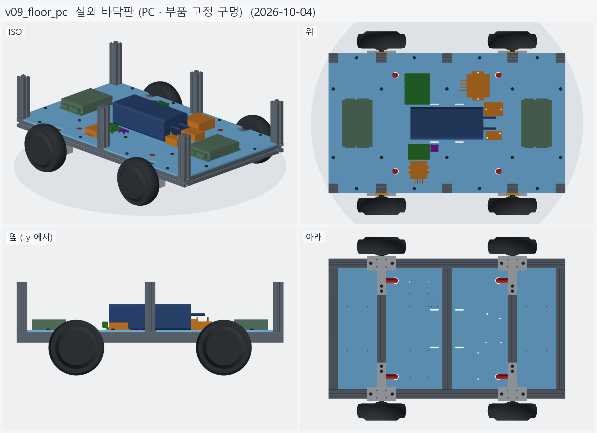
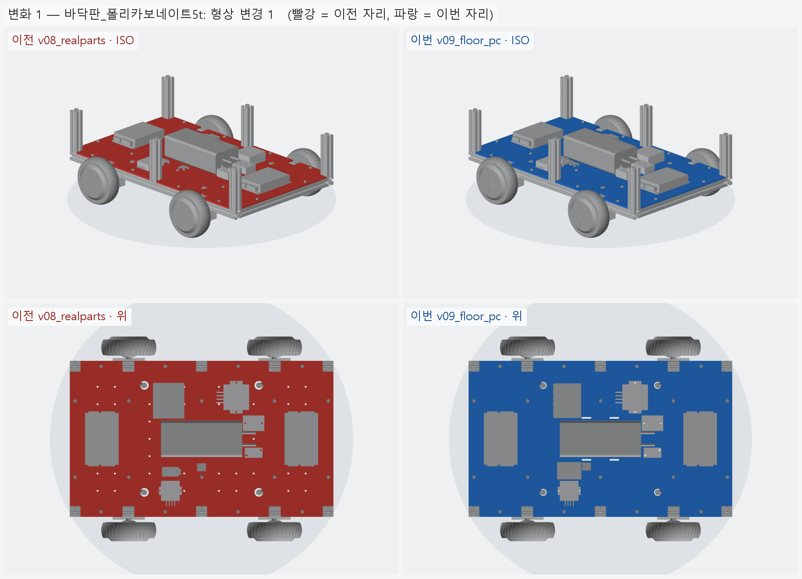
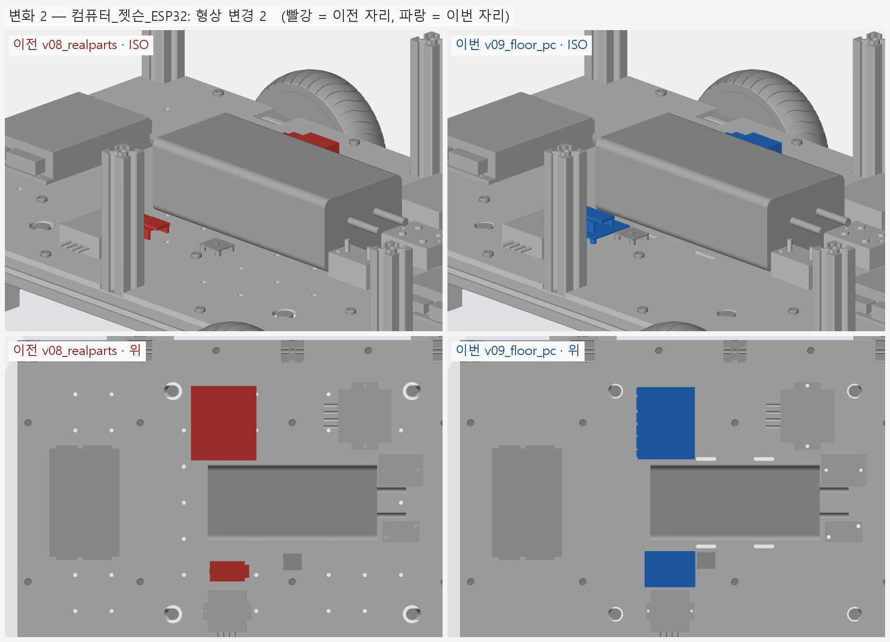
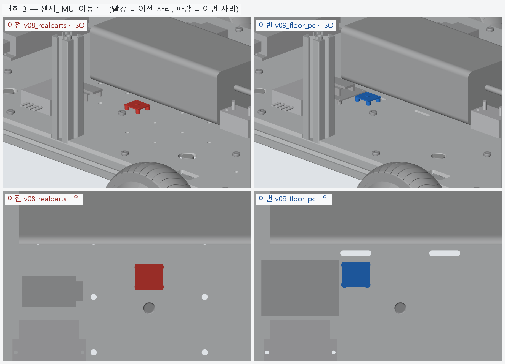

# v09_floor_pc — 실외 바닥판 (PC · 부품 고정 구멍)

- 날짜: 2026-10-04
- 이전 버전: [v08_realparts](../v08_realparts/README.md)
- 코드: [floor.py](floor.py) (재료 · 글랜드 · 격자 끔 · 부품 구멍), [parts.py](parts.py) (`MOUNT_HOLES` · `plate_holes()` · `strap_slots()`),
  [assembly.py](assembly.py) (`verify_holes`). 재단: [floor_plate_cut.md](floor_plate_cut.md), `output/floor_plate.dxf`

## 무엇을 왜 바꿨나

실외 주행으로 정해서 바닥판을 다시 냈다. 재료는 가격 · 무게까지 비교해 **PC 5t** (약 2.0 kg, 직선 재단 + 직접 가공이면 2~3 만원대 어림).

- 케이블 구멍: 그로밋 Ø25 → **방수 케이블 글랜드 M20** (Ø20.5, 케이블 Ø6~12). 자리는 그대로.
- M5 격자 66 → **없앰**. 실외에서는 구멍이 곧 물길이라, 부품을 고정할 구멍만 부품 자리에서 바로 뚫는다.
- 부품 고정 구멍 — 드라이버 귀 M4 ×8, 젯슨 M3 스탠드오프 ×4, ESP32 받침보드 M3 ×4, MIDI 홀더 M5 ×2,
  SSR M4 ×2, DC-DC 19V M5 ×2 · 5V M3 ×2 (DC-DC 는 [가정] 자리), IMU M2.5 ×4. 배터리 밴드 슬롯 4.
- 젯슨은 플라스틱 받침을 빼고 M3 스탠드오프 (받침과 같은 높이 6.4), ESP32 는 만능기판 받침보드에 꽂는다.
- IMU 를 x=0 → -40 으로 옮겼다 — 가운데 크로스 바로 위라 볼트 너트가 못 들어갔다.
- 볼트마다 EPDM 고무 와셔, 글랜드는 O 링 + 로크너트, 기둥 노치 틈은 실리콘 (재단 규격서에 적음).

## 남은 일

- DC-DC 두 개 귀 구멍은 실물 받고 확인 ([가정]).
- 외관판 (v10).

<!-- record:begin — record.py 가 덮어쓴다. 이 사이는 손으로 고치지 않는다 -->
## 기록 (자동 · record.py · 2026-10-04 12:34)

**요약** — 실외 바닥판 — PC 5t, 글랜드 M20, 격자 없앰, 부품 고정 구멍 · 배터리 밴드 슬롯

### 전체 모습



### 이전 버전(v08_realparts) 대비 변화

| # | 그룹 | 변화 | 부품 |
|---|---|---|---|
| 1 | 바닥판_폴리카보네이트5t | 형상 변경 1 | 바닥판 형상 변경 (부피 1639.3 → 1645.8 cm³) |
| 2 | 컴퓨터_젯슨_ESP32 | 형상 변경 2 | 젯슨_오린나노_개발킷 형상 변경 (부피 149.0 → 90.0 cm³)<br>ESP32_보드 형상 변경 (부피 5.7 → 11.8 cm³) |
| 3 | 센서_IMU | 이동 1 | IMU_BNO085 이동 Δ(-40.0, +2.0, +0.0) |

**변화 1 — 바닥판_폴리카보네이트5t**



**변화 2 — 컴퓨터_젯슨_ESP32**



**변화 3 — 센서_IMU**



### 수치

| 항목 | 값 |
|---|---|
| 프레임 외곽 (x × y) | 760 × 450 mm |
| 휠베이스 (앞뒤 축 간격) | 420 mm |
| 트레드 (좌우 바퀴 중심 간격) | 527.4 mm |
| 레일 윗면 높이 | 123.8 mm |
| 축크로스 x | ±210 mm |
| 기둥 | 6 본, x=-365 · +0 · +365 × y=±210, 높이 143 (윗면 z=266.9) |
| 3030 절단 | 760 × 2 + 390 × 5 + 143 × 6 |
| 3030 합계 | 실길이 4.33 m / 과금 4.80 m (45,600원) |
| 체결볼트 M6x15 | 16 개 |
| 바닥판 재료 | 폴리카보네이트 (PC) 5t — 충격에 아크릴의 수십 배 / 레이저는 그을린다 → CNC 재단 |
| 바닥판 크기 · 무게 | 760 × 450 × 5, 약 1.97 kg |
| 바닥판 구멍 | M6 고정 18 · 그로밋 Ø20.5 4 · M5 격자 0 · 기둥 노치 10 (x=-365 · -210 · +0 · +210 · +365, 기둥 6 · 10 본 겸용) |
| 판볼트 | M6x15 + 와셔 (필요 15.0 ~ 최대 15.8) |
| 받침 없는 구간 (크로스 안쪽면 사이) | 125 · 180 · 180 · 125 mm |
| 부품 | 10 개 (실측 치수 모델, 출처 parts.py) |
| 부품 무게 (알려진 것) | 4.66 kg — 무게 미상: ESP32_보드, SSR_모터전원차단_40A, DCDC_36V-5V |
| 부품 무게중심 | x=+22.0 · y=+9.6 · z=159.7 mm (휠베이스 가운데 x=0 기준) |
| 가장 높은 부품 윗면 | z=203.8 — 기둥 윗면 z=266.9 까지 63.0 mm 남음 |
| 전체 크기 (x × y × z) | 760.0 × 590.2 × 266.9 mm |
| 최저 지상고 (바퀴 제외, 지면 z=0) | 54.9 mm |

### 부품 구성

| 그룹 | 개수 |
|---|---|
| 프레임_3030_13본 | 13 |
| T클램프_혀선반_4개 | 4 |
| 기존_상부클램프_4개 | 4 |
| 휠모터_4개 | 4 |
| 체결볼트_M6x15_16개 | 16 |
| 바닥판_폴리카보네이트5t | 1 |
| 판볼트_M6x15_18개 | 18 |
| 케이블_경로_참고 | 8 |
| 배터리 | 1 |
| 모터드라이버 | 2 |
| 컴퓨터_젯슨_ESP32 | 2 |
| 전원_퓨즈_SSR_DCDC | 4 |
| 센서_IMU | 1 |

### 검증

```
  간섭 프레임-T클램프: 0.00 mm3
  간섭 프레임-상부클램프: 0.00 mm3
  간섭 프레임-휠모터: 0.00 mm3
  간섭 T클램프-휠모터: 0.00 mm3
  간섭 T클램프-상부클램프: 0.00 mm3
  간섭 볼트-프레임: 0.00 mm3
  간섭 볼트-T클램프: 8.38 mm3 (두께 0.010)
  간섭 볼트-휠모터: 0.00 mm3
  대조군 클램프 +1mm 올림 → 레일 겹침 4006 mm3
  대조군 클램프 +1mm 올림 → 축크로스 겹침 6509 mm3
  대조군 기둥 -1mm 내림 → 레일 겹침 1893 mm3
  기둥 ~ 휠모터 최소 간격 74.0 mm (메시 점 기준)
  간섭 바닥판-프레임 (기둥 포함): 0.00 mm3
  간섭 바닥판-T클램프: 0.00 mm3
  간섭 바닥판-휠모터: 0.00 mm3
  간섭 판볼트-프레임: 0.00 mm3
  간섭 판볼트-바닥판: 0.00 mm3
  간섭 케이블-프레임: 0.00 mm3
  간섭 케이블-T클램프: 0.00 mm3
  간섭 케이블-상부클램프: 0.00 mm3
  간섭 케이블-휠모터: 0.00 mm3
  간섭 케이블-바닥판: 0.00 mm3
  대조군 바닥판 -0.5mm → 프레임 겹침 31909 mm3
  10 본 겸용: 축 자리 가상 기둥 4 본 ~ 바닥판 간섭 0.00 mm3
  대조군 노치 없는 판 ~ 가상 기둥 겹침 7682 mm3
  판볼트 길이: 필요 15.0 ~ 최대 15.8 → M6x15
  간섭 부품끼리: 0.00 mm3
  간섭 부품-프레임 (기둥): 0.00 mm3
  간섭 부품-판볼트 머리: 0.00 mm3
  간섭 부품-바닥판: 0.00 mm3
  간섭 부품-케이블 구멍 위 (반경 15): 0.00 mm3
  대조군 부품 -1mm → 바닥판 겹침 65050 mm3
  부품 고정 구멍 28 — 빔 위 0 · 서로/다른 구멍과 2 mm 안 0
  대조군 x=0 구멍 → 빔 위 판정 True
verify: OK
```

### 기록 소요

불러오기 0.1s · 짓기 17.0s · 검증 44.2s · STEP 10.3s · 내보내기 9.4s · 뷰어 전송 5.1s · 메시 (31 형상 → 78 부품) 14.3s · 전체 모습 이미지 5 장 6.3s · 변화 이미지 3 장 10.4s

<!-- record:end -->
