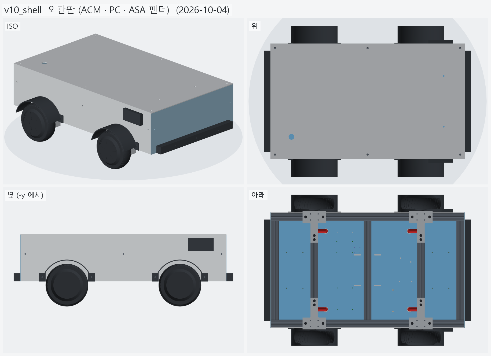
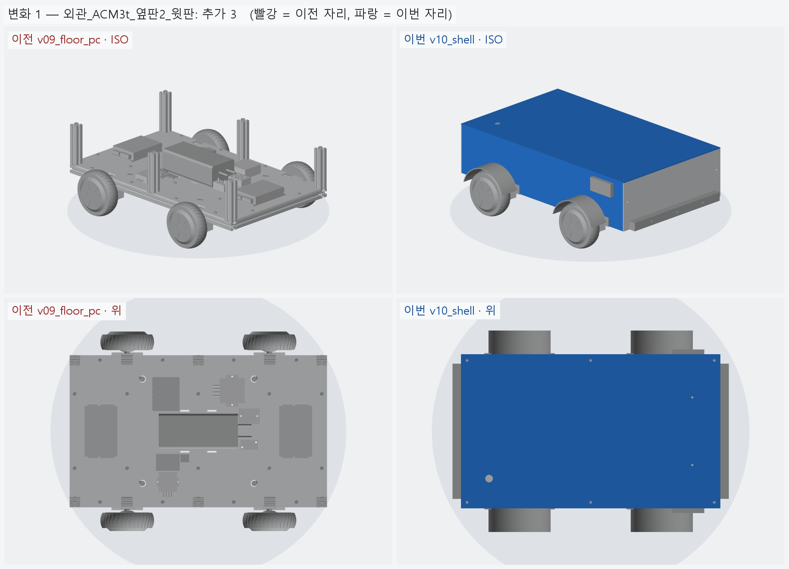
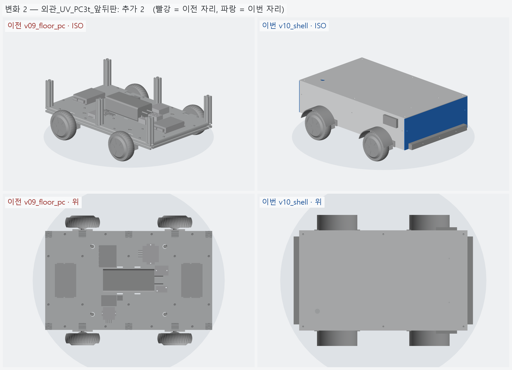
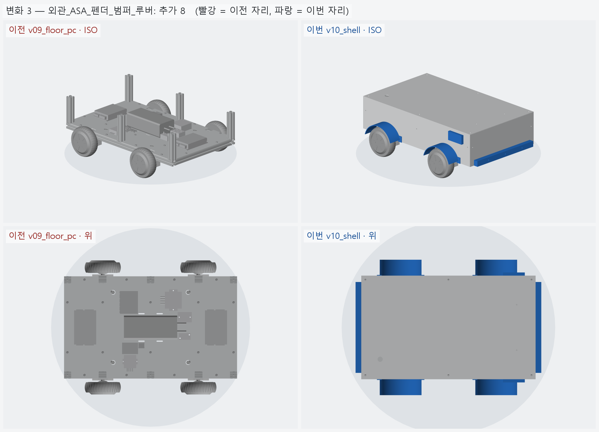

# v10_shell — 외관판 (ACM · PC · ASA 펜더)

- 날짜: 2026-10-04
- 이전 버전: [v09_floor_pc](../v09_floor_pc/README.md)
- 코드: [shell.py](shell.py) (판 · 출력물 · DXF), [assembly.py](assembly.py) (`shell_groups` · `verify_shell`).
  재단: [shell_cut.md](shell_cut.md), `output/shell_side_l|side_r|front|rear|lid.dxf`

## 무엇을 왜 바꿨나

요청: 실외용으로 외관판까지 붙여 본다. 벽은 **바퀴 안쪽 + 펜더 따로**.

| 부품 | 재료 | 자리 · 고정 |
|---|---|---|
| 옆판 2 | ACM 3t | 프레임 바깥면 y=±(225~228), 하부 레일 밑면 ~ 기둥 윗면. 레일 · 기둥 바깥 슬롯 M5 |
| 앞 · 뒤판 | UV PC 3t | x=±(380~383), 옆판 끝을 덮는다. 끝 크로스 · 모서리 기둥 슬롯 M5. 뒤판에 80 mm 배기 팬 |
| 윗판 | ACM 3t | 기둥 6 개 윗면에 얹고 M8 (기둥 중심 구멍에 탭). 비상정지 Ø22.5 · 안테나 SMA 2 |
| 펜더 4 | ASA | 바퀴 위 원호 (안쪽 R92 — 타이어와 12.6 여유). 탭을 옆판과 같이 레일 슬롯에 M5 |
| 범퍼 앞 · 뒤 | ASA | 끝 크로스 슬롯 볼트를 같이 쓴다 |
| 루버 덮개 2 | ASA | 옆판 앞쪽 흡기 루버 위, 아래로만 열려 빗물을 막는다 |

- 실외 원칙: PC 는 UV 코팅품, 출력물은 ASA, 이음새는 EPDM 개스킷, 쓰지 않는 T 슬롯은 커버.
- 흡기는 앞 끝 칸 옆면 (빗물막이 덮개 아래), 배기는 뒤판 팬 (젯슨 쪽).

## 남은 일

- 개스킷 · 슬롯 커버 · 팬 필터, 충전 단자 · 메인 스위치 자리 (뒤판).
- 상부 프레임을 올리면 윗판 높이 · 고정을 다시 정한다.

<!-- record:begin — record.py 가 덮어쓴다. 이 사이는 손으로 고치지 않는다 -->
## 기록 (자동 · record.py · 2026-10-04 12:41)

**요약** — 실외 외관 — ACM 옆판 · 윗판, UV PC 앞뒤판, ASA 펜더 4 · 범퍼 2 · 루버 덮개 2

### 전체 모습



### 이전 버전(v09_floor_pc) 대비 변화

| # | 그룹 | 변화 | 부품 |
|---|---|---|---|
| 1 | 외관_ACM3t_옆판2_윗판 | 추가 3 | 옆판_왼쪽_ACM3t 추가<br>옆판_오른쪽_ACM3t 추가<br>윗판_ACM3t 추가 |
| 2 | 외관_UV_PC3t_앞뒤판 | 추가 2 | 앞판_PC3t 추가<br>뒤판_PC3t 추가 |
| 3 | 외관_ASA_펜더_범퍼_루버 | 추가 8 | 펜더_뒤오른_ASA 추가<br>펜더_뒤왼_ASA 추가<br>펜더_앞오른_ASA 추가<br>펜더_앞왼_ASA 추가<br>범퍼_뒤_ASA 추가<br>범퍼_앞_ASA 추가<br>루버덮개_오른_ASA 추가<br>루버덮개_왼_ASA 추가 |

**변화 1 — 외관_ACM3t_옆판2_윗판**



**변화 2 — 외관_UV_PC3t_앞뒤판**



**변화 3 — 외관_ASA_펜더_범퍼_루버**



### 수치

| 항목 | 값 |
|---|---|
| 프레임 외곽 (x × y) | 760 × 450 mm |
| 휠베이스 (앞뒤 축 간격) | 420 mm |
| 트레드 (좌우 바퀴 중심 간격) | 527.4 mm |
| 레일 윗면 높이 | 123.8 mm |
| 축크로스 x | ±210 mm |
| 기둥 | 6 본, x=-365 · +0 · +365 × y=±210, 높이 143 (윗면 z=266.9) |
| 3030 절단 | 760 × 2 + 390 × 5 + 143 × 6 |
| 3030 합계 | 실길이 4.33 m / 과금 4.80 m (45,600원) |
| 체결볼트 M6x15 | 16 개 |
| 바닥판 재료 | 폴리카보네이트 (PC) 5t — 충격에 아크릴의 수십 배 / 레이저는 그을린다 → CNC 재단 |
| 바닥판 크기 · 무게 | 760 × 450 × 5, 약 1.97 kg |
| 바닥판 구멍 | M6 고정 18 · 그로밋 Ø20.5 4 · M5 격자 0 · 기둥 노치 10 (x=-365 · -210 · +0 · +210 · +365, 기둥 6 · 10 본 겸용) |
| 판볼트 | M6x15 + 와셔 (필요 15.0 ~ 최대 15.8) |
| 받침 없는 구간 (크로스 안쪽면 사이) | 125 · 180 · 180 · 125 mm |
| 부품 | 10 개 (실측 치수 모델, 출처 parts.py) |
| 부품 무게 (알려진 것) | 4.66 kg — 무게 미상: ESP32_보드, SSR_모터전원차단_40A, DCDC_36V-5V |
| 부품 무게중심 | x=+22.0 · y=+9.6 · z=159.7 mm (휠베이스 가운데 x=0 기준) |
| 가장 높은 부품 윗면 | z=203.8 — 기둥 윗면 z=266.9 까지 63.0 mm 남음 |
| 전체 크기 (x × y × z) | 816.0 × 596.0 × 269.9 mm |
| 최저 지상고 (바퀴 제외, 지면 z=0) | 54.9 mm |

### 부품 구성

| 그룹 | 개수 |
|---|---|
| 프레임_3030_13본 | 13 |
| T클램프_혀선반_4개 | 4 |
| 기존_상부클램프_4개 | 4 |
| 휠모터_4개 | 4 |
| 체결볼트_M6x15_16개 | 16 |
| 바닥판_폴리카보네이트5t | 1 |
| 판볼트_M6x15_18개 | 18 |
| 케이블_경로_참고 | 8 |
| 배터리 | 1 |
| 모터드라이버 | 2 |
| 컴퓨터_젯슨_ESP32 | 2 |
| 전원_퓨즈_SSR_DCDC | 4 |
| 센서_IMU | 1 |
| 외관_ACM3t_옆판2_윗판 | 3 |
| 외관_UV_PC3t_앞뒤판 | 2 |
| 외관_ASA_펜더_범퍼_루버 | 8 |

### 검증

```
  간섭 프레임-T클램프: 0.00 mm3
  간섭 프레임-상부클램프: 0.00 mm3
  간섭 프레임-휠모터: 0.00 mm3
  간섭 T클램프-휠모터: 0.00 mm3
  간섭 T클램프-상부클램프: 0.00 mm3
  간섭 볼트-프레임: 0.00 mm3
  간섭 볼트-T클램프: 8.38 mm3 (두께 0.010)
  간섭 볼트-휠모터: 0.00 mm3
  대조군 클램프 +1mm 올림 → 레일 겹침 4006 mm3
  대조군 클램프 +1mm 올림 → 축크로스 겹침 6509 mm3
  대조군 기둥 -1mm 내림 → 레일 겹침 1893 mm3
  기둥 ~ 휠모터 최소 간격 74.0 mm (메시 점 기준)
  간섭 바닥판-프레임 (기둥 포함): 0.00 mm3
  간섭 바닥판-T클램프: 0.00 mm3
  간섭 바닥판-휠모터: 0.00 mm3
  간섭 판볼트-프레임: 0.00 mm3
  간섭 판볼트-바닥판: 0.00 mm3
  간섭 케이블-프레임: 0.00 mm3
  간섭 케이블-T클램프: 0.00 mm3
  간섭 케이블-상부클램프: 0.00 mm3
  간섭 케이블-휠모터: 0.00 mm3
  간섭 케이블-바닥판: 0.00 mm3
  대조군 바닥판 -0.5mm → 프레임 겹침 31909 mm3
  10 본 겸용: 축 자리 가상 기둥 4 본 ~ 바닥판 간섭 0.00 mm3
  대조군 노치 없는 판 ~ 가상 기둥 겹침 7682 mm3
  판볼트 길이: 필요 15.0 ~ 최대 15.8 → M6x15
  간섭 부품끼리: 0.00 mm3
  간섭 부품-프레임 (기둥): 0.00 mm3
  간섭 부품-판볼트 머리: 0.00 mm3
  간섭 부품-바닥판: 0.00 mm3
  간섭 부품-케이블 구멍 위 (반경 15): 0.00 mm3
  대조군 부품 -1mm → 바닥판 겹침 65050 mm3
  부품 고정 구멍 28 — 빔 위 0 · 서로/다른 구멍과 2 mm 안 0
  대조군 x=0 구멍 → 빔 위 판정 True
  간섭 외관판-프레임: 0.00 mm3
  간섭 외관판-T클램프: 0.00 mm3
  간섭 외관판-휠모터: 0.00 mm3
  간섭 외관판-부품: 0.00 mm3
  간섭 외관판-바닥판: 0.00 mm3
  간섭 출력물-프레임: 0.00 mm3
  간섭 출력물-휠모터: 0.00 mm3
  간섭 출력물-T클램프: 0.00 mm3
  간섭 출력물-외관판: 0.00 mm3
  옆판 ~ 타이어 최소 간격 7.1 mm (메시 점 기준)
  펜더 ~ 타이어 반경 여유 12.7 mm
  대조군 윗판 -1mm → 기둥 겹침 2182 mm3
  부품 윗면 z=203.8 ~ 윗판 밑면 z=266.9: 63.0 mm
verify: OK
```

### 기록 소요

불러오기 0.2s · 짓기 18.3s · 검증 67.3s · STEP 7.9s · 내보내기 12.7s · 뷰어 전송 13.9s · 메시 (44 형상 → 91 부품) 16.5s · 전체 모습 이미지 5 장 7.1s · 변화 이미지 3 장 16.5s

<!-- record:end -->
