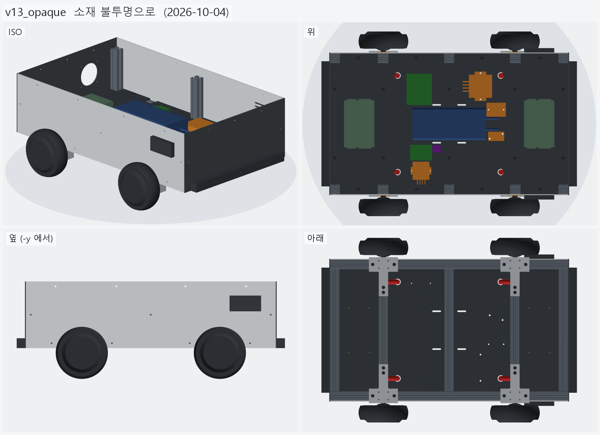
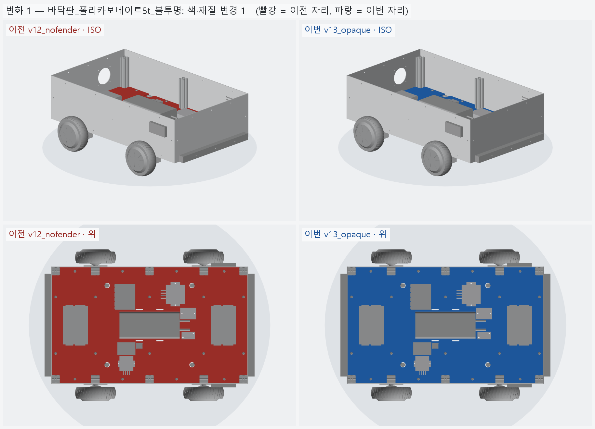
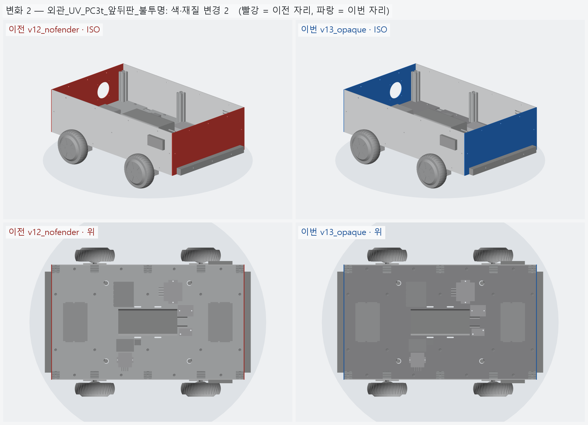

# v13_opaque — 소재 불투명으로

- 날짜: 2026-10-04
- 이전 버전: [v12_nofender](../v12_nofender/README.md)
- 코드: [floor.py](floor.py) (`pc_opaque`), [shell.py](shell.py) (재단 규격 문구), [assembly.py](assembly.py) (색 · 불투명)

## 무엇을 왜 바꿨나

요청: 반투명은 쓰지 않는다 — 투명하지 않은 불투명으로.

- 바닥판: 투명 PC 5t → **불투명 PC 5t** (흑색 · 회색). 형상 · 구멍 그대로.
- 앞 · 뒤판: UV PC 3t → **불투명 UV PC 3t**. 옆판 ACM 은 원래 불투명.
- 뷰어 · 기록 이미지도 반투명 표시를 없앴다.
- 기록 도구가 형상이 같고 색만 바뀐 것도 "색·재질 변경" 으로 잡게 했다 (이번 변화가 그렇다).

<!-- record:begin — record.py 가 덮어쓴다. 이 사이는 손으로 고치지 않는다 -->
## 기록 (자동 · record.py · 2026-10-04 12:50)

**요약** — 투명 · 반투명 없이 불투명으로 — 바닥판 불투명 PC 5t, 앞뒤판 불투명 UV PC 3t

### 전체 모습



### 이전 버전(v12_nofender) 대비 변화

| # | 그룹 | 변화 | 부품 |
|---|---|---|---|
| 1 | 바닥판_폴리카보네이트5t_불투명 | 색·재질 변경 1 | 바닥판 색 #7fc8f8 → #3f444a |
| 2 | 외관_UV_PC3t_앞뒤판_불투명 | 색·재질 변경 2 | 앞판_PC3t 색 #9fc3d8 → #4a4f55<br>뒤판_PC3t 색 #9fc3d8 → #4a4f55 |

**변화 1 — 바닥판_폴리카보네이트5t_불투명**



**변화 2 — 외관_UV_PC3t_앞뒤판_불투명**



### 수치

| 항목 | 값 |
|---|---|
| 프레임 외곽 (x × y) | 760 × 450 mm |
| 휠베이스 (앞뒤 축 간격) | 420 mm |
| 트레드 (좌우 바퀴 중심 간격) | 527.4 mm |
| 레일 윗면 높이 | 123.8 mm |
| 축크로스 x | ±210 mm |
| 기둥 | 6 본, x=-365 · +0 · +365 × y=±210, 높이 143 (윗면 z=266.9) |
| 3030 절단 | 760 × 2 + 390 × 5 + 143 × 6 |
| 3030 합계 | 실길이 4.33 m / 과금 4.80 m (45,600원) |
| 체결볼트 M6x15 | 16 개 |
| 바닥판 재료 | 폴리카보네이트 (PC) 불투명 흑색 5t — 불투명 (흑색 · 회색) — 충격에 강하고 안이 안 보인다 / 레이저는 그을린다 → CNC 재단 |
| 바닥판 크기 · 무게 | 760 × 450 × 5, 약 1.97 kg |
| 바닥판 구멍 | M6 고정 18 · 그로밋 Ø20.5 4 · M5 격자 0 · 기둥 노치 10 (x=-365 · -210 · +0 · +210 · +365, 기둥 6 · 10 본 겸용) |
| 판볼트 | M6x15 + 와셔 (필요 15.0 ~ 최대 15.8) |
| 받침 없는 구간 (크로스 안쪽면 사이) | 125 · 180 · 180 · 125 mm |
| 부품 | 10 개 (실측 치수 모델, 출처 parts.py) |
| 부품 무게 (알려진 것) | 4.66 kg — 무게 미상: ESP32_보드, SSR_모터전원차단_40A, DCDC_36V-5V |
| 부품 무게중심 | x=+22.0 · y=+9.6 · z=159.7 mm (휠베이스 가운데 x=0 기준) |
| 가장 높은 부품 윗면 | z=203.8 — 기둥 윗면 z=266.9 까지 63.0 mm 남음 |
| 전체 크기 (x × y × z) | 816.0 × 590.2 × 296.9 mm |
| 최저 지상고 (바퀴 제외, 지면 z=0) | 54.9 mm |

### 부품 구성

| 그룹 | 개수 |
|---|---|
| 프레임_3030_13본 | 13 |
| T클램프_혀선반_4개 | 4 |
| 기존_상부클램프_4개 | 4 |
| 휠모터_4개 | 4 |
| 체결볼트_M6x15_16개 | 16 |
| 바닥판_폴리카보네이트5t_불투명 | 1 |
| 판볼트_M6x15_18개 | 18 |
| 케이블_경로_참고 | 8 |
| 배터리 | 1 |
| 모터드라이버 | 2 |
| 컴퓨터_젯슨_ESP32 | 2 |
| 전원_퓨즈_SSR_DCDC | 4 |
| 센서_IMU | 1 |
| 외관_ACM3t_옆판2 | 2 |
| 외관_UV_PC3t_앞뒤판_불투명 | 2 |
| 외관_ASA_범퍼_루버 | 4 |

### 검증

```
  간섭 프레임-T클램프: 0.00 mm3
  간섭 프레임-상부클램프: 0.00 mm3
  간섭 프레임-휠모터: 0.00 mm3
  간섭 T클램프-휠모터: 0.00 mm3
  간섭 T클램프-상부클램프: 0.00 mm3
  간섭 볼트-프레임: 0.00 mm3
  간섭 볼트-T클램프: 8.38 mm3 (두께 0.010)
  간섭 볼트-휠모터: 0.00 mm3
  대조군 클램프 +1mm 올림 → 레일 겹침 4006 mm3
  대조군 클램프 +1mm 올림 → 축크로스 겹침 6509 mm3
  대조군 기둥 -1mm 내림 → 레일 겹침 1893 mm3
  기둥 ~ 휠모터 최소 간격 74.0 mm (메시 점 기준)
  간섭 바닥판-프레임 (기둥 포함): 0.00 mm3
  간섭 바닥판-T클램프: 0.00 mm3
  간섭 바닥판-휠모터: 0.00 mm3
  간섭 판볼트-프레임: 0.00 mm3
  간섭 판볼트-바닥판: 0.00 mm3
  간섭 케이블-프레임: 0.00 mm3
  간섭 케이블-T클램프: 0.00 mm3
  간섭 케이블-상부클램프: 0.00 mm3
  간섭 케이블-휠모터: 0.00 mm3
  간섭 케이블-바닥판: 0.00 mm3
  대조군 바닥판 -0.5mm → 프레임 겹침 31909 mm3
  10 본 겸용: 축 자리 가상 기둥 4 본 ~ 바닥판 간섭 0.00 mm3
  대조군 노치 없는 판 ~ 가상 기둥 겹침 7682 mm3
  판볼트 길이: 필요 15.0 ~ 최대 15.8 → M6x15
  간섭 부품끼리: 0.00 mm3
  간섭 부품-프레임 (기둥): 0.00 mm3
  간섭 부품-판볼트 머리: 0.00 mm3
  간섭 부품-바닥판: 0.00 mm3
  간섭 부품-케이블 구멍 위 (반경 15): 0.00 mm3
  대조군 부품 -1mm → 바닥판 겹침 65050 mm3
  부품 고정 구멍 28 — 빔 위 0 · 서로/다른 구멍과 2 mm 안 0
  대조군 x=0 구멍 → 빔 위 판정 True
  간섭 외관판-프레임: 0.00 mm3
  간섭 외관판-T클램프: 0.00 mm3
  간섭 외관판-휠모터: 0.00 mm3
  간섭 외관판-부품: 0.00 mm3
  간섭 외관판-바닥판: 0.00 mm3
  간섭 출력물-프레임: 0.00 mm3
  간섭 출력물-휠모터: 0.00 mm3
  간섭 출력물-T클램프: 0.00 mm3
  간섭 출력물-외관판: 0.00 mm3
  옆판 ~ 타이어 최소 간격 7.1 mm (메시 점 기준)
  벽 위끝 z=296.85 (상부 프레임 윗면 가정 z=296.85)
  부품 윗면 z=203.8 ~ 상부 프레임 밑면 z=266.9: 63.0 mm
verify: OK
```

### 기록 소요

불러오기 0.3s · 짓기 19.2s · 검증 59.3s · STEP 12.5s · 내보내기 20.4s · 뷰어 전송 9.6s · 메시 (39 형상 → 86 부품) 22.2s · 전체 모습 이미지 5 장 12.5s · 변화 이미지 2 장 12.8s

<!-- record:end -->
