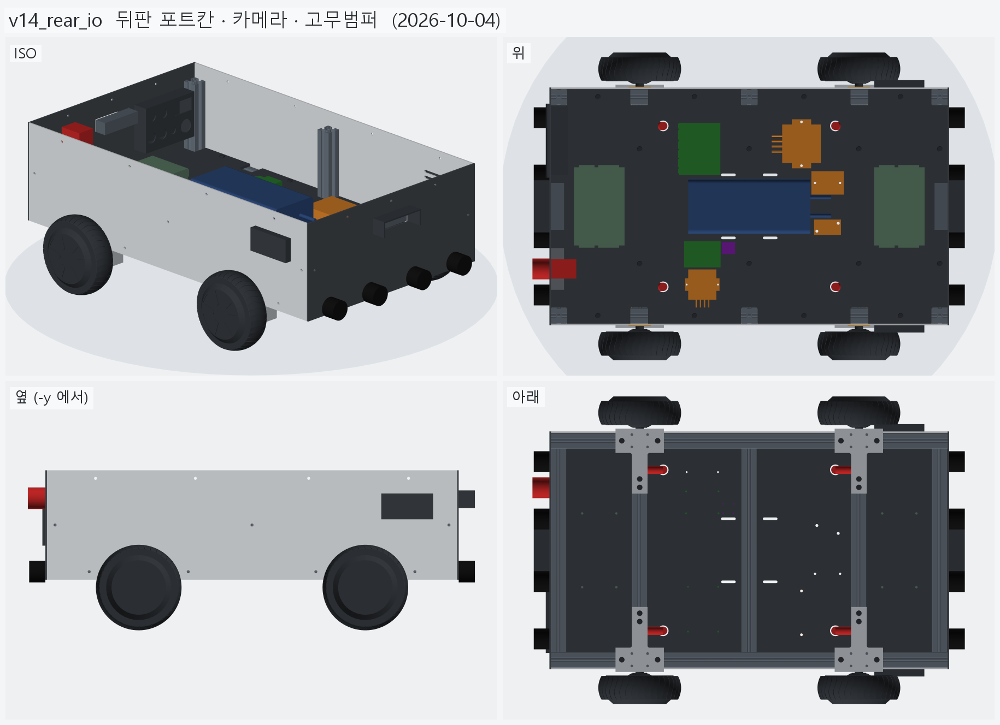
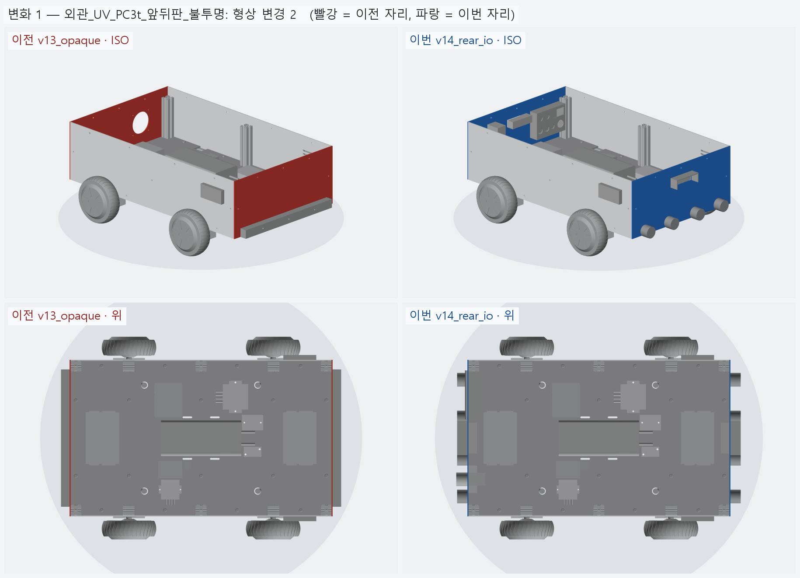
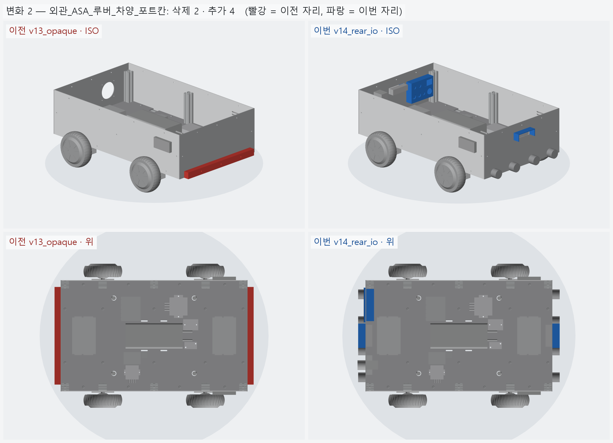
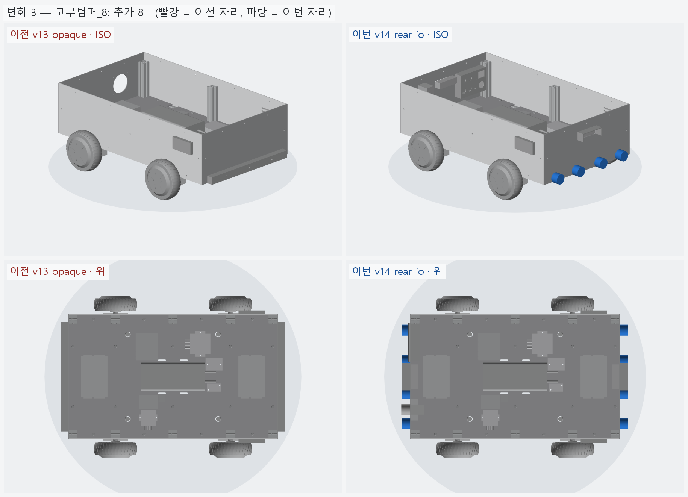
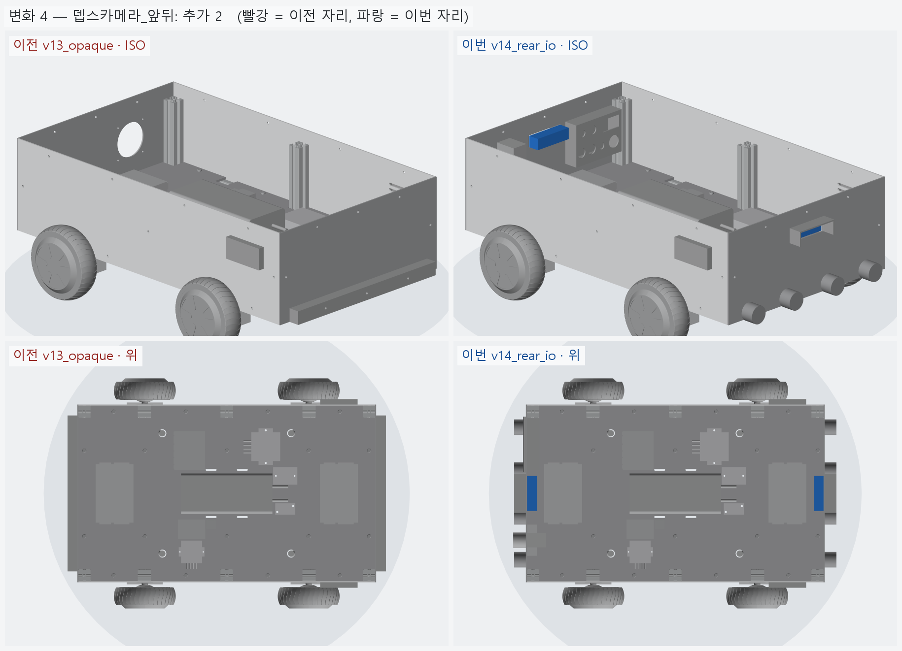
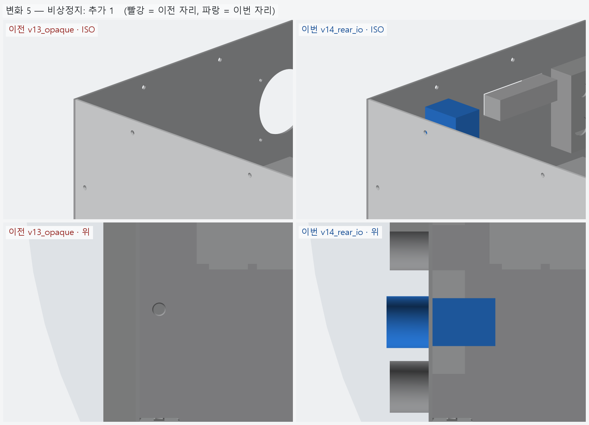
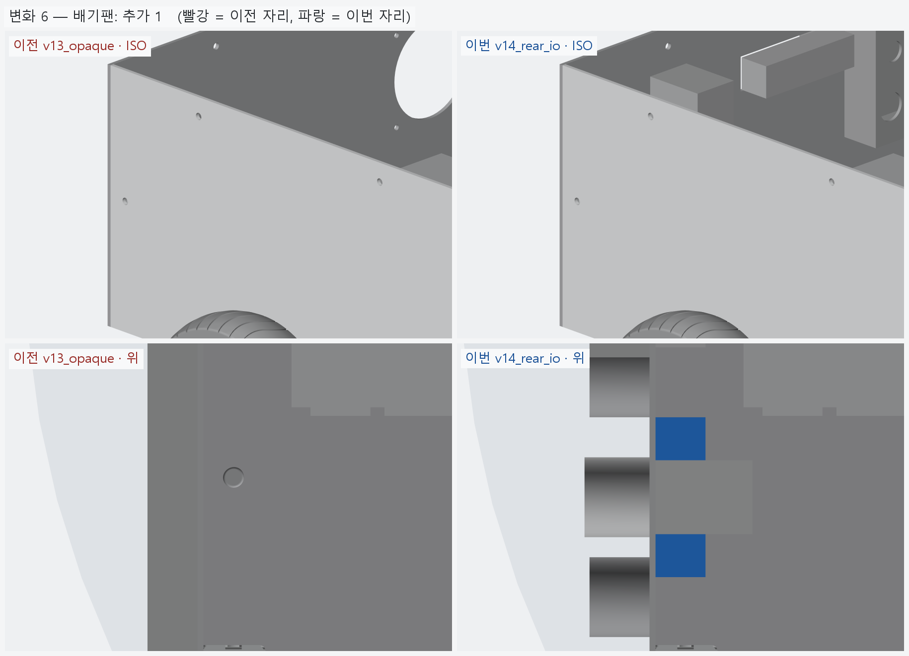

# v14_rear_io — 뒤판 포트 칸 · 카메라 · 고무 범퍼

- 날짜: 2026-10-04
- 이전 버전: [v13_opaque](../v13_opaque/README.md)
- 코드: [shell.py](shell.py) (`CAM` · `RUBBER` · `BAY` · `BAY_PORTS` · `ESTOP` · `FAN_POS`, 새 부품 함수), [assembly.py](assembly.py) (`verify_rear`)

## 무엇을 왜 바꿨나

요청 1: ASA 범퍼는 길게 뽑기 힘드니 비슷한 크기 고무 조각 3~4 개로 → **앞뒤 각 4 개** (모서리가 먼저 부딪힌다).
- 고무 범퍼 Ø40 × 30, y = ±60 · ±170, 끝 크로스 바깥 슬롯 높이 (z=108.85) 에 M6. 판 구멍 Ø6.5.

요청 2: 뒤판에 들어갈 포트를 정리하고, **움푹 들어가 덮개를 열어야 보이는** 구조로. 카메라는 앞뒤 둘 다.

| 자리 | 무엇 | 비고 |
|---|---|---|
| 포트 칸 안 (덮개 아래) | 충전 GX16 · 키 스위치 · 전압계 · USB ×2 · ESP32 USB-C · RJ45 | 커넥터 구멍 크기는 일반 패널형 [가정] |
| 덮개 밖 | **비상정지** (Koino 22 파이) | 덮개를 열어야 누를 수 있으면 비상정지가 아니다 |
| 덮개 밖 | 배기 팬 80 mm | 바람이 지나가야 한다 |
| 앞 · 뒤 | 뎁스 카메라 (D435 급) 창 92×27 + ASA 차양 | 렌즈 앞에 작은 보호창 (광학창) 은 따로 필요 |

포트 칸 — ASA 트레이 132 × 93, 깊이 35 (뒤판 바깥면에서 안쪽으로), 둘레 플랜지 5, 바닥 배수 홈.
덮개는 **윗변 경첩으로 위로 연다** (EPDM 개스킷 · 자석/걸쇠는 모델 없음). z 162~255 — 뒤 드라이버 윗면 (159.9) 위,
상부 프레임 밑면 (266.9) 아래라 커넥터 뒤꼬리가 안쪽으로 들어가도 드라이버와 안 닿는다.

키 스위치는 큰 전류를 직접 끊지 않고 메인 릴레이 · SSR 의 신호로 쓴다.

## 남은 일

- 커넥터 실물 (GX16 · 방수 USB · RJ45 패널형) 치수로 구멍 확정, 덮개 경첩 · 걸쇠 상세.
- 카메라 보호창 · 브래킷 (상부 프레임이 생기면 거기에 문다).

<!-- record:begin — record.py 가 덮어쓴다. 이 사이는 손으로 고치지 않는다 -->
## 기록 (자동 · record.py · 2026-10-04 13:06)

**요약** — 뒤판 오목 포트 칸 (덮개) · 비상정지 · 팬, 앞뒤 뎁스 카메라 창 · 차양, ASA 범퍼 → 고무 범퍼 4+4

### 전체 모습



### 이전 버전(v13_opaque) 대비 변화

| # | 그룹 | 변화 | 부품 |
|---|---|---|---|
| 1 | 외관_UV_PC3t_앞뒤판_불투명 | 형상 변경 2 | 앞판_PC3t 형상 변경 (부피 277.1 → 269.5 cm³)<br>뒤판_PC3t 형상 변경 (부피 263.3 → 217.7 cm³) |
| 2 | 외관_ASA_루버_차양_포트칸 | 삭제 2 · 추가 4 | 범퍼_뒤_ASA 삭제<br>범퍼_앞_ASA 삭제<br>카메라차양_뒤_ASA 추가<br>카메라차양_앞_ASA 추가<br>포트칸_트레이_ASA 추가<br>포트칸_덮개_ASA 추가 |
| 3 | 고무범퍼_8 | 추가 8 | 고무범퍼_뒤 ×4 추가<br>고무범퍼_앞 ×4 추가 |
| 4 | 뎁스카메라_앞뒤 | 추가 2 | 뎁스카메라_뒤_D435급 추가<br>뎁스카메라_앞_D435급 추가 |
| 5 | 비상정지 | 추가 1 | 비상정지_KSEP_22파이 추가 |
| 6 | 배기팬 | 추가 1 | 배기팬_80mm 추가 |

**변화 1 — 외관_UV_PC3t_앞뒤판_불투명**



**변화 2 — 외관_ASA_루버_차양_포트칸**



**변화 3 — 고무범퍼_8**



**변화 4 — 뎁스카메라_앞뒤**



**변화 5 — 비상정지**



**변화 6 — 배기팬**



### 수치

| 항목 | 값 |
|---|---|
| 프레임 외곽 (x × y) | 760 × 450 mm |
| 휠베이스 (앞뒤 축 간격) | 420 mm |
| 트레드 (좌우 바퀴 중심 간격) | 527.4 mm |
| 레일 윗면 높이 | 123.8 mm |
| 축크로스 x | ±210 mm |
| 기둥 | 6 본, x=-365 · +0 · +365 × y=±210, 높이 143 (윗면 z=266.9) |
| 3030 절단 | 760 × 2 + 390 × 5 + 143 × 6 |
| 3030 합계 | 실길이 4.33 m / 과금 4.80 m (45,600원) |
| 체결볼트 M6x15 | 16 개 |
| 바닥판 재료 | 폴리카보네이트 (PC) 불투명 흑색 5t — 불투명 (흑색 · 회색) — 충격에 강하고 안이 안 보인다 / 레이저는 그을린다 → CNC 재단 |
| 바닥판 크기 · 무게 | 760 × 450 × 5, 약 1.97 kg |
| 바닥판 구멍 | M6 고정 18 · 그로밋 Ø20.5 4 · M5 격자 0 · 기둥 노치 10 (x=-365 · -210 · +0 · +210 · +365, 기둥 6 · 10 본 겸용) |
| 판볼트 | M6x15 + 와셔 (필요 15.0 ~ 최대 15.8) |
| 받침 없는 구간 (크로스 안쪽면 사이) | 125 · 180 · 180 · 125 mm |
| 부품 | 10 개 (실측 치수 모델, 출처 parts.py) |
| 부품 무게 (알려진 것) | 4.66 kg — 무게 미상: ESP32_보드, SSR_모터전원차단_40A, DCDC_36V-5V |
| 부품 무게중심 | x=+22.0 · y=+9.6 · z=159.7 mm (휠베이스 가운데 x=0 기준) |
| 가장 높은 부품 윗면 | z=203.8 — 기둥 윗면 z=266.9 까지 63.0 mm 남음 |
| 전체 크기 (x × y × z) | 828.5 × 590.2 × 296.9 mm |
| 최저 지상고 (바퀴 제외, 지면 z=0) | 54.9 mm |

### 부품 구성

| 그룹 | 개수 |
|---|---|
| 프레임_3030_13본 | 13 |
| T클램프_혀선반_4개 | 4 |
| 기존_상부클램프_4개 | 4 |
| 휠모터_4개 | 4 |
| 체결볼트_M6x15_16개 | 16 |
| 바닥판_폴리카보네이트5t_불투명 | 1 |
| 판볼트_M6x15_18개 | 18 |
| 케이블_경로_참고 | 8 |
| 배터리 | 1 |
| 모터드라이버 | 2 |
| 컴퓨터_젯슨_ESP32 | 2 |
| 전원_퓨즈_SSR_DCDC | 4 |
| 센서_IMU | 1 |
| 외관_ACM3t_옆판2 | 2 |
| 외관_UV_PC3t_앞뒤판_불투명 | 2 |
| 외관_ASA_루버_차양_포트칸 | 6 |
| 고무범퍼_8 | 8 |
| 뎁스카메라_앞뒤 | 2 |
| 비상정지 | 1 |
| 배기팬 | 1 |

### 검증

```
  간섭 프레임-T클램프: 0.00 mm3
  간섭 프레임-상부클램프: 0.00 mm3
  간섭 프레임-휠모터: 0.00 mm3
  간섭 T클램프-휠모터: 0.00 mm3
  간섭 T클램프-상부클램프: 0.00 mm3
  간섭 볼트-프레임: 0.00 mm3
  간섭 볼트-T클램프: 8.38 mm3 (두께 0.010)
  간섭 볼트-휠모터: 0.00 mm3
  대조군 클램프 +1mm 올림 → 레일 겹침 4006 mm3
  대조군 클램프 +1mm 올림 → 축크로스 겹침 6509 mm3
  대조군 기둥 -1mm 내림 → 레일 겹침 1893 mm3
  기둥 ~ 휠모터 최소 간격 74.0 mm (메시 점 기준)
  간섭 바닥판-프레임 (기둥 포함): 0.00 mm3
  간섭 바닥판-T클램프: 0.00 mm3
  간섭 바닥판-휠모터: 0.00 mm3
  간섭 판볼트-프레임: 0.00 mm3
  간섭 판볼트-바닥판: 0.00 mm3
  간섭 케이블-프레임: 0.00 mm3
  간섭 케이블-T클램프: 0.00 mm3
  간섭 케이블-상부클램프: 0.00 mm3
  간섭 케이블-휠모터: 0.00 mm3
  간섭 케이블-바닥판: 0.00 mm3
  대조군 바닥판 -0.5mm → 프레임 겹침 31909 mm3
  10 본 겸용: 축 자리 가상 기둥 4 본 ~ 바닥판 간섭 0.00 mm3
  대조군 노치 없는 판 ~ 가상 기둥 겹침 7682 mm3
  판볼트 길이: 필요 15.0 ~ 최대 15.8 → M6x15
  간섭 부품끼리: 0.00 mm3
  간섭 부품-프레임 (기둥): 0.00 mm3
  간섭 부품-판볼트 머리: 0.00 mm3
  간섭 부품-바닥판: 0.00 mm3
  간섭 부품-케이블 구멍 위 (반경 15): 0.00 mm3
  대조군 부품 -1mm → 바닥판 겹침 65050 mm3
  부품 고정 구멍 28 — 빔 위 0 · 서로/다른 구멍과 2 mm 안 0
  대조군 x=0 구멍 → 빔 위 판정 True
  간섭 외관판-프레임: 0.00 mm3
  간섭 외관판-T클램프: 0.00 mm3
  간섭 외관판-휠모터: 0.00 mm3
  간섭 외관판-부품: 0.00 mm3
  간섭 외관판-바닥판: 0.00 mm3
  간섭 출력물-프레임: 0.00 mm3
  간섭 출력물-휠모터: 0.00 mm3
  간섭 출력물-T클램프: 0.00 mm3
  간섭 출력물-외관판: 0.00 mm3
  옆판 ~ 타이어 최소 간격 7.1 mm (메시 점 기준)
  벽 위끝 z=296.85 (상부 프레임 윗면 가정 z=296.85)
  부품 윗면 z=203.8 ~ 상부 프레임 밑면 z=266.9: 63.0 mm
  간섭 추가물-프레임: 0.00 mm3
  간섭 추가물-부품: 0.00 mm3
  간섭 추가물-외관판: 0.00 mm3
  간섭 추가물-ASA: 0.00 mm3
  간섭 추가물끼리: 0.00 mm3
  간섭 비상정지-팬: 0.00 mm3
  간섭 추가물-휠모터: 0.00 mm3
  포트 칸 z 162.0~255.0 — 뒤 드라이버 윗면 159.8, 상부 프레임 밑면 266.9
verify: OK
```

### 기록 소요

불러오기 0.1s · 짓기 14.6s · 검증 35.6s · STEP 7.3s · 내보내기 9.2s · 뷰어 전송 6.4s · 메시 (53 형상 → 100 부품) 12.8s · 전체 모습 이미지 5 장 4.8s · 변화 이미지 6 장 28.3s

<!-- record:end -->
