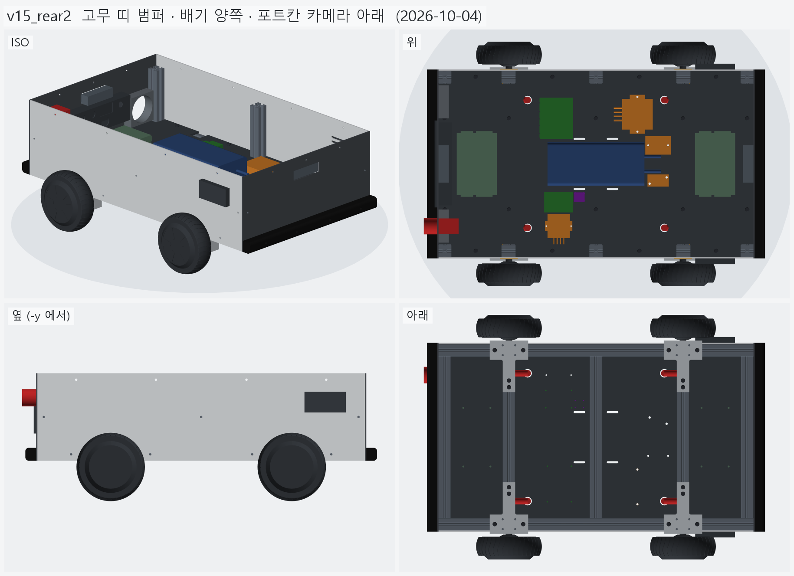
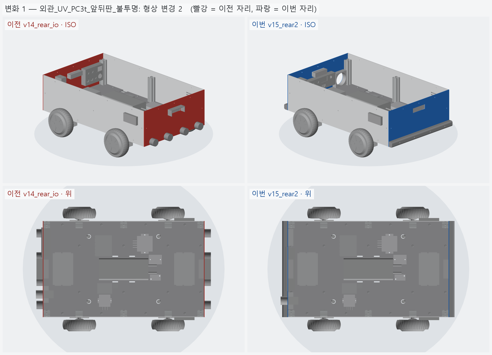
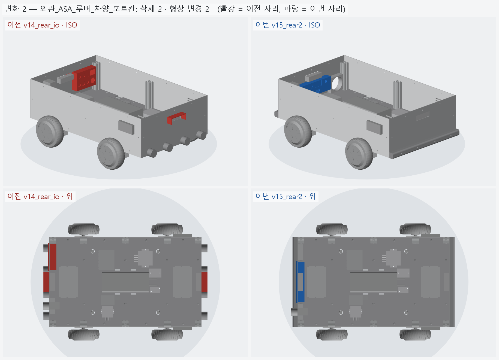
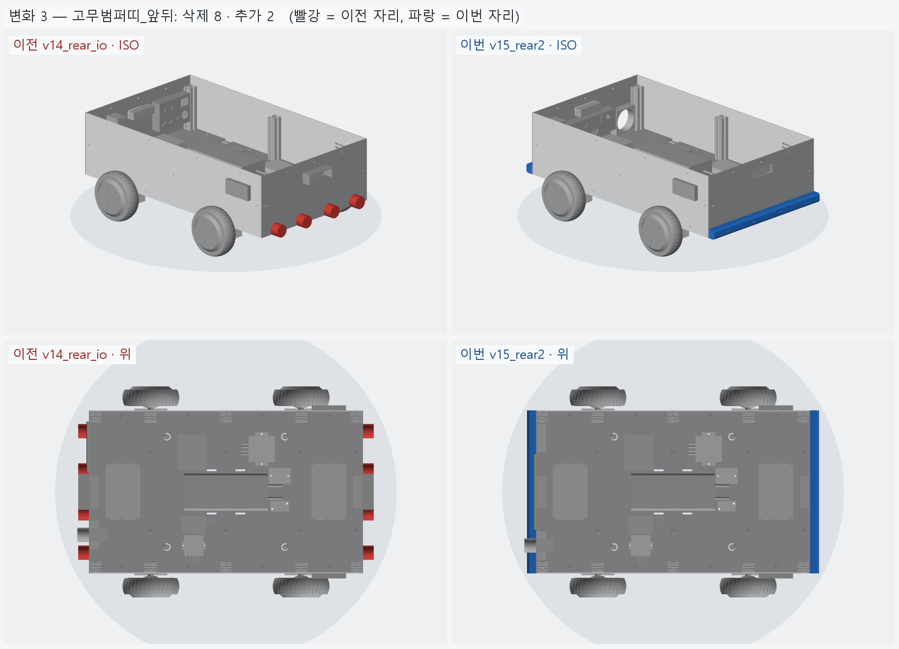
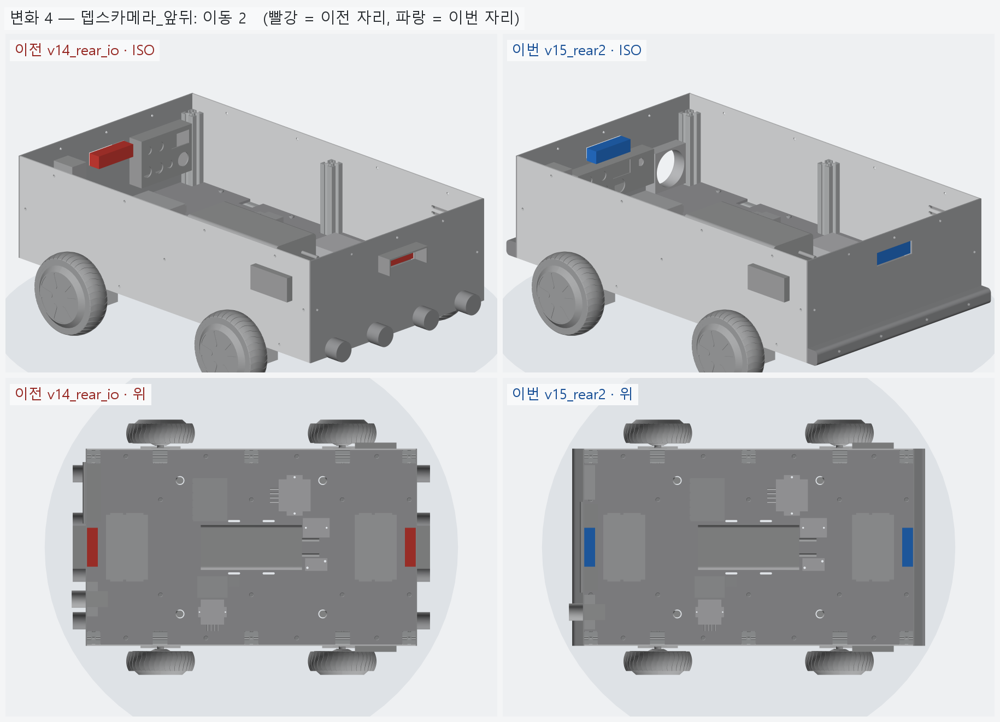
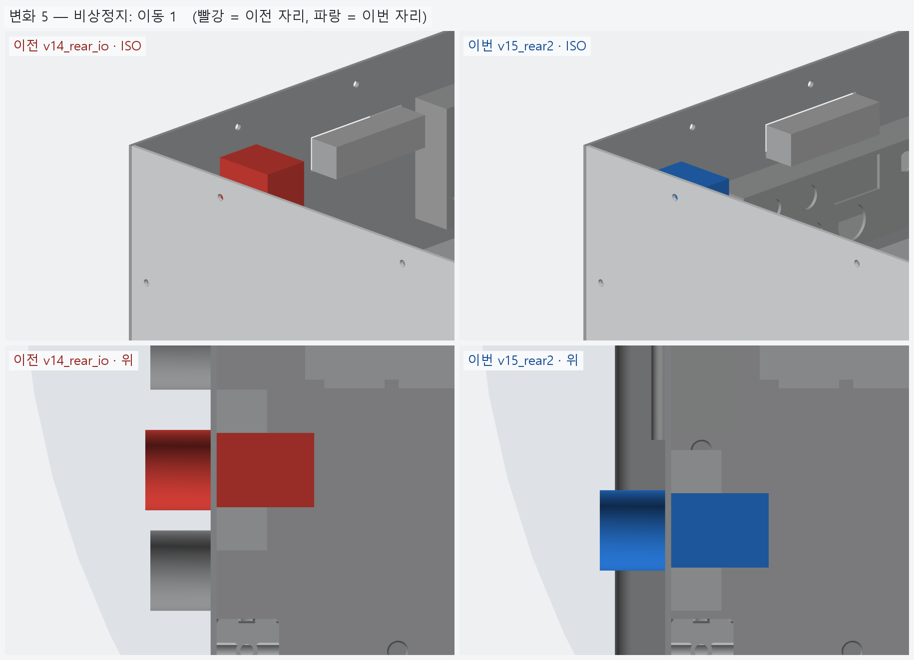
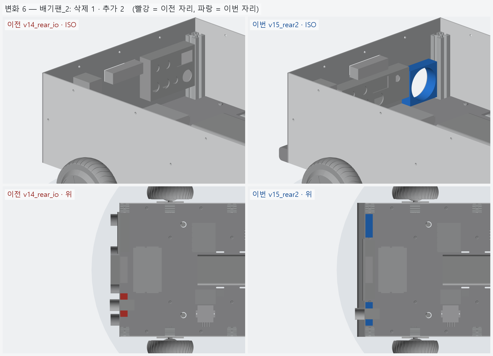

# v15_rear2 — 고무 띠 범퍼 · 배기 양쪽 · 포트 칸 카메라 아래

- 날짜: 2026-10-04
- 이전 버전: [v14_rear_io](../v14_rear_io/README.md)
- 코드: [shell.py](shell.py) (`RUBBER` · `BAY` · `BAY_PORTS` · `FANS` · `ESTOP` · `CAM`)

## 무엇을 왜 바꿨나

요청: 고무는 원기둥이 아니라 네모 블록을 띄엄띄엄 — 아니면 이어진 고무 띠. 뒤판 배기는 양쪽, 포트 칸은 카메라 아래, 카메라 덮개 뺌.

- **고무 범퍼 → 이어진 고무 띠** (앞 · 뒤 하나씩, 판 전체 폭 456 × 높이 30 × 두께 25, 바깥 모서리 R8).
  띄엄띄엄 블록은 사이 틈으로 기둥 · 모서리가 판을 바로 친다 — 이어진 띠가 판 끝까지 막는다.
  M6 4 개 (y=±60 · ±170) 로 끝 크로스 바깥 슬롯에 문다. 시중 "D 형 고무 범퍼 / 고무 몰딩" 을 길이대로 자르면 된다.
  (블록으로 바꾸려면 `rubber_bumpers()` 만 고친다.)
- 뒤판 **배기 팬 80 mm 양쪽** (y=±150, z=175).
- **포트 칸을 카메라 아래 가운데로** — 200 × 68, z 162~230, 깊이 35. 포트 7 개를 2 줄로
  (위: 충전 GX16 · 키 스위치 · 전압계 · ESP32 USB-C / 아래: USB ×2 · RJ45).
- 카메라 z 240 → **250** (아래에 포트 칸 자리를 내려고). 앞 · 뒤 같은 높이. **카메라 차양 뺌.**
- 비상정지는 오른쪽 (-y) 팬 위 (y=-150, z=240) — 덮개 밖.
- 기록 수치의 "그로밋" → "케이블 글랜드 M20" 으로 바로잡음.

<!-- record:begin — record.py 가 덮어쓴다. 이 사이는 손으로 고치지 않는다 -->
## 기록 (자동 · record.py · 2026-10-04 13:14)

**요약** — 고무 범퍼 → 이어진 고무 띠, 뒤판 배기 팬 양쪽 · 포트 칸 카메라 아래, 카메라 차양 뺌

### 전체 모습



### 이전 버전(v14_rear_io) 대비 변화

| # | 그룹 | 변화 | 부품 |
|---|---|---|---|
| 1 | 외관_UV_PC3t_앞뒤판_불투명 | 형상 변경 2 | 앞판_PC3t 형상 변경 (외곽 · 부피 같음 — 안쪽 구멍 · 창 자리가 바뀜)<br>뒤판_PC3t 형상 변경 (부피 217.7 → 199.9 cm³) |
| 2 | 외관_ASA_루버_차양_포트칸 | 삭제 2 · 형상 변경 2 | 포트칸_트레이_ASA 형상 변경 (부피 66.5 → 78.4 cm³)<br>포트칸_덮개_ASA 형상 변경 (부피 46.7 → 53.3 cm³)<br>카메라차양_뒤_ASA 삭제<br>카메라차양_앞_ASA 삭제 |
| 3 | 고무범퍼띠_앞뒤 | 삭제 8 · 추가 2 | 고무범퍼_뒤 ×4 삭제<br>고무범퍼_앞 ×4 삭제<br>고무범퍼띠_뒤 추가<br>고무범퍼띠_앞 추가 |
| 4 | 뎁스카메라_앞뒤 | 이동 2 | 뎁스카메라_뒤_D435급 이동 Δ(+0.0, +0.0, +10.0)<br>뎁스카메라_앞_D435급 이동 Δ(+0.0, +0.0, +10.0) |
| 5 | 비상정지 | 이동 1 | 비상정지_KSEP_22파이 이동 Δ(+0.0, -30.0, -5.0) |
| 6 | 배기팬_2 | 삭제 1 · 추가 2 | 배기팬_80mm 삭제<br>배기팬_80mm_오른 추가<br>배기팬_80mm_왼 추가 |

**변화 1 — 외관_UV_PC3t_앞뒤판_불투명**



**변화 2 — 외관_ASA_루버_차양_포트칸**



**변화 3 — 고무범퍼띠_앞뒤**



**변화 4 — 뎁스카메라_앞뒤**



**변화 5 — 비상정지**



**변화 6 — 배기팬_2**



### 수치

| 항목 | 값 |
|---|---|
| 프레임 외곽 (x × y) | 760 × 450 mm |
| 휠베이스 (앞뒤 축 간격) | 420 mm |
| 트레드 (좌우 바퀴 중심 간격) | 527.4 mm |
| 레일 윗면 높이 | 123.8 mm |
| 축크로스 x | ±210 mm |
| 기둥 | 6 본, x=-365 · +0 · +365 × y=±210, 높이 143 (윗면 z=266.9) |
| 3030 절단 | 760 × 2 + 390 × 5 + 143 × 6 |
| 3030 합계 | 실길이 4.33 m / 과금 4.80 m (45,600원) |
| 체결볼트 M6x15 | 16 개 |
| 바닥판 재료 | 폴리카보네이트 (PC) 불투명 흑색 5t — 불투명 (흑색 · 회색) — 충격에 강하고 안이 안 보인다 / 레이저는 그을린다 → CNC 재단 |
| 바닥판 크기 · 무게 | 760 × 450 × 5, 약 1.97 kg |
| 바닥판 구멍 | M6 고정 18 · 케이블 글랜드 M20 (Ø20.5) 4 · M5 격자 0 · 기둥 노치 10 (x=-365 · -210 · +0 · +210 · +365, 기둥 6 · 10 본 겸용) |
| 판볼트 | M6x15 + 와셔 (필요 15.0 ~ 최대 15.8) |
| 받침 없는 구간 (크로스 안쪽면 사이) | 125 · 180 · 180 · 125 mm |
| 부품 | 10 개 (실측 치수 모델, 출처 parts.py) |
| 부품 무게 (알려진 것) | 4.66 kg — 무게 미상: ESP32_보드, SSR_모터전원차단_40A, DCDC_36V-5V |
| 부품 무게중심 | x=+22.0 · y=+9.6 · z=159.7 mm (휠베이스 가운데 x=0 기준) |
| 가장 높은 부품 윗면 | z=203.8 — 기둥 윗면 z=266.9 까지 63.0 mm 남음 |
| 전체 크기 (x × y × z) | 823.5 × 590.2 × 296.9 mm |
| 최저 지상고 (바퀴 제외, 지면 z=0) | 54.9 mm |

### 부품 구성

| 그룹 | 개수 |
|---|---|
| 프레임_3030_13본 | 13 |
| T클램프_혀선반_4개 | 4 |
| 기존_상부클램프_4개 | 4 |
| 휠모터_4개 | 4 |
| 체결볼트_M6x15_16개 | 16 |
| 바닥판_폴리카보네이트5t_불투명 | 1 |
| 판볼트_M6x15_18개 | 18 |
| 케이블_경로_참고 | 8 |
| 배터리 | 1 |
| 모터드라이버 | 2 |
| 컴퓨터_젯슨_ESP32 | 2 |
| 전원_퓨즈_SSR_DCDC | 4 |
| 센서_IMU | 1 |
| 외관_ACM3t_옆판2 | 2 |
| 외관_UV_PC3t_앞뒤판_불투명 | 2 |
| 외관_ASA_루버_차양_포트칸 | 4 |
| 고무범퍼띠_앞뒤 | 2 |
| 뎁스카메라_앞뒤 | 2 |
| 비상정지 | 1 |
| 배기팬_2 | 2 |

### 검증

```
  간섭 프레임-T클램프: 0.00 mm3
  간섭 프레임-상부클램프: 0.00 mm3
  간섭 프레임-휠모터: 0.00 mm3
  간섭 T클램프-휠모터: 0.00 mm3
  간섭 T클램프-상부클램프: 0.00 mm3
  간섭 볼트-프레임: 0.00 mm3
  간섭 볼트-T클램프: 8.38 mm3 (두께 0.010)
  간섭 볼트-휠모터: 0.00 mm3
  대조군 클램프 +1mm 올림 → 레일 겹침 4006 mm3
  대조군 클램프 +1mm 올림 → 축크로스 겹침 6509 mm3
  대조군 기둥 -1mm 내림 → 레일 겹침 1893 mm3
  기둥 ~ 휠모터 최소 간격 74.0 mm (메시 점 기준)
  간섭 바닥판-프레임 (기둥 포함): 0.00 mm3
  간섭 바닥판-T클램프: 0.00 mm3
  간섭 바닥판-휠모터: 0.00 mm3
  간섭 판볼트-프레임: 0.00 mm3
  간섭 판볼트-바닥판: 0.00 mm3
  간섭 케이블-프레임: 0.00 mm3
  간섭 케이블-T클램프: 0.00 mm3
  간섭 케이블-상부클램프: 0.00 mm3
  간섭 케이블-휠모터: 0.00 mm3
  간섭 케이블-바닥판: 0.00 mm3
  대조군 바닥판 -0.5mm → 프레임 겹침 31909 mm3
  10 본 겸용: 축 자리 가상 기둥 4 본 ~ 바닥판 간섭 0.00 mm3
  대조군 노치 없는 판 ~ 가상 기둥 겹침 7682 mm3
  판볼트 길이: 필요 15.0 ~ 최대 15.8 → M6x15
  간섭 부품끼리: 0.00 mm3
  간섭 부품-프레임 (기둥): 0.00 mm3
  간섭 부품-판볼트 머리: 0.00 mm3
  간섭 부품-바닥판: 0.00 mm3
  간섭 부품-케이블 구멍 위 (반경 15): 0.00 mm3
  대조군 부품 -1mm → 바닥판 겹침 65050 mm3
  부품 고정 구멍 28 — 빔 위 0 · 서로/다른 구멍과 2 mm 안 0
  대조군 x=0 구멍 → 빔 위 판정 True
  간섭 외관판-프레임: 0.00 mm3
  간섭 외관판-T클램프: 0.00 mm3
  간섭 외관판-휠모터: 0.00 mm3
  간섭 외관판-부품: 0.00 mm3
  간섭 외관판-바닥판: 0.00 mm3
  간섭 출력물-프레임: 0.00 mm3
  간섭 출력물-휠모터: 0.00 mm3
  간섭 출력물-T클램프: 0.00 mm3
  간섭 출력물-외관판: 0.00 mm3
  옆판 ~ 타이어 최소 간격 7.1 mm (메시 점 기준)
  벽 위끝 z=296.85 (상부 프레임 윗면 가정 z=296.85)
  부품 윗면 z=203.8 ~ 상부 프레임 밑면 z=266.9: 63.0 mm
  간섭 추가물-프레임: 0.00 mm3
  간섭 추가물-부품: 0.00 mm3
  간섭 추가물-외관판: 0.00 mm3
  간섭 추가물-ASA: 0.00 mm3
  간섭 추가물끼리: 0.00 mm3
  간섭 비상정지-팬: 0.00 mm3
  간섭 추가물-휠모터: 0.00 mm3
  포트 칸 z 162.0~230.0 — 뒤 드라이버 윗면 159.8, 상부 프레임 밑면 266.9
verify: OK
```

### 기록 소요

불러오기 0.4s · 짓기 26.6s · 검증 43.1s · STEP 8.0s · 내보내기 10.7s · 뷰어 전송 6.2s · 메시 (46 형상 → 93 부품) 14.4s · 전체 모습 이미지 5 장 4.9s · 변화 이미지 6 장 17.1s

<!-- record:end -->
