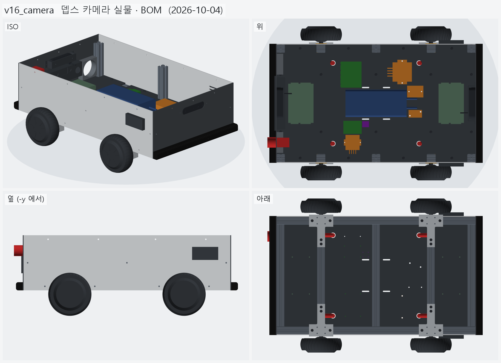
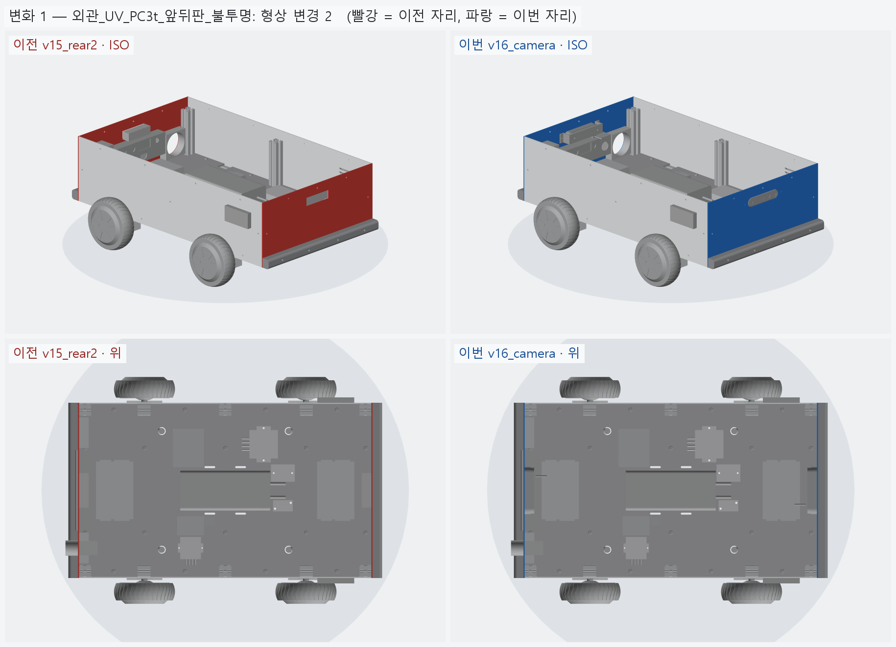
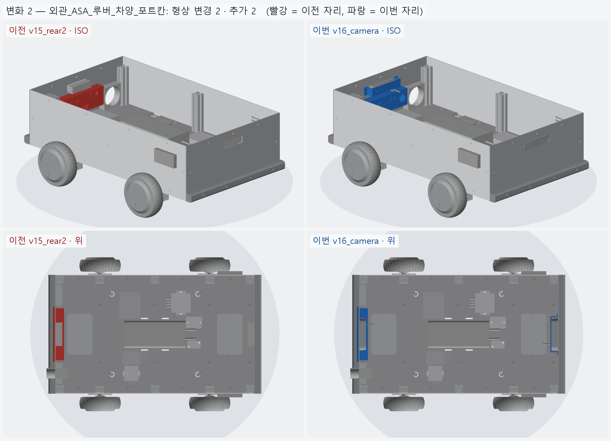
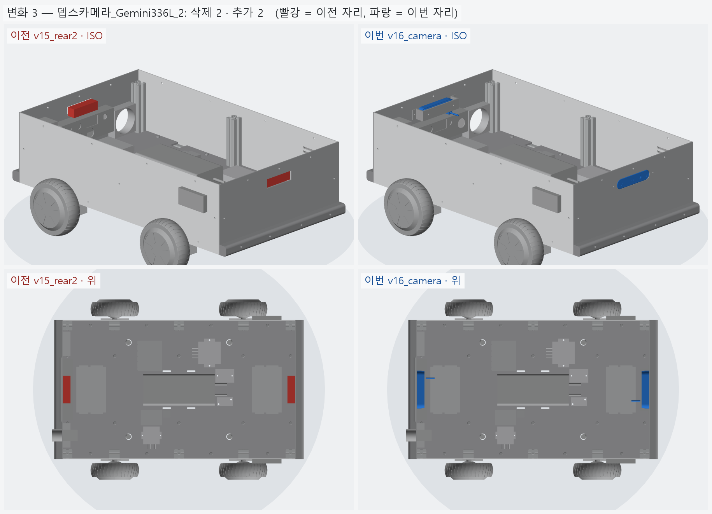

# v16_camera — 뎁스 카메라 실물 (Orbbec Gemini 336L) · BOM

- 날짜: 2026-10-04
- 이전 버전: [v15_rear2](../v15_rear2/README.md)
- 코드: [camera.py](camera.py) (카메라 · 브래킷, 공식 도면 치수), [shell.py](shell.py) (창 · 브래킷 구멍 · `camera_bom`),
  [bom.py](bom.py) → [bom.md](bom.md) · `output/bom.csv`

## 무엇을 왜 바꿨나

요청: 실제 작업에서 시행착오가 없게 현실적으로 — 뎁스 카메라는 실제 제품 · 링크를 찾아 BOM 에 넣고 수치 · 사진 기반으로 모델링.

**카메라 선정 — Orbbec Gemini 336L × 2** (앞 · 뒤)

| 후보 | IP | 인터페이스 | Min-Z | 국내가 (VAT 포함) | 판단 |
|---|---|---|---|---|---|
| **Gemini 336L** | **IP65** | USB-C (나사 잠금, 커넥터 IP67) | 0.25 m | **616,000** (아이씨뱅큐) | 실외 밀폐 · Orin Nano 공식 지원 · 깊이 계산이 카메라 안 (젯슨 GPU 안 씀) |
| Gemini 335L | IP65 | 같음 | 0.25 m | 605,000 | IR 통과 커버만 없음 — 같은 하우징 |
| RealSense D456 | IP65 | USB-C | 0.52 m | 830,000 | 비싸고 근거리 약함 (같은 브래킷에 들어감) |
| OAK-D Pro W PoE | IP65 | PoE (인젝터 필요) | — | 1,534,590 | 비싸고 전원 별도 |
| ZED 2i | IP66 | USB-C | 0.3 m | 875,000 | 깊이에 젯슨 GPU 사용, 175 mm 로 큼 |

**모델링 (공식 도면 Gemini 336L V1.0 기준)** — 외곽 124.02 × 29.03 × 27.70, 앞면 스타디움 (양끝 반원), 앞 구간 18.25,
IR 창 Ø12 (±47.5, 기준선 95) · 프로젝터 Ø6.7 · RGB Ø15.6/12, 뒷면 방열 핀 · M4 ×2 (95 간격, 최대 삽입 4),
바닥 1/4-20 (최대 8) · USB-C + 잠금 M2 ×2 (15 간격). USB 자리 · 핀 개수는 [도면 비례].

**장착** — IP65 라 렌즈면을 판 바깥면과 **같은 면**으로 노출, 판 구멍은 카메라와 같은 **스타디움 124.6 × 29.6**
(+0.3, EPDM 개스킷). ASA 브래킷이 카메라 뒷면 M4 ×2 를 잡고, 양옆 플랜지가 판 안쪽면에 M3 ×2 (열압입 인서트).
USB-C 는 바닥으로 나와 **ㄱ자 플러그**로 안쪽으로 꺾는다 — 뒤쪽은 그 아래 포트 칸 높이를 68 → 60 으로 줄였다.

**BOM 시작** — [bom.md](bom.md). 프로파일 절단 · 판재 · 출력물 (부피 → 무게 · 시간) · 볼트 개수는 형상에서 세고,
가격은 조사로 확인한 것만 (나머지 "확인 필요").

## 남은 일

- USB-C ㄱ자 케이블 실물 (플러그 높이) 확인, 젯슨 USB 3 포트 배분.
- BOM 의 "확인 필요" 단가 견적.

<!-- record:begin — record.py 가 덮어쓴다. 이 사이는 손으로 고치지 않는다 -->
## 기록 (자동 · record.py · 2026-10-04 14:16)

**요약** — 뎁스 카메라 Orbbec Gemini 336L 실물 모델 (스타디움 창 · 브래킷), 포트 칸 60, BOM 시작

### 전체 모습



### 이전 버전(v15_rear2) 대비 변화

| # | 그룹 | 변화 | 부품 |
|---|---|---|---|
| 1 | 외관_UV_PC3t_앞뒤판_불투명 | 형상 변경 2 | 앞판_PC3t 형상 변경 (부피 269.5 → 266.4 cm³)<br>뒤판_PC3t 형상 변경 (부피 199.9 → 201.6 cm³) |
| 2 | 외관_ASA_루버_차양_포트칸 | 형상 변경 2 · 추가 2 | 포트칸_트레이_ASA 형상 변경 (부피 78.4 → 72.8 cm³)<br>포트칸_덮개_ASA 형상 변경 (부피 53.3 → 48.2 cm³)<br>카메라브래킷_뒤_ASA 추가<br>카메라브래킷_앞_ASA 추가 |
| 3 | 뎁스카메라_Gemini336L_2 | 삭제 2 · 추가 2 | 뎁스카메라_뒤_D435급 삭제<br>뎁스카메라_앞_D435급 삭제<br>뎁스카메라_뒤_Gemini336L 추가<br>뎁스카메라_앞_Gemini336L 추가 |

**변화 1 — 외관_UV_PC3t_앞뒤판_불투명**



**변화 2 — 외관_ASA_루버_차양_포트칸**



**변화 3 — 뎁스카메라_Gemini336L_2**



### 수치

| 항목 | 값 |
|---|---|
| 프레임 외곽 (x × y) | 760 × 450 mm |
| 휠베이스 (앞뒤 축 간격) | 420 mm |
| 트레드 (좌우 바퀴 중심 간격) | 527.4 mm |
| 레일 윗면 높이 | 123.8 mm |
| 축크로스 x | ±210 mm |
| 기둥 | 6 본, x=-365 · +0 · +365 × y=±210, 높이 143 (윗면 z=266.9) |
| 3030 절단 | 760 × 2 + 390 × 5 + 143 × 6 |
| 3030 합계 | 실길이 4.33 m / 과금 4.80 m (45,600원) |
| 체결볼트 M6x15 | 16 개 |
| 바닥판 재료 | 폴리카보네이트 (PC) 불투명 흑색 5t — 불투명 (흑색 · 회색) — 충격에 강하고 안이 안 보인다 / 레이저는 그을린다 → CNC 재단 |
| 바닥판 크기 · 무게 | 760 × 450 × 5, 약 1.97 kg |
| 바닥판 구멍 | M6 고정 18 · 케이블 글랜드 M20 (Ø20.5) 4 · M5 격자 0 · 기둥 노치 10 (x=-365 · -210 · +0 · +210 · +365, 기둥 6 · 10 본 겸용) |
| 판볼트 | M6x15 + 와셔 (필요 15.0 ~ 최대 15.8) |
| 받침 없는 구간 (크로스 안쪽면 사이) | 125 · 180 · 180 · 125 mm |
| 부품 | 10 개 (실측 치수 모델, 출처 parts.py) |
| 부품 무게 (알려진 것) | 4.66 kg — 무게 미상: ESP32_보드, SSR_모터전원차단_40A, DCDC_36V-5V |
| 부품 무게중심 | x=+22.0 · y=+9.6 · z=159.7 mm (휠베이스 가운데 x=0 기준) |
| 가장 높은 부품 윗면 | z=203.8 — 기둥 윗면 z=266.9 까지 63.0 mm 남음 |
| 전체 크기 (x × y × z) | 823.5 × 590.2 × 296.9 mm |
| 최저 지상고 (바퀴 제외, 지면 z=0) | 54.9 mm |

### 부품 구성

| 그룹 | 개수 |
|---|---|
| 프레임_3030_13본 | 13 |
| T클램프_혀선반_4개 | 4 |
| 기존_상부클램프_4개 | 4 |
| 휠모터_4개 | 4 |
| 체결볼트_M6x15_16개 | 16 |
| 바닥판_폴리카보네이트5t_불투명 | 1 |
| 판볼트_M6x15_18개 | 18 |
| 케이블_경로_참고 | 8 |
| 배터리 | 1 |
| 모터드라이버 | 2 |
| 컴퓨터_젯슨_ESP32 | 2 |
| 전원_퓨즈_SSR_DCDC | 4 |
| 센서_IMU | 1 |
| 외관_ACM3t_옆판2 | 2 |
| 외관_UV_PC3t_앞뒤판_불투명 | 2 |
| 외관_ASA_루버_차양_포트칸 | 6 |
| 고무범퍼띠_앞뒤 | 2 |
| 뎁스카메라_Gemini336L_2 | 2 |
| 비상정지 | 1 |
| 배기팬_2 | 2 |

### 검증

```
  간섭 프레임-T클램프: 0.00 mm3
  간섭 프레임-상부클램프: 0.00 mm3
  간섭 프레임-휠모터: 0.00 mm3
  간섭 T클램프-휠모터: 0.00 mm3
  간섭 T클램프-상부클램프: 0.00 mm3
  간섭 볼트-프레임: 0.00 mm3
  간섭 볼트-T클램프: 8.38 mm3 (두께 0.010)
  간섭 볼트-휠모터: 0.00 mm3
  대조군 클램프 +1mm 올림 → 레일 겹침 4006 mm3
  대조군 클램프 +1mm 올림 → 축크로스 겹침 6509 mm3
  대조군 기둥 -1mm 내림 → 레일 겹침 1893 mm3
  기둥 ~ 휠모터 최소 간격 74.0 mm (메시 점 기준)
  간섭 바닥판-프레임 (기둥 포함): 0.00 mm3
  간섭 바닥판-T클램프: 0.00 mm3
  간섭 바닥판-휠모터: 0.00 mm3
  간섭 판볼트-프레임: 0.00 mm3
  간섭 판볼트-바닥판: 0.00 mm3
  간섭 케이블-프레임: 0.00 mm3
  간섭 케이블-T클램프: 0.00 mm3
  간섭 케이블-상부클램프: 0.00 mm3
  간섭 케이블-휠모터: 0.00 mm3
  간섭 케이블-바닥판: 0.00 mm3
  대조군 바닥판 -0.5mm → 프레임 겹침 31909 mm3
  10 본 겸용: 축 자리 가상 기둥 4 본 ~ 바닥판 간섭 0.00 mm3
  대조군 노치 없는 판 ~ 가상 기둥 겹침 7682 mm3
  판볼트 길이: 필요 15.0 ~ 최대 15.8 → M6x15
  간섭 부품끼리: 0.00 mm3
  간섭 부품-프레임 (기둥): 0.00 mm3
  간섭 부품-판볼트 머리: 0.00 mm3
  간섭 부품-바닥판: 0.00 mm3
  간섭 부품-케이블 구멍 위 (반경 15): 0.00 mm3
  대조군 부품 -1mm → 바닥판 겹침 65050 mm3
  부품 고정 구멍 28 — 빔 위 0 · 서로/다른 구멍과 2 mm 안 0
  대조군 x=0 구멍 → 빔 위 판정 True
  간섭 외관판-프레임: 0.00 mm3
  간섭 외관판-T클램프: 0.00 mm3
  간섭 외관판-휠모터: 0.00 mm3
  간섭 외관판-부품: 0.00 mm3
  간섭 외관판-바닥판: 0.00 mm3
  간섭 출력물-프레임: 0.00 mm3
  간섭 출력물-휠모터: 0.00 mm3
  간섭 출력물-T클램프: 0.00 mm3
  간섭 출력물-외관판: 0.00 mm3
  옆판 ~ 타이어 최소 간격 7.1 mm (메시 점 기준)
  벽 위끝 z=296.85 (상부 프레임 윗면 가정 z=296.85)
  부품 윗면 z=203.8 ~ 상부 프레임 밑면 z=266.9: 63.0 mm
  간섭 추가물-프레임: 0.00 mm3
  간섭 추가물-부품: 0.00 mm3
  간섭 추가물-외관판: 0.00 mm3
  간섭 추가물-ASA: 0.00 mm3
  간섭 추가물끼리: 0.00 mm3
  간섭 비상정지-팬: 0.00 mm3
  간섭 추가물-휠모터: 0.00 mm3
  포트 칸 z 162.0~222.0 — 뒤 드라이버 윗면 159.8, 상부 프레임 밑면 266.9
  카메라 윗면 z=264.51 ~ 상부 프레임 밑면 266.85: 2.34 mm
  카메라 렌즈면 = 판 바깥면 x=±383.0
verify: OK
```

### 기록 소요

불러오기 0.2s · 짓기 11.4s · 검증 25.6s · STEP 4.0s · 내보내기 5.3s · 뷰어 전송 3.2s · 메시 (46 형상 → 95 부품) 11.8s · 전체 모습 이미지 5 장 4.1s · 변화 이미지 3 장 5.7s

<!-- record:end -->
