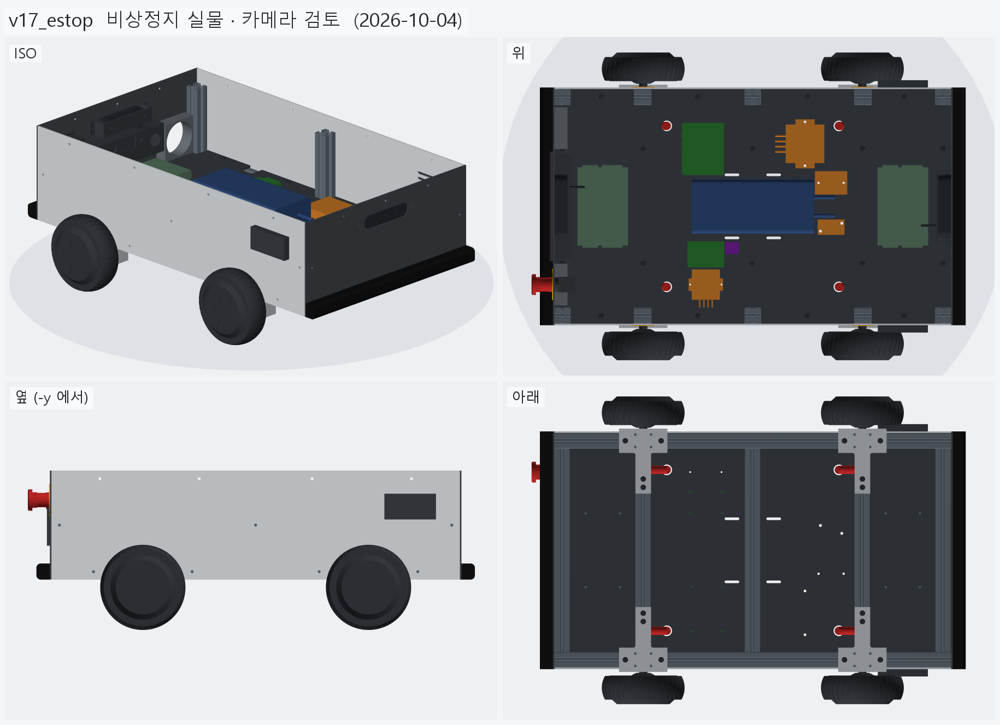
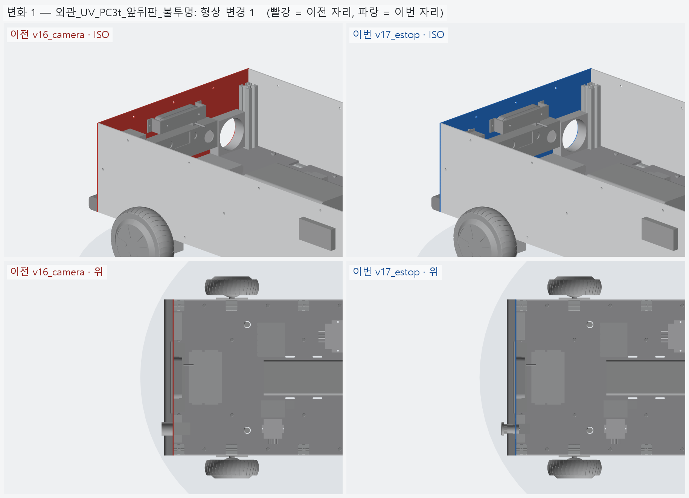
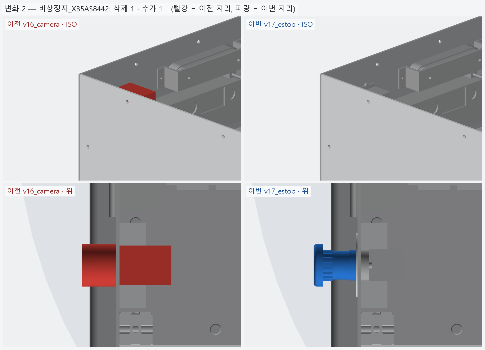
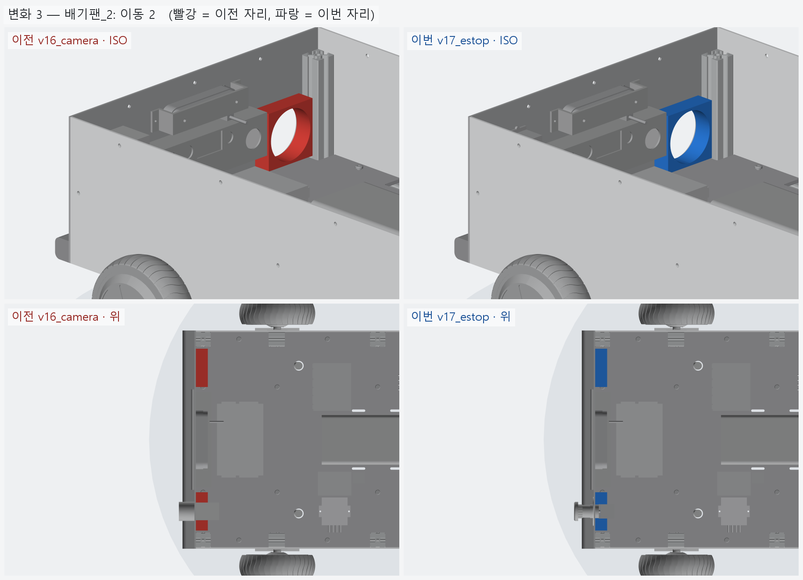
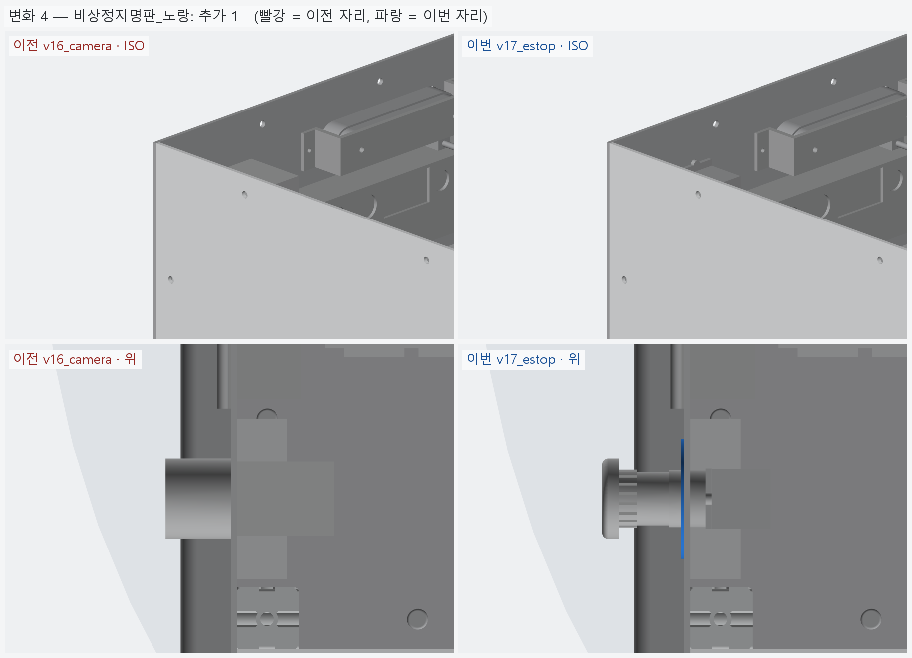
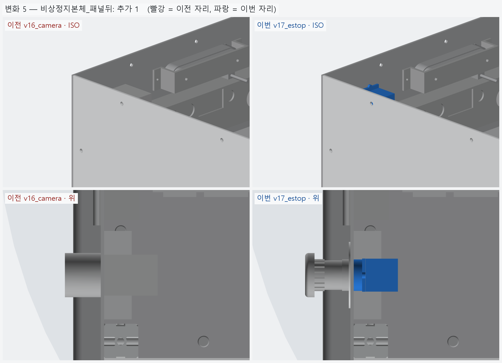

# v17_estop — 비상정지 실물 (Schneider XB5AS8442)

- 날짜: 2026-10-04
- 이전 버전: [v16_camera](../v16_camera/README.md)
- 코드: [estop.py](estop.py) (버튼 · 명판, 데이터시트 도면 치수), [shell.py](shell.py) (구멍 · 홈 · 자리), [bom.py](bom.py) → [bom.md](bom.md)

## 무엇을 왜 바꿨나

요청 1: 비상정지 버튼을 실제 제품으로 찾아 BOM 에 넣고 데이터시트 · 수치 · 이미지 기반으로 모델링.

| 후보 | 전면 보호 | 직접개로 | 3 mm 판 | 국내가 | 판단 |
|---|---|---|---|---|---|
| **Schneider XB5AS8442** | **IP66/67/69/69K, UL 4X** | IEC 60947-5-1 Annex K, 60947-5-5 | 1~6 mm | 다나와 27,450~ (해외 다수), 나비엠알오 19,239 (단종 표시) | **실외 비 · 세척까지 확인된 유일한 후보** |
| IDEC XW1E-BV402M-R | IP65 (PDF) | 있음 (2NC) | 0.8~6 | 디지키 72,956 | 비싸다 |
| Autonics SF2ER-E2RB | IP65, 매뉴얼에 "실내" | 표기만 | 가드 쓰면 2.3 mm 까지 → 3 mm 판엔 가드 불가 | 엘레파츠 23,100 | 실외 부적합 |

모델 (2015 데이터시트 도면) — 패널 앞 39.5 · 뒤 43 [도면], 헤드 Ø40 [도면] (버섯 두께 8.5 · 톱니 그립 Ø29 · 축 Ø26.7 · 베젤 Ø28.5 [도면 비례]),
패널 뒤 고정 링 → 고정 칼라판 30×40 (위 돌기 포함 43 [도면]) → 접점블록 ZBE102 (1NC, 나사 단자).
노란 Ø60 명판 ZBY9320 (두께 [가정] 1.5) 을 패널 앞에 깔고, 회전방지판 ZB5AZ902 를 쓴다.
뒤판 구멍 **Ø22.5 + 회전방지 홈** (폭 3.2, 구멍 중심 → 홈 끝 12.95, [도면] 24.1 에서).

- 명판 Ø60 이 오른쪽 배기 팬 구멍 (Ø76) 위끝에 3 mm 겹쳐서 비상정지 z 240 → 242, 팬 z 175 → 172 (사이 2 mm).
- 정품 경로 주의: 다나와 상품 상당수가 해외 직구 — 비상정지는 위조품 위험이 있어 국내 대리점 구매 권장.

요청 2: 카메라를 Nuwa HP60C 로 바꾸면? → **이 실외 차량에는 권하지 않는다** (카메라는 Gemini 336L 그대로).

| | Nuwa HP60C | Gemini 336L |
|---|---|---|
| 사용 환경 (제조사) | **실내** (Angstrong 사양서) | 실내 · 실외 |
| 방식 | 단안 구조광 940 nm — 햇빛에서 깊이가 빠지기 쉽다 | 능동 + 수동 스테레오 — 햇빛에서는 수동으로 |
| 방수 | **등급 없음**, 앞에 유리 덧대기 **금지** (사양서 §6.4) | IP65 |
| 인터페이스 · 거리 | USB 2.0, 640×480, 0.2~4 m (2 m 이내 권장), Orin Nano 실측 depth 12 Hz | USB 3, 0.25~6 m 최적 |
| 가격 (대당) | 약 18~26 만원 (쿠팡 해외 181,250~ · 아이씨뱅큐 264,550) | 616,000 |

2 대면 70~90 만원 싸지만 햇빛 · 비에서 깊이를 믿기 어렵다. 쓴다면 그늘 · 야간 근거리 보조나 실내 시험용.

<!-- record:begin — record.py 가 덮어쓴다. 이 사이는 손으로 고치지 않는다 -->
## 기록 (자동 · record.py · 2026-10-04 15:34)

**요약** — 비상정지 Schneider XB5AS8442 실물 모델 (+ 노란 Ø60 명판, 회전방지 홈), 팬 · 비상정지 높이 조정

### 전체 모습



### 이전 버전(v16_camera) 대비 변화

| # | 그룹 | 변화 | 부품 |
|---|---|---|---|
| 1 | 외관_UV_PC3t_앞뒤판_불투명 | 형상 변경 1 | 뒤판_PC3t 형상 변경 (부피 201.6 → 201.6 cm³) |
| 2 | 비상정지_XB5AS8442 | 삭제 1 · 추가 1 | 비상정지_KSEP_22파이 삭제<br>비상정지_Schneider_XB5AS8442 추가 |
| 3 | 배기팬_2 | 이동 2 | 배기팬_80mm_오른 이동 Δ(+0.0, +0.0, -3.0)<br>배기팬_80mm_왼 이동 Δ(+0.0, +0.0, -3.0) |
| 4 | 비상정지명판_노랑 | 추가 1 | 비상정지명판_ZBY9320_노랑 추가 |
| 5 | 비상정지본체_패널뒤 | 추가 1 | 비상정지본체_ZB5AZ102_ZBE102 추가 |

**변화 1 — 외관_UV_PC3t_앞뒤판_불투명**



**변화 2 — 비상정지_XB5AS8442**



**변화 3 — 배기팬_2**



**변화 4 — 비상정지명판_노랑**



**변화 5 — 비상정지본체_패널뒤**



### 수치

| 항목 | 값 |
|---|---|
| 프레임 외곽 (x × y) | 760 × 450 mm |
| 휠베이스 (앞뒤 축 간격) | 420 mm |
| 트레드 (좌우 바퀴 중심 간격) | 527.4 mm |
| 레일 윗면 높이 | 123.8 mm |
| 축크로스 x | ±210 mm |
| 기둥 | 6 본, x=-365 · +0 · +365 × y=±210, 높이 143 (윗면 z=266.9) |
| 3030 절단 | 760 × 2 + 390 × 5 + 143 × 6 |
| 3030 합계 | 실길이 4.33 m / 과금 4.80 m (45,600원) |
| 체결볼트 M6x15 | 16 개 |
| 바닥판 재료 | 폴리카보네이트 (PC) 불투명 흑색 5t — 불투명 (흑색 · 회색) — 충격에 강하고 안이 안 보인다 / 레이저는 그을린다 → CNC 재단 |
| 바닥판 크기 · 무게 | 760 × 450 × 5, 약 1.97 kg |
| 바닥판 구멍 | M6 고정 18 · 케이블 글랜드 M20 (Ø20.5) 4 · M5 격자 0 · 기둥 노치 10 (x=-365 · -210 · +0 · +210 · +365, 기둥 6 · 10 본 겸용) |
| 판볼트 | M6x15 + 와셔 (필요 15.0 ~ 최대 15.8) |
| 받침 없는 구간 (크로스 안쪽면 사이) | 125 · 180 · 180 · 125 mm |
| 부품 | 10 개 (실측 치수 모델, 출처 parts.py) |
| 부품 무게 (알려진 것) | 4.66 kg — 무게 미상: ESP32_보드, SSR_모터전원차단_40A, DCDC_36V-5V |
| 부품 무게중심 | x=+22.0 · y=+9.6 · z=159.7 mm (휠베이스 가운데 x=0 기준) |
| 가장 높은 부품 윗면 | z=203.8 — 기둥 윗면 z=266.9 까지 63.0 mm 남음 |
| 전체 크기 (x × y × z) | 832.0 × 590.2 × 296.9 mm |
| 최저 지상고 (바퀴 제외, 지면 z=0) | 54.9 mm |

### 부품 구성

| 그룹 | 개수 |
|---|---|
| 프레임_3030_13본 | 13 |
| T클램프_혀선반_4개 | 4 |
| 기존_상부클램프_4개 | 4 |
| 휠모터_4개 | 4 |
| 체결볼트_M6x15_16개 | 16 |
| 바닥판_폴리카보네이트5t_불투명 | 1 |
| 판볼트_M6x15_18개 | 18 |
| 케이블_경로_참고 | 8 |
| 배터리 | 1 |
| 모터드라이버 | 2 |
| 컴퓨터_젯슨_ESP32 | 2 |
| 전원_퓨즈_SSR_DCDC | 4 |
| 센서_IMU | 1 |
| 외관_ACM3t_옆판2 | 2 |
| 외관_UV_PC3t_앞뒤판_불투명 | 2 |
| 외관_ASA_루버_차양_포트칸 | 6 |
| 고무범퍼띠_앞뒤 | 2 |
| 뎁스카메라_Gemini336L_2 | 2 |
| 비상정지_XB5AS8442 | 1 |
| 비상정지명판_노랑 | 1 |
| 비상정지본체_패널뒤 | 1 |
| 배기팬_2 | 2 |

### 검증

```
  간섭 프레임-T클램프: 0.00 mm3
  간섭 프레임-상부클램프: 0.00 mm3
  간섭 프레임-휠모터: 0.00 mm3
  간섭 T클램프-휠모터: 0.00 mm3
  간섭 T클램프-상부클램프: 0.00 mm3
  간섭 볼트-프레임: 0.00 mm3
  간섭 볼트-T클램프: 8.38 mm3 (두께 0.010)
  간섭 볼트-휠모터: 0.00 mm3
  대조군 클램프 +1mm 올림 → 레일 겹침 4006 mm3
  대조군 클램프 +1mm 올림 → 축크로스 겹침 6509 mm3
  대조군 기둥 -1mm 내림 → 레일 겹침 1893 mm3
  기둥 ~ 휠모터 최소 간격 74.0 mm (메시 점 기준)
  간섭 바닥판-프레임 (기둥 포함): 0.00 mm3
  간섭 바닥판-T클램프: 0.00 mm3
  간섭 바닥판-휠모터: 0.00 mm3
  간섭 판볼트-프레임: 0.00 mm3
  간섭 판볼트-바닥판: 0.00 mm3
  간섭 케이블-프레임: 0.00 mm3
  간섭 케이블-T클램프: 0.00 mm3
  간섭 케이블-상부클램프: 0.00 mm3
  간섭 케이블-휠모터: 0.00 mm3
  간섭 케이블-바닥판: 0.00 mm3
  대조군 바닥판 -0.5mm → 프레임 겹침 31909 mm3
  10 본 겸용: 축 자리 가상 기둥 4 본 ~ 바닥판 간섭 0.00 mm3
  대조군 노치 없는 판 ~ 가상 기둥 겹침 7682 mm3
  판볼트 길이: 필요 15.0 ~ 최대 15.8 → M6x15
  간섭 부품끼리: 0.00 mm3
  간섭 부품-프레임 (기둥): 0.00 mm3
  간섭 부품-판볼트 머리: 0.00 mm3
  간섭 부품-바닥판: 0.00 mm3
  간섭 부품-케이블 구멍 위 (반경 15): 0.00 mm3
  대조군 부품 -1mm → 바닥판 겹침 65050 mm3
  부품 고정 구멍 28 — 빔 위 0 · 서로/다른 구멍과 2 mm 안 0
  대조군 x=0 구멍 → 빔 위 판정 True
  간섭 외관판-프레임: 0.00 mm3
  간섭 외관판-T클램프: 0.00 mm3
  간섭 외관판-휠모터: 0.00 mm3
  간섭 외관판-부품: 0.00 mm3
  간섭 외관판-바닥판: 0.00 mm3
  간섭 출력물-프레임: 0.00 mm3
  간섭 출력물-휠모터: 0.00 mm3
  간섭 출력물-T클램프: 0.00 mm3
  간섭 출력물-외관판: 0.00 mm3
  옆판 ~ 타이어 최소 간격 7.1 mm (메시 점 기준)
  벽 위끝 z=296.85 (상부 프레임 윗면 가정 z=296.85)
  부품 윗면 z=203.8 ~ 상부 프레임 밑면 z=266.9: 63.0 mm
  간섭 추가물-프레임: 0.00 mm3
  간섭 추가물-부품: 0.00 mm3
  간섭 추가물-외관판: 0.00 mm3
  간섭 추가물-ASA: 0.00 mm3
  간섭 추가물끼리: 0.00 mm3
  간섭 비상정지-팬: 0.00 mm3
  간섭 명판-팬: 0.00 mm3
  간섭 추가물-휠모터: 0.00 mm3
  포트 칸 z 162.0~222.0 — 뒤 드라이버 윗면 159.8, 상부 프레임 밑면 266.9
  명판 Ø60 ~ 팬 구멍 Ø76 간격 2.0 mm
  카메라 윗면 z=264.51 ~ 상부 프레임 밑면 266.85: 2.34 mm
  카메라 렌즈면 = 판 바깥면 x=±383.0
verify: OK
```

### 기록 소요

불러오기 0.1s · 짓기 10.9s · 검증 17.2s · STEP 3.7s · 내보내기 3.9s · 뷰어 전송 3.1s · 메시 (48 형상 → 97 부품) 10.0s · 전체 모습 이미지 5 장 2.5s · 변화 이미지 5 장 8.3s

<!-- record:end -->
