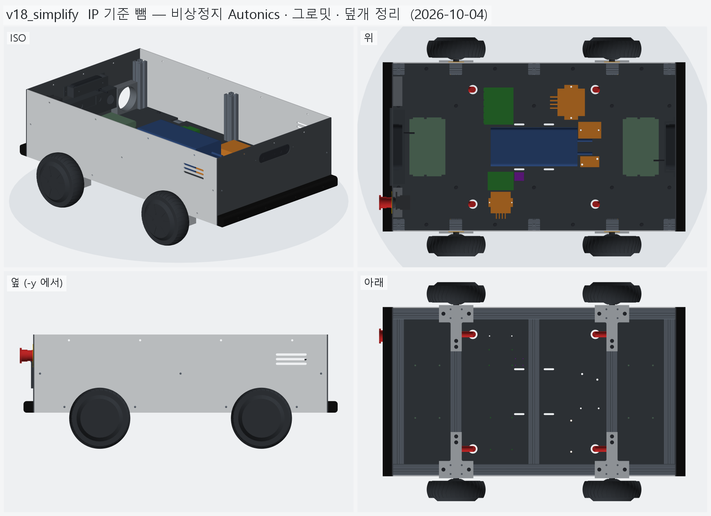
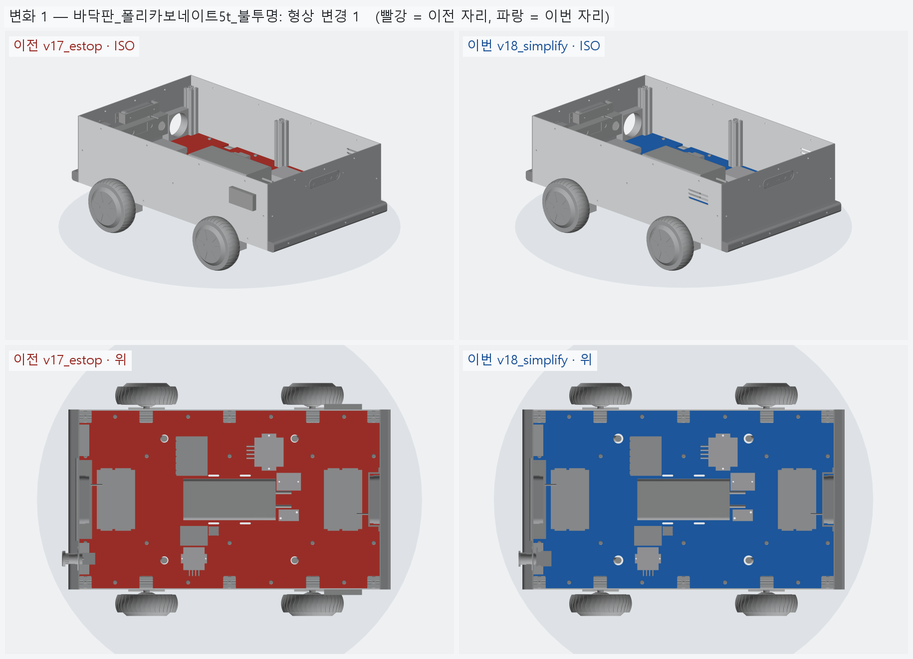
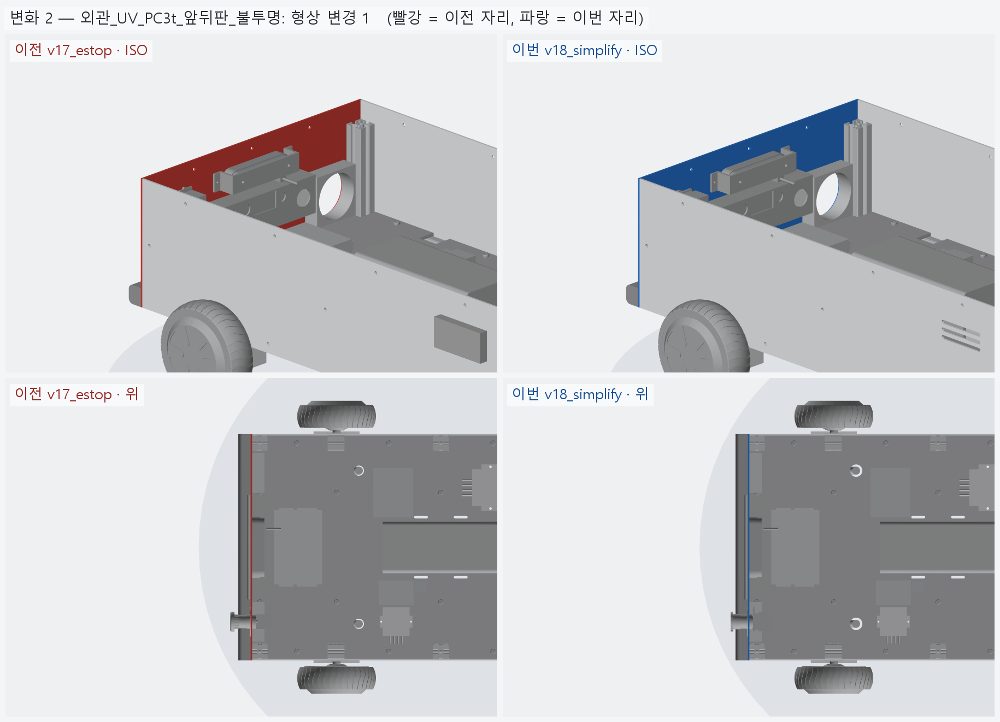
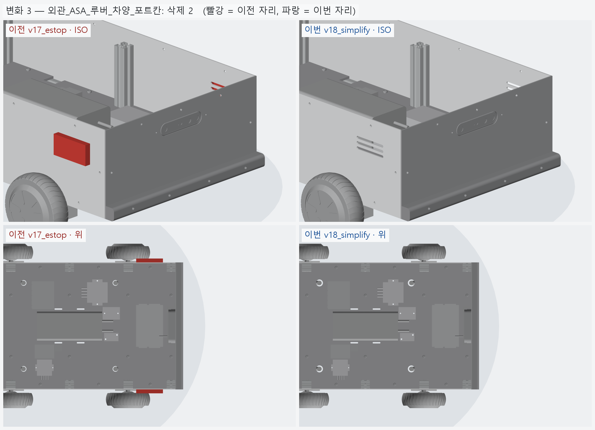
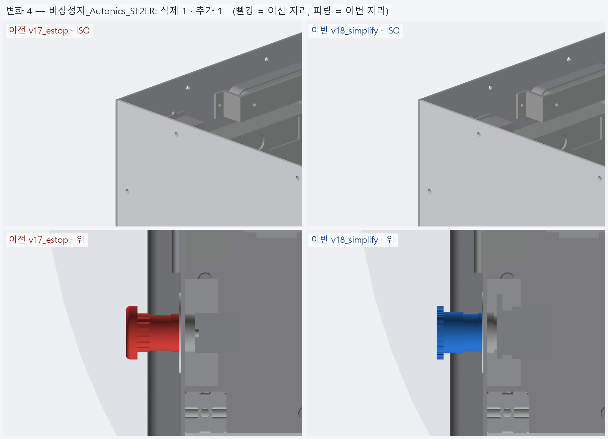
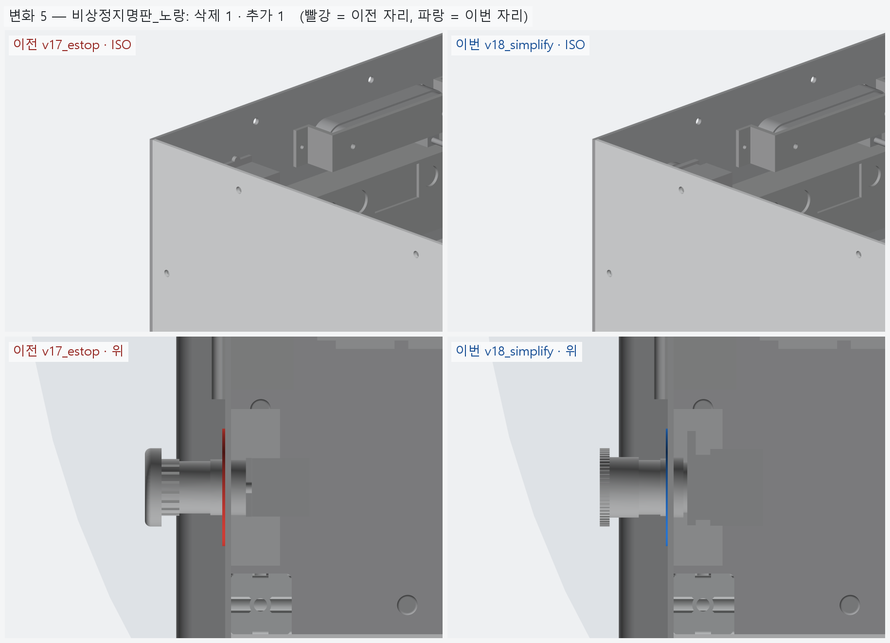
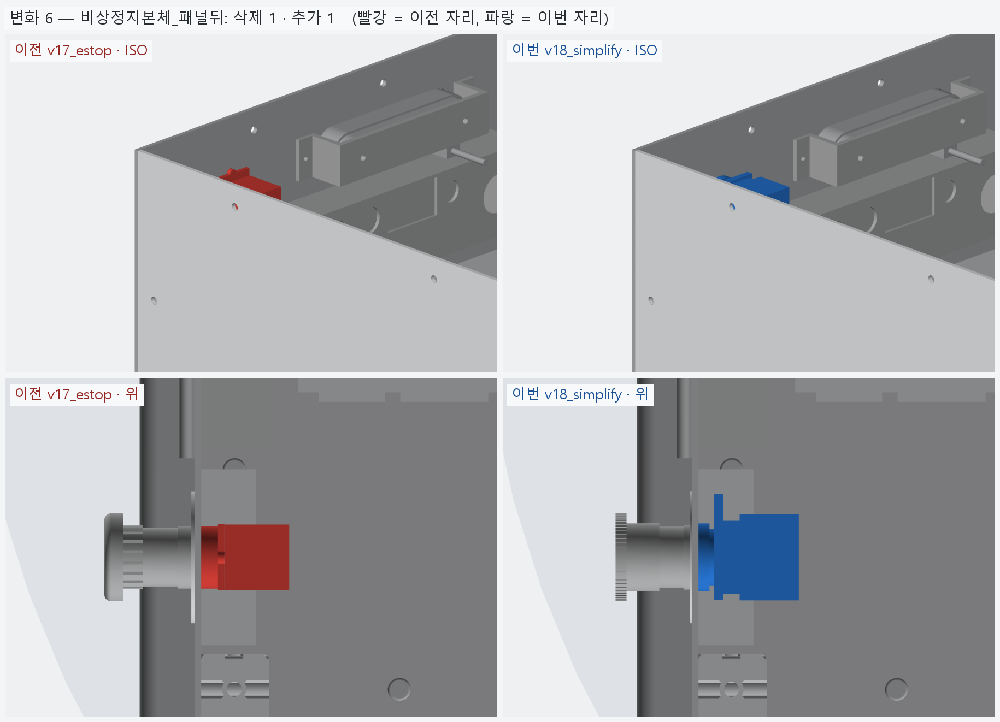

# v18_simplify — 방수 · 방진 기준 뺌 (비상정지 Autonics · 그로밋 · 덮개 정리)

- 날짜: 2026-10-04
- 이전 버전: [v17_estop](../v17_estop/README.md)
- 코드: [estop.py](estop.py) (Autonics SF2ER-E2RB), [shell.py](shell.py), [floor.py](floor.py), [bom.py](bom.py) → [bom.md](bom.md)

## 무엇을 왜 바꿨나

사용자: 실외에서 굴려도 극한 환경은 아니니 **방수 · 방진 등급은 고려하지 않는다**. 그 기준으로 고르거나 더한 것을 추천대로 정리했다.

| 항목 | v17 | v18 | 이유 |
|---|---|---|---|
| 비상정지 | Schneider XB5AS8442 (IP69K, 해외 직구 · 단종 표시) | **Autonics SF2ER-E2RB** (엘레파츠 23,100, 국내 정품) | IP 를 빼면 국내 정품 · 재고가 우선 |
| 바닥판 케이블 구멍 | 방수 글랜드 M20 (Ø20.5) | **고무 그로밋 Ø25** | |
| 옆판 통풍구 덮개 | ASA 빗물막이 루버 덮개 | **뺌** (통풍구는 그대로) | |
| 볼트 와셔 · 카메라 둘레 | EPDM 와셔 · 개스킷 | 일반 와셔 · 없음 | |
| 바닥판 재료 · 포트 칸 덮개 | PC 5t · 위로 여는 덮개 | 그대로 | PC 는 진동 · 충격 때문, 덮개는 포트를 숨기려는 것 |

비상정지 모델 (Autonics 매뉴얼 도면) — 패널 앞 33.7 · 뒤 48.6 [도면], 톱니 링 Ø40 [도면] · 헤드 몸통 Ø30.9 · 축 Ø27.9 · 베젤 Ø29.4 [도면 비례],
패널 뒤 고정 너트 → 어댑터 틀 30.4 [도면] × 38.7 + 레버 탭 (전체 48.1 [도면]) → 접점블록 높이 39.2 · 깊이 26.9 [도면].
판 구멍 Ø22.5 + 회전방지 홈 (폭 3, 중심 → 끝 13, R1) [도면]. 명판 SF2ER-B3 Ø60 · 두께 1.

- 어댑터 레버 탭을 위로 두면 탭 끝이 z=270.8 로 **나중 상부 프레임 (밑면 266.9) 에 걸린다** → 버튼을 X 축으로 90° 돌려
  탭과 회전방지 홈이 차량 안쪽 (+y) 을 보게 했다.

## 다음

- 카메라: 햇빛에 강한 저가 스테레오 카메라 조사 중 → 다음 버전.

<!-- record:begin — record.py 가 덮어쓴다. 이 사이는 손으로 고치지 않는다 -->
## 기록 (자동 · record.py · 2026-10-04 16:01)

**요약** — 방수 기준 뺌 — 비상정지 Autonics SF2ER-E2RB 실물, 그로밋 Ø25, 루버 덮개 뺌, BOM 정리

### 전체 모습



### 이전 버전(v17_estop) 대비 변화

| # | 그룹 | 변화 | 부품 |
|---|---|---|---|
| 1 | 바닥판_폴리카보네이트5t_불투명 | 형상 변경 1 | 바닥판 형상 변경 (부피 1645.8 → 1642.6 cm³) |
| 2 | 외관_UV_PC3t_앞뒤판_불투명 | 형상 변경 1 | 뒤판_PC3t 형상 변경 (부피 201.6 → 201.6 cm³) |
| 3 | 외관_ASA_루버_차양_포트칸 | 삭제 2 | 루버덮개_오른_ASA 삭제<br>루버덮개_왼_ASA 삭제 |
| 4 | 비상정지_Autonics_SF2ER | 삭제 1 · 추가 1 | 비상정지_Schneider_XB5AS8442 삭제<br>비상정지_Autonics_SF2ER-E2RB 추가 |
| 5 | 비상정지명판_노랑 | 삭제 1 · 추가 1 | 비상정지명판_ZBY9320_노랑 삭제<br>비상정지명판_SF2ER-B3 추가 |
| 6 | 비상정지본체_패널뒤 | 삭제 1 · 추가 1 | 비상정지본체_ZB5AZ102_ZBE102 삭제<br>비상정지본체_어댑터_접점블록 추가 |

**변화 1 — 바닥판_폴리카보네이트5t_불투명**



**변화 2 — 외관_UV_PC3t_앞뒤판_불투명**



**변화 3 — 외관_ASA_루버_차양_포트칸**



**변화 4 — 비상정지_Autonics_SF2ER**



**변화 5 — 비상정지명판_노랑**



**변화 6 — 비상정지본체_패널뒤**



### 수치

| 항목 | 값 |
|---|---|
| 프레임 외곽 (x × y) | 760 × 450 mm |
| 휠베이스 (앞뒤 축 간격) | 420 mm |
| 트레드 (좌우 바퀴 중심 간격) | 527.4 mm |
| 레일 윗면 높이 | 123.8 mm |
| 축크로스 x | ±210 mm |
| 기둥 | 6 본, x=-365 · +0 · +365 × y=±210, 높이 143 (윗면 z=266.9) |
| 3030 절단 | 760 × 2 + 390 × 5 + 143 × 6 |
| 3030 합계 | 실길이 4.33 m / 과금 4.80 m (45,600원) |
| 체결볼트 M6x15 | 16 개 |
| 바닥판 재료 | 폴리카보네이트 (PC) 불투명 흑색 5t — 불투명 (흑색 · 회색) — 충격에 강하고 안이 안 보인다 / 레이저는 그을린다 → CNC 재단 |
| 바닥판 크기 · 무게 | 760 × 450 × 5, 약 1.97 kg |
| 바닥판 구멍 | M6 고정 18 · 케이블 그로밋 Ø25 4 · M5 격자 0 · 기둥 노치 10 (x=-365 · -210 · +0 · +210 · +365, 기둥 6 · 10 본 겸용) |
| 판볼트 | M6x15 + 와셔 (필요 15.0 ~ 최대 15.8) |
| 받침 없는 구간 (크로스 안쪽면 사이) | 125 · 180 · 180 · 125 mm |
| 부품 | 10 개 (실측 치수 모델, 출처 parts.py) |
| 부품 무게 (알려진 것) | 4.66 kg — 무게 미상: ESP32_보드, SSR_모터전원차단_40A, DCDC_36V-5V |
| 부품 무게중심 | x=+22.0 · y=+9.6 · z=159.7 mm (휠베이스 가운데 x=0 기준) |
| 가장 높은 부품 윗면 | z=203.8 — 기둥 윗면 z=266.9 까지 63.0 mm 남음 |
| 전체 크기 (x × y × z) | 825.7 × 590.2 × 296.9 mm |
| 최저 지상고 (바퀴 제외, 지면 z=0) | 54.9 mm |

### 부품 구성

| 그룹 | 개수 |
|---|---|
| 프레임_3030_13본 | 13 |
| T클램프_혀선반_4개 | 4 |
| 기존_상부클램프_4개 | 4 |
| 휠모터_4개 | 4 |
| 체결볼트_M6x15_16개 | 16 |
| 바닥판_폴리카보네이트5t_불투명 | 1 |
| 판볼트_M6x15_18개 | 18 |
| 케이블_경로_참고 | 8 |
| 배터리 | 1 |
| 모터드라이버 | 2 |
| 컴퓨터_젯슨_ESP32 | 2 |
| 전원_퓨즈_SSR_DCDC | 4 |
| 센서_IMU | 1 |
| 외관_ACM3t_옆판2 | 2 |
| 외관_UV_PC3t_앞뒤판_불투명 | 2 |
| 외관_ASA_루버_차양_포트칸 | 4 |
| 고무범퍼띠_앞뒤 | 2 |
| 뎁스카메라_Gemini336L_2 | 2 |
| 비상정지_Autonics_SF2ER | 1 |
| 비상정지명판_노랑 | 1 |
| 비상정지본체_패널뒤 | 1 |
| 배기팬_2 | 2 |

### 검증

```
  간섭 프레임-T클램프: 0.00 mm3
  간섭 프레임-상부클램프: 0.00 mm3
  간섭 프레임-휠모터: 0.00 mm3
  간섭 T클램프-휠모터: 0.00 mm3
  간섭 T클램프-상부클램프: 0.00 mm3
  간섭 볼트-프레임: 0.00 mm3
  간섭 볼트-T클램프: 8.38 mm3 (두께 0.010)
  간섭 볼트-휠모터: 0.00 mm3
  대조군 클램프 +1mm 올림 → 레일 겹침 4006 mm3
  대조군 클램프 +1mm 올림 → 축크로스 겹침 6509 mm3
  대조군 기둥 -1mm 내림 → 레일 겹침 1893 mm3
  기둥 ~ 휠모터 최소 간격 74.0 mm (메시 점 기준)
  간섭 바닥판-프레임 (기둥 포함): 0.00 mm3
  간섭 바닥판-T클램프: 0.00 mm3
  간섭 바닥판-휠모터: 0.00 mm3
  간섭 판볼트-프레임: 0.00 mm3
  간섭 판볼트-바닥판: 0.00 mm3
  간섭 케이블-프레임: 0.00 mm3
  간섭 케이블-T클램프: 0.00 mm3
  간섭 케이블-상부클램프: 0.00 mm3
  간섭 케이블-휠모터: 0.00 mm3
  간섭 케이블-바닥판: 0.00 mm3
  대조군 바닥판 -0.5mm → 프레임 겹침 31909 mm3
  10 본 겸용: 축 자리 가상 기둥 4 본 ~ 바닥판 간섭 0.00 mm3
  대조군 노치 없는 판 ~ 가상 기둥 겹침 7682 mm3
  판볼트 길이: 필요 15.0 ~ 최대 15.8 → M6x15
  간섭 부품끼리: 0.00 mm3
  간섭 부품-프레임 (기둥): 0.00 mm3
  간섭 부품-판볼트 머리: 0.00 mm3
  간섭 부품-바닥판: 0.00 mm3
  간섭 부품-케이블 구멍 위 (반경 15): 0.00 mm3
  대조군 부품 -1mm → 바닥판 겹침 65050 mm3
  부품 고정 구멍 28 — 빔 위 0 · 서로/다른 구멍과 2 mm 안 0
  대조군 x=0 구멍 → 빔 위 판정 True
  간섭 외관판-프레임: 0.00 mm3
  간섭 외관판-T클램프: 0.00 mm3
  간섭 외관판-휠모터: 0.00 mm3
  간섭 외관판-부품: 0.00 mm3
  간섭 외관판-바닥판: 0.00 mm3
  간섭 출력물-프레임: 0.00 mm3
  간섭 출력물-휠모터: 0.00 mm3
  간섭 출력물-T클램프: 0.00 mm3
  간섭 출력물-외관판: 0.00 mm3
  옆판 ~ 타이어 최소 간격 7.1 mm (메시 점 기준)
  벽 위끝 z=296.85 (상부 프레임 윗면 가정 z=296.85)
  부품 윗면 z=203.8 ~ 상부 프레임 밑면 z=266.9: 63.0 mm
  간섭 추가물-프레임: 0.00 mm3
  간섭 추가물-부품: 0.00 mm3
  간섭 추가물-외관판: 0.00 mm3
  간섭 추가물-ASA: 0.00 mm3
  간섭 추가물끼리: 0.00 mm3
  간섭 비상정지-팬: 0.00 mm3
  간섭 명판-팬: 0.00 mm3
  간섭 추가물-휠모터: 0.00 mm3
  포트 칸 z 162.0~222.0 — 뒤 드라이버 윗면 159.8, 상부 프레임 밑면 266.9
  명판 Ø60 ~ 팬 구멍 Ø76 간격 2.0 mm
  비상정지 윗끝 z=261.99 ~ 상부 프레임 밑면 266.85: 4.86 mm
  카메라 윗면 z=264.51 ~ 상부 프레임 밑면 266.85: 2.34 mm
  카메라 렌즈면 = 판 바깥면 x=±383.0
verify: OK
```

### 기록 소요

불러오기 0.1s · 짓기 24.8s · 검증 16.7s · STEP 3.0s · 내보내기 3.9s · 뷰어 전송 3.7s · 메시 (46 형상 → 95 부품) 8.8s · 전체 모습 이미지 5 장 2.5s · 변화 이미지 6 장 8.6s

<!-- record:end -->
