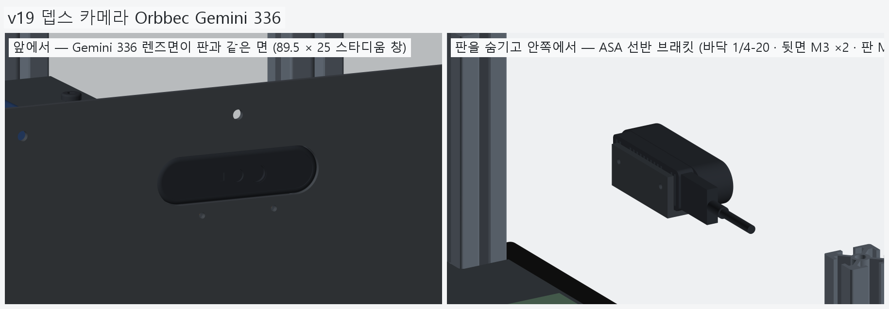
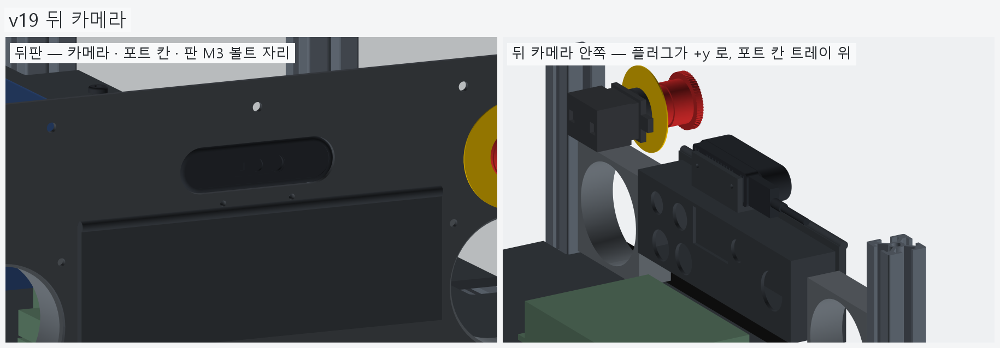
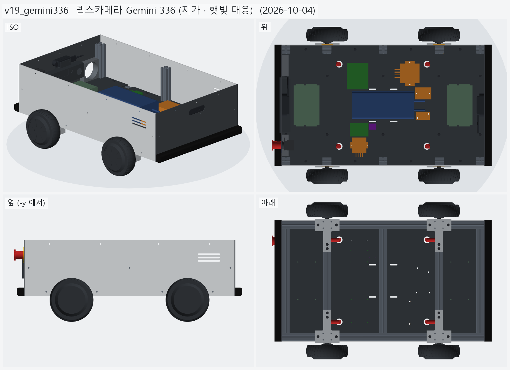
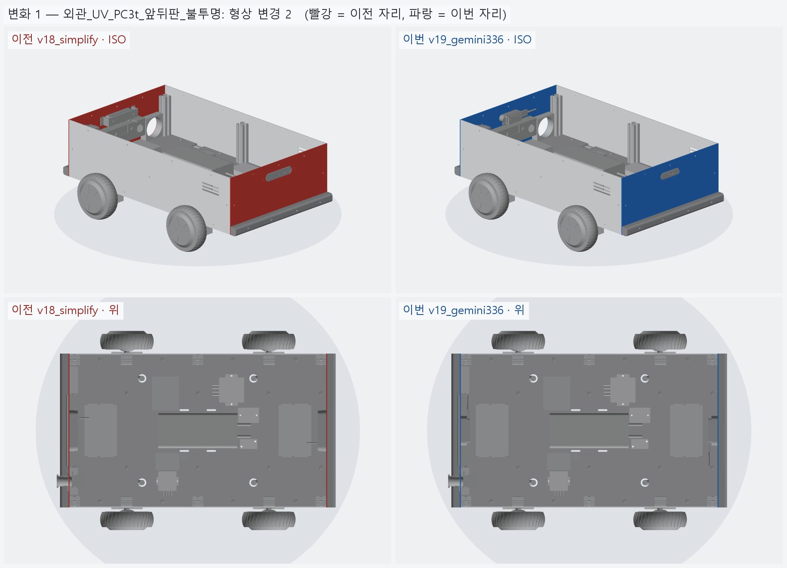
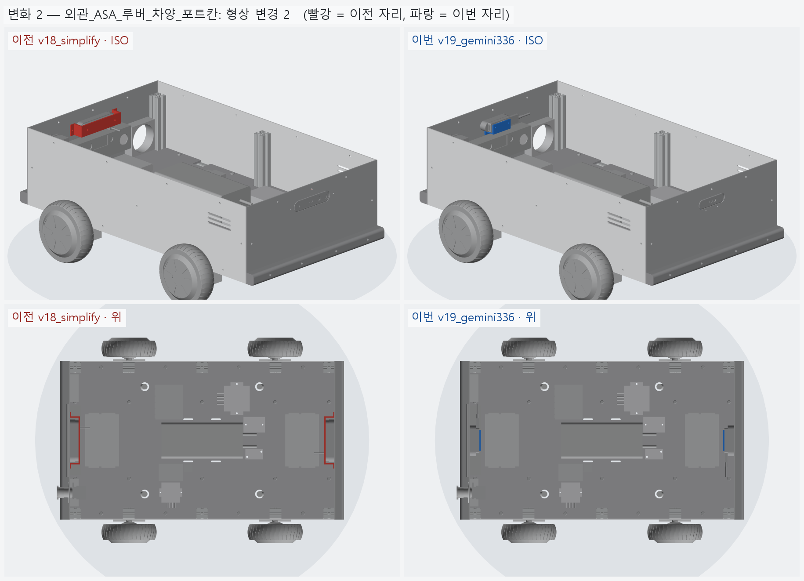
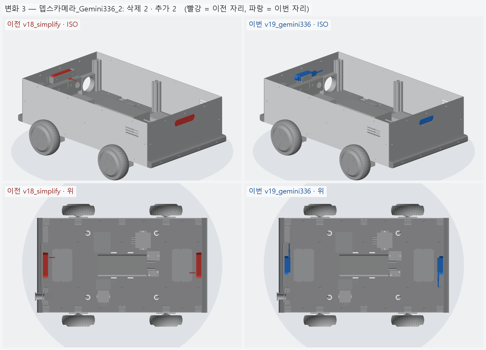

# v19_gemini336 — 뎁스카메라 Gemini 336 (저가 · 햇빛 대응)

- 날짜: 2026-10-04
- 이전 버전: [v18_simplify](../v18_simplify/README.md)

## 무엇을 왜 바꿨나

- 요청: 336L 이 비싸다. 방수 · 방진 등급은 기준에서 뺐으니 (v18) 햇빛에 강하면서 싼 스테레오 카메라로.
- **Orbbec Gemini 336** ×2 — 아이씨뱅큐 462,000 (VAT 포함, 출고 1주 이내) <https://www.icbanq.com/P016230044>.
  336L (616,000) 보다 대당 154,000, 두 대 308,000 싸다.
  - 336L 과 같은 IR-pass 필터. Orbbec 이 실외 배송 로봇용 "strong outdoor lighting" 대상으로 명시.
  - 깊이는 카메라 ASIC 이 계산 (젯슨 GPU 안 씀). Orbbec SDK v2 가 Orin Nano 를 시험 플랫폼으로 명시, ROS2 Humble 래퍼.
  - 대가: 기준선 95 → 50 mm. 이상 범위 0.3–3 m (336L 0.25–6 m), 작동 범위 0.1–20 m+.
- 모델 (camera.py): 공식 도면 (Datasheet V1.6 부록 C) — 89.46 × 25 × 30.7, 스타디움 앞 껍데기 + 방열 핀 뒤 블록,
  뒷면 M3 ×2 (간격 45), 바닥 1/4-20, 왼쪽 끝면 USB-C (M2 잠금 ×2, 간격 15), 오른쪽 끝면 sync 8 핀. 0.099 kg.
- 브래킷 (ASA): 양 끝을 감싸던 팔 → **밑 선반 (1/4-20) + 뒷판 (M3 ×2) + 창 아래 플랜지 (판 M3 ×2)**.
  양 끝을 비워서 USB-C 가 어느 끝이어도 맞는다. 판 구멍 z=231 — 뒤판 포트 칸 바깥 테두리 (z≤227) 와 볼트 머리 1.25 mm.
- 버린 대안
  - Gemini 335 (506,000, 당일출고): 같은 몸통 · 구멍, 필터만 All-pass. 336 이 늦으면 그대로 바꿔 끼운다.
  - Gemini 2 / 2L: 공식 "Indoor/Semi-Outdoor".
  - OAK-D Lite: 미국가 $269 로 올랐고 국내 정식 유통 미확인.
  - RealSense D435i · ZED Mini: 더 비싸다 (56만~71만).
  - Nuwa HP60C: 구조광이라 햇빛에 약하고 공식 실내용.





## 남은 일 / 다음 버전 후보

- USB-C 가 어느 끝인지 실물로 확인 (도면 = 렌즈를 볼 때 왼쪽, 일부 사진은 반대). 공식 STEP 으로도 확인 가능.
- 1/4-20 앞뒤 위치 (앞에서 20.5) · USB 깊이 위치는 도면 비례값 (±0.7) — 실물 받으면 재서 브래킷 구멍을 맞춘다.
- 상부 프레임 · 상부판, 포트 칸 커넥터 실물, BOM 단가 미확인 줄.

<!-- record:begin — record.py 가 덮어쓴다. 이 사이는 손으로 고치지 않는다 -->
## 기록 (자동 · record.py · 2026-10-04 16:29)

**요약** — 카메라 Gemini 336L → Gemini 336 (308,000 절감), 끝면 USB-C, 선반형 브래킷

### 전체 모습



### 이전 버전(v18_simplify) 대비 변화

| # | 그룹 | 변화 | 부품 |
|---|---|---|---|
| 1 | 외관_UV_PC3t_앞뒤판_불투명 | 형상 변경 2 | 앞판_PC3t 형상 변경 (부피 266.4 → 270.4 cm³)<br>뒤판_PC3t 형상 변경 (부피 201.6 → 205.6 cm³) |
| 2 | 외관_ASA_루버_차양_포트칸 | 형상 변경 2 | 카메라브래킷_뒤_ASA 형상 변경 (부피 23.7 → 14.3 cm³)<br>카메라브래킷_앞_ASA 형상 변경 (부피 23.7 → 14.3 cm³) |
| 3 | 뎁스카메라_Gemini336_2 | 삭제 2 · 추가 2 | 뎁스카메라_뒤_Gemini336L 삭제<br>뎁스카메라_앞_Gemini336L 삭제<br>뎁스카메라_뒤_Gemini336 추가<br>뎁스카메라_앞_Gemini336 추가 |

**변화 1 — 외관_UV_PC3t_앞뒤판_불투명**



**변화 2 — 외관_ASA_루버_차양_포트칸**



**변화 3 — 뎁스카메라_Gemini336_2**



### 수치

| 항목 | 값 |
|---|---|
| 프레임 외곽 (x × y) | 760 × 450 mm |
| 휠베이스 (앞뒤 축 간격) | 420 mm |
| 트레드 (좌우 바퀴 중심 간격) | 527.4 mm |
| 레일 윗면 높이 | 123.8 mm |
| 축크로스 x | ±210 mm |
| 기둥 | 6 본, x=-365 · +0 · +365 × y=±210, 높이 143 (윗면 z=266.9) |
| 3030 절단 | 760 × 2 + 390 × 5 + 143 × 6 |
| 3030 합계 | 실길이 4.33 m / 과금 4.80 m (45,600원) |
| 체결볼트 M6x15 | 16 개 |
| 바닥판 재료 | 폴리카보네이트 (PC) 불투명 흑색 5t — 불투명 (흑색 · 회색) — 충격에 강하고 안이 안 보인다 / 레이저는 그을린다 → CNC 재단 |
| 바닥판 크기 · 무게 | 760 × 450 × 5, 약 1.97 kg |
| 바닥판 구멍 | M6 고정 18 · 케이블 그로밋 Ø25 4 · M5 격자 0 · 기둥 노치 10 (x=-365 · -210 · +0 · +210 · +365, 기둥 6 · 10 본 겸용) |
| 판볼트 | M6x15 + 와셔 (필요 15.0 ~ 최대 15.8) |
| 받침 없는 구간 (크로스 안쪽면 사이) | 125 · 180 · 180 · 125 mm |
| 부품 | 10 개 (실측 치수 모델, 출처 parts.py) |
| 부품 무게 (알려진 것) | 4.66 kg — 무게 미상: ESP32_보드, SSR_모터전원차단_40A, DCDC_36V-5V |
| 부품 무게중심 | x=+22.0 · y=+9.6 · z=159.7 mm (휠베이스 가운데 x=0 기준) |
| 가장 높은 부품 윗면 | z=203.8 — 기둥 윗면 z=266.9 까지 63.0 mm 남음 |
| 전체 크기 (x × y × z) | 825.7 × 590.2 × 296.9 mm |
| 최저 지상고 (바퀴 제외, 지면 z=0) | 54.9 mm |

### 부품 구성

| 그룹 | 개수 |
|---|---|
| 프레임_3030_13본 | 13 |
| T클램프_혀선반_4개 | 4 |
| 기존_상부클램프_4개 | 4 |
| 휠모터_4개 | 4 |
| 체결볼트_M6x15_16개 | 16 |
| 바닥판_폴리카보네이트5t_불투명 | 1 |
| 판볼트_M6x15_18개 | 18 |
| 케이블_경로_참고 | 8 |
| 배터리 | 1 |
| 모터드라이버 | 2 |
| 컴퓨터_젯슨_ESP32 | 2 |
| 전원_퓨즈_SSR_DCDC | 4 |
| 센서_IMU | 1 |
| 외관_ACM3t_옆판2 | 2 |
| 외관_UV_PC3t_앞뒤판_불투명 | 2 |
| 외관_ASA_루버_차양_포트칸 | 4 |
| 고무범퍼띠_앞뒤 | 2 |
| 뎁스카메라_Gemini336_2 | 2 |
| 비상정지_Autonics_SF2ER | 1 |
| 비상정지명판_노랑 | 1 |
| 비상정지본체_패널뒤 | 1 |
| 배기팬_2 | 2 |

### 검증

```
  간섭 프레임-T클램프: 0.00 mm3
  간섭 프레임-상부클램프: 0.00 mm3
  간섭 프레임-휠모터: 0.00 mm3
  간섭 T클램프-휠모터: 0.00 mm3
  간섭 T클램프-상부클램프: 0.00 mm3
  간섭 볼트-프레임: 0.00 mm3
  간섭 볼트-T클램프: 8.38 mm3 (두께 0.010)
  간섭 볼트-휠모터: 0.00 mm3
  대조군 클램프 +1mm 올림 → 레일 겹침 4006 mm3
  대조군 클램프 +1mm 올림 → 축크로스 겹침 6509 mm3
  대조군 기둥 -1mm 내림 → 레일 겹침 1893 mm3
  기둥 ~ 휠모터 최소 간격 74.0 mm (메시 점 기준)
  간섭 바닥판-프레임 (기둥 포함): 0.00 mm3
  간섭 바닥판-T클램프: 0.00 mm3
  간섭 바닥판-휠모터: 0.00 mm3
  간섭 판볼트-프레임: 0.00 mm3
  간섭 판볼트-바닥판: 0.00 mm3
  간섭 케이블-프레임: 0.00 mm3
  간섭 케이블-T클램프: 0.00 mm3
  간섭 케이블-상부클램프: 0.00 mm3
  간섭 케이블-휠모터: 0.00 mm3
  간섭 케이블-바닥판: 0.00 mm3
  대조군 바닥판 -0.5mm → 프레임 겹침 31909 mm3
  10 본 겸용: 축 자리 가상 기둥 4 본 ~ 바닥판 간섭 0.00 mm3
  대조군 노치 없는 판 ~ 가상 기둥 겹침 7682 mm3
  판볼트 길이: 필요 15.0 ~ 최대 15.8 → M6x15
  간섭 부품끼리: 0.00 mm3
  간섭 부품-프레임 (기둥): 0.00 mm3
  간섭 부품-판볼트 머리: 0.00 mm3
  간섭 부품-바닥판: 0.00 mm3
  간섭 부품-케이블 구멍 위 (반경 15): 0.00 mm3
  대조군 부품 -1mm → 바닥판 겹침 65050 mm3
  부품 고정 구멍 28 — 빔 위 0 · 서로/다른 구멍과 2 mm 안 0
  대조군 x=0 구멍 → 빔 위 판정 True
  간섭 외관판-프레임: 0.00 mm3
  간섭 외관판-T클램프: 0.00 mm3
  간섭 외관판-휠모터: 0.00 mm3
  간섭 외관판-부품: 0.00 mm3
  간섭 외관판-바닥판: 0.00 mm3
  간섭 출력물-프레임: 0.00 mm3
  간섭 출력물-휠모터: 0.00 mm3
  간섭 출력물-T클램프: 0.00 mm3
  간섭 출력물-외관판: 0.00 mm3
  옆판 ~ 타이어 최소 간격 7.1 mm (메시 점 기준)
  벽 위끝 z=296.85 (상부 프레임 윗면 가정 z=296.85)
  부품 윗면 z=203.8 ~ 상부 프레임 밑면 z=266.9: 63.0 mm
  간섭 추가물-프레임: 0.00 mm3
  간섭 추가물-부품: 0.00 mm3
  간섭 추가물-외관판: 0.00 mm3
  간섭 추가물-ASA: 0.00 mm3
  간섭 추가물끼리: 0.00 mm3
  간섭 비상정지-팬: 0.00 mm3
  간섭 명판-팬: 0.00 mm3
  간섭 추가물-휠모터: 0.00 mm3
  포트 칸 z 162.0~222.0 — 뒤 드라이버 윗면 159.8, 상부 프레임 밑면 266.9
  명판 Ø60 ~ 팬 구멍 Ø76 간격 2.0 mm
  비상정지 윗끝 z=261.99 ~ 상부 프레임 밑면 266.85: 4.86 mm
  카메라 윗면 z=262.50 ~ 상부 프레임 밑면 266.85: 4.35 mm
  카메라 렌즈면 = 판 바깥면 x=±383.0
  간섭 카메라브래킷-포트칸: 0.00 mm3
  판 M3 볼트 머리 아래끝 z=228.25 ~ 포트 칸 바깥 테두리 윗끝 227.00: 1.25 mm
  브래킷 플랜지 아래끝 z=225.00 ~ 포트 칸 윗면 222.00
verify: OK
```

### 기록 소요

불러오기 0.1s · 짓기 23.8s · 검증 16.8s · STEP 4.2s · 내보내기 4.3s · 뷰어 전송 3.2s · 메시 (46 형상 → 95 부품) 10.2s · 전체 모습 이미지 5 장 2.5s · 변화 이미지 3 장 5.1s

<!-- record:end -->
