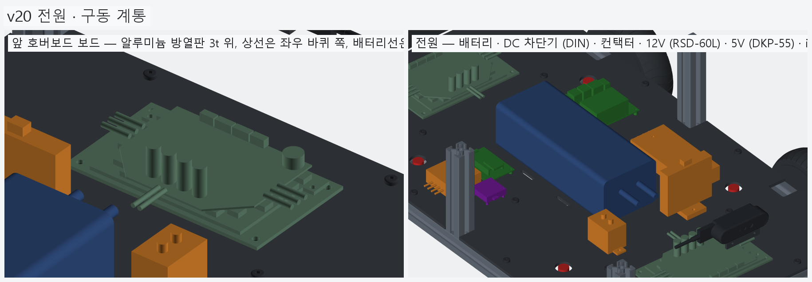
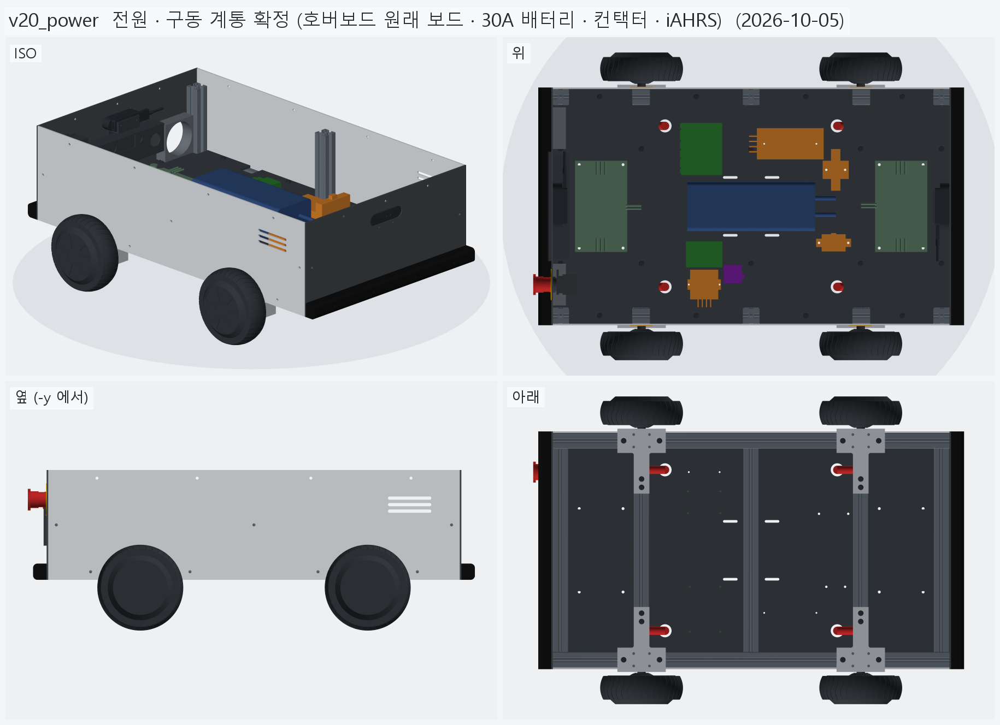
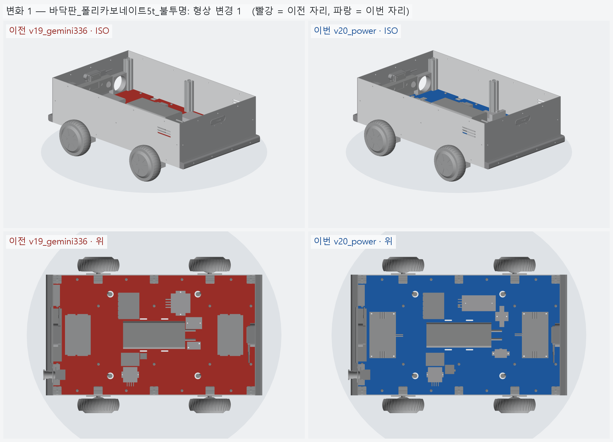
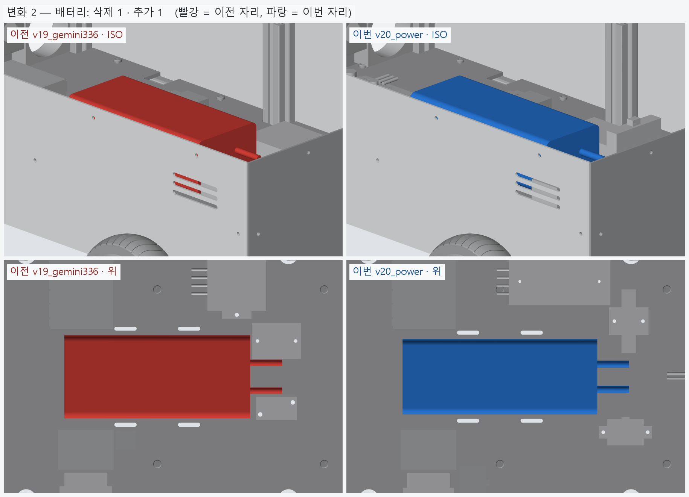
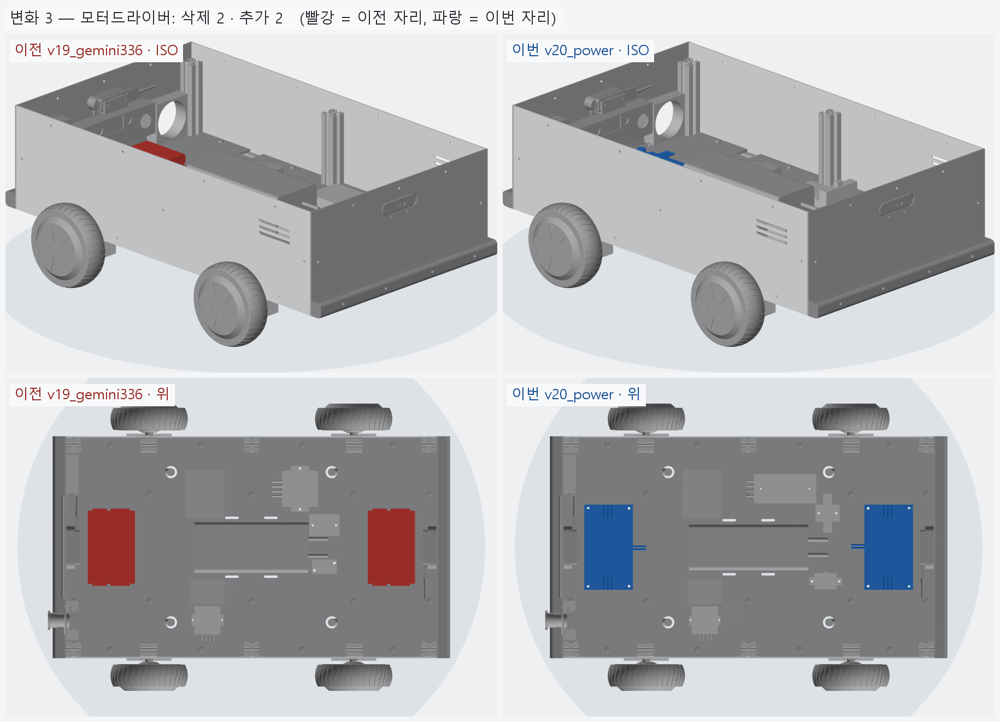
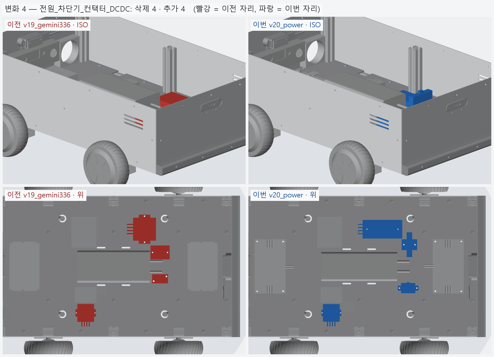
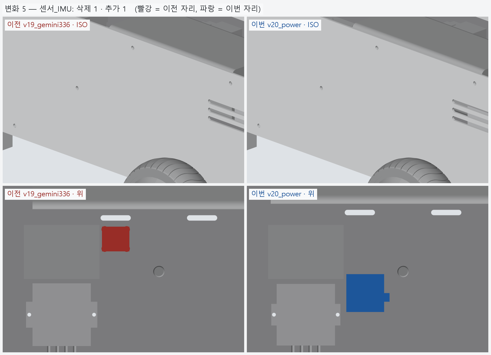

# v20_power — 전원 · 구동 계통 확정 (호버보드 원래 보드 · 30A 배터리 · 컨택터 · iAHRS)

- 날짜: 2026-10-05
- 이전 버전: [v19_gemini336](../v19_gemini336/README.md)

## 무엇을 왜 바꿨나

사용자 결정 (2026-10-05): "모터 드라이버는 호버보드에 들어 있던 것 그대로, 배터리는 30 A 이상
(바퀴 4 · 젯슨 · ESP32 · 카메라 · LED 까지), 비상정지는 편한 대로, 방향 센서는 iAHRS."
**왜 그렇게 정했는지는 [`../DECISIONS.md`](../DECISIONS.md) D-03 ~ D-08** 에 근거와 버린 대안까지 적었다.
조사 원자료: [비슷한 차량 사례](../research/2026-10-05_similar_vehicles.md) · [국내 구매처](../research/2026-10-04_domestic_sourcing.md).

| 자리 | v19 | v20 | 결정 |
|---|---|---|---|
| 모터 드라이버 ×2 | ZLTECH ZLAC8015D | **호버보드 1 세대 메인보드** + 알루미늄 방열판 3t (175 × 100) | D-03 |
| 배터리 | 볼트온 36V 20Ah (15 A) | **알엠파워 ZENION 36V 20Ah 10S4P** (최대 30 A, 95 × 245 × 75, 3 kg) | D-04 |
| 메인 보호 | Victron MIDI 40 A (해외) | **DC 차단기 1P 40 A** (DIN 레일) | D-07 |
| 바퀴 전원 차단 | Fotek SSR-40DD | **LS GPR-M040 컨택터** (12 V 코일) | D-05 |
| 젯슨 전원 | Fidida 19 V (해외) | **MEAN WELL RSD-60L-12** (18~72 V → 12 V) | D-07 |
| 5 V | DROK (해외) | **디오시스템 DKP-55** (8~60 V → 5 V 10 A) | D-07 |
| IMU | Adafruit BNO085 | **iAHRS RB-SDA-v1** (35 × 35 × 10, USB) | D-06 |

- 호버보드 보드는 끝 칸 (x = ±287.5) 에 90° 돌려 놓았다 — 상선은 좌우 바퀴 쪽, 배터리선은 차량 안쪽.
  보드 판은 원래 호버보드 알루미늄 프레임에 붙어 열을 뺀다. PC 바닥판은 단열재라 **방열판을 깔았다**.
- 전원 칸 (배터리 앞): 배터리 리드 → 차단기 (y = +70) · 컨택터 (y = −70) 사이로 지나간다. 12 V 변환기는 차단기 뒤 (y = +120).
- 비상정지 회로 (D-05): 배터리 → 차단기 → ① 컨택터 → 보드 2 장 / ② 12 V · 5 V 변환기 (컨택터 앞단 — 젯슨은 안 꺼진다).
  코일 = 12 V → 키 스위치 → 비상정지 (1NC) → 코일.
- 전력 예산 (D-04): 1.5 m/s 속도 제한이면 최악 약 26 A (바퀴 약 24 A + 전자 약 2 A), 평소 3~6 A, 주행 약 3.8 h [계산 · 가정 포함].
- BOM: 전부 국내 구매처. 단가가 확인된 합 **2,070,401 원**. 이 중 카메라가 924,000 원이고 배터리가 553,000 원이다.
  호버보드 2 대는 보유품 (단가 0).
  ZLAC 2 대 (견적 미정) 를 빼고 볼트온 (480,000) 을 ZENION (553,000) 으로 바꿨다.



## 남은 일 / 다음 버전 후보

- **호버보드 보드 실측** — 지금 치수는 사진 비례 (±5~8 %). 캘리퍼로 PCB · 판 · 탭 구멍 간격 · 가장 높은 부품 높이를 재서 고친다
  (모눈종이 위 자와 함께 위에서 찍은 사진이면 충분).
- **보드 칩 확인** — STM32F103RCT6 / GD32F103RCT6 (64 핀) 이면 EFeru. AT32 · 48 핀 (GD32F130 등) 이면 다른 펌웨어 → D-03 다시 본다.
- 배터리 "최대 30 A" 가 연속인지 판매처에 확인. 만든 뒤 제자리 회전 · 경사 · 가속에서 배터리 전류 실측 (25 A 넘으면 파워크래프트 50 A BMS 견적).
- 컨택터 주문품 4~6 주 — 일찍 주문.
- 6.5" 모터 고정축이 42 · 44 mm 두 종류라는 국내 자료 — T 클램프와 실물 축을 맞춰 본다.
- 배선 (XT90 → 차단기 → 컨택터 → 보드, 분기 퓨즈) 은 아직 모델 없음. 상부 프레임 · 상부판도 다음.

## 알려진 문제

- 모터 드라이버를 **1 세대 일체형 보드 2 장**으로 그렸는데, 사용자 보드는 **직사각형 4 장 (2 세대 분리형)** 이었다 — v21 에서 고침 (DECISIONS D-03 개정).

<!-- record:begin — record.py 가 덮어쓴다. 이 사이는 손으로 고치지 않는다 -->
## 기록 (자동 · record.py · 2026-10-05 11:59)

**요약** — 호버보드 원래 보드 ×2 · ZENION 20Ah 30 A · DC 차단기 + 컨택터 · 12V/5V 국내품 · iAHRS, BOM 국내 구매처

### 전체 모습



### 이전 버전(v19_gemini336) 대비 변화

| # | 그룹 | 변화 | 부품 |
|---|---|---|---|
| 1 | 바닥판_폴리카보네이트5t_불투명 | 형상 변경 1 | 바닥판 형상 변경 (부피 1642.6 → 1642.5 cm³) |
| 2 | 배터리 | 삭제 1 · 추가 1 | 배터리_36V_20Ah_볼트온 삭제<br>배터리_36V_20Ah_ZENION 추가 |
| 3 | 모터드라이버 | 삭제 2 · 추가 2 | 모터드라이버_앞_ZLAC8015D 삭제<br>모터드라이버_뒤_ZLAC8015D 삭제<br>모터드라이버_앞_호버보드보드 추가<br>모터드라이버_뒤_호버보드보드 추가 |
| 4 | 전원_차단기_컨택터_DCDC | 삭제 4 · 추가 4 | 메인퓨즈_MIDI40A_58V 삭제<br>SSR_모터전원차단_40A 삭제<br>DCDC_36V-19V_젯슨 삭제<br>DCDC_36V-5V 삭제<br>메인차단기_DC40A_DIN 추가<br>컨택터_LS_GPR-M040 추가<br>DCDC_36V-12V_젯슨_RSD-60L 추가<br>DCDC_36V-5V_DKP-55 추가 |
| 5 | 센서_IMU | 삭제 1 · 추가 1 | IMU_BNO085 삭제<br>IMU_iAHRS_RB-SDA 추가 |

**변화 1 — 바닥판_폴리카보네이트5t_불투명**



**변화 2 — 배터리**



**변화 3 — 모터드라이버**



**변화 4 — 전원_차단기_컨택터_DCDC**



**변화 5 — 센서_IMU**



### 수치

| 항목 | 값 |
|---|---|
| 프레임 외곽 (x × y) | 760 × 450 mm |
| 휠베이스 (앞뒤 축 간격) | 420 mm |
| 트레드 (좌우 바퀴 중심 간격) | 527.4 mm |
| 레일 윗면 높이 | 123.8 mm |
| 축크로스 x | ±210 mm |
| 기둥 | 6 본, x=-365 · +0 · +365 × y=±210, 높이 143 (윗면 z=266.9) |
| 3030 절단 | 760 × 2 + 390 × 5 + 143 × 6 |
| 3030 합계 | 실길이 4.33 m / 과금 4.80 m (45,600원) |
| 체결볼트 M6x15 | 16 개 |
| 바닥판 재료 | 폴리카보네이트 (PC) 불투명 흑색 5t — 불투명 (흑색 · 회색) — 충격에 강하고 안이 안 보인다 / 레이저는 그을린다 → CNC 재단 |
| 바닥판 크기 · 무게 | 760 × 450 × 5, 약 1.97 kg |
| 바닥판 구멍 | M6 고정 18 · 케이블 그로밋 Ø25 4 · M5 격자 0 · 기둥 노치 10 (x=-365 · -210 · +0 · +210 · +365, 기둥 6 · 10 본 겸용) |
| 판볼트 | M6x15 + 와셔 (필요 15.0 ~ 최대 15.8) |
| 받침 없는 구간 (크로스 안쪽면 사이) | 125 · 180 · 180 · 125 mm |
| 부품 | 10 개 (실측 치수 모델, 출처 parts.py) |
| 부품 무게 (알려진 것) | 4.22 kg — 무게 미상: ESP32_보드, DCDC_36V-12V_젯슨_RSD-60L, DCDC_36V-5V_DKP-55, IMU_iAHRS_RB-SDA |
| 부품 무게중심 | x=+20.3 · y=+4.2 · z=161.7 mm (휠베이스 가운데 x=0 기준) |
| 가장 높은 부품 윗면 | z=215.3 — 기둥 윗면 z=266.9 까지 51.5 mm 남음 |
| 전체 크기 (x × y × z) | 825.7 × 590.2 × 296.9 mm |
| 최저 지상고 (바퀴 제외, 지면 z=0) | 54.9 mm |

### 부품 구성

| 그룹 | 개수 |
|---|---|
| 프레임_3030_13본 | 13 |
| T클램프_혀선반_4개 | 4 |
| 기존_상부클램프_4개 | 4 |
| 휠모터_4개 | 4 |
| 체결볼트_M6x15_16개 | 16 |
| 바닥판_폴리카보네이트5t_불투명 | 1 |
| 판볼트_M6x15_18개 | 18 |
| 케이블_경로_참고 | 8 |
| 배터리 | 1 |
| 모터드라이버 | 2 |
| 컴퓨터_젯슨_ESP32 | 2 |
| 전원_차단기_컨택터_DCDC | 4 |
| 센서_IMU | 1 |
| 외관_ACM3t_옆판2 | 2 |
| 외관_UV_PC3t_앞뒤판_불투명 | 2 |
| 외관_ASA_루버_차양_포트칸 | 4 |
| 고무범퍼띠_앞뒤 | 2 |
| 뎁스카메라_Gemini336_2 | 2 |
| 비상정지_Autonics_SF2ER | 1 |
| 비상정지명판_노랑 | 1 |
| 비상정지본체_패널뒤 | 1 |
| 배기팬_2 | 2 |

### 검증

```
  간섭 프레임-T클램프: 0.00 mm3
  간섭 프레임-상부클램프: 0.00 mm3
  간섭 프레임-휠모터: 0.00 mm3
  간섭 T클램프-휠모터: 0.00 mm3
  간섭 T클램프-상부클램프: 0.00 mm3
  간섭 볼트-프레임: 0.00 mm3
  간섭 볼트-T클램프: 8.38 mm3 (두께 0.010)
  간섭 볼트-휠모터: 0.00 mm3
  대조군 클램프 +1mm 올림 → 레일 겹침 4006 mm3
  대조군 클램프 +1mm 올림 → 축크로스 겹침 6509 mm3
  대조군 기둥 -1mm 내림 → 레일 겹침 1893 mm3
  기둥 ~ 휠모터 최소 간격 74.0 mm (메시 점 기준)
  간섭 바닥판-프레임 (기둥 포함): 0.00 mm3
  간섭 바닥판-T클램프: 0.00 mm3
  간섭 바닥판-휠모터: 0.00 mm3
  간섭 판볼트-프레임: 0.00 mm3
  간섭 판볼트-바닥판: 0.00 mm3
  간섭 케이블-프레임: 0.00 mm3
  간섭 케이블-T클램프: 0.00 mm3
  간섭 케이블-상부클램프: 0.00 mm3
  간섭 케이블-휠모터: 0.00 mm3
  간섭 케이블-바닥판: 0.00 mm3
  대조군 바닥판 -0.5mm → 프레임 겹침 31909 mm3
  10 본 겸용: 축 자리 가상 기둥 4 본 ~ 바닥판 간섭 0.00 mm3
  대조군 노치 없는 판 ~ 가상 기둥 겹침 7682 mm3
  판볼트 길이: 필요 15.0 ~ 최대 15.8 → M6x15
  간섭 부품끼리: 0.00 mm3
  간섭 부품-프레임 (기둥): 0.00 mm3
  간섭 부품-판볼트 머리: 0.00 mm3
  간섭 부품-바닥판: 0.00 mm3
  간섭 부품-케이블 구멍 위 (반경 15): 0.00 mm3
  대조군 부품 -1mm → 바닥판 겹침 70098 mm3
  부품 고정 구멍 28 — 빔 위 0 · 서로/다른 구멍과 2 mm 안 0
  대조군 x=0 구멍 → 빔 위 판정 True
  간섭 외관판-프레임: 0.00 mm3
  간섭 외관판-T클램프: 0.00 mm3
  간섭 외관판-휠모터: 0.00 mm3
  간섭 외관판-부품: 0.00 mm3
  간섭 외관판-바닥판: 0.00 mm3
  간섭 출력물-프레임: 0.00 mm3
  간섭 출력물-휠모터: 0.00 mm3
  간섭 출력물-T클램프: 0.00 mm3
  간섭 출력물-외관판: 0.00 mm3
  옆판 ~ 타이어 최소 간격 7.1 mm (메시 점 기준)
  벽 위끝 z=296.85 (상부 프레임 윗면 가정 z=296.85)
  부품 윗면 z=215.3 ~ 상부 프레임 밑면 z=266.9: 51.5 mm
  간섭 추가물-프레임: 0.00 mm3
  간섭 추가물-부품: 0.00 mm3
  간섭 추가물-외관판: 0.00 mm3
  간섭 추가물-ASA: 0.00 mm3
  간섭 추가물끼리: 0.00 mm3
  간섭 비상정지-팬: 0.00 mm3
  간섭 명판-팬: 0.00 mm3
  간섭 추가물-휠모터: 0.00 mm3
  포트 칸 z 162.0~222.0 — 뒤 드라이버 윗면 165.9, 상부 프레임 밑면 266.9
  명판 Ø60 ~ 팬 구멍 Ø76 간격 2.0 mm
  비상정지 윗끝 z=261.99 ~ 상부 프레임 밑면 266.85: 4.86 mm
  카메라 윗면 z=262.50 ~ 상부 프레임 밑면 266.85: 4.35 mm
  카메라 렌즈면 = 판 바깥면 x=±383.0
  간섭 카메라브래킷-포트칸: 0.00 mm3
  판 M3 볼트 머리 아래끝 z=228.25 ~ 포트 칸 바깥 테두리 윗끝 227.00: 1.25 mm
  브래킷 플랜지 아래끝 z=225.00 ~ 포트 칸 윗면 222.00
verify: OK
```

### 기록 소요

불러오기 0.1s · 짓기 29.7s · 검증 19.3s · STEP 3.9s · 내보내기 6.4s · 메시 (46 형상 → 95 부품) 11.8s · 전체 모습 이미지 5 장 4.9s · 변화 이미지 5 장 9.7s

<!-- record:end -->
