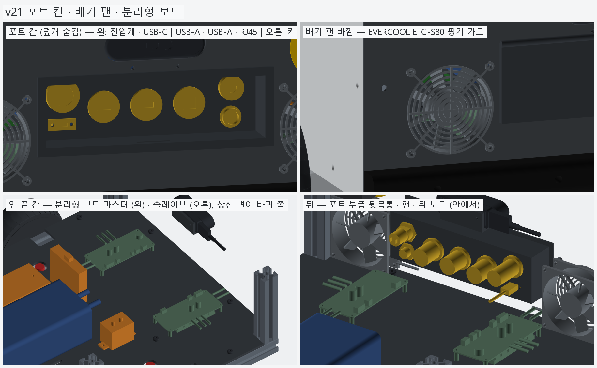
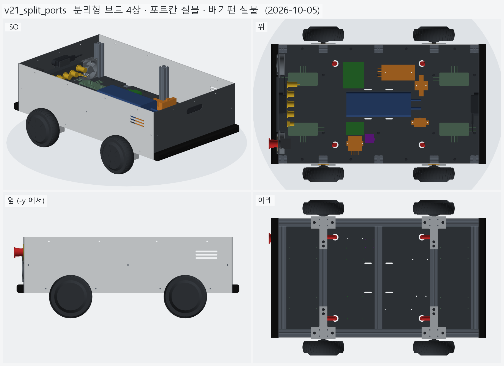
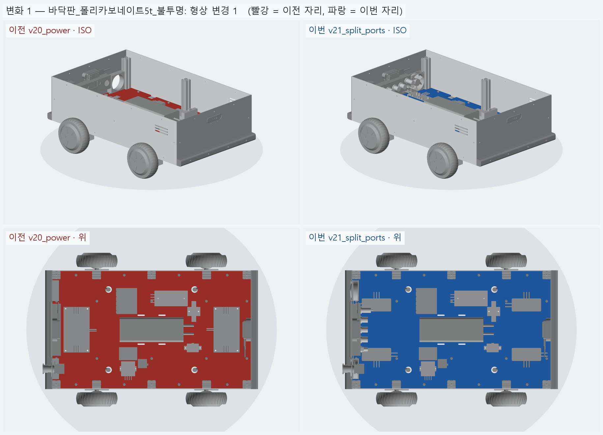
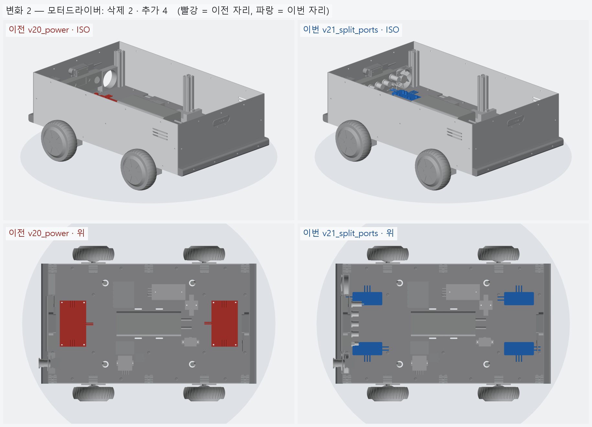
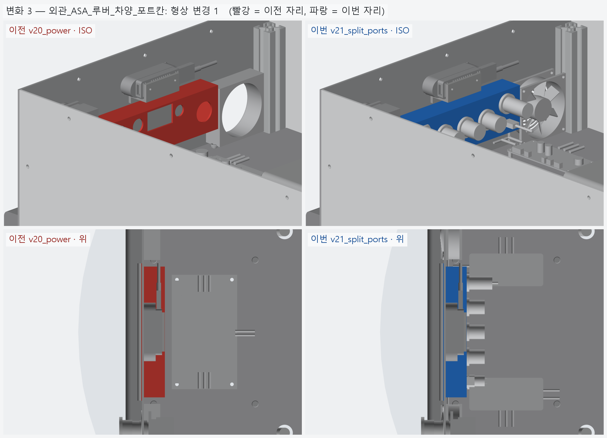
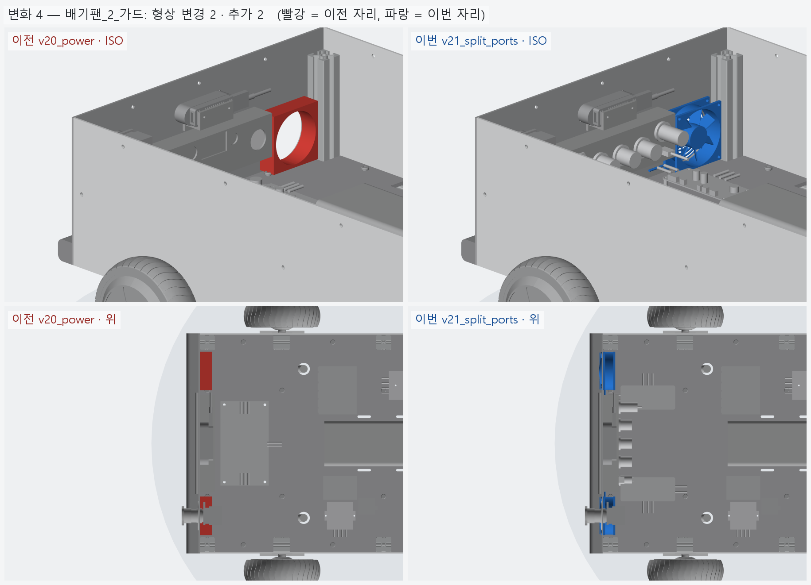
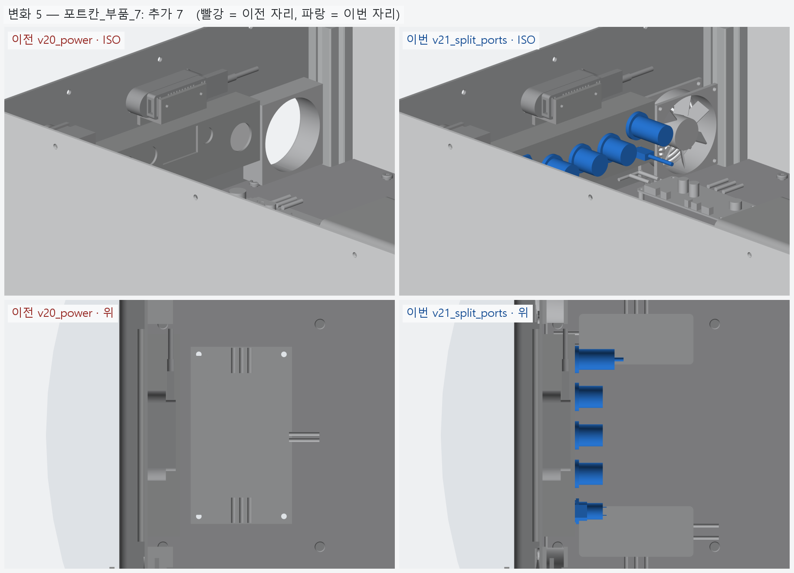

# v21_split_ports — 분리형 보드 4장 · 포트칸 실물 · 배기팬 실물

- 날짜: 2026-10-05
- 이전 버전: [v20_power](../v20_power/README.md)

## 무엇을 왜 바꿨나

사용자 (2026-10-05): "모터 드라이버는 저렇게 생긴 게 아니라 직사각형으로 생긴 것이 4 개 있다. 포트 칸에 들어갈 실제 부품도
찾아서 모델링하고, 배기구 팬도 실제 부품 기반으로." 왜 그렇게 정했는지는 [`../DECISIONS.md`](../DECISIONS.md) **D-03 (개정) · D-09 · D-10**.
조사 원자료: [분리형 보드](../research/2026-10-05_split_boards.md) · [포트 · 팬](../research/2026-10-05_ports_fans.md).

| 자리 | v20 | v21 |
|---|---|---|
| 모터 드라이버 | 1 세대 일체형 보드 ×2 + 방열판 (사용자 보드와 다름) | **2 세대 분리형 보드 ×4** (Gen2.1.1 TT-SD2.2 기준 113 × 50, M3 스탠드오프 12) — 앞 · 뒤 끝 칸에 원래 짝 (마스터 + 슬레이브) 하나씩, 상선 변이 바퀴 쪽 |
| 포트 칸 | 가정 크기 구멍 7 | **실물 7 개** 두 줄 — 전압계 (원형 DC 4~100 V) · ESP32 USB-C (MT723) · USB 3.0 ×2 (HA079) · RJ45 (HA084) · 키 스위치 (HAS1911) · 충전 GX16 3P. D 컷 구멍 · 귀 나사까지 트레이에 뚫음 |
| 배기 팬 | 80 × 80 × 25 상자 | **EVERCOOL EC8025H05B** (5 V 0.28 A, 7 날개, 라벨면 = 배기면이 판 쪽) + 바깥 **EFG-S80 가드** |

- 제어 (D-03): ESP32 하드웨어 UART 2 개 → 앞 · 뒤 마스터 (19200 baud). 두 짝에 같은 (속도, 조향) = 스키드 스티어.
  보드 전원은 `DISABLE_BUTTON` + ESP32 GPIO (릴레이 없음). 보드당 `DC_CUR_LIMIT` 7 A → 4 장 합 28 A + 전자 2 A = 30 A (배터리 최대).
- 검사에서 잡은 것: 팬 케이블이 옆 기둥에 3 mm 닿았다 (67 mm³) → 케이블을 차량 가운데 쪽으로 돌렸다.
- BOM: 단가 확인된 합 **2,111,266 원** (+40,865 — 포트 7 · 가드 2. 보드 방열판 · 릴레이 줄은 뺐다).



## 남은 일 / 다음 버전 후보

- **보드 실측 · 칩 확인** — 지금 치수는 사진 비례 (±10~15 %). 칩 각인 (GD32F130C8 / MM32 / AT32 …) 에 따라 펌웨어가 갈린다 (AT32F415 는 미지원).
- 알엠파워에 충전기 항공단자 규격 (GX16 / GX12) · 성별 확인 (D-10).
- 원형 벌크헤드 · 전압계 구멍, MT723 컷아웃 — 실물로 재거나 시험 출력.
- 배선 모델 (배터리 → 차단기 → 컨택터 → 보드 4 + 보드별 퓨즈, 포트 뒤 케이블) 은 아직 없음. 상부 프레임 · 상부판.

<!-- record:begin — record.py 가 덮어쓴다. 이 사이는 손으로 고치지 않는다 -->
## 기록 (자동 · record.py · 2026-10-05 12:32)

**요약** — 모터 드라이버 = 2 세대 분리형 보드 4 장, 포트 칸 실물 7 개, 배기 팬 EC8025H05B + 가드

### 전체 모습



### 이전 버전(v20_power) 대비 변화

| # | 그룹 | 변화 | 부품 |
|---|---|---|---|
| 1 | 바닥판_폴리카보네이트5t_불투명 | 형상 변경 1 | 바닥판 형상 변경 (부피 1642.5 → 1642.8 cm³) |
| 2 | 모터드라이버 | 삭제 2 · 추가 4 | 모터드라이버_앞_호버보드보드 삭제<br>모터드라이버_뒤_호버보드보드 삭제<br>모터드라이버_앞왼_분리형_마스터 추가<br>모터드라이버_앞오른_분리형_슬레이브 추가<br>모터드라이버_뒤왼_분리형_마스터 추가<br>모터드라이버_뒤오른_분리형_슬레이브 추가 |
| 3 | 외관_ASA_루버_차양_포트칸 | 형상 변경 1 | 포트칸_트레이_ASA 형상 변경 (부피 72.8 → 75.7 cm³) |
| 4 | 배기팬_2_가드 | 형상 변경 2 · 추가 2 | 배기팬_80mm_오른 형상 변경 (부피 58.2 → 39.4 cm³)<br>배기팬_80mm_왼 형상 변경 (부피 58.2 → 39.4 cm³)<br>배기팬가드_오른_EFG-S80 추가<br>배기팬가드_왼_EFG-S80 추가 |
| 5 | 포트칸_부품_7 | 추가 7 | 포트_전압계_DC100V_원형 추가<br>포트_ESP32_USB-C_MT723 추가<br>포트_USB-A_1_HA079 추가<br>포트_USB-A_2_HA079 추가<br>포트_RJ45_HA084 추가<br>포트_키스위치_HAS1911 추가<br>포트_충전단자_GX16_3P 추가 |

**변화 1 — 바닥판_폴리카보네이트5t_불투명**



**변화 2 — 모터드라이버**



**변화 3 — 외관_ASA_루버_차양_포트칸**



**변화 4 — 배기팬_2_가드**



**변화 5 — 포트칸_부품_7**



### 수치

| 항목 | 값 |
|---|---|
| 프레임 외곽 (x × y) | 760 × 450 mm |
| 휠베이스 (앞뒤 축 간격) | 420 mm |
| 트레드 (좌우 바퀴 중심 간격) | 527.4 mm |
| 레일 윗면 높이 | 123.8 mm |
| 축크로스 x | ±210 mm |
| 기둥 | 6 본, x=-365 · +0 · +365 × y=±210, 높이 143 (윗면 z=266.9) |
| 3030 절단 | 760 × 2 + 390 × 5 + 143 × 6 |
| 3030 합계 | 실길이 4.33 m / 과금 4.80 m (45,600원) |
| 체결볼트 M6x15 | 16 개 |
| 바닥판 재료 | 폴리카보네이트 (PC) 불투명 흑색 5t — 불투명 (흑색 · 회색) — 충격에 강하고 안이 안 보인다 / 레이저는 그을린다 → CNC 재단 |
| 바닥판 크기 · 무게 | 760 × 450 × 5, 약 1.97 kg |
| 바닥판 구멍 | M6 고정 18 · 케이블 그로밋 Ø25 4 · M5 격자 0 · 기둥 노치 10 (x=-365 · -210 · +0 · +210 · +365, 기둥 6 · 10 본 겸용) |
| 판볼트 | M6x15 + 와셔 (필요 15.0 ~ 최대 15.8) |
| 받침 없는 구간 (크로스 안쪽면 사이) | 125 · 180 · 180 · 125 mm |
| 부품 | 12 개 (실측 치수 모델, 출처 parts.py) |
| 부품 무게 (알려진 것) | 3.44 kg — 무게 미상: 모터드라이버_앞왼_분리형_마스터, 모터드라이버_앞오른_분리형_슬레이브, 모터드라이버_뒤왼_분리형_마스터, 모터드라이버_뒤오른_분리형_슬레이브, ESP32_보드, DCDC_36V-12V_젯슨_RSD-60L, DCDC_36V-5V_DKP-55, IMU_iAHRS_RB-SDA |
| 부품 무게중심 | x=+24.9 · y=+5.1 · z=164.9 mm (휠베이스 가운데 x=0 기준) |
| 가장 높은 부품 윗면 | z=215.3 — 기둥 윗면 z=266.9 까지 51.5 mm 남음 |
| 전체 크기 (x × y × z) | 825.7 × 590.2 × 296.9 mm |
| 최저 지상고 (바퀴 제외, 지면 z=0) | 54.9 mm |

### 부품 구성

| 그룹 | 개수 |
|---|---|
| 프레임_3030_13본 | 13 |
| T클램프_혀선반_4개 | 4 |
| 기존_상부클램프_4개 | 4 |
| 휠모터_4개 | 4 |
| 체결볼트_M6x15_16개 | 16 |
| 바닥판_폴리카보네이트5t_불투명 | 1 |
| 판볼트_M6x15_18개 | 18 |
| 케이블_경로_참고 | 8 |
| 배터리 | 1 |
| 모터드라이버 | 4 |
| 컴퓨터_젯슨_ESP32 | 2 |
| 전원_차단기_컨택터_DCDC | 4 |
| 센서_IMU | 1 |
| 외관_ACM3t_옆판2 | 2 |
| 외관_UV_PC3t_앞뒤판_불투명 | 2 |
| 외관_ASA_루버_차양_포트칸 | 4 |
| 고무범퍼띠_앞뒤 | 2 |
| 뎁스카메라_Gemini336_2 | 2 |
| 비상정지_Autonics_SF2ER | 1 |
| 비상정지명판_노랑 | 1 |
| 비상정지본체_패널뒤 | 1 |
| 배기팬_2_가드 | 4 |
| 포트칸_부품_7 | 7 |

### 검증

```
  간섭 프레임-T클램프: 0.00 mm3
  간섭 프레임-상부클램프: 0.00 mm3
  간섭 프레임-휠모터: 0.00 mm3
  간섭 T클램프-휠모터: 0.00 mm3
  간섭 T클램프-상부클램프: 0.00 mm3
  간섭 볼트-프레임: 0.00 mm3
  간섭 볼트-T클램프: 8.38 mm3 (두께 0.010)
  간섭 볼트-휠모터: 0.00 mm3
  대조군 클램프 +1mm 올림 → 레일 겹침 4006 mm3
  대조군 클램프 +1mm 올림 → 축크로스 겹침 6509 mm3
  대조군 기둥 -1mm 내림 → 레일 겹침 1893 mm3
  기둥 ~ 휠모터 최소 간격 74.0 mm (메시 점 기준)
  간섭 바닥판-프레임 (기둥 포함): 0.00 mm3
  간섭 바닥판-T클램프: 0.00 mm3
  간섭 바닥판-휠모터: 0.00 mm3
  간섭 판볼트-프레임: 0.00 mm3
  간섭 판볼트-바닥판: 0.00 mm3
  간섭 케이블-프레임: 0.00 mm3
  간섭 케이블-T클램프: 0.00 mm3
  간섭 케이블-상부클램프: 0.00 mm3
  간섭 케이블-휠모터: 0.00 mm3
  간섭 케이블-바닥판: 0.00 mm3
  대조군 바닥판 -0.5mm → 프레임 겹침 31909 mm3
  10 본 겸용: 축 자리 가상 기둥 4 본 ~ 바닥판 간섭 0.00 mm3
  대조군 노치 없는 판 ~ 가상 기둥 겹침 7682 mm3
  판볼트 길이: 필요 15.0 ~ 최대 15.8 → M6x15
  간섭 부품끼리: 0.00 mm3
  간섭 부품-프레임 (기둥): 0.00 mm3
  간섭 부품-판볼트 머리: 0.00 mm3
  간섭 부품-바닥판: 0.00 mm3
  간섭 부품-케이블 구멍 위 (반경 15): 0.00 mm3
  대조군 부품 -1mm → 바닥판 겹침 35523 mm3
  부품 고정 구멍 36 — 빔 위 0 · 서로/다른 구멍과 2 mm 안 0
  대조군 x=0 구멍 → 빔 위 판정 True
  간섭 외관판-프레임: 0.00 mm3
  간섭 외관판-T클램프: 0.00 mm3
  간섭 외관판-휠모터: 0.00 mm3
  간섭 외관판-부품: 0.00 mm3
  간섭 외관판-바닥판: 0.00 mm3
  간섭 출력물-프레임: 0.00 mm3
  간섭 출력물-휠모터: 0.00 mm3
  간섭 출력물-T클램프: 0.00 mm3
  간섭 출력물-외관판: 0.00 mm3
  옆판 ~ 타이어 최소 간격 7.1 mm (메시 점 기준)
  벽 위끝 z=296.85 (상부 프레임 윗면 가정 z=296.85)
  부품 윗면 z=215.3 ~ 상부 프레임 밑면 z=266.9: 51.5 mm
  간섭 추가물-프레임: 0.00 mm3
  간섭 추가물-부품: 0.00 mm3
  간섭 추가물-외관판: 0.00 mm3
  간섭 추가물-ASA: 0.00 mm3
  간섭 추가물끼리: 0.00 mm3
  간섭 포트-팬 · 비상정지: 0.00 mm3
  간섭 비상정지-팬: 0.00 mm3
  간섭 명판-팬: 0.00 mm3
  간섭 추가물-휠모터: 0.00 mm3
  간섭 포트 부품끼리 (7 개): 0.00 mm3
  포트 칸 z 162.0~222.0 — 뒤 드라이버 윗면 155.4, 상부 프레임 밑면 266.9
  명판 Ø60 ~ 팬 구멍 Ø76 간격 2.0 mm
  비상정지 윗끝 z=261.99 ~ 상부 프레임 밑면 266.85: 4.86 mm
  카메라 윗면 z=262.50 ~ 상부 프레임 밑면 266.85: 4.35 mm
  카메라 렌즈면 = 판 바깥면 x=±383.0
  간섭 카메라브래킷-포트칸: 0.00 mm3
  판 M3 볼트 머리 아래끝 z=228.25 ~ 포트 칸 바깥 테두리 윗끝 227.00: 1.25 mm
  브래킷 플랜지 아래끝 z=225.00 ~ 포트 칸 윗면 222.00
verify: OK
```

### 기록 소요

불러오기 0.1s · 짓기 31.8s · 검증 19.7s · STEP 4.5s · 내보내기 4.3s · 뷰어 전송 3.9s · 메시 (56 형상 → 106 부품) 10.7s · 전체 모습 이미지 5 장 2.6s · 변화 이미지 5 장 8.0s

<!-- record:end -->
