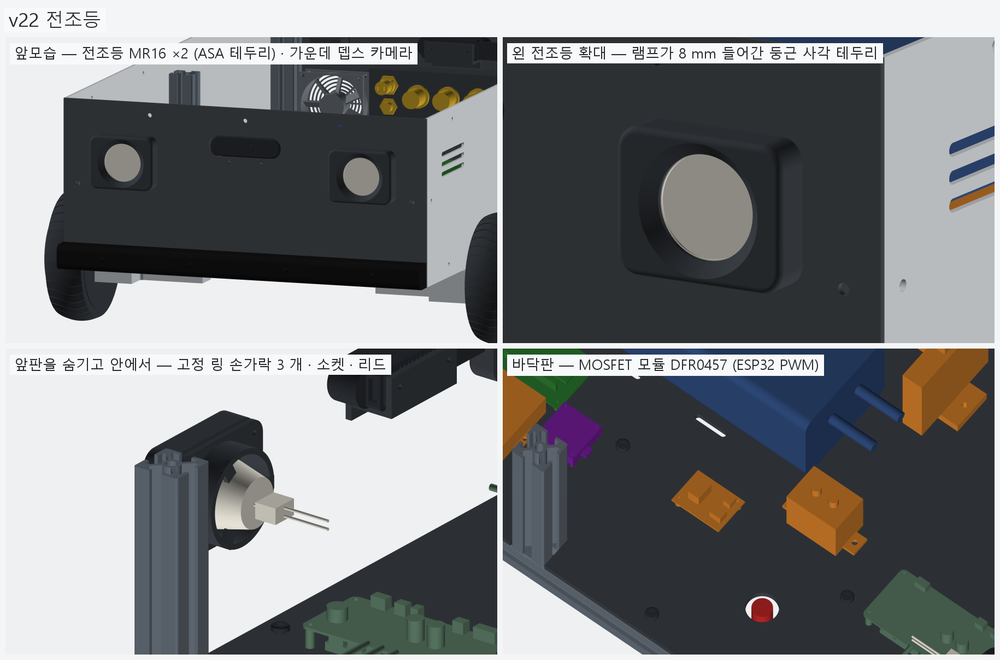
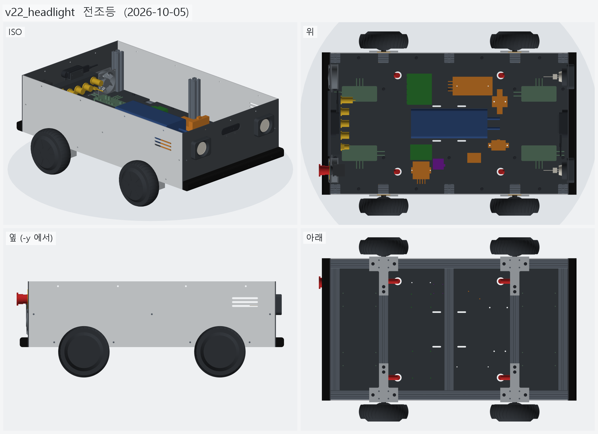
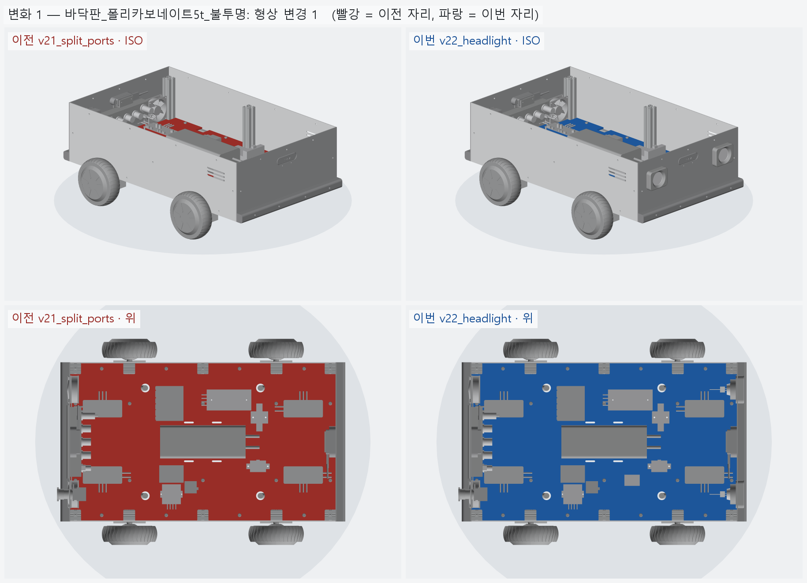
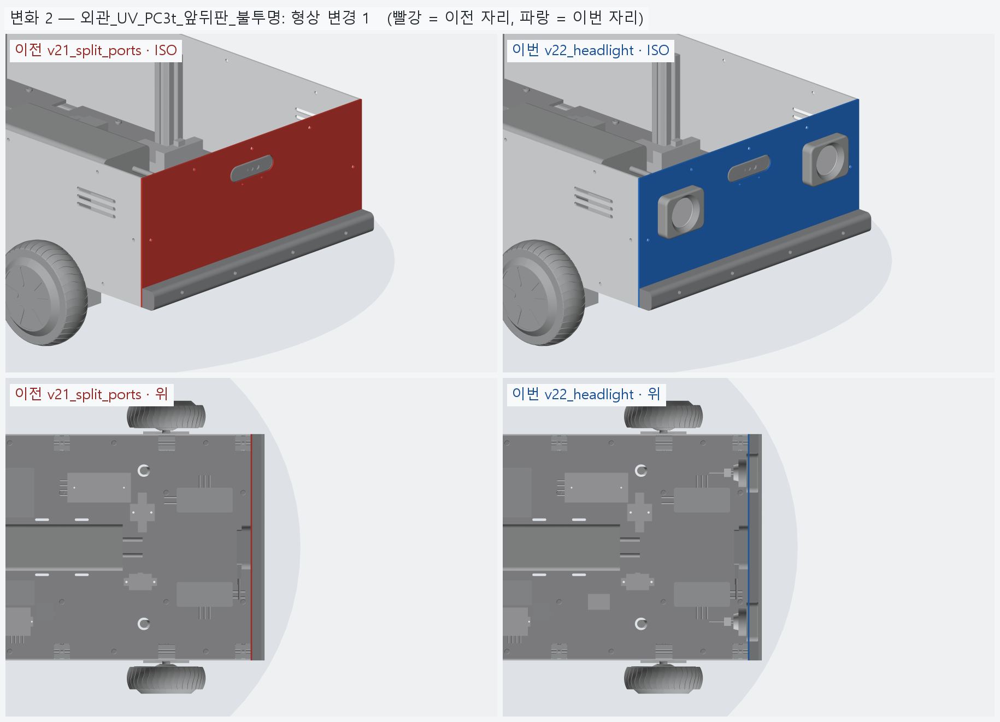
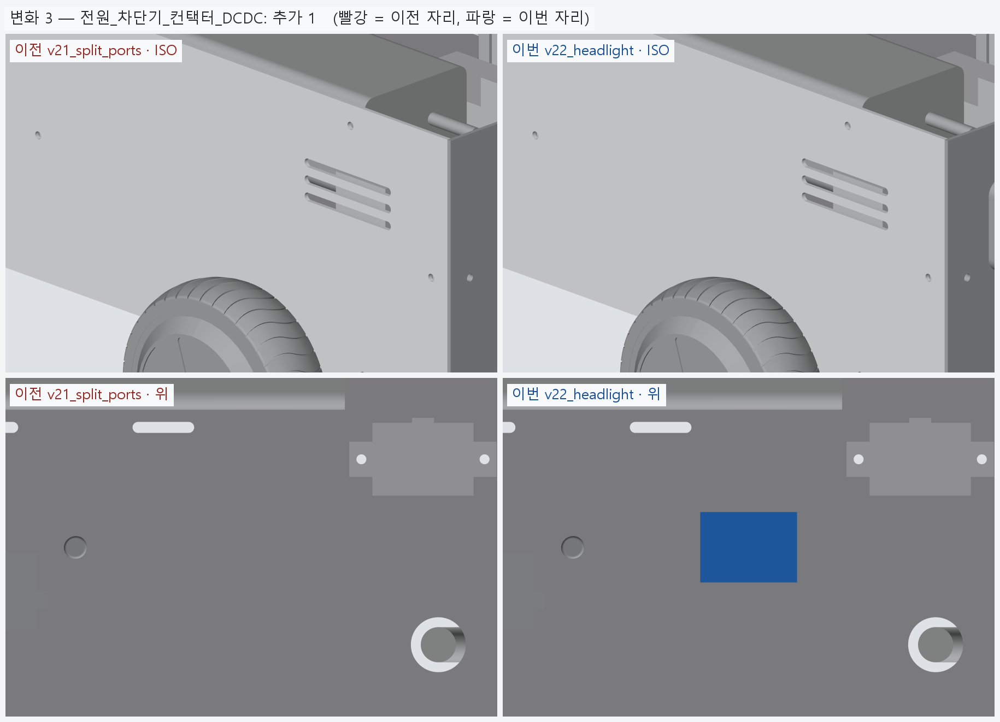
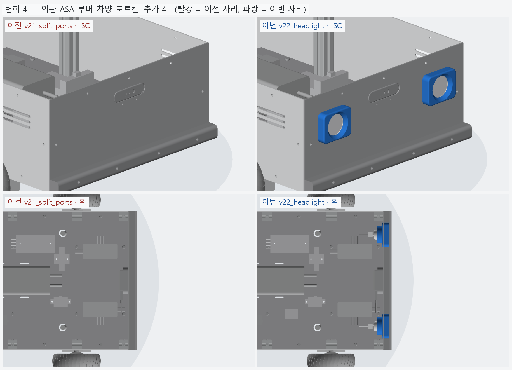
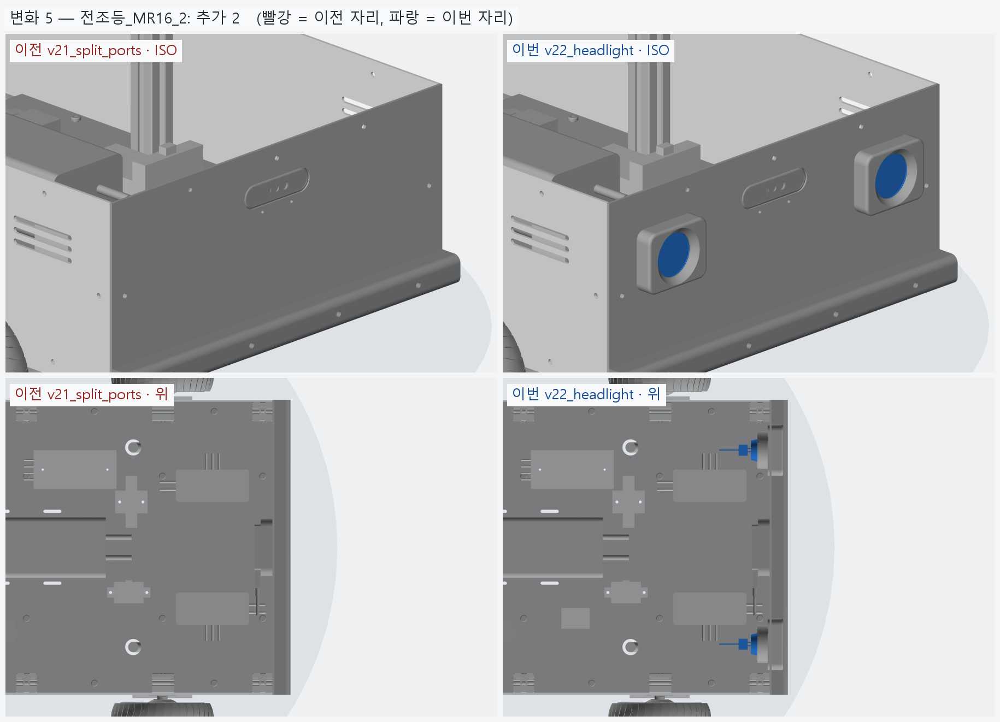

# v22_headlight — 전조등

- 날짜: 2026-10-05
- 이전 버전: [v21_split_ports](../v21_split_ports/README.md)

## 무엇을 왜 바꿨나

사용자 (2026-10-05): "앞에 라이트 · 전조등 느낌 할 부품과 구조도 적용해 보자." 왜 이렇게 정했는지는 [`../DECISIONS.md`](../DECISIONS.md) **D-11**,
조사 원자료는 [research/2026-10-05_headlight.md](../research/2026-10-05_headlight.md).

- **램프**: 건식 LED MR16 12 V 5 W 집중형 주광 ×2 (0.41 A · 410 lm · 빔 50°, Ø50 × 49) + GU5.3 소켓 — 카메라 창 양옆 아래 y = ±150, z = 225.
- **구조** (headlight.py)
  - 앞판 Ø51 구멍 + M3 구멍 4 (64 × 48).
  - 바깥 **ASA 테두리**: 둥근 사각 80 × 64, 깊이 18. 램프는 테두리 앞면에서 8 mm 들어가고, 립 (Ø46 → 나팔 Ø58) 이 램프 앞 테두리를 잡는다.
  - 안쪽 **ASA 고정 링**: 판 안쪽면 플랜지 + 관 (Ø58, 16) — 손가락 3 개가 램프 뒤 원뿔을 앞으로 민다.
  - M3 × 10 을 안에서 넣어 고정 링 · 판 · 테두리 (열압입 인서트) 를 한 번에 조인다 — 바깥에 볼트 머리가 안 보인다.
- **제어**: 바닥판 MOSFET 모듈 DFR0457 (x 80, y −110) — 두 램프 병렬, ESP32 PWM (≤ 1 kHz).
- 검사: 램프 · 테두리 · 고정 링 · 카메라 · 판 · 프레임 겹침 0. 대조군 — 램프를 0.5 mm 앞으로 밀면 테두리와 296 mm³ 겹친다 (= 립에 앉아 있다).
  전조등 윗끝 z 257 — 상부 프레임 자리 (266.9) 아래.
- BOM: +16,370 (램프 2 · 소켓 2 · MOSFET 모듈) → 단가 확인된 합 **2,127,636 원**. 테두리 · 고정 링은 출력물 줄로 자동 계산.



## 남은 일 / 다음 버전 후보

- MR16 내장 드라이버라 **PWM 밝기 조절이 되는지 미확인** — 200~1000 Hz 로 시험 (켜고 끄기는 됨).
- 12 V 계통이 빠듯하다 (최악 약 4.6 A / 5 A) — 젯슨 최대 모드 + 전조등을 오래 쓰면 RSD-60L-12 한 단계 큰 것 검토.
- 소켓 포함 실제 깊이 · 렌즈 지름은 실물로 확인. 테두리 · 고정 링은 시험 출력으로 끼워 맞춤 확인.

<!-- record:begin — record.py 가 덮어쓴다. 이 사이는 손으로 고치지 않는다 -->
## 기록 (자동 · record.py · 2026-10-05 13:04)

**요약** — 전조등 MR16 12V 5W ×2 + ASA 테두리 · 고정 링, MOSFET 모듈 (ESP32 PWM)

### 전체 모습



### 이전 버전(v21_split_ports) 대비 변화

| # | 그룹 | 변화 | 부품 |
|---|---|---|---|
| 1 | 바닥판_폴리카보네이트5t_불투명 | 형상 변경 1 | 바닥판 형상 변경 (부피 1642.8 → 1642.7 cm³) |
| 2 | 외관_UV_PC3t_앞뒤판_불투명 | 형상 변경 1 | 앞판_PC3t 형상 변경 (부피 270.4 → 257.9 cm³) |
| 3 | 전원_차단기_컨택터_DCDC | 추가 1 | MOSFET모듈_전조등_DFR0457 추가 |
| 4 | 외관_ASA_루버_차양_포트칸 | 추가 4 | 전조등테두리_왼_ASA 추가<br>전조등고정링_왼_ASA 추가<br>전조등테두리_오른_ASA 추가<br>전조등고정링_오른_ASA 추가 |
| 5 | 전조등_MR16_2 | 추가 2 | 전조등_MR16_5W_왼 추가<br>전조등_MR16_5W_오른 추가 |

**변화 1 — 바닥판_폴리카보네이트5t_불투명**



**변화 2 — 외관_UV_PC3t_앞뒤판_불투명**



**변화 3 — 전원_차단기_컨택터_DCDC**



**변화 4 — 외관_ASA_루버_차양_포트칸**



**변화 5 — 전조등_MR16_2**



### 수치

| 항목 | 값 |
|---|---|
| 프레임 외곽 (x × y) | 760 × 450 mm |
| 휠베이스 (앞뒤 축 간격) | 420 mm |
| 트레드 (좌우 바퀴 중심 간격) | 527.4 mm |
| 레일 윗면 높이 | 123.8 mm |
| 축크로스 x | ±210 mm |
| 기둥 | 6 본, x=-365 · +0 · +365 × y=±210, 높이 143 (윗면 z=266.9) |
| 3030 절단 | 760 × 2 + 390 × 5 + 143 × 6 |
| 3030 합계 | 실길이 4.33 m / 과금 4.80 m (45,600원) |
| 체결볼트 M6x15 | 16 개 |
| 바닥판 재료 | 폴리카보네이트 (PC) 불투명 흑색 5t — 불투명 (흑색 · 회색) — 충격에 강하고 안이 안 보인다 / 레이저는 그을린다 → CNC 재단 |
| 바닥판 크기 · 무게 | 760 × 450 × 5, 약 1.97 kg |
| 바닥판 구멍 | M6 고정 18 · 케이블 그로밋 Ø25 4 · M5 격자 0 · 기둥 노치 10 (x=-365 · -210 · +0 · +210 · +365, 기둥 6 · 10 본 겸용) |
| 판볼트 | M6x15 + 와셔 (필요 15.0 ~ 최대 15.8) |
| 받침 없는 구간 (크로스 안쪽면 사이) | 125 · 180 · 180 · 125 mm |
| 부품 | 13 개 (실측 치수 모델, 출처 parts.py) |
| 부품 무게 (알려진 것) | 3.44 kg — 무게 미상: 모터드라이버_앞왼_분리형_마스터, 모터드라이버_앞오른_분리형_슬레이브, 모터드라이버_뒤왼_분리형_마스터, 모터드라이버_뒤오른_분리형_슬레이브, ESP32_보드, DCDC_36V-12V_젯슨_RSD-60L, DCDC_36V-5V_DKP-55, MOSFET모듈_전조등_DFR0457, IMU_iAHRS_RB-SDA |
| 부품 무게중심 | x=+24.9 · y=+5.1 · z=164.9 mm (휠베이스 가운데 x=0 기준) |
| 가장 높은 부품 윗면 | z=215.3 — 기둥 윗면 z=266.9 까지 51.5 mm 남음 |
| 전체 크기 (x × y × z) | 825.7 × 590.2 × 296.9 mm |
| 최저 지상고 (바퀴 제외, 지면 z=0) | 54.9 mm |

### 부품 구성

| 그룹 | 개수 |
|---|---|
| 프레임_3030_13본 | 13 |
| T클램프_혀선반_4개 | 4 |
| 기존_상부클램프_4개 | 4 |
| 휠모터_4개 | 4 |
| 체결볼트_M6x15_16개 | 16 |
| 바닥판_폴리카보네이트5t_불투명 | 1 |
| 판볼트_M6x15_18개 | 18 |
| 케이블_경로_참고 | 8 |
| 배터리 | 1 |
| 모터드라이버 | 4 |
| 컴퓨터_젯슨_ESP32 | 2 |
| 전원_차단기_컨택터_DCDC | 5 |
| 센서_IMU | 1 |
| 외관_ACM3t_옆판2 | 2 |
| 외관_UV_PC3t_앞뒤판_불투명 | 2 |
| 외관_ASA_루버_차양_포트칸 | 8 |
| 고무범퍼띠_앞뒤 | 2 |
| 뎁스카메라_Gemini336_2 | 2 |
| 비상정지_Autonics_SF2ER | 1 |
| 비상정지명판_노랑 | 1 |
| 비상정지본체_패널뒤 | 1 |
| 배기팬_2_가드 | 4 |
| 포트칸_부품_7 | 7 |
| 전조등_MR16_2 | 2 |

### 검증

```
  간섭 프레임-T클램프: 0.00 mm3
  간섭 프레임-상부클램프: 0.00 mm3
  간섭 프레임-휠모터: 0.00 mm3
  간섭 T클램프-휠모터: 0.00 mm3
  간섭 T클램프-상부클램프: 0.00 mm3
  간섭 볼트-프레임: 0.00 mm3
  간섭 볼트-T클램프: 8.38 mm3 (두께 0.010)
  간섭 볼트-휠모터: 0.00 mm3
  대조군 클램프 +1mm 올림 → 레일 겹침 4006 mm3
  대조군 클램프 +1mm 올림 → 축크로스 겹침 6509 mm3
  대조군 기둥 -1mm 내림 → 레일 겹침 1893 mm3
  기둥 ~ 휠모터 최소 간격 74.0 mm (메시 점 기준)
  간섭 바닥판-프레임 (기둥 포함): 0.00 mm3
  간섭 바닥판-T클램프: 0.00 mm3
  간섭 바닥판-휠모터: 0.00 mm3
  간섭 판볼트-프레임: 0.00 mm3
  간섭 판볼트-바닥판: 0.00 mm3
  간섭 케이블-프레임: 0.00 mm3
  간섭 케이블-T클램프: 0.00 mm3
  간섭 케이블-상부클램프: 0.00 mm3
  간섭 케이블-휠모터: 0.00 mm3
  간섭 케이블-바닥판: 0.00 mm3
  대조군 바닥판 -0.5mm → 프레임 겹침 31909 mm3
  10 본 겸용: 축 자리 가상 기둥 4 본 ~ 바닥판 간섭 0.00 mm3
  대조군 노치 없는 판 ~ 가상 기둥 겹침 7682 mm3
  판볼트 길이: 필요 15.0 ~ 최대 15.8 → M6x15
  간섭 부품끼리: 0.00 mm3
  간섭 부품-프레임 (기둥): 0.00 mm3
  간섭 부품-판볼트 머리: 0.00 mm3
  간섭 부품-바닥판: 0.00 mm3
  간섭 부품-케이블 구멍 위 (반경 15): 0.00 mm3
  대조군 부품 -1mm → 바닥판 겹침 35561 mm3
  부품 고정 구멍 38 — 빔 위 0 · 서로/다른 구멍과 2 mm 안 0
  대조군 x=0 구멍 → 빔 위 판정 True
  간섭 외관판-프레임: 0.00 mm3
  간섭 외관판-T클램프: 0.00 mm3
  간섭 외관판-휠모터: 0.00 mm3
  간섭 외관판-부품: 0.00 mm3
  간섭 외관판-바닥판: 0.00 mm3
  간섭 출력물-프레임: 0.00 mm3
  간섭 출력물-휠모터: 0.00 mm3
  간섭 출력물-T클램프: 0.00 mm3
  간섭 출력물-외관판: 0.00 mm3
  옆판 ~ 타이어 최소 간격 7.1 mm (메시 점 기준)
  벽 위끝 z=296.85 (상부 프레임 윗면 가정 z=296.85)
  부품 윗면 z=215.3 ~ 상부 프레임 밑면 z=266.9: 51.5 mm
  간섭 추가물-프레임: 0.00 mm3
  간섭 추가물-부품: 0.00 mm3
  간섭 추가물-외관판: 0.00 mm3
  간섭 추가물-ASA: 0.00 mm3
  간섭 추가물끼리: 0.00 mm3
  간섭 포트-팬 · 비상정지: 0.00 mm3
  간섭 비상정지-팬: 0.00 mm3
  간섭 명판-팬: 0.00 mm3
  간섭 추가물-휠모터: 0.00 mm3
  대조군 전조등 +0.5 mm 앞으로 → 테두리 겹침 295.6 mm3
  간섭 전조등-카메라: 0.00 mm3
  전조등 윗끝 z=257.0 ~ 상부 프레임 밑면 266.9
  간섭 포트 부품끼리 (7 개): 0.00 mm3
  포트 칸 z 162.0~222.0 — 뒤 드라이버 윗면 155.4, 상부 프레임 밑면 266.9
  명판 Ø60 ~ 팬 구멍 Ø76 간격 2.0 mm
  비상정지 윗끝 z=261.99 ~ 상부 프레임 밑면 266.85: 4.86 mm
  카메라 윗면 z=262.50 ~ 상부 프레임 밑면 266.85: 4.35 mm
  카메라 렌즈면 = 판 바깥면 x=±383.0
  간섭 카메라브래킷-포트칸: 0.00 mm3
  판 M3 볼트 머리 아래끝 z=228.25 ~ 포트 칸 바깥 테두리 윗끝 227.00: 1.25 mm
  브래킷 플랜지 아래끝 z=225.00 ~ 포트 칸 윗면 222.00
verify: OK
```

### 기록 소요

불러오기 0.1s · 짓기 35.8s · 검증 20.9s · STEP 4.7s · 내보내기 5.2s · 뷰어 전송 4.7s · 메시 (63 형상 → 113 부품) 14.7s · 전체 모습 이미지 5 장 3.0s · 변화 이미지 5 장 8.9s

<!-- record:end -->
