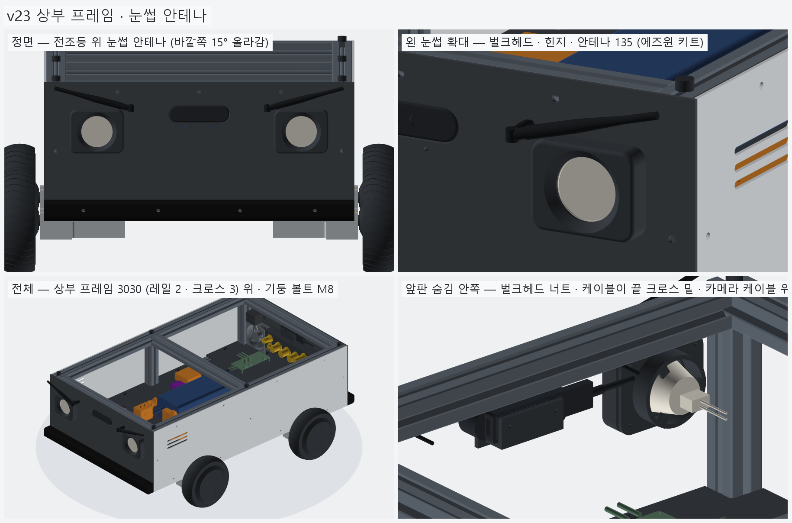
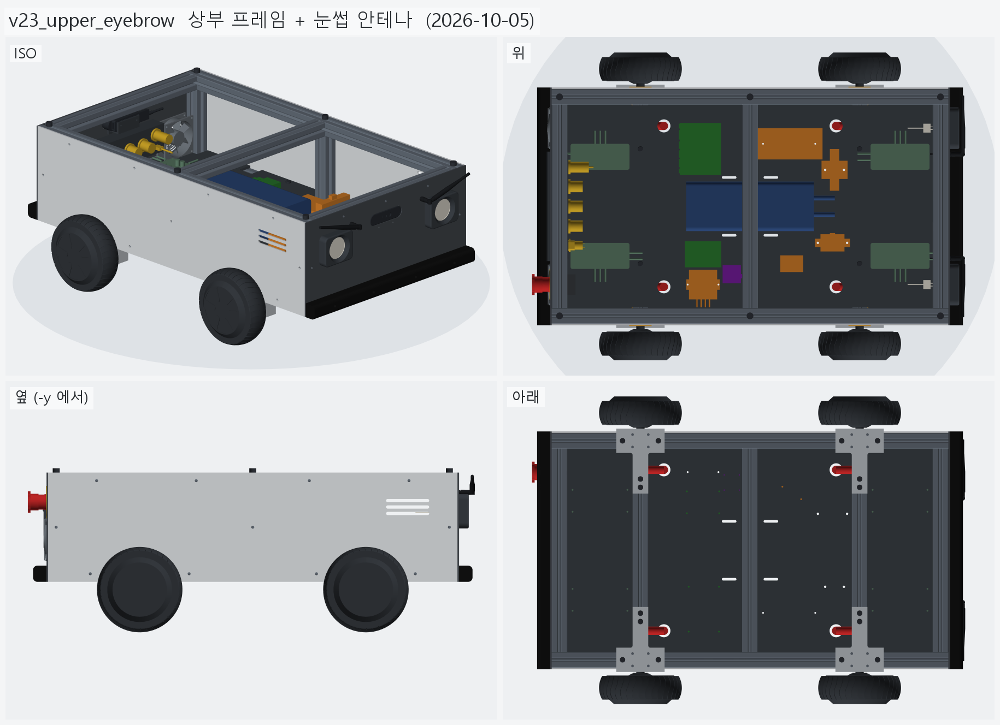
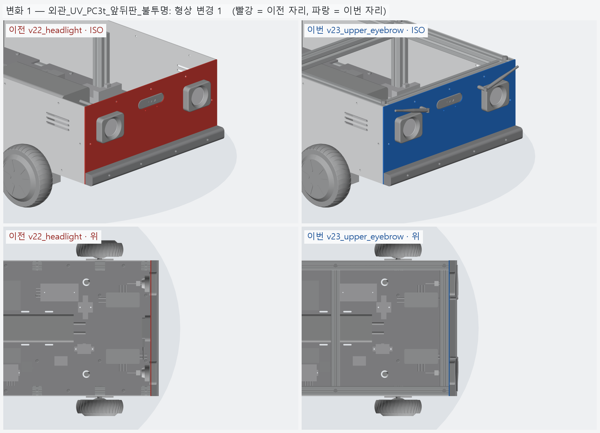
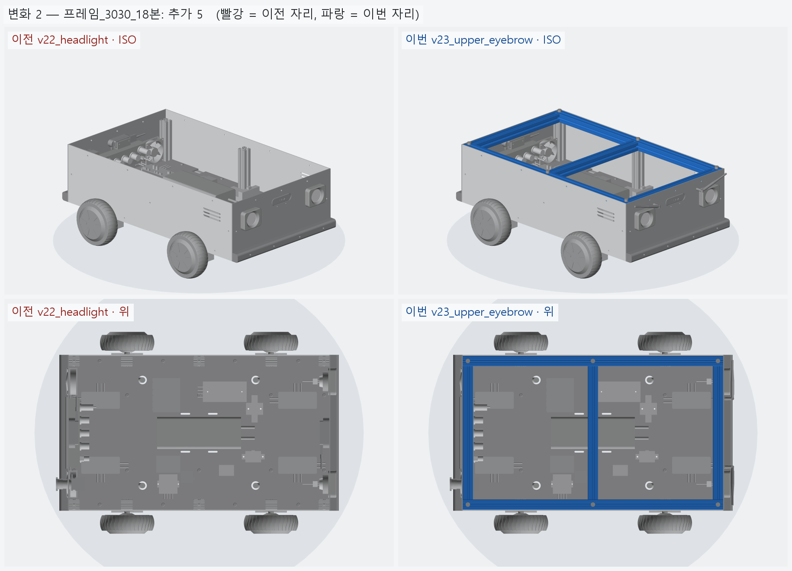
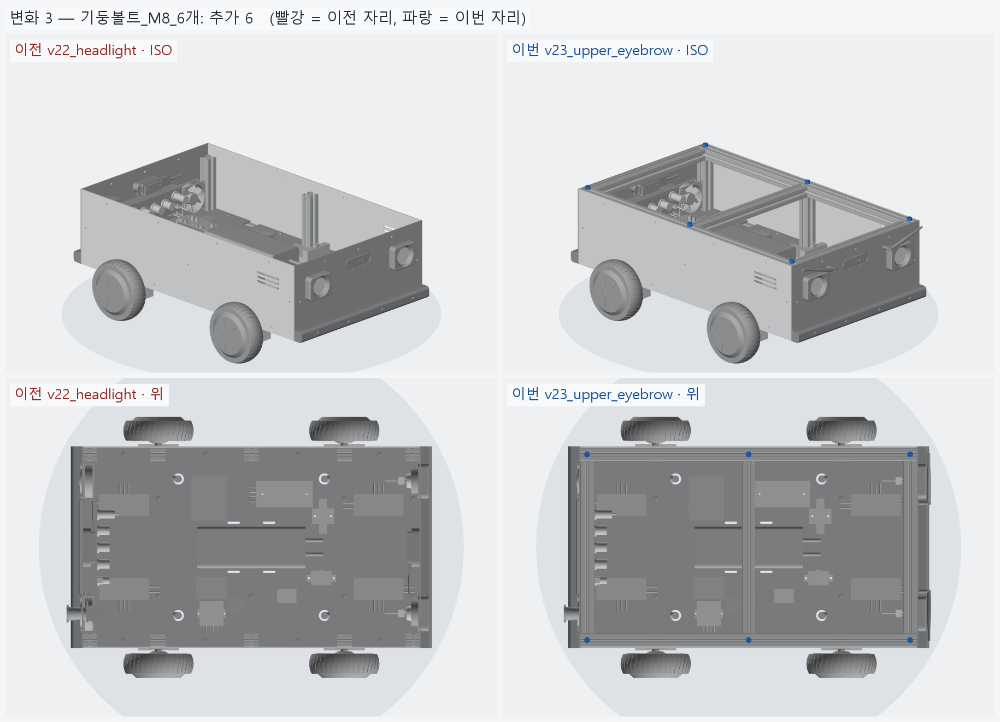
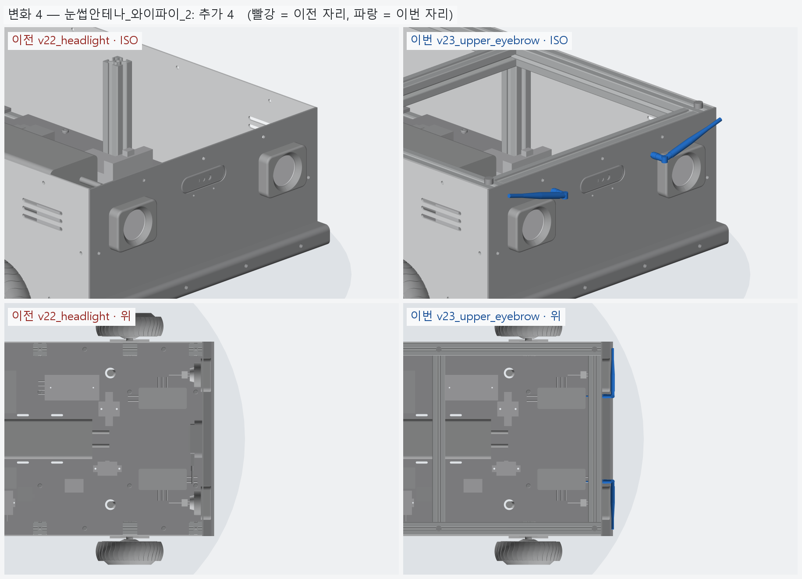

# v23_upper_eyebrow — 상부 프레임 + 눈썹 안테나

- 날짜: 2026-10-05
- 이전 버전: [v22_headlight](../v22_headlight/README.md)

## 무엇을 왜 바꿨나

사용자 (2026-10-05): "전조등 위쪽으로 외부 안테나 빼서 눈썹 같은 느낌 낼까, 상부 프레임도 올려 봐 이제."
왜 이렇게 정했는지는 [`../DECISIONS.md`](../DECISIONS.md) **D-12 (눈썹 안테나) · D-13 (상부 프레임)**,
조사 원자료 [research/2026-10-05_antenna.md](../research/2026-10-05_antenna.md).

- **상부 프레임** 3030 — 옆 레일 760 ×2 (y ±210) + 크로스 390 ×3 (x −365 · 0 · +365), 기둥 6 위, 윗면 z 296.85 (= 외관판 위끝).
  기둥은 **M8 × 60 렌치볼트**로 위에서 (레일 관통 → 기둥 끝 탭), 크로스는 M8 엔드탭.
  외관판 위쪽 구멍 (z 281.85) 이 이제 실제로 레일 · 크로스 슬롯에 물린다.
- **눈썹 안테나** — 젯슨 와이파이 (AW-CB375NF, MHF4 ×2) 를 **에즈윈 AX200 Wi-Fi 6 키트** (29,000) 케이블 300 + 안테나 135 로 앞판 밖으로.
  벌크헤드 y ±100 · z 260 (전조등 테두리 안쪽 위 모서리), 안테나는 힌지로 꺾어 바깥쪽이 15° 올라가게 — 앞에서 보면 "\ /" 눈썹.
  힌지라 실물에서 각도 · 방향을 바꿀 수 있다 (반대로 꺾으면 순한 인상).
- 검사: 상부 레일 −1 mm → 기둥 겹침 1893 mm³ (= 얹혀 있다), 상부 프레임 ↔ 모든 부품 · 외관 · 카메라 · 전조등 · 비상정지 겹침 0.
  안테나 윗끝 z 292.8 · 옆 끝 |y| 212.8 — 앞판 (296.85 · 228) 안. 벌크헤드 안쪽 너트는 끝 크로스 밑 (266.85) 2.2 mm 아래.
- 메시 오류 하나 고침: 안테나 몸통이 힌지와 같은 반지름으로 맞닿으면 OCC 가 면을 못 나눈다 → 몸통을 힌지 중심에서 3 mm 비켜 시작.
  거울 복사 (오른쪽 안테나) 는 솔리드가 무효가 돼서 방향을 직접 뒤집어 짓는다.
- BOM: +55,600 (안테나 키트 29,000 + 프로파일 760 ×2 · 390 ×3) → 단가 확인된 합 **2,183,236 원**.



## 남은 일 / 다음 버전 후보

- **상부판** — 상부 프레임 위. 기둥 볼트 머리 자리 구멍, 라이다 · GPS · 상태 표시등 자리.
- 키트 커넥터 SMA / RP-SMA 확인, 안테나 이득 5 dBi 이하인지 (젯슨 모듈 인증 기준).
- 무선 비상정지 · 바깥 전원 스위치 · 전류 센서 (앞서 정리한 남은 것).

<!-- record:begin — record.py 가 덮어쓴다. 이 사이는 손으로 고치지 않는다 -->
## 기록 (자동 · record.py · 2026-10-05 14:02)

**요약** — 상부 프레임 3030 (레일 2 · 크로스 3, 기둥 볼트 M8) + 전조등 위 눈썹 안테나 2

### 전체 모습



### 이전 버전(v22_headlight) 대비 변화

| # | 그룹 | 변화 | 부품 |
|---|---|---|---|
| 1 | 외관_UV_PC3t_앞뒤판_불투명 | 형상 변경 1 | 앞판_PC3t 형상 변경 (부피 257.9 → 257.7 cm³) |
| 2 | 프레임_3030_18본 | 추가 5 | 상부사이드 ×2 추가<br>상부크로스 ×3 추가 |
| 3 | 기둥볼트_M8_6개 | 추가 6 | 기둥볼트_M ×6 추가 |
| 4 | 눈썹안테나_와이파이_2 | 추가 4 | 안테나벌크헤드_왼_RP-SMA 추가<br>와이파이안테나_왼_눈썹 추가<br>안테나벌크헤드_오른_RP-SMA 추가<br>와이파이안테나_오른_눈썹 추가 |

**변화 1 — 외관_UV_PC3t_앞뒤판_불투명**



**변화 2 — 프레임_3030_18본**



**변화 3 — 기둥볼트_M8_6개**



**변화 4 — 눈썹안테나_와이파이_2**



### 수치

| 항목 | 값 |
|---|---|
| 프레임 외곽 (x × y) | 760 × 450 mm |
| 휠베이스 (앞뒤 축 간격) | 420 mm |
| 트레드 (좌우 바퀴 중심 간격) | 527.4 mm |
| 레일 윗면 높이 | 123.8 mm |
| 축크로스 x | ±210 mm |
| 기둥 | 6 본, x=-365 · +0 · +365 × y=±210, 높이 143 (윗면 z=266.9) |
| 3030 절단 | 760 × 4 + 390 × 8 + 143 × 6 |
| 3030 합계 | 실길이 7.02 m / 과금 7.60 m (72,200원) |
| 체결볼트 M6x15 | 16 개 |
| 바닥판 재료 | 폴리카보네이트 (PC) 불투명 흑색 5t — 불투명 (흑색 · 회색) — 충격에 강하고 안이 안 보인다 / 레이저는 그을린다 → CNC 재단 |
| 바닥판 크기 · 무게 | 760 × 450 × 5, 약 1.97 kg |
| 바닥판 구멍 | M6 고정 18 · 케이블 그로밋 Ø25 4 · M5 격자 0 · 기둥 노치 10 (x=-365 · -210 · +0 · +210 · +365, 기둥 6 · 10 본 겸용) |
| 판볼트 | M6x15 + 와셔 (필요 15.0 ~ 최대 15.8) |
| 받침 없는 구간 (크로스 안쪽면 사이) | 125 · 180 · 180 · 125 mm |
| 부품 | 13 개 (실측 치수 모델, 출처 parts.py) |
| 부품 무게 (알려진 것) | 3.44 kg — 무게 미상: 모터드라이버_앞왼_분리형_마스터, 모터드라이버_앞오른_분리형_슬레이브, 모터드라이버_뒤왼_분리형_마스터, 모터드라이버_뒤오른_분리형_슬레이브, ESP32_보드, DCDC_36V-12V_젯슨_RSD-60L, DCDC_36V-5V_DKP-55, MOSFET모듈_전조등_DFR0457, IMU_iAHRS_RB-SDA |
| 부품 무게중심 | x=+24.9 · y=+5.1 · z=164.9 mm (휠베이스 가운데 x=0 기준) |
| 가장 높은 부품 윗면 | z=215.3 — 기둥 윗면 z=266.9 까지 51.5 mm 남음 |
| 전체 크기 (x × y × z) | 830.1 × 590.2 × 304.9 mm |
| 최저 지상고 (바퀴 제외, 지면 z=0) | 54.9 mm |

### 부품 구성

| 그룹 | 개수 |
|---|---|
| 프레임_3030_18본 | 18 |
| T클램프_혀선반_4개 | 4 |
| 기존_상부클램프_4개 | 4 |
| 휠모터_4개 | 4 |
| 체결볼트_M6x15_16개 | 16 |
| 기둥볼트_M8_6개 | 6 |
| 바닥판_폴리카보네이트5t_불투명 | 1 |
| 판볼트_M6x15_18개 | 18 |
| 케이블_경로_참고 | 8 |
| 배터리 | 1 |
| 모터드라이버 | 4 |
| 컴퓨터_젯슨_ESP32 | 2 |
| 전원_차단기_컨택터_DCDC | 5 |
| 센서_IMU | 1 |
| 외관_ACM3t_옆판2 | 2 |
| 외관_UV_PC3t_앞뒤판_불투명 | 2 |
| 외관_ASA_루버_차양_포트칸 | 8 |
| 고무범퍼띠_앞뒤 | 2 |
| 뎁스카메라_Gemini336_2 | 2 |
| 비상정지_Autonics_SF2ER | 1 |
| 비상정지명판_노랑 | 1 |
| 비상정지본체_패널뒤 | 1 |
| 배기팬_2_가드 | 4 |
| 포트칸_부품_7 | 7 |
| 전조등_MR16_2 | 2 |
| 눈썹안테나_와이파이_2 | 4 |

### 검증

```
  간섭 프레임-T클램프: 0.00 mm3
  간섭 프레임-상부클램프: 0.00 mm3
  간섭 프레임-휠모터: 0.00 mm3
  간섭 T클램프-휠모터: 0.00 mm3
  간섭 T클램프-상부클램프: 0.00 mm3
  간섭 볼트-프레임: 0.00 mm3
  간섭 볼트-T클램프: 8.38 mm3 (두께 0.010)
  간섭 볼트-휠모터: 0.00 mm3
  대조군 클램프 +1mm 올림 → 레일 겹침 4006 mm3
  대조군 클램프 +1mm 올림 → 축크로스 겹침 6509 mm3
  대조군 기둥 -1mm 내림 → 레일 겹침 1893 mm3
  대조군 상부 레일 -1mm 내림 → 기둥 겹침 1893 mm3
  간섭 상부 레일-상부 크로스: 0.00 mm3
  간섭 상부 프레임-기둥 · 하부: 0.00 mm3
  기둥 ~ 휠모터 최소 간격 74.0 mm (메시 점 기준)
  간섭 바닥판-프레임 (기둥 포함): 0.00 mm3
  간섭 바닥판-T클램프: 0.00 mm3
  간섭 바닥판-휠모터: 0.00 mm3
  간섭 판볼트-프레임: 0.00 mm3
  간섭 판볼트-바닥판: 0.00 mm3
  간섭 케이블-프레임: 0.00 mm3
  간섭 케이블-T클램프: 0.00 mm3
  간섭 케이블-상부클램프: 0.00 mm3
  간섭 케이블-휠모터: 0.00 mm3
  간섭 케이블-바닥판: 0.00 mm3
  대조군 바닥판 -0.5mm → 프레임 겹침 31909 mm3
  10 본 겸용: 축 자리 가상 기둥 4 본 ~ 바닥판 간섭 0.00 mm3
  대조군 노치 없는 판 ~ 가상 기둥 겹침 7682 mm3
  판볼트 길이: 필요 15.0 ~ 최대 15.8 → M6x15
  간섭 부품끼리: 0.00 mm3
  간섭 부품-프레임 (기둥): 0.00 mm3
  간섭 부품-판볼트 머리: 0.00 mm3
  간섭 부품-바닥판: 0.00 mm3
  간섭 부품-케이블 구멍 위 (반경 15): 0.00 mm3
  대조군 부품 -1mm → 바닥판 겹침 35561 mm3
  부품 고정 구멍 38 — 빔 위 0 · 서로/다른 구멍과 2 mm 안 0
  대조군 x=0 구멍 → 빔 위 판정 True
  간섭 외관판-프레임: 0.00 mm3
  간섭 외관판-T클램프: 0.00 mm3
  간섭 외관판-휠모터: 0.00 mm3
  간섭 외관판-부품: 0.00 mm3
  간섭 외관판-바닥판: 0.00 mm3
  간섭 출력물-프레임: 0.00 mm3
  간섭 출력물-휠모터: 0.00 mm3
  간섭 출력물-T클램프: 0.00 mm3
  간섭 출력물-외관판: 0.00 mm3
  옆판 ~ 타이어 최소 간격 7.1 mm (메시 점 기준)
  벽 위끝 z=296.85 (상부 프레임 윗면 가정 z=296.85)
  부품 윗면 z=215.3 ~ 상부 프레임 밑면 z=266.9: 51.5 mm
  간섭 추가물-프레임: 0.00 mm3
  간섭 추가물-부품: 0.00 mm3
  간섭 추가물-외관판: 0.00 mm3
  간섭 추가물-ASA: 0.00 mm3
  간섭 추가물끼리: 0.00 mm3
  간섭 포트-팬 · 비상정지: 0.00 mm3
  간섭 비상정지-팬: 0.00 mm3
  간섭 명판-팬: 0.00 mm3
  간섭 추가물-휠모터: 0.00 mm3
  대조군 전조등 +0.5 mm 앞으로 → 테두리 겹침 295.6 mm3
  간섭 전조등-카메라: 0.00 mm3
  전조등 윗끝 z=257.0 ~ 상부 프레임 밑면 266.9
  간섭 안테나-전조등 · 카메라: 0.00 mm3
  안테나 윗끝 z=292.8 (판 위끝 296.85) · 옆 끝 |y|=212.8 (판 끝 228.0)
  간섭 포트 부품끼리 (7 개): 0.00 mm3
  포트 칸 z 162.0~222.0 — 뒤 드라이버 윗면 155.4, 상부 프레임 밑면 266.9
  명판 Ø60 ~ 팬 구멍 Ø76 간격 2.0 mm
  비상정지 윗끝 z=261.99 ~ 상부 프레임 밑면 266.85: 4.86 mm
  카메라 윗면 z=262.50 ~ 상부 프레임 밑면 266.85: 4.35 mm
  카메라 렌즈면 = 판 바깥면 x=±383.0
  간섭 카메라브래킷-포트칸: 0.00 mm3
  판 M3 볼트 머리 아래끝 z=228.25 ~ 포트 칸 바깥 테두리 윗끝 227.00: 1.25 mm
  브래킷 플랜지 아래끝 z=225.00 ~ 포트 칸 윗면 222.00
verify: OK
```

### 기록 소요

불러오기 0.4s · 짓기 113.7s · 검증 100.3s · STEP 7.1s · 내보내기 11.7s · 뷰어 전송 6.5s · 메시 (73 형상 → 128 부품) 24.2s · 전체 모습 이미지 5 장 9.0s · 변화 이미지 4 장 13.9s

<!-- record:end -->
