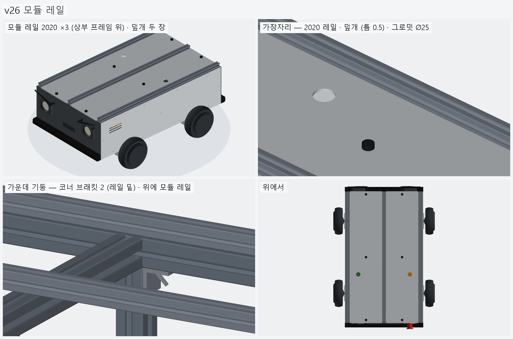
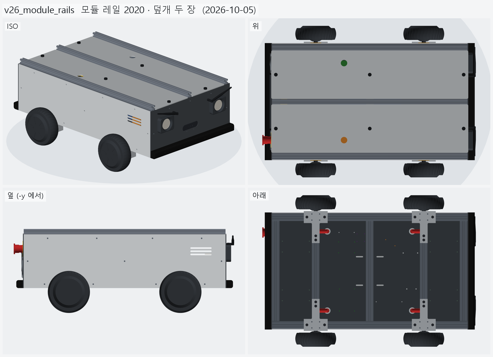
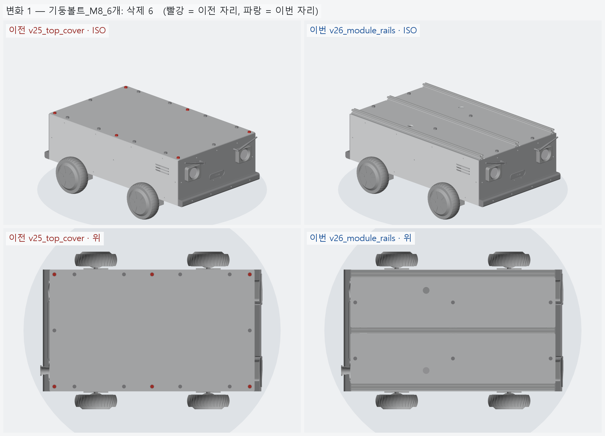
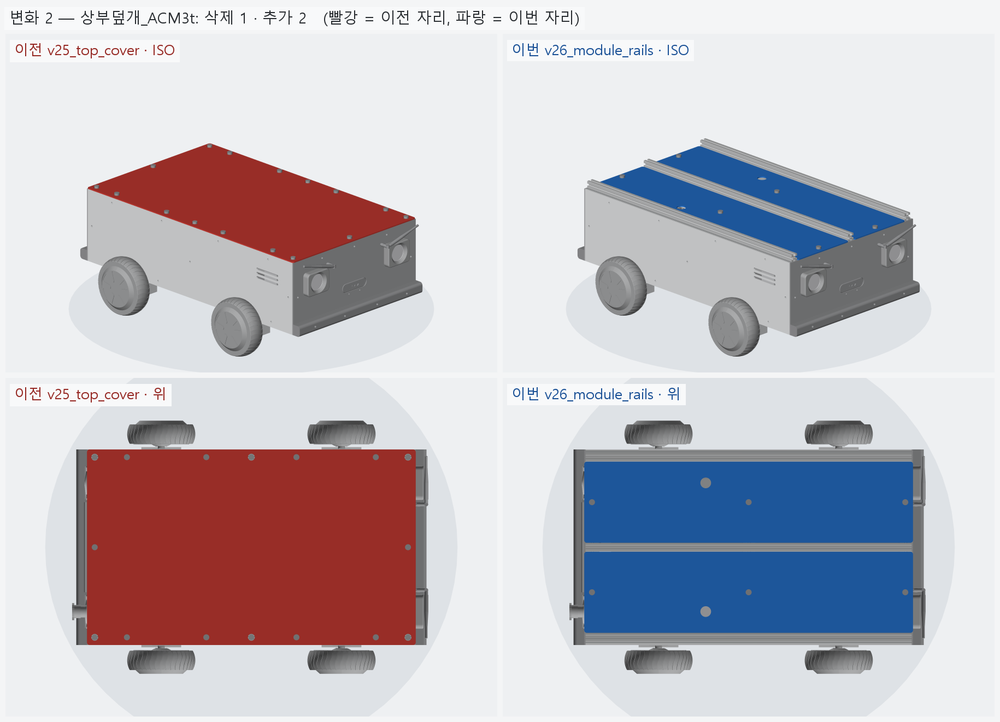
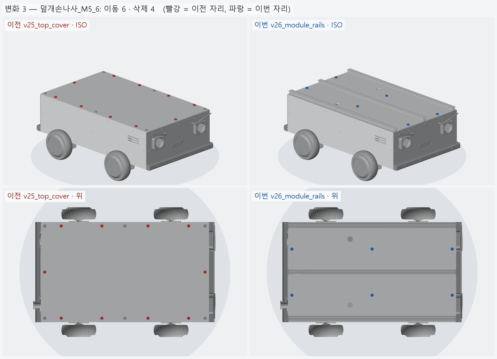
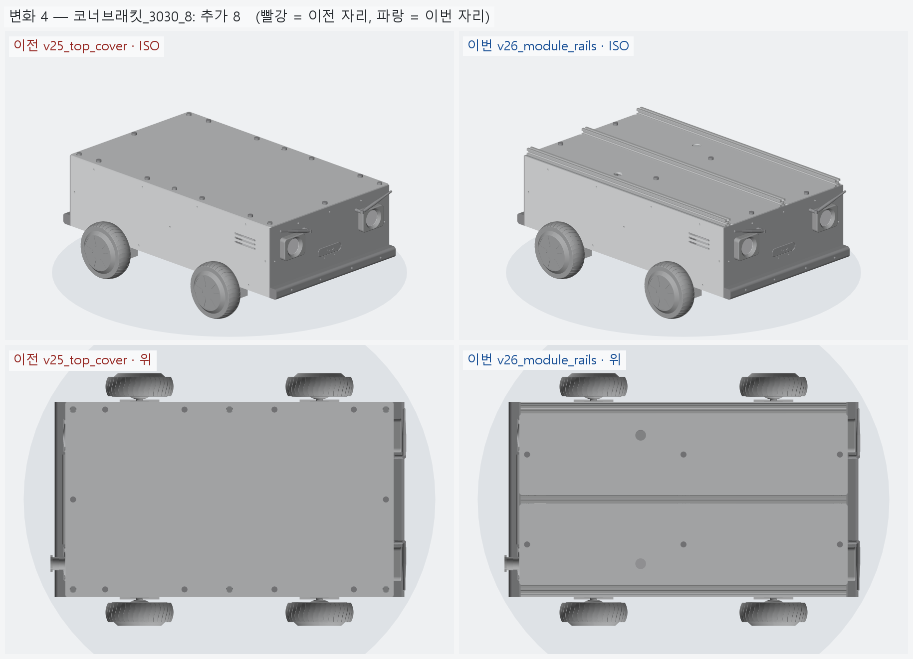
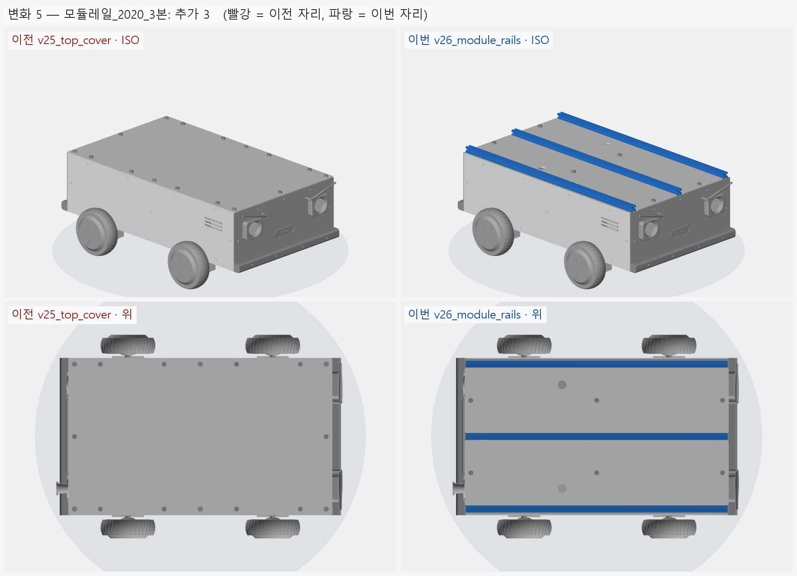

# v26_module_rails — 모듈 레일 2020 · 덮개 두 장

- 날짜: 2026-10-05
- 이전 버전: [v25_top_cover](../v25_top_cover/README.md)

## 무엇을 왜 바꿨나

사용자 (2026-10-05): "초기에 의도했던 것처럼 상부 덮개 위에는 프로파일 레일이 있어서 모듈식으로 위에 모듈을 올릴 수 있게 되어 있어야 해."
처음 의도는 docs/build-log.md 8 막 · docs/payload-interface.md (데크 위 2020 3 본). 이유 · 인터페이스 치수는 [`../DECISIONS.md`](../DECISIONS.md) **D-16** (D-13 개정 포함).

- **모듈 레일 2020 ×3** — x −380~+380, y −210 · 0 · +210, 상부 프레임 위에 바로 (윗면 z 316.85). 양옆은 상부 사이드 레일 윗슬롯 M5 4 개씩, 가운데는 크로스 3 곳.
- **덮개 두 장** — 레일 사이 (ACM 3t 766 × 189 R6), 손나사 3 개씩 (크로스 위), 모듈 케이블 그로밋 Ø25 한 장에 하나 (x −100, y ±150).
  레일 · 모듈을 건드리지 않고 덮개만 연다.
- **기둥 이음** — M8 기둥 볼트 6 → 3030 코너 브래킷 8 (레일 밑). 상부 사이드 레일 윗면을 모듈 레일 자리로.
- 검사: 레일 −1 mm → 프레임 겹침 18,120 mm³, 브래킷 +0.5 mm → 상부 레일 겹침 2,211 mm³, 덮개 −1 mm → 프레임 겹침 29,217 mm³ — 전부 제자리.
  레일 · 브래킷 · 덮개 ↔ 나머지 전부 겹침 0.
- BOM: 2020 L760 ×3 · 코너 브래킷 8 · 레일 볼트 11 · 그로밋 2 — 단가 미확인 (확인된 합 2,183,236 원 그대로).



## 남은 일 / 다음 버전 후보

- 첫 모듈 — 라이다 · GPS · 상태 표시등 센서 모듈을 레일 위에 (T 너트 고정).
- 2020 레일 단가 · 코너 브래킷 단가 확인.
- 무선 비상정지 · 바깥 전원 스위치 · 전류 센서, 배선.

<!-- record:begin — record.py 가 덮어쓴다. 이 사이는 손으로 고치지 않는다 -->
## 기록 (자동 · record.py · 2026-10-05 15:01)

**요약** — 모듈 레일 2020 ×3 (상부 프레임 위), 덮개 레일 사이 두 장 · 그로밋 2, 기둥 이음 -> 코너 브래킷

### 전체 모습



### 이전 버전(v25_top_cover) 대비 변화

| # | 그룹 | 변화 | 부품 |
|---|---|---|---|
| 1 | 기둥볼트_M8_6개 | 삭제 6 | 기둥볼트_M ×6 삭제 |
| 2 | 상부덮개_ACM3t | 삭제 1 · 추가 2 | 상부덮개_ACM3t 삭제<br>상부덮개_왼_ACM3t 추가<br>상부덮개_오른_ACM3t 추가 |
| 3 | 덮개손나사_M5_6 | 이동 6 · 삭제 4 | 덮개손나사_M5_1 이동 Δ(-75.0, +315.0, +0.0)<br>덮개손나사_M5_2 이동 Δ(+290.0, -105.0, +0.0)<br>덮개손나사_M5_3 이동 Δ(+470.0, +315.0, +0.0)<br>덮개손나사_M5_4 이동 Δ(-260.0, -315.0, +0.0)<br>덮개손나사_M5_5 이동 Δ(-105.0, +105.0, +0.0)<br>덮개손나사_M5_6 이동 Δ(+260.0, -315.0, +0.0)<br>덮개손나사_M ×4 삭제 |
| 4 | 코너브래킷_3030_8 | 추가 8 | 코너브래킷 ×8 추가 |
| 5 | 모듈레일_2020_3본 | 추가 3 | 모듈레일_2020_오른 추가<br>모듈레일_2020_가운데 추가<br>모듈레일_2020_왼 추가 |

**변화 1 — 기둥볼트_M8_6개**



**변화 2 — 상부덮개_ACM3t**



**변화 3 — 덮개손나사_M5_6**



**변화 4 — 코너브래킷_3030_8**



**변화 5 — 모듈레일_2020_3본**



### 수치

| 항목 | 값 |
|---|---|
| 프레임 외곽 (x × y) | 760 × 450 mm |
| 휠베이스 (앞뒤 축 간격) | 420 mm |
| 트레드 (좌우 바퀴 중심 간격) | 527.4 mm |
| 레일 윗면 높이 | 123.8 mm |
| 축크로스 x | ±210 mm |
| 기둥 | 6 본, x=-365 · +0 · +365 × y=±210, 높이 143 (윗면 z=266.9) |
| 3030 절단 | 760 × 4 + 390 × 8 + 143 × 6 |
| 3030 합계 | 실길이 7.02 m / 과금 7.60 m (72,200원) |
| 체결볼트 M6x15 | 16 개 |
| 바닥판 재료 | 폴리카보네이트 (PC) 불투명 흑색 5t — 불투명 (흑색 · 회색) — 충격에 강하고 안이 안 보인다 / 레이저는 그을린다 → CNC 재단 |
| 바닥판 크기 · 무게 | 760 × 450 × 5, 약 1.97 kg |
| 바닥판 구멍 | M6 고정 18 · 케이블 그로밋 Ø25 4 · M5 격자 0 · 기둥 노치 10 (x=-365 · -210 · +0 · +210 · +365, 기둥 6 · 10 본 겸용) |
| 판볼트 | M6x15 + 와셔 (필요 15.0 ~ 최대 15.8) |
| 받침 없는 구간 (크로스 안쪽면 사이) | 125 · 180 · 180 · 125 mm |
| 부품 | 13 개 (실측 치수 모델, 출처 parts.py) |
| 부품 무게 (알려진 것) | 3.44 kg — 무게 미상: 모터드라이버_앞왼_분리형_마스터, 모터드라이버_앞오른_분리형_슬레이브, 모터드라이버_뒤왼_분리형_마스터, 모터드라이버_뒤오른_분리형_슬레이브, ESP32_보드, DCDC_36V-12V_젯슨_RSD-60L, DCDC_36V-5V_DKP-55, MOSFET모듈_전조등_DFR0457, IMU_iAHRS_RB-SDA |
| 부품 무게중심 | x=+24.9 · y=+5.1 · z=164.9 mm (휠베이스 가운데 x=0 기준) |
| 가장 높은 부품 윗면 | z=215.3 — 기둥 윗면 z=266.9 까지 51.5 mm 남음 |
| 전체 크기 (x × y × z) | 830.1 × 590.2 × 316.9 mm |
| 최저 지상고 (바퀴 제외, 지면 z=0) | 54.9 mm |

### 부품 구성

| 그룹 | 개수 |
|---|---|
| 프레임_3030_18본 | 18 |
| T클램프_혀선반_4개 | 4 |
| 기존_상부클램프_4개 | 4 |
| 휠모터_4개 | 4 |
| 체결볼트_M6x15_16개 | 16 |
| 코너브래킷_3030_8 | 8 |
| 모듈레일_2020_3본 | 3 |
| 바닥판_폴리카보네이트5t_불투명 | 1 |
| 판볼트_M6x15_18개 | 18 |
| 케이블_경로_참고 | 8 |
| 배터리 | 1 |
| 모터드라이버 | 4 |
| 컴퓨터_젯슨_ESP32 | 2 |
| 전원_차단기_컨택터_DCDC | 5 |
| 센서_IMU | 1 |
| 외관_ACM3t_옆판2 | 2 |
| 외관_UV_PC3t_앞뒤판_불투명 | 2 |
| 외관_ASA_루버_차양_포트칸 | 8 |
| 고무범퍼띠_앞뒤 | 2 |
| 뎁스카메라_Gemini336_2 | 2 |
| 비상정지_Autonics_SF2ER | 1 |
| 비상정지명판_노랑 | 1 |
| 비상정지본체_패널뒤 | 1 |
| 배기팬_2_가드 | 4 |
| 포트칸_부품_7 | 7 |
| 전조등_MR16_2 | 2 |
| 눈썹안테나_와이파이_2 | 4 |
| 상부덮개_ACM3t | 2 |
| 덮개손나사_M5_6 | 6 |

### 검증

```
  간섭 프레임-T클램프: 0.00 mm3
  간섭 프레임-상부클램프: 0.00 mm3
  간섭 프레임-휠모터: 0.00 mm3
  간섭 T클램프-휠모터: 0.00 mm3
  간섭 T클램프-상부클램프: 0.00 mm3
  간섭 볼트-프레임: 0.00 mm3
  간섭 볼트-T클램프: 8.38 mm3 (두께 0.010)
  간섭 볼트-휠모터: 0.00 mm3
  대조군 클램프 +1mm 올림 → 레일 겹침 4006 mm3
  대조군 클램프 +1mm 올림 → 축크로스 겹침 6509 mm3
  대조군 기둥 -1mm 내림 → 레일 겹침 1893 mm3
  대조군 상부 레일 -1mm 내림 → 기둥 겹침 1893 mm3
  간섭 상부 레일-상부 크로스: 0.00 mm3
  간섭 상부 프레임-기둥 · 하부: 0.00 mm3
  기둥 ~ 휠모터 최소 간격 74.0 mm (메시 점 기준)
  간섭 바닥판-프레임 (기둥 포함): 0.00 mm3
  간섭 바닥판-T클램프: 0.00 mm3
  간섭 바닥판-휠모터: 0.00 mm3
  간섭 판볼트-프레임: 0.00 mm3
  간섭 판볼트-바닥판: 0.00 mm3
  간섭 케이블-프레임: 0.00 mm3
  간섭 케이블-T클램프: 0.00 mm3
  간섭 케이블-상부클램프: 0.00 mm3
  간섭 케이블-휠모터: 0.00 mm3
  간섭 케이블-바닥판: 0.00 mm3
  대조군 바닥판 -0.5mm → 프레임 겹침 31909 mm3
  10 본 겸용: 축 자리 가상 기둥 4 본 ~ 바닥판 간섭 0.00 mm3
  대조군 노치 없는 판 ~ 가상 기둥 겹침 7682 mm3
  판볼트 길이: 필요 15.0 ~ 최대 15.8 → M6x15
  간섭 부품끼리: 0.00 mm3
  간섭 부품-프레임 (기둥): 0.00 mm3
  간섭 부품-판볼트 머리: 0.00 mm3
  간섭 부품-바닥판: 0.00 mm3
  간섭 부품-케이블 구멍 위 (반경 15): 0.00 mm3
  대조군 부품 -1mm → 바닥판 겹침 35561 mm3
  부품 고정 구멍 38 — 빔 위 0 · 서로/다른 구멍과 2 mm 안 0
  대조군 x=0 구멍 → 빔 위 판정 True
  간섭 외관판-프레임: 0.00 mm3
  간섭 외관판-T클램프: 0.00 mm3
  간섭 외관판-휠모터: 0.00 mm3
  간섭 외관판-부품: 0.00 mm3
  간섭 외관판-바닥판: 0.00 mm3
  간섭 출력물-프레임: 0.00 mm3
  간섭 출력물-휠모터: 0.00 mm3
  간섭 출력물-T클램프: 0.00 mm3
  간섭 출력물-외관판: 0.00 mm3
  옆판 ~ 타이어 최소 간격 7.1 mm (메시 점 기준)
  벽 위끝 z=296.85 (상부 프레임 윗면 가정 z=296.85)
  부품 윗면 z=215.3 ~ 상부 프레임 밑면 z=266.9: 51.5 mm
  간섭 추가물-프레임: 0.00 mm3
  간섭 추가물-부품: 0.00 mm3
  간섭 추가물-외관판: 0.00 mm3
  간섭 추가물-ASA: 0.00 mm3
  간섭 추가물끼리: 0.00 mm3
  간섭 포트-팬 · 비상정지: 0.00 mm3
  간섭 비상정지-팬: 0.00 mm3
  간섭 명판-팬: 0.00 mm3
  간섭 추가물-휠모터: 0.00 mm3
  대조군 전조등 +0.5 mm 앞으로 → 테두리 겹침 295.6 mm3
  간섭 전조등-카메라: 0.00 mm3
  전조등 윗끝 z=257.0 ~ 상부 프레임 밑면 266.9
  간섭 안테나-전조등 · 카메라: 0.00 mm3
  안테나 윗끝 z=292.8 (판 위끝 296.85) · 옆 끝 |y|=212.8 (판 끝 228.0)
  간섭 앞 카메라 · 브래킷-부품 · 바닥판: 0.00 mm3
  앞 카메라 z=172: 창 위끝 184.8 ~ 전조등 테두리 아래끝 193.0 (8.2), 카메라 · 브래킷 아래끝 ~ 바닥판 18.2, 카메라 아래끝 159.5 ~ 보드 윗면 155.4
  바닥이 보이기 시작하는 거리: 앞 270 mm · 뒤 392 mm
  대조군 덮개 -1mm 내림 → 프레임 겹침 29217 mm3
  간섭 덮개-나머지 전부 (기둥 볼트 머리 포함): 0.00 mm3
  덮개 손나사 윗끝 z=305.9 (덮개 윗면 299.85, 레일 윗면 316.85)
  대조군 모듈 레일 -1mm 내림 -> 프레임 겹침 18120 mm3
  간섭 모듈 레일-나머지 전부 (덮개 포함): 0.00 mm3
  간섭 코너 브래킷-나머지 전부: 0.00 mm3
  대조군 브래킷 +0.5mm 올림 -> 상부 레일 겹침 2211 mm3
  간섭 포트 부품끼리 (7 개): 0.00 mm3
  포트 칸 z 162.0~222.0 — 뒤 드라이버 윗면 155.4, 상부 프레임 밑면 266.9
  명판 Ø60 ~ 팬 구멍 Ø76 간격 2.0 mm
  비상정지 윗끝 z=261.99 ~ 상부 프레임 밑면 266.85: 4.86 mm
  카메라 윗면 z=262.50 ~ 상부 프레임 밑면 266.85: 4.35 mm
  카메라 렌즈면 = 판 바깥면 x=±383.0
  간섭 카메라브래킷-포트칸: 0.00 mm3
  판 M3 볼트 머리 아래끝 z=228.25 ~ 포트 칸 바깥 테두리 윗끝 227.00: 1.25 mm
  브래킷 플랜지 아래끝 z=225.00 ~ 포트 칸 윗면 222.00
verify: OK
```

### 기록 소요

불러오기 0.2s · 짓기 31.6s · 검증 23.7s · STEP 4.2s · 내보내기 5.1s · 뷰어 전송 3.8s · 메시 (84 형상 → 141 부품) 12.8s · 전체 모습 이미지 5 장 2.8s · 변화 이미지 5 장 8.1s

<!-- record:end -->
