# v28_wiring — 내부 배선

- 날짜: 2026-10-05
- 이전 버전: [v27_sensor_module](../v27_sensor_module/README.md)

## 무엇을 왜 바꿨나

사용자 (2026-10-05): "내부 부품 배치된 거 볼 수 있게 상단 프레임 등 다시 떼 보고, 그 안에 실제 필요한 거 맞게 배선까지".
이유 · 버린 대안은 [`../DECISIONS.md`](../DECISIONS.md) **D-20**, 구매처 원자료 [research/2026-10-05_wiring.md](../research/2026-10-05_wiring.md).
배선 코드는 `wiring.py`, 속 보기는 `inside.py` (상부 프레임 · 덮개 · 외관판 · 센서 모듈을 빼고 그림 + 뷰어).

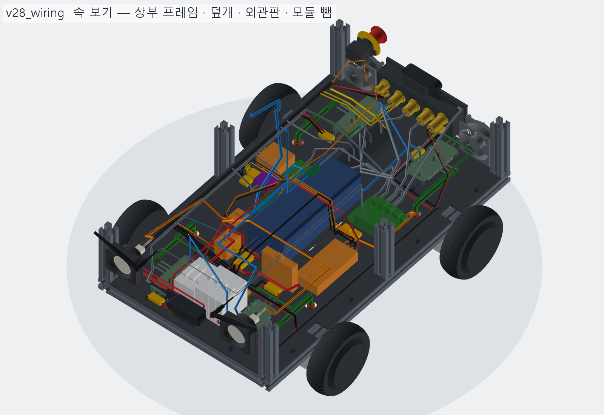

- **배전 (앞 칸)**: XT90 → 메인 차단기 40 A → 컨택터 → **분기 레일** — 바퀴 보드 4 장은 DC 차단기 **20 A ×4**,
  12 V · 5 V 변환기 · 충전 단자는 DC 퓨즈 홀더 10×38 **15 A ×3**. 모든 0 V 는 **음극 N 단자대** 한 점.
  (국내에 10 A 이하 DC 차단기 · 퓨즈, 1P 핀 부스바, M6 버스바가 없어서 — 20 A · 15 A 와 점퍼선 · N 단자대로.)
- **12 V · 5 V 분배**: WAGO 221-415 ×4. 12 V → 젯슨 DC · 키 → 비상정지 → 컨택터 코일 · 전조등 · 표시등, 5 V → ESP32 · 팬 · USB 허브.
- **신호 · USB**: ESP32 → 앞 · 뒤 마스터 (UART + 전원 핀), 전조등 PWM, 표시등 MOSFET ×4. 카메라 2 는 젯슨 직결,
  라이다 · GNSS · iAHRS · ESP32 · 패널 USB 는 **유전원 7 포트 허브** (PL-UH307P). 패널 USB-C 는 **젯슨 USB-C** 로 바꿈.
- **경로**: 긴 구간은 하네스 간선 2 (왼쪽 바닥 · 오른쪽 z 170), 신호는 상부 프레임 밑 · 배터리 위 (방향별 높이 나눔). 전선 · 케이블 **90 가닥**.
- **검사**: 전선 ↔ 부품 겹침 **0**, 전선끼리 **0**, 끝점 **180 / 180** 이 단자에 닿음, 대조군 통과.
- **찾은 것**: 안테나 동축은 **0.8 m** 짜리가 필요 (키트 300 mm 는 짧다), 앞 카메라 USB 는 1 m 로 겨우.
- BOM: 배선 · 배전을 형상 길이로 넣음 → 단가 확인된 합 **2,636,743 원** (+121,273).

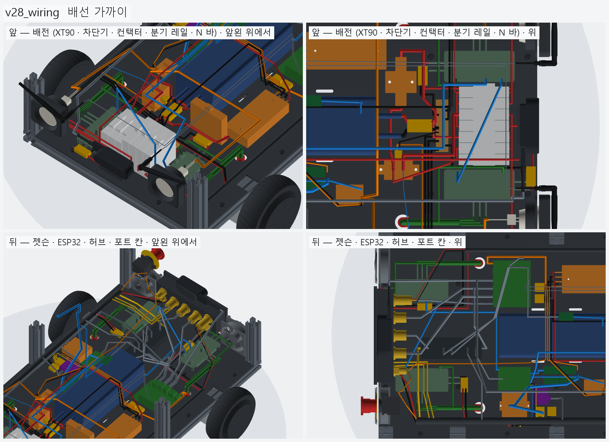

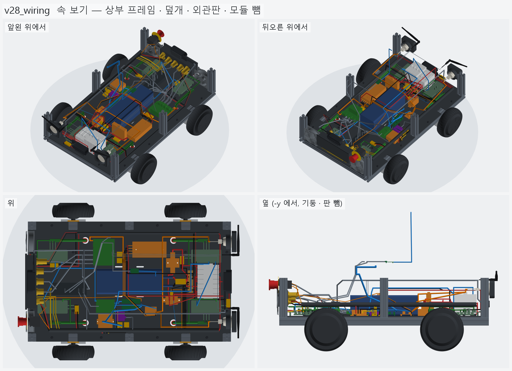

## 남은 일 / 다음 버전 후보

- 실물 단자 자리 (RSD 단자 순서 · DKP 선 색 · DFR0457 단자대 · 보드 REMOTE 헤더) 를 보고 `wiring.py` 좌표 고치기.
- 컨택터 투입 돌입 전류 실측 → 필요하면 프리차지 (릴레이로 잠깐) 추가.
- N 단자대 · 0.8 m 안테나 피그테일 · 타이 마운트 소량 구매처.
- (D-19 결정 대기) 옆 낮은 센서 · 비상정지 정지 유지 + 상선 단락 · 12 V 변환기 키우기.

<!-- record:begin — record.py 가 덮어쓴다. 이 사이는 손으로 고치지 않는다 -->
## 기록 (자동 · record.py · 2026-10-05 20:07)

**요약** — 내부 배선 — 분기 레일 (차단기 20 A ×4 · 퓨즈 15 A ×3) · 음극 N 바 · WAGO · USB 허브 + 전선 90 가닥 · 간선 2 (겹침 0)

### 전체 모습

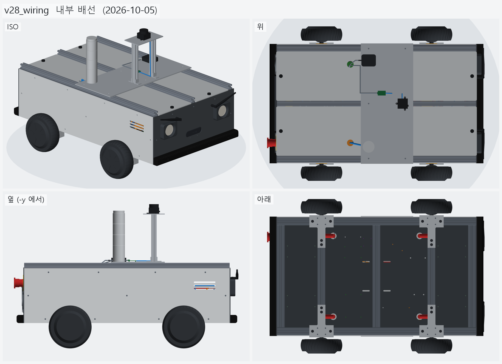

### 이전 버전(v27_sensor_module) 대비 변화

| # | 그룹 | 변화 | 부품 |
|---|---|---|---|
| 1 | GNSS_GPS630 | 이동 1 | GNSS_아센코리아_GPS630 이동 Δ(-12.0, +0.0, +0.0) |
| 2 | 포트칸_부품_7 | 삭제 1 · 추가 1 | 포트_ESP32_USB-C_MT723 삭제<br>포트_젯슨_USB-C_MT723 추가 |
| 3 | 배전레일_차단기20A4_퓨즈3 | 추가 8 | DIN레일_35_L136 추가<br>분기차단기_F1_앞왼_DC20A 추가<br>분기차단기_F3_뒤왼_DC20A 추가<br>분기차단기_F4_뒤오른_DC20A 추가<br>분기차단기_F2_앞오른_DC20A 추가<br>퓨즈홀더_F7_충전_10x38_15A 추가<br>퓨즈홀더_F6_5V_10x38_15A 추가<br>퓨즈홀더_F5_12V_10x38_15A 추가 |
| 4 | 음극단자대_N바 | 추가 1 | 음극단자대_N바_12구멍 추가 |
| 5 | 커넥터_XT90_XT60_WAGO_코일플러그 | 추가 10 | 커넥터_XT90_배터리 추가<br>컨택터코일플러그_GPR-40ST 추가<br>WAGO_221-415_12V+ 추가<br>WAGO_221-415_12V- 추가<br>WAGO_221-415_5V+ 추가<br>WAGO_221-415_5V- 추가<br>커넥터_XT60_앞왼 추가<br>커넥터_XT60_앞오른 추가<br>커넥터_XT60_뒤왼 추가<br>커넥터_XT60_뒤오른 추가 |
| 6 | USB허브_PL-UH307P | 추가 1 | USB허브_POWERLAN_PL-UH307P_7포트 추가 |
| 7 | 보조보드_MOSFET4_라이다USB | 추가 5 | 표시등MOSFET_초록_15A 추가<br>표시등MOSFET_노랑_15A 추가<br>표시등MOSFET_빨강_15A 추가<br>표시등MOSFET_부저_15A 추가<br>라이다USB어댑터_CP2102 추가 |
| 8 | 전선_36V+_빨강 | 추가 23 | 배터리리드+_XT90 추가<br>주전원+_XT90-메인차단기 추가<br>상시+_메인차단기-컨택터 추가<br>스위치+_컨택터-F4 추가<br>점퍼+_F4-F ×2 추가<br>점퍼+_F3-F1 추가<br>점퍼+_F5-F6 추가<br>상시+_컨택터-F5 추가<br>배터리+_XT90-F7 추가<br>보드+_F1-앞왼 추가<br>보드+_F2-앞오른 추가<br>보드+_F3-뒤왼 추가<br>보드+_F3-뒤왼_뒤가지 추가<br>보드+_F4-뒤오른 추가<br>보드+_F4-뒤오른_뒤가지 추가<br>상시+_F5-RSD입력 추가<br>충전+_F7-GX16 추가<br>충전+_F7-GX16_뒤가지 추가<br>전압계+_F1입력 추가<br>전압계+_F1입력_뒤가지 추가<br>상시+_F6-DKP입력 추가<br>상시+_F6-DKP입력_뒤가지 추가 |
| 9 | 전선_0V_검정 | 추가 21 | 배터리리드-_XT90 추가<br>주전원-_XT90-N바 추가<br>보드-_앞왼-N바 추가<br>보드-_앞오른-N바 추가<br>보드-_뒤왼-N바 추가<br>보드-_뒤왼-N바_뒤가지 추가<br>보드-_뒤오른-N바 추가<br>보드-_뒤오른-N바_뒤가지 추가<br>12V-_RSD-WAGO 추가<br>RSD-Vin_12V- 추가<br>기준선_12V--N바 추가<br>12V-_WAGO-DFR0457 추가<br>코일-_N바 추가<br>충전-_GX16-N바 추가<br>충전-_GX16-N바_뒤가지 추가<br>전압계-_N바 추가<br>전압계-_N바_뒤가지 추가<br>DKP-Vin_N바 추가<br>DKP-Vin_N바_뒤가지 추가<br>5V-_DKP-WAGO 추가<br>5V-_WAGO-ESP32 추가 |
| 10 | 전선_12V_주황 | 추가 10 | 12V+_RSD-WAGO 추가<br>젯슨DC_12V_5.5x2.5 추가<br>키스위치_12V+ 추가<br>12V+_WAGO-표시등공통 추가<br>12V+_WAGO-DFR0457 추가<br>전조등_오른_2심 추가<br>전조등_왼_2심 추가<br>키-비상정지 추가<br>비상정지-코일+ 추가<br>비상정지-코일+_뒤가지 추가 |
| 11 | 전선_5V_노랑 | 추가 8 | 5V+_DKP-WAGO 추가<br>팬_오른_5V 추가<br>팬_오른_5V_뒤가지 추가<br>팬_왼_5V 추가<br>팬_왼_5V_뒤가지 추가<br>USB허브_5V 추가<br>USB허브_5V_뒤가지 추가<br>5V+_WAGO-ESP32 추가 |
| 12 | 케이블_신호_파랑 | 추가 10 | 감지_컨택터출력-ESP32 추가<br>감지_컨택터출력-ESP32_뒤가지 추가<br>UART+전원_ESP32-앞왼마스터 추가<br>UART+전원_ESP32-뒤왼마스터 추가<br>PWM_ESP32-DFR0457 추가<br>표시등게이트_ESP32-MOSFET4 추가<br>마스터-슬레이브_앞 추가<br>마스터-슬레이브_뒤 추가<br>라이다_UART4 추가<br>표시등케이블_5심 추가 |
| 13 | 케이블_USB_LAN_동축_회색 | 추가 14 | USB3_앞카메라-젯슨 추가<br>USB3_뒤카메라-젯슨 추가<br>USB3_허브-젯슨 추가<br>USB3_포트A1-젯슨 추가<br>USB-C연장_포트-젯슨 추가<br>LAN_포트-젯슨 추가<br>USB3_포트A2-허브 추가<br>USB2_ESP32-허브 추가<br>USB2_IMU-허브 추가<br>USB2_IMU-허브_뒤가지 추가<br>동축_안테나왼-젯슨 추가<br>동축_안테나오른-젯슨 추가<br>USB2_GNSS-허브 추가<br>USB2_라이다어댑터-허브 추가 |
| 14 | 케이블_모터_상선_홀_초록 | 추가 20 | 모터케이블_앞왼 추가<br>상선1_앞왼 추가<br>상선2_앞왼 추가<br>상선3_앞왼 추가<br>홀_앞왼 추가<br>모터케이블_앞오른 추가<br>상선1_앞오른 추가<br>상선2_앞오른 추가<br>상선3_앞오른 추가<br>홀_앞오른 추가<br>모터케이블_뒤왼 추가<br>상선1_뒤왼 추가<br>상선2_뒤왼 추가<br>상선3_뒤왼 추가<br>홀_뒤왼 추가<br>모터케이블_뒤오른 추가<br>상선1_뒤오른 추가<br>상선2_뒤오른 추가<br>상선3_뒤오른 추가<br>홀_뒤오른 추가 |
| 15 | 하네스간선_헬리컬밴드 | 추가 2 | 간선_T_L_Ø9 추가<br>간선_T_R_Ø16 추가 |

**변화 1 — GNSS_GPS630**

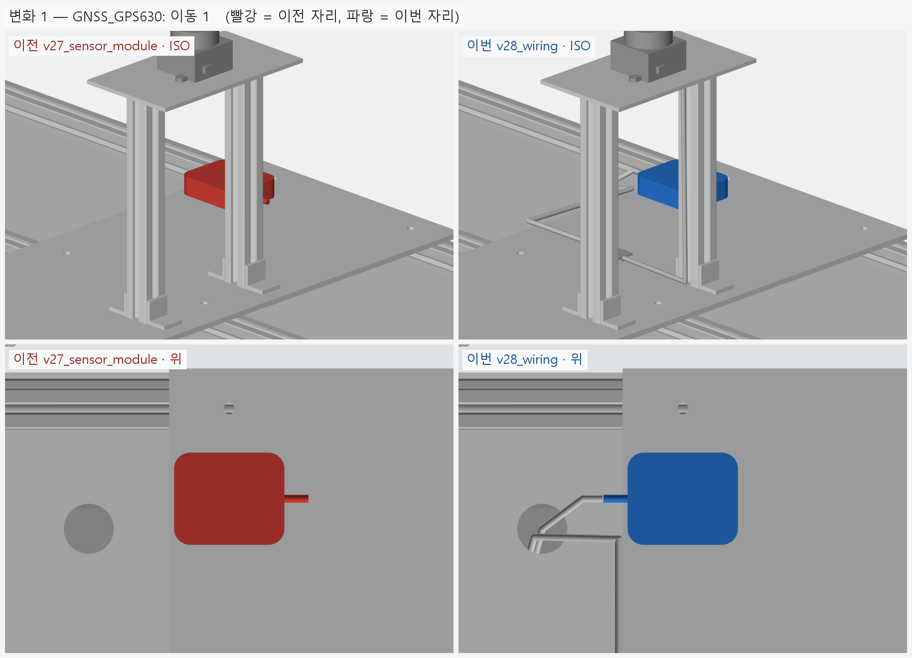

**변화 2 — 포트칸_부품_7**

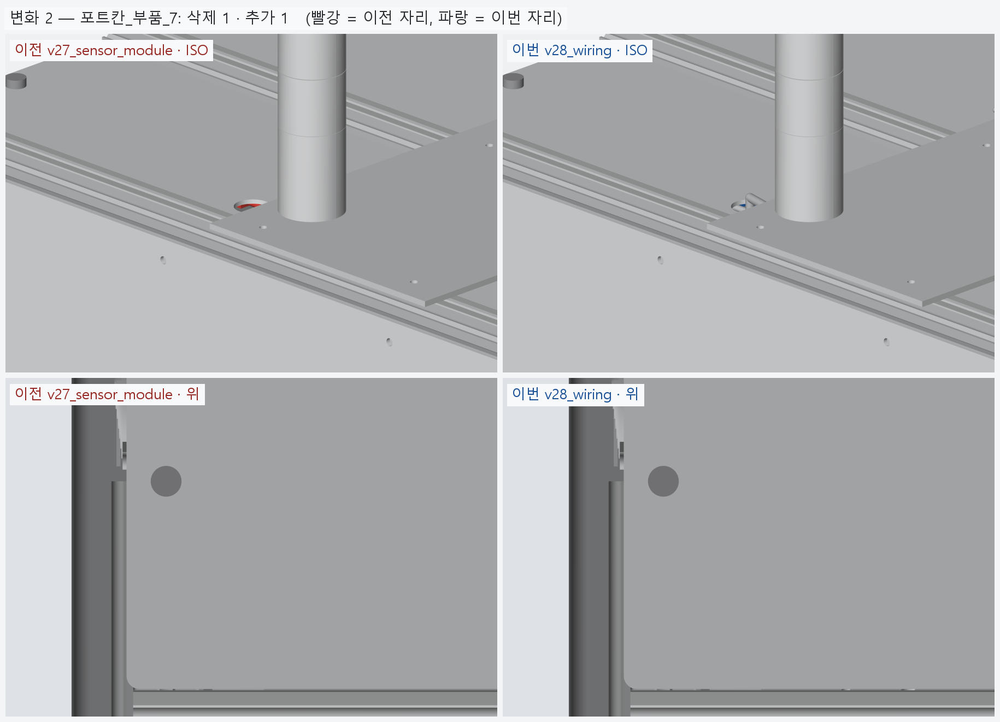

**변화 3 — 배전레일_차단기20A4_퓨즈3**

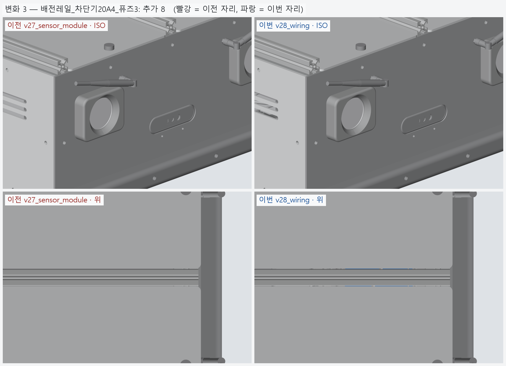

**변화 4 — 음극단자대_N바**

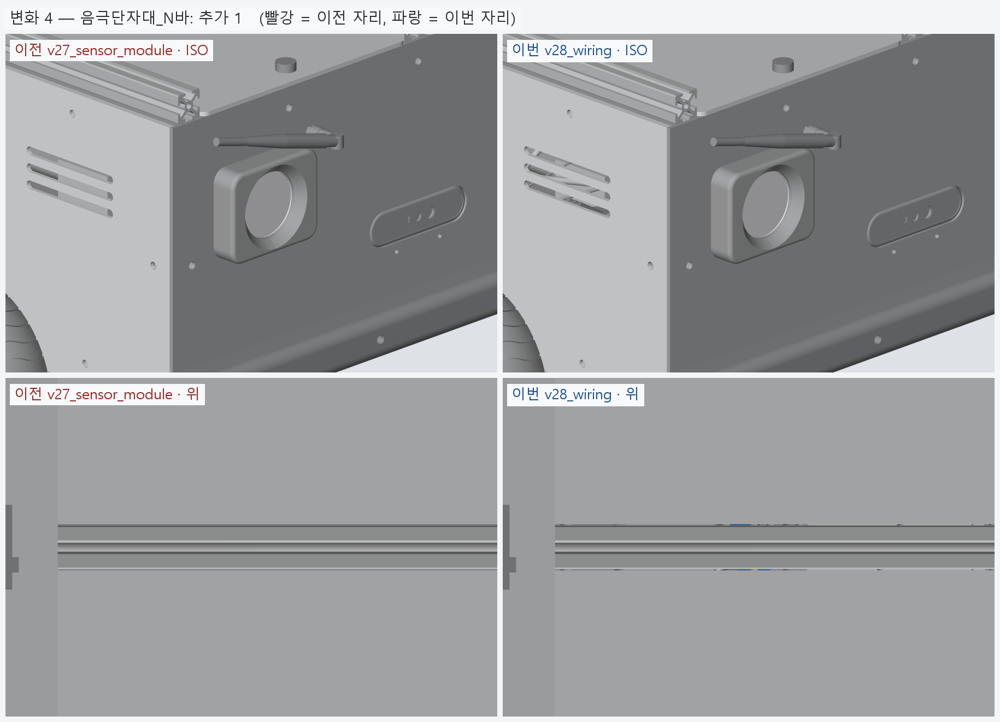

**변화 5 — 커넥터_XT90_XT60_WAGO_코일플러그**

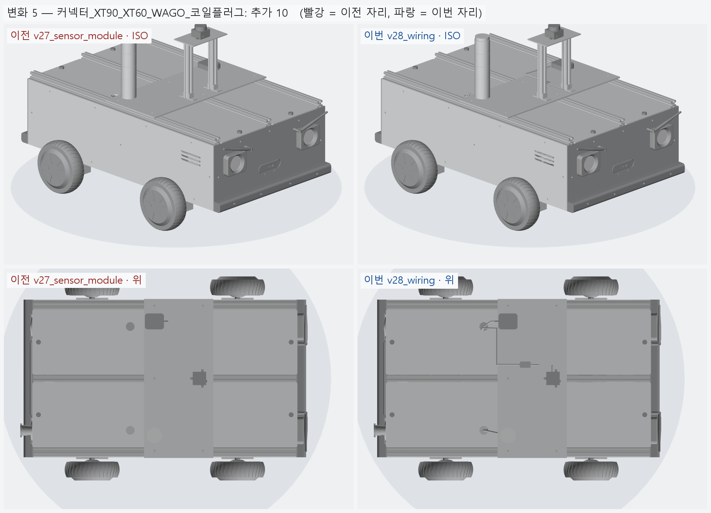

**변화 6 — USB허브_PL-UH307P**

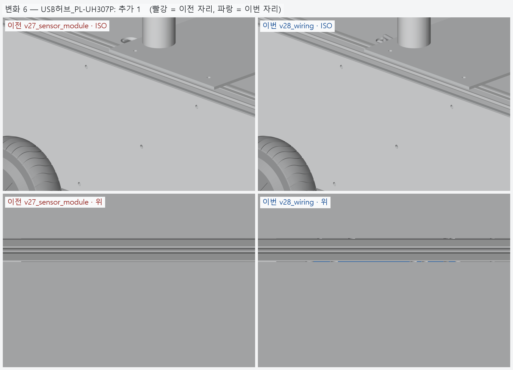

**변화 7 — 보조보드_MOSFET4_라이다USB**

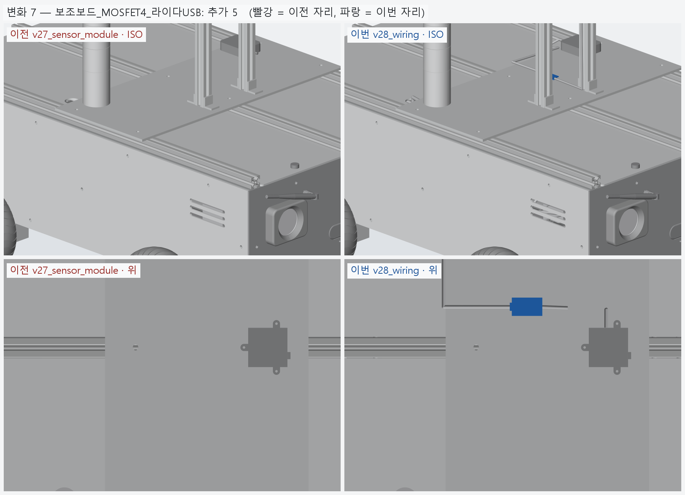

**변화 8 — 전선_36V+_빨강**


**변화 9 — 전선_0V_검정**

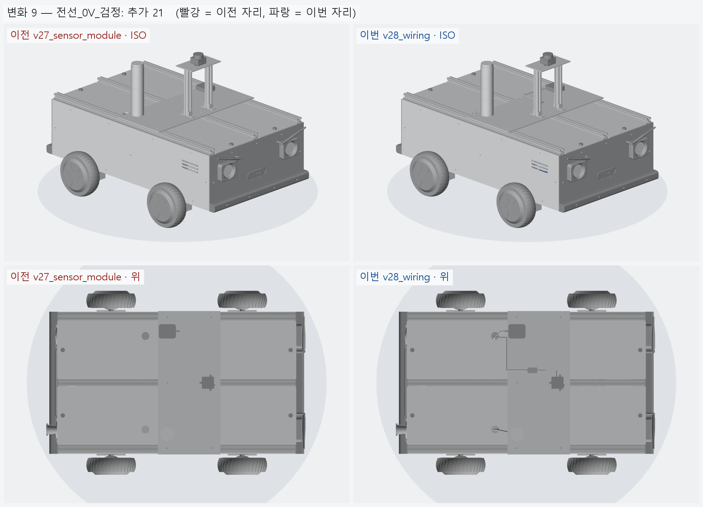

**변화 10 — 전선_12V_주황**

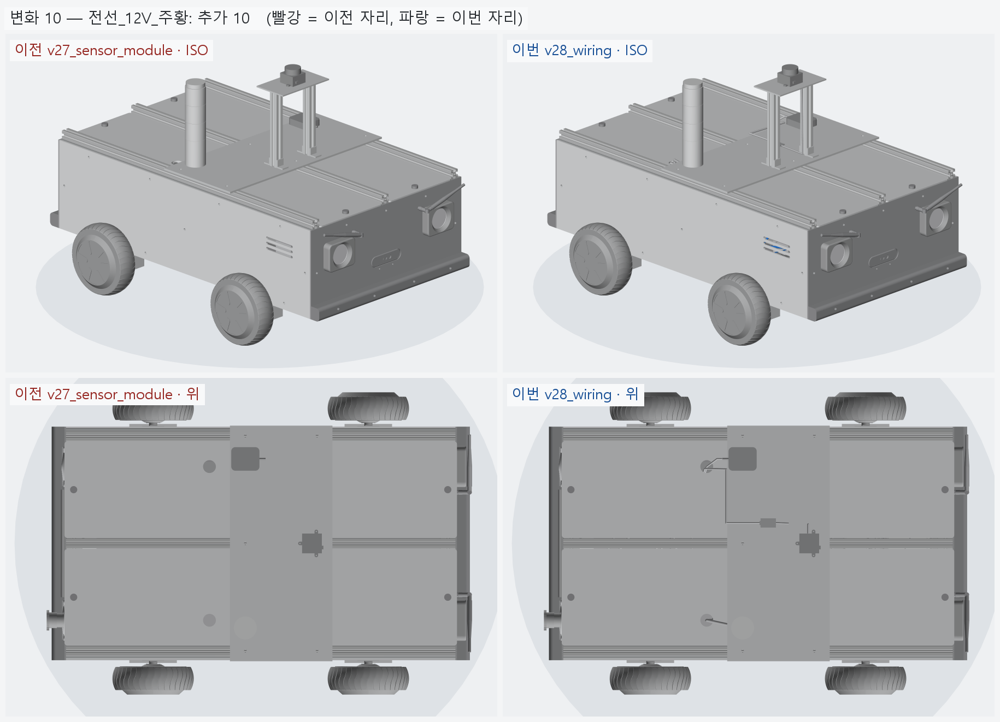

**변화 11 — 전선_5V_노랑**

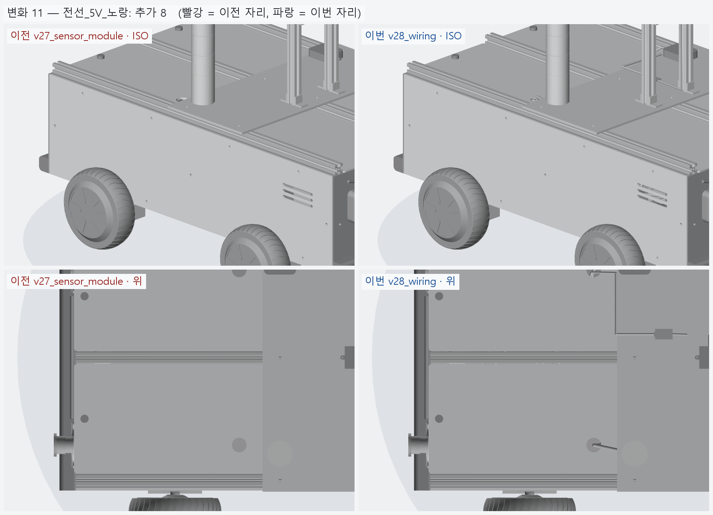

**변화 12 — 케이블_신호_파랑**

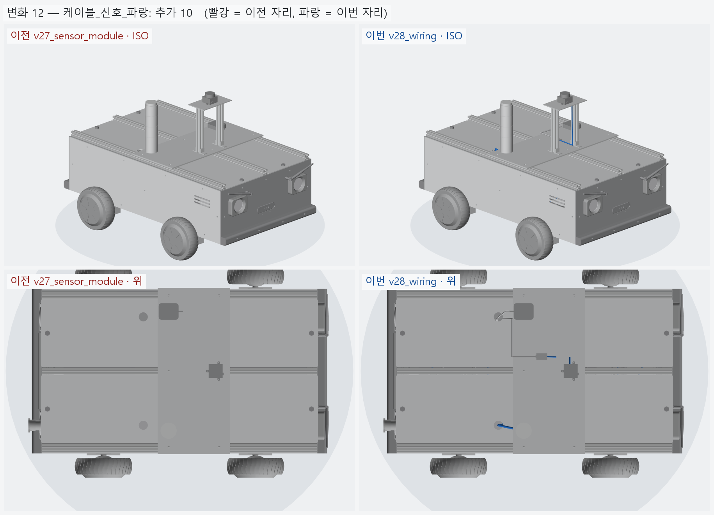

**변화 13 — 케이블_USB_LAN_동축_회색**

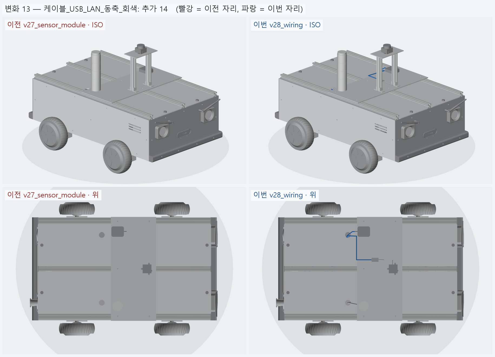

**변화 14 — 케이블_모터_상선_홀_초록**

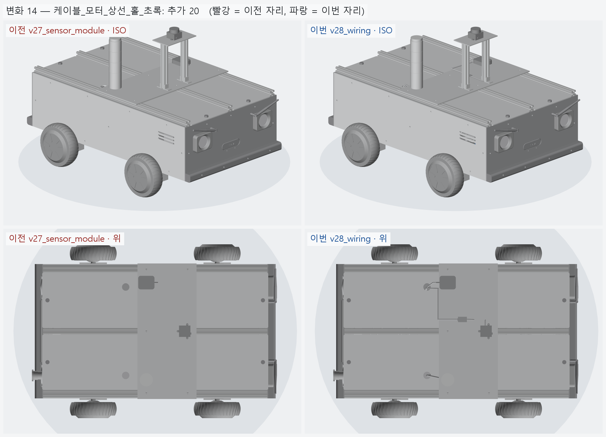

**변화 15 — 하네스간선_헬리컬밴드**

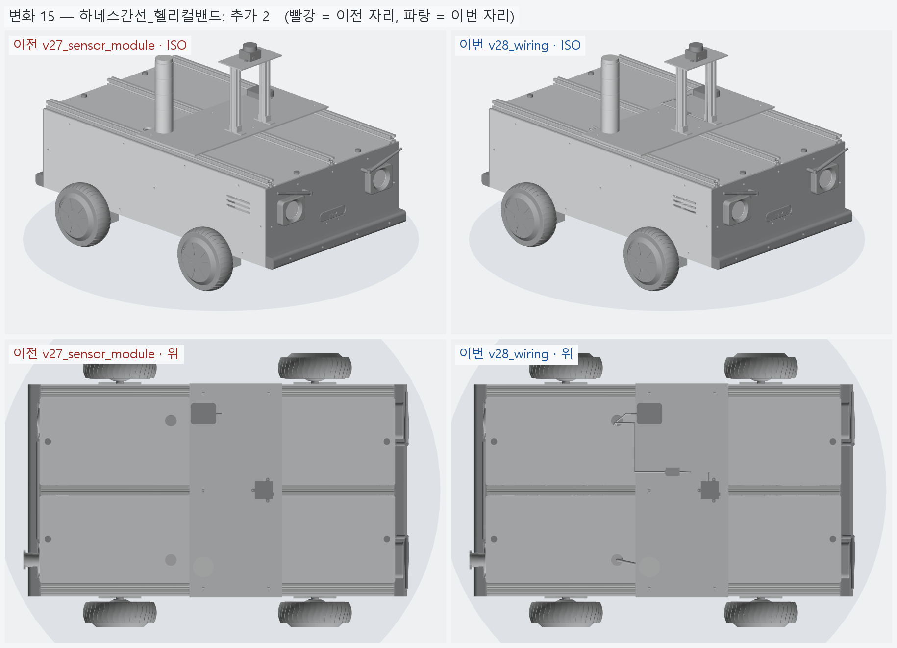

### 수치

| 항목 | 값 |
|---|---|
| 프레임 외곽 (x × y) | 760 × 450 mm |
| 휠베이스 (앞뒤 축 간격) | 420 mm |
| 트레드 (좌우 바퀴 중심 간격) | 527.4 mm |
| 레일 윗면 높이 | 123.8 mm |
| 축크로스 x | ±210 mm |
| 기둥 | 6 본, x=-365 · +0 · +365 × y=±210, 높이 143 (윗면 z=266.9) |
| 3030 절단 | 760 × 4 + 390 × 8 + 143 × 6 |
| 3030 합계 | 실길이 7.02 m / 과금 7.60 m (72,200원) |
| 체결볼트 M6x15 | 16 개 |
| 바닥판 재료 | 폴리카보네이트 (PC) 불투명 흑색 5t — 불투명 (흑색 · 회색) — 충격에 강하고 안이 안 보인다 / 레이저는 그을린다 → CNC 재단 |
| 바닥판 크기 · 무게 | 760 × 450 × 5, 약 1.97 kg |
| 바닥판 구멍 | M6 고정 18 · 케이블 그로밋 Ø25 4 · M5 격자 0 · 기둥 노치 10 (x=-365 · -210 · +0 · +210 · +365, 기둥 6 · 10 본 겸용) |
| 판볼트 | M6x15 + 와셔 (필요 15.0 ~ 최대 15.8) |
| 받침 없는 구간 (크로스 안쪽면 사이) | 125 · 180 · 180 · 125 mm |
| 부품 | 13 개 (실측 치수 모델, 출처 parts.py) |
| 부품 무게 (알려진 것) | 3.44 kg — 무게 미상: 모터드라이버_앞왼_분리형_마스터, 모터드라이버_앞오른_분리형_슬레이브, 모터드라이버_뒤왼_분리형_마스터, 모터드라이버_뒤오른_분리형_슬레이브, ESP32_보드, DCDC_36V-12V_젯슨_RSD-60L, DCDC_36V-5V_DKP-55, MOSFET모듈_전조등_DFR0457, IMU_iAHRS_RB-SDA |
| 부품 무게중심 | x=+24.9 · y=+5.1 · z=164.9 mm (휠베이스 가운데 x=0 기준) |
| 가장 높은 부품 윗면 | z=215.3 — 기둥 윗면 z=266.9 까지 51.5 mm 남음 |
| 배선 가닥 | 90 (전선 · 케이블, 하네스 간선 2: T_L 0.54 m Ø9 · T_R 0.64 m Ø16) |
| 전선 길이 (굵기별, 여유 없이) | AWG10 0.57 m · AWG14 9.00 m · AWG18 2.62 m · AWG22 2.40 m · CAB3 0.43 m · CAB5 0.95 m · COAX 1.23 m · DC2 1.50 m · FAN2 1.14 m · HALL 0.98 m · LAN 0.28 m · LEAD 0.03 m · MOTOR 0.46 m · MS4 0.54 m · PHASE 0.54 m · ST5 0.34 m · USB2 1.69 m · USB3 1.67 m |
| 길이가 정해진 케이블 | 앞 카메라 USB 0.90 m · 안테나 동축 0.72 m · LAN 0.28 m · USB-C 연장 0.17 m |
| 전체 크기 (x × y × z) | 830.1 × 590.2 × 533.9 mm |
| 최저 지상고 (바퀴 제외, 지면 z=0) | 54.9 mm |

### 부품 구성

| 그룹 | 개수 |
|---|---|
| 프레임_3030_18본 | 18 |
| T클램프_혀선반_4개 | 4 |
| 기존_상부클램프_4개 | 4 |
| 휠모터_4개 | 4 |
| 체결볼트_M6x15_16개 | 16 |
| 코너브래킷_3030_8 | 8 |
| 모듈레일_2020_3본 | 3 |
| 센서모듈_밑판_기둥 | 8 |
| 라이다_STL-19P | 1 |
| GNSS_GPS630 | 1 |
| 상태표시등_ST45ML_3단 | 5 |
| 바닥판_폴리카보네이트5t_불투명 | 1 |
| 판볼트_M6x15_18개 | 18 |
| 케이블_경로_참고 | 8 |
| 배터리 | 1 |
| 모터드라이버 | 4 |
| 컴퓨터_젯슨_ESP32 | 2 |
| 전원_차단기_컨택터_DCDC | 5 |
| 센서_IMU | 1 |
| 외관_ACM3t_옆판2 | 2 |
| 외관_UV_PC3t_앞뒤판_불투명 | 2 |
| 외관_ASA_루버_차양_포트칸 | 8 |
| 고무범퍼띠_앞뒤 | 2 |
| 뎁스카메라_Gemini336_2 | 2 |
| 비상정지_Autonics_SF2ER | 1 |
| 비상정지명판_노랑 | 1 |
| 비상정지본체_패널뒤 | 1 |
| 배기팬_2_가드 | 4 |
| 포트칸_부품_7 | 7 |
| 전조등_MR16_2 | 2 |
| 눈썹안테나_와이파이_2 | 4 |
| 상부덮개_ACM3t | 2 |
| 덮개손나사_M5_6 | 6 |
| 배전레일_차단기20A4_퓨즈3 | 8 |
| 음극단자대_N바 | 1 |
| 커넥터_XT90_XT60_WAGO_코일플러그 | 10 |
| USB허브_PL-UH307P | 1 |
| 보조보드_MOSFET4_라이다USB | 5 |
| 전선_36V+_빨강 | 23 |
| 전선_0V_검정 | 21 |
| 전선_12V_주황 | 10 |
| 전선_5V_노랑 | 8 |
| 케이블_신호_파랑 | 10 |
| 케이블_USB_LAN_동축_회색 | 14 |
| 케이블_모터_상선_홀_초록 | 20 |
| 하네스간선_헬리컬밴드 | 2 |

### 검증

```
  간섭 프레임-T클램프: 0.00 mm3
  간섭 프레임-상부클램프: 0.00 mm3
  간섭 프레임-휠모터: 0.00 mm3
  간섭 T클램프-휠모터: 0.00 mm3
  간섭 T클램프-상부클램프: 0.00 mm3
  간섭 볼트-프레임: 0.00 mm3
  간섭 볼트-T클램프: 8.38 mm3 (두께 0.010)
  간섭 볼트-휠모터: 0.00 mm3
  대조군 클램프 +1mm 올림 → 레일 겹침 4006 mm3
  대조군 클램프 +1mm 올림 → 축크로스 겹침 6509 mm3
  대조군 기둥 -1mm 내림 → 레일 겹침 1893 mm3
  대조군 상부 레일 -1mm 내림 → 기둥 겹침 1893 mm3
  간섭 상부 레일-상부 크로스: 0.00 mm3
  간섭 상부 프레임-기둥 · 하부: 0.00 mm3
  기둥 ~ 휠모터 최소 간격 74.0 mm (메시 점 기준)
  간섭 바닥판-프레임 (기둥 포함): 0.00 mm3
  간섭 바닥판-T클램프: 0.00 mm3
  간섭 바닥판-휠모터: 0.00 mm3
  간섭 판볼트-프레임: 0.00 mm3
  간섭 판볼트-바닥판: 0.00 mm3
  간섭 케이블-프레임: 0.00 mm3
  간섭 케이블-T클램프: 0.00 mm3
  간섭 케이블-상부클램프: 0.00 mm3
  간섭 케이블-휠모터: 0.00 mm3
  간섭 케이블-바닥판: 0.00 mm3
  대조군 바닥판 -0.5mm → 프레임 겹침 31909 mm3
  10 본 겸용: 축 자리 가상 기둥 4 본 ~ 바닥판 간섭 0.00 mm3
  대조군 노치 없는 판 ~ 가상 기둥 겹침 7682 mm3
  판볼트 길이: 필요 15.0 ~ 최대 15.8 → M6x15
  간섭 부품끼리: 0.00 mm3
  간섭 부품-프레임 (기둥): 0.00 mm3
  간섭 부품-판볼트 머리: 0.00 mm3
  간섭 부품-바닥판: 0.00 mm3
  간섭 부품-케이블 구멍 위 (반경 15): 0.00 mm3
  대조군 부품 -1mm → 바닥판 겹침 35561 mm3
  부품 고정 구멍 38 — 빔 위 0 · 서로/다른 구멍과 2 mm 안 0
  대조군 x=0 구멍 → 빔 위 판정 True
  간섭 외관판-프레임: 0.00 mm3
  간섭 외관판-T클램프: 0.00 mm3
  간섭 외관판-휠모터: 0.00 mm3
  간섭 외관판-부품: 0.00 mm3
  간섭 외관판-바닥판: 0.00 mm3
  간섭 출력물-프레임: 0.00 mm3
  간섭 출력물-휠모터: 0.00 mm3
  간섭 출력물-T클램프: 0.00 mm3
  간섭 출력물-외관판: 0.00 mm3
  옆판 ~ 타이어 최소 간격 7.1 mm (메시 점 기준)
  벽 위끝 z=296.85 (상부 프레임 윗면 가정 z=296.85)
  부품 윗면 z=215.3 ~ 상부 프레임 밑면 z=266.9: 51.5 mm
  간섭 추가물-프레임: 0.00 mm3
  간섭 추가물-부품: 0.00 mm3
  간섭 추가물-외관판: 0.00 mm3
  간섭 추가물-ASA: 0.00 mm3
  간섭 추가물끼리: 0.00 mm3
  간섭 포트-팬 · 비상정지: 0.00 mm3
  간섭 비상정지-팬: 0.00 mm3
  간섭 명판-팬: 0.00 mm3
  간섭 추가물-휠모터: 0.00 mm3
  대조군 전조등 +0.5 mm 앞으로 → 테두리 겹침 295.6 mm3
  간섭 전조등-카메라: 0.00 mm3
  전조등 윗끝 z=257.0 ~ 상부 프레임 밑면 266.9
  간섭 안테나-전조등 · 카메라: 0.00 mm3
  안테나 윗끝 z=292.8 (판 위끝 296.85) · 옆 끝 |y|=212.8 (판 끝 228.0)
  간섭 앞 카메라 · 브래킷-부품 · 바닥판: 0.00 mm3
  앞 카메라 z=172: 창 위끝 184.8 ~ 전조등 테두리 아래끝 193.0 (8.2), 카메라 · 브래킷 아래끝 ~ 바닥판 18.2, 카메라 아래끝 159.5 ~ 보드 윗면 155.4
  바닥이 보이기 시작하는 거리: 앞 270 mm · 뒤 392 mm
  대조군 덮개 -1mm 내림 → 프레임 겹침 29217 mm3
  간섭 덮개-나머지 전부 (기둥 볼트 머리 포함): 0.00 mm3
  덮개 손나사 윗끝 z=305.9 (덮개 윗면 299.85, 레일 윗면 316.85)
  대조군 모듈 레일 -1mm 내림 -> 프레임 겹침 18120 mm3
  간섭 모듈 레일-나머지 전부 (덮개 포함): 0.00 mm3
  간섭 코너 브래킷-나머지 전부: 0.00 mm3
  대조군 브래킷 +0.5mm 올림 -> 상부 레일 겹침 2211 mm3
  대조군 센서 모듈 밑판 -1mm 내림 -> 레일 겹침 8022 mm3
  간섭 센서 모듈-나머지 전부 (배선은 verify_wiring 에서): 0.00 mm3
  라이다 스캔 평면 z=526.1 — 그 밖의 가장 높은 것 z=509.8 (표시등 꼭대기 509.8), 여유 16.3
  간섭 포트 부품끼리 (7 개): 0.00 mm3
  포트 칸 z 162.0~222.0 — 뒤 드라이버 윗면 155.4, 상부 프레임 밑면 266.9
  명판 Ø60 ~ 팬 구멍 Ø76 간격 2.0 mm
  비상정지 윗끝 z=261.99 ~ 상부 프레임 밑면 266.85: 4.86 mm
  카메라 윗면 z=262.50 ~ 상부 프레임 밑면 266.85: 4.35 mm
  카메라 렌즈면 = 판 바깥면 x=±383.0
  간섭 카메라브래킷-포트칸: 0.00 mm3
  판 M3 볼트 머리 아래끝 z=228.25 ~ 포트 칸 바깥 테두리 윗끝 227.00: 1.25 mm
  브래킷 플랜지 아래끝 z=225.00 ~ 포트 칸 윗면 222.00
  배선 간섭 (전선 106 가지 · 간선 2 · 새 부품 25): 0 건
  전선끼리 겹침 (양 끝 20 mm 뺌): 0 건
  끝점이 단자 부품에 닿음: 180 / 180
  대조군 RSD 입력선 -30 mm → [('하부크로스3', 16.6), ('바닥판', 90.8)]
verify: OK
```

### 기록 소요

불러오기 0.1s · 짓기 30.3s · 메시 (231 형상 → 289 부품) 29.4s · 전체 모습 이미지 5 장 4.2s · 변화 이미지 15 장 34.9s

<!-- record:end -->
