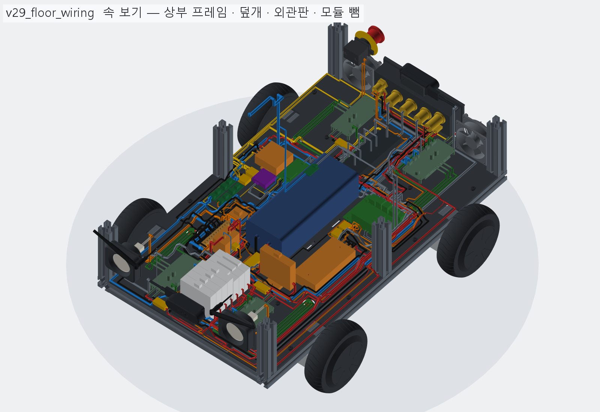
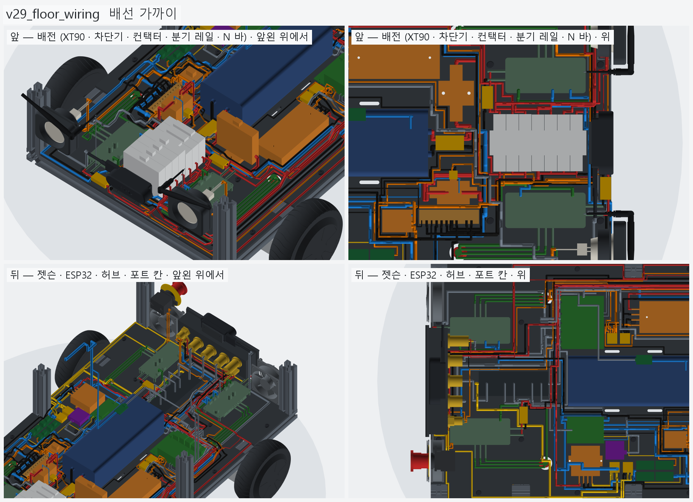
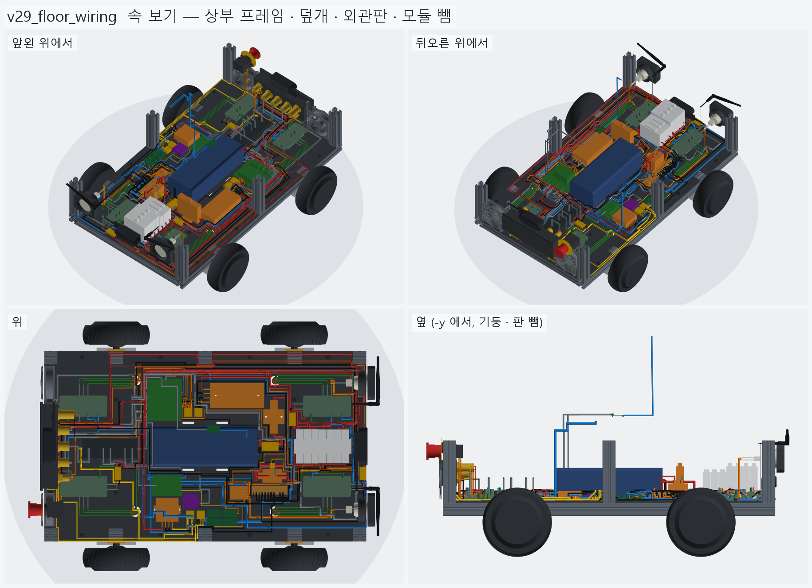
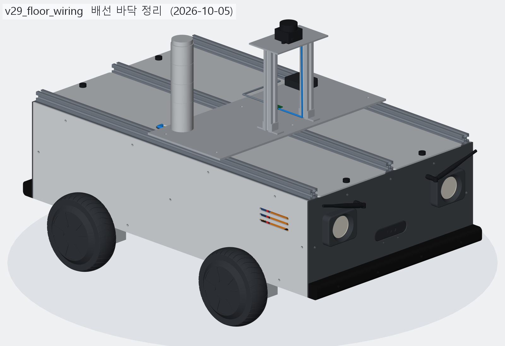

# v29_floor_wiring — 배선 바닥 정리 (진행 중)

- 날짜: 2026-10-05 ~ 2026-10-12
- 이전 버전: [v28_wiring](../v28_wiring/README.md)
- **상태: 진행 중 — 검증 통과 전.** 자동 기록 블록 (변화 이미지 · 수치 표) 은 아직 없다. 아래는 손으로 적은 현재 상태.

## 무엇을 왜 바꿨나

사용자 (2026-10-05): "최대한 바닥판에 잘 정리해봐 — 선 길이는 얼마든지 늘려도 되니 ㄱ · ㄴ 자로 휘어도 깔끔하게만".
v28 (D-20) 의 연결 90 가닥은 그대로 두고, 공중 · 배터리 위 · 대각선으로 지나던 선을 **바닥판 위 직각 경로**로 다시 깔았다.
이유 · 버린 대안은 [`../DECISIONS.md`](../DECISIONS.md) **D-21**.



- **경로 찾기 (`router.py`)** — 바닥 위 부품 단면을 2 mm 격자로 칠하고, 끝점마다 단자에서 짧게 빠져 (escape) 수직으로 바닥까지
  내려갈 자리를 먼저 잡은 뒤 (1 단계), 바닥에서 A* 로 x · y 방향만 간다 (2 단계).
  꺾임 벌점 · 다른 선이나 부품 옆에 붙어 가기 (다발) · 다른 선은 직각으로만 넘어가기 (그 자리는 들어 올림) · 나란히 얹기 (막히면 세 겹까지).
  결과는 `routes_data.py` 에 굳혀 두고 짓기는 그것만 읽는다.
  ```bash
  .venv/Scripts/python.exe models/vehicle/v29_floor_wiring/router.py --cache <폴더> --plot
  ```
- **결과**: 79 가닥 (고정 리드 · 점퍼 · 모터 케이블 뿌리 빼고) 전부 바닥 경로를 찾았다 — 5 가닥은 막혀서 세 겹으로 얹힘.
  대조군: 바닥 선을 1 mm 내리면 바닥판과 겹친다 (= 정말 바닥에 누워 있다).
- **바닥 배선에 맞춰 옮긴 부품**
  - XT90 을 바닥에 눕힘 (배터리 리드 토막 5 mm + 리드 선으로 XT90 까지) — `parts.py` 배터리 `lead_len` 40 → 5.
  - 분기 레일 90° 돌림 (DIN 레일 x 방향, 차단기 · 퓨즈 홀더가 y 로 서서 출력이 옆 보드 쪽).
  - 음극 N 바를 컨택터 남쪽으로 (x 방향).
  - XT60 4 개 모두 보드 리드 끝에서 90° 꺾어 y 방향으로 매닮.
  - 12 V WAGO 두 개를 나란히, 입구를 북쪽 (RSD 단자 쪽) 으로. 5 V WAGO 입구는 홀수 번째를 한 번 넘어가게.
  - 표시등 MOSFET 4 개를 남쪽으로 (ESP32 앞이 막힌 주머니였다), USB 허브 y −27 → −5.
  - ESP32 단자 간격을 6~8 mm 로, 빠져나오는 길이 8 mm.

## 남은 일 (검증 실패 항목)

- **판에 닿음 2**: 오른쪽 팬 선 ↔ 오른쪽 옆판, ESP32 → 앞왼 마스터 선 ↔ 앞판.
- **전선끼리 겹침 69**: 격자 (2 mm) 어림 경로를 실제 굵기로 재면 붙는 곳 — 넘어가는 높이 · 나란한 간격 계산을 실제 지름으로 다시.
- 겹침 0 이 되면 `record.py v29_floor_wiring` 으로 자동 기록 (변화 이미지 · BOM) 을 다시 만든다.
- 뷰어 전송은 무겁다 (배선 토막 수천 개) — `inside.py --noimg --show [--full]` 은 꺾임 구 · 테두리를 빼고 보낸다.






